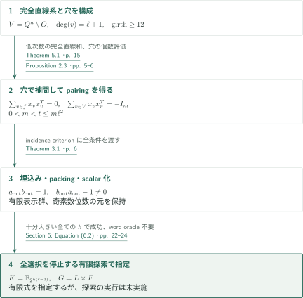
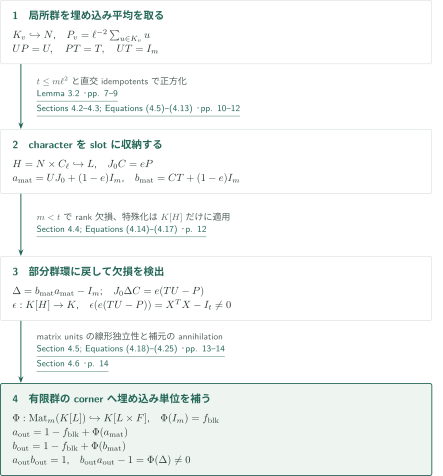
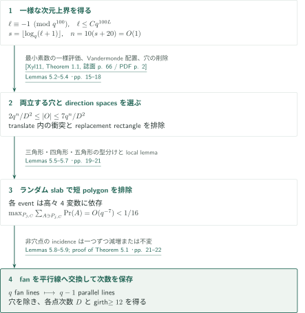
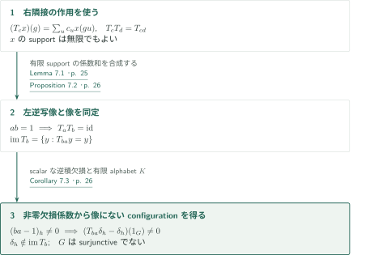

# A Counterexample to Kaplansky’s Direct-Finiteness Conjecture in Characteristic Two

**穴をあけた有限affine空間のpairingを、character packingと有限群のmatrix unitsでscalar反例へ移す。**

本原稿の核心は、片側逆元と逆積の非零欠損を異なる段階で保証することにある。直線ごとの零和は前向きの積を恒等行列にし、埋め込まれた部分群環上の特殊化は逆積の欠損を検出する。その後に有限群因子を追加して初めて群環の二つのscalar元を得る。

## 1. 主要結果

### Theorem 1.1 — 有限標数2体上のscalar反例

標数2の有限体 $K$、奇素数位数の元を含む有限表示群 $G$、および $a_{\mathrm{out}},b_{\mathrm{out}}\in K[G]$ が存在して
$$a_{\mathrm{out}}b_{\mathrm{out}}=1,\qquad b_{\mathrm{out}}a_{\mathrm{out}}\ne1$$
を満たす。体・群・二つの有限和は、有限集合と有限体演算を用いる停止する処方によって指定される。$K=\mathbb F_2$ とは主張せず、$G$ は捩れなしではなく奇素数位数の捩れを実際に含む。

<!-- cite:main -->[Theorem 1.1 · p. 1](https://github.com/openai/math/blob/1581d4cbdd69a0faf34b2089614fe2a814316a6a/preprints/A-Counterexample-to-Kaplanskys-Direct-Finiteness-Conjecture-in-Characteristic-Two-September-23-2026/paper.pdf)<!-- /cite -->

処方の停止は証明されるが、原稿はこの探索を実行していない。積の恒等式と欠損の非零性は代数的に証明され、群のword problemを解く手続きを必要としない。Elek–Szabóの定理の対偶により、この $G$ は非soficでもある。非sofic性だけから群環反例を導く逆向きの含意は使わない。

<!-- cite:recipe -->[Section 6; Equation (6.2) · pp. 22–24](https://github.com/openai/math/blob/1581d4cbdd69a0faf34b2089614fe2a814316a6a/preprints/A-Counterexample-to-Kaplanskys-Direct-Finiteness-Conjecture-in-Characteristic-Two-September-23-2026/paper.pdf)<!-- /cite -->
<!-- cite:sofic -->[&#91;ES04, Corollary 4.7, p. 8&#93;](https://arxiv.org/pdf/math/0305440v2#page=8)<!-- /cite -->

### Corollary 7.3 — 単射だが全射でないcellular automaton

Theorem 1.1の同じ $K,G,a_{\mathrm{out}},b_{\mathrm{out}}$ に対し、有限supportの $c=\sum_uc_uu$ から
$$(T_cx)(g)=\sum_uc_ux(gu)\qquad(x\in K^G)$$
を定める。$T_{b_{\mathrm{out}}}:K^G\to K^G$ は単射だが全射でなく、その像は $T_{b_{\mathrm{out}}a_{\mathrm{out}}}$ の固定点集合である。従って $G$ はsurjunctiveでない。configurationは有限supportに制限しない。

<!-- cite:ca -->[Corollary 7.3 · p. 26](https://github.com/openai/math/blob/1581d4cbdd69a0faf34b2089614fe2a814316a6a/preprints/A-Counterexample-to-Kaplanskys-Direct-Finiteness-Conjecture-in-Characteristic-Two-September-23-2026/paper.pdf)<!-- /cite -->

## 図の矢印に付した引用

<!-- reference-guide -->
略号のない定理・補題・節・式番号は本原稿 [A Counterexample to Kaplansky’s Direct-Finiteness Conjecture in Characteristic Two](https://github.com/openai/math/blob/1581d4cbdd69a0faf34b2089614fe2a814316a6a/preprints/A-Counterexample-to-Kaplanskys-Direct-Finiteness-Conjecture-in-Characteristic-Two-September-23-2026/paper.pdf) を指します。外部入力には次の略号を使います。

- [Xyl11](https://www.impan.pl/shop/en/publication/transaction/download/product/83078) Triantafyllos Xylouris — *On the least prime in an arithmetic progression and estimates for the zeros of Dirichlet L-functions*：§5の一様な最小素数評価と§6の素数探索の停止。Acta Arithmetica 150(1), 65–91 (2011), publisher PDF。
- [ES04](https://arxiv.org/pdf/math/0305440v2) Gábor Elek and Endre Szabó — *Sofic groups and direct finiteness*：主定理から非sofic性を得る帰結。arXiv:math/0305440v2; PDF header 19 April 2004。

各引用に結果番号とページを付します。誌面番号とPDF内の位置が異なる場合は両方を示します。GitHubの閲覧リンクではページ位置への自動移動を前提としません。
<!-- /reference-guide -->

## 2. Theorem 1.1 — 主定理の証明概略

<!-- proof-target:1 -->証明対象：[Theorem 1.1 · p. 1](https://github.com/openai/math/blob/1581d4cbdd69a0faf34b2089614fe2a814316a6a/preprints/A-Counterexample-to-Kaplanskys-Direct-Finiteness-Conjecture-in-Characteristic-Two-September-23-2026/paper.pdf)<!-- /proof-target -->

**証明の道筋。** 穴 $O$ を除いたaffine空間 $V$ に、各点次数 $D=\ell+1$、incidence girth $\ge12$ の完全直線系を作る。穴の指示関数を低次数多項式で補間して行列pairingを得る。Theorem 3.1がその有限データをscalar反例へ変換し、§6は存在証明を停止する有限探索へ置き換える。

### 1. 幾何・代数・サイズを別々に供給する

$Q=\{a_0,\ldots,a_{q-1}\}$ は位数 $q=2^h$ の体とし、$S_d=\{(a_{k_1},\ldots,a_{k_n}):k_i\ge0,\ \sum_i k_i\le d\}$ をindex simplexとする。$A=Q^n$、$O\subset S_{(q-2)/2}$、$m=|O|$ とする。各穴 $o$ の指示値を補間する多項式 $f_o$ を選び、$x_v=(f_o(v))_{o\in O}$ とする。$x_vx_v^T$ の各成分は次数 $\le q-2$ の多項式なので完全直線上でも $A$ 全体でも和が零になる。穴での値が標準基底だから、$V=A\setminus O$ に制限すると
$$\sum_{v\in f}x_vx_v^T=0,\qquad\sum_{v\in V}x_vx_v^T=-I_m$$
が得られる。穴の個数の上下限は $0<m<t=|V|\le m\ell^2$ を保証する。incidence girthは局所部分群を埋め込むため、上限はcharacter packingのため、狭義不等式 $m<t$ は逆積の欠損検出のために使う。

<!-- cite:pairing -->[Proposition 2.3 · pp. 5–6](https://github.com/openai/math/blob/1581d4cbdd69a0faf34b2089614fe2a814316a6a/preprints/A-Counterexample-to-Kaplanskys-Direct-Finiteness-Conjecture-in-Characteristic-Two-September-23-2026/paper.pdf)<!-- /cite -->
<!-- cite:criterion -->[Theorem 3.1 · p. 6](https://github.com/openai/math/blob/1581d4cbdd69a0faf34b2089614fe2a814316a6a/preprints/A-Counterexample-to-Kaplanskys-Direct-Finiteness-Conjecture-in-Characteristic-Two-September-23-2026/paper.pdf)<!-- /cite -->

### 2. 存在から停止する処方へ

$h=2,3,\ldots$ と順に、$\ell\equiv-1\pmod{q^{100}}$ の最小素数、所定次数の最初の既約多項式による有限体 $K=\mathbb F_{2^{h(\ell-1)}}$、その部分体 $Q$ と最初の原始 $\ell$ 乗根を選ぶ。各 $h$ で有限個の $(O,\mathcal F)$ を列挙し、個数・完全直線・正則性・girthを判定する。Theorem 5.1は十分大きいすべての $h$ と任意の体の列挙に対する成功を保証するため、外側の探索も止まる。

その後は有限体線形代数、有限の局所乗法表、指定されたconjugation relations、有限群のmatrix unitsによって群と二つの有限式が定まる。異なる表示語が同じ群元かどうかを判定して有限式を正規化する必要はない。この処方は実行可能性を理論的に主張するもので、実用的な計算量や実行済みの出力を与えるものではない。

<!-- cite:recipe -->[Section 6; Equation (6.2) · pp. 22–24](https://github.com/openai/math/blob/1581d4cbdd69a0faf34b2089614fe2a814316a6a/preprints/A-Counterexample-to-Kaplanskys-Direct-Finiteness-Conjecture-in-Characteristic-Two-September-23-2026/paper.pdf)<!-- /cite -->
<!-- cite:linnik -->[&#91;Xyl11, Theorem 1.1, 誌面 p. 66 / PDF p. 2&#93;](https://www.impan.pl/shop/en/publication/transaction/download/product/83078)<!-- /cite -->

## 3. Theorem 3.1 の証明 — 矩形恒等式、逆積欠損、scalar化

<!-- proof-target:2 -->証明対象：[Theorem 3.1 · p. 6](https://github.com/openai/math/blob/1581d4cbdd69a0faf34b2089614fe2a814316a6a/preprints/A-Counterexample-to-Kaplanskys-Direct-Finiteness-Conjecture-in-Characteristic-Two-September-23-2026/paper.pdf)<!-- /proof-target -->

<!-- statement:theorem-3-1 -->
### Theorem 3.1 — Incidence criterion

$\ell$ を奇素数、$K$ を原始 $\ell$ 乗根 $\zeta$ を含む標数2の有限体、$\kappa=\ell^2$ とする。$|V|=t$ と有限な非空部分集合族 $\mathcal F$ は、各 $v\in V$ がちょうど $\ell+1$ 個のmemberに属し、二部incidence graphのgirthが $12$ 以上であるとする。整数 $m$ と列ベクトル $x_v\in K^m$ が
$$0<m<t\le m\kappa,\qquad\sum_{v\in V}x_vx_v^T=-I_m,\qquad\sum_{v\in f}x_vx_v^T=0\quad(f\in\mathcal F)$$
を満たせば、位数 $\ell$ の元を含む有限表示群 $G$ と有限和 $a_{\mathrm{out}},b_{\mathrm{out}}\in K[G]$ が以下の構成で得られ、$a_{\mathrm{out}}b_{\mathrm{out}}=1$ かつ $b_{\mathrm{out}}a_{\mathrm{out}}\ne1$ となる。

<!-- cite:criterion -->[Theorem 3.1 · p. 6](https://github.com/openai/math/blob/1581d4cbdd69a0faf34b2089614fe2a814316a6a/preprints/A-Counterexample-to-Kaplanskys-Direct-Finiteness-Conjecture-in-Characteristic-Two-September-23-2026/paper.pdf)<!-- /cite -->
<!-- /statement -->

### 1. 局所群の埋込みが平均と矩形恒等式を正当化する

各点に $K_v^0=(\mathbb F_\ell^2,+)$、各memberに $L_f^0=(\mathbb F_\ell,+)$ を置き、incidentな $L_f^0$ を $K_v^0$ の異なる1次元部分空間へ貼り合わせて $N$ を作る。Lemma 3.2は局所群が潰れないことを、例外頂点が一つある平面weighted graphへ帰着して証明する。最小化後はblack degree $\ge3$、ordinary white degree $\ge2$、高々一面を除くface length $\ge12$ であり、Eulerの式と矛盾する。これは単にpresentationを与えるだけでは得られない埋込み保証である。

埋め込まれた $K_v$ の平均 $P_v=\kappa^{-1}\sum_{u\in K_v}u$ と $P=\operatorname{diag}(P_v)$ を使い、$U_{-,v}=-\kappa x_vP_v$, $T_{v,-}=P_vx_v^T$ を定める。$\ell$ が奇数なので分母は可逆である。incidentな1次元部分群による $K_v\setminus\{1\}$ の分割と二つのpairingは
$$UP=U,\qquad PT=T,\qquad UT=I_m$$
を与える。ただし $U,T$ はまだ矩形であり、直接有限性の反例ではない。

<!-- cite:embedding -->[Lemma 3.2 · pp. 7–9](https://github.com/openai/math/blob/1581d4cbdd69a0faf34b2089614fe2a814316a6a/preprints/A-Counterexample-to-Kaplanskys-Direct-Finiteness-Conjecture-in-Characteristic-Two-September-23-2026/paper.pdf)<!-- /cite -->
<!-- cite:rectangular -->[Section 4.1; Equation (4.4) · p. 10](https://github.com/openai/math/blob/1581d4cbdd69a0faf34b2089614fe2a814316a6a/preprints/A-Counterexample-to-Kaplanskys-Direct-Finiteness-Conjecture-in-Characteristic-Two-September-23-2026/paper.pdf)<!-- /cite -->

### 2. Character packing後も部分群環へ戻して欠損を検出する

$H=N\times\langle z\rangle$、$|z|=\ell$ とし、局所群の座標同型とcharacter twistを実現するstable lettersを加えて $L$ を作る。原稿は $H$ の正則置換作用を延長して $H\hookrightarrow L$ を直接証明する。中央idempotent $e=\ell^{-1}\sum_r\zeta^{-r}z^r$ と直交character idempotentsにより、$t\le m\kappa$ 個の座標を $m$ 個のslotへ収納し、$J_0C=eP$ を得る。そこで
$$a_{\mathrm{mat}}=UJ_0+(1-e)I_m,\qquad b_{\mathrm{mat}}=CT+(1-e)I_m$$
は $a_{\mathrm{mat}}b_{\mathrm{mat}}=I_m$ を満たす。

逆積欠損 $\Delta=b_{\mathrm{mat}}a_{\mathrm{mat}}-I_m$ は
$$J_0\Delta C=e(TU-P)\in\operatorname{Mat}_t(K[H])$$
で検出する。$\epsilon:K[H]\to K$, $nz^r\mapsto\zeta^r$ を適用すると、$X=(x_v)$ に対して $X^TX-I_t$ となる。$m<t$ により $\ker X\ne0$ だからこの行列は非零である。$K[H]\hookrightarrow K[L]$ が非零性を保つ。特殊化 $\epsilon$ を $K[L]$ 全体へ延長できるとは主張していない。

<!-- cite:packing -->[Sections 4.2–4.3; Equations (4.5)–(4.13) · pp. 10–12](https://github.com/openai/math/blob/1581d4cbdd69a0faf34b2089614fe2a814316a6a/preprints/A-Counterexample-to-Kaplanskys-Direct-Finiteness-Conjecture-in-Characteristic-Two-September-23-2026/paper.pdf)<!-- /cite -->
<!-- cite:defect -->[Section 4.4; Equations (4.14)–(4.17) · p. 12](https://github.com/openai/math/blob/1581d4cbdd69a0faf34b2089614fe2a814316a6a/preprints/A-Counterexample-to-Kaplanskys-Direct-Finiteness-Conjecture-in-Characteristic-Two-September-23-2026/paper.pdf)<!-- /cite -->

### 3. 有限群因子のmatrix unitsで単位元を補完する

$F=(\mathbb Z/\ell)^m\rtimes S_m$ のcharacter idempotentsから $p_{ij}$ を作り、$p_{ij}p_{kr}=\delta_{jk}p_{ir}$ と線形独立性を確認する。$G=L\times F$ に対して
$$\Phi:\operatorname{Mat}_m(K[L])\hookrightarrow K[G],\qquad \Phi(Z)=\sum_{i,j}Z_{ij}p_{ij}$$
は単射な環準同型だが、$\Phi(I_m)=f_{\mathrm{blk}}$ はcornerの単位元である。そこで
$$a_{\mathrm{out}}=1-f_{\mathrm{blk}}+\Phi(a_{\mathrm{mat}}),\qquad b_{\mathrm{out}}=1-f_{\mathrm{blk}}+\Phi(b_{\mathrm{mat}})$$
とする。補元はimageを両側でannihilateするため、前向き積は $1$、逆積欠損は $\Phi(\Delta)\ne0$ となる。$|S_m|$ は逆数にしておらず、逆数にする $|(\mathbb Z/\ell)^m|$ だけが奇数である。

局所零和の長さ高々3のrelatorsが $N$ の有限表示を与え、有限個のstable letters・relationsと有限群 $F$ によって $G$ も有限表示となる。埋込み鎖 $K_v\le N\le H\le L\le G$ は位数 $\ell$ の元を保持する。有限supportが与える有限生成性だけから有限表示性を結論しているわけではない。

<!-- cite:scalar -->[Section 4.5; Equations (4.18)–(4.25) · pp. 13–14](https://github.com/openai/math/blob/1581d4cbdd69a0faf34b2089614fe2a814316a6a/preprints/A-Counterexample-to-Kaplanskys-Direct-Finiteness-Conjecture-in-Characteristic-Two-September-23-2026/paper.pdf)<!-- /cite -->
<!-- cite:finite -->[Section 4.6 · p. 14](https://github.com/openai/math/blob/1581d4cbdd69a0faf34b2089614fe2a814316a6a/preprints/A-Counterexample-to-Kaplanskys-Direct-Finiteness-Conjecture-in-Characteristic-Two-September-23-2026/paper.pdf)<!-- /cite -->

## 4. Theorem 5.1 の証明 — 穴の周囲のtradeで正則性を保つ

<!-- proof-target:3 -->証明対象：[Theorem 5.1 · p. 15](https://github.com/openai/math/blob/1581d4cbdd69a0faf34b2089614fe2a814316a6a/preprints/A-Counterexample-to-Kaplanskys-Direct-Finiteness-Conjecture-in-Characteristic-Two-September-23-2026/paper.pdf)<!-- /proof-target -->

<!-- statement:theorem-5-1 -->
### Theorem 5.1 — 正則で大きなincidence girthをもつ完全直線系

$q=2^h$、$\ell$ は $-1\pmod{q^{100}}$ の最小素数とし、$D=\ell+1$, $s=\lfloor\log_qD\rfloor$, $b=s+20$, $n=10b$, $N_{\mathrm{pt}}=q^n$ とする。任意に列挙した位数 $q$ の体 $Q$ に対し $A=Q^n$, $S=S_{(q-2)/2}$ と置く。

十分大きいすべての $h$ とすべてのこのような $Q$・列挙について、$O\subset S$ と $V=A\setminus O$ に含まれる完全affine $Q$-lineの集合 $\mathcal F$ が存在し、
$$\frac{2N_{\mathrm{pt}}}{D^2}\le|O|\le\frac{7N_{\mathrm{pt}}}{D^2},$$
各 $V$ の点がちょうど $D$ 本の直線に属し、incidence graphのgirthは $12$ 以上となる。

<!-- cite:geometry -->[Theorem 5.1 · p. 15](https://github.com/openai/math/blob/1581d4cbdd69a0faf34b2089614fe2a814316a6a/preprints/A-Counterexample-to-Kaplanskys-Direct-Finiteness-Conjecture-in-Characteristic-Two-September-23-2026/paper.pdf)<!-- /cite -->
<!-- /statement -->

### 1. 一様なパラメータと両立する穴を選ぶ

Xylourisの定理を互いに素な剰余 $q^{100}-1$ と法 $q^{100}$ に適用し、$\ell\le Cq^{100L}$ を得る。ここで $C>0,L$ は絶対定数で、Xylourisの記述では $L=5.18$ とできる。このため $s$、従って $n$ は $h$ によらない上限をもち、$h\to\infty$ の見積りを一様に使える。$D$ を $q$ 個ずつのdirection bundleへ分け、任意の高々10個がdirect sumになる $W_r,E_j$ をVandermonde配置で選ぶ。

穴は小確率で選んで衝突を削除する。各 $W_r$ のtranslateに穴が高々一つ、各関連cosetで穴密度が有界、replacement linesだけで作る例外rectangleの4つの証人が同時に穴にならない、という三つの条件を得る。これらは後で直線を交換するときの整合性とevent countにそれぞれ必要になる。

<!-- cite:linnik -->[&#91;Xyl11, Theorem 1.1, 誌面 p. 66 / PDF p. 2&#93;](https://www.impan.pl/shop/en/publication/transaction/download/product/83078)<!-- /cite -->
<!-- cite:holes -->[Lemmas 5.2–5.4 · pp. 15–18](https://github.com/openai/math/blob/1581d4cbdd69a0faf34b2089614fe2a814316a6a/preprints/A-Counterexample-to-Kaplanskys-Direct-Finiteness-Conjecture-in-Characteristic-Two-September-23-2026/paper.pdf)<!-- /cite -->

### 2. Slabの短polygonを排除し、完全直線を交換する

各 $U_j=d_j\oplus E_j$ のcosetで独立な2次元部分空間 $P_{j,C}\subset E_j$ を選び、3次元slabに分ける。三角形・四角形・五角形のcandidateを、direction spacesのdirectnessで少数の型へ絞る。各bad eventは高々4変数に依存し、1変数あたりの確率の総和は $O(q^{-7})$。原稿内で証明するweighted local lemmaにより、slab内の穴の衝突と短polygonを同時に排除する。

各slabを完全直線でpartitionしてから、穴 $o$ とbundle $r$ ごとに $o$ を通る $q$ 本のfanを除き、$o+W_r$ 内の $q-1$ 本の平行線へ置き換える。穴以外の点は一つのincidenceを失うと同時に一つ得るか、どちらも変化しない。穴はすべてのincidenceを失う。従って $V$ 上の次数は正確に $D$ のままである。短いincidence cycleは排除済みのgeneric polygonか、穴の選択で禁止したreplacement rectangleに帰着する。

<!-- cite:slabs -->[Lemmas 5.5–5.7 · pp. 19–21](https://github.com/openai/math/blob/1581d4cbdd69a0faf34b2089614fe2a814316a6a/preprints/A-Counterexample-to-Kaplanskys-Direct-Finiteness-Conjecture-in-Characteristic-Two-September-23-2026/paper.pdf)<!-- /cite -->
<!-- cite:trade -->[Lemmas 5.8–5.9; proof of Theorem 5.1 · pp. 21–22](https://github.com/openai/math/blob/1581d4cbdd69a0faf34b2089614fe2a814316a6a/preprints/A-Counterexample-to-Kaplanskys-Direct-Finiteness-Conjecture-in-Characteristic-Two-September-23-2026/paper.pdf)<!-- /cite -->

## 5. Corollary 7.3 の証明 — 右隣接作用と像の局所方程式

<!-- proof-target:4 -->証明対象：[Corollary 7.3 · p. 26](https://github.com/openai/math/blob/1581d4cbdd69a0faf34b2089614fe2a814316a6a/preprints/A-Counterexample-to-Kaplanskys-Direct-Finiteness-Conjecture-in-Characteristic-Two-September-23-2026/paper.pdf)<!-- /proof-target -->

**証明の道筋。** 上の主要結果で定義した $T_c$ は右隣接の規約で $T_cT_d=T_{cd}$ を満たす。左逆写像で単射性を得て、逆積をprojectionとして像を同定する。

### 1. 左逆写像は全configurationに作用する

係数のsupportは有限なので、$x\in K^G$ 自身のsupportが無限でも積の二重和は有限であり、$T_c(T_dx)(g)=\sum_{u,v}c_ud_vx(guv)=T_{cd}x(g)$。積の順序は $dc$ ではない。$a=a_{\mathrm{out}}$, $b=b_{\mathrm{out}}$ とすると $T_aT_b=T_{ab}=\mathrm{id}$ で、$T_b$ は単射となる。$K$ の有限性が有限alphabet、$b$ の有限supportが有限memoryを供給する。

<!-- cite:action -->[Lemma 7.1 · p. 25](https://github.com/openai/math/blob/1581d4cbdd69a0faf34b2089614fe2a814316a6a/preprints/A-Counterexample-to-Kaplanskys-Direct-Finiteness-Conjecture-in-Characteristic-Two-September-23-2026/paper.pdf)<!-- /cite -->

### 2. 逆積欠損の係数が欠ける点指示関数を選ぶ

$y=T_bx$ なら $T_{ba}y=y$。逆にこの等式を満たせば $y=T_b(T_ay)$ なので
$$\operatorname{im}T_b=\{y:T_{ba}y=y\}.$$
$(ba-1)_h\ne0$ となる係数をとると、点指示関数 $\delta_h$ は
$$(T_{ba}\delta_h-\delta_h)(1_G)=(ba-1)_h\ne0$$
を満たし、像に入らない。この像は有限local equations $\sum_u(ba-1)_uy(gu)=0$ でも記述できる。従って非全射性と非surjunctivityが同時に得られる。特定の非零係数を探索で実際に計算したという主張は含まない。

<!-- cite:image -->[Proposition 7.2 · p. 26](https://github.com/openai/math/blob/1581d4cbdd69a0faf34b2089614fe2a814316a6a/preprints/A-Counterexample-to-Kaplanskys-Direct-Finiteness-Conjecture-in-Characteristic-Two-September-23-2026/paper.pdf)<!-- /cite -->
<!-- cite:ca -->[Corollary 7.3 · p. 26](https://github.com/openai/math/blob/1581d4cbdd69a0faf34b2089614fe2a814316a6a/preprints/A-Counterexample-to-Kaplanskys-Direct-Finiteness-Conjecture-in-Characteristic-Two-September-23-2026/paper.pdf)<!-- /cite -->

## 6. 直接入力とカタログ内での役割

| 入力・接続 | 利用箇所 | 確認範囲 |
|---|---|---|
| Xyl11、Theorem 1.1 | §5の $s$ の一様上界、§6の素数探索 | 互いに素な法・剰余、効果的定数付きstatement、適用を照合。外部証明未検証。 |
| ES04、Corollary 4.7 | Introductionの非sofic性 | 任意division ring上のsofic群環のstable finitenessと、その対偶を照合。構成への入力ではなく帰結。 |
| 本稿Theorem 1.1 → determinant反例原稿 | 群環determinant反例の標数2入力 | 本稿側のscalar結論を確認。利用先の接続は当該記事とカタログの接続記録で扱う。 |

HNN型の埋込み、有限群によるmatrix-to-scalar移送、補間、local lemmaは原稿内で証明される。紹介される既存文献やcoding論文への引用を、未照合の直接依存として追加していない。

## 7. 原典を読む入口と確認範囲

<!-- reading-list -->
- [Proposition 2.3 · pp. 5–6](https://github.com/openai/math/blob/1581d4cbdd69a0faf34b2089614fe2a814316a6a/preprints/A-Counterexample-to-Kaplanskys-Direct-Finiteness-Conjecture-in-Characteristic-Two-September-23-2026/paper.pdf) — 穴の補間から二つのpairingを得る。
- [Theorem 3.1 · p. 6](https://github.com/openai/math/blob/1581d4cbdd69a0faf34b2089614fe2a814316a6a/preprints/A-Counterexample-to-Kaplanskys-Direct-Finiteness-Conjecture-in-Characteristic-Two-September-23-2026/paper.pdf) — incidence条件とサイズ不等式の役割。
- [Section 4.4; Equations (4.14)–(4.17) · p. 12](https://github.com/openai/math/blob/1581d4cbdd69a0faf34b2089614fe2a814316a6a/preprints/A-Counterexample-to-Kaplanskys-Direct-Finiteness-Conjecture-in-Characteristic-Two-September-23-2026/paper.pdf) — 部分群環に戻して逆積欠損を検出する。
- [Section 4.5; Equations (4.18)–(4.25) · pp. 13–14](https://github.com/openai/math/blob/1581d4cbdd69a0faf34b2089614fe2a814316a6a/preprints/A-Counterexample-to-Kaplanskys-Direct-Finiteness-Conjecture-in-Characteristic-Two-September-23-2026/paper.pdf) — matrix unitsと補助単位元でscalar化する。
- [Theorem 5.1 · p. 15](https://github.com/openai/math/blob/1581d4cbdd69a0faf34b2089614fe2a814316a6a/preprints/A-Counterexample-to-Kaplanskys-Direct-Finiteness-Conjecture-in-Characteristic-Two-September-23-2026/paper.pdf) — 正則性を保つtradeとgirth排除。
- [Section 6; Equation (6.2) · pp. 22–24](https://github.com/openai/math/blob/1581d4cbdd69a0faf34b2089614fe2a814316a6a/preprints/A-Counterexample-to-Kaplanskys-Direct-Finiteness-Conjecture-in-Characteristic-Two-September-23-2026/paper.pdf) — 有限探索の停止と有限式の指定。
- [Proposition 7.2 · p. 26](https://github.com/openai/math/blob/1581d4cbdd69a0faf34b2089614fe2a814316a6a/preprints/A-Counterexample-to-Kaplanskys-Direct-Finiteness-Conjecture-in-Characteristic-Two-September-23-2026/paper.pdf) — 全configuration上の像と欠ける点指示関数。
<!-- /reading-list -->

§§2–4のpairing・局所埋込み・packing・逆積欠損・scalar化、§5のパラメータと幾何構成、§6の停止処方、§7.1–7.2のCAと像の証明を読んだ。穴・slabの全確率定数の独立再計算、外部定理の全証明、探索の実行は行っていない。§7.3のCorollary 7.4と別原稿のtype-$F_\infty$ embeddingはこの記事の確認範囲外である。著者の存在・停止の主張を紹介する概説であり、全証明の正しさの認定ではない。
