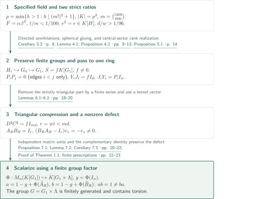
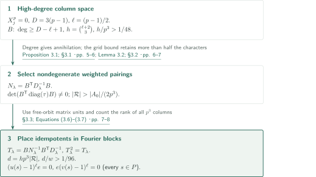
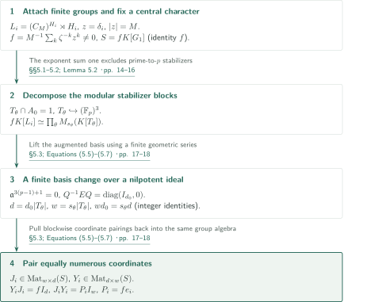
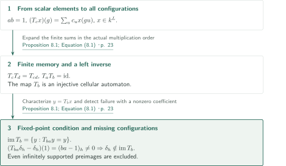

# A Counterexample to Kaplansky’s Direct-Finiteness Conjecture in Odd Characteristic

**High-degree modular representations, a common central sector, and triangular compression to scalar one-sided inverses**

The manuscript constructs a direct-finiteness counterexample over a field of order $p^4$ for one specified odd prime $p$, using finite formulas and choices. Comparing a low-rank graph-fitting matrix with a high-regular-rank local idempotent is not sufficient by itself. The proof preserves finite-group embeddings, realizes the ranks as rectangular matrix identities over one nonzero ring, and then transfers the matrix defect injectively into a scalar group algebra.

## 1. Main results

### Theorem 1.1 — A scalar counterexample in a specified odd characteristic

Put

$$m=\binom{1200}{600},\qquad p=\min\{h\in\mathbb Z:h>1,\ h\mid(m!)^2+1\}.$$

Then $p$ is an odd prime. There exist a specified field $K$ of order $p^4$, a specified finitely generated group $G$ containing torsion, and specified finite sums $a,b\in K[G]$ such that

$$ab=1,\qquad ba\ne1.$$

“Specified” means given by finite formulas and choices in ordered finite sets. The construction is not claimed to have been executed as a practical computation. It concerns this particular $p$, not every odd prime. Finite presentation is not stated as a conclusion of this theorem.

<!-- cite:main -->[Theorem 1.1 · p. 1](https://github.com/openai/math/blob/1581d4cbdd69a0faf34b2089614fe2a814316a6a/preprints/A-Counterexample-to-Kaplanskys-Direct-Finiteness-Conjecture-in-Odd-Characteristic-September-26-2026/paper.pdf)<!-- /cite -->

### Proposition 8.1 — One-sided inverses and the image on all configurations

Let $k$ be a finite field, $L$ a group, and $a,b\in k[L]$ finite sums with $ab=1$. For $c=\sum_uc_uu$, define on all functions $x:L\to k$, without a finite-support restriction,

$$(T_cx)(g)=\sum_uc_ux(gu).$$

Then $T_b:k^L\to k^L$ is an injective cellular automaton, and

$$\operatorname{im}T_b=\{y\in k^L:T_{ba}y=y\}.$$

For every $h$ with $(ba-1)_h\ne0$, the point indicator $\delta_h$ is absent from its image. In particular, if $ba\ne1$, then $T_b$ is nonsurjective. Applying this to the scalar pair of Theorem 1.1 gives an injective, nonsurjective cellular automaton.

<!-- cite:automaton -->[Proposition 8.1; Equation (8.1) · p. 23](https://github.com/openai/math/blob/1581d4cbdd69a0faf34b2089614fe2a814316a6a/preprints/A-Counterexample-to-Kaplanskys-Direct-Finiteness-Conjecture-in-Odd-Characteristic-September-26-2026/paper.pdf)<!-- /cite -->

## References on the arrows

<!-- reference-guide -->
Unprefixed theorem, lemma, section and equation numbers refer to [A Counterexample to Kaplansky’s Direct-Finiteness Conjecture in Odd Characteristic](https://github.com/openai/math/blob/1581d4cbdd69a0faf34b2089614fe2a814316a6a/preprints/A-Counterexample-to-Kaplanskys-Direct-Finiteness-Conjecture-in-Odd-Characteristic-September-26-2026/paper.pdf). External inputs use the following keys.

- [ES04](https://arxiv.org/pdf/math/0305440v2) Gábor Elek; Endre Szabó — *Sofic groups and direct finiteness*: Stable finiteness for sofic groups, used only for nonsoficity after the scalar construction. arXiv:math/0305440v2, 2004-04-19, 9 pages.

Each citation gives the result and pages. When printed pagination differs from the PDF position, both are shown. GitHub previews do not automatically jump to the cited page.
<!-- /reference-guide -->

## 2. Proof of Theorem 1.1 — Connecting the construction

<!-- proof-target:1 -->Proof target：[Theorem 1.1 · p. 1](https://github.com/openai/math/blob/1581d4cbdd69a0faf34b2089614fe2a814316a6a/preprints/A-Counterexample-to-Kaplanskys-Direct-Finiteness-Conjecture-in-Odd-Characteristic-September-26-2026/paper.pdf)<!-- /proof-target -->

**Proof route.** The graph ratio $t/m<1/100$ and local idempotent ratio $d/w>1/96$ are converted into a split injection $S^{md}\to S^{wt}$ over $S=fK[G_1]$. Since $wt<md$, a nonzero kernel vector certifies a matrix defect, which is then scalarized using a finite group factor. The high-rank idempotent and central-sector realization are detailed under [Proposition 3.1](#proof-2) and [Proposition 5.1](#proof-3).

### 1. Fix the coefficient field and low-rank graph factorization

If $p\leq m$, then $p$ divides both $m!$ and $(m!)^2+1$, a contradiction; hence $p>m$. Also $(m!)^2=-1$ in $\mathbb F_p$. Choose the least nonsquare $\eta\in\mathbb F_p^*$ and set

$$K_0=\mathbb F_p[\xi]/(\xi^2-\eta),\qquad K=K_0[\nu]/(\nu^2-\xi).$$

The norm $N_{K_0/\mathbb F_p}(\xi)=-\eta$ is nonsquare, so both extensions are quadratic and $|K|=p^4$. Fix $M=p^4-1$ and $\zeta\in K^*$ of order $M$.

The vertices of $\Gamma$ are the 600-subsets $I_i$ of $[1200]$, with adjacency defined by $|I_i\cap I_j|<200$. Three pairwise adjacent vertices would have a union of at least 1203 elements, so the graph is triangle-free. Multilinearizing the degree-400 polynomial

$$Q_j(X)=\prod_{k=200}^{599}\frac{\sum_{x\in I_j}X_x-k}{600-k}$$

gives $F_{ij}=\sum_{T\in\mathcal T}\alpha_i(T)\beta_j(T)$, where $\mathcal T=\{T\subset[1200]:|T|\leq400\}$. Then $F_{ii}=1$, $F_{ij}=0$ for distinct nonneighbors, and $t=|\mathcal T|$ satisfies $t/m<1/100$. The denominators are invertible because $p>m$.

<!-- cite:field-graph -->[Lemma 2.1; Proposition 2.2 · pp. 3–4](https://github.com/openai/math/blob/1581d4cbdd69a0faf34b2089614fe2a814316a6a/preprints/A-Counterexample-to-Kaplanskys-Direct-Finiteness-Conjecture-in-Odd-Characteristic-September-26-2026/paper.pdf)<!-- /cite -->

### 2. Glue the directed annihilations while retaining the finite groups

Put $P=(\mathbb F_p)^3$, $A_0=(\mathbb Z/M\mathbb Z)^P$, and $H=A_0\rtimes P$. Let $c$ be the identity-coordinate function, $u(s)=(0,s)$, and $v(s)=cu(s)c^{-1}$. Then $U=u(P)$ and $V=cUc^{-1}$ have $U\cap V=1$. For $\ell=(p-1)/2$, the local idempotent satisfies

$$(u(s)-1)^\ell e=0,\qquad e(v(s)-1)^\ell=0,\qquad d/w>1/96,$$

where $w=|H|$ and $d=\dim_K eK[H]$. Along each edge $i<j$, identify $v(1,\bar j,\bar j^2)$ in $H_i$ with $u(1,\bar i,\bar i^2)$ in $H_j$ to form $G_0$. Calling the shared element $y$, the right annihilator in $K[\langle y\rangle]=K[X]/(X^p)$ gives $e_i=qX^{p-\ell}$; since $p-\ell=\ell+1$, this implies $e_ie_j=0$. No reverse ordered product is assumed.

Proposition 4.2 establishes $H_i\hookrightarrow G_0$. Nonvanishing of the required local words of length at most three follows from Vandermonde independence, using $p>m$, and $U\cap V=1$. In Lemma 4.1, a hypothetical kernel yields a minimal spherical map with exactly one nonidentity face. Neutral edges, bridges, equal-type faces, and consecutive equal labels are reduced. Triangle-freeness and the short-word condition then force ordinary vertex degrees and face lengths to be at least four. The Euler sum is eight, whereas the exceptional face contributes at most three in the loop-free case; the remaining single-loop case contributes at most seven in total. Ordinary graph-of-groups normal form does not replace the injectivity proof for this first quotient.

<!-- cite:annihilation -->[Corollary 3.3 · p. 8](https://github.com/openai/math/blob/1581d4cbdd69a0faf34b2089614fe2a814316a6a/preprints/A-Counterexample-to-Kaplanskys-Direct-Finiteness-Conjecture-in-Odd-Characteristic-September-26-2026/paper.pdf)<!-- /cite -->

<!-- cite:gluing -->[Lemma 4.1; Proposition 4.2 · pp. 9–13](https://github.com/openai/math/blob/1581d4cbdd69a0faf34b2089614fe2a814316a6a/preprints/A-Counterexample-to-Kaplanskys-Direct-Finiteness-Conjecture-in-Odd-Characteristic-September-26-2026/paper.pdf)<!-- /cite -->

### 3. Common-ring identities yield a certified matrix defect

Proposition 5.1 supplies $G_0\hookrightarrow G_1$ and a nonzero central idempotent $f$. In $S=fK[G_1]$, whose identity is $f$, put $P_i=fe_i$. The identities $Y_iJ_i=fI_d$, $J_iY_i=P_iI_w$ hold simultaneously at every vertex.

For $C_0=(\beta_j(T)P_j)_{T,j}$ and $D_0=(\alpha_i(T)P_i)_{i,T}$, the product is $\mathcal P+N$, where $\mathcal P=\operatorname{diag}(P_i)$ and $N$ is strictly lower triangular. Thus $N^m=0$ and $\mathcal PN=N=N\mathcal P$. A finite geometric sum corrects $D_0C_0$ to $\mathcal P$; taking $w$ copies and composing with $J_i,Y_i$ gives

$$D^\sharp C^\sharp=fI_{md},\qquad C^\sharp:S^{md}\to S^{wt},\qquad r=wt<md=N_0.$$

The inequalities here are ordinary integer inequalities. Let $\iota:S^r\to S^{N_0}$ and $\pi:S^{N_0}\to S^r$ include and project onto the first $r$ coordinates. Set

$$A_R=\pi D^\sharp+(1-f)I_r,\qquad B_R=C^\sharp\iota+(1-f)I_r.$$

Then $A_RB_R=I_r$. If $u_*$ has last coordinate $f$ and all others zero, $v_*=C^\sharp u_*\ne0$, $D^\sharp v_*=u_*$, and $A_Rv_*=0$. Therefore $(B_RA_R-I_r)v_*=-v_*\ne0$ certifies the reverse defect without deciding equality of group words.

<!-- cite:compression -->[Lemmas 6.1–6.2 · pp. 18–20](https://github.com/openai/math/blob/1581d4cbdd69a0faf34b2089614fe2a814316a6a/preprints/A-Counterexample-to-Kaplanskys-Direct-Finiteness-Conjecture-in-Odd-Characteristic-September-26-2026/paper.pdf)<!-- /cite -->

### 4. Preserve the defect under scalarization and finish the finite prescription

Choose the least $q\geq0$ with $n=M^q\geq r$, and pad $A_R,B_R$ to size $n$ by identity matrices. The finite Heisenberg group $\Lambda=(\mathbb Z/M\mathbb Z)^q\times(\mathbb Z/M\mathbb Z)^q\times\mathbb Z/M\mathbb Z$ has multiplication

$$(x,y,k)(x',y',k')=(x+x',y+y',k+k'+y\cdot x').$$

The matrix units $\Omega_{uv}$ of Proposition 7.1 form a basis of a nonzero central sector $f'K[\Lambda]\simeq M_n(K)$. A shift/modulation representation sends them to standard matrix units, proving linear independence and hence injectivity of $\Phi:M_n(K[G_1])\hookrightarrow K[G_1\times\Lambda]$. Multiplication formulas alone would not establish injectivity.

Put $G=G_1\times\Lambda$, $g=\Phi(I_n)$, $a=1-g+\Phi(\widetilde A_R)$, and $b=1-g+\Phi(\widetilde B_R)$. Cross terms with the complement vanish, giving $ab=1$; injectivity gives $ba-1=\Phi(\widetilde B_R\widetilde A_R-I_n)\ne0$. The coefficient field remains the same $K$ throughout. Finitely many finite groups and the specified identifications generate $G$, while the embedded $H_i$ retain torsion. Every choice of field element, character, basis, or finite inverse occurs in an ordered finite set.

<!-- cite:scalar -->[Proposition 7.1; Lemma 7.2; Corollary 7.3 · pp. 20–22](https://github.com/openai/math/blob/1581d4cbdd69a0faf34b2089614fe2a814316a6a/preprints/A-Counterexample-to-Kaplanskys-Direct-Finiteness-Conjecture-in-Odd-Characteristic-September-26-2026/paper.pdf)<!-- /cite -->

<!-- cite:assembly -->[Proof of Theorem 1.1; finite prescriptions · pp. 22–23](https://github.com/openai/math/blob/1581d4cbdd69a0faf34b2089614fe2a814316a6a/preprints/A-Counterexample-to-Kaplanskys-Direct-Finiteness-Conjecture-in-Odd-Characteristic-September-26-2026/paper.pdf)<!-- /cite -->

## 3. Proof of Proposition 3.1 — Constructing the large local idempotent

<!-- proof-target:2 -->Proof target：[Proposition 3.1; §3.1 · pp. 5–6](https://github.com/openai/math/blob/1581d4cbdd69a0faf34b2089614fe2a814316a6a/preprints/A-Counterexample-to-Kaplanskys-Direct-Finiteness-Conjecture-in-Odd-Characteristic-September-26-2026/paper.pdf)<!-- /proof-target -->

<!-- statement:proposition-3-1 -->
### Proposition 3.1 — Prescribed two-sided annihilations and a regular-rank bound

Use $p,K,M,P,A_0,H,u,v$ above, and put $\ell=(p-1)/2$, $w=|H|$. There is an idempotent $e\in K[H]$, specified by finite field operations, such that for every $s\in P$, $(u(s)-1)^\ell e=0$ and $e(v(s)-1)^\ell=0$. Its regular rank $d=\dim_K eK[H]$ satisfies $d/w>1/96$.

<!-- cite:local -->[Proposition 3.1; §3.1 · pp. 5–6](https://github.com/openai/math/blob/1581d4cbdd69a0faf34b2089614fe2a814316a6a/preprints/A-Counterexample-to-Kaplanskys-Direct-Finiteness-Conjecture-in-Odd-Characteristic-September-26-2026/paper.pdf)<!-- /cite -->
<!-- /statement -->

### 1. Augmentation degree annihilates columns and rows

For translations $L_s$ on $K^P$, set $X_j=L_{\epsilon_j}-I$. Then $X_j^p=0$ and the vectors $X_1^{n_1}X_2^{n_2}X_3^{n_3}e_0$, $0\leq n_j<p$, form a basis. Put $D=3(p-1)$ and let $B$ consist of the basis columns of total degree at least $D-\ell+1$. Then

$$(L_s-I)^\ell B=0,\qquad B^{\mathsf T}(L_s-I)^\ell=0,\qquad h=\operatorname{rank}B=\binom{\ell+2}{3},\quad h/p^3>1/48.$$

The first equality raises degree to at least $D+1$; the second follows by applying the same argument to $-s$ and transposing. Transpose involves no scalar conjugation.

<!-- cite:local -->[Proposition 3.1; §3.1 · pp. 5–6](https://github.com/openai/math/blob/1581d4cbdd69a0faf34b2089614fe2a814316a6a/preprints/A-Counterexample-to-Kaplanskys-Direct-Finiteness-Conjecture-in-Odd-Characteristic-September-26-2026/paper.pdf)<!-- /cite -->

### 2. Vary the weights to obtain enough nondegenerate pairings

For a character $\lambda$ of $A_0$, put $D_\lambda=\operatorname{diag}((x\lambda)(c))$ and $N_\lambda=B^{\mathsf T}D_\lambda^{-1}B$. By Cauchy–Binet, $\det(B^{\mathsf T}\operatorname{diag}(\tau_x)B)$ has squares of maximal minors as coefficients of distinct monomials. Full column rank makes it nonzero. The degree-$h$ grid bound gives singular pairings a fraction at most $h/M<1/4$. Characters with nontrivial stabilizer also occupy a fraction below $1/4$, so more than half have free orbits and invertible $N_\lambda$. Choosing one representative from each orbit containing such a character gives $|\mathcal R|>|A_0|/(2p^3)$. Admissibility need not be constant on an orbit.

<!-- cite:pairing -->[Lemma 3.2; §3.2 · pp. 6–7](https://github.com/openai/math/blob/1581d4cbdd69a0faf34b2089614fe2a814316a6a/preprints/A-Counterexample-to-Kaplanskys-Direct-Finiteness-Conjecture-in-Odd-Characteristic-September-26-2026/paper.pdf)<!-- /cite -->

### 3. Convert representation rank to regular rank

Fourier matrix units identify a free-character-orbit block with $M_{p^3}(K)$. Place

$$T_\lambda=BN_\lambda^{-1}B^{\mathsf T}D_\lambda^{-1}$$

in each selected block and zero in the complement to define $e$. Since $T_\lambda B=B$, it is idempotent of rank $h$. Its left-multiplication image consists of matrices whose $p^3$ columns lie in $\operatorname{im}B$, so its regular rank is $hp^3$. Hence $d=hp^3|\mathcal R|$ and $d/w>h/(2p^3)>1/96$. The weighted row factor annihilates the conjugate translations $v(s)$ on the prescribed side. Only the prime-to-$p$ subgroup $A_0$ is diagonalized; semisimplicity of the entire modular group algebra is not assumed.

<!-- cite:local-completion -->[§3.3; Equations (3.6)–(3.7) · pp. 7–8](https://github.com/openai/math/blob/1581d4cbdd69a0faf34b2089614fe2a814316a6a/preprints/A-Counterexample-to-Kaplanskys-Direct-Finiteness-Conjecture-in-Odd-Characteristic-September-26-2026/paper.pdf)<!-- /cite -->

## 4. Proof of Proposition 5.1 — Realizing regular ranks over one ring

<!-- proof-target:3 -->Proof target：[Proposition 5.1 · p. 14](https://github.com/openai/math/blob/1581d4cbdd69a0faf34b2089614fe2a814316a6a/preprints/A-Counterexample-to-Kaplanskys-Direct-Finiteness-Conjecture-in-Odd-Characteristic-September-26-2026/paper.pdf)<!-- /proof-target -->

<!-- statement:proposition-5-1 -->
### Proposition 5.1 — Rectangular matrices in a common central sector

Let $K$ have characteristic $p$, let $M$ be a positive integer prime to $p$, and suppose $K$ contains $\zeta$ of order $M$. Put $H=(C_M)^{(\mathbb F_p)^3}\rtimes(\mathbb F_p)^3$ and $w=|H|$. Suppose a countable group $G_0$ contains specified copies $H_i\simeq H$, $1\leq i\leq m$, and idempotents $e_i\in K[H_i]$ have the same positive integer rank $d=\dim_K e_iK[H_i]$.

There exist a group $G_1$ containing $G_0$ and a central element $z$ of order $M$ such that, with $f=M^{-1}\sum_{k=0}^{M-1}\zeta^{-k}z^k\ne0$, $S=fK[G_1]$, and $P_i=fe_i$, specified matrices $J_i\in\operatorname{Mat}_{w\times d}(S)$ and $Y_i\in\operatorname{Mat}_{d\times w}(S)$ satisfy $Y_iJ_i=fI_d$, $J_iY_i=P_iI_w$. Their entries lie in the group algebra of specified finite subgroups of $G_1$, multiplied by $f$, and are constructed by finite group operations and linear algebra over $K$.

<!-- cite:sector -->[Proposition 5.1 · p. 14](https://github.com/openai/math/blob/1581d4cbdd69a0faf34b2089614fe2a814316a6a/preprints/A-Counterexample-to-Kaplanskys-Direct-Finiteness-Conjecture-in-Odd-Characteristic-September-26-2026/paper.pdf)<!-- /cite -->
<!-- /statement -->

### 1. Align character sectors and control their stabilizers

Attach $L_i=(C_M)^{H_i}\rtimes H_i$ to $\langle z\rangle\times G_0$, identifying $z$ with the constant function $\delta_i$. Matching free actions orbit by orbit over $\langle z\rangle\times H_i$ proves that each factor embeds. Thus $z$ retains its order and the identity coefficient $M^{-1}$ of $f$ is nonzero.

The stabilizer $T_\theta$ of a character with $\chi(z)=\zeta$ meets $A_0$ trivially. Otherwise an element of order $q>1$ would force the exponent sum one to lie in $q(\mathbb Z/M\mathbb Z)$, a contradiction. Hence $T_\theta\hookrightarrow(\mathbb F_p)^3$ is elementary abelian, possibly nontrivial and nonnormal. Explicit matrix units and dimension comparison give

$$fK[L_i]\simeq\prod_\theta M_{s_\theta}(K[T_\theta]),\qquad s_\theta=[H_i:T_\theta].$$

<!-- cite:sector-blocks -->[§§5.1–5.2; Lemma 5.2 · pp. 14–16](https://github.com/openai/math/blob/1581d4cbdd69a0faf34b2089614fe2a814316a6a/preprints/A-Counterexample-to-Kaplanskys-Direct-Finiteness-Conjecture-in-Odd-Characteristic-September-26-2026/paper.pdf)<!-- /cite -->

### 2. Conjugate to a coordinate projection over a nilpotent ideal

In one block put $D_\theta=K[T_\theta]$ and $E=\rho_\theta(P_i)$. Its augmentation ideal satisfies $\mathfrak a^{3(p-1)+1}=0$. Choose bases of the image and complementary image after augmentation, and form $Q$ from the corresponding columns of $E$ and $I-E$. Write $Q=Q_0(I+N)$ with entries of $N$ in $\mathfrak a$; a finite geometric sum gives its inverse. Thus $Q^{-1}EQ=\operatorname{diag}(I_{d_0},0)$.

Comparison with the original regular representation gives ordinary integer equalities $d=d_0|T_\theta|$, $w=s_\theta|T_\theta|$, and therefore $wd_0=s_\theta d$. Pairing these equally numerous coordinates constructs the rectangular matrices blockwise, and pulling back all blocks produces $J_i,Y_i$. The proof does not jump from numerical $K$-linear ranks to a free-module isomorphism over $S$.

<!-- cite:sector-ranks -->[§5.3; Equations (5.5)–(5.7) · pp. 17–18](https://github.com/openai/math/blob/1581d4cbdd69a0faf34b2089614fe2a814316a6a/preprints/A-Counterexample-to-Kaplanskys-Direct-Finiteness-Conjecture-in-Odd-Characteristic-September-26-2026/paper.pdf)<!-- /cite -->

## 5. Proof of Proposition 8.1 — The defect persists on infinitely supported configurations

<!-- proof-target:4 -->Proof target：[Proposition 8.1; Equation (8.1) · p. 23](https://github.com/openai/math/blob/1581d4cbdd69a0faf34b2089614fe2a814316a6a/preprints/A-Counterexample-to-Kaplanskys-Direct-Finiteness-Conjecture-in-Odd-Characteristic-September-26-2026/paper.pdf)<!-- /proof-target -->

**Proof route.** With the convention in the [main statement](#proposition-8-1), verify the composition order and then identify the image as a fixed-point set. No further characteristic or torsion assumption is needed.

### 1. Composition order and injectivity

Expanding two finite sums gives $T_cT_d=T_{cd}$. Thus $T_aT_b=T_{ab}=\operatorname{id}$, proving injectivity of $T_b$. The finite support of $b$ supplies a memory set, so it is a cellular automaton.

### 2. Characterize the image and exclude point indicators

If $y=T_bx$, then $T_{ba}y=T_bT_aT_bx=y$. Conversely, $T_{ba}y=y$ implies $y=T_b(T_ay)$, so $y$ lies in the image. Finally $(T_{ba}\delta_h-\delta_h)(1)=(ba-1)_h\ne0$ excludes $\delta_h$. These computations hold on the full function space, so allowing infinitely supported preimages does not change the conclusion.

<!-- cite:automaton -->[Proposition 8.1; Equation (8.1) · p. 23](https://github.com/openai/math/blob/1581d4cbdd69a0faf34b2089614fe2a814316a6a/preprints/A-Counterexample-to-Kaplanskys-Direct-Finiteness-Conjecture-in-Odd-Characteristic-September-26-2026/paper.pdf)<!-- /cite -->

## 6. External inputs, background, and consequences

The characteristic-two paper is a comparison with a different local construction, not an input to this odd-prime proof. The required graph fit, grid estimate, spherical gluing, central-sector realization, and finite Heisenberg encoding are proved within this manuscript. Its connections to earlier work are methodological antecedents rather than unproved imported steps.

Nonsoficity uses an external result only after the scalar pair has been completed. ES04 states that group algebras of sofic groups are stably finite over every division ring. The field $K$ satisfies this coefficient hypothesis, so the constructed $ab=1\ne ba$ forces $G$ to be nonsofic. In contrast, the cellular-automaton counterexample follows from the direct computation above without this external theorem.

<!-- cite:sofic -->[&#91;ES04, Corollary 4.7, p. 8&#93;](https://arxiv.org/pdf/math/0305440v2#page=8)<!-- /cite -->

## 7. Return to the sources

<!-- reading-list -->
- [Proposition 3.1; §3.1 · pp. 5–6](https://github.com/openai/math/blob/1581d4cbdd69a0faf34b2089614fe2a814316a6a/preprints/A-Counterexample-to-Kaplanskys-Direct-Finiteness-Conjecture-in-Odd-Characteristic-September-26-2026/paper.pdf) — Read the high-degree modular construction and distinguish regular rank
- [Lemma 4.1; Proposition 4.2 · pp. 9–13](https://github.com/openai/math/blob/1581d4cbdd69a0faf34b2089614fe2a814316a6a/preprints/A-Counterexample-to-Kaplanskys-Direct-Finiteness-Conjecture-in-Odd-Characteristic-September-26-2026/paper.pdf) — Follow why the gluing quotient preserves the finite groups
- [§5.3; Equations (5.5)–(5.7) · pp. 17–18](https://github.com/openai/math/blob/1581d4cbdd69a0faf34b2089614fe2a814316a6a/preprints/A-Counterexample-to-Kaplanskys-Direct-Finiteness-Conjecture-in-Odd-Characteristic-September-26-2026/paper.pdf) — Check the passage from integer ranks to identities over the same ring
- [Lemmas 6.1–6.2 · pp. 18–20](https://github.com/openai/math/blob/1581d4cbdd69a0faf34b2089614fe2a814316a6a/preprints/A-Counterexample-to-Kaplanskys-Direct-Finiteness-Conjecture-in-Odd-Characteristic-September-26-2026/paper.pdf) — Read the directed-zero-product argument and the nonzero kernel certificate
- [Proposition 7.1; Lemma 7.2; Corollary 7.3 · pp. 20–22](https://github.com/openai/math/blob/1581d4cbdd69a0faf34b2089614fe2a814316a6a/preprints/A-Counterexample-to-Kaplanskys-Direct-Finiteness-Conjecture-in-Odd-Characteristic-September-26-2026/paper.pdf) — Follow injective matrix units and complementary-identity scalarization
- [Proposition 8.1; Equation (8.1) · p. 23](https://github.com/openai/math/blob/1581d4cbdd69a0faf34b2089614fe2a814316a6a/preprints/A-Counterexample-to-Kaplanskys-Direct-Finiteness-Conjecture-in-Odd-Characteristic-September-26-2026/paper.pdf) — Check multiplication order and missing points on all configurations
<!-- /reading-list -->

We read §§2–8 and compared the specified field, the two ratios, directed zero products, finite-group embeddings, common-sector integer rank identities, triangular compression, injective scalarization, and the image on all configurations. We also read the spherical-map reductions for loops, bridges, and equal-label smoothing and the Euler contradiction; this is not an independent formal verification of every topological case. The ES04 statement and its application were checked, without recursively verifying its proof or those of the background literature. The enormous finite prescription has not been executed, and expert peer review and formal verification have not been performed.
