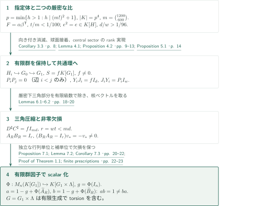
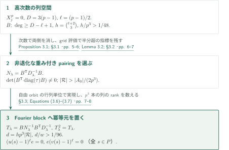
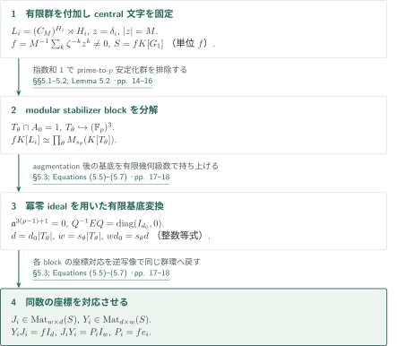
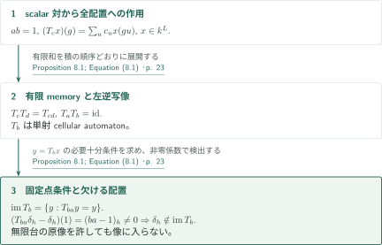

# A Counterexample to Kaplansky’s Direct-Finiteness Conjecture in Odd Characteristic

**高次数のmodular表現、共通central sector、三角圧縮からscalar片側逆元へ**

原稿は一つの指定された奇素数$p$と位数$p^4$の体について、直接有限性の反例を有限の公式と選択で構成する。低rankのグラフ適合行列と、大きい正則rankを持つ局所冪等元の比率を比較するだけでは足りない。有限群の埋込みを保持し、同じ非零環の上でrankを長方形行列の恒等式へ変え、その後に行列の欠損をscalar群環へ単射的に移すことが証明の軸である。

## 1. 主要結果

### Theorem 1.1 — 指定された奇標数のscalar反例

$$m=\binom{1200}{600},\qquad p=\min\{h\in\mathbb Z:h>1,\ h\mid(m!)^2+1\}$$

とする。$p$は奇素数である。位数$p^4$の指定された体$K$、torsionを含む指定された有限生成群$G$、指定された有限和$a,b\in K[G]$が存在し、

$$ab=1,\qquad ba\ne1.$$

「指定された」とは有限の公式と順序付き有限集合内の選択による指定を意味する。原稿は実用的な計算としての実行を主張していない。結論はこの特定の$p$に対するもので、任意の奇素数に対する主張ではない。群の有限表示性はこの定理の結論として掲げられていない。

<!-- cite:main -->[Theorem 1.1 · p. 1](https://github.com/openai/math/blob/1581d4cbdd69a0faf34b2089614fe2a814316a6a/preprints/A-Counterexample-to-Kaplanskys-Direct-Finiteness-Conjecture-in-Odd-Characteristic-September-26-2026/paper.pdf)<!-- /cite -->

### Proposition 8.1 — 片側逆元と全配置上の像

$k$を有限体、$L$を群、$a,b\in k[L]$を$ab=1$を満たす有限和とする。$c=\sum_uc_uu$に対し、有限台に限らない全関数$x:L\to k$上で

$$(T_cx)(g)=\sum_uc_ux(gu)$$

と定める。このとき$T_b:k^L\to k^L$は単射cellular automatonであり、

$$\operatorname{im}T_b=\{y\in k^L:T_{ba}y=y\}.$$

$(ba-1)_h\ne0$であるすべての$h$について、点指示関数$\delta_h$はその像に属さない。特に$ba\ne1$なら$T_b$は非全射である。Theorem 1.1のscalar対への適用で、単射かつ非全射のcellular automatonを得る。

<!-- cite:automaton -->[Proposition 8.1; Equation (8.1) · p. 23](https://github.com/openai/math/blob/1581d4cbdd69a0faf34b2089614fe2a814316a6a/preprints/A-Counterexample-to-Kaplanskys-Direct-Finiteness-Conjecture-in-Odd-Characteristic-September-26-2026/paper.pdf)<!-- /cite -->

## 図の矢印に付した引用

<!-- reference-guide -->
略号のない定理・補題・節・式番号は本原稿 [A Counterexample to Kaplansky’s Direct-Finiteness Conjecture in Odd Characteristic](https://github.com/openai/math/blob/1581d4cbdd69a0faf34b2089614fe2a814316a6a/preprints/A-Counterexample-to-Kaplanskys-Direct-Finiteness-Conjecture-in-Odd-Characteristic-September-26-2026/paper.pdf) を指します。外部入力には次の略号を使います。

- [ES04](https://arxiv.org/pdf/math/0305440v2) Gábor Elek; Endre Szabó — *Sofic groups and direct finiteness*：sofic群上のstable finiteness。scalar構成後の非sofic帰結にのみ使う。arXiv:math/0305440v2, 2004-04-19, 9 pages。

各引用に結果番号とページを付します。誌面番号とPDF内の位置が異なる場合は両方を示します。GitHubの閲覧リンクではページ位置への自動移動を前提としません。
<!-- /reference-guide -->

## 2. Theorem 1.1 の証明 — 構成全体の接続

<!-- proof-target:1 -->証明対象：[Theorem 1.1 · p. 1](https://github.com/openai/math/blob/1581d4cbdd69a0faf34b2089614fe2a814316a6a/preprints/A-Counterexample-to-Kaplanskys-Direct-Finiteness-Conjecture-in-Odd-Characteristic-September-26-2026/paper.pdf)<!-- /proof-target -->

**証明の道筋。** グラフの比$t/m<1/100$と局所冪等元の比$d/w>1/96$を、$S=fK[G_1]$上のsplit injection $S^{md}\to S^{wt}$へ結び付ける。$wt<md$から非零核ベクトルで証明された行列欠損を作り、有限群因子でscalar化する。高rank冪等元とcentral sectorの実現は[Proposition 3.1](#proof-2)と[Proposition 5.1](#proof-3)で詳述する。

### 1. 係数体とグラフの低rank因子分解を固定する

$p\leq m$なら$p$が$m!$と$(m!)^2+1$の両方を割るため、$p>m$である。また$(m!)^2=-1$ in $\mathbb F_p$。最小の非平方元$\eta\in\mathbb F_p^*$を選び、

$$K_0=\mathbb F_p[\xi]/(\xi^2-\eta),\qquad K=K_0[\nu]/(\nu^2-\xi)$$

とする。$N_{K_0/\mathbb F_p}(\xi)=-\eta$は非平方なので両段階が二次拡大であり、$|K|=p^4$。$M=p^4-1$と位数$M$の$\zeta\in K^*$を固定する。

グラフ$\Gamma$の頂点は$[1200]$の600元部分集合$I_i$、辺は$|I_i\cap I_j|<200$で定める。三つの隣接頂点なら和集合が1203元以上となるためtriangle-freeである。次数400以下へmultilinear化した多項式

$$Q_j(X)=\prod_{k=200}^{599}\frac{\sum_{x\in I_j}X_x-k}{600-k}$$

から$F_{ij}=\sum_{T\in\mathcal T}\alpha_i(T)\beta_j(T)$、$\mathcal T=\{T\subset[1200]:|T|\leq400\}$を得る。$F_{ii}=1$、異なる非隣接頂点では$F_{ij}=0$、$t=|\mathcal T|$は$t/m<1/100$を満たす。分母は$p>m$により可逆である。

<!-- cite:field-graph -->[Lemma 2.1; Proposition 2.2 · pp. 3–4](https://github.com/openai/math/blob/1581d4cbdd69a0faf34b2089614fe2a814316a6a/preprints/A-Counterexample-to-Kaplanskys-Direct-Finiteness-Conjecture-in-Odd-Characteristic-September-26-2026/paper.pdf)<!-- /cite -->

### 2. 片側消滅を接着し、有限群の埋込みを保持する

$P=(\mathbb F_p)^3$, $A_0=(\mathbb Z/M\mathbb Z)^P$, $H=A_0\rtimes P$とし、$c$を恒等元座標の関数、$u(s)=(0,s)$、$v(s)=cu(s)c^{-1}$とする。$U=u(P)$と$V=cUc^{-1}$は$U\cap V=1$を満たす。局所冪等元$e$は$\ell=(p-1)/2$について

$$(u(s)-1)^\ell e=0,\qquad e(v(s)-1)^\ell=0,\qquad d/w>1/96$$

を満たす（$w=|H|$, $d=\dim_K eK[H]$）。各辺$i<j$で$H_i$の$v(1,\bar j,\bar j^2)$と$H_j$の$u(1,\bar i,\bar i^2)$を同一視して$G_0$を作る。共通元を$y$とすると、$K[\langle y\rangle]=K[X]/(X^p)$の右消滅イデアルから$e_i=qX^{p-\ell}$となり、$p-\ell=\ell+1$により$e_ie_j=0$。逆順の積は仮定しない。

Proposition 4.2は$H_i\hookrightarrow G_0$を保証する。必要な長さ3以下の局所語の非消滅は、$p>m$によるVandermonde独立性と$U\cap V=1$で確認する。Lemma 4.1の球面図式では、仮に核があれば非自明面がちょうど一つの最小図式を作る。中性辺・橋・同型面・連続同ラベルを縮約し、triangle-free性と短語条件で通常の頂点次数・面長を4以上にする。Eulerの総和8に対し、ループなしでは例外面の寄与は高々3、残る単一ループの場合でも高々7となって矛盾する。この最初の商の単射性を通常のgraph-of-groups正規形だけで代用しない。

<!-- cite:annihilation -->[Corollary 3.3 · p. 8](https://github.com/openai/math/blob/1581d4cbdd69a0faf34b2089614fe2a814316a6a/preprints/A-Counterexample-to-Kaplanskys-Direct-Finiteness-Conjecture-in-Odd-Characteristic-September-26-2026/paper.pdf)<!-- /cite -->

<!-- cite:gluing -->[Lemma 4.1; Proposition 4.2 · pp. 9–13](https://github.com/openai/math/blob/1581d4cbdd69a0faf34b2089614fe2a814316a6a/preprints/A-Counterexample-to-Kaplanskys-Direct-Finiteness-Conjecture-in-Odd-Characteristic-September-26-2026/paper.pdf)<!-- /cite -->

### 3. 共通環での恒等式から、証明可能な行列欠損へ

Proposition 5.1により$G_0\hookrightarrow G_1$と非零central idempotent $f$を取り、単位元が$f$の環$S=fK[G_1]$で$P_i=fe_i$を用いる。$Y_iJ_i=fI_d$, $J_iY_i=P_iI_w$が各頂点で同時に成り立つ。

$C_0=(\beta_j(T)P_j)_{T,j}$と$D_0=(\alpha_i(T)P_i)_{i,T}$の積は$\mathcal P+N$となる。$\mathcal P=\operatorname{diag}(P_i)$、$N$は厳密下三角であり、$N^m=0$, $\mathcal PN=N=N\mathcal P$。有限幾何級数が$D_0C_0$を$\mathcal P$へ直し、$w$重複製と$J_i,Y_i$によって

$$D^\sharp C^\sharp=fI_{md},\qquad C^\sharp:S^{md}\to S^{wt},\qquad r=wt<md=N_0$$

を得る。ここで不等式は通常の整数の不等式である。

$\iota:S^r\to S^{N_0}$と$\pi:S^{N_0}\to S^r$を最初の$r$座標の包含と射影として、

$$A_R=\pi D^\sharp+(1-f)I_r,\qquad B_R=C^\sharp\iota+(1-f)I_r$$

と置くと$A_RB_R=I_r$。最後の座標が$f$の$u_*$に対して$v_*=C^\sharp u_*\ne0$、$D^\sharp v_*=u_*$、$A_Rv_*=0$となり、$(B_RA_R-I_r)v_*=-v_*\ne0$が逆積の欠損を証明する。群の語の一致判定は要らない。

<!-- cite:compression -->[Lemmas 6.1–6.2 · pp. 18–20](https://github.com/openai/math/blob/1581d4cbdd69a0faf34b2089614fe2a814316a6a/preprints/A-Counterexample-to-Kaplanskys-Direct-Finiteness-Conjecture-in-Odd-Characteristic-September-26-2026/paper.pdf)<!-- /cite -->

### 4. 非零欠損を保ってscalar化し、有限指定を完結する

最小の$q\geq0$で$n=M^q\geq r$を取り、$A_R,B_R$を単位行列で$n$次へ拡張する。有限Heisenberg群$\Lambda=(\mathbb Z/M\mathbb Z)^q\times(\mathbb Z/M\mathbb Z)^q\times\mathbb Z/M\mathbb Z$の積を

$$(x,y,k)(x',y',k')=(x+x',y+y',k+k'+y\cdot x')$$

と定める。Proposition 7.1の行列単位$\Omega_{uv}$は非零central sector $f'K[\Lambda]\simeq M_n(K)$の基底を成す。shift/modulation表現で標準行列単位へ写ることが線形独立性、従って符号化$\Phi:M_n(K[G_1])\hookrightarrow K[G_1\times\Lambda]$の単射性を保証する。積の公式だけで単射性を済ませない。

$G=G_1\times\Lambda$とし、$g=\Phi(I_n)$に対して$a=1-g+\Phi(\widetilde A_R)$、$b=1-g+\Phi(\widetilde B_R)$と置く。補空間との交差項が零なので$ab=1$であり、単射性から$ba-1=\Phi(\widetilde B_R\widetilde A_R-I_n)\ne0$。係数体は終始同じ$K$である。有限個の有限群と指定された同一視が$G$を有限生成し、埋め込まれた$H_i$がtorsionを残す。体・指標・基底・有限逆元の選択は全て順序付き有限集合内で完結する。

<!-- cite:scalar -->[Proposition 7.1; Lemma 7.2; Corollary 7.3 · pp. 20–22](https://github.com/openai/math/blob/1581d4cbdd69a0faf34b2089614fe2a814316a6a/preprints/A-Counterexample-to-Kaplanskys-Direct-Finiteness-Conjecture-in-Odd-Characteristic-September-26-2026/paper.pdf)<!-- /cite -->

<!-- cite:assembly -->[Proof of Theorem 1.1; finite prescriptions · pp. 22–23](https://github.com/openai/math/blob/1581d4cbdd69a0faf34b2089614fe2a814316a6a/preprints/A-Counterexample-to-Kaplanskys-Direct-Finiteness-Conjecture-in-Odd-Characteristic-September-26-2026/paper.pdf)<!-- /cite -->

## 3. Proposition 3.1 の証明 — 大きい局所冪等元を作る

<!-- proof-target:2 -->証明対象：[Proposition 3.1; §3.1 · pp. 5–6](https://github.com/openai/math/blob/1581d4cbdd69a0faf34b2089614fe2a814316a6a/preprints/A-Counterexample-to-Kaplanskys-Direct-Finiteness-Conjecture-in-Odd-Characteristic-September-26-2026/paper.pdf)<!-- /proof-target -->

<!-- statement:proposition-3-1 -->
### Proposition 3.1 — 両側の指定消滅と正則rank下界

上記の$p,K,M,P,A_0,H,u,v$を用い、$\ell=(p-1)/2$, $w=|H|$とする。有限の体演算で指定される冪等元$e\in K[H]$が存在し、全ての$s\in P$について$(u(s)-1)^\ell e=0$と$e(v(s)-1)^\ell=0$を満たす。その正則rank $d=\dim_K eK[H]$は$d/w>1/96$を満たす。

<!-- cite:local -->[Proposition 3.1; §3.1 · pp. 5–6](https://github.com/openai/math/blob/1581d4cbdd69a0faf34b2089614fe2a814316a6a/preprints/A-Counterexample-to-Kaplanskys-Direct-Finiteness-Conjecture-in-Odd-Characteristic-September-26-2026/paper.pdf)<!-- /cite -->
<!-- /statement -->

### 1. augmentation次数で列と行を消す

$K^P$のtranslation作用$L_s$に対し$X_j=L_{\epsilon_j}-I$と置く。$X_j^p=0$で、$X_1^{n_1}X_2^{n_2}X_3^{n_3}e_0$（$0\leq n_j<p$）は基底を成す。$D=3(p-1)$として総次数$D-\ell+1$以上の基底を列に持つ行列$B$を取ると、

$$(L_s-I)^\ell B=0,\qquad B^{\mathsf T}(L_s-I)^\ell=0,\qquad h=\operatorname{rank}B=\binom{\ell+2}{3},\quad h/p^3>1/48.$$

前者は次数を$D+1$以上へ上げること、後者は$-s$への同じ議論を転置することによる。転置には係数の共役を含めない。

<!-- cite:local -->[Proposition 3.1; §3.1 · pp. 5–6](https://github.com/openai/math/blob/1581d4cbdd69a0faf34b2089614fe2a814316a6a/preprints/A-Counterexample-to-Kaplanskys-Direct-Finiteness-Conjecture-in-Odd-Characteristic-September-26-2026/paper.pdf)<!-- /cite -->

### 2. 重みを変えて非退化pairingを十分な頻度で得る

$A_0$の指標$\lambda$について$D_\lambda=\operatorname{diag}((x\lambda)(c))$、$N_\lambda=B^{\mathsf T}D_\lambda^{-1}B$とする。Cauchy–Binetによる$\det(B^{\mathsf T}\operatorname{diag}(\tau_x)B)$は、相異なる単項式に極大minorの二乗を係数として持ち、$B$の全列rankにより非零である。次数$h$のgrid評価で特異pairingの割合は高々$h/M<1/4$。非自明安定化群を持つ指標の割合も$<1/4$であるため、自由orbitかつ$N_\lambda$可逆の指標は半分を超える。各該当orbitから一つを取り$\mathcal R$とすれば$|\mathcal R|>|A_0|/(2p^3)$。可適合性がorbit上一定である必要はない。

<!-- cite:pairing -->[Lemma 3.2; §3.2 · pp. 6–7](https://github.com/openai/math/blob/1581d4cbdd69a0faf34b2089614fe2a814316a6a/preprints/A-Counterexample-to-Kaplanskys-Direct-Finiteness-Conjecture-in-Odd-Characteristic-September-26-2026/paper.pdf)<!-- /cite -->

### 3. 表現行列のrankを正則rankへ数え直す

自由指標orbitに対応するFourier行列単位により、central blockは$M_{p^3}(K)$になる。そこに

$$T_\lambda=BN_\lambda^{-1}B^{\mathsf T}D_\lambda^{-1}$$

を置き、それ以外のblockでは零として$e$を定める。$T_\lambda B=B$なので冪等でrankは$h$。左乗法の像は$p^3$本の列それぞれが$\operatorname{im}B$に入る行列だから、正則rankは$hp^3$である。従って$d=hp^3|\mathcal R|$、$d/w>h/(2p^3)>1/96$。重み付き行因子により$v(s)$の共役translationも指定の側で消える。対角化するのはprime-to-$p$の$A_0$であり、modular群環全体の半単純性を仮定しない。

<!-- cite:local-completion -->[§3.3; Equations (3.6)–(3.7) · pp. 7–8](https://github.com/openai/math/blob/1581d4cbdd69a0faf34b2089614fe2a814316a6a/preprints/A-Counterexample-to-Kaplanskys-Direct-Finiteness-Conjecture-in-Odd-Characteristic-September-26-2026/paper.pdf)<!-- /cite -->

## 4. Proposition 5.1 の証明 — 正則rankを共通環上の恒等式にする

<!-- proof-target:3 -->証明対象：[Proposition 5.1 · p. 14](https://github.com/openai/math/blob/1581d4cbdd69a0faf34b2089614fe2a814316a6a/preprints/A-Counterexample-to-Kaplanskys-Direct-Finiteness-Conjecture-in-Odd-Characteristic-September-26-2026/paper.pdf)<!-- /proof-target -->

<!-- statement:proposition-5-1 -->
### Proposition 5.1 — 共通central sectorでの長方形行列

$K$を標数$p$の体、$M$を$p$と素な正整数とし、$K$は位数$M$の元$\zeta$を含むとする。$H=(C_M)^{(\mathbb F_p)^3}\rtimes(\mathbb F_p)^3$、$w=|H|$とする。可算群$G_0$が指定された$H_i\simeq H$（$1\leq i\leq m$）を含み、$e_i\in K[H_i]$が共通の正整数rank $d=\dim_K e_iK[H_i]$を持つ冪等元であるとする。

$G_0$を含む群$G_1$と位数$M$のcentral元$z$が存在し、$f=M^{-1}\sum_{k=0}^{M-1}\zeta^{-k}z^k\ne0$、$S=fK[G_1]$、$P_i=fe_i$について、指定された$J_i\in\operatorname{Mat}_{w\times d}(S)$、$Y_i\in\operatorname{Mat}_{d\times w}(S)$が$Y_iJ_i=fI_d$, $J_iY_i=P_iI_w$を満たす。各成分は$G_1$の指定された有限部分群の群環に$f$を掛けたものに属し、有限群演算と$K$上の線形代数だけで構成される。

<!-- cite:sector -->[Proposition 5.1 · p. 14](https://github.com/openai/math/blob/1581d4cbdd69a0faf34b2089614fe2a814316a6a/preprints/A-Counterexample-to-Kaplanskys-Direct-Finiteness-Conjecture-in-Odd-Characteristic-September-26-2026/paper.pdf)<!-- /cite -->
<!-- /statement -->

### 1. 指標sectorをそろえ、安定化群を制御する

$\langle z\rangle\times G_0$へ$L_i=(C_M)^{H_i}\rtimes H_i$を付加し、$z$を定数関数$\delta_i$と同一視する。共有部分群$\langle z\rangle\times H_i$の自由作用を軌道ごとに同一視することで、各因子の単射性を示す。従って$z$の位数が保たれ、$f$の恒等元係数$M^{-1}$は非零である。

$\chi(z)=\zeta$となる指標orbitの安定化群$T_\theta$は$A_0$と自明に交わる。もし位数$q>1$の元が交われば、指標の指数和1が$q(\mathbb Z/M\mathbb Z)$に入り矛盾する。従って$T_\theta\hookrightarrow(\mathbb F_p)^3$で、非自明・非正規の場合も許すelementary abelian $p$群となる。明示的行列単位と次元照合から

$$fK[L_i]\simeq\prod_\theta M_{s_\theta}(K[T_\theta]),\qquad s_\theta=[H_i:T_\theta]$$

を得る。

<!-- cite:sector-blocks -->[§§5.1–5.2; Lemma 5.2 · pp. 14–16](https://github.com/openai/math/blob/1581d4cbdd69a0faf34b2089614fe2a814316a6a/preprints/A-Counterexample-to-Kaplanskys-Direct-Finiteness-Conjecture-in-Odd-Characteristic-September-26-2026/paper.pdf)<!-- /cite -->

### 2. 冪零ideal上で座標射影へ共役する

一つのblockで$D_\theta=K[T_\theta]$、$E=\rho_\theta(P_i)$とする。augmentation ideal $\mathfrak a$は$\mathfrak a^{3(p-1)+1}=0$を満たす。augmentationで$E$の像と補像の基底を選び、対応する$E$と$I-E$の列から$Q$を作る。$Q=Q_0(I+N)$で$N$の成分は$\mathfrak a$に入り、有限幾何級数が逆元を与える。これにより$Q^{-1}EQ=\operatorname{diag}(I_{d_0},0)$。

元の正則表現との比較で、通常の整数として$d=d_0|T_\theta|$、$w=s_\theta|T_\theta|$、従って$wd_0=s_\theta d$となる。等しい個数の座標を対応させてblock内の長方形行列を作り、全blockを戻すと$J_i,Y_i$が得られる。単なる$K$-線形rankの等式から$S$上の自由加群同型を飛躍して結論してはいない。

<!-- cite:sector-ranks -->[§5.3; Equations (5.5)–(5.7) · pp. 17–18](https://github.com/openai/math/blob/1581d4cbdd69a0faf34b2089614fe2a814316a6a/preprints/A-Counterexample-to-Kaplanskys-Direct-Finiteness-Conjecture-in-Odd-Characteristic-September-26-2026/paper.pdf)<!-- /cite -->

## 5. Proposition 8.1 の証明 — 無限台の配置にも欠損を残す

<!-- proof-target:4 -->証明対象：[Proposition 8.1; Equation (8.1) · p. 23](https://github.com/openai/math/blob/1581d4cbdd69a0faf34b2089614fe2a814316a6a/preprints/A-Counterexample-to-Kaplanskys-Direct-Finiteness-Conjecture-in-Odd-Characteristic-September-26-2026/paper.pdf)<!-- /proof-target -->

**証明の道筋。** [主要結果の主張](#proposition-8-1)の規約で、有限和の合成順序を確認してから像を固定点集合として記述する。ここではcharacteristicやtorsionによる追加制約はない。

### 1. 合成順序と単射性

二つの有限和を展開すると$T_cT_d=T_{cd}$である。したがって$T_aT_b=T_{ab}=\operatorname{id}$で$T_b$は単射。$b$の有限台がmemory setを与えるのでcellular automatonである。

### 2. 像の特徴付けと欠ける点指示関数

$y=T_bx$なら$T_{ba}y=T_bT_aT_bx=y$。逆に$T_{ba}y=y$なら$y=T_b(T_ay)$なので像に入る。さらに$(T_{ba}\delta_h-\delta_h)(1)=(ba-1)_h\ne0$より$\delta_h$は像に入らない。この議論は全関数空間上で成立するため、無限台の配置を原像に許しても結論は変わらない。

<!-- cite:automaton -->[Proposition 8.1; Equation (8.1) · p. 23](https://github.com/openai/math/blob/1581d4cbdd69a0faf34b2089614fe2a814316a6a/preprints/A-Counterexample-to-Kaplanskys-Direct-Finiteness-Conjecture-in-Odd-Characteristic-September-26-2026/paper.pdf)<!-- /cite -->

## 6. 直接入力と背景・帰結の区別

標数2の論文は別の局所構成を与える比較対象で、この奇素数の証明の入力ではない。本稿のグラフfit、grid評価、球面接着、central sector、有限Heisenberg符号化は必要部分が本稿内で証明されている。原稿が挙げる先行研究との方法上の関係を、外部定理の未証明な利用と取り違えない。

外部結果を使う非sofic性は完成したscalar対の帰結である。ES04によればsofic群の群環は任意の斜体上stably finiteである。体$K$もその仮定を満たすため、本稿の$ab=1\ne ba$と両立せず$G$はnonsoficとなる。一方、cellular automatonの反例は上の直接計算で得られ、この外部定理を必要としない。

<!-- cite:sofic -->[&#91;ES04, Corollary 4.7, p. 8&#93;](https://arxiv.org/pdf/math/0305440v2#page=8)<!-- /cite -->

## 7. 原典を読む入口と確認範囲

<!-- reading-list -->
- [Proposition 3.1; §3.1 · pp. 5–6](https://github.com/openai/math/blob/1581d4cbdd69a0faf34b2089614fe2a814316a6a/preprints/A-Counterexample-to-Kaplanskys-Direct-Finiteness-Conjecture-in-Odd-Characteristic-September-26-2026/paper.pdf) — 高次数のmodular表現と正則rankの区別を読む
- [Lemma 4.1; Proposition 4.2 · pp. 9–13](https://github.com/openai/math/blob/1581d4cbdd69a0faf34b2089614fe2a814316a6a/preprints/A-Counterexample-to-Kaplanskys-Direct-Finiteness-Conjecture-in-Odd-Characteristic-September-26-2026/paper.pdf) — 接着商で有限群が消えない理由を追う
- [§5.3; Equations (5.5)–(5.7) · pp. 17–18](https://github.com/openai/math/blob/1581d4cbdd69a0faf34b2089614fe2a814316a6a/preprints/A-Counterexample-to-Kaplanskys-Direct-Finiteness-Conjecture-in-Odd-Characteristic-September-26-2026/paper.pdf) — 整数rankから同じ環上の恒等式への接続を見る
- [Lemmas 6.1–6.2 · pp. 18–20](https://github.com/openai/math/blob/1581d4cbdd69a0faf34b2089614fe2a814316a6a/preprints/A-Counterexample-to-Kaplanskys-Direct-Finiteness-Conjecture-in-Odd-Characteristic-September-26-2026/paper.pdf) — 向き付き零積と非零核ベクトルの証明を読む
- [Proposition 7.1; Lemma 7.2; Corollary 7.3 · pp. 20–22](https://github.com/openai/math/blob/1581d4cbdd69a0faf34b2089614fe2a814316a6a/preprints/A-Counterexample-to-Kaplanskys-Direct-Finiteness-Conjecture-in-Odd-Characteristic-September-26-2026/paper.pdf) — 単射な行列単位と補単位によるscalar化を追う
- [Proposition 8.1; Equation (8.1) · p. 23](https://github.com/openai/math/blob/1581d4cbdd69a0faf34b2089614fe2a814316a6a/preprints/A-Counterexample-to-Kaplanskys-Direct-Finiteness-Conjecture-in-Odd-Characteristic-September-26-2026/paper.pdf) — 全配置上での積の順序と欠ける配置を確認する
<!-- /reading-list -->

本文§§2–8を読み、指定体、二つの比率、向き付き零積、有限群の埋込み、共通sectorの整数rank恒等式、三角圧縮、scalar化の単射性、全配置上の像を照合した。球面図式のループ・橋・同ラベル平滑化とEuler矛盾も原典の該当箇所を読んだが、全ての位相的場合分けの独立形式検証ではない。ES04の定理記述と使用を確認し、その証明や背景文献の証明を再帰的に検証していない。巨大な有限手順の実行、専門家査読・形式検証は未実施である。
