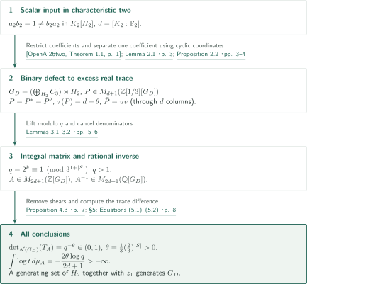
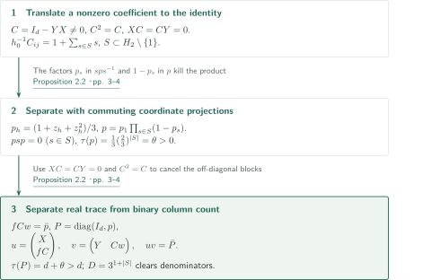
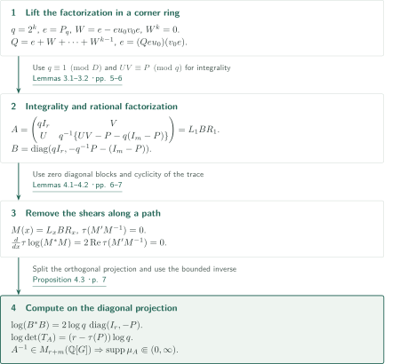

# A Counterexample to the Group-Ring Determinant Conjecture

**From a binary one-sided inverse defect to excess real trace and a negative integral-matrix logarithmic determinant**

The manuscript takes a scalar group-algebra counterexample in characteristic two as input and constructs a counterexample to the integer group-ring Determinant Conjecture. Its central device is a rational orthogonal projection whose real trace exceeds the number of columns through which its reduction modulo two factors; that discrepancy is converted into a Fuglede–Kadison determinant.

## 1. Main results

### Theorem 1.1 — A rationally invertible integral group-ring counterexample

There exist a finitely generated discrete group $G_D$, an integer $n\geq1$, and $A\in M_n(\mathbb Z[G_D])$ invertible over $\mathbb Q[G_D]$ such that its left regular operator satisfies

$$0<\det_{\mathcal N(G_D)}(T_A)<1.$$

For the probability spectral measure $\mu_A$ of $T_A^*T_A$ and the unnormalized trace $\tau_n(I_n)=n$, the convention is

$$\log\det_{\mathcal N(G_D)}(T_A)=\frac12\tau_n\log(T_A^*T_A)=\frac n2\int_{(0,\infty)}\log t\,d\mu_A(t).$$

This integral is finite and strictly negative. The output is a **matrix** over the integer group ring; invertibility over $\mathbb Z[G_D]$ is not asserted. The constructed group contains elements of order three. Neither finite presentation nor torsion-freeness is part of the conclusion.

<!-- cite:main -->[Theorem 1.1 · p. 2](https://github.com/openai/math/blob/1581d4cbdd69a0faf34b2089614fe2a814316a6a/preprints/A-Counterexample-to-the-Group-Ring-Determinant-Conjecture-September-23-2026/paper.pdf)<!-- /cite -->

<!-- cite:convention -->[Equations (1.1)–(1.2) · p. 1](https://github.com/openai/math/blob/1581d4cbdd69a0faf34b2089614fe2a814316a6a/preprints/A-Counterexample-to-the-Group-Ring-Determinant-Conjecture-September-23-2026/paper.pdf)<!-- /cite -->

## References on the arrows

<!-- reference-guide -->
Unprefixed theorem, lemma, section and equation numbers refer to [A Counterexample to the Group-Ring Determinant Conjecture](https://github.com/openai/math/blob/1581d4cbdd69a0faf34b2089614fe2a814316a6a/preprints/A-Counterexample-to-the-Group-Ring-Determinant-Conjecture-September-23-2026/paper.pdf). External inputs use the following keys.

- [OpenAI26two](https://github.com/openai/math/blob/1581d4cbdd69a0faf34b2089614fe2a814316a6a/preprints/A-Counterexample-to-Kaplanskys-Direct-Finiteness-Conjecture-in-Characteristic-Two-September-23-2026/paper.pdf) OpenAI — *A Counterexample to Kaplansky’s Direct-Finiteness Conjecture in Characteristic Two*: The sole external construction input: a scalar one-sided inverse pair over a finite field of characteristic two. September 23, 2026; fixed commit 1581d4cbdd69a0faf34b2089614fe2a814316a6a.
- [ES05](https://arxiv.org/pdf/math/0408400v2) Gábor Elek; Endre Szabó — *Hyperlinearity, essentially free actions and L²-invariants. The sofic property*: The determinant lower bound used only for the subsequent nonsoficity consequence. arXiv:math/0408400v2, 2014-10-07, 20 pages.

Each citation gives the result and pages. When printed pagination differs from the PDF position, both are shown. GitHub previews do not automatically jump to the cited page.
<!-- /reference-guide -->

## 2. Proof of Theorem 1.1 — The complete construction

<!-- proof-target:1 -->Proof target：[Theorem 1.1 · p. 2](https://github.com/openai/math/blob/1581d4cbdd69a0faf34b2089614fe2a814316a6a/preprints/A-Counterexample-to-the-Group-Ring-Determinant-Conjecture-September-23-2026/paper.pdf)<!-- /proof-target -->

**Proof route.** Start with a finite field $K_2$ of characteristic two and a scalar pair $a_2b_2=1\ne b_2a_2$. Put $d=[K_2:\mathbb F_2]$, pass to binary matrices, and apply the [projection construction](#proof-2) followed by the [integral-matrix conversion](#proof-3). The starting existence theorem supplies a finite prescription with proved termination, not an executed numerical instance. It does not assert $K_2=\mathbb F_2$.

### 1. From the scalar input to an integral matrix over a finitely generated group

Applying the regular representation $K_2\hookrightarrow M_d(\mathbb F_2)$ coefficientwise gives $X,Y\in M_d(\mathbb F_2[H_2])$ and $C=I_d-YX\ne0$. The identity $XY=I_d$ implies $C^2=C$ and $XC=CY=0$. Proposition 2.2 constructs

$$G_D=\left(\bigoplus_{h\in H_2}C_3\right)\rtimes H_2,\quad P\in M_{d+1}(\mathbb Z[1/3][G_D]),\quad\tau_{d+1}(P)=d+\theta,$$

with $\bar P$ factoring through $d$ columns. A finite generating set of $H_2$, together with the identity-coordinate generator $z_1$, generates $G_D$. Proposition 4.3 with $r=d$, $m=d+1$ supplies an integral matrix of size $n=2d+1$ and its finite-support rational inverse.

<!-- cite:input -->[&#91;OpenAI26two, Theorem 1.1, p. 1&#93;](https://github.com/openai/math/blob/1581d4cbdd69a0faf34b2089614fe2a814316a6a/preprints/A-Counterexample-to-Kaplanskys-Direct-Finiteness-Conjecture-in-Characteristic-Two-September-23-2026/paper.pdf)<!-- /cite -->

<!-- cite:restriction -->[Lemma 2.1 · p. 3](https://github.com/openai/math/blob/1581d4cbdd69a0faf34b2089614fe2a814316a6a/preprints/A-Counterexample-to-the-Group-Ring-Determinant-Conjecture-September-23-2026/paper.pdf)<!-- /cite -->

<!-- cite:assembly -->[§5; Equations (5.1)–(5.2) · p. 8](https://github.com/openai/math/blob/1581d4cbdd69a0faf34b2089614fe2a814316a6a/preprints/A-Counterexample-to-the-Group-Ring-Determinant-Conjecture-September-23-2026/paper.pdf)<!-- /cite -->

### 2. From excess trace to strict bounds and a finite logarithmic integral

A finite set $S\subset H_2\setminus\{1\}$ determines

$$\theta=\frac13\left(\frac23\right)^{|S|}>0,\qquad D=3^{1+|S|}.$$

Choose $q=2^k>1$ with $q\equiv1\pmod D$. Then

$$\det_{\mathcal N(G_D)}(T_A)=q^{-\theta}\in(0,1),\qquad \int_{(0,\infty)}\log t\,d\mu_A(t)=-\frac{2\theta\log q}{2d+1}<0.$$

The regular representation of the rational group-ring inverse is bounded, so the positive spectrum lies in a compact interval away from zero. This separately establishes finiteness of the logarithmic integral: the example violates the lower bound one, not determinant class.

<!-- cite:formula -->[Proposition 4.3 · p. 7](https://github.com/openai/math/blob/1581d4cbdd69a0faf34b2089614fe2a814316a6a/preprints/A-Counterexample-to-the-Group-Ring-Determinant-Conjecture-September-23-2026/paper.pdf)<!-- /cite -->

<!-- cite:assembly -->[§5; Equations (5.1)–(5.2) · p. 8](https://github.com/openai/math/blob/1581d4cbdd69a0faf34b2089614fe2a814316a6a/preprints/A-Counterexample-to-the-Group-Ring-Determinant-Conjecture-September-23-2026/paper.pdf)<!-- /cite -->

## 3. Proposition 2.2 — Coefficient separation and excess trace

<!-- proof-target:2 -->Proof target：[Proposition 2.2 · pp. 3–4](https://github.com/openai/math/blob/1581d4cbdd69a0faf34b2089614fe2a814316a6a/preprints/A-Counterexample-to-the-Group-Ring-Determinant-Conjecture-September-23-2026/paper.pdf)<!-- /proof-target -->

<!-- statement:proposition-2-2 -->
### Proposition 2.2 — A projection with trace exceeding its binary factorization size

Let $d\geq1$ and $X,Y\in M_d(\mathbb F_2[H_2])$ satisfy $XY=I_d\ne YX$. In the group $G_D$ above there exist a finite set $S\subset H_2\setminus\{1\}$ and an orthogonal projection $P\in M_{d+1}(\mathbb Z[1/3][G_D])$ such that $\tau_{d+1}(P)=d+\theta$, $\theta=\frac13(\frac23)^{|S|}>0$, and $\bar P=uv$. Here $u$ is $(d+1)\times d$ and $v$ is $d\times(d+1)$ over $\mathbb F_2[G_D]$, and $D=3^{1+|S|}$ clears all coefficients of $P$.

<!-- cite:projection -->[Proposition 2.2 · pp. 3–4](https://github.com/openai/math/blob/1581d4cbdd69a0faf34b2089614fe2a814316a6a/preprints/A-Counterexample-to-the-Group-Ring-Determinant-Conjecture-September-23-2026/paper.pdf)<!-- /cite -->
<!-- /statement -->

### 1. Enlarge the group to kill the unwanted coefficients

Translate a coefficient equal to one in a nonzero entry $C_{ij}$ to obtain $h_0^{-1}C_{ij}=1+\sum_{s\in S}s$. With coordinate averages $p_h=(1+z_h+z_h^2)/3$, set

$$p=p_1\prod_{s\in S}(1-p_s).$$

These averages are commuting self-adjoint idempotents. Since $sps^{-1}$ contains $p_s$ while $p$ contains $1-p_s$, one has $psp=0$. The original and translated label sets need not be disjoint. Distinct original coordinates make the identity coefficient multiplicative, giving $\tau_1(p)=\theta>0$.

<!-- cite:projection -->[Proposition 2.2 · pp. 3–4](https://github.com/openai/math/blob/1581d4cbdd69a0faf34b2089614fe2a814316a6a/preprints/A-Counterexample-to-the-Group-Ring-Determinant-Conjecture-September-23-2026/paper.pdf)<!-- /cite -->

### 2. Use the binary defect to save one column

Let $f$ be the row with $\bar p h_0^{-1}$ in position $i$, and $w$ the column with $\bar p$ in position $j$. Then $fCw=\bar p$. Define

$$P=\operatorname{diag}(I_d,p),\quad u=\begin{pmatrix}X\\fC\end{pmatrix},\quad v=\begin{pmatrix}Y&Cw\end{pmatrix}.$$

The identities $XC=CY=0$ and $C^2=C$ give $uv=\operatorname{diag}(I_d,\bar p)=\bar P$. The rational orthogonal projection $P$ has the excess real trace; this is not a real-valued comparison of the binary projection's trace.

<!-- cite:projection -->[Proposition 2.2 · pp. 3–4](https://github.com/openai/math/blob/1581d4cbdd69a0faf34b2089614fe2a814316a6a/preprints/A-Counterexample-to-the-Group-Ring-Determinant-Conjecture-September-23-2026/paper.pdf)<!-- /cite -->

## 4. Proposition 4.3 — Integrality and shear invariance

<!-- proof-target:3 -->Proof target：[Proposition 4.3 · p. 7](https://github.com/openai/math/blob/1581d4cbdd69a0faf34b2089614fe2a814316a6a/preprints/A-Counterexample-to-the-Group-Ring-Determinant-Conjecture-September-23-2026/paper.pdf)<!-- /proof-target -->

<!-- statement:proposition-4-3 -->
### Proposition 4.3 — Turning the trace gap into a determinant

Let $G$ be discrete, $m,r\geq1$, and $P=P^*=P^2\in M_m(\mathbb Q[G])$. Suppose an odd $D>0$ clears its denominators and $\bar P=uv$ factors into matrices of sizes $m\times r$ and $r\times m$ over $\mathbb F_2[G]$. For every $q=2^k>1$ with $q\equiv1\pmod D$, the matrix $A\in M_{r+m}(\mathbb Z[G])$ of Lemma 3.2 is invertible over $\mathbb Q[G]$ and satisfies

$$\tau_{r+m}\log(T_A^*T_A)=2(r-\tau_m(P))\log q,\qquad\log\det_{\mathcal N(G)}(T_A)=(r-\tau_m(P))\log q.$$

The positive-square spectral measure is supported in a compact subinterval of $(0,\infty)$.

<!-- cite:formula -->[Proposition 4.3 · p. 7](https://github.com/openai/math/blob/1581d4cbdd69a0faf34b2089614fe2a814316a6a/preprints/A-Counterexample-to-the-Group-Ring-Determinant-Conjecture-September-23-2026/paper.pdf)<!-- /cite -->
<!-- /statement -->

### 1. A finite corner geometric series enables integrality

Put $R=(\mathbb Z/q\mathbb Z)[G]$ and $e=P_q$. For arbitrary lifts $u_0,v_0$, work in the corner ring $eM_m(R)e$ with $Z=eu_0v_0e$ and $W=e-Z$. Every coefficient of $W$ is even, so $W^k=0$ and $Q=e+W+\cdots+W^{k-1}$ is a corner inverse of $Z$. Thus $u_q=Qeu_0$, $v_q=v_0e$ give $e=u_qv_q$.

For integral lifts $U,V$ set

$$A=\begin{pmatrix}qI_r&V\\U&q^{-1}\{UV-P-q(I_m-P)\}\end{pmatrix}.$$

The matrix $P+q(I_m-P)=qI_m+(1-q)P$ is integral because $D\mid q-1$; its agreement with $UV$ modulo $q$ makes the lower-right block integral. Put $J=-q^{-1}P-(I_m-P)$ and $B=\operatorname{diag}(qI_r,J)$. Then $A=L_1BR_1$, where $L_x,R_x$ are lower and upper block shears with off-diagonal blocks $xU/q,xV/q$. The identity $J^{-1}=-qP-(I_m-P)$ supplies an explicit rational inverse. No conditions such as $PU=U$ or $V=U^*$ are imposed on the lifts.

<!-- cite:lifting -->[Lemmas 3.1–3.2 · pp. 5–6](https://github.com/openai/math/blob/1581d4cbdd69a0faf34b2089614fe2a814316a6a/preprints/A-Counterexample-to-the-Group-Ring-Determinant-Conjecture-September-23-2026/paper.pdf)<!-- /cite -->

### 2. Differentiate under the trace along a noncommutative path

For $M(x)=L_xBR_x$, Lemma 4.1 gives

$$\frac d{dx}\tau\log(M(x)^*M(x))=2\operatorname{Re}\tau(M'(x)M(x)^{-1}).$$

The proof uses a uniformly convergent logarithm series and tracial cyclicity, without assuming that $M^*M$ commutes with its derivative. Each shear's logarithmic derivative has zero diagonal blocks; its trace, also after conjugation, is zero. Hence this quantity is constant along the path. Computing at $B^*B=\operatorname{diag}(q^2I_r,q^{-2}P+I_m-P)$ produces the difference $r-\tau_m(P)$. The bounded inverse gives $\|T_A^{-1}\|^{-2}I\leq T_A^*T_A\leq\|T_A\|^2I$.

<!-- cite:trace -->[Lemmas 4.1–4.2 · pp. 6–7](https://github.com/openai/math/blob/1581d4cbdd69a0faf34b2089614fe2a814316a6a/preprints/A-Counterexample-to-the-Group-Ring-Determinant-Conjecture-September-23-2026/paper.pdf)<!-- /cite -->

<!-- cite:formula -->[Proposition 4.3 · p. 7](https://github.com/openai/math/blob/1581d4cbdd69a0faf34b2089614fe2a814316a6a/preprints/A-Counterexample-to-the-Group-Ring-Determinant-Conjecture-September-23-2026/paper.pdf)<!-- /cite -->

## 5. External inputs and consequences

The scalar characteristic-two pair is the external input treated in the [Characteristic Two article](../direct-finiteness-characteristic-two/article.en.md); its construction is not reproved here. An odd-characteristic pair alone does not satisfy the binary premise. Coordinate projections and the tracial logarithmic derivative have earlier antecedents, but the required arguments are proved locally in this manuscript.

Nonsoficity is a subsequent consequence. If $G_D$ were sofic, the ES05 lower bound would apply to the positive self-adjoint integral matrix $A^*A$, giving $\tau\log(T_A^*T_A)\geq0$, contrary to the computed negative value. This theorem is not used to construct $A$.

<!-- cite:sofic -->[&#91;ES05, Theorem 5, p. 18&#93;](https://arxiv.org/pdf/math/0408400v2#page=18)<!-- /cite -->

<!-- cite:assembly -->[§5; Equations (5.1)–(5.2) · p. 8](https://github.com/openai/math/blob/1581d4cbdd69a0faf34b2089614fe2a814316a6a/preprints/A-Counterexample-to-the-Group-Ring-Determinant-Conjecture-September-23-2026/paper.pdf)<!-- /cite -->

## 6. Return to the sources

<!-- reading-list -->
- [Proposition 2.2 · pp. 3–4](https://github.com/openai/math/blob/1581d4cbdd69a0faf34b2089614fe2a814316a6a/preprints/A-Counterexample-to-the-Group-Ring-Determinant-Conjecture-September-23-2026/paper.pdf) — Separate one defect coefficient and create the gap between real trace and binary factorization
- [Lemmas 3.1–3.2 · pp. 5–6](https://github.com/openai/math/blob/1581d4cbdd69a0faf34b2089614fe2a814316a6a/preprints/A-Counterexample-to-the-Group-Ring-Determinant-Conjecture-September-23-2026/paper.pdf) — Follow the corner inverse and the integrality calculation
- [Lemmas 4.1–4.2 · pp. 6–7](https://github.com/openai/math/blob/1581d4cbdd69a0faf34b2089614fe2a814316a6a/preprints/A-Counterexample-to-the-Group-Ring-Determinant-Conjecture-September-23-2026/paper.pdf) — Use tracial cyclicity to handle noncommutative differentiation
- [§5; Equations (5.1)–(5.2) · p. 8](https://github.com/openai/math/blob/1581d4cbdd69a0faf34b2089614fe2a814316a6a/preprints/A-Counterexample-to-the-Group-Ring-Determinant-Conjecture-September-23-2026/paper.pdf) — Check all conclusions and determinant normalization
<!-- /reading-list -->

We read §§2–5 and checked the connections between the main statement, projection, modular lift, integrality, trace calculation, and finite generation. We also compared the characteristic-two input statement with its use here, and the ES05 lower bound for positive integral matrices with the nonsoficity consequence. This does not include independent verification of all external proofs, numerical execution of the finite prescription, expert peer review, or formal verification.
