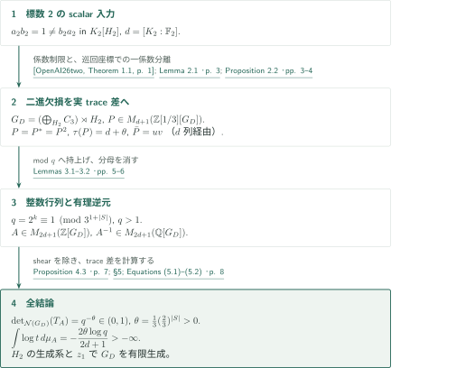
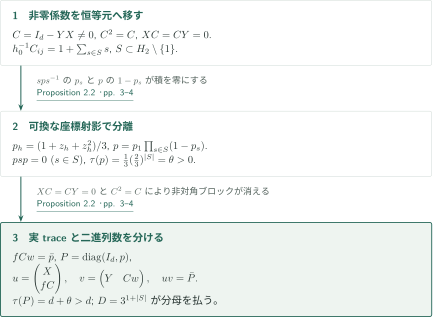
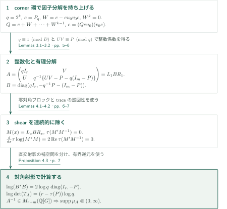

# A Counterexample to the Group-Ring Determinant Conjecture

**二進の片側逆元欠損を、実traceの余剰と整数行列の負の対数行列式へ移す**

原稿は標数2のscalar群環反例を入力として、整数群環上の行列式予想の反例を構成する。核心は、有理直交射影の実traceが、そのmod 2因子分解の列数を上回る状況を作り、その差をFuglede–Kadison行列式へ変換することである。

## 1. 主要結果

### Theorem 1.1 — 有理可逆な整数群環行列の反例

有限生成離散群$G_D$、整数$n\geq1$、$\mathbb Q[G_D]$上可逆な$A\in M_n(\mathbb Z[G_D])$が存在し、左正則表現の作用素$T_A$について

$$0<\det_{\mathcal N(G_D)}(T_A)<1.$$

$T_A^*T_A$の確率スペクトル測度を$\mu_A$、$\tau_n(I_n)=n$となる非正規化traceを$\tau_n$とすると、

$$\log\det_{\mathcal N(G_D)}(T_A)=\frac12\tau_n\log(T_A^*T_A)=\frac n2\int_{(0,\infty)}\log t\,d\mu_A(t).$$

この積分は有限かつ厳密に負である。$A$は整数群環上の**行列**であり、$\mathbb Z[G_D]$上可逆とは主張していない。構成される群は位数3の元を含む。有限表示性やtorsion-free性は結論に含まれない。

<!-- cite:main -->[Theorem 1.1 · p. 2](https://github.com/openai/math/blob/1581d4cbdd69a0faf34b2089614fe2a814316a6a/preprints/A-Counterexample-to-the-Group-Ring-Determinant-Conjecture-September-23-2026/paper.pdf)<!-- /cite -->

<!-- cite:convention -->[Equations (1.1)–(1.2) · p. 1](https://github.com/openai/math/blob/1581d4cbdd69a0faf34b2089614fe2a814316a6a/preprints/A-Counterexample-to-the-Group-Ring-Determinant-Conjecture-September-23-2026/paper.pdf)<!-- /cite -->

## 図の矢印に付した引用

<!-- reference-guide -->
略号のない定理・補題・節・式番号は本原稿 [A Counterexample to the Group-Ring Determinant Conjecture](https://github.com/openai/math/blob/1581d4cbdd69a0faf34b2089614fe2a814316a6a/preprints/A-Counterexample-to-the-Group-Ring-Determinant-Conjecture-September-23-2026/paper.pdf) を指します。外部入力には次の略号を使います。

- [OpenAI26two](https://github.com/openai/math/blob/1581d4cbdd69a0faf34b2089614fe2a814316a6a/preprints/A-Counterexample-to-Kaplanskys-Direct-Finiteness-Conjecture-in-Characteristic-Two-September-23-2026/paper.pdf) OpenAI — *A Counterexample to Kaplansky’s Direct-Finiteness Conjecture in Characteristic Two*：標数2の有限体上のscalar片側逆元対を供給する唯一の外部構成入力。September 23, 2026; fixed commit 1581d4cbdd69a0faf34b2089614fe2a814316a6a。
- [ES05](https://arxiv.org/pdf/math/0408400v2) Gábor Elek; Endre Szabó — *Hyperlinearity, essentially free actions and L²-invariants. The sofic property*：構成後の非sofic性への帰結にのみ使用する行列式下界。arXiv:math/0408400v2, 2014-10-07, 20 pages。

各引用に結果番号とページを付します。誌面番号とPDF内の位置が異なる場合は両方を示します。GitHubの閲覧リンクではページ位置への自動移動を前提としません。
<!-- /reference-guide -->

## 2. Theorem 1.1 の証明 — 主定理の全体像

<!-- proof-target:1 -->証明対象：[Theorem 1.1 · p. 2](https://github.com/openai/math/blob/1581d4cbdd69a0faf34b2089614fe2a814316a6a/preprints/A-Counterexample-to-the-Group-Ring-Determinant-Conjecture-September-23-2026/paper.pdf)<!-- /proof-target -->

**証明の道筋。** 標数2の有限体$K_2$とscalar対$a_2b_2=1\ne b_2a_2$を出発点とする。$d=[K_2:\mathbb F_2]$として二進行列へ移し、[射影の構成](#proof-2)と[整数行列への変換](#proof-3)を順に用いる。出発点は停止が証明された有限手順による存在定理であり、実行済み数値例ではない。$K_2=\mathbb F_2$も仮定しない。

### 1. scalar入力から有限生成群上の整数行列へ

係数ごとの正則表現$K_2\hookrightarrow M_d(\mathbb F_2)$により、$X,Y\in M_d(\mathbb F_2[H_2])$と$C=I_d-YX\ne0$を得る。$XY=I_d$から$C^2=C$, $XC=CY=0$である。Proposition 2.2は

$$G_D=\left(\bigoplus_{h\in H_2}C_3\right)\rtimes H_2,\quad P\in M_{d+1}(\mathbb Z[1/3][G_D]),\quad\tau_{d+1}(P)=d+\theta$$

を構成し、$\bar P$を$d$列経由で因子分解する。$H_2$の有限生成系と恒等元座標の生成元$z_1$だけで$G_D$を生成できる。Proposition 4.3に$r=d$, $m=d+1$を入れ、$n=2d+1$の整数行列と有限台の有理逆元を得る。

<!-- cite:input -->[&#91;OpenAI26two, Theorem 1.1, p. 1&#93;](https://github.com/openai/math/blob/1581d4cbdd69a0faf34b2089614fe2a814316a6a/preprints/A-Counterexample-to-Kaplanskys-Direct-Finiteness-Conjecture-in-Characteristic-Two-September-23-2026/paper.pdf)<!-- /cite -->

<!-- cite:restriction -->[Lemma 2.1 · p. 3](https://github.com/openai/math/blob/1581d4cbdd69a0faf34b2089614fe2a814316a6a/preprints/A-Counterexample-to-the-Group-Ring-Determinant-Conjecture-September-23-2026/paper.pdf)<!-- /cite -->

<!-- cite:assembly -->[§5; Equations (5.1)–(5.2) · p. 8](https://github.com/openai/math/blob/1581d4cbdd69a0faf34b2089614fe2a814316a6a/preprints/A-Counterexample-to-the-Group-Ring-Determinant-Conjecture-September-23-2026/paper.pdf)<!-- /cite -->

### 2. traceの余剰から二つの厳密不等式と積分の有限性へ

有限集合$S\subset H_2\setminus\{1\}$から

$$\theta=\frac13\left(\frac23\right)^{|S|}>0,\qquad D=3^{1+|S|}$$

を得る。$q=2^k>1$を$q\equiv1\pmod D$となるよう取ると、

$$\det_{\mathcal N(G_D)}(T_A)=q^{-\theta}\in(0,1),\qquad \int_{(0,\infty)}\log t\,d\mu_A(t)=-\frac{2\theta\log q}{2d+1}<0.$$

有理群環逆元の正則表現は有界なので、正のスペクトルは0から離れたコンパクト区間に入る。したがって対数積分の有限性は別途保証され、これはdeterminant classの失敗ではなく下界1の失敗である。

<!-- cite:formula -->[Proposition 4.3 · p. 7](https://github.com/openai/math/blob/1581d4cbdd69a0faf34b2089614fe2a814316a6a/preprints/A-Counterexample-to-the-Group-Ring-Determinant-Conjecture-September-23-2026/paper.pdf)<!-- /cite -->

<!-- cite:assembly -->[§5; Equations (5.1)–(5.2) · p. 8](https://github.com/openai/math/blob/1581d4cbdd69a0faf34b2089614fe2a814316a6a/preprints/A-Counterexample-to-the-Group-Ring-Determinant-Conjecture-September-23-2026/paper.pdf)<!-- /cite -->

## 3. Proposition 2.2 の証明 — 一係数の分離とtrace差

<!-- proof-target:2 -->証明対象：[Proposition 2.2 · pp. 3–4](https://github.com/openai/math/blob/1581d4cbdd69a0faf34b2089614fe2a814316a6a/preprints/A-Counterexample-to-the-Group-Ring-Determinant-Conjecture-September-23-2026/paper.pdf)<!-- /proof-target -->

<!-- statement:proposition-2-2 -->
### Proposition 2.2 — 二進因子分解より大きなtraceを持つ射影

$d\geq1$、$X,Y\in M_d(\mathbb F_2[H_2])$が$XY=I_d\ne YX$を満たすとする。上記の$G_D$には有限集合$S\subset H_2\setminus\{1\}$と直交射影$P\in M_{d+1}(\mathbb Z[1/3][G_D])$が存在し、$\tau_{d+1}(P)=d+\theta$、$\theta=\frac13(\frac23)^{|S|}>0$、$\bar P=uv$を満たす。$u$は$(d+1)\times d$、$v$は$d\times(d+1)$の$\mathbb F_2[G_D]$行列で、$D=3^{1+|S|}$は$P$の全係数の分母を払う。

<!-- cite:projection -->[Proposition 2.2 · pp. 3–4](https://github.com/openai/math/blob/1581d4cbdd69a0faf34b2089614fe2a814316a6a/preprints/A-Counterexample-to-the-Group-Ring-Determinant-Conjecture-September-23-2026/paper.pdf)<!-- /cite -->
<!-- /statement -->

### 1. 群を拡大して不要な係数を消す

非零成分$C_{ij}$の係数1を左移動して$h_0^{-1}C_{ij}=1+\sum_{s\in S}s$とする。座標$h$の平均$p_h=(1+z_h+z_h^2)/3$から

$$p=p_1\prod_{s\in S}(1-p_s)$$

を作る。座標平均は可換な自己共役冪等元である。$sps^{-1}$は$p_s$を、$p$は$1-p_s$を因子に持つので$psp=0$。ラベル集合とその平行移動が互いに素である必要はない。恒等元係数は元の相異なる座標ごとに積となり$\tau_1(p)=\theta>0$を与える。

<!-- cite:projection -->[Proposition 2.2 · pp. 3–4](https://github.com/openai/math/blob/1581d4cbdd69a0faf34b2089614fe2a814316a6a/preprints/A-Counterexample-to-the-Group-Ring-Determinant-Conjecture-September-23-2026/paper.pdf)<!-- /cite -->

### 2. 二進欠損を用いて一列を節約する

$f$を第$i$成分が$\bar p h_0^{-1}$の行、$w$を第$j$成分が$\bar p$の列とすると$fCw=\bar p$。そこで

$$P=\operatorname{diag}(I_d,p),\quad u=\begin{pmatrix}X\\fC\end{pmatrix},\quad v=\begin{pmatrix}Y&Cw\end{pmatrix}$$

とする。$XC=CY=0$と$C^2=C$から$uv=\operatorname{diag}(I_d,\bar p)=\bar P$となる。大きい実traceを持つのは有理直交射影$P$であり、二進射影のtraceを実数として比較しているのではない。

<!-- cite:projection -->[Proposition 2.2 · pp. 3–4](https://github.com/openai/math/blob/1581d4cbdd69a0faf34b2089614fe2a814316a6a/preprints/A-Counterexample-to-the-Group-Ring-Determinant-Conjecture-September-23-2026/paper.pdf)<!-- /cite -->

## 4. Proposition 4.3 の証明 — 整数化とshear不変性

<!-- proof-target:3 -->証明対象：[Proposition 4.3 · p. 7](https://github.com/openai/math/blob/1581d4cbdd69a0faf34b2089614fe2a814316a6a/preprints/A-Counterexample-to-the-Group-Ring-Determinant-Conjecture-September-23-2026/paper.pdf)<!-- /proof-target -->

<!-- statement:proposition-4-3 -->
### Proposition 4.3 — trace差の行列式への変換

$G$を離散群、$m,r\geq1$、$P=P^*=P^2\in M_m(\mathbb Q[G])$とする。奇数$D>0$が分母を払い、$\bar P=uv$が$\mathbb F_2[G]$上の$m\times r$と$r\times m$の因子分解を持つと仮定する。各$q=2^k>1$、$q\equiv1\pmod D$についてLemma 3.2の行列$A\in M_{r+m}(\mathbb Z[G])$は$\mathbb Q[G]$上可逆で、

$$\tau_{r+m}\log(T_A^*T_A)=2(r-\tau_m(P))\log q,\qquad\log\det_{\mathcal N(G)}(T_A)=(r-\tau_m(P))\log q.$$

さらに$T_A^*T_A$のスペクトル測度の台は$(0,\infty)$のコンパクト部分区間に含まれる。

<!-- cite:formula -->[Proposition 4.3 · p. 7](https://github.com/openai/math/blob/1581d4cbdd69a0faf34b2089614fe2a814316a6a/preprints/A-Counterexample-to-the-Group-Ring-Determinant-Conjecture-September-23-2026/paper.pdf)<!-- /cite -->
<!-- /statement -->

### 1. cornerの有限幾何級数が整数化を可能にする

$R=(\mathbb Z/q\mathbb Z)[G]$, $e=P_q$とする。$u,v$の任意の持上げ$u_0,v_0$に対してcorner環$eM_m(R)e$で$Z=eu_0v_0e$, $W=e-Z$と置く。$W$の全係数は偶数で$W^k=0$、したがって$Q=e+W+\cdots+W^{k-1}$は$Z$のcorner逆元である。$u_q=Qeu_0$, $v_q=v_0e$は$e=u_qv_q$を与える。

その整数持上げを$U,V$とすると、

$$A=\begin{pmatrix}qI_r&V\\U&q^{-1}\{UV-P-q(I_m-P)\}\end{pmatrix}.$$

$P+q(I_m-P)=qI_m+(1-q)P$は$D\mid q-1$により整数であり、$UV$とのmod $q$一致で右下成分も整数になる。$J=-q^{-1}P-(I_m-P)$、$B=\operatorname{diag}(qI_r,J)$なら$A=L_1BR_1$で、$L_x,R_x$は非対角成分$xU/q,xV/q$の下・上三角shearである。$J^{-1}=-qP-(I_m-P)$から有理逆元が明示される。持上げに$PU=U$や$V=U^*$を課す必要はない。

<!-- cite:lifting -->[Lemmas 3.1–3.2 · pp. 5–6](https://github.com/openai/math/blob/1581d4cbdd69a0faf34b2089614fe2a814316a6a/preprints/A-Counterexample-to-the-Group-Ring-Determinant-Conjecture-September-23-2026/paper.pdf)<!-- /cite -->

### 2. 非可換な経路上ではtraceを取ってから微分する

$M(x)=L_xBR_x$に対しLemma 4.1は

$$\frac d{dx}\tau\log(M(x)^*M(x))=2\operatorname{Re}\tau(M'(x)M(x)^{-1})$$

を与える。証明は一様収束する対数級数とtraceの巡回性を使い、$M^*M$とその微分の可換性を仮定しない。shearの対数微分は対角ブロックが零であり、共役後もtraceが零なので、この量は経路上一定である。$B^*B=\operatorname{diag}(q^2I_r,q^{-2}P+I_m-P)$で計算すると所要の差$r-\tau_m(P)$が出る。有界逆元は$\|T_A^{-1}\|^{-2}I\leq T_A^*T_A\leq\|T_A\|^2I$を与える。

<!-- cite:trace -->[Lemmas 4.1–4.2 · pp. 6–7](https://github.com/openai/math/blob/1581d4cbdd69a0faf34b2089614fe2a814316a6a/preprints/A-Counterexample-to-the-Group-Ring-Determinant-Conjecture-September-23-2026/paper.pdf)<!-- /cite -->

<!-- cite:formula -->[Proposition 4.3 · p. 7](https://github.com/openai/math/blob/1581d4cbdd69a0faf34b2089614fe2a814316a6a/preprints/A-Counterexample-to-the-Group-Ring-Determinant-Conjecture-September-23-2026/paper.pdf)<!-- /cite -->

## 5. 直接入力と帰結の区別

標数2のscalar対は[Characteristic Twoの記事](../direct-finiteness-characteristic-two/article.ja.md)が扱う外部入力であり、その構成を本稿内で再証明しない。奇標数の対だけでは二進の前提を満たさない。射影の座標法やtracial logarithmic derivativeには先行研究があるが、本稿は必要な論証を局所的に与えている。

非sofic性は構成後の帰結である。$G_D$がsoficなら、ES05の下界を正の自己共役整数行列$A^*A$へ適用でき、$\tau\log(T_A^*T_A)\geq0$となって負値に矛盾する。この定理は$A$の構成には使わない。

<!-- cite:sofic -->[&#91;ES05, Theorem 5, p. 18&#93;](https://arxiv.org/pdf/math/0408400v2#page=18)<!-- /cite -->

<!-- cite:assembly -->[§5; Equations (5.1)–(5.2) · p. 8](https://github.com/openai/math/blob/1581d4cbdd69a0faf34b2089614fe2a814316a6a/preprints/A-Counterexample-to-the-Group-Ring-Determinant-Conjecture-September-23-2026/paper.pdf)<!-- /cite -->

## 6. 原典を読む入口と確認範囲

<!-- reading-list -->
- [Proposition 2.2 · pp. 3–4](https://github.com/openai/math/blob/1581d4cbdd69a0faf34b2089614fe2a814316a6a/preprints/A-Counterexample-to-the-Group-Ring-Determinant-Conjecture-September-23-2026/paper.pdf) — 欠損の一係数を分離し、実traceと二進因子分解の差を作る
- [Lemmas 3.1–3.2 · pp. 5–6](https://github.com/openai/math/blob/1581d4cbdd69a0faf34b2089614fe2a814316a6a/preprints/A-Counterexample-to-the-Group-Ring-Determinant-Conjecture-September-23-2026/paper.pdf) — corner逆元と整数係数の確保を追う
- [Lemmas 4.1–4.2 · pp. 6–7](https://github.com/openai/math/blob/1581d4cbdd69a0faf34b2089614fe2a814316a6a/preprints/A-Counterexample-to-the-Group-Ring-Determinant-Conjecture-September-23-2026/paper.pdf) — 非可換な微分をtraceの巡回性で処理する
- [§5; Equations (5.1)–(5.2) · p. 8](https://github.com/openai/math/blob/1581d4cbdd69a0faf34b2089614fe2a814316a6a/preprints/A-Counterexample-to-the-Group-Ring-Determinant-Conjecture-September-23-2026/paper.pdf) — 全結論と正規化を照合する
<!-- /reading-list -->

原稿の§§2–5を読み、主要結果・射影・mod $q$持上げ・整数性・trace計算・有限生成性の接続を照合した。標数2の入力定理の記述と本稿の使用箇所、ES05の正の整数行列に対する下界と非sofic帰結への適用も照合した。外部論文の全証明、有限手順の数値実行、専門家査読・形式検証はこの確認に含まれない。
