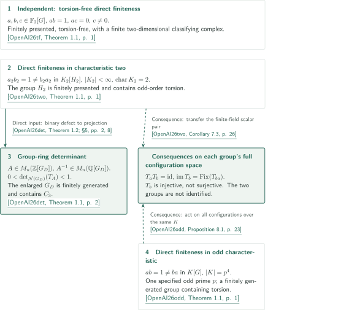

# Nonsofic groups and group-ring counterexamples

**Official catalogue 197 — Algebra**

The three scalar direct-finiteness counterexamples differ in coefficient field, torsion, and construction. The finite-field characteristic-two example also supplies an input for a counterexample to the integer group-ring determinant lower bound. The guide separates scalar elements, group-ring matrices, nonsoficity, and cellular-automaton consequences.

## Papers in official catalogue order

CATALOGINVENTORYTOKEN

## How the constructions and results connect

The solid arrow records an actual inter-paper proof input. Dashed arrows are cellular-automaton consequences of completed scalar pairs, not inputs for constructing another group-algebra counterexample. The torsion-free construction at the top is independent.

### References on the diagram

- **OpenAI26tf** — OpenAI, *A Torsion-Free Group Algebra That Is Not Directly Finite*, October 4, 2026. The independent prime-field $\mathbb F_2$, torsion-free construction. <!-- cite:tf-main -->[&#91;OpenAI26tf, Theorem 1.1, p. 1&#93;](https://github.com/openai/math/blob/1581d4cbdd69a0faf34b2089614fe2a814316a6a/preprints/A-Torsion-Free-Group-Algebra-That-Is-Not-Directly-Finite-October-4-2026/direct-finiteness.pdf)<!-- /cite -->
- **OpenAI26two** — OpenAI, *A Counterexample to Kaplansky's Direct-Finiteness Conjecture in Characteristic Two*, September 23, 2026. Supplies the scalar pair used by the determinant paper and its own CA consequence. <!-- cite:two-main -->[&#91;OpenAI26two, Theorem 1.1, p. 1&#93;](https://github.com/openai/math/blob/1581d4cbdd69a0faf34b2089614fe2a814316a6a/preprints/A-Counterexample-to-Kaplanskys-Direct-Finiteness-Conjecture-in-Characteristic-Two-September-23-2026/paper.pdf)<!-- /cite -->
- **OpenAI26det** — OpenAI, *A Counterexample to the Group-Ring Determinant Conjecture*, September 23, 2026. Converts a binary defect into an integral group-ring matrix. <!-- cite:det-main -->[&#91;OpenAI26det, Theorem 1.1, p. 2&#93;](https://github.com/openai/math/blob/1581d4cbdd69a0faf34b2089614fe2a814316a6a/preprints/A-Counterexample-to-the-Group-Ring-Determinant-Conjecture-September-23-2026/paper.pdf)<!-- /cite -->
- **OpenAI26odd** — OpenAI, *A Counterexample to Kaplansky's Direct-Finiteness Conjecture in Odd Characteristic*, September 26, 2026. An independent construction for one specified odd prime and its CA consequence. <!-- cite:odd-main -->[&#91;OpenAI26odd, Theorem 1.1, p. 1&#93;](https://github.com/openai/math/blob/1581d4cbdd69a0faf34b2089614fe2a814316a6a/preprints/A-Counterexample-to-Kaplanskys-Direct-Finiteness-Conjecture-in-Odd-Characteristic-September-26-2026/paper.pdf)<!-- /cite -->

All four versions are fixed to the same official commit. Citations give original result numbers and pages, with printed and PDF pagination agreeing.

The scalar pair from [Direct finiteness in characteristic two](../direct-finiteness-characteristic-two/article.en.md) is restricted to a binary matrix pair in [Group-ring determinant](../group-ring-determinant/article.en.md#proof-1). A projection over the enlarged group $G_D=(\bigoplus_{H_2}C_3)\rtimes H_2$ then yields an integral matrix with determinant strictly between zero and one. The input and output groups differ, and the latter contains order-three torsion. Since the starting field need not be $\mathbb F_2$ itself, the coefficient-restriction dimension $d$ must be retained.

[Direct finiteness in odd characteristic](../direct-finiteness-odd-characteristic/article.en.md) does not replace this binary input. Transferring its scalar pair over the specified $p$ to $T_c$, using the same right-neighbor convention as the characteristic-two paper, gives $T_aT_b=\operatorname{id}$ and $\operatorname{im}T_b=\operatorname{Fix}(T_{ba})$ in both cases. A nonzero coefficient of the reverse defect detects nonsurjectivity on the full configuration space.

| Kind | Supplying result → use | Content and hypotheses |
|---|---|---|
| Direct input | Characteristic two, Theorem 1.1 → Determinant, Theorem 1.2 and §5 | A scalar pair over a finite characteristic-two field and a finitely generated group. Finite presentation of the input is weakened to finite generation here. |
| Internal consequence | Characteristic two, Theorem 1.1 → Proposition 7.2 and Corollary 7.3 | A finite field, finite support, and $ab=1\ne ba$ give an injective nonsurjective CA and its fixed-point image description. |
| Internal consequence | Odd characteristic, Theorem 1.1 → Proposition 8.1 | The same algebraic conditions are used over the unchanged specified field of order $p^4$. |

<!-- cite:two-main -->[&#91;OpenAI26two, Theorem 1.1, p. 1&#93;](https://github.com/openai/math/blob/1581d4cbdd69a0faf34b2089614fe2a814316a6a/preprints/A-Counterexample-to-Kaplanskys-Direct-Finiteness-Conjecture-in-Characteristic-Two-September-23-2026/paper.pdf)<!-- /cite -->

<!-- cite:det-input -->[&#91;OpenAI26det, Theorem 1.2; §5, pp. 2, 8&#93;](https://github.com/openai/math/blob/1581d4cbdd69a0faf34b2089614fe2a814316a6a/preprints/A-Counterexample-to-the-Group-Ring-Determinant-Conjecture-September-23-2026/paper.pdf)<!-- /cite -->

<!-- cite:two-ca -->[&#91;OpenAI26two, Corollary 7.3, p. 26&#93;](https://github.com/openai/math/blob/1581d4cbdd69a0faf34b2089614fe2a814316a6a/preprints/A-Counterexample-to-Kaplanskys-Direct-Finiteness-Conjecture-in-Characteristic-Two-September-23-2026/paper.pdf)<!-- /cite -->

<!-- cite:odd-ca -->[&#91;OpenAI26odd, Proposition 8.1, p. 23&#93;](https://github.com/openai/math/blob/1581d4cbdd69a0faf34b2089614fe2a814316a6a/preprints/A-Counterexample-to-Kaplanskys-Direct-Finiteness-Conjecture-in-Odd-Characteristic-September-26-2026/paper.pdf)<!-- /cite -->

Nonsoficity is not a construction principle in the reverse direction. The external stable-finiteness theorem **ES04** (Gábor Elek and Endre Szabó, *Sofic groups and direct finiteness*, arXiv:math/0305440v2, 19 April 2004) implies that each of the three scalar constructions has a nonsofic group. For the determinant output group, applying the bound in **ES05** (the same authors, *Hyperlinearity, essentially free actions and L²-invariants. The sofic property*, arXiv:math/0408400v2, 7 October 2014) to $A^*A$ gives a contradiction. These external theorems explain consequences of the completed counterexamples.

<!-- cite:es04 -->[&#91;ES04, Corollary 4.7, p. 8&#93;](https://arxiv.org/pdf/math/0305440v2#page=8)<!-- /cite -->

<!-- cite:es05 -->[&#91;ES05, Theorem 5, p. 18&#93;](https://arxiv.org/pdf/math/0408400v2#page=18)<!-- /cite -->

## Where to enter the proofs

- **Prime field and torsion-freeness together:** read parity, finite-arrangement exclusion, and cone surgery in [Torsion-free direct finiteness](../torsion-free-direct-finiteness/article.en.md). The product identities, the nonzero certificate $c$, and the classifying-complex properties require separate connections.
- **From matrices to scalars:** in the [characteristic-two article](../direct-finiteness-characteristic-two/article.en.md), follow character packing and detection of the defect in an embedded subalgebra; in the [odd-characteristic article](../direct-finiteness-odd-characteristic/article.en.md#proof-1), follow the common sector, triangular compression, and finite Heisenberg matrix units. The coefficient hypotheses and local mechanisms differ.
- **Real trace versus reduction modulo two:** in the [determinant article](../group-ring-determinant/article.en.md#proof-2), compare the projection's real trace with the binary factorization's column count, then separate integrality from rational invertibility in the next section.

## Sources and checking scope

The official field is **Algebra**, the number is **197**, and the overview title is **Nonsofic groups and group-ring counterexamples** (PDF p. 21). The CONTENTS.md heading is instead **A torsion-free group algebra that is not directly finite**. The table preserves the four-paper CONTENTS order; internal paper IDs are distinct from the catalogue number. The reference commit is `1581d4cbdd69a0faf34b2089614fe2a814316a6a`, and the overview title-page date is October 6, 2026.

<!-- cite:overview -->[OpenAI Research Catalog · Catalogue 197 / Algebra · p. 21](https://github.com/openai/math/blob/1581d4cbdd69a0faf34b2089614fe2a814316a6a/overview.pdf)<!-- /cite -->

The main results, core proof passages, and recorded input statements and applications were compared with the official sources. Both ends of the characteristic-two determinant input and the CA image calculation were checked. Unrecorded citation relationships are not treated as absent dependencies. Individual articles identify probabilistic estimates, topological cases, and other details not independently recalculated. Characteristic-two Corollary 7.4 and the external type-$F_\infty$ embedding are outside this guide’s checked claims. Finite prescriptions have not been executed; recursive verification of all external proofs, expert peer review, and formal verification have not been performed.
