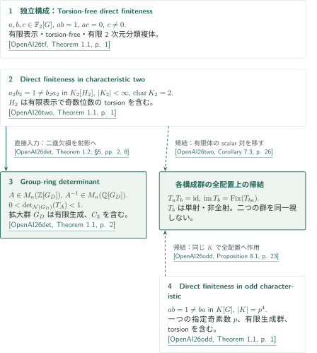

# 非sofic群と群環の反例

**Nonsofic groups and group-ring counterexamples — 公式カタログ197、Algebra**

三つのscalar直接有限性反例は、係数体・群のtorsion・構成法が異なる。そのうち標数2の有限体上の反例を用いて、第四の問題である整数群環の行列式下界へ反例を移す。scalar元、群環上の行列、非sofic性、cellular automatonの帰結を区別して接続を示す。

## 公式順の記事一覧

CATALOGINVENTORYTOKEN

## 構成と結果のつながり

図の実線は、原稿が実際に使う論文間の直接入力を表す。破線は完成したscalar対からのcellular automatonの帰結であり、別の群環反例の構成入力ではない。上段のtorsion-free構成は独立している。

### 図の引用案内

- **OpenAI26tf** — OpenAI, *A Torsion-Free Group Algebra That Is Not Directly Finite*、October 4, 2026。素体$\mathbb F_2$・torsion-free群の独立構成。<!-- cite:tf-main -->[&#91;OpenAI26tf, Theorem 1.1, p. 1&#93;](https://github.com/openai/math/blob/1581d4cbdd69a0faf34b2089614fe2a814316a6a/preprints/A-Torsion-Free-Group-Algebra-That-Is-Not-Directly-Finite-October-4-2026/direct-finiteness.pdf)<!-- /cite -->
- **OpenAI26two** — OpenAI, *A Counterexample to Kaplansky's Direct-Finiteness Conjecture in Characteristic Two*、September 23, 2026。行列式論文へ渡すscalar対と、そのCA帰結。<!-- cite:two-main -->[&#91;OpenAI26two, Theorem 1.1, p. 1&#93;](https://github.com/openai/math/blob/1581d4cbdd69a0faf34b2089614fe2a814316a6a/preprints/A-Counterexample-to-Kaplanskys-Direct-Finiteness-Conjecture-in-Characteristic-Two-September-23-2026/paper.pdf)<!-- /cite -->
- **OpenAI26det** — OpenAI, *A Counterexample to the Group-Ring Determinant Conjecture*、September 23, 2026。二進欠損から整数群環行列への変換。<!-- cite:det-main -->[&#91;OpenAI26det, Theorem 1.1, p. 2&#93;](https://github.com/openai/math/blob/1581d4cbdd69a0faf34b2089614fe2a814316a6a/preprints/A-Counterexample-to-the-Group-Ring-Determinant-Conjecture-September-23-2026/paper.pdf)<!-- /cite -->
- **OpenAI26odd** — OpenAI, *A Counterexample to Kaplansky's Direct-Finiteness Conjecture in Odd Characteristic*、September 26, 2026。一つの指定奇素数に対する独立構成とCA帰結。<!-- cite:odd-main -->[&#91;OpenAI26odd, Theorem 1.1, p. 1&#93;](https://github.com/openai/math/blob/1581d4cbdd69a0faf34b2089614fe2a814316a6a/preprints/A-Counterexample-to-Kaplanskys-Direct-Finiteness-Conjecture-in-Odd-Characteristic-September-26-2026/paper.pdf)<!-- /cite -->

全て同一の公式commitに固定した版を参照する。各引用は原典の結果番号と誌面/PDF共通ページを示す。

[Direct finiteness in characteristic two](../direct-finiteness-characteristic-two/article.ja.md)のscalar対が、[Group-ring determinant](../group-ring-determinant/article.ja.md#proof-1)で二進行列対へ制限される。そこから拡大群$G_D=(\bigoplus_{H_2}C_3)\rtimes H_2$上の射影を作り、整数行列の行列式を$0$と$1$の間へ落とす。入力群と出力群は同じではなく、出力群には位数3のtorsionがある。元の体が$\mathbb F_2$そのものとは限らないため、係数制限の次元$d$を保つ必要がある。

[Direct finiteness in odd characteristic](../direct-finiteness-odd-characteristic/article.ja.md)はこの二進入力を置き換える論文ではない。指定$p$で構成したscalar対を、標数2原稿と同じ右近傍規約の作用$T_c$へ移すと、両方で$T_aT_b=\operatorname{id}$と$\operatorname{im}T_b=\operatorname{Fix}(T_{ba})$が得られる。非全射性は逆積欠損の非零係数で検出され、全配置空間上の主張である。

| 種別 | 供給結果 → 使用箇所 | 何を渡すか・適用条件 |
|---|---|---|
| 直接入力 | 標数2 Theorem 1.1 → 行列式 Theorem 1.2、§5 | 有限標数2体と有限生成群上のscalar対。入力の有限表示性はここでは有限生成へ弱めて使う。 |
| 論文内の帰結 | 標数2 Theorem 1.1 → Proposition 7.2、Corollary 7.3 | 有限体・有限台・$ab=1\ne ba$から単射非全射CAと像の固定点記述。 |
| 論文内の帰結 | 奇標数 Theorem 1.1 → Proposition 8.1 | 同じ代数的条件を、指定された位数$p^4$の体のままで使う。 |

<!-- cite:two-main -->[&#91;OpenAI26two, Theorem 1.1, p. 1&#93;](https://github.com/openai/math/blob/1581d4cbdd69a0faf34b2089614fe2a814316a6a/preprints/A-Counterexample-to-Kaplanskys-Direct-Finiteness-Conjecture-in-Characteristic-Two-September-23-2026/paper.pdf)<!-- /cite -->

<!-- cite:det-input -->[&#91;OpenAI26det, Theorem 1.2; §5, pp. 2, 8&#93;](https://github.com/openai/math/blob/1581d4cbdd69a0faf34b2089614fe2a814316a6a/preprints/A-Counterexample-to-the-Group-Ring-Determinant-Conjecture-September-23-2026/paper.pdf)<!-- /cite -->

<!-- cite:two-ca -->[&#91;OpenAI26two, Corollary 7.3, p. 26&#93;](https://github.com/openai/math/blob/1581d4cbdd69a0faf34b2089614fe2a814316a6a/preprints/A-Counterexample-to-Kaplanskys-Direct-Finiteness-Conjecture-in-Characteristic-Two-September-23-2026/paper.pdf)<!-- /cite -->

<!-- cite:odd-ca -->[&#91;OpenAI26odd, Proposition 8.1, p. 23&#93;](https://github.com/openai/math/blob/1581d4cbdd69a0faf34b2089614fe2a814316a6a/preprints/A-Counterexample-to-Kaplanskys-Direct-Finiteness-Conjecture-in-Odd-Characteristic-September-26-2026/paper.pdf)<!-- /cite -->

非sofic性は逆方向の構成原理ではない。外部結果 **ES04**（Gábor Elek・Endre Szabó, *Sofic groups and direct finiteness*, arXiv:math/0305440v2, 19 April 2004）のsofic群環のstable finitenessにより、三つのscalar構成それぞれの群はnonsoficとなる。行列式の出力群については **ES05**（同著者, *Hyperlinearity, essentially free actions and L²-invariants. The sofic property*, arXiv:math/0408400v2, 7 October 2014）の下界を$A^*A$へ適用して矛盾を得る。これらの外部定理は、ここで完成した反例から得る帰結を説明する。

<!-- cite:es04 -->[&#91;ES04, Corollary 4.7, p. 8&#93;](https://arxiv.org/pdf/math/0305440v2#page=8)<!-- /cite -->

<!-- cite:es05 -->[&#91;ES05, Theorem 5, p. 18&#93;](https://arxiv.org/pdf/math/0408400v2#page=18)<!-- /cite -->

## 証明を読む入口

- **素体とtorsion-free性を同時に追う：** [Torsion-free direct finiteness](../torsion-free-direct-finiteness/article.ja.md)のparity、有限配置の排除、cone surgeryを読む。$ab=1$と$ac=0$の計算、$c\ne0$、分類複体の性質は別の接続で保証される。
- **行列からscalarへの移行を追う：** [標数2の記事](../direct-finiteness-characteristic-two/article.ja.md)ではcharacter packingと埋込み先での欠損検出、[奇標数の記事](../direct-finiteness-odd-characteristic/article.ja.md#proof-1)では共通sector、三角圧縮、有限Heisenberg行列単位を見る。両者の係数仮定と局所機構は異なる。
- **正のtraceとmod 2の違いを追う：** [行列式の記事](../group-ring-determinant/article.ja.md#proof-2)では射影の実traceと二進因子分解の列数、続く節では整数化と有理可逆性を分けて読む。

## 原典と確認範囲

公式の分野は **Algebra**、番号は **197**、overviewの名称は **Nonsofic groups and group-ring counterexamples**（PDF p. 21）である。CONTENTS.mdの見出しは **A torsion-free group algebra that is not directly finite** と異なる。記事一覧はCONTENTSの4篇の順序を保持し、内部paper IDとカタログ番号を区別する。参照commitは`1581d4cbdd69a0faf34b2089614fe2a814316a6a`、overview表紙の日付はOctober 6, 2026。

<!-- cite:overview -->[OpenAI Research Catalog · Catalogue 197 / Algebra · p. 21](https://github.com/openai/math/blob/1581d4cbdd69a0faf34b2089614fe2a814316a6a/overview.pdf)<!-- /cite -->

主要結果、証明の核心、記録した入力結果と適用箇所を公式原典と照合した。行列式の標数2入力とCAの像の計算は供給側・利用側を照合している。未記録の引用関係を「依存なし」とは扱わない。各記事に確率評価・位相的場合分け等の独立再計算を行っていない範囲を記す。標数2原稿のCorollary 7.4と外部type-$F_\infty$埋込みは、この案内の確認済み結果には含めない。有限手順の実行、全外部証明の再帰的検証、専門家査読・形式検証は未実施である。
