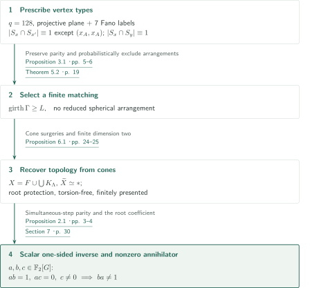
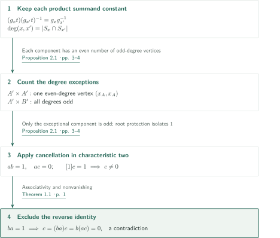
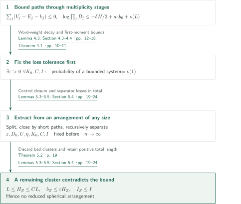
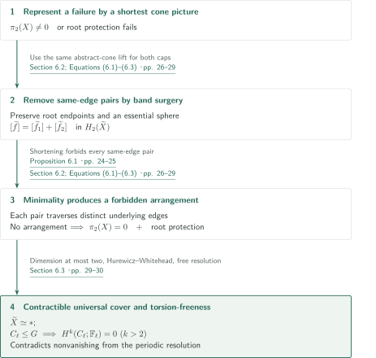

# A Torsion-Free Group Algebra That Is Not Directly Finite

**Simultaneous-step parity produces a one-sided inverse; exclusion of spherical arrangements supplies torsion-freeness.**

The manuscript constructs a group by attaching cones on finite labelled graphs and uses characteristic-two cancellation to produce a scalar one-sided inverse. Vertex types enforce the algebraic parity conditions, while random matchings, planar separation and cone surgeries supply nonvanishing and a finite classifying space.

## 1. Main results

### Theorem 1.1 — Failure of direct finiteness for a torsion-free group

There exist a finitely presented torsion-free group $G$ and $a,b,c\in\mathbb F_2[G]$ satisfying
$$ab=1,\qquad ac=0,\qquad c\ne0.$$
Consequently $ba\ne1$. Moreover, $G$ admits a finite two-dimensional classifying complex. This asserts failure in the group algebra itself over the prime field, rather than only in a matrix ring.

<!-- cite:main -->[Theorem 1.1 · p. 1](https://github.com/openai/math/blob/1581d4cbdd69a0faf34b2089614fe2a814316a6a/preprints/A-Torsion-Free-Group-Algebra-That-Is-Not-Directly-Finite-October-4-2026/direct-finiteness.pdf)<!-- /cite -->

The proof selects a sufficiently large finite matching with the required properties. It gives a finite presentation and finite scalar sums once that matching is selected, but does not list its edges. Non-soficity follows from this conclusion and Elek–Szabó; it is not an input used to obtain the one-sided inverse.

<!-- cite:completion -->[Section 7 · p. 30](https://github.com/openai/math/blob/1581d4cbdd69a0faf34b2089614fe2a814316a6a/preprints/A-Torsion-Free-Group-Algebra-That-Is-Not-Directly-Finite-October-4-2026/direct-finiteness.pdf)<!-- /cite -->
<!-- cite:sofic -->[&#91;ES04, Corollary 4.7, p. 8&#93;](https://arxiv.org/pdf/math/0305440v2#page=8)<!-- /cite -->

## References on the arrows

<!-- reference-guide -->
Unprefixed theorem, lemma, section and equation numbers refer to [A Torsion-Free Group Algebra That Is Not Directly Finite](https://github.com/openai/math/blob/1581d4cbdd69a0faf34b2089614fe2a814316a6a/preprints/A-Torsion-Free-Group-Algebra-That-Is-Not-Directly-Finite-October-4-2026/direct-finiteness.pdf). External inputs use the following keys.

- [LT79](https://epubs.siam.org/doi/10.1137/0136016) Richard J. Lipton and Robert Endre Tarjan — *A Separator Theorem for Planar Graphs*: Planar separation in Lemma 5.5; required statement checked in the publisher abstract, external PDF text and pagination unverified. SIAM Journal on Applied Mathematics 36(2), 177–189 (1979); publisher abstract checked 2026-10-18.
- [Hat02](https://pi.math.cornell.edu/~hatcher/AT/AT.pdf) Allen Hatcher — *Algebraic Topology*: Hurewicz and Whitehead for contractibility in Section 6. 2002 book; author-hosted PDF checked 2026-10-18.
- [ES04](https://arxiv.org/pdf/math/0305440v2) Gábor Elek and Endre Szabó — *Sofic groups and direct finiteness*: Used only to infer non-soficity as a consequence of the main theorem. arXiv:math/0305440v2; PDF header 19 April 2004.

Each citation gives the result and pages. When printed pagination differs from the PDF position, both are shown. GitHub previews do not automatically jump to the cited page.
<!-- /reference-guide -->

## 2. Theorem 1.1 — Proof overview of the main theorem

<!-- proof-target:1 -->Proof target：[Theorem 1.1 · p. 1](https://github.com/openai/math/blob/1581d4cbdd69a0faf34b2089614fe2a814316a6a/preprints/A-Torsion-Free-Group-Algebra-That-Is-Not-Directly-Finite-October-4-2026/direct-finiteness.pdf)<!-- /proof-target -->

**Proof route.** A projective plane with $q=128$ and seven additional Fano-plane labels prescribe the parity. Matchings conditioned on large girth exclude reduced spherical arrangements, making the cone complex aspherical and protecting the roots. Summing vertex labels in the root components then gives the algebraic witnesses.

### 1. Separate the properties required of the graphs

Attach the abstract cone on each connected component $\Lambda$ to a rose $F$ by its label map, setting $X=F\cup_{\Lambda\to F}\bigcup_\Lambda K_\Lambda$ and $G=\pi_1(X)$. The outgoing label sets $S_x$ are prescribed before choosing edges, so their parities survive changes of matching. Girth, diameter and absence of arrangements instead come from the matching choice. Theorem 5.2 supplies a finite outcome satisfying these conditions simultaneously; Proposition 6.1 converts it into a classifying complex with protected roots.

<!-- cite:types -->[Proposition 3.1 · pp. 5–6](https://github.com/openai/math/blob/1581d4cbdd69a0faf34b2089614fe2a814316a6a/preprints/A-Torsion-Free-Group-Algebra-That-Is-Not-Directly-Finite-October-4-2026/direct-finiteness.pdf)<!-- /cite -->
<!-- cite:exclude -->[Theorem 5.2 · p. 19](https://github.com/openai/math/blob/1581d4cbdd69a0faf34b2089614fe2a814316a6a/preprints/A-Torsion-Free-Group-Algebra-That-Is-Not-Directly-Finite-October-4-2026/direct-finiteness.pdf)<!-- /cite -->
<!-- cite:cone -->[Proposition 6.1 · pp. 24–25](https://github.com/openai/math/blob/1581d4cbdd69a0faf34b2089614fe2a814316a6a/preprints/A-Torsion-Free-Group-Algebra-That-Is-Not-Directly-Finite-October-4-2026/direct-finiteness.pdf)<!-- /cite -->

### 2. Connect every conclusion

Proposition 2.1 gives $ab=1$, $ac=0$ and $c\ne0$. If $ba=1$, then $c=(ba)c=b(ac)=0$, a contradiction. Finiteness and dimension two come from the cone construction; asphericity and torsion-freeness come from Proposition 6.1. The group-ring identities and the topological conclusions therefore merge distinct inputs.

<!-- cite:parity -->[Proposition 2.1 · pp. 3–4](https://github.com/openai/math/blob/1581d4cbdd69a0faf34b2089614fe2a814316a6a/preprints/A-Torsion-Free-Group-Algebra-That-Is-Not-Directly-Finite-October-4-2026/direct-finiteness.pdf)<!-- /cite -->
<!-- cite:completion -->[Section 7 · p. 30](https://github.com/openai/math/blob/1581d4cbdd69a0faf34b2089614fe2a814316a6a/preprints/A-Torsion-Free-Group-Algebra-That-Is-Not-Directly-Finite-October-4-2026/direct-finiteness.pdf)<!-- /cite -->

## 3. Proof of Proposition 2.1 — Keep one even-degree exception

<!-- proof-target:2 -->Proof target：[Proposition 2.1 · pp. 3–4](https://github.com/openai/math/blob/1581d4cbdd69a0faf34b2089614fe2a814316a6a/preprints/A-Torsion-Free-Group-Algebra-That-Is-Not-Directly-Finite-October-4-2026/direct-finiteness.pdf)<!-- /proof-target -->

<!-- statement:proposition-2-1 -->
### Proposition 2.1 — Parity criterion

Let finite loopless graphs $\Gamma_A,\Gamma_B$ immerse in the same rose, with roots $x_A,x_B$. Write $A',B'$ for the vertex sets of the root components and $S_x$ for outgoing labels. Assume that $|S_x\cap S_{x'}|$ is odd on $A'\times A'$ except at $(x_A,x_A)$, that $|S_{x_A}|$ is even, and that $|S_x\cap S_y|$ is odd on $A'\times B'$. Assume also that every path starting at either root and ending at a different vertex has nontrivial label in $G$. If $g_x,h_y$ are the labels of root-to-vertex paths, then
$$a=\sum_{x\in A'}g_x,\quad b=\sum_{x\in A'}g_x^{-1},\quad c=\sum_{y\in B'}h_y^{-1}$$
satisfy $ab=1$, $ac=0$, $c\ne0$, and hence $ba\ne1$.

<!-- cite:parity -->[Proposition 2.1 · pp. 3–4](https://github.com/openai/math/blob/1581d4cbdd69a0faf34b2089614fe2a814316a6a/preprints/A-Torsion-Free-Group-Algebra-That-Is-Not-Directly-Finite-October-4-2026/direct-finiteness.pdf)<!-- /cite -->
<!-- /statement -->

### 1. One exception in $A'\times A'$ gives $ab=1$

Join pairs of vertices by simultaneous steps with a common label $t$. A product summand is constant on each connected component, since
$$(g_xt)(g_{x'}t)^{-1}=g_xg_{x'}^{-1}.$$
The degree at $(x,x')$ is $|S_x\cap S_{x'}|$. A component avoiding the exceptional vertex has only odd-degree vertices, hence even cardinality, so its contribution cancels in characteristic two. The component containing $(x_A,x_A)$ has exactly one even-degree vertex, hence odd cardinality; its contribution is $1$.

<!-- cite:parity -->[Proposition 2.1 · pp. 3–4](https://github.com/openai/math/blob/1581d4cbdd69a0faf34b2089614fe2a814316a6a/preprints/A-Torsion-Free-Group-Algebra-That-Is-Not-Directly-Finite-October-4-2026/direct-finiteness.pdf)<!-- /cite -->

### 2. Cancellation on $A'\times B'$ and nonvanishing of $c$

All degrees in the mixed simultaneous-step graph are odd, so every component has even cardinality and $ac=0$. On the other hand, $h_{x_B}=1$, while root protection says that no other $h_y$ is the identity. The identity coefficient in $c$ is therefore exactly $1$. Pairwise distinctness of all vertex labels is not required; protection of $x_B$ alone suffices for this coefficient calculation.

<!-- cite:parity -->[Proposition 2.1 · pp. 3–4](https://github.com/openai/math/blob/1581d4cbdd69a0faf34b2089614fe2a814316a6a/preprints/A-Torsion-Free-Group-Algebra-That-Is-Not-Directly-Finite-October-4-2026/direct-finiteness.pdf)<!-- /cite -->

## 4. Proof of Theorem 5.2 — From bounded paths to all arrangements

<!-- proof-target:3 -->Proof target：[Theorem 5.2 · p. 19](https://github.com/openai/math/blob/1581d4cbdd69a0faf34b2089614fe2a814316a6a/preprints/A-Torsion-Free-Group-Algebra-That-Is-Not-Directly-Finite-October-4-2026/direct-finiteness.pdf)<!-- /proof-target -->

<!-- statement:theorem-5-2 -->
### Theorem 5.2 — Absence of reduced spherical arrangements

Set $v=16513$, $n=vm$, and $L=\lfloor c_0\log n\rfloor$, with $c_0>0$ fixed as in Section 3.3. Choose independent uniform matchings between the prescribed inverse-label slot sets and condition on girth at least $L$.

The probability that $\Gamma$ admits a reduced spherical arrangement of Definition 5.1 tends to zero as $m\equiv1\pmod4$ tends to infinity. Thus every sufficiently large admissible $m$ admits a matching satisfying the girth bound, the component-diameter bound of Proposition 3.4, and absence of such arrangements simultaneously. A paired pair of occurrences carries inverse labels and traverses distinct underlying graph edges. At most one boundary may be a nonclosed path starting at a root, and at least one ordinary closed boundary is required.

<!-- cite:exclude -->[Theorem 5.2 · p. 19](https://github.com/openai/math/blob/1581d4cbdd69a0faf34b2089614fe2a814316a6a/preprints/A-Torsion-Free-Group-Algebra-That-Is-Not-Directly-Finite-October-4-2026/direct-finiteness.pdf)<!-- /cite -->
<!-- /statement -->

### 1. Do not count repeated traversals as independent prescriptions

Theorem 4.1 fixes $\varepsilon>0$ before the arbitrary fixed bounds $K_0,C,I$. It rules out, with probability tending to one, systems with at most $K_0$ paths, total length $L\le H\le CL$, at most $I$ comparison pairs, and at most $b_0\le\varepsilon H$ unpaired positions. The proof organizes an image graph by edge multiplicities: $\Delta_j=\{e:m_e\ge j\}$. Fixing the root once compensates for the interval endpoints, giving $\sum_j(V_j-E_j-k_j)\le0$ for the net vertex/edge exponent.

An approximately compatible grid cuts the chains into long blocks so that square-summability of the word weights $P(W)$ can be used. For stage first-moment bounds $B_j$, realization probability is at most $\min_jB_j$, and the manuscript proves
$$\log\prod_jB_j\le-\frac\delta2H+a_0b_0+o(L).$$
It does not multiply stage probabilities under an independence assumption. A sufficiently small $\varepsilon$ and the sum over $\exp(o(L))$ patterns yield the bounded-path exclusion.

<!-- cite:bounded -->[Theorem 4.1 · pp. 10–11](https://github.com/openai/math/blob/1581d4cbdd69a0faf34b2089614fe2a814316a6a/preprints/A-Torsion-Free-Group-Algebra-That-Is-Not-Directly-Finite-October-4-2026/direct-finiteness.pdf)<!-- /cite -->
<!-- cite:stages -->[Lemma 4.3; Section 4.3–4.4 · pp. 12–18](https://github.com/openai/math/blob/1581d4cbdd69a0faf34b2089614fe2a814316a6a/preprints/A-Torsion-Free-Group-Algebra-That-Is-Not-Directly-Finite-October-4-2026/direct-finiteness.pdf)<!-- /cite -->

### 2. Retain one bounded cluster from any large arrangement

Split long boundaries into pieces of length $O(UL)$ and close each piece by adding at most $D_0L$ edges using the diameter estimate. Added occurrences remain unpaired. A planar Euler count makes the number of comparison intervals linear in the number of pieces. Recursive separation in Lemma 5.5 then deletes few pieces and leaves components with at most $K_0$ pieces. Choosing parameters in the order $\varepsilon,D_0,U,\eta,K_0,C,I,n$ permits application of the preceding estimate for one fixed triple $(K_0,C,I)$.

Small loss is established in total, not separately for every cluster. Discard clusters with excessive unpaired proportion, excessive comparison count, and the unique possible exceptional cluster of length below $L$. Positive total length remains. A remaining cluster contradicts Theorem 4.1. The required constant-bearing separator statement was checked against LT79's publisher abstract; its external PDF text and pagination remain unverified.

<!-- cite:extraction -->[Lemmas 5.3–5.5; Section 5.4 · pp. 19–24](https://github.com/openai/math/blob/1581d4cbdd69a0faf34b2089614fe2a814316a6a/preprints/A-Torsion-Free-Group-Algebra-That-Is-Not-Directly-Finite-October-4-2026/direct-finiteness.pdf)<!-- /cite -->

## 5. Proof of Proposition 6.1 — Remove same-edge pairings by surgery

<!-- proof-target:4 -->Proof target：[Proposition 6.1 · pp. 24–25](https://github.com/openai/math/blob/1581d4cbdd69a0faf34b2089614fe2a814316a6a/preprints/A-Torsion-Free-Group-Algebra-That-Is-Not-Directly-Finite-October-4-2026/direct-finiteness.pdf)<!-- /proof-target -->

<!-- statement:proposition-6-1 -->
### Proposition 6.1 — Cone criterion

Let a finite graph $\Gamma=\Gamma_A\sqcup\Gamma_B$ immerse in the rose $F$, with roots $x_A,x_B$. For the cone complex $X$ and group $G$ of (2.1), absence of reduced spherical arrangements of Definition 5.1 implies $\pi_2(X)=0$ and nontriviality of every root-to-different-vertex path label in $G$. 

Moreover, $X$ is a finite aspherical complex of dimension at most two, and $G$ is finitely presented and torsion-free.

<!-- cite:cone -->[Proposition 6.1 · pp. 24–25](https://github.com/openai/math/blob/1581d4cbdd69a0faf34b2089614fe2a814316a6a/preprints/A-Torsion-Free-Group-Algebra-That-Is-Not-Directly-Finite-October-4-2026/direct-finiteness.pdf)<!-- /cite -->
<!-- /statement -->

### 1. A shortest cone picture would give a reduced arrangement

Assume either $\pi_2(X)\ne0$ or a trivial label on a path from a root $r$ to a different vertex $z$. Choose a cone picture minimizing total boundary length. Preimages of interior points of rose edges give disjoint arcs pairing inverse boundary letters. If one arc pairs traversals of the same underlying graph edge, a band surgery shortens the picture.

In the rooted case, retaining the side containing the marked break preserves the original endpoints $r,z$. When one inner cone disk splits in the sphere case, fill both caps using the same lift of the abstract cone. In the universal cover this gives $[\widetilde f]=[\widetilde f_1]+[\widetilde f_2]$ in $H_2$. Hurewicz ensures that at least one sphere remains essential. No embedding of the cone image in $X$ is assumed. Minimality excludes all same-edge pairings, producing the prohibited reduced arrangement.

<!-- cite:surgery -->[Section 6.2; Equations (6.1)–(6.3) · pp. 26–29](https://github.com/openai/math/blob/1581d4cbdd69a0faf34b2089614fe2a814316a6a/preprints/A-Torsion-Free-Group-Algebra-That-Is-Not-Directly-Finite-October-4-2026/direct-finiteness.pdf)<!-- /cite -->
<!-- cite:hurewicz -->[&#91;Hat02, Theorem 4.32, print p. 366 / PDF p. 375&#93;](https://pi.math.cornell.edu/~hatcher/AT/AT.pdf#page=375)<!-- /cite -->

### 2. Recover the classifying complex and torsion-freeness

The universal cover is simply connected, has vanishing $\pi_2$, and has dimension at most two. It is therefore acyclic and, by Hurewicz and Whitehead, contractible. The finite CW structure gives a finite presentation of $G$. If $G$ contained a prime-order subgroup $C_\ell$, restricting the cellular resolution to $\mathbb ZC_\ell$ would give a free resolution of length at most two. The cyclic group's periodic resolution instead gives $H^k(C_\ell;\mathbb F_\ell)\cong\mathbb F_\ell$ for all $k\ge0$, a contradiction. This periodic calculation is reproduced in the manuscript. Thus the finite two-dimensional classifying complex, finite presentation and torsion-freeness all have explicit proof routes.

<!-- cite:aspherical -->[Section 6.3 · pp. 29–30](https://github.com/openai/math/blob/1581d4cbdd69a0faf34b2089614fe2a814316a6a/preprints/A-Torsion-Free-Group-Algebra-That-Is-Not-Directly-Finite-October-4-2026/direct-finiteness.pdf)<!-- /cite -->
<!-- cite:whitehead -->[&#91;Hat02, Theorem 4.5, print p. 346 / PDF p. 355&#93;](https://pi.math.cornell.edu/~hatcher/AT/AT.pdf#page=355)<!-- /cite -->

## 6. External inputs and their roles

| Input | Use | Role and checking scope |
|---|---|---|
| LT79 planar separation | Lemma 5.5; Theorem 5.2 | Recursively separate the planar graph after deleting loops and parallel edges. Required statement and use checked; external PDF text and pagination unverified. |
| Hat02 Hurewicz and Whitehead | Sections 6.1–6.3 | $\pi_2\simeq H_2$ and contractibility from acyclicity for simply connected CW complexes. Statements and application hypotheses checked. |
| ES04, Corollary 4.7 | Non-soficity in the Introduction | Contraposition of stable finiteness over any division ring for sofic groups. A consequence, not an input to the construction. |

The separate characteristic-two counterexample is not used as an input to this main theorem. The zero-divisors manuscript is credited for the parity and arrangement-exclusion method, but the estimates and topology required here are reproduced. A complete comparison with that manuscript has not been performed.

## 7. Return to the sources

<!-- reading-list -->
- [Proposition 2.1 · pp. 3–4](https://github.com/openai/math/blob/1581d4cbdd69a0faf34b2089614fe2a814316a6a/preprints/A-Torsion-Free-Group-Algebra-That-Is-Not-Directly-Finite-October-4-2026/direct-finiteness.pdf) — Simultaneous-step parity and the identity coefficient.
- [Theorem 4.1 · pp. 10–11](https://github.com/openai/math/blob/1581d4cbdd69a0faf34b2089614fe2a814316a6a/preprints/A-Torsion-Free-Group-Algebra-That-Is-Not-Directly-Finite-October-4-2026/direct-finiteness.pdf) — The quantifier order and repeated graph edges.
- [Lemmas 5.3–5.5; Section 5.4 · pp. 19–24](https://github.com/openai/math/blob/1581d4cbdd69a0faf34b2089614fe2a814316a6a/preprints/A-Torsion-Free-Group-Algebra-That-Is-Not-Directly-Finite-October-4-2026/direct-finiteness.pdf) — Extract a bounded cluster from an arbitrarily large arrangement.
- [Section 6.2; Equations (6.1)–(6.3) · pp. 26–29](https://github.com/openai/math/blob/1581d4cbdd69a0faf34b2089614fe2a814316a6a/preprints/A-Torsion-Free-Group-Algebra-That-Is-Not-Directly-Finite-October-4-2026/direct-finiteness.pdf) — Cone surgeries preserving root endpoints and an essential sphere.
- [Section 7 · p. 30](https://github.com/openai/math/blob/1581d4cbdd69a0faf34b2089614fe2a814316a6a/preprints/A-Torsion-Free-Group-Algebra-That-Is-Not-Directly-Finite-October-4-2026/direct-finiteness.pdf) — Assemble the selected finite matching into the theorem.
<!-- /reading-list -->

The reading covered the main theorem, parity calculation, multiplicity-stage estimates and parameter quantifiers, planar extraction, cone surgeries and final assembly. Hurewicz, Whitehead and Elek–Szabó were checked at the level of statements and use; LT79 was checked through its publisher abstract. All probability constants in Section 3, every grid estimate in Lemma 4.4, and proofs of external inputs have not been independently reverified. This is a guide to the manuscript's argument, not a certification of its entire proof.
