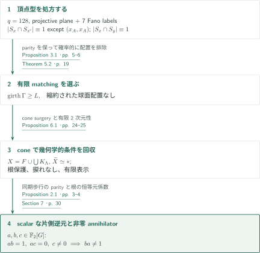
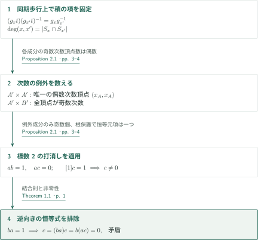
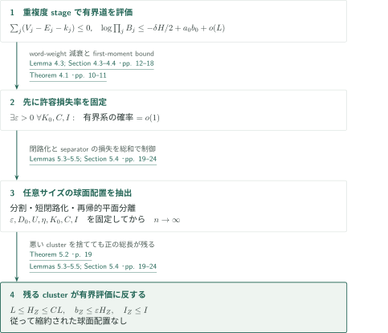
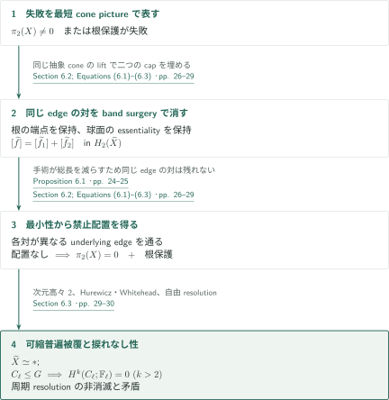

# A Torsion-Free Group Algebra That Is Not Directly Finite

**同期歩行のparityから片側逆元を作り、球面配置の排除で捩れなし性を保証する。**

本原稿は、有限ラベル付きグラフのconeで群を構成し、標数2の打消しを利用して群環のscalarな片側逆元を作る。代数計算に必要なparityは頂点型に組み込み、非零性と有限の分類空間はランダムmatching・平面分離・cone surgeryで保証する。

## 1. 主要結果

### Theorem 1.1 — 捩れなし群環の直接有限性の反例

有限表示をもつ捩れなし群 $G$ と $a,b,c\in\mathbb F_2[G]$ が存在し、
$$ab=1,\qquad ac=0,\qquad c\ne0$$
を満たす。従って $ba\ne1$ である。さらに $G$ は有限2次元分類複体をもつ。これは行列環だけの反例ではなく、素体 $\mathbb F_2$ 上の群環そのものの反例という主張である。

<!-- cite:main -->[Theorem 1.1 · p. 1](https://github.com/openai/math/blob/1581d4cbdd69a0faf34b2089614fe2a814316a6a/preprints/A-Torsion-Free-Group-Algebra-That-Is-Not-Directly-Finite-October-4-2026/direct-finiteness.pdf)<!-- /cite -->

証明は十分大きい有限matchingのうち条件を満たすものを選択する。群の有限表示と有限和の存在を与えるが、選択されたmatchingの辺を列挙した具体例ではない。非sofic性はこの主張とElek–Szabóの定理からの帰結であり、非sofic性を入力して片側逆元を得る議論ではない。

<!-- cite:completion -->[Section 7 · p. 30](https://github.com/openai/math/blob/1581d4cbdd69a0faf34b2089614fe2a814316a6a/preprints/A-Torsion-Free-Group-Algebra-That-Is-Not-Directly-Finite-October-4-2026/direct-finiteness.pdf)<!-- /cite -->
<!-- cite:sofic -->[&#91;ES04, Corollary 4.7, p. 8&#93;](https://arxiv.org/pdf/math/0305440v2#page=8)<!-- /cite -->

## 図の矢印に付した引用

<!-- reference-guide -->
略号のない定理・補題・節・式番号は本原稿 [A Torsion-Free Group Algebra That Is Not Directly Finite](https://github.com/openai/math/blob/1581d4cbdd69a0faf34b2089614fe2a814316a6a/preprints/A-Torsion-Free-Group-Algebra-That-Is-Not-Directly-Finite-October-4-2026/direct-finiteness.pdf) を指します。外部入力には次の略号を使います。

- [LT79](https://epubs.siam.org/doi/10.1137/0136016) Richard J. Lipton and Robert Endre Tarjan — *A Separator Theorem for Planar Graphs*：Lemma 5.5の平面分離。必要statementは出版社Abstractで確認、外部PDF本文・ページ対応は未確認。SIAM Journal on Applied Mathematics 36(2), 177–189 (1979); publisher abstract checked 2026-10-18。
- [Hat02](https://pi.math.cornell.edu/~hatcher/AT/AT.pdf) Allen Hatcher — *Algebraic Topology*：§6のHurewicz・Whiteheadによる可縮性。2002 book; author-hosted PDF checked 2026-10-18。
- [ES04](https://arxiv.org/pdf/math/0305440v2) Gábor Elek and Endre Szabó — *Sofic groups and direct finiteness*：主定理から非sofic性を導く帰結だけに使用。arXiv:math/0305440v2; PDF header 19 April 2004。

各引用に結果番号とページを付します。誌面番号とPDF内の位置が異なる場合は両方を示します。GitHubの閲覧リンクではページ位置への自動移動を前提としません。
<!-- /reference-guide -->

## 2. Theorem 1.1 — 主定理の証明概略

<!-- proof-target:1 -->証明対象：[Theorem 1.1 · p. 1](https://github.com/openai/math/blob/1581d4cbdd69a0faf34b2089614fe2a814316a6a/preprints/A-Torsion-Free-Group-Algebra-That-Is-Not-Directly-Finite-October-4-2026/direct-finiteness.pdf)<!-- /proof-target -->

**証明の道筋。** $q=128$ の射影平面とFano平面の7つの追加ラベルからparityを固定する。大きなgirthを条件としたmatchingで「縮約された球面配置」を排除し、cone複体をasphericalにして根を保護する。最後に根を含む成分の頂点ラベルを足し合わせる。

### 1. 存在するグラフの条件を分離する

各連結成分 $\Lambda$ のconeをrose $F$ へラベル写像で貼り、$X=F\cup_{\Lambda\to F}\bigcup_\Lambda K_\Lambda$、$G=\pi_1(X)$ とする。ラベルの出次数集合 $S_x$ はあらかじめ処方するので、matchingを選び直してもparityは変わらない。一方、girth・直径・球面配置の不在はmatchingの選択で得る。Theorem 5.2はこれらを同時に満たす有限の選択を与え、Proposition 6.1がその選択を分類複体と根保護へ変換する。

<!-- cite:types -->[Proposition 3.1 · pp. 5–6](https://github.com/openai/math/blob/1581d4cbdd69a0faf34b2089614fe2a814316a6a/preprints/A-Torsion-Free-Group-Algebra-That-Is-Not-Directly-Finite-October-4-2026/direct-finiteness.pdf)<!-- /cite -->
<!-- cite:exclude -->[Theorem 5.2 · p. 19](https://github.com/openai/math/blob/1581d4cbdd69a0faf34b2089614fe2a814316a6a/preprints/A-Torsion-Free-Group-Algebra-That-Is-Not-Directly-Finite-October-4-2026/direct-finiteness.pdf)<!-- /cite -->
<!-- cite:cone -->[Proposition 6.1 · pp. 24–25](https://github.com/openai/math/blob/1581d4cbdd69a0faf34b2089614fe2a814316a6a/preprints/A-Torsion-Free-Group-Algebra-That-Is-Not-Directly-Finite-October-4-2026/direct-finiteness.pdf)<!-- /cite -->

### 2. 全結論への最後の接続

Proposition 2.1によって $ab=1$, $ac=0$, $c\ne0$ が得られる。$ba=1$ なら $c=(ba)c=b(ac)=0$ となるので矛盾する。有限性と2次元性はconeの構成、asphericityと捩れなし性はProposition 6.1から来る。このように群環の恒等式と群の位相的性質は別々の入力を合流させている。

<!-- cite:parity -->[Proposition 2.1 · pp. 3–4](https://github.com/openai/math/blob/1581d4cbdd69a0faf34b2089614fe2a814316a6a/preprints/A-Torsion-Free-Group-Algebra-That-Is-Not-Directly-Finite-October-4-2026/direct-finiteness.pdf)<!-- /cite -->
<!-- cite:completion -->[Section 7 · p. 30](https://github.com/openai/math/blob/1581d4cbdd69a0faf34b2089614fe2a814316a6a/preprints/A-Torsion-Free-Group-Algebra-That-Is-Not-Directly-Finite-October-4-2026/direct-finiteness.pdf)<!-- /cite -->

## 3. Proposition 2.1 の証明 — 一つの偶数次数例外を残す

<!-- proof-target:2 -->証明対象：[Proposition 2.1 · pp. 3–4](https://github.com/openai/math/blob/1581d4cbdd69a0faf34b2089614fe2a814316a6a/preprints/A-Torsion-Free-Group-Algebra-That-Is-Not-Directly-Finite-October-4-2026/direct-finiteness.pdf)<!-- /proof-target -->

<!-- statement:proposition-2-1 -->
### Proposition 2.1 — Parity criterion

同じroseへimmersedする有限looplessグラフ $\Gamma_A,\Gamma_B$ と根 $x_A,x_B$ をとる。根を含む成分の頂点集合を $A',B'$、出ラベル集合を $S_x$ とする。$|S_x\cap S_{x'}|$ は $(x,x')=(x_A,x_A)$ を除く $A'\times A'$ 上で奇数、$|S_{x_A}|$ は偶数、$|S_x\cap S_y|$ は $A'\times B'$ 上で常に奇数と仮定する。また、どちらかの根から異なる頂点へ至る道のラベルは $G$ で非自明とする。根からの道のラベルを $g_x,h_y$ と置けば
$$a=\sum_{x\in A'}g_x,\quad b=\sum_{x\in A'}g_x^{-1},\quad c=\sum_{y\in B'}h_y^{-1}$$
は $ab=1$, $ac=0$, $c\ne0$、従って $ba\ne1$ を満たす。

<!-- cite:parity -->[Proposition 2.1 · pp. 3–4](https://github.com/openai/math/blob/1581d4cbdd69a0faf34b2089614fe2a814316a6a/preprints/A-Torsion-Free-Group-Algebra-That-Is-Not-Directly-Finite-October-4-2026/direct-finiteness.pdf)<!-- /cite -->
<!-- /statement -->

### 1. $A'\times A'$ の一つの例外が $ab=1$ を与える

共通ラベル $t$ で両座標を同時に進めるグラフを考える。積の項は
$$(g_xt)(g_{x'}t)^{-1}=g_xg_{x'}^{-1}$$
により各連結成分上で一定である。その頂点次数は $|S_x\cap S_{x'}|$。例外を含まない成分は全頂点が奇数次数なので頂点数が偶数になり、標数2で打ち消える。$(x_A,x_A)$ を含む成分は偶数次数頂点がちょうど一つで頂点数が奇数、その寄与は $1$ である。

<!-- cite:parity -->[Proposition 2.1 · pp. 3–4](https://github.com/openai/math/blob/1581d4cbdd69a0faf34b2089614fe2a814316a6a/preprints/A-Torsion-Free-Group-Algebra-That-Is-Not-Directly-Finite-October-4-2026/direct-finiteness.pdf)<!-- /cite -->

### 2. $A'\times B'$ の打消しと $c$ の非零性

混合積では全頂点の次数が奇数なので各成分の頂点数が偶数となり、$ac=0$。一方 $h_{x_B}=1$ であり、根保護によって他の $h_y$ は恒等元でない。従って $c$ の恒等元係数は正確に $1$ である。すべての頂点ラベルの相互相異性を要求しているわけではなく、この係数の確認には根 $x_B$ の保護で十分である。

<!-- cite:parity -->[Proposition 2.1 · pp. 3–4](https://github.com/openai/math/blob/1581d4cbdd69a0faf34b2089614fe2a814316a6a/preprints/A-Torsion-Free-Group-Algebra-That-Is-Not-Directly-Finite-October-4-2026/direct-finiteness.pdf)<!-- /cite -->

## 4. Theorem 5.2 の証明 — 有界な道の評価から全配置を排除する

<!-- proof-target:3 -->証明対象：[Theorem 5.2 · p. 19](https://github.com/openai/math/blob/1581d4cbdd69a0faf34b2089614fe2a814316a6a/preprints/A-Torsion-Free-Group-Algebra-That-Is-Not-Directly-Finite-October-4-2026/direct-finiteness.pdf)<!-- /proof-target -->

<!-- statement:theorem-5-2 -->
### Theorem 5.2 — 縮約された球面配置の不在

$v=16513$, $n=vm$, $L=\lfloor c_0\log n\rfloor$ とし、$c_0>0$ は§3.3の条件で固定する。処方した各inverse-label slot集合間の独立一様matchingをgirth $\ge L$ に条件付ける。

$m\equiv1\pmod4$ が無限大へ向かうとき、$\Gamma$ がDefinition 5.1のreduced spherical arrangementをもつ確率は $0$ に収束する。従って十分大きい許容 $m$ ごとに、girth条件、Proposition 3.4の成分直径条件、reduced spherical arrangementの不在を同時に満たすmatchingが存在する。ここで配置の比較は逆向きのラベルを対にし、各対は異なるunderlying graph edgeを使う。根から始まる非閉道を境界にする例外円板は高々一つであり、通常の閉境界を少なくとも一つ含む。

<!-- cite:exclude -->[Theorem 5.2 · p. 19](https://github.com/openai/math/blob/1581d4cbdd69a0faf34b2089614fe2a814316a6a/preprints/A-Torsion-Free-Group-Algebra-That-Is-Not-Directly-Finite-October-4-2026/direct-finiteness.pdf)<!-- /cite -->
<!-- /statement -->

### 1. 重複したedge traversalsを独立な処方と数えない

Theorem 4.1は、固定した $\varepsilon>0$ に対して、任意の固定 $K_0,C,I$ の下で、道の本数 $\le K_0$、総長 $L\le H\le CL$、比較区間対数 $\le I$、未対応位置 $b_0\le\varepsilon H$ の系が存在する確率を $o(1)$ とする。$\varepsilon$ を先に選ぶ順序が決定的である。証明では同じedgeの重複度 $m_e$ に応じてstage $\Delta_j=\{e:m_e\ge j\}$ を作る。根を一度固定する損失を入れると、頂点選択とedge処方の指数は $\sum_j(V_j-E_j-k_j)\le0$ となる。

比較に整合する近似gridで長いblockを作り、$P(W)$ の二乗和減衰を利用する。各stageのfirst-moment boundを $B_j$ とすれば、実現確率は $\min_j B_j$ 以下であり、原稿は
$$\log\prod_jB_j\le-\frac\delta2H+a_0b_0+o(L)$$
を示す。stage同士の独立性を仮定して確率を掛けるのではない。小さい $\varepsilon$ と $\exp(o(L))$ 個のpatternの総和から有界系を排除する。

<!-- cite:bounded -->[Theorem 4.1 · pp. 10–11](https://github.com/openai/math/blob/1581d4cbdd69a0faf34b2089614fe2a814316a6a/preprints/A-Torsion-Free-Group-Algebra-That-Is-Not-Directly-Finite-October-4-2026/direct-finiteness.pdf)<!-- /cite -->
<!-- cite:stages -->[Lemma 4.3; Section 4.3–4.4 · pp. 12–18](https://github.com/openai/math/blob/1581d4cbdd69a0faf34b2089614fe2a814316a6a/preprints/A-Torsion-Free-Group-Algebra-That-Is-Not-Directly-Finite-October-4-2026/direct-finiteness.pdf)<!-- /cite -->

### 2. 任意に大きい配置から一つの有界clusterを残す

長い境界を長さ $O(UL)$ のpieceに分割し、直径評価によって各pieceへ高々 $D_0L$ を付加して閉じる。追加部分は未対応として数える。平面Euler計数は比較区間数をpiece数に比例させ、Lemma 5.5の再帰的separatorは少数のpieceを消して成分サイズを $K_0$ 以下にする。パラメータを $\varepsilon,D_0,U,\eta,K_0,C,I,n$ の順に固定するため、前段の有界評価を一つの固定した三組 $(K_0,C,I)$ に適用できる。

損失の小ささは各clusterごとには保証されない。未対応率が大きいcluster、比較区間が多いcluster、そして長さ $<L$ の唯一あり得る例外clusterを捨てても正の総長が残る、と総和で評価する。この残ったclusterがTheorem 4.1に反する。平面分離の必要な定数付きstatementはLT79の出版社Abstractと照合したが、外部PDF本文とページ対応は未確認である。

<!-- cite:extraction -->[Lemmas 5.3–5.5; Section 5.4 · pp. 19–24](https://github.com/openai/math/blob/1581d4cbdd69a0faf34b2089614fe2a814316a6a/preprints/A-Torsion-Free-Group-Algebra-That-Is-Not-Directly-Finite-October-4-2026/direct-finiteness.pdf)<!-- /cite -->

## 5. Proposition 6.1 の証明 — 同じedgeの対を手術で消す

<!-- proof-target:4 -->証明対象：[Proposition 6.1 · pp. 24–25](https://github.com/openai/math/blob/1581d4cbdd69a0faf34b2089614fe2a814316a6a/preprints/A-Torsion-Free-Group-Algebra-That-Is-Not-Directly-Finite-October-4-2026/direct-finiteness.pdf)<!-- /proof-target -->

<!-- statement:proposition-6-1 -->
### Proposition 6.1 — Cone criterion

有限グラフ $\Gamma=\Gamma_A\sqcup\Gamma_B$ がrose $F$ へimmersedし、根 $x_A,x_B$ をもつとする。式(2.1)のcone複体 $X$ と群 $G$ について、Definition 5.1のreduced spherical arrangementが存在しなければ $\pi_2(X)=0$ であり、根から異なる頂点へ行く道のラベルは $G$ で非自明である。

さらに $X$ は有限で次元高々2のaspherical複体、$G$ は有限表示をもつ捩れなし群である。

<!-- cite:cone -->[Proposition 6.1 · pp. 24–25](https://github.com/openai/math/blob/1581d4cbdd69a0faf34b2089614fe2a814316a6a/preprints/A-Torsion-Free-Group-Algebra-That-Is-Not-Directly-Finite-October-4-2026/direct-finiteness.pdf)<!-- /cite -->
<!-- /statement -->

### 1. 最短cone pictureからreduced arrangementを作る

$\pi_2(X)\ne0$、または根 $r$ から別頂点 $z$ へのラベルが自明と仮定し、境界総長最小のcone pictureを選ぶ。roseのedge内部の点の逆像は、境界の逆ラベルを結ぶ互いに交わらないarcを与える。同じunderlying graph edgeを対にするarcがあればband surgeryで総長を短くできる。

根付きの場合はmarked breakを含む側を残すことで、元の端点 $r,z$ を保持する。球面の場合に一つの内側cone diskが二つへ分裂するときは、二つのcapを同じ抽象coneのliftで充填し、普遍被覆の $H_2$ で $[\widetilde f]=[\widetilde f_1]+[\widetilde f_2]$ とする。Hurewiczにより少なくとも一方の球面がessentialのまま残る。coneの像が $X$ に埋め込まれているとは仮定しない。最小性から同一edgeの対はなくなり、禁止されたreduced arrangementが得られる。

<!-- cite:surgery -->[Section 6.2; Equations (6.1)–(6.3) · pp. 26–29](https://github.com/openai/math/blob/1581d4cbdd69a0faf34b2089614fe2a814316a6a/preprints/A-Torsion-Free-Group-Algebra-That-Is-Not-Directly-Finite-October-4-2026/direct-finiteness.pdf)<!-- /cite -->
<!-- cite:hurewicz -->[&#91;Hat02, Theorem 4.32, 誌面 p. 366 / PDF p. 375&#93;](https://pi.math.cornell.edu/~hatcher/AT/AT.pdf#page=375)<!-- /cite -->

### 2. 分類複体と捩れなし性を回収する

$\widetilde X$ は単連結、$\pi_2=0$、次元高々2なのでacyclicであり、HurewiczとWhiteheadから可縮となる。有限CW構造から $G$ の有限表示を得る。もし素数位数の部分群 $C_\ell\le G$ があれば、可縮普遍被覆のcellular resolutionを $\mathbb ZC_\ell$ に制限して長さ高々2の自由resolutionを得る。しかし巡回群の周期resolutionは $H^k(C_\ell;\mathbb F_\ell)\cong\mathbb F_\ell$ を全 $k\ge0$ で与え、矛盾する。この周期計算は本稿に再掲されている。これで有限2次元分類複体・有限表示・捩れなし性の全てに証明が対応する。

<!-- cite:aspherical -->[Section 6.3 · pp. 29–30](https://github.com/openai/math/blob/1581d4cbdd69a0faf34b2089614fe2a814316a6a/preprints/A-Torsion-Free-Group-Algebra-That-Is-Not-Directly-Finite-October-4-2026/direct-finiteness.pdf)<!-- /cite -->
<!-- cite:whitehead -->[&#91;Hat02, Theorem 4.5, 誌面 p. 346 / PDF p. 355&#93;](https://pi.math.cornell.edu/~hatcher/AT/AT.pdf#page=355)<!-- /cite -->

## 6. どの論文が、どの段階を担うか

| 入力 | 利用箇所 | 役割と照合範囲 |
|---|---|---|
| LT79の平面分離 | Lemma 5.5、Theorem 5.2 | loop・多重辺を除いた平面グラフを再帰分離する。必要statementと適用を照合。外部PDF本文・ページ対応は未確認。 |
| Hat02のHurewicz・Whitehead | §§6.1–6.3 | 単連結CW複体での $\pi_2\simeq H_2$、acyclicから可縮への移行。定理記述と使用条件を照合。 |
| ES04、Corollary 4.7 | Introductionの非sofic性 | soficなら任意division ring上でstably finite、の対偶。構成の入力ではなく帰結。 |

標数2の別反例原稿は、本稿の主定理の入力として使われていない。zero-divisors原稿はparityとarrangement-exclusionの方法上の先行研究として記されるが、本稿は必要な見積りと位相的議論を再証明する。その原稿との全範囲の照合は行っていない。

## 7. 原典を読む入口と確認範囲

<!-- reading-list -->
- [Proposition 2.1 · pp. 3–4](https://github.com/openai/math/blob/1581d4cbdd69a0faf34b2089614fe2a814316a6a/preprints/A-Torsion-Free-Group-Algebra-That-Is-Not-Directly-Finite-October-4-2026/direct-finiteness.pdf) — 同期歩行のparityと恒等元係数の計算。
- [Theorem 4.1 · pp. 10–11](https://github.com/openai/math/blob/1581d4cbdd69a0faf34b2089614fe2a814316a6a/preprints/A-Torsion-Free-Group-Algebra-That-Is-Not-Directly-Finite-October-4-2026/direct-finiteness.pdf) — εを先に固定する量化と重複edgeの扱い。
- [Lemmas 5.3–5.5; Section 5.4 · pp. 19–24](https://github.com/openai/math/blob/1581d4cbdd69a0faf34b2089614fe2a814316a6a/preprints/A-Torsion-Free-Group-Algebra-That-Is-Not-Directly-Finite-October-4-2026/direct-finiteness.pdf) — 任意サイズの球面配置から有界clusterを抽出する。
- [Section 6.2; Equations (6.1)–(6.3) · pp. 26–29](https://github.com/openai/math/blob/1581d4cbdd69a0faf34b2089614fe2a814316a6a/preprints/A-Torsion-Free-Group-Algebra-That-Is-Not-Directly-Finite-October-4-2026/direct-finiteness.pdf) — root endpointsとessential sphereを保つcone surgery。
- [Section 7 · p. 30](https://github.com/openai/math/blob/1581d4cbdd69a0faf34b2089614fe2a814316a6a/preprints/A-Torsion-Free-Group-Algebra-That-Is-Not-Directly-Finite-October-4-2026/direct-finiteness.pdf) — 選んだ有限matchingから主定理へ組み立てる。
<!-- /reading-list -->

主定理、parity計算、multiplicity-stage評価とparameterの量化順、平面抽出、cone surgery、最終組立の本文を読んだ。直接外部入力ではHurewicz・WhiteheadとElek–Szabóの記述を確認し、LT79は出版社Abstractの必要statementまで確認した。§3の全確率定数、Lemma 4.4の全grid評価、外部結果の証明の独立再検証は未実施である。ここで示すのは原稿の論証をたどる概説であり、全証明の正しさの認定ではない。
