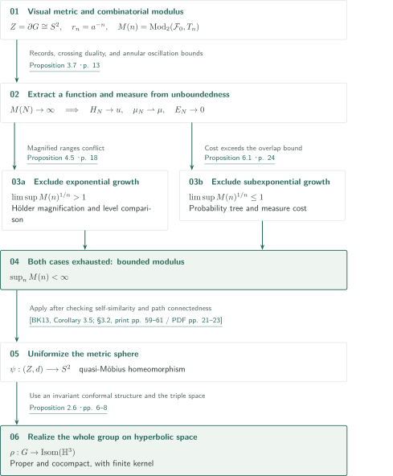
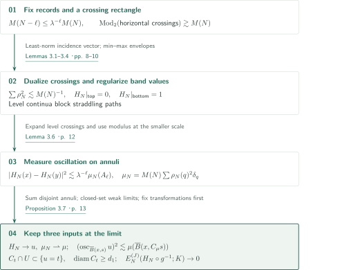
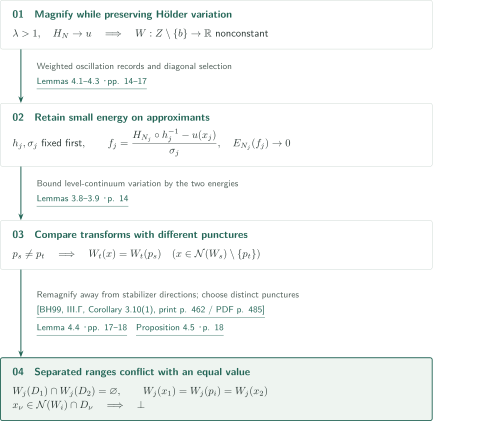
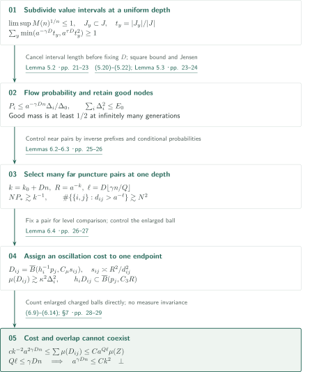
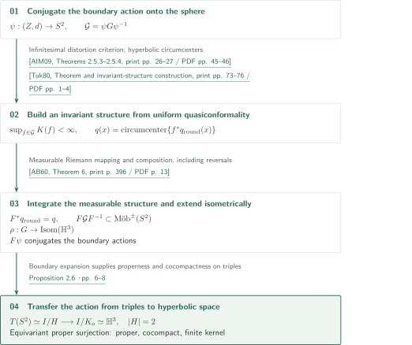
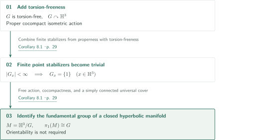

# A Modulus Proof of Cannon’s Conjecture

**Two contradictions bounding boundary modulus, followed by an action on hyperbolic space**

The manuscript claims to resolve Cannon’s conjecture by putting a visual metric on a hyperbolic group boundary homeomorphic to the two-sphere and proving boundedness of its combinatorial 2-moduli. A real-valued function and a finite measure extracted from hypothetical unboundedness form the core of the new argument. This article follows their construction, the exclusion of exponential and subexponential growth, and the realization of the group action after uniformization.

## 1. Main results

### Theorem 1.1 — A geometric action with finite kernel

Let $G$ be a hyperbolic group whose Gromov boundary $Z=\partial G$ is homeomorphic to $S^2$. There exists a homomorphism

$$\rho:G\longrightarrow\operatorname{Isom}(\mathbb H^3)$$

whose isometric action is proper and cocompact and whose kernel $\ker\rho$ is finite. Properness means that $\{g\in G:\rho(g)K\cap K\ne\varnothing\}$ is finite for every compact $K\subset\mathbb H^3$. No torsion-free, faithful-boundary-action, or orientation-preserving hypothesis is imposed. The isometry group includes orientation-reversing isometries.

<!-- cite:main -->[Theorem 1.1 · p. 2](https://github.com/openai/math/blob/1581d4cbdd69a0faf34b2089614fe2a814316a6a/preprints/A-Modulus-Proof-of-Cannons-Conjecture-September-23-2026/paper.pdf)<!-- /cite -->

### Corollary 8.1 — A closed hyperbolic manifold in the torsion-free case

If, in addition, $G$ is torsion-free, then it is the fundamental group of a closed hyperbolic three-manifold. The manifold may be nonorientable.

<!-- cite:manifold -->[Corollary 8.1 · p. 29](https://github.com/openai/math/blob/1581d4cbdd69a0faf34b2089614fe2a814316a6a/preprints/A-Modulus-Proof-of-Cannons-Conjecture-September-23-2026/paper.pdf)<!-- /cite -->

## References on the arrows

<!-- reference-guide -->
Unprefixed theorem, lemma, section and equation numbers refer to [A Modulus Proof of Cannon’s Conjecture](https://github.com/openai/math/blob/1581d4cbdd69a0faf34b2089614fe2a814316a6a/preprints/A-Modulus-Proof-of-Cannons-Conjecture-September-23-2026/paper.pdf). External inputs use the following keys.

- [BK13](https://ems.press/content/serial-article-files/29637?nt=1) Marc Bourdon and Bruce Kleiner — *Combinatorial modulus, the combinatorial Loewner property, and Coxeter groups*: Modulus uniformization for an approximately self-similar metric sphere. Groups, Geometry, and Dynamics 7 (2013), 39–107; published version.
- [AIM09](https://api.pageplace.de/preview/DT0400.9781400830114_A25083002/preview-9781400830114_A25083002.pdf) Kari Astala, Tadeusz Iwaniec, and Gaven Martin — *Elliptic Partial Differential Equations and Quasiconformal Mappings in the Plane*: Metric-to-analytic quasiconformality, null sets, differentials, and conformal structures. Princeton University Press, 2009; publisher preview (70 PDF pages).
- [Tuk80](https://www.acadsci.fi/mathematica/Vol05/vol05pp073-078.pdf) Pekka Tukia — *On two-dimensional quasiconformal groups*: Invariant measurable conformal structures from hyperbolic circumcenters. Annales Academiae Scientiarum Fennicae, Series A I Mathematica 5 (1980), 73–78; published version.
- [AB60](https://www.cimat.mx/~mmoreno/teaching/fall10/AhlforsBers.pdf) Lars Ahlfors and Lipman Bers — *Riemann’s mapping theorem for variable metrics*: Composition of weak differentials and the measurable Riemann mapping theorem. Annals of Mathematics, Second Series 72 (1960), 385–404; scanned published version with cover page.
- [BH99](https://webhomes.maths.ed.ac.uk/~v1ranick/papers/bridsonhaefligerx.pdf) Martin R. Bridson and André Haefliger — *Metric Spaces of Non-Positive Curvature*: Quasi-geodesic cyclic orbits of infinite-order elements, used in Lemma 4.4. Springer, Grundlehren der mathematischen Wissenschaften 319, 1999; scanned book.
- [HK95](https://doi.org/10.1007/BF01241122) Juha Heinonen and Pekka Koskela — *Definitions of quasiconformality*: Parallel metric characterization cited by Proposition 2.6; external statement unchecked here. Inventiones Mathematicae 120 (1995), 61–79; bibliography verified, original statement not inspected.

Each citation gives the result and pages. When printed pagination differs from the PDF position, both are shown. GitHub previews do not automatically jump to the cited page.
<!-- /reference-guide -->

## 2. Theorem 1.1 — Proof overview of the main theorem

<!-- proof-target:1 -->Proof target：[Theorem 1.1 · p. 2](https://github.com/openai/math/blob/1581d4cbdd69a0faf34b2089614fe2a814316a6a/preprints/A-Modulus-Proof-of-Cannons-Conjecture-September-23-2026/paper.pdf)<!-- /proof-target -->

Fix the [hypotheses and full conclusion of the main theorem](#theorem-1-1). In the Cayley graph for a finite symmetric generating set, take basepoint $e$ and a visual metric $d(y,z)\asymp a^{-(y|z)_e}$ for some $a>1$. All balls, diameters, and oscillations below refer to $d$. Write $B$ for open balls and $\overline B$ for closed balls. Set $r_n=a^{-n}$, choose a maximal $r_n$-separated set $T_n$, and use the **open** cells $B(q,2r_n)$.

For the family $\mathcal F_0$ of continuous curves of diameter at least $d_0$, define

$$M(n)=\min_{\omega\ge0}\left\{\sum_{q\in T_n}\omega(q)^2:\ \sum_{B(q,2r_n)\cap\pi\ne\varnothing}\omega(q)\ge1\quad(\pi\in\mathcal F_0)\right\}.$$

Fix $d_0>0$ small enough both for expanded scale-$R$ curves to belong to $\mathcal F_0$ and for the uniformization criterion. **Proof route.** Assuming that $M(n)$ is unbounded produces a common scalar limit. The two possible growth regimes then lead to contradictions. Metric uniformization is invoked only after boundedness has been obtained.

### 1. Separate the topological input from the metric conclusion

The topological sphere supplies separation and crossing continua in coordinate rectangles. Quasi-Möbius equivalence of the visual metric to the round sphere is not inferred from this topological hypothesis alone. Choose a vertex $v$ at depth $k$ on a ray to $x$, and put $h=v^{-1}$, $R=r_k$, and $D_y=\max\{R,d(x,y)\}$. Lemma 2.1 gives

$$d(hy,hz)\asymp\frac{R\,d(y,z)}{D_yD_z}.$$

On a small ball this is a uniform bi-Lipschitz comparison after rescaling distances by $R^{-1}$, supplying approximate self-similarity. The packing bound $\#\lesssim(t/s)^Q$ in Lemma 2.3 gives doubling; Lemma 2.4 supplies quantitatively controlled paths.

<!-- cite:geometry -->[Lemmas 2.1–2.4 · pp. 4–6](https://github.com/openai/math/blob/1581d4cbdd69a0faf34b2089614fe2a814316a6a/preprints/A-Modulus-Proof-of-Cannons-Conjecture-September-23-2026/paper.pdf)<!-- /cite -->

### 2. Turn boundedness into the uniformization input

With the scalar limit of [Proposition 3.7](#proof-1) as their common input, [Proposition 4.5](#proof-2) excludes exponential growth and [Proposition 6.1](#proof-3) excludes unbounded subexponential growth. Thus $\sup_nM(n)<\infty$. The external criterion used in Theorem 2.5 requires an arcwise connected, approximately self-similar metric sphere and uniform bounds for the 2-moduli of large curves in its graph approximations. Choosing $2^{-m}/a<r_n\le2^{-m}$ makes the cells above a fixed approximation for any $\kappa>2a$. No Coxeter-group hypothesis is required. The resulting $\psi:(Z,d)\to S^2$ is a quasi-Möbius homeomorphism; equivariance with a Möbius action has not yet been established. [Proposition 2.6](#proof-4) constructs a further conjugacy and realizes the whole group.

<!-- cite:modulus -->[§2.3; Theorem 2.5 · p. 6](https://github.com/openai/math/blob/1581d4cbdd69a0faf34b2089614fe2a814316a6a/preprints/A-Modulus-Proof-of-Cannons-Conjecture-September-23-2026/paper.pdf)<!-- /cite -->

<!-- cite:bk -->[&#91;BK13, Corollary 3.5; §3.2, print pp. 59–61 / PDF pp. 21–23&#93;](https://ems.press/content/serial-article-files/29637?nt=1)<!-- /cite -->

## 3. Proposition 3.7 — From unbounded modulus to a scalar limit

<!-- proof-target:2 -->Proof target：[Proposition 3.7 · p. 13](https://github.com/openai/math/blob/1581d4cbdd69a0faf34b2089614fe2a814316a6a/preprints/A-Modulus-Proof-of-Cannons-Conjecture-September-23-2026/paper.pdf)<!-- /proof-target -->

<!-- statement:proposition-3-7 -->
### Proposition 3.7 — The scalar limit

Assume that $M(n)$ is unbounded. If $\limsup M(n)^{1/n}>1$, choose $1<\lambda<\limsup M(n)^{1/n}$; otherwise take $\lambda=1$. Record indices for $M(N)/\lambda^N$ satisfy $M(N)\to\infty$ and $M(N-\ell)\le\lambda^{-\ell}M(N)$. In the coordinate rectangles $Q\subset\widehat Q$ selected in §3, let $U=\operatorname{int}\widehat Q$. The construction gives continuous $H_N$ with band values $0,1$ and weights $\rho_N$; put $\mu_N=M(N)\sum_q\rho_N(q)^2\delta_q$.

Along a subsequence, $H_N\to u$ locally uniformly on $U$ and $\mu_N\rightharpoonup\mu$, where $u:U\to[0,1]$ is continuous and nonconstant and $\mu$ is finite. The function is respectively $0,1$ on the interiors of the two bands; it is locally Hölder if $\lambda>1$. For each compact $K\subset U$, all sufficiently small $s>0$, and uniformly for $x\in K$,

$$\bigl(\operatorname{osc}_{\overline B(x,s)}u\bigr)^2\le C\mu\bigl(\overline B(x,C_\mu s)\bigr).$$

For each $t\in(0,1)$ there is a continuum $C_t\subset Q$ of diameter $\ge d_1$, with $u=t$ on $C_t\cap U$, meeting every compact path in $U$ whose endpoint values strictly straddle $t$. The fixed-transform energy bounds of Lemma 3.5 remain valid along this subsequence. No extension of $u$ outside $U$ is asserted.

<!-- cite:scalar -->[Proposition 3.7 · p. 13](https://github.com/openai/math/blob/1581d4cbdd69a0faf34b2089614fe2a814316a6a/preprints/A-Modulus-Proof-of-Cannons-Conjecture-September-23-2026/paper.pdf)<!-- /cite -->
<!-- /statement -->

### 1. Obtain both small energy and large level sets

Localization to finitely many coordinate rectangles selects a fixed rectangle whose horizontal crossing modulus is bounded below by a constant times $M(N)$. The least-norm point in the convex hull of the horizontal cell-incidence vectors supplies admissible weights $\rho_N$ for the transverse crossings. This finite-dimensional duality yields $\sum\rho_N^2\lesssim M(N)^{-1}$. The manuscript proves this step internally.

Interpolate a path-cost function on a coordinate triangulation, then apply a min–max envelope from the upper band and a max–min envelope from the lower band. These operations produce $H_N$ without increasing path oscillations and allow strict sublevel and superlevel sets to be connected to their respective bands. Jordan separation then makes each transverse level continuum $C_{N,t}$ block every path straddling $t$.

<!-- cite:rectangle -->[Lemmas 3.1–3.4 · pp. 8–10](https://github.com/openai/math/blob/1581d4cbdd69a0faf34b2089614fe2a814316a6a/preprints/A-Modulus-Proof-of-Cannons-Conjecture-September-23-2026/paper.pdf)<!-- /cite -->

### 2. Distinguish estimates passed to the limit from those retained on approximants

Lemma 3.6 expands an annulus of radius $R=r_\ell$ and applies modulus at scale $N-\ell$. It bounds the squared endpoint-value difference by $M(N-\ell)$ times the sum of $\rho_N^2$ in the annulus. Inserting the record inequality and summing over disjoint annuli gives oscillation $O(k^{-1/2})$ at scale $r_k$. If $\lambda>1$, one annulus gives $O(\lambda^{-k/2})$. These are the equicontinuity and additional Hölder estimates needed for local uniform convergence. The closed-ball measure inequality uses the closed-set upper bound for weak convergence.

<!-- cite:annulus -->[Lemma 3.6 · p. 12](https://github.com/openai/math/blob/1581d4cbdd69a0faf34b2089614fe2a814316a6a/preprints/A-Modulus-Proof-of-Cannons-Conjecture-September-23-2026/paper.pdf)<!-- /cite -->

For each fixed $g\in G$, compact $K\subset gU$, and fixed $J\ge2$, retain the local energy formed from closed-ball oscillations:

$$E_N^{(J)}(H_N\circ g^{-1};K)=\sum_{\substack{q\in T_N\\\overline B(q,2r_N)\cap K\ne\varnothing}}\bigl(\operatorname{osc}_{\overline B(q,Jr_N)}(H_N\circ g^{-1})\bigr)^2\longrightarrow0.$$

The bi-Lipschitz constant of an individual group element need not be uniform over the group. Subsequent comparisons fix the transformations or the pair being compared before sending $N\to\infty$. The Hausdorff subsequence for a level continuum may depend on $t$; no simultaneous selection for every $t$ is required.

<!-- cite:energy -->[Lemma 3.5 · p. 11](https://github.com/openai/math/blob/1581d4cbdd69a0faf34b2089614fe2a814316a6a/preprints/A-Modulus-Proof-of-Cannons-Conjecture-September-23-2026/paper.pdf)<!-- /cite -->

## 4. Proposition 4.5 — Excluding exponential growth

<!-- proof-target:3 -->Proof target：[Proposition 4.5 · p. 18](https://github.com/openai/math/blob/1581d4cbdd69a0faf34b2089614fe2a814316a6a/preprints/A-Modulus-Proof-of-Cannons-Conjecture-September-23-2026/paper.pdf)<!-- /proof-target -->

<!-- statement:proposition-4-5 -->
### Proposition 4.5 — Contradiction for exponential records

In the [unbounded-modulus and record-index setup of Proposition 3.7](#proposition-3-7), the case $\lambda>1$ cannot occur. This is a conclusion within the contradiction setup assuming unbounded modulus.

<!-- cite:exponential -->[Proposition 4.5 · p. 18](https://github.com/openai/math/blob/1581d4cbdd69a0faf34b2089614fe2a814316a6a/preprints/A-Modulus-Proof-of-Cannons-Conjecture-September-23-2026/paper.pdf)<!-- /cite -->
<!-- /statement -->

### 1. Equip the magnified limit with comparable approximants

Expand a variation region of the Hölder function $u$ and normalize its values by positive affine maps. Weighted oscillation records in Lemma 4.1 produce a nonconstant locally Hölder limit $W$ on the punctured sphere $Z\setminus\{b\}$. Magnifying $u$ alone would not automatically preserve the vanishing-energy estimates for fixed transformations. Lemma 4.2 first fixes the expansion $h_j$ and normalization $\sigma_j$, then chooses $N_j$ sufficiently large so that

$$f_j(z)=\frac{H_{N_j}(h_j^{-1}z)-u(x_j)}{\sigma_j}$$

also has vanishing local energy along the diagonal sequence.

The level comparison of Lemma 3.8 says that if $w$ oscillates by at least $b_0$ on continua where $f=t$, then $b_0|I|$ is at most the sum of the products of their cell oscillations. Cauchy–Schwarz contradicts this when both energies vanish. Applying this comparison in a common compact domain, Lemma 4.3 obtains, for transforms $W_s,W_t$ with distinct punctures $p_s,p_t$,

$$W_t(x)=W_t(p_s)\qquad\bigl(x\in\mathcal N(W_s)\setminus\{p_t\}\bigr),$$

where $\mathcal N(f)$ is the set of points at which $f$ is not locally constant.

<!-- cite:magnify -->[Lemmas 4.1–4.3 · pp. 14–17](https://github.com/openai/math/blob/1581d4cbdd69a0faf34b2089614fe2a814316a6a/preprints/A-Modulus-Proof-of-Cannons-Conjecture-September-23-2026/paper.pdf)<!-- /cite -->

<!-- cite:comparison -->[Lemmas 3.8–3.9 · p. 14](https://github.com/openai/math/blob/1581d4cbdd69a0faf34b2089614fe2a814316a6a/preprints/A-Modulus-Proof-of-Cannons-Conjecture-September-23-2026/paper.pdf)<!-- /cite -->

### 2. Move the punctures and contradict range separation

Lemma 4.4 bounds the accumulation directions of $\operatorname{Stab}_G(b)$ by two. The argument compares a linear count of short stabilizer elements with the quadratic number of products that two different axis directions would produce. The input from BH99, Corollary 3.10(1), states that the cyclic orbit of an infinite-order element in a hyperbolic group is a quasi-geodesic. The manuscript uses this to treat the element as loxodromic with two boundary endpoints. The statement and use were compared.

<!-- cite:bh-cyclic -->[&#91;BH99, III.Γ, Corollary 3.10(1), print p. 462 / PDF p. 485&#93;](https://webhomes.maths.ed.ac.uk/~v1ranick/papers/bridsonhaefligerx.pdf#page=485)<!-- /cite -->

<!-- cite:stabilizer -->[Lemma 4.4 · pp. 17–18](https://github.com/openai/math/blob/1581d4cbdd69a0faf34b2089614fe2a814316a6a/preprints/A-Modulus-Proof-of-Cannons-Conjecture-September-23-2026/paper.pdf)<!-- /cite -->

Magnify $W$ again in a variation region avoiding this finite set and $b$. Its punctures can then be chosen pairwise distinct. Choose two small disks in the new limit, each containing variation and with disjoint range intervals. For two sufficiently late magnified functions, the preceding comparison forces one to have the same value at non-locally-constant points of the other in both disks. Its two range intervals are disjoint, giving the contradiction.

<!-- cite:exponential -->[Proposition 4.5 · p. 18](https://github.com/openai/math/blob/1581d4cbdd69a0faf34b2089614fe2a814316a6a/preprints/A-Modulus-Proof-of-Cannons-Conjecture-September-23-2026/paper.pdf)<!-- /cite -->

## 5. Proposition 6.1 — Excluding subexponential growth

<!-- proof-target:4 -->Proof target：[Proposition 6.1 · p. 24](https://github.com/openai/math/blob/1581d4cbdd69a0faf34b2089614fe2a814316a6a/preprints/A-Modulus-Proof-of-Cannons-Conjecture-September-23-2026/paper.pdf)<!-- /proof-target -->

<!-- statement:proposition-6-1 -->
### Proposition 6.1 — Unbounded subexponential modulus is impossible

In the [boundary, metric, and cell setup of the main theorem](#proof-overview), $M(n)$ cannot be unbounded while satisfying $\limsup_{n\to\infty}M(n)^{1/n}\le1$.

<!-- cite:subexponential -->[Proposition 6.1 · p. 24](https://github.com/openai/math/blob/1581d4cbdd69a0faf34b2089614fe2a814316a6a/preprints/A-Modulus-Proof-of-Cannons-Conjecture-September-23-2026/paper.pdf)<!-- /cite -->
<!-- /statement -->

### 1. Choose one subdivision depth even for short value intervals

The function $u$ need not be Hölder in this regime. Section 5 instead builds a tree of centers $x_i$, radii $R_i$, and nonempty open value intervals $J_i\subset(0,1)$ realized nearby. Write $\Delta_i=|J_i|$. Child intervals are nested inside parent intervals, and radii decrease by $a^{-D}$ for one fixed $D$. At a “good” node, two fixed target balls after expansion each contain variation of at least $\kappa\Delta_i$, while their **whole-ball range intervals** are separated by at least $\Delta_i/4$. Balls need not be connected.

A node that is not good has many separated child candidates retaining a definite fraction of the value interval. At every node, the capacity estimate of Lemma 5.2 gives

$$\sum_y\min\{a^{-\gamma D}t_y,\ a^{\tau D}t_y^2\}\ge1,\qquad t_y=|J_y|/|J|,$$

where $\tau=1/20$, $\beta=\tau/[4(Q+1)]$, and $\gamma=\beta/2$. The proof integrates level values $t\in J$ over many radial bins at the intermediate scale $a^{-\lceil\beta D\rceil}R$. After removing candidates with large ranges, it transfers modulus to the remaining small-range candidates and applies Cauchy–Schwarz. The factor $|J|$ cancels before $D$ is chosen, so the same $D$ works even as intervals shorten deep in the tree.

<!-- cite:capacity -->[Lemma 5.2 · pp. 21–23](https://github.com/openai/math/blob/1581d4cbdd69a0faf34b2089614fe2a814316a6a/preprints/A-Modulus-Proof-of-Cannons-Conjecture-September-23-2026/paper.pdf)<!-- /cite -->

### 2. Retain substantial probability on good nodes

Choose child probabilities $p_y$ with $p_y\le a^{-\gamma D}t_y$ at every node, $p_y\le a^{-D/2}t_y^2$ at nodes that are not good, and $p_y\le a^{\tau D}t_y^2$ at good nodes. For a generation-$n$ node $i$ of probability $P_i$ with $m_i$ ancestors that are not good,

$$P_i\le a^{-\gamma Dn}\frac{\Delta_i}{\Delta_0},\qquad
\Delta_i^2\ge\Delta_0^2P_i\,a^{D((1/2+\tau)m_i-\tau n)}.$$

Separation of centers and the measure estimate in Proposition 3.7 give $\sum_i\Delta_i^2\le E_0<\infty$. Jensen’s inequality bounds the mean proportion of bad ancestors by $1/11+o(1)$. Consequently infinitely many generations have good-node mass at least $1/2$. Conditional probabilities for descendants $m$ generations below an ancestor $A$ also satisfy $P_i/P_A\le a^{-\gamma Dm}$.

<!-- cite:probabilities -->[(5.20)–(5.22); Lemma 5.3 · pp. 23–24](https://github.com/openai/math/blob/1581d4cbdd69a0faf34b2089614fe2a814316a6a/preprints/A-Modulus-Proof-of-Cannons-Conjecture-September-23-2026/paper.pdf)<!-- /cite -->

### 3. Compare pairwise oscillation costs with measure multiplicity

At such a generation set $k=k_0+Dn$ and $R=a^{-k}$. Select one of finitely many target-ball patterns and one of $O(k)$ probability classes, obtaining $N$ nodes with $P_*\le P_i\le2P_*$ and $NP_*\gtrsim k^{-1}$. For the punctures $p_i=h_i z_0$ of their expansions $h_i$, inverse-word prefixes at common depth bound multiplicity at radius $O(R)$. Combining prefixes with the ancestor conditional-probability bound shows that, for $\ell=D\lfloor\gamma n/Q\rfloor$, the mass within $a^{-\ell}$ of a puncture is $O(a^{-\gamma D\lfloor\gamma n/Q\rfloor})$. Thus at least $cN^2$ pairs have $d_{ij}=d(p_i,p_j)>a^{-\ell}\gg R$.

<!-- cite:punctures -->[Lemmas 6.2–6.3 · pp. 25–26](https://github.com/openai/math/blob/1581d4cbdd69a0faf34b2089614fe2a814316a6a/preprints/A-Modulus-Proof-of-Cannons-Conjecture-September-23-2026/paper.pdf)<!-- /cite -->

Fix a far pair before passing to the limit in the approximation index. The level comparison in Lemma 6.4 forces one endpoint, say $i$, to have $u$-oscillation at least $\kappa\Delta_i/16$ on $h_i^{-1}\overline B(p_j,A_hR)$. If both endpoints qualify, either assignment is allowed.

<!-- cite:pair -->[Lemma 6.4 · pp. 26–27](https://github.com/openai/math/blob/1581d4cbdd69a0faf34b2089614fe2a814316a6a/preprints/A-Modulus-Proof-of-Cannons-Conjecture-September-23-2026/paper.pdf)<!-- /cite -->

With $z_{ij}=h_i^{-1}p_j$ and $s_{ij}\asymp R^2/d_{ij}^2$, the closed ball $D_{ij}=\overline B(z_{ij},C_\mu s_{ij})$ pays for this oscillation: $\mu(D_{ij})\gtrsim\kappa^2\Delta_i^2$. Crucially, the **enlarged closed ball** still satisfies $h_iD_{ij}\subset\overline B(p_j,C_3R)$. Indeed, $C_\mu s_{ij}/\max(R,d(x_i,z_{ij}))\lesssim R/d_{ij}\to0$, keeping the expansion denominators comparable throughout the enlarged ball. Combining bounded multiplicity in $j$ for fixed $i$ with packing for $D_{ij}\subset\overline B(x_i,C_4Ra^\ell)$ gives

$$c k^{-2}a^{2\gamma Dn}\ \le\sum_{\text{assigned far pairs}}\mu(D_{ij})\ \le C a^{Q\ell}\mu(Z).$$

Since $Q\ell\le\gamma Dn$, this yields $a^{\gamma Dn}\le Ck^2$, contradicting $k=k_0+Dn$. The argument counts the actual enlarged charged balls; it does not assume that $\mu$ is invariant under the group.

<!-- cite:charges -->[(6.9)–(6.14); §7 · pp. 28–29](https://github.com/openai/math/blob/1581d4cbdd69a0faf34b2089614fe2a814316a6a/preprints/A-Modulus-Proof-of-Cannons-Conjecture-September-23-2026/paper.pdf)<!-- /cite -->

## 6. Proposition 2.6 — From the uniformized boundary to the whole group action

<!-- proof-target:5 -->Proof target：[Proposition 2.6 · pp. 6–8](https://github.com/openai/math/blob/1581d4cbdd69a0faf34b2089614fe2a814316a6a/preprints/A-Modulus-Proof-of-Cannons-Conjecture-September-23-2026/paper.pdf)<!-- /proof-target -->

<!-- statement:proposition-2-6 -->
### Proposition 2.6 — The bridge to hyperbolic space

Let $G,Z,d$ be as in the [main theorem setup](#proof-overview). If $(Z,d)$ is quasi-Möbius homeomorphic to the round sphere, then $G$ admits a proper cocompact isometric action on $\mathbb H^3$ with finite kernel.

<!-- cite:bridge -->[Proposition 2.6 · pp. 6–8](https://github.com/openai/math/blob/1581d4cbdd69a0faf34b2089614fe2a814316a6a/preprints/A-Modulus-Proof-of-Cannons-Conjecture-September-23-2026/paper.pdf)<!-- /cite -->
<!-- /statement -->

### 1. Convert the quasi-Möbius action into an equivariant isometric action

Under $\psi:Z\to S^2$, the conjugated group $\mathcal G=\psi G\psi^{-1}$ has one quasi-Möbius distortion function for all its elements. Letting three points coalesce in a four-point cross-ratio estimate bounds infinitesimal linear distortion uniformly. The metric and analytic characterizations in planar charts then make $\mathcal G$ uniformly quasiconformal. For a reversing map, apply the characterization after a conformal reflection.

<!-- cite:aim-metric -->[&#91;AIM09, Theorems 2.5.3–2.5.4, print pp. 26–27 / PDF pp. 45–46&#93;](https://api.pageplace.de/preview/DT0400.9781400830114_A25083002/preview-9781400830114_A25083002.pdf#page=45)<!-- /cite -->

Countability and preservation of null sets provide an invariant conull set where all differentials and composition rules hold. Positive definite quadratic forms on each tangent space, modulo positive scalars, form a hyperbolic plane; pullback by any invertible linear map, of either orientation, is an isometry. The orbit of the round conformal structure under pullbacks is bounded. Its unique circumcenter defines an invariant measurable conformal structure $q$. The manuscript applies Tukia’s circumcenter construction to the whole group using this quadratic-form description.

<!-- cite:aim-null -->[&#91;AIM09, Theorem 3.1.2, print p. 49 / PDF p. 68&#93;](https://api.pageplace.de/preview/DT0400.9781400830114_A25083002/preview-9781400830114_A25083002.pdf#page=68)<!-- /cite -->

<!-- cite:aim-forms -->[&#91;AIM09, §2.3; Theorem 2.3.2, print pp. 18–20 / PDF pp. 37–39&#93;](https://api.pageplace.de/preview/DT0400.9781400830114_A25083002/preview-9781400830114_A25083002.pdf#page=37)<!-- /cite -->

<!-- cite:tukia -->[&#91;Tuk80, Theorem and invariant-structure construction, print pp. 73–76 / PDF pp. 1–4&#93;](https://www.acadsci.fi/mathematica/Vol05/vol05pp073-078.pdf#page=1)<!-- /cite -->

The measurable Riemann mapping theorem gives a quasiconformal homeomorphism $F$ with $F^*q_{\mathrm{round}}=q$. The differential composition rule and invariance make $F\mathcal GF^{-1}$ Möbius or anti-Möbius. Unique hyperbolic isometric extensions define the homomorphism $\rho$. The composite $F\psi$ now conjugates the original boundary action to the action of $\rho$ at infinity; this is the map carrying equivariance.

<!-- cite:ab-chain -->[&#91;AB60, Lemma 10; Theorem 5, print pp. 393–395 / PDF pp. 10–12&#93;](https://www.cimat.mx/~mmoreno/teaching/fall10/AhlforsBers.pdf#page=10)<!-- /cite -->

<!-- cite:ab-integrate -->[&#91;AB60, Theorem 6, print p. 396 / PDF p. 13&#93;](https://www.cimat.mx/~mmoreno/teaching/fall10/AhlforsBers.pdf#page=13)<!-- /cite -->

### 2. Transfer properness, cocompactness, and finite kernel through triples

The boundary expansion estimates make the action on ordered distinct triples $T(Z)$ proper and cocompact. A long group element brings two points of a uniformly separated triple close, giving properness. Expansion at the scale of its closest pair separates all three points uniformly, giving cocompactness. Conjugation by $F\psi$ preserves these properties.

Put $I=\operatorname{Isom}(\mathbb H^3)$. The stabilizer $H$ of a standard ordered ideal triple consists of the identity and reflection in the hyperbolic plane through that triple. Choose an $H$-fixed point $o$ and its compact stabilizer $K_o$. Then

$$T(S^2)\simeq I/H\longrightarrow I/K_o\simeq\mathbb H^3$$

is an equivariant proper surjection. Properness and cocompactness transfer from triples to hyperbolic space through this map. The kernel lies in a point stabilizer and is therefore finite. The faithful action belongs to $G/\ker\rho$; the conclusion for the original $G$ is an action with finite kernel. No restriction to a finite-index orientation-preserving subgroup, or replacement by a quasi-action, is used as the final conclusion.

<!-- cite:bridge -->[Proposition 2.6 · pp. 6–8](https://github.com/openai/math/blob/1581d4cbdd69a0faf34b2089614fe2a814316a6a/preprints/A-Modulus-Proof-of-Cannons-Conjecture-September-23-2026/paper.pdf)<!-- /cite -->

## 7. Corollary 8.1 — From a free action to a closed manifold

<!-- proof-target:6 -->Proof target：[Corollary 8.1 · p. 29](https://github.com/openai/math/blob/1581d4cbdd69a0faf34b2089614fe2a814316a6a/preprints/A-Modulus-Proof-of-Cannons-Conjecture-September-23-2026/paper.pdf)<!-- /proof-target -->

Use the [additional hypothesis and conclusion of Corollary 8.1](#corollary-8-1).

### 1. Eliminate finite stabilizers

Point stabilizers in the proper action of Theorem 1.1 are finite. If $G$ is torsion-free, they are trivial, so the action is faithful and free. Cocompactness makes $\mathbb H^3/G$ compact, the free isometric action makes it a hyperbolic manifold without boundary, and simple connectedness of $\mathbb H^3$ identifies its fundamental group with $G$. Orientation preservation was not assumed, so orientability is not concluded. Virtual fibering and the further conclusions of Corollary 8.2 require separate external inputs and are not among the principal results covered here.

<!-- cite:manifold -->[Corollary 8.1 · p. 29](https://github.com/openai/math/blob/1581d4cbdd69a0faf34b2089614fe2a814316a6a/preprints/A-Modulus-Proof-of-Cannons-Conjecture-September-23-2026/paper.pdf)<!-- /cite -->

## 8. Which papers supply which steps

| Source and result | Used at | Input and hypotheses | Checking scope |
|---|---|---|---|
| <!-- cite:bk -->[&#91;BK13, Corollary 3.5; §3.2, print pp. 59–61 / PDF pp. 21–23&#93;](https://ems.press/content/serial-article-files/29637?nt=1)<!-- /cite --> | Theorem 2.5, [overview](#proof-overview-step-2) | Arcwise connected, approximately self-similar metric sphere; uniform 2-modulus bounds for a fixed approximation | Source hypotheses and their verification here compared; no recursive verification of the underlying Bonk–Kleiner theorem |
| <!-- cite:aim-metric -->[&#91;AIM09, Theorems 2.5.3–2.5.4, print pp. 26–27 / PDF pp. 45–46&#93;](https://api.pageplace.de/preview/DT0400.9781400830114_A25083002/preview-9781400830114_A25083002.pdf#page=45)<!-- /cite --> | Proposition 2.6, [action construction](#proof-4-step-1) | Infinitesimal distortion in planar charts gives quasiconformality | Statements and use, including reflection, compared |
| <!-- cite:aim-null -->[&#91;AIM09, Theorem 3.1.2, print p. 49 / PDF p. 68&#93;](https://api.pageplace.de/preview/DT0400.9781400830114_A25083002/preview-9781400830114_A25083002.pdf#page=68)<!-- /cite --> | Same step | Null-set preservation and nondegenerate differentials for a countable group | Statement and use compared |
| <!-- cite:tukia -->[&#91;Tuk80, Theorem and invariant-structure construction, print pp. 73–76 / PDF pp. 1–4&#93;](https://www.acadsci.fi/mathematica/Vol05/vol05pp073-078.pdf#page=1)<!-- /cite --> | Same step | Circumcenter of a uniformly bounded orbit of conformal structures | Measurability and invariance construction compared; reversals also use the manuscript’s quadratic-form formulation |
| <!-- cite:ab-integrate -->[&#91;AB60, Theorem 6, print p. 396 / PDF p. 13&#93;](https://www.cimat.mx/~mmoreno/teaching/fall10/AhlforsBers.pdf#page=13)<!-- /cite --> | Same step | Integration of a bounded measurable Beltrami coefficient | Statement and application compared; the composition rule uses Lemma 10 and Theorem 5 of the same source |
| <!-- cite:bh-cyclic -->[&#91;BH99, III.Γ, Corollary 3.10(1), print p. 462 / PDF p. 485&#93;](https://webhomes.maths.ed.ac.uk/~v1ranick/papers/bridsonhaefligerx.pdf#page=485)<!-- /cite --> | Lemma 4.4, [exponential case](#proof-2-step-2) | Infinite-order element of a hyperbolic group; quasi-geodesic cyclic orbit supplies two endpoints | Original statement and manuscript use compared |

The BH99 input in Lemma 4.4 was checked as a direct dependency against its original statement and use. The parallel HK95 characterization cited in Proposition 2.6 was not checked separately; the table follows the inspected AIM09 route. Section 3’s finite convex duality was read in the manuscript itself: another modulus-duality paper in the bibliography is not automatically treated as a direct proof input. Direct dependencies, generalizations, or alternative proofs in other catalogues were not systematically investigated; this does not mean that there are no such connections.

## 9. Return to the sources

<!-- reading-list -->
- [§2.3; Theorem 2.5 · p. 6](https://github.com/openai/math/blob/1581d4cbdd69a0faf34b2089614fe2a814316a6a/preprints/A-Modulus-Proof-of-Cannons-Conjecture-September-23-2026/paper.pdf) — Visual metric, cells, choice of d₀, and uniformization hypotheses
- [Proposition 3.7 · p. 13](https://github.com/openai/math/blob/1581d4cbdd69a0faf34b2089614fe2a814316a6a/preprints/A-Modulus-Proof-of-Cannons-Conjecture-September-23-2026/paper.pdf) — Limit domain, closed-ball measure estimate, and energy after fixed transformations
- [Lemmas 4.1–4.3 · pp. 14–17](https://github.com/openai/math/blob/1581d4cbdd69a0faf34b2089614fe2a814316a6a/preprints/A-Modulus-Proof-of-Cannons-Conjecture-September-23-2026/paper.pdf) — Order of choosing normalizations and approximation indices
- [Lemma 5.2 · pp. 21–23](https://github.com/openai/math/blob/1581d4cbdd69a0faf34b2089614fe2a814316a6a/preprints/A-Modulus-Proof-of-Cannons-Conjecture-September-23-2026/paper.pdf) — A subdivision depth uniform in the length of the value interval
- [(6.9)–(6.14); §7 · pp. 28–29](https://github.com/openai/math/blob/1581d4cbdd69a0faf34b2089614fe2a814316a6a/preprints/A-Modulus-Proof-of-Cannons-Conjecture-September-23-2026/paper.pdf) — Images and multiplicity of enlarged charged balls; final contradiction
- [Proposition 2.6 · pp. 6–8](https://github.com/openai/math/blob/1581d4cbdd69a0faf34b2089614fe2a814316a6a/preprints/A-Modulus-Proof-of-Cannons-Conjecture-September-23-2026/paper.pdf) — Bridge from quasi-Möbius conjugacy to an isometric action of the whole group
<!-- /reading-list -->

The editor read the statements, proof text of §§2–7, and Corollary 8.1 in the fixed September 23, 2026 version and self-checked the claim-to-proof connections presented here. Particular checks concerned closed-ball measure estimates, fixing transformations before choosing approximation indices, subdivision depth independent of interval length, and multiplicity of enlarged charged balls. External-input checks have the scope shown above. This is a single author’s content check, not independent peer review, independent verification of the entire proof, or an audit of formalization.

The manuscript and official catalogue claim an unconditional solution. This article presents that claim and its argument; it does not assert editorial certification that the conjecture has been resolved. The parallel HK95 route, external inputs to Corollary 8.2 and later material, and cross-catalogue relations retain the unchecked or out-of-scope status described above.
