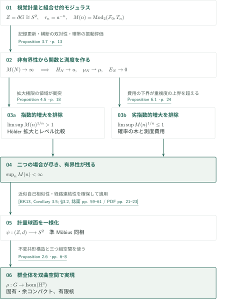
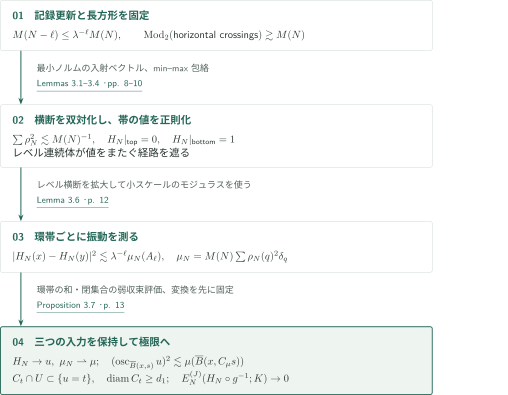
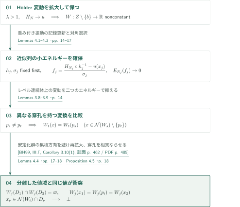
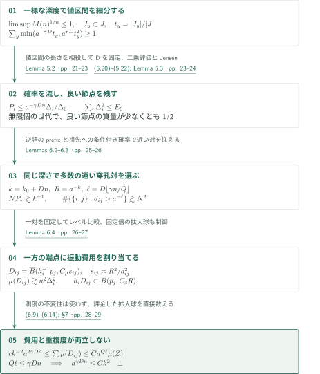
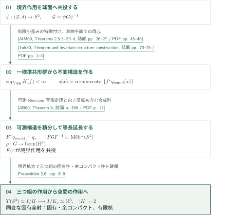
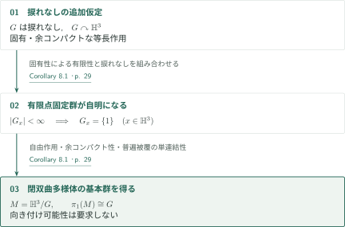

# A Modulus Proof of Cannon’s Conjecture

**境界のモジュラスを有界にする二つの矛盾論法と、双曲空間への作用の構成**

本原稿は、位相的に2次元球面である双曲群の境界を視覚計量で捉え、組合せ的2モジュラスの有界性を証明することでCannon予想を解決すると主張する。非有界性から取り出す実数値関数と測度が、新しい論証の中心となる。本記事では、その構成、指数的・劣指数的な増大の排除、一様化後の群作用の実現を順に説明する。

## 1. 主要結果

### Theorem 1.1 — 有限核を持つ幾何学的作用

$G$を双曲群とし、そのGromov境界$Z=\partial G$が$S^2$に同相であるとする。このとき準同型

$$\rho:G\longrightarrow\operatorname{Isom}(\mathbb H^3)$$

が存在し、対応する等長作用は固有かつ余コンパクトで、$\ker\rho$は有限である。ここで固有性は、任意のコンパクト集合$K\subset\mathbb H^3$について$\{g\in G:\rho(g)K\cap K\ne\varnothing\}$が有限であるという意味である。捩れなし、境界作用の忠実性、向きの保存は仮定しない。等長群は向きを反転する等長写像も含む。

<!-- cite:main -->[Theorem 1.1 · p. 2](https://github.com/openai/math/blob/1581d4cbdd69a0faf34b2089614fe2a814316a6a/preprints/A-Modulus-Proof-of-Cannons-Conjecture-September-23-2026/paper.pdf)<!-- /cite -->

### Corollary 8.1 — 捩れなしの場合の閉双曲多様体

さらに$G$が捩れなしなら、$G$は閉双曲3次元多様体の基本群である。その多様体は向き付け不可能でもよい。

<!-- cite:manifold -->[Corollary 8.1 · p. 29](https://github.com/openai/math/blob/1581d4cbdd69a0faf34b2089614fe2a814316a6a/preprints/A-Modulus-Proof-of-Cannons-Conjecture-September-23-2026/paper.pdf)<!-- /cite -->

## 図の矢印に付した引用

<!-- reference-guide -->
略号のない定理・補題・節・式番号は本原稿 [A Modulus Proof of Cannon’s Conjecture](https://github.com/openai/math/blob/1581d4cbdd69a0faf34b2089614fe2a814316a6a/preprints/A-Modulus-Proof-of-Cannons-Conjecture-September-23-2026/paper.pdf) を指します。外部入力には次の略号を使います。

- [BK13](https://ems.press/content/serial-article-files/29637?nt=1) Marc Bourdon and Bruce Kleiner — *Combinatorial modulus, the combinatorial Loewner property, and Coxeter groups*：近似自己相似な計量球面のモジュラス一様化条件。Groups, Geometry, and Dynamics 7 (2013), 39–107; published version。
- [AIM09](https://api.pageplace.de/preview/DT0400.9781400830114_A25083002/preview-9781400830114_A25083002.pdf) Kari Astala, Tadeusz Iwaniec, and Gaven Martin — *Elliptic Partial Differential Equations and Quasiconformal Mappings in the Plane*：計量的歪みから解析的準共形性へ、零集合・微分・共形構造。Princeton University Press, 2009; publisher preview (70 PDF pages)。
- [Tuk80](https://www.acadsci.fi/mathematica/Vol05/vol05pp073-078.pdf) Pekka Tukia — *On two-dimensional quasiconformal groups*：双曲円板の周心による不変可測共形構造の構成。Annales Academiae Scientiarum Fennicae, Series A I Mathematica 5 (1980), 73–78; published version。
- [AB60](https://www.cimat.mx/~mmoreno/teaching/fall10/AhlforsBers.pdf) Lars Ahlfors and Lipman Bers — *Riemann’s mapping theorem for variable metrics*：微分の合成則と可測Riemann写像定理。Annals of Mathematics, Second Series 72 (1960), 385–404; scanned published version with cover page。
- [BH99](https://webhomes.maths.ed.ac.uk/~v1ranick/papers/bridsonhaefligerx.pdf) Martin R. Bridson and André Haefliger — *Metric Spaces of Non-Positive Curvature*：Lemma 4.4で使う無限位数元の巡回軌道の準測地線性。Springer, Grundlehren der mathematischen Wissenschaften 319, 1999; scanned book。
- [HK95](https://doi.org/10.1007/BF01241122) Juha Heinonen and Pekka Koskela — *Definitions of quasiconformality*：Proposition 2.6が併記する計量的特徴付け。本記事では外部記述未照合。Inventiones Mathematicae 120 (1995), 61–79; bibliography verified, original statement not inspected。

各引用に結果番号とページを付します。誌面番号とPDF内の位置が異なる場合は両方を示します。GitHubの閲覧リンクではページ位置への自動移動を前提としません。
<!-- /reference-guide -->

## 2. Theorem 1.1 — 主定理の証明概略

<!-- proof-target:1 -->証明対象：[Theorem 1.1 · p. 2](https://github.com/openai/math/blob/1581d4cbdd69a0faf34b2089614fe2a814316a6a/preprints/A-Modulus-Proof-of-Cannons-Conjecture-September-23-2026/paper.pdf)<!-- /proof-target -->

[主定理の仮定と全結論](#theorem-1-1)を固定する。有限対称生成集合のCayleyグラフで基点を$e$とし、$a>1$に対する視覚計量$d(y,z)\asymp a^{-(y|z)_e}$を選ぶ。以下の球・直径・振動はすべて$d$に関する。$B$は開球、$\overline B$は閉球を表す。$r_n=a^{-n}$、$T_n$を極大$r_n$分離集合とし、セルを**開球**$B(q,2r_n)$とする。

$\mathcal F_0$を直径が$d_0$以上の連続曲線の族として、

$$M(n)=\min_{\omega\ge0}\left\{\sum_{q\in T_n}\omega(q)^2:\ \sum_{B(q,2r_n)\cap\pi\ne\varnothing}\omega(q)\ge1\quad(\pi\in\mathcal F_0)\right\}.$$

$d_0>0$は、スケール$R$の曲線を境界の群元で拡大した像が$\mathcal F_0$に入ること、および一様化条件の要求をともに満たすように十分小さく固定する。**証明の道筋。** $M(n)$が非有界だと仮定して共通のスカラー極限を作り、その増大率による二つの場合を排除する。有界性を得て初めて計量的一様化へ進む。

### 1. 位相から得るものと、計量的に証明するもの

境界が球面であることは、座標長方形での分離や連続体の横断に使う。視覚計量が丸い球面と準Möbius同値であることは、この仮定だけからは従わせない。深さ$k$で境界点$x$へ向かう測地線上の頂点$v$を選び、$h=v^{-1}$、$R=r_k$、$D_y=\max\{R,d(x,y)\}$とすると、Lemma 2.1は

$$d(hy,hz)\asymp\frac{R\,d(y,z)}{D_yD_z}$$

を与える。小球上では距離を$R^{-1}$倍する一様な双Lipschitz比較となり、近似自己相似性を確保する。Lemma 2.3の充填評価$\#\lesssim(t/s)^Q$は倍加性を、Lemma 2.4は定量的な経路の存在を与える。

<!-- cite:geometry -->[Lemmas 2.1–2.4 · pp. 4–6](https://github.com/openai/math/blob/1581d4cbdd69a0faf34b2089614fe2a814316a6a/preprints/A-Modulus-Proof-of-Cannons-Conjecture-September-23-2026/paper.pdf)<!-- /cite -->

### 2. 有界性を一様化の入力に変える

[Proposition 3.7](#proof-1)のスカラー極限を共通の入力に、[Proposition 4.5](#proof-2)は指数的な増大を、[Proposition 6.1](#proof-3)は非有界な劣指数的増大を排除する。したがって$\sup_nM(n)<\infty$。原稿のTheorem 2.5で使う外部条件は、弧状連結・近似自己相似な計量球面と、そのグラフ近似での大きな曲線の2モジュラスの一様上界である。$2^{-m}/a<r_n\le2^{-m}$を選べば、上記セルは任意の固定$\kappa>2a$に対する近似を与え、条件を満たす。Coxeter群という追加仮定はない。ここで得る$\psi:(Z,d)\to S^2$は準Möbius同相であり、この段階でMöbius作用との同変性を結論してはいない。[Proposition 2.6](#proof-4)がさらに共役を構成して群全体の作用を実現する。

<!-- cite:modulus -->[§2.3; Theorem 2.5 · p. 6](https://github.com/openai/math/blob/1581d4cbdd69a0faf34b2089614fe2a814316a6a/preprints/A-Modulus-Proof-of-Cannons-Conjecture-September-23-2026/paper.pdf)<!-- /cite -->

<!-- cite:bk -->[&#91;BK13, Corollary 3.5; §3.2, 誌面 pp. 59–61 / PDF pp. 21–23&#93;](https://ems.press/content/serial-article-files/29637?nt=1)<!-- /cite -->

## 3. Proposition 3.7 — 非有界なモジュラスからスカラー極限へ

<!-- proof-target:2 -->証明対象：[Proposition 3.7 · p. 13](https://github.com/openai/math/blob/1581d4cbdd69a0faf34b2089614fe2a814316a6a/preprints/A-Modulus-Proof-of-Cannons-Conjecture-September-23-2026/paper.pdf)<!-- /proof-target -->

<!-- statement:proposition-3-7 -->
### Proposition 3.7 — スカラー極限

$M(n)$が非有界と仮定する。$\limsup M(n)^{1/n}>1$なら$1<\lambda<\limsup M(n)^{1/n}$を、それ以外なら$\lambda=1$を選ぶ。$M(N)/\lambda^N$の記録更新添字を取れば、$M(N)\to\infty$かつ$M(N-\ell)\le\lambda^{-\ell}M(N)$である。§3で選ぶ座標長方形$Q\subset\widehat Q$の$U=\operatorname{int}\widehat Q$上に、帯での境界値が$0,1$である連続関数$H_N$を作る。対応する重み$\rho_N$について$\mu_N=M(N)\sum_q\rho_N(q)^2\delta_q$とする。

部分列に沿って$H_N\to u$は$U$上局所一様、$\mu_N\rightharpoonup\mu$であり、$u:U\to[0,1]$は連続・非定数、$\mu$は有限である。$u$は二つの帯の内部でそれぞれ$0,1$を取り、$\lambda>1$なら局所Hölder連続である。各コンパクト$K\subset U$で、十分小さい$s>0$とすべての$x\in K$に対し

$$\bigl(\operatorname{osc}_{\overline B(x,s)}u\bigr)^2\le C\mu\bigl(\overline B(x,C_\mu s)\bigr).$$

各$t\in(0,1)$には、直径$\ge d_1$の連続体$C_t\subset Q$があり、$C_t\cap U$上で$u=t$、かつ端点値が$t$を厳密にまたぐ$U$内の任意のコンパクト経路と交わる。Lemma 3.5の固定変換後のエネルギー評価もこの部分列上で保持される。$u$の値を$U$の外へ延長したという主張ではない。

<!-- cite:scalar -->[Proposition 3.7 · p. 13](https://github.com/openai/math/blob/1581d4cbdd69a0faf34b2089614fe2a814316a6a/preprints/A-Modulus-Proof-of-Cannons-Conjecture-September-23-2026/paper.pdf)<!-- /cite -->
<!-- /statement -->

### 1. 小さいエネルギーと、大きいレベル集合を両立させる

有限個の座標長方形への局所化により、横断曲線のモジュラスが$M(N)$の定数倍以上となる長方形を固定する。その横断のセル入射ベクトルの凸包で最小ノルム点を取り、反対向きの横断に許容される重み$\rho_N$を得る。この有限次元の双対化から$\sum\rho_N^2\lesssim M(N)^{-1}$となる。原稿はこの部分を内部で証明している。

経路コストを座標三角形上で補間した関数に、上帯からのmin–max、下帯からのmax–minの包絡操作を順に行って$H_N$を作る。振動を増やさず、厳密な下位・上位集合をそれぞれ帯へ接続できるようにするのが目的である。Jordan分離により、横断するレベル連続体$C_{N,t}$は、値が$t$をまたぐすべての経路を遮断する。

<!-- cite:rectangle -->[Lemmas 3.1–3.4 · pp. 8–10](https://github.com/openai/math/blob/1581d4cbdd69a0faf34b2089614fe2a814316a6a/preprints/A-Modulus-Proof-of-Cannons-Conjecture-September-23-2026/paper.pdf)<!-- /cite -->

### 2. 極限へ渡す評価と、近似列に残す評価

Lemma 3.6は、半径$R=r_\ell$の環帯を拡大してスケール$N-\ell$のモジュラスを適用し、端点間の値の差の二乗を$M(N-\ell)$と環帯内の$\rho_N^2$の和で抑える。記録更新の不等式を挿入し、互いに素な環帯で和を取ると、スケール$r_k$での振動は$O(k^{-1/2})$となる。$\lambda>1$なら一つの環帯から$O(\lambda^{-k/2})$を得る。これが局所一様収束と追加のHölder性の根拠である。閉球の測度評価には弱収束の閉集合に対する上限評価を使う。

<!-- cite:annulus -->[Lemma 3.6 · p. 12](https://github.com/openai/math/blob/1581d4cbdd69a0faf34b2089614fe2a814316a6a/preprints/A-Modulus-Proof-of-Cannons-Conjecture-September-23-2026/paper.pdf)<!-- /cite -->

固定した$g\in G$、コンパクト$K\subset gU$、固定$J\ge2$について、閉球上の振動を足した局所エネルギー

$$E_N^{(J)}(H_N\circ g^{-1};K)=\sum_{\substack{q\in T_N\\\overline B(q,2r_N)\cap K\ne\varnothing}}\bigl(\operatorname{osc}_{\overline B(q,Jr_N)}(H_N\circ g^{-1})\bigr)^2\longrightarrow0$$

を保持する。群元ごとの双Lipschitz定数は一様でなくてよい。以後の比較では変換や比較する一対を先に固定してから$N\to\infty$とする。レベル連続体のHausdorff部分列は$t$ごとに選べばよく、全$t$に共通する選択は要求されない。

<!-- cite:energy -->[Lemma 3.5 · p. 11](https://github.com/openai/math/blob/1581d4cbdd69a0faf34b2089614fe2a814316a6a/preprints/A-Modulus-Proof-of-Cannons-Conjecture-September-23-2026/paper.pdf)<!-- /cite -->

## 4. Proposition 4.5 — 指数的な増大を排除する

<!-- proof-target:3 -->証明対象：[Proposition 4.5 · p. 18](https://github.com/openai/math/blob/1581d4cbdd69a0faf34b2089614fe2a814316a6a/preprints/A-Modulus-Proof-of-Cannons-Conjecture-September-23-2026/paper.pdf)<!-- /proof-target -->

<!-- statement:proposition-4-5 -->
### Proposition 4.5 — 指数的記録更新の場合の矛盾

[Proposition 3.7の非有界性の仮定と記録更新の設定](#proposition-3-7)の下で、$\lambda>1$の場合は起こらない。これはモジュラスの非有界性を仮定した矛盾論法の結論である。

<!-- cite:exponential -->[Proposition 4.5 · p. 18](https://github.com/openai/math/blob/1581d4cbdd69a0faf34b2089614fe2a814316a6a/preprints/A-Modulus-Proof-of-Cannons-Conjecture-September-23-2026/paper.pdf)<!-- /cite -->
<!-- /statement -->

### 1. 拡大極限に比較可能な近似列を付ける

Hölder連続な$u$の変動領域を拡大し、正のアフィン変換で値を正規化する。Lemma 4.1は、重み付き振動の記録更新スケールを選ぶことで、穿孔球面$Z\setminus\{b\}$上の非定数な局所Hölder極限$W$を得る。単に$u$を拡大するだけでは、固定変換に対する小エネルギー評価を自動的には引き継げない。Lemma 4.2は各拡大$h_j$と正規化係数$\sigma_j$を固定した後に$N_j$を十分大きく選び、

$$f_j(z)=\frac{H_{N_j}(h_j^{-1}z)-u(x_j)}{\sigma_j}$$

の局所エネルギーも消える対角列を用意する。

Lemma 3.8のレベル比較では、$f=t$の連続体上で別関数$w$が一定量$b_0$振動すると、$b_0|I|$がセルごとの二つの振動の積の和以下になる。Cauchy–Schwarzにより、両エネルギーが消える状況と矛盾する。Lemma 4.3はこれを共通のコンパクトな定義域で適用し、異なる穿孔$p_s,p_t$を持つ変換$W_s,W_t$について

$$W_t(x)=W_t(p_s)\qquad\bigl(x\in\mathcal N(W_s)\setminus\{p_t\}\bigr)$$

を得る。$\mathcal N(f)$は$f$が局所定数でない点の集合である。

<!-- cite:magnify -->[Lemmas 4.1–4.3 · pp. 14–17](https://github.com/openai/math/blob/1581d4cbdd69a0faf34b2089614fe2a814316a6a/preprints/A-Modulus-Proof-of-Cannons-Conjecture-September-23-2026/paper.pdf)<!-- /cite -->

<!-- cite:comparison -->[Lemmas 3.8–3.9 · p. 14](https://github.com/openai/math/blob/1581d4cbdd69a0faf34b2089614fe2a814316a6a/preprints/A-Modulus-Proof-of-Cannons-Conjecture-September-23-2026/paper.pdf)<!-- /cite -->

### 2. 穿孔を変え、値域の分離と衝突させる

Lemma 4.4は$\operatorname{Stab}_G(b)$の境界集積方向が高々二つであることを示す。原稿は、安定化群内の短い元の個数の線形上界と、二つの異なる軸方向があれば得られる二次個の積を比較する。この中で使うBH99のCorollary 3.10(1)は、双曲群の無限位数元の巡回軌道が準測地線であることを述べる。原稿はこれを、二つの境界端点を持つloxodromic元として扱う箇所に適用する。定理の記述と使用箇所を照合した。

<!-- cite:bh-cyclic -->[&#91;BH99, III.Γ, Corollary 3.10(1), 誌面 p. 462 / PDF p. 485&#93;](https://webhomes.maths.ed.ac.uk/~v1ranick/papers/bridsonhaefligerx.pdf#page=485)<!-- /cite -->

<!-- cite:stabilizer -->[Lemma 4.4 · pp. 17–18](https://github.com/openai/math/blob/1581d4cbdd69a0faf34b2089614fe2a814316a6a/preprints/A-Modulus-Proof-of-Cannons-Conjecture-September-23-2026/paper.pdf)<!-- /cite -->

$W$の変動領域をその有限集合と$b$から離してもう一度拡大する。これにより穿孔を互いに異なるように選べる。新しい極限の二つの小円板で、どちらにも変動があり、しかも値域が互いに素となるようにする。十分後の二つの拡大関数に前段の比較式を適用すると、一方の関数は両円板内の非局所定数点で同じ値を取らねばならない。しかしその関数の二つの値域は離れている。これが矛盾である。

<!-- cite:exponential -->[Proposition 4.5 · p. 18](https://github.com/openai/math/blob/1581d4cbdd69a0faf34b2089614fe2a814316a6a/preprints/A-Modulus-Proof-of-Cannons-Conjecture-September-23-2026/paper.pdf)<!-- /cite -->

## 5. Proposition 6.1 — 劣指数的な増大を排除する

<!-- proof-target:4 -->証明対象：[Proposition 6.1 · p. 24](https://github.com/openai/math/blob/1581d4cbdd69a0faf34b2089614fe2a814316a6a/preprints/A-Modulus-Proof-of-Cannons-Conjecture-September-23-2026/paper.pdf)<!-- /proof-target -->

<!-- statement:proposition-6-1 -->
### Proposition 6.1 — 非有界な劣指数的モジュラスは存在しない

[主定理の境界・計量・セルの設定](#proof-overview)の下で、$M(n)$が非有界であり、同時に$\limsup_{n\to\infty}M(n)^{1/n}\le1$を満たすことはできない。

<!-- cite:subexponential -->[Proposition 6.1 · p. 24](https://github.com/openai/math/blob/1581d4cbdd69a0faf34b2089614fe2a814316a6a/preprints/A-Modulus-Proof-of-Cannons-Conjecture-September-23-2026/paper.pdf)<!-- /cite -->
<!-- /statement -->

### 1. 短い値区間にも共通の細分深度を選ぶ

この場合の$u$にはHölder性を要求できない。そこで§5は、中心$x_i$、半径$R_i$、その近傍で実現される非空開値区間$J_i\subset(0,1)$を節点とする木を作る。$\Delta_i=|J_i|$とし、子区間は親区間に含め、半径を一つの固定$D$によって$a^{-D}$倍する。「良い」節点では、拡大後の二つの固定標的球に$\kappa\Delta_i$以上の変動があり、その**球全体の値域区間**が$\Delta_i/4$以上離れている。球の連結性は仮定しない。

良くない節点には、多数の互いに分離した子候補があり、各子が値区間の一定割合を保持する。一方、任意の節点に対するLemma 5.2の容量評価は

$$\sum_y\min\{a^{-\gamma D}t_y,\ a^{\tau D}t_y^2\}\ge1,\qquad t_y=|J_y|/|J|$$

を与える。ここで$\tau=1/20$、$\beta=\tau/[4(Q+1)]$、$\gamma=\beta/2$である。証明は中間スケール$a^{-\lceil\beta D\rceil}R$の多数の半径帯にわたり、レベル値$t\in J$を積分する。大きな値域の候補を除き、残る小さい候補へモジュラスを移してCauchy–Schwarzを適用する。この際、$|J|$を相殺した後で$D$を選ぶため、木の深部で値区間が短くなっても同じ$D$を使える。

<!-- cite:capacity -->[Lemma 5.2 · pp. 21–23](https://github.com/openai/math/blob/1581d4cbdd69a0faf34b2089614fe2a814316a6a/preprints/A-Modulus-Proof-of-Cannons-Conjecture-September-23-2026/paper.pdf)<!-- /cite -->

### 2. 良い節点に確率質量が残る

子への確率$p_y$を、すべての節点で$p_y\le a^{-\gamma D}t_y$、良くない節点で$p_y\le a^{-D/2}t_y^2$、良い節点で$p_y\le a^{\tau D}t_y^2$と選ぶ。第$n$世代の節点$i$の確率$P_i$と、良くない祖先数$m_i$について

$$P_i\le a^{-\gamma Dn}\frac{\Delta_i}{\Delta_0},\qquad
\Delta_i^2\ge\Delta_0^2P_i\,a^{D((1/2+\tau)m_i-\tau n)}.$$

節点の中心の分離とProposition 3.7の測度評価から$\sum_i\Delta_i^2\le E_0<\infty$。Jensenの不等式を使うと、平均の悪い祖先比率は$1/11+o(1)$以下となる。そのため、良い節点の総確率が少なくとも$1/2$となる世代が無限に存在する。祖先$A$から$m$世代下の子孫への条件付き確率も$P_i/P_A\le a^{-\gamma Dm}$に抑えられる。

<!-- cite:probabilities -->[(5.20)–(5.22); Lemma 5.3 · pp. 23–24](https://github.com/openai/math/blob/1581d4cbdd69a0faf34b2089614fe2a814316a6a/preprints/A-Modulus-Proof-of-Cannons-Conjecture-September-23-2026/paper.pdf)<!-- /cite -->

### 3. 一対ごとの振動費用を、測度の重複度と比較する

そのような世代で$k=k_0+Dn$、$R=a^{-k}$とする。有限個の標的球パターンと$O(k)$個の確率階級から、$P_*\le P_i\le2P_*$かつ$NP_*\gtrsim k^{-1}$となる$N$個を選ぶ。拡大$h_i$の穿孔$p_i=h_i z_0$は、同じ深さの逆語のprefixによって半径$O(R)$での重複度が有界である。さらに祖先への条件付き確率を組み合わせると、$\ell=D\lfloor\gamma n/Q\rfloor$に対して、距離$a^{-\ell}$以内の穿孔に載る質量は$O(a^{-\gamma D\lfloor\gamma n/Q\rfloor})$。したがって少なくとも$cN^2$個の対は$d_{ij}=d(p_i,p_j)>a^{-\ell}\gg R$を満たす。

<!-- cite:punctures -->[Lemmas 6.2–6.3 · pp. 25–26](https://github.com/openai/math/blob/1581d4cbdd69a0faf34b2089614fe2a814316a6a/preprints/A-Modulus-Proof-of-Cannons-Conjecture-September-23-2026/paper.pdf)<!-- /cite -->

各遠い対を固定してから近似添字を極限に送る。Lemma 6.4のレベル比較により、少なくとも一方、たとえば$i$では、$h_i^{-1}\overline B(p_j,A_hR)$上の$u$の振動が$\kappa\Delta_i/16$以上となる。両方に有資格性がある場合の割当ては任意でよい。

<!-- cite:pair -->[Lemma 6.4 · pp. 26–27](https://github.com/openai/math/blob/1581d4cbdd69a0faf34b2089614fe2a814316a6a/preprints/A-Modulus-Proof-of-Cannons-Conjecture-September-23-2026/paper.pdf)<!-- /cite -->

$z_{ij}=h_i^{-1}p_j$、$s_{ij}\asymp R^2/d_{ij}^2$と置くと、閉球$D_{ij}=\overline B(z_{ij},C_\mu s_{ij})$がこの振動の費用を負担し、$\mu(D_{ij})\gtrsim\kappa^2\Delta_i^2$。重要なのは**拡大した閉球**についても$h_iD_{ij}\subset\overline B(p_j,C_3R)$を保つことである。$C_\mu s_{ij}/\max(R,d(x_i,z_{ij}))\lesssim R/d_{ij}\to0$なので、拡大球上で分母の比較が崩れない。固定$i$での$j$の重複度と、$D_{ij}\subset\overline B(x_i,C_4Ra^\ell)$に対する充填評価を合わせると、

$$c k^{-2}a^{2\gamma Dn}\ \le\sum_{\text{割り当てた遠い対}}\mu(D_{ij})\ \le C a^{Q\ell}\mu(Z).$$

$Q\ell\le\gamma Dn$ゆえに$a^{\gamma Dn}\le Ck^2$となり、$k=k_0+Dn$に矛盾する。$\mu$の群作用不変性は使わず、実際に課金する拡大球の重複度を数えている。

<!-- cite:charges -->[(6.9)–(6.14); §7 · pp. 28–29](https://github.com/openai/math/blob/1581d4cbdd69a0faf34b2089614fe2a814316a6a/preprints/A-Modulus-Proof-of-Cannons-Conjecture-September-23-2026/paper.pdf)<!-- /cite -->

## 6. Proposition 2.6 — 一様化した境界から群全体の作用へ

<!-- proof-target:5 -->証明対象：[Proposition 2.6 · pp. 6–8](https://github.com/openai/math/blob/1581d4cbdd69a0faf34b2089614fe2a814316a6a/preprints/A-Modulus-Proof-of-Cannons-Conjecture-September-23-2026/paper.pdf)<!-- /proof-target -->

<!-- statement:proposition-2-6 -->
### Proposition 2.6 — 境界から双曲空間への橋渡し

$G,Z,d$は[主定理の設定](#proof-overview)にあるとする。さらに$(Z,d)$が丸い球面と準Möbius同相であれば、$G$は$\mathbb H^3$上に有限核を持つ固有・余コンパクトな等長作用を持つ。

<!-- cite:bridge -->[Proposition 2.6 · pp. 6–8](https://github.com/openai/math/blob/1581d4cbdd69a0faf34b2089614fe2a814316a6a/preprints/A-Modulus-Proof-of-Cannons-Conjecture-September-23-2026/paper.pdf)<!-- /cite -->
<!-- /statement -->

### 1. 準Möbius作用を同変な等長作用へ変える

$\psi:Z\to S^2$で移した群$\mathcal G=\psi G\psi^{-1}$には、群元に共通する準Möbius歪み関数がある。四点の交比評価で三点を一つの点へ近付けると、無限小線形歪みに共通上界が得られる。平面座標での準共形性の計量的特徴付けと解析的特徴付けにより、$\mathcal G$は一様準共形群となる。向きを反転する写像には共形反射を合成して適用する。

<!-- cite:aim-metric -->[&#91;AIM09, Theorems 2.5.3–2.5.4, 誌面 pp. 26–27 / PDF pp. 45–46&#93;](https://api.pageplace.de/preview/DT0400.9781400830114_A25083002/preview-9781400830114_A25083002.pdf#page=45)<!-- /cite -->

可算性と零集合の保存を使い、すべての群元の微分と合成則が成立する不変な充満測度集合を選ぶ。各接空間の正定値二次形式を正の倍数で割った空間は双曲平面であり、向きの正負を問わず可逆線形写像の引戻しはその等長写像となる。丸い共形構造の引戻し軌道は有界なので、その一意な周心が不変可測共形構造$q$を与える。Tukiaの周心構成を、原稿はこの二次形式の記述で群全体に適用している。

<!-- cite:aim-null -->[&#91;AIM09, Theorem 3.1.2, 誌面 p. 49 / PDF p. 68&#93;](https://api.pageplace.de/preview/DT0400.9781400830114_A25083002/preview-9781400830114_A25083002.pdf#page=68)<!-- /cite -->

<!-- cite:aim-forms -->[&#91;AIM09, §2.3; Theorem 2.3.2, 誌面 pp. 18–20 / PDF pp. 37–39&#93;](https://api.pageplace.de/preview/DT0400.9781400830114_A25083002/preview-9781400830114_A25083002.pdf#page=37)<!-- /cite -->

<!-- cite:tukia -->[&#91;Tuk80, Theorem and invariant-structure construction, 誌面 pp. 73–76 / PDF pp. 1–4&#93;](https://www.acadsci.fi/mathematica/Vol05/vol05pp073-078.pdf#page=1)<!-- /cite -->

可測Riemann写像定理で$F^*q_{\mathrm{round}}=q$となる準共形同相$F$を得る。微分の合成則と不変性から$F\mathcal GF^{-1}$はMöbiusまたは反Möbius写像となり、その一意な双曲等長延長が準同型$\rho$を定める。これで$F\psi$は元の境界作用と$\rho$の無限遠境界作用を共役する。同変性を担う写像はこの合成である。

<!-- cite:ab-chain -->[&#91;AB60, Lemma 10; Theorem 5, 誌面 pp. 393–395 / PDF pp. 10–12&#93;](https://www.cimat.mx/~mmoreno/teaching/fall10/AhlforsBers.pdf#page=10)<!-- /cite -->

<!-- cite:ab-integrate -->[&#91;AB60, Theorem 6, 誌面 p. 396 / PDF p. 13&#93;](https://www.cimat.mx/~mmoreno/teaching/fall10/AhlforsBers.pdf#page=13)<!-- /cite -->

### 2. 三つ組から固有性・余コンパクト性・有限核を移す

相異なる順序付き三つ組の空間$T(Z)$上の作用は、境界の拡大評価から固有かつ余コンパクトとなる。長い群元は一様に分離した三つ組のうち二点を近付けるため固有性が得られ、最も近い二点の距離に合わせた拡大は三点を一様に分離するため余コンパクト性が得られる。これは$F\psi$による共役後も保たれる。

$I=\operatorname{Isom}(\mathbb H^3)$とし、標準三つ組の固定群$H$は恒等写像と、その三点を通る双曲平面の反射からなる二元群である。$H$が固定する$o$を選び、そのコンパクト固定群を$K_o$とすると、

$$T(S^2)\simeq I/H\longrightarrow I/K_o\simeq\mathbb H^3$$

は同変な固有全射である。三つ組上の固有性と余コンパクト性はこの写像を通して空間上へ移る。$\ker\rho$は点固定群に含まれるので有限である。忠実な作用が得られるのは$G/\ker\rho$であり、元の$G$について主張するのは有限核を持つ作用である。この構成では有限指数の向き保存部分群への制限や準作用を最終結論の代用にしていない。

<!-- cite:bridge -->[Proposition 2.6 · pp. 6–8](https://github.com/openai/math/blob/1581d4cbdd69a0faf34b2089614fe2a814316a6a/preprints/A-Modulus-Proof-of-Cannons-Conjecture-September-23-2026/paper.pdf)<!-- /cite -->

## 7. Corollary 8.1 — 自由作用から閉多様体へ

<!-- proof-target:6 -->証明対象：[Corollary 8.1 · p. 29](https://github.com/openai/math/blob/1581d4cbdd69a0faf34b2089614fe2a814316a6a/preprints/A-Modulus-Proof-of-Cannons-Conjecture-September-23-2026/paper.pdf)<!-- /proof-target -->

[Corollary 8.1の追加仮定と結論](#corollary-8-1)を用いる。

### 1. 有限固定群を消す

Theorem 1.1の固有作用の点固定群は有限である。$G$が捩れなしならそれらは自明なので、作用は忠実かつ自由となる。余コンパクト性により$\mathbb H^3/G$はコンパクト、自由な等長作用により境界のない双曲多様体であり、$\mathbb H^3$が単連結だから基本群は$G$である。向き保存を仮定していないため、向き付け可能性は結論しない。原稿の次のCorollary 8.2にある仮想ファイバー化等は、別の外部入力を必要とし、本記事の主要結果には含めていない。

<!-- cite:manifold -->[Corollary 8.1 · p. 29](https://github.com/openai/math/blob/1581d4cbdd69a0faf34b2089614fe2a814316a6a/preprints/A-Modulus-Proof-of-Cannons-Conjecture-September-23-2026/paper.pdf)<!-- /cite -->

## 8. どの論文が、どの段階を担うか

| 供給元と結果 | 利用箇所 | 入力と適用条件 | 確認範囲 |
|---|---|---|---|
| <!-- cite:bk -->[&#91;BK13, Corollary 3.5; §3.2, 誌面 pp. 59–61 / PDF pp. 21–23&#93;](https://ems.press/content/serial-article-files/29637?nt=1)<!-- /cite --> | Theorem 2.5、[全体像](#proof-overview-step-2) | 弧状連結・近似自己相似な計量球面、固定近似上の一様な2モジュラス上界 | 原典の条件と本稿での確保を照合。背景のBonk–Kleiner定理の証明を再帰検証したものではない |
| <!-- cite:aim-metric -->[&#91;AIM09, Theorems 2.5.3–2.5.4, 誌面 pp. 26–27 / PDF pp. 45–46&#93;](https://api.pageplace.de/preview/DT0400.9781400830114_A25083002/preview-9781400830114_A25083002.pdf#page=45)<!-- /cite --> | Proposition 2.6、[作用の構成](#proof-4-step-1) | 平面座標での無限小歪みから準共形性へ | 定理の記述と反射を含む適用を照合 |
| <!-- cite:aim-null -->[&#91;AIM09, Theorem 3.1.2, 誌面 p. 49 / PDF p. 68&#93;](https://api.pageplace.de/preview/DT0400.9781400830114_A25083002/preview-9781400830114_A25083002.pdf#page=68)<!-- /cite --> | 同上 | 可算群全体で微分を扱うための零集合の保存・非退化性 | 記述と用途を照合 |
| <!-- cite:tukia -->[&#91;Tuk80, Theorem and invariant-structure construction, 誌面 pp. 73–76 / PDF pp. 1–4&#93;](https://www.acadsci.fi/mathematica/Vol05/vol05pp073-078.pdf#page=1)<!-- /cite --> | 同上 | 一様有界な共形構造の軌道の周心 | 可測性・不変性の構成を照合。向き反転は原稿の二次形式の説明も使用 |
| <!-- cite:ab-integrate -->[&#91;AB60, Theorem 6, 誌面 p. 396 / PDF p. 13&#93;](https://www.cimat.mx/~mmoreno/teaching/fall10/AhlforsBers.pdf#page=13)<!-- /cite --> | 同上 | 有界可測Beltrami係数の積分 | 定理の記述と適用を照合。合成則は同文献のLemma 10・Theorem 5 |
| <!-- cite:bh-cyclic -->[&#91;BH99, III.Γ, Corollary 3.10(1), 誌面 p. 462 / PDF p. 485&#93;](https://webhomes.maths.ed.ac.uk/~v1ranick/papers/bridsonhaefligerx.pdf#page=485)<!-- /cite --> | Lemma 4.4、[指数的な場合](#proof-2-step-2) | 双曲群の無限位数元。巡回軌道の準測地線性を二つの端点の存在に使う | 原著の記述と原稿の使用箇所を照合 |

Lemma 4.4のBH99入力は直接依存として原著の記述と使用箇所を照合した。Proposition 2.6が併記するHK95の特徴付けも個別には未照合であり、上表では読めたAIM09の経路を説明した。§3の有限凸双対性は原稿内の証明を追っており、参考文献に現れる別のモジュラス双対性論文をそのまま外部入力の矢印にはしていない。他カタログへの直接依存・一般化・別証明の関係は系統的に調査しておらず、「依存なし」とは扱わない。

## 9. 原典を読む入口と確認範囲

<!-- reading-list -->
- [§2.3; Theorem 2.5 · p. 6](https://github.com/openai/math/blob/1581d4cbdd69a0faf34b2089614fe2a814316a6a/preprints/A-Modulus-Proof-of-Cannons-Conjecture-September-23-2026/paper.pdf) — 視覚計量、セル、d₀の選択と一様化条件
- [Proposition 3.7 · p. 13](https://github.com/openai/math/blob/1581d4cbdd69a0faf34b2089614fe2a814316a6a/preprints/A-Modulus-Proof-of-Cannons-Conjecture-September-23-2026/paper.pdf) — 極限の定義域、閉球の測度評価、固定変換後のエネルギー
- [Lemmas 4.1–4.3 · pp. 14–17](https://github.com/openai/math/blob/1581d4cbdd69a0faf34b2089614fe2a814316a6a/preprints/A-Modulus-Proof-of-Cannons-Conjecture-September-23-2026/paper.pdf) — 正規化と近似添字を選ぶ順序
- [Lemma 5.2 · pp. 21–23](https://github.com/openai/math/blob/1581d4cbdd69a0faf34b2089614fe2a814316a6a/preprints/A-Modulus-Proof-of-Cannons-Conjecture-September-23-2026/paper.pdf) — 値区間の長さによらない一様な細分深度
- [(6.9)–(6.14); §7 · pp. 28–29](https://github.com/openai/math/blob/1581d4cbdd69a0faf34b2089614fe2a814316a6a/preprints/A-Modulus-Proof-of-Cannons-Conjecture-September-23-2026/paper.pdf) — 拡大した課金球の像と重複度、最終矛盾
- [Proposition 2.6 · pp. 6–8](https://github.com/openai/math/blob/1581d4cbdd69a0faf34b2089614fe2a814316a6a/preprints/A-Modulus-Proof-of-Cannons-Conjecture-September-23-2026/paper.pdf) — 準Möbius共役から群全体の等長作用への橋渡し
<!-- /reading-list -->

編集側は固定した2026年9月23日版の主張、§§2–7の証明本文、Corollary 8.1を読み、ここで示した主張と証明の接続を自己点検した。とくに、閉球の測度評価、変換を固定してから近似添字を選ぶ順序、値区間の長さに依存しない細分深度、拡大後の課金球の重複度を照合した。外部入力の確認範囲は上表のとおりである。これは単独執筆者による内容点検であり、独立査読、全証明の独立検証、形式化の監査を済ませたという意味ではない。

原稿と公式カタログは無条件の解決を主張している。本記事はその主張と論証を紹介するもので、編集側が予想の解決を認定したとの表現は用いない。HK95の併記された経路、Corollary 8.2以降の外部入力、および他カタログとの関係には上記の未確認・対象外が残る。
