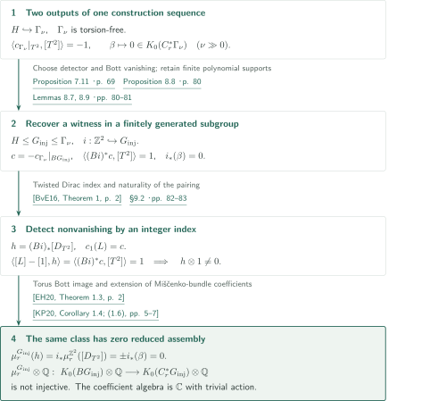
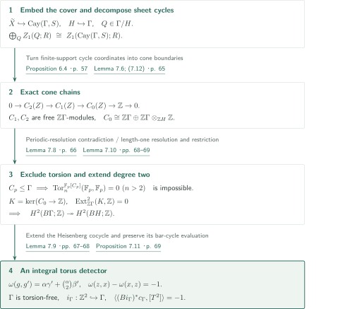
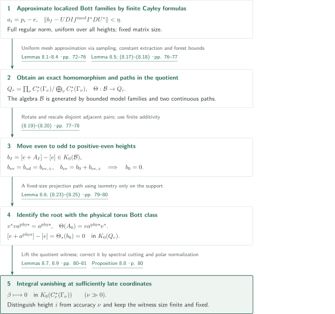

# A torsion-free counterexample to reduced Baum–Connes injectivity

**An integrally detected torus and Bott cancellation in the reduced group C* algebra**

The manuscript claims an infinite-order kernel class for coefficient-free reduced Baum–Connes assembly of a finitely generated torsion-free group. An integral cohomology class detects a torus in a Heisenberg subgroup, while localized Bott representatives move through a tower of heights to cancel its analytic image. The final step retains both properties in the same finitely generated subgroup.

## 1. Main results

### Theorem 1.1 — Failure of rational injectivity for coefficient-free reduced assembly

There exist a finitely generated torsion-free discrete group $G_{\mathrm{inj}}$, an injective homomorphism $i:\mathbb Z^2\hookrightarrow G_{\mathrm{inj}}$, and an integral class $c\in H^2(BG_{\mathrm{inj}};\mathbb Z)$ such that

$$
\langle(Bi)^*c,[T^2]\rangle=1,
\qquad
 i_*(\beta)=0\quad\text{in }K_0(C_r^*(G_{\mathrm{inj}})).
$$

Here $\beta\in K_0(C_r^*(\mathbb Z^2))\cong K^0(T^2)$ is a rank-zero Bott generator, and $i_*$ is induced by the inclusion of reduced group C* algebras. If $[D_{T^2}]$ is the spin Dirac class of the oriented torus, then

$$
h=(Bi)_*[D_{T^2}]\in K_0(BG_{\mathrm{inj}})
$$

has infinite order and $\mu_r^{G_{\mathrm{inj}}}(h)=0$. The map in question is

$$
\mu_r^{G_{\mathrm{inj}}}:K_*(BG_{\mathrm{inj}})\longrightarrow K_*(C_r^*(G_{\mathrm{inj}})),
$$

with coefficient algebra $\mathbb C$ and trivial action. All K-theory is complex; the domain is compactly supported K-homology, defined as the colimit over finite subcomplexes. Thus $h\otimes1\ne0$ but $(\mu_r^{G_{\mathrm{inj}}}\otimes\mathbb Q)(h\otimes1)=0$: injectivity fails even after rationalization. Finite presentation is not part of the conclusion.

<!-- cite:main-result -->[Theorem 1.1 · p. 1](https://github.com/openai/math/blob/1581d4cbdd69a0faf34b2089614fe2a814316a6a/preprints/A-Torsion-Free-Counterexample-to-Reduced-Baum-Connes-Injectivity-September-23-2026/paper.pdf)<!-- /cite -->

## References on the arrows

<!-- reference-guide -->
Unprefixed theorem, lemma, section and equation numbers refer to [A torsion-free counterexample to reduced Baum–Connes injectivity](https://github.com/openai/math/blob/1581d4cbdd69a0faf34b2089614fe2a814316a6a/preprints/A-Torsion-Free-Counterexample-to-Reduced-Baum-Connes-Injectivity-September-23-2026/paper.pdf). External inputs use the following keys.

- [EH20](https://arxiv.org/pdf/2001.06124v2) Heath Emerson; Dan Hudson — *Baum–Connes and the Fourier–Mukai transform*: Assembly of the torus Dirac class; the full-torus case of Theorem 1.3. arXiv:2001.06124v2, 27 July 2020.
- [KP20](https://arxiv.org/pdf/1807.05757v2) Jens Kaad; Valerio Proietti — *Index theory on the Miščenko bundle*: Comparison of the Miščenko index with reduced assembly, applied to the compact torus cycle. arXiv:1807.05757v2, 5 March 2020.
- [BvE16](https://arxiv.org/pdf/1604.03502v1) Paul F. Baum; Erik van Erp — *K-homology and Fredholm operators I: Dirac Operators*: Twisted Dirac index on a closed even-dimensional spin-c manifold, detecting the degree of a line bundle on the torus. arXiv:1604.03502v1, 12 April 2016.
- [HS07](https://arxiv.org/pdf/0705.2578v1) Bernhard Hanke; Thomas Schick — *The strong Novikov conjecture for low degree cohomology*: Comparison and consequence only: degree-two detection makes the maximal assembly image rationally nonzero. arXiv:0705.2578v1, 17 May 2007.
- [OpenAI26b](https://github.com/openai/math/blob/1581d4cbdd69a0faf34b2089614fe2a814316a6a/preprints/A-Torsion-Free-Counterexample-to-the-Kadison-Kaplansky-Projection-Conjecture-September-23-2026/paper.pdf) OpenAI — *A torsion-free counterexample to the Kadison–Kaplansky projection conjecture*: Methodological predecessor; cone chains and torsion exclusion are reproved here, rather than imported as a main-theorem input. September 23, 2026.

Each citation gives the result and pages. When printed pagination differs from the PDF position, both are shown. GitHub previews do not automatically jump to the cited page.
<!-- /reference-guide -->

## 2. Theorem 1.1 — Proof overview of the main theorem

<!-- proof-target:1 -->Proof target：[Theorem 1.1 · p. 1](https://github.com/openai/math/blob/1581d4cbdd69a0faf34b2089614fe2a814316a6a/preprints/A-Torsion-Free-Counterexample-to-Reduced-Baum-Connes-Injectivity-September-23-2026/paper.pdf)<!-- /proof-target -->

**Proof route.** Construct the [integral detector](#proof-1) and [Bott vanishing](#proof-2) for the same accuracy sequence of groups $\Gamma_\nu$. Choose one sufficiently late coordinate and pass to a subgroup containing a finite witness for the K-theory equality. The index pairing and naturality of the Miščenko index then identify topological nonvanishing and zero reduced assembly.

### 1. Retain both constructions in a finitely generated subgroup

Embed the integral Heisenberg group $H=\langle x,y,z\mid[x,y]=z,[x,z]=[y,z]=1\rangle$ in $\Gamma_\nu$. Proposition 7.11 supplies torsion-freeness of $\Gamma_\nu$ and a class $c_{\Gamma_\nu}$ evaluating to $-1$ on the ordered torus $(z,x)$. Proposition 8.8 asserts integral vanishing of its Bott image for all sufficiently large $\nu$.

Lemma 8.9 approximates the finite matrix entries of a stabilization projection and a witnessing partial isometry by group polynomials. Their finite supports, together with generators of $H$, generate $G_{\mathrm{inj}}$. The reduced inclusion of a subgroup is isometric, so the small-defect bounds remain valid in this subgroup. Spectral cutting and polar normalization recover an exact witness there. Torsion-freeness and the embedded torus pass to the subgroup; setting $c=-c_{\Gamma_\nu}|_{BG_{\mathrm{inj}}}$ changes the evaluation to $1$. No limit group of the accuracy sequence is used.

<!-- cite:detector -->[Proposition 7.11 · p. 69](https://github.com/openai/math/blob/1581d4cbdd69a0faf34b2089614fe2a814316a6a/preprints/A-Torsion-Free-Counterexample-to-Reduced-Baum-Connes-Injectivity-September-23-2026/paper.pdf)<!-- /cite --> <!-- cite:bott -->[Proposition 8.8 · p. 80](https://github.com/openai/math/blob/1581d4cbdd69a0faf34b2089614fe2a814316a6a/preprints/A-Torsion-Free-Counterexample-to-Reduced-Baum-Connes-Injectivity-September-23-2026/paper.pdf)<!-- /cite --> <!-- cite:finite-witness -->[Lemmas 8.7, 8.9 · pp. 80–81](https://github.com/openai/math/blob/1581d4cbdd69a0faf34b2089614fe2a814316a6a/preprints/A-Torsion-Free-Counterexample-to-Reduced-Baum-Connes-Injectivity-September-23-2026/paper.pdf)<!-- /cite -->

### 2. Detect the topological class by an integer index

Choose a line bundle $L$ with $c_1(L)=c$. Naturality of the index pairing on the compact torus cycle gives

$$
\langle[L]-[1],h\rangle
=\operatorname{index}(D_{T^2}\otimes(Bi)^*L)-\operatorname{index}(D_{T^2})
=\langle(Bi)^*c,[T^2]\rangle=1.
$$

The tangent bundle is trivial, so the characteristic class in the index formula is $1$, and the untwisted Dirac index is zero. An integer-valued homomorphism taking $h$ to $1$ proves infinite order. Compactness of $BG_{\mathrm{inj}}$ is not required.

<!-- cite:index -->[&#91;BvE16, Theorem 1, p. 2&#93;](https://arxiv.org/pdf/1604.03502v1#page=2)<!-- /cite --> <!-- cite:main-proof -->[§9.2 · pp. 82–83](https://github.com/openai/math/blob/1581d4cbdd69a0faf34b2089614fe2a814316a6a/preprints/A-Torsion-Free-Counterexample-to-Reduced-Baum-Connes-Injectivity-September-23-2026/paper.pdf)<!-- /cite -->

### 3. Identify the reduced assembly image of the same class

In the full-torus case of Emerson–Hudson, the dual subtorus is a point, giving $\mu_r^{\mathbb Z^2}([D_{T^2}])=\pm\beta$. The sign depends on orientation conventions and does not affect vanishing. Put $A=C_r^*(\mathbb Z^2)$, $B=C_r^*(G_{\mathrm{inj}})$ and let $j:A\to B$ be inclusion. The Miščenko bundle becomes $E_A\otimes_jB$. The manuscript checks on this torus cycle that extension of coefficients commutes with the index Kasparov product. The comparison theorem therefore gives

$$
\mu_r^{G_{\mathrm{inj}}}(h)
=j_*\mu_r^{\mathbb Z^2}([D_{T^2}])=\pm j_*(\beta)=0
$$

This concerns injectivity with trivial coefficients, a different assertion from known failures of surjectivity with nontrivial coefficients or the existence of a nontrivial projection in the scalar algebra.

<!-- cite:torus-assembly -->[&#91;EH20, Theorem 1.3, p. 2&#93;](https://arxiv.org/pdf/2001.06124v2#page=2)<!-- /cite --> <!-- cite:mishchenko -->[&#91;KP20, Corollary 1.4; (1.6), pp. 5–7&#93;](https://arxiv.org/pdf/1807.05757v2#page=5)<!-- /cite --> <!-- cite:main-proof -->[§9.2 · pp. 82–83](https://github.com/openai/math/blob/1581d4cbdd69a0faf34b2089614fe2a814316a6a/preprints/A-Torsion-Free-Counterexample-to-Reduced-Baum-Connes-Injectivity-September-23-2026/paper.pdf)<!-- /cite -->

## 3. Proposition 7.11 — Torsion exclusion and the integral detector

<!-- proof-target:2 -->Proof target：[Proposition 7.11 · p. 69](https://github.com/openai/math/blob/1581d4cbdd69a0faf34b2089614fe2a814316a6a/preprints/A-Torsion-Free-Counterexample-to-Reduced-Baum-Connes-Injectivity-September-23-2026/paper.pdf)<!-- /proof-target -->

<!-- statement:proposition-7-11 -->
### Proposition 7.11 — Detecting the embedded Heisenberg torus

The graphical group $\Gamma$ constructed in §§2–6 is torsion-free. The map $i_\Gamma:\mathbb Z^2\to\Gamma$ sending the ordered basis to $(z,x)$ is injective, and there is a class $c_\Gamma\in H^2(B\Gamma;\mathbb Z)$ such that

$$
\langle(Bi_\Gamma)^*c_\Gamma,[T^2]\rangle=-1
$$

This assertion concerns the group $\Gamma$ with the sheet and cone-chain structure below, rather than an arbitrary group containing the Heisenberg group.

<!-- cite:detector -->[Proposition 7.11 · p. 69](https://github.com/openai/math/blob/1581d4cbdd69a0faf34b2089614fe2a814316a6a/preprints/A-Torsion-Free-Counterexample-to-Reduced-Baum-Connes-Injectivity-September-23-2026/paper.pdf)<!-- /cite -->
<!-- /statement -->

### 1. Embed the cover and control finite-support chains

Unique recovery of long words and exclusion of short circuits let the manuscript prove, by plane diagrams, that a null-labeled source path has equal endpoints. The voltage cover $\widetilde X$ and its deck group $H$ consequently embed in the Cayley graph; translated sheets are indexed by $\Gamma/H$. The direct decomposition into sheet cycle coordinates makes the chain complex of the two-dimensional complex $Z$, obtained by coning each sheet, exact over any commutative coefficient ring.

$$
0\longrightarrow C_2(Z)\longrightarrow C_1(Z)\longrightarrow C_0(Z)\longrightarrow\mathbb Z\longrightarrow0,
\quad C_0(Z)\cong\mathbb Z\Gamma\oplus\mathbb Z\Gamma\otimes_{\mathbb ZH}\mathbb Z.
$$

The modules $C_1,C_2$ are free over $\mathbb Z\Gamma$. All chains and cycle decompositions have finite support; no independence of infinite sums is assumed.

<!-- cite:embedding -->[Proposition 6.4 · p. 57](https://github.com/openai/math/blob/1581d4cbdd69a0faf34b2089614fe2a814316a6a/preprints/A-Torsion-Free-Counterexample-to-Reduced-Baum-Connes-Injectivity-September-23-2026/paper.pdf)<!-- /cite --> <!-- cite:geometry -->[Lemmas 6.3, 7.3; Proposition 7.4 · pp. 55–57, 62–64](https://github.com/openai/math/blob/1581d4cbdd69a0faf34b2089614fe2a814316a6a/preprints/A-Torsion-Free-Counterexample-to-Reduced-Baum-Connes-Injectivity-September-23-2026/paper.pdf)<!-- /cite --> <!-- cite:cone -->[Lemma 7.6; (7.12) · p. 65](https://github.com/openai/math/blob/1581d4cbdd69a0faf34b2089614fe2a814316a6a/preprints/A-Torsion-Free-Counterexample-to-Reduced-Baum-Connes-Injectivity-September-23-2026/paper.pdf)<!-- /cite -->

### 2. Rule out prime-order subgroups by resolution length

The group $H$ is torsion-free, cone-vertex stabilizers are conjugates of $H$, and other cell stabilizers are trivial. If $C_p\le\Gamma$, it acts freely on cells, and the chains over $\mathbb F_p$ give a length-two free resolution of the trivial $\mathbb F_p[C_p]$ module. But tensoring the periodic resolution over $\mathbb F_p[C_p]\cong\mathbb F_p[t]/(t^p)$ with the trivial module leaves homology $\mathbb F_p$ in every degree. Resolution comparison gives a contradiction. Hence there is no subgroup $C_p$ and $\Gamma$ is torsion-free.

<!-- cite:torsion -->[Lemma 7.8 · p. 66](https://github.com/openai/math/blob/1581d4cbdd69a0faf34b2089614fe2a814316a6a/preprints/A-Torsion-Free-Counterexample-to-Reduced-Baum-Connes-Injectivity-September-23-2026/paper.pdf)<!-- /cite -->

### 3. Extend an explicit cocycle to the ambient group

Use Heisenberg coordinates with the following product.

$$
\begin{aligned}
&(\alpha,\beta,\gamma)(\alpha',\beta',\gamma')\\
&\qquad=(\alpha+\alpha',\beta+\beta',\gamma+\gamma'+\alpha\beta').
\end{aligned}
$$

The integral 2-cocycle

$$
\omega(g,g')=\alpha\gamma'+\binom{\alpha}{2}\beta'
$$

evaluates to $-1$ on the bar cycle $[z|x]-[x|z]$. The module $K=\ker(C_0(Z)\to\mathbb Z)$ has a length-one free resolution, so $\operatorname{Ext}^2_{\mathbb Z\Gamma}(K,\mathbb Z)=0$. This makes $H^2(B\Gamma;\mathbb Z)\to H^2(BH;\mathbb Z)$ surjective. The manuscript also compares chain maps from the induced resolution and the bar resolution, identifying this map with actual subgroup restriction. An extension of $[\omega]$ therefore retains the required evaluation.

<!-- cite:cocycle -->[Lemma 7.9 · pp. 67–68](https://github.com/openai/math/blob/1581d4cbdd69a0faf34b2089614fe2a814316a6a/preprints/A-Torsion-Free-Counterexample-to-Reduced-Baum-Connes-Injectivity-September-23-2026/paper.pdf)<!-- /cite --> <!-- cite:extension -->[Lemma 7.10 · pp. 68–69](https://github.com/openai/math/blob/1581d4cbdd69a0faf34b2089614fe2a814316a6a/preprints/A-Torsion-Free-Counterexample-to-Reduced-Baum-Connes-Injectivity-September-23-2026/paper.pdf)<!-- /cite -->

## 4. Proposition 8.8 — Bott vanishing in the reduced algebra

<!-- proof-target:3 -->Proof target：[Proposition 8.8 · p. 80](https://github.com/openai/math/blob/1581d4cbdd69a0faf34b2089614fe2a814316a6a/preprints/A-Torsion-Free-Counterexample-to-Reduced-Baum-Connes-Injectivity-September-23-2026/paper.pdf)<!-- /proof-target -->

<!-- statement:proposition-8-8 -->
### Proposition 8.8 — Integral vanishing at sufficiently late coordinates

Consider the compatible sequence of constructions $\Gamma_\nu$, with parameters chosen in the order of §9.1. For every sufficiently large $\nu$, the image of the rank-zero Bott generator for $\langle z,x\rangle\cong\mathbb Z^2$ is zero in

$$
K_0(C_r^*(\Gamma_\nu))
$$

No rationalization is needed. Height $i\ge0$ runs inside one tower, whereas accuracy $\nu$ indexes different constructions. Matrix sizes remain fixed along the accuracy sequence.

<!-- cite:bott -->[Proposition 8.8 · p. 80](https://github.com/openai/math/blob/1581d4cbdd69a0faf34b2089614fe2a814316a6a/preprints/A-Torsion-Free-Counterexample-to-Reduced-Baum-Connes-Injectivity-September-23-2026/paper.pdf)<!-- /cite -->
<!-- /statement -->

### 1. Realize finite Cayley formulas in full regular norm

Treat the localized differences $a_i=p_i-e$, adjacent-height rotations and rescalings as finite families of profiles. Proposition 5.2 imposes short-circuit exclusion and full regular operator-norm approximation on the same voltage choice. Small spectral-carrier traces and bounds on excluded coordinates control the loss when restricting to disjoint sheet domains. Products of incidences extract normalized constant modes, while a fixed gap $\rho<1$ suppresses their complements. The remaining Cayley edges form a forest, whose operator-norm error is $O(\sqrt{|S_{\mathrm{wt}}|}/q)$.

Lemma 8.4 obtains finite matrix group-algebra elements with arbitrarily small error. It does not assume physical height-selection projections or membership of Borel carriers in the reduced C* algebra. The order of choices is essential: first profiles, meshes and weight nets, then the degree parameter, and finally the initial height.

<!-- cite:sampling -->[Proposition 5.2; §5.8 · pp. 41–42, 49–50](https://github.com/openai/math/blob/1581d4cbdd69a0faf34b2089614fe2a814316a6a/preprints/A-Torsion-Free-Counterexample-to-Reduced-Baum-Connes-Injectivity-September-23-2026/paper.pdf)<!-- /cite --> <!-- cite:realization -->[Lemmas 8.1–8.4 · pp. 72–76](https://github.com/openai/math/blob/1581d4cbdd69a0faf34b2089614fe2a814316a6a/preprints/A-Torsion-Free-Counterexample-to-Reduced-Baum-Connes-Injectivity-September-23-2026/paper.pdf)<!-- /cite --> <!-- cite:choices -->[§9.1 · pp. 81–82](https://github.com/openai/math/blob/1581d4cbdd69a0faf34b2089614fe2a814316a6a/preprints/A-Torsion-Free-Counterexample-to-Reduced-Baum-Connes-Injectivity-September-23-2026/paper.pdf)<!-- /cite -->

### 2. Remove the initial term using two homotopies and finite additivity

Fix regular representations of $A_\nu=C_r^*(\Gamma_\nu)$ and put $Q_r=\prod_\nu A_\nu/\bigoplus_\nu A_\nu$, where products are bounded sequences and direct sums are norm-null sequences. Let $\mathcal B$ be the C* algebra generated by four bounded model families and two paths. Compression by almost-isometries gives an exact $*$-homomorphism $\Theta$ in the quotient. Uniform approximation on finite meshes proves $\Theta(\mathcal B)\subset Q_r$.

Denote the even, odd, positive-even and initial-height differences by $A_{\mathrm{ev}},A_{\mathrm{od}},A_{\mathrm{ev},+},A_0$. Using external unitization, set $b_I=[e+A_I]-[e]\in K_0(\mathcal B)$. Rotations on disjoint adjacent pairs, followed by rescaling, give

$$
b_{\mathrm{ev}}=b_{\mathrm{od}}=b_{\mathrm{ev},+},
\qquad b_{\mathrm{ev}}=b_0+b_{\mathrm{ev},+},
\qquad b_0=0.
$$

The second equality comes from a finite-size projection homotopy using orthogonal supports. The all-height families have already been constructed as bounded operators; the displayed argument does not sum infinitely many K-theory classes.

<!-- cite:source-algebra -->[Lemma 8.5; (8.17)–(8.18) · pp. 76–77](https://github.com/openai/math/blob/1581d4cbdd69a0faf34b2089614fe2a814316a6a/preprints/A-Torsion-Free-Counterexample-to-Reduced-Baum-Connes-Injectivity-September-23-2026/paper.pdf)<!-- /cite --> <!-- cite:parity -->[(8.19)–(8.20) · pp. 77–78](https://github.com/openai/math/blob/1581d4cbdd69a0faf34b2089614fe2a814316a6a/preprints/A-Torsion-Free-Counterexample-to-Reduced-Baum-Connes-Injectivity-September-23-2026/paper.pdf)<!-- /cite -->

### 3. Identify the physical Bott class and recover equality in one group

The initial profile and the subgroup Bott representative $a^{\mathrm{phys}}$ are related by a bounded $v$ satisfying $v^*va^{\mathrm{phys}}=a^{\mathrm{phys}}$ and $\Theta(A_0)=va^{\mathrm{phys}}v^*$. Supported transport in Lemma 8.6 constructs a fixed-size projection path from precisely these relations. Hence the physical Bott class vanishes in $K_0(Q_r)$.

Lemma 8.7 lifts a stabilization projection and a partial isometry from the quotient to bounded sequences, then uses spectral cutting and polar normalization at sufficiently late coordinates. This recovers equality in $K_0(A_\nu)$ with a fixed finite witness size. The unitary equivalence from right to left regular representations sends each group element to that same group element, yielding Proposition 8.8.

<!-- cite:transport -->[Lemma 8.6; (8.23)–(8.25) · pp. 79–80](https://github.com/openai/math/blob/1581d4cbdd69a0faf34b2089614fe2a814316a6a/preprints/A-Torsion-Free-Counterexample-to-Reduced-Baum-Connes-Injectivity-September-23-2026/paper.pdf)<!-- /cite --> <!-- cite:finite-witness -->[Lemmas 8.7, 8.9 · pp. 80–81](https://github.com/openai/math/blob/1581d4cbdd69a0faf34b2089614fe2a814316a6a/preprints/A-Torsion-Free-Counterexample-to-Reduced-Baum-Connes-Injectivity-September-23-2026/paper.pdf)<!-- /cite -->

## 5. Which papers supply which steps

| Source | Used at | Content and checking scope |
|---|---|---|
| <!-- cite:index -->[&#91;BvE16, Theorem 1, p. 2&#93;](https://arxiv.org/pdf/1604.03502v1#page=2)<!-- /cite --> | §9.2, index detection above | The closed spin torus and pulled-back line bundle meet the index theorem's hypotheses. Statement and use checked. |
| <!-- cite:torus-assembly -->[&#91;EH20, Theorem 1.3, p. 2&#93;](https://arxiv.org/pdf/2001.06124v2#page=2)<!-- /cite --> | §9.2, assembly image | The dual of the full torus is a point. Identification with the rank-zero Bott class, up to sign, checked. |
| <!-- cite:mishchenko -->[&#91;KP20, Corollary 1.4; (1.6), pp. 5–7&#93;](https://arxiv.org/pdf/1807.05757v2#page=5)<!-- /cite --> | §9.2, subgroup naturality | Apply the comparison to a countable-group principal bundle with compact torus base. The manuscript computes coefficient extension. |
| <!-- cite:method -->[&#91;OpenAI26b, §7.6, pp. 36–38&#93;](https://github.com/openai/math/blob/1581d4cbdd69a0faf34b2089614fe2a814316a6a/preprints/A-Torsion-Free-Counterexample-to-the-Kadison-Kaplansky-Projection-Conjecture-September-23-2026/paper.pdf)<!-- /cite --> | §7.4, cone chains | Methodological reference. Exactness and torsion exclusion for the present sheets are reproved here. |

<!-- cite:method-use -->[§2; §7.4 · pp. 7, 64](https://github.com/openai/math/blob/1581d4cbdd69a0faf34b2089614fe2a814316a6a/preprints/A-Torsion-Free-Counterexample-to-Reduced-Baum-Connes-Injectivity-September-23-2026/paper.pdf)<!-- /cite -->

For comparison with maximal assembly, detection by the degree-two class $c$ meets Hanke–Schick's hypothesis, so the maximal assembly image of the same $h$ is rationally nonzero. That image dies under the regular quotient $C^*_{\max}(G_{\mathrm{inj}})\to C_r^*(G_{\mathrm{inj}})$. The manuscript does not claim a counterexample to maximal rational injectivity or the classical Novikov conjecture.

<!-- cite:maximal -->[&#91;HS07, Theorem 1.2, pp. 1–2&#93;](https://arxiv.org/pdf/0705.2578v1#page=1)<!-- /cite --> <!-- cite:comparison -->[§§1.1–1.2 · pp. 1–3](https://github.com/openai/math/blob/1581d4cbdd69a0faf34b2089614fe2a814316a6a/preprints/A-Torsion-Free-Counterexample-to-Reduced-Baum-Connes-Injectivity-September-23-2026/paper.pdf)<!-- /cite -->

The projection-counterexample manuscript in this catalogue supplies adapted stream/recovery and cone-chain methods, but its projection-existence theorem is not used as an input producing this kernel class. No direct theorem dependence on the irrational-trace manuscript was found in the proof route and bibliography inspected here.

## 6. Return to the sources

<!-- reading-list -->
- [Theorem 1.1 · p. 1](https://github.com/openai/math/blob/1581d4cbdd69a0faf34b2089614fe2a814316a6a/preprints/A-Torsion-Free-Counterexample-to-Reduced-Baum-Connes-Injectivity-September-23-2026/paper.pdf) — Check the group, coefficients and the two conclusions.
- [Proposition 5.2; §5.8 · pp. 41–42, 49–50](https://github.com/openai/math/blob/1581d4cbdd69a0faf34b2089614fe2a814316a6a/preprints/A-Torsion-Free-Counterexample-to-Reduced-Baum-Connes-Injectivity-September-23-2026/paper.pdf) — The simultaneous geometric and full-regular-norm requirements.
- [Proposition 7.11 · p. 69](https://github.com/openai/math/blob/1581d4cbdd69a0faf34b2089614fe2a814316a6a/preprints/A-Torsion-Free-Counterexample-to-Reduced-Baum-Connes-Injectivity-September-23-2026/paper.pdf) — Combine torsion exclusion and the integral detector.
- [Lemma 8.5; (8.17)–(8.18) · pp. 76–77](https://github.com/openai/math/blob/1581d4cbdd69a0faf34b2089614fe2a814316a6a/preprints/A-Torsion-Free-Counterexample-to-Reduced-Baum-Connes-Injectivity-September-23-2026/paper.pdf) — Pass from bounded operator families to exact quotient homotopies.
- [Lemmas 8.7, 8.9 · pp. 80–81](https://github.com/openai/math/blob/1581d4cbdd69a0faf34b2089614fe2a814316a6a/preprints/A-Torsion-Free-Counterexample-to-Reduced-Baum-Connes-Injectivity-September-23-2026/paper.pdf) — Recover equality in one group and then a finitely generated subgroup.
- [§9.2 · pp. 82–83](https://github.com/openai/math/blob/1581d4cbdd69a0faf34b2089614fe2a814316a6a/preprints/A-Torsion-Free-Counterexample-to-Reduced-Baum-Connes-Injectivity-September-23-2026/paper.pdf) — Compare the nonzero index pairing with zero assembly.
<!-- /reading-list -->

The reading covered the main statement, the simultaneous-selection interface in §5.8, §§6.3–6.4, cycle/cone arguments and integral detection in §7, finite formulas, quotient algebras, Bott cancellation and finite witnesses in §8, and the conclusion in §9. Statements and application hypotheses were checked in fixed versions of the three external inputs and the maximal-assembly comparison.

The complete sequential probability, recovery and pruning estimates in §§2–4, and the Fourier envelopes, finite regular-norm tests and centered moment calculations in §§5.4–5.7, have not been independently audited. These are important unresolved parts on which the later analytic realization depends. This is not a certification of the complete 85-page proof, an independent verification of all external proofs, expert peer review or formal verification.
