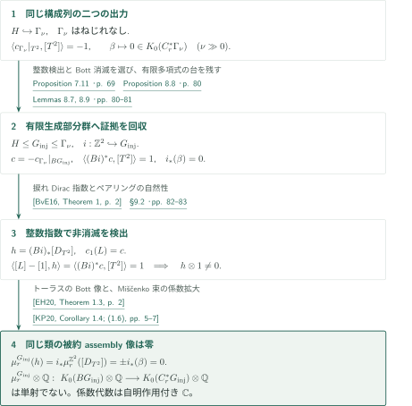
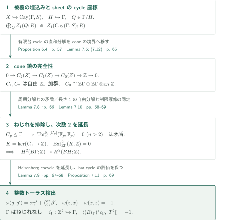
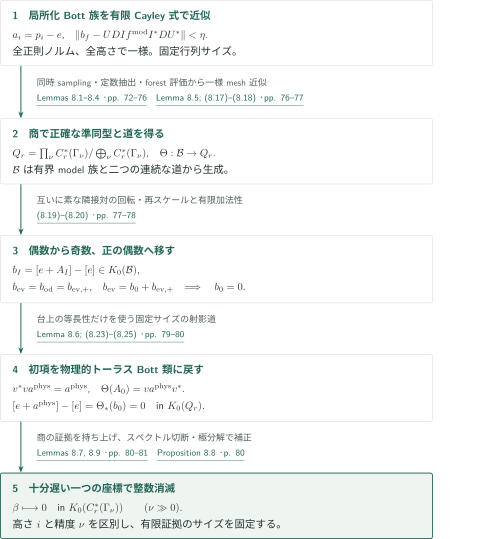

# A torsion-free counterexample to reduced Baum–Connes injectivity

**整数検出を保ったトーラスと、被約群C*環におけるBott消去**

原稿は、有限生成ねじれなし群に対する係数なしの被約Baum–Connes assemblyに、無限位数の核元を構成すると主張する。Heisenberg部分群のトーラス上で整数コホモロジーを検出し、一方では局所化したBott代表を高さ方向へ移して解析的像を消す。二つの性質を同じ有限生成部分群へ残すのが最後の接続である。

## 1. 主要結果

### Theorem 1.1 — 係数なしの被約assemblyの有理単射性の失敗

有限生成ねじれなし離散群 $G_{\mathrm{inj}}$、単射準同型 $i:\mathbb Z^2\hookrightarrow G_{\mathrm{inj}}$、整数類 $c\in H^2(BG_{\mathrm{inj}};\mathbb Z)$ が存在し、

$$
\langle(Bi)^*c,[T^2]\rangle=1,
\qquad
 i_*(\beta)=0\quad\text{in }K_0(C_r^*(G_{\mathrm{inj}})).
$$

ここで $\beta\in K_0(C_r^*(\mathbb Z^2))\cong K^0(T^2)$ はrank-zero Bott生成元、$i_*$ は被約群C*環の包含から誘導される写像である。向き付けたトーラスのspin Dirac類を $[D_{T^2}]$ とすると、

$$
h=(Bi)_*[D_{T^2}]\in K_0(BG_{\mathrm{inj}})
$$

は無限位数であり、$\mu_r^{G_{\mathrm{inj}}}(h)=0$ である。対象の写像は

$$
\mu_r^{G_{\mathrm{inj}}}:K_*(BG_{\mathrm{inj}})\longrightarrow K_*(C_r^*(G_{\mathrm{inj}})),
$$

係数代数は自明作用付き $\mathbb C$、K理論は複素K理論、左辺は有限部分複体に関する極限としてのコンパクト台Kホモロジーである。したがって $h\otimes1\ne0$ かつ $(\mu_r^{G_{\mathrm{inj}}}\otimes\mathbb Q)(h\otimes1)=0$ であり、有理化後も単射でない。有限表示は結論に含まれない。

<!-- cite:main-result -->[Theorem 1.1 · p. 1](https://github.com/openai/math/blob/1581d4cbdd69a0faf34b2089614fe2a814316a6a/preprints/A-Torsion-Free-Counterexample-to-Reduced-Baum-Connes-Injectivity-September-23-2026/paper.pdf)<!-- /cite -->

## 図の矢印に付した引用

<!-- reference-guide -->
略号のない定理・補題・節・式番号は本原稿 [A torsion-free counterexample to reduced Baum–Connes injectivity](https://github.com/openai/math/blob/1581d4cbdd69a0faf34b2089614fe2a814316a6a/preprints/A-Torsion-Free-Counterexample-to-Reduced-Baum-Connes-Injectivity-September-23-2026/paper.pdf) を指します。外部入力には次の略号を使います。

- [EH20](https://arxiv.org/pdf/2001.06124v2) Heath Emerson; Dan Hudson — *Baum–Connes and the Fourier–Mukai transform*：トーラスDirac類のassembly像。Theorem 1.3の全トーラスの場合を使用。arXiv:2001.06124v2, 27 July 2020。
- [KP20](https://arxiv.org/pdf/1807.05757v2) Jens Kaad; Valerio Proietti — *Index theory on the Miščenko bundle*：Miščenko指数と被約assemblyの比較。コンパクトなトーラスサイクルへ適用。arXiv:1807.05757v2, 5 March 2020。
- [BvE16](https://arxiv.org/pdf/1604.03502v1) Paul F. Baum; Erik van Erp — *K-homology and Fredholm operators I: Dirac Operators*：閉じた偶数次元Spinᶜ多様体の捩れDirac指数。トーラス上の線束の次数を検出。arXiv:1604.03502v1, 12 April 2016。
- [HS07](https://arxiv.org/pdf/0705.2578v1) Bernhard Hanke; Thomas Schick — *The strong Novikov conjecture for low degree cohomology*：比較・帰結のみ。次数2の検出により最大assembly像は有理的に非零。arXiv:0705.2578v1, 17 May 2007。
- [OpenAI26b](https://github.com/openai/math/blob/1581d4cbdd69a0faf34b2089614fe2a814316a6a/preprints/A-Torsion-Free-Counterexample-to-the-Kadison-Kaplansky-Projection-Conjecture-September-23-2026/paper.pdf) OpenAI — *A torsion-free counterexample to the Kadison–Kaplansky projection conjecture*：方法上の先行原稿。cone-chainと有限位数排除は本稿で再証明する。主定理の直接入力ではない。September 23, 2026。

各引用に結果番号とページを付します。誌面番号とPDF内の位置が異なる場合は両方を示します。GitHubの閲覧リンクではページ位置への自動移動を前提としません。
<!-- /reference-guide -->

## 2. Theorem 1.1 — 主定理の証明概略

<!-- proof-target:1 -->証明対象：[Theorem 1.1 · p. 1](https://github.com/openai/math/blob/1581d4cbdd69a0faf34b2089614fe2a814316a6a/preprints/A-Torsion-Free-Counterexample-to-Reduced-Baum-Connes-Injectivity-September-23-2026/paper.pdf)<!-- /proof-target -->

**証明の道筋。** [整数検出の構成](#proof-1)と[Bott消滅の構成](#proof-2)を同じ精度列の群 $\Gamma_\nu$ で行う。一つの十分遅い座標を選び、K理論の有限な等式の証拠を含む部分群へ移る。その後、指数ペアリングとMiščenko指数の自然性が、位相的非消滅と被約assemblyの消滅を結び付ける。

### 1. 二つの構成を有限生成部分群へ残す

整数Heisenberg群 $H=\langle x,y,z\mid[x,y]=z,[x,z]=[y,z]=1\rangle$ を $\Gamma_\nu$ に埋め込む。Proposition 7.11は $\Gamma_\nu$ のねじれなし性と、順序付きトーラス $(z,x)$ 上で $-1$ を与える類 $c_{\Gamma_\nu}$ を供給する。Proposition 8.8は、十分大きい $\nu$ でそのトーラスのBott像が整数係数のK理論で零になると主張する。

Lemma 8.9では、安定化射影と部分等長作用素の有限行列による証拠を群環の多項式で近似し、その有限個の台と $H$ の生成元で $G_{\mathrm{inj}}$ を生成する。部分群の被約C*環の包含は等長なので、小さな欠陥の評価はこの部分群内でも成立する。スペクトル切断と極分解により正確な証拠を回復する。ねじれなし性とトーラスの単射性は部分群へ継承され、$c=-c_{\Gamma_\nu}|_{BG_{\mathrm{inj}}}$ とすれば評価は $1$ になる。精度列の極限群を取る議論ではない。

<!-- cite:detector -->[Proposition 7.11 · p. 69](https://github.com/openai/math/blob/1581d4cbdd69a0faf34b2089614fe2a814316a6a/preprints/A-Torsion-Free-Counterexample-to-Reduced-Baum-Connes-Injectivity-September-23-2026/paper.pdf)<!-- /cite --> <!-- cite:bott -->[Proposition 8.8 · p. 80](https://github.com/openai/math/blob/1581d4cbdd69a0faf34b2089614fe2a814316a6a/preprints/A-Torsion-Free-Counterexample-to-Reduced-Baum-Connes-Injectivity-September-23-2026/paper.pdf)<!-- /cite --> <!-- cite:finite-witness -->[Lemmas 8.7, 8.9 · pp. 80–81](https://github.com/openai/math/blob/1581d4cbdd69a0faf34b2089614fe2a814316a6a/preprints/A-Torsion-Free-Counterexample-to-Reduced-Baum-Connes-Injectivity-September-23-2026/paper.pdf)<!-- /cite -->

### 2. 整数指数で位相的類を検出する

$c_1(L)=c$ となる線束 $L$ を取る。コンパクトなトーラスサイクル上で指数ペアリングの自然性を用いると、

$$
\langle[L]-[1],h\rangle
=\operatorname{index}(D_{T^2}\otimes(Bi)^*L)-\operatorname{index}(D_{T^2})
=\langle(Bi)^*c,[T^2]\rangle=1.
$$

接束が自明なため指数公式の特性類は $1$、捩れなしのDirac指数は零である。整数値準同型で $1$ に写るので $h$ は無限位数である。この議論は $BG_{\mathrm{inj}}$ のコンパクト性を要求しない。

<!-- cite:index -->[&#91;BvE16, Theorem 1, p. 2&#93;](https://arxiv.org/pdf/1604.03502v1#page=2)<!-- /cite --> <!-- cite:main-proof -->[§9.2 · pp. 82–83](https://github.com/openai/math/blob/1581d4cbdd69a0faf34b2089614fe2a814316a6a/preprints/A-Torsion-Free-Counterexample-to-Reduced-Baum-Connes-Injectivity-September-23-2026/paper.pdf)<!-- /cite -->

### 3. 同じ類の被約assembly像を同定する

Emerson–Hudsonの全トーラスの場合では、双対部分トーラスは一点であり、$\mu_r^{\mathbb Z^2}([D_{T^2}])=\pm\beta$ となる。符号は向きの規約によるが消滅には影響しない。$A=C_r^*(\mathbb Z^2)$、$B=C_r^*(G_{\mathrm{inj}})$、包含 $j:A\to B$ に対し、Miščenko束は $E_A\otimes_jB$ へ変わる。係数拡大と指数Kasparov積が可換であることを原稿はこのトーラスサイクル上で確認し、比較定理を用いて

$$
\mu_r^{G_{\mathrm{inj}}}(h)
=j_*\mu_r^{\mathbb Z^2}([D_{T^2}])=\pm j_*(\beta)=0
$$

を得る。これは自明係数での単射性への反例であり、非自明係数の全射性への既知の反例や、スカラー代数内の非自明射影の存在とは異なる主張である。

<!-- cite:torus-assembly -->[&#91;EH20, Theorem 1.3, p. 2&#93;](https://arxiv.org/pdf/2001.06124v2#page=2)<!-- /cite --> <!-- cite:mishchenko -->[&#91;KP20, Corollary 1.4; (1.6), pp. 5–7&#93;](https://arxiv.org/pdf/1807.05757v2#page=5)<!-- /cite --> <!-- cite:main-proof -->[§9.2 · pp. 82–83](https://github.com/openai/math/blob/1581d4cbdd69a0faf34b2089614fe2a814316a6a/preprints/A-Torsion-Free-Counterexample-to-Reduced-Baum-Connes-Injectivity-September-23-2026/paper.pdf)<!-- /cite -->

## 3. Proposition 7.11 — ねじれ排除と整数検出

<!-- proof-target:2 -->証明対象：[Proposition 7.11 · p. 69](https://github.com/openai/math/blob/1581d4cbdd69a0faf34b2089614fe2a814316a6a/preprints/A-Torsion-Free-Counterexample-to-Reduced-Baum-Connes-Injectivity-September-23-2026/paper.pdf)<!-- /proof-target -->

<!-- statement:proposition-7-11 -->
### Proposition 7.11 — 埋め込まれたHeisenbergトーラスの検出

§§2–6の構成から得るgraphical group $\Gamma$ はねじれなしである。順序付き基底を $(z,x)$ に送る $i_\Gamma:\mathbb Z^2\to\Gamma$ は単射であり、ある $c_\Gamma\in H^2(B\Gamma;\mathbb Z)$ が

$$
\langle(Bi_\Gamma)^*c_\Gamma,[T^2]\rangle=-1
$$

を満たす。これは任意のHeisenberg群を含む群に対する主張ではなく、以下のsheetとcone-chain構造を備える $\Gamma$ に対する結論である。

<!-- cite:detector -->[Proposition 7.11 · p. 69](https://github.com/openai/math/blob/1581d4cbdd69a0faf34b2089614fe2a814316a6a/preprints/A-Torsion-Free-Counterexample-to-Reduced-Baum-Connes-Injectivity-September-23-2026/paper.pdf)<!-- /cite -->
<!-- /statement -->

### 1. 被覆を埋め込み、有限台の鎖を制御する

長い語の一意回復と短い閉路の排除から、原稿はnull-labeled source pathの両端が一致することを平面図式で示す。ここから電圧被覆 $\widetilde X$ とdeck群 $H$ がCayleyグラフに埋め込まれ、その平行移動であるsheetが $\Gamma/H$ で添字付けられる。sheetのcycle座標の直和分解を使い、各sheet上へconeを付けた二次元複体 $Z$ の鎖複体が任意の可換係数環で完全となる。

$$
0\longrightarrow C_2(Z)\longrightarrow C_1(Z)\longrightarrow C_0(Z)\longrightarrow\mathbb Z\longrightarrow0,
\quad C_0(Z)\cong\mathbb Z\Gamma\oplus\mathbb Z\Gamma\otimes_{\mathbb ZH}\mathbb Z.
$$

ここで $C_1,C_2$ は自由 $\mathbb Z\Gamma$ 加群である。使う鎖とcycle分解はいずれも有限台であり、無限和の独立性を仮定しない。

<!-- cite:embedding -->[Proposition 6.4 · p. 57](https://github.com/openai/math/blob/1581d4cbdd69a0faf34b2089614fe2a814316a6a/preprints/A-Torsion-Free-Counterexample-to-Reduced-Baum-Connes-Injectivity-September-23-2026/paper.pdf)<!-- /cite --> <!-- cite:geometry -->[Lemmas 6.3, 7.3; Proposition 7.4 · pp. 55–57, 62–64](https://github.com/openai/math/blob/1581d4cbdd69a0faf34b2089614fe2a814316a6a/preprints/A-Torsion-Free-Counterexample-to-Reduced-Baum-Connes-Injectivity-September-23-2026/paper.pdf)<!-- /cite --> <!-- cite:cone -->[Lemma 7.6; (7.12) · p. 65](https://github.com/openai/math/blob/1581d4cbdd69a0faf34b2089614fe2a814316a6a/preprints/A-Torsion-Free-Counterexample-to-Reduced-Baum-Connes-Injectivity-September-23-2026/paper.pdf)<!-- /cite -->

### 2. 素数位数部分群と短い自由分解を両立させない

$H$ はねじれなしで、cone頂点の安定化群は $H$ の共役である。他のセルの安定化群は自明である。もし $C_p\le\Gamma$ があれば、$C_p$ はセル上自由に作用し、$\mathbb F_p$ 係数の鎖複体が自明 $\mathbb F_p[C_p]$ 加群の長さ2の自由分解になる。一方、$\mathbb F_p[C_p]\cong\mathbb F_p[t]/(t^p)$ の周期分解を自明加群とテンソルすると、全次数で $\mathbb F_p$ のホモロジーが残る。分解比較と矛盾するため素数位数部分群はなく、$\Gamma$ はねじれなしとなる。

<!-- cite:torsion -->[Lemma 7.8 · p. 66](https://github.com/openai/math/blob/1581d4cbdd69a0faf34b2089614fe2a814316a6a/preprints/A-Torsion-Free-Counterexample-to-Reduced-Baum-Connes-Injectivity-September-23-2026/paper.pdf)<!-- /cite -->

### 3. 明示的cocycleをambient groupへ延長する

Heisenberg座標の積は次の式で与えられる。

$$
\begin{aligned}
&(\alpha,\beta,\gamma)(\alpha',\beta',\gamma')\\
&\qquad=(\alpha+\alpha',\beta+\beta',\gamma+\gamma'+\alpha\beta').
\end{aligned}
$$

整数2-cocycle

$$
\omega(g,g')=\alpha\gamma'+\binom{\alpha}{2}\beta'
$$

はbar cycle $[z|x]-[x|z]$ に $-1$ を与える。$K=\ker(C_0(Z)\to\mathbb Z)$ は長さ1の自由分解を持つので $\operatorname{Ext}^2_{\mathbb Z\Gamma}(K,\mathbb Z)=0$。これにより $H^2(B\Gamma;\mathbb Z)\to H^2(BH;\mathbb Z)$ が全射となる。原稿は誘導分解とbar分解のchain mapを比較し、この写像が実際の部分群制限であることも確認する。したがって $[\omega]$ を延長した類が必要な評価を保つ。

<!-- cite:cocycle -->[Lemma 7.9 · pp. 67–68](https://github.com/openai/math/blob/1581d4cbdd69a0faf34b2089614fe2a814316a6a/preprints/A-Torsion-Free-Counterexample-to-Reduced-Baum-Connes-Injectivity-September-23-2026/paper.pdf)<!-- /cite --> <!-- cite:extension -->[Lemma 7.10 · pp. 68–69](https://github.com/openai/math/blob/1581d4cbdd69a0faf34b2089614fe2a814316a6a/preprints/A-Torsion-Free-Counterexample-to-Reduced-Baum-Connes-Injectivity-September-23-2026/paper.pdf)<!-- /cite -->

## 4. Proposition 8.8 — 被約代数でのBott消滅

<!-- proof-target:3 -->証明対象：[Proposition 8.8 · p. 80](https://github.com/openai/math/blob/1581d4cbdd69a0faf34b2089614fe2a814316a6a/preprints/A-Torsion-Free-Counterexample-to-Reduced-Baum-Connes-Injectivity-September-23-2026/paper.pdf)<!-- /proof-target -->

<!-- statement:proposition-8-8 -->
### Proposition 8.8 — 精度列の十分遅い座標での整数消滅

§9.1の順序でパラメータを選んだ両立する構成列 $\Gamma_\nu$ を考える。十分大きいすべての $\nu$ について、$\langle z,x\rangle\cong\mathbb Z^2$ のrank-zero Bott生成元の像は

$$
K_0(C_r^*(\Gamma_\nu))
$$

で零である。有理化は不要である。高さ $i\ge0$ は一つの塔の内部添字、精度 $\nu$ は別々の構成を走る添字であり、行列サイズは精度列に沿って固定する。

<!-- cite:bott -->[Proposition 8.8 · p. 80](https://github.com/openai/math/blob/1581d4cbdd69a0faf34b2089614fe2a814316a6a/preprints/A-Torsion-Free-Counterexample-to-Reduced-Baum-Connes-Injectivity-September-23-2026/paper.pdf)<!-- /cite -->
<!-- /statement -->

### 1. 全正則ノルムで有限Cayley式を実現する

局所化した差 $a_i=p_i-e$ と隣接高さ間の回転・再スケールを有限個のprofileとして扱う。Proposition 5.2は、同じ電圧選択に短閉路排除と全正則作用素ノルムでの近似を同時に課す。sheetごとの互いに素な領域へ制限した際の誤差は、小さいspectral carrierのトレースと除外座標数で抑える。正規化された定数モードをincidenceの積で抽出し、補空間は固定gap $\rho<1$ により減衰させる。残りのCayley辺はforestとなり、その作用素ノルム誤差は $O(\sqrt{|S_{\mathrm{wt}}|}/q)$ で抑える。

Lemma 8.4が得るのは、任意に小さい誤差での有限行列群環元である。高さを選ぶ物理的射影やBorel carrierの被約C*環への所属を仮定しない。有限profile、mesh、重みnetを選んでから次数パラメータ、最後に初期高さを増す順序が不可欠である。

<!-- cite:sampling -->[Proposition 5.2; §5.8 · pp. 41–42, 49–50](https://github.com/openai/math/blob/1581d4cbdd69a0faf34b2089614fe2a814316a6a/preprints/A-Torsion-Free-Counterexample-to-Reduced-Baum-Connes-Injectivity-September-23-2026/paper.pdf)<!-- /cite --> <!-- cite:realization -->[Lemmas 8.1–8.4 · pp. 72–76](https://github.com/openai/math/blob/1581d4cbdd69a0faf34b2089614fe2a814316a6a/preprints/A-Torsion-Free-Counterexample-to-Reduced-Baum-Connes-Injectivity-September-23-2026/paper.pdf)<!-- /cite --> <!-- cite:choices -->[§9.1 · pp. 81–82](https://github.com/openai/math/blob/1581d4cbdd69a0faf34b2089614fe2a814316a6a/preprints/A-Torsion-Free-Counterexample-to-Reduced-Baum-Connes-Injectivity-September-23-2026/paper.pdf)<!-- /cite -->

### 2. 二つのホモトピーと有限加法性で初項を消す

$A_\nu=C_r^*(\Gamma_\nu)$ の正則表現を固定し、$Q_r=\prod_\nu A_\nu/\bigoplus_\nu A_\nu$ と置く。直積は有界列、直和はノルム零列である。model上の四つの有界作用素族と二つの道から生成したC*代数 $\mathcal B$ に対し、ほぼ等長な写像の圧縮が商で正確な $*$-準同型 $\Theta$ を与える。有限meshの一様近似により $\Theta(\mathcal B)\subset Q_r$ を証明する。

偶数、奇数、正の偶数、初期高さの差を $A_{\mathrm{ev}},A_{\mathrm{od}},A_{\mathrm{ev},+},A_0$ とし、外部単位化を用いて $b_I=[e+A_I]-[e]\in K_0(\mathcal B)$ と置く。互いに素な隣接対の回転と再スケールにより

$$
b_{\mathrm{ev}}=b_{\mathrm{od}}=b_{\mathrm{ev},+},
\qquad b_{\mathrm{ev}}=b_0+b_{\mathrm{ev},+},
\qquad b_0=0.
$$

二番目の等式は台の直交性から作る有限サイズの射影ホモトピーである。高さ全体の作用素族は有界作用素として先に構成されており、この式は無限個のK理論類の和を用いない。

<!-- cite:source-algebra -->[Lemma 8.5; (8.17)–(8.18) · pp. 76–77](https://github.com/openai/math/blob/1581d4cbdd69a0faf34b2089614fe2a814316a6a/preprints/A-Torsion-Free-Counterexample-to-Reduced-Baum-Connes-Injectivity-September-23-2026/paper.pdf)<!-- /cite --> <!-- cite:parity -->[(8.19)–(8.20) · pp. 77–78](https://github.com/openai/math/blob/1581d4cbdd69a0faf34b2089614fe2a814316a6a/preprints/A-Torsion-Free-Counterexample-to-Reduced-Baum-Connes-Injectivity-September-23-2026/paper.pdf)<!-- /cite -->

### 3. 物理的Bott類を同定し、商の等式を一つの群へ戻す

初期profileの像と部分群のBott代表 $a^{\mathrm{phys}}$ は、$v^*va^{\mathrm{phys}}=a^{\mathrm{phys}}$、$\Theta(A_0)=va^{\mathrm{phys}}v^*$ を満たす有界 $v$ で結ばれる。Lemma 8.6のsupported transportは、この関係だけから固定サイズの射影道を作る。したがって物理的Bott類は $K_0(Q_r)$ で零になる。

Lemma 8.7は商内の安定化射影と部分等長作用素を有界列へ持ち上げ、十分遅い座標でスペクトル切断と極分解を行う。固定有限サイズの証拠を保ったまま $K_0(A_\nu)$ の等式を回復する。右正則表現から通常の左正則表現へのユニタリ同値は各群元を同じ群元へ送るので、これがProposition 8.8の消滅である。

<!-- cite:transport -->[Lemma 8.6; (8.23)–(8.25) · pp. 79–80](https://github.com/openai/math/blob/1581d4cbdd69a0faf34b2089614fe2a814316a6a/preprints/A-Torsion-Free-Counterexample-to-Reduced-Baum-Connes-Injectivity-September-23-2026/paper.pdf)<!-- /cite --> <!-- cite:finite-witness -->[Lemmas 8.7, 8.9 · pp. 80–81](https://github.com/openai/math/blob/1581d4cbdd69a0faf34b2089614fe2a814316a6a/preprints/A-Torsion-Free-Counterexample-to-Reduced-Baum-Connes-Injectivity-September-23-2026/paper.pdf)<!-- /cite -->

## 5. どの論文が、どの段階を担うか

| 供給元 | 利用箇所 | 内容と照合範囲 |
|---|---|---|
| <!-- cite:index -->[&#91;BvE16, Theorem 1, p. 2&#93;](https://arxiv.org/pdf/1604.03502v1#page=2)<!-- /cite --> | §9.2、上の指数検出 | 閉じたspinトーラスと引戻し線束は指数公式の仮定を満たす。定理記述と適用を照合。 |
| <!-- cite:torus-assembly -->[&#91;EH20, Theorem 1.3, p. 2&#93;](https://arxiv.org/pdf/2001.06124v2#page=2)<!-- /cite --> | §9.2、assembly像 | 全トーラスの双対は一点。符号を除いたrank-zero Bott像の同定を照合。 |
| <!-- cite:mishchenko -->[&#91;KP20, Corollary 1.4; (1.6), pp. 5–7&#93;](https://arxiv.org/pdf/1807.05757v2#page=5)<!-- /cite --> | §9.2、部分群自然性 | 可算群の主束とコンパクトなトーラス基底で比較を適用。係数拡大の計算は本稿で行う。 |
| <!-- cite:method -->[&#91;OpenAI26b, §7.6, pp. 36–38&#93;](https://github.com/openai/math/blob/1581d4cbdd69a0faf34b2089614fe2a814316a6a/preprints/A-Torsion-Free-Counterexample-to-the-Kadison-Kaplansky-Projection-Conjecture-September-23-2026/paper.pdf)<!-- /cite --> | §7.4、cone-chain | 方法上の参照。今回のsheetに対する完全性とねじれ排除は再証明される。 |

<!-- cite:method-use -->[§2; §7.4 · pp. 7, 64](https://github.com/openai/math/blob/1581d4cbdd69a0faf34b2089614fe2a814316a6a/preprints/A-Torsion-Free-Counterexample-to-Reduced-Baum-Connes-Injectivity-September-23-2026/paper.pdf)<!-- /cite -->

最大assemblyとの比較では、$c$ による次数2の検出がHanke–Schickの仮定を満たすため、同じ $h$ の最大assembly像は有理的に非零である。その像が正則商 $C^*_{\max}(G_{\mathrm{inj}})\to C_r^*(G_{\mathrm{inj}})$ で消えるという位置付けになる。原稿は最大assemblyの有理単射性や古典的Novikov予想の反例を主張しない。

<!-- cite:maximal -->[&#91;HS07, Theorem 1.2, pp. 1–2&#93;](https://arxiv.org/pdf/0705.2578v1#page=1)<!-- /cite --> <!-- cite:comparison -->[§§1.1–1.2 · pp. 1–3](https://github.com/openai/math/blob/1581d4cbdd69a0faf34b2089614fe2a814316a6a/preprints/A-Torsion-Free-Counterexample-to-Reduced-Baum-Connes-Injectivity-September-23-2026/paper.pdf)<!-- /cite -->

同じカタログの射影反例原稿からはstream/recoveryとcone-chainの方法を適応するが、射影の存在定理を本稿の核元の入力として使わない。irrational-trace原稿への直接の定理依存は、今回読んだ証明経路と参考文献では確認していない。

## 6. 原典を読む入口と確認範囲

<!-- reading-list -->
- [Theorem 1.1 · p. 1](https://github.com/openai/math/blob/1581d4cbdd69a0faf34b2089614fe2a814316a6a/preprints/A-Torsion-Free-Counterexample-to-Reduced-Baum-Connes-Injectivity-September-23-2026/paper.pdf) — 群・係数・二つの結論を確認する。
- [Proposition 5.2; §5.8 · pp. 41–42, 49–50](https://github.com/openai/math/blob/1581d4cbdd69a0faf34b2089614fe2a814316a6a/preprints/A-Torsion-Free-Counterexample-to-Reduced-Baum-Connes-Injectivity-September-23-2026/paper.pdf) — 幾何条件と全正則ノルム近似を同時に課す箇所。
- [Proposition 7.11 · p. 69](https://github.com/openai/math/blob/1581d4cbdd69a0faf34b2089614fe2a814316a6a/preprints/A-Torsion-Free-Counterexample-to-Reduced-Baum-Connes-Injectivity-September-23-2026/paper.pdf) — ねじれ排除と整数検出を合流させる。
- [Lemma 8.5; (8.17)–(8.18) · pp. 76–77](https://github.com/openai/math/blob/1581d4cbdd69a0faf34b2089614fe2a814316a6a/preprints/A-Torsion-Free-Counterexample-to-Reduced-Baum-Connes-Injectivity-September-23-2026/paper.pdf) — 有界作用素族から正確な商代数内ホモトピーへ進む。
- [Lemmas 8.7, 8.9 · pp. 80–81](https://github.com/openai/math/blob/1581d4cbdd69a0faf34b2089614fe2a814316a6a/preprints/A-Torsion-Free-Counterexample-to-Reduced-Baum-Connes-Injectivity-September-23-2026/paper.pdf) — 一つの群、その有限生成部分群へ等式を降ろす。
- [§9.2 · pp. 82–83](https://github.com/openai/math/blob/1581d4cbdd69a0faf34b2089614fe2a814316a6a/preprints/A-Torsion-Free-Counterexample-to-Reduced-Baum-Connes-Injectivity-September-23-2026/paper.pdf) — 指数の非消滅とassemblyの消滅を照合する。
<!-- /reading-list -->

原典の主張、§5.8の同時選択の接続、§§6.3–6.4、§7のcycle/coneと整数検出、§8の有限式・商代数・Bott消去・有限証拠、§9の結論を読んだ。外部3入力と最大assemblyの比較結果は、固定版の定理記述・適用条件を照合した。

§§2–4の逐次確率・回復・pruningの全評価、§§5.4–5.7のFourier envelope・有限正則ノルムtest・centered momentの全計算は独立に検証していない。この部分は後続の解析的実現が依存する重要な未確認範囲である。85頁全体の正しさの認定、外部定理の全証明の検証、専門家査読または形式検証を行ったという意味ではない。
