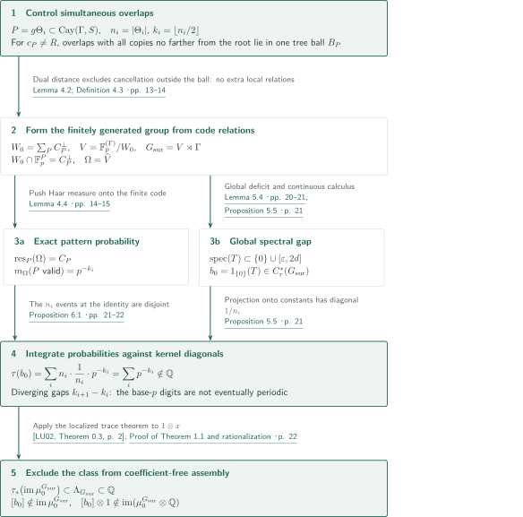
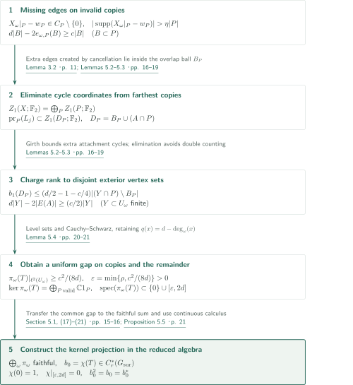

# An irrational-trace counterexample to reduced Baum–Connes

**Exact local distributions from codes, and a spectral gap on the entire graph**

The manuscript claims to construct an irrational-trace projection in the reduced group C*-algebra of a semidirect product, using a finite-field lamp module modulo code relations on graphs. The decisive step is a uniform spectral gap that places the kernel projection in the reduced group C*-algebra itself. Comparing its trace with the trace restriction on assembly then obstructs surjectivity of the coefficient-free reduced Baum–Connes map.

## 1. Main results

### Theorem 1.1 — Irrational trace and failure of coefficient-free surjectivity

There exist a finitely generated discrete group $G_{\mathrm{sur}}$ and a projection $b_0\in C_r^*(G_{\mathrm{sur}})$ such that, for the canonical trace normalized by $\tau_{G_{\mathrm{sur}}}(1)=1$,

$$
\tau_{G_{\mathrm{sur}}}(b_0)\notin\mathbb Q,
\qquad
[b_0]\notin\operatorname{im}\!\left(
\mu_0^{G_{\mathrm{sur}}}:K_0^{G_{\mathrm{sur}}}(\underline EG_{\mathrm{sur}})
\longrightarrow K_0(C_r^*(G_{\mathrm{sur}}))\right).
$$

The manuscript therefore asserts that the coefficient-free reduced Baum–Connes conjecture for countable discrete groups is false. K-theory is integral complex K-theory, and the coefficient algebra is $\mathbb C$ with trivial action. The space $\underline EG$ classifies proper actions: fixed-point sets are contractible for finite subgroups and empty for infinite subgroups. No finite-dimensional or cocompact model is assumed. The domain is equivariant K-homology with $G$-compact supports, defined as the direct limit of $KK_0^G(C_0(Z),\mathbb C)$ over closed invariant $G$-compact subspaces $Z$ of a proper $G$-CW model. No torsion-free condition is imposed on $G_{\mathrm{sur}}$.

<!-- cite:main-result -->[Theorem 1.1 · p. 2](https://github.com/openai/math/blob/1581d4cbdd69a0faf34b2089614fe2a814316a6a/preprints/An-Irrational-Trace-Counterexample-to-Reduced-Baum-Connes-September-23-2026/paper.pdf)<!-- /cite -->

## References on the arrows

<!-- reference-guide -->
Unprefixed theorem, lemma, section and equation numbers refer to [An irrational-trace counterexample to reduced Baum–Connes](https://github.com/openai/math/blob/1581d4cbdd69a0faf34b2089614fe2a814316a6a/preprints/An-Irrational-Trace-Counterexample-to-Reduced-Baum-Connes-September-23-2026/paper.pdf). External inputs use the following keys.

- [LU02](https://www.math.uni-bonn.de/people/lueck/data/trc.pdf) Wolfgang Lück — *The relation between the Baum-Connes Conjecture and the Trace Conjecture*: Trace restriction on assembly; use the localized image without assuming surjectivity. 2002 author-hosted typeset PDF, numbered 1–30 (not final journal pagination 123–152).
- [Osa20](https://intlpress.com/api/bgcloud-front/resource/pdf/volume/1805558233924313090-1805558233924313090-a435a3d1f4b693c71097e3d66a7d45cd.pdf) Damian Osajda — *Small cancellation labellings of some infinite graphs and applications*: Finite labelling of expanders and isometric embeddings into a Cayley graph. Acta Mathematica 225 (2020), 159–191.
- [BH99](https://webhomes.maths.ed.ac.uk/~v1ranick/papers/bridsonhaefligerx.pdf) Martin R. Bridson, André Haefliger — *Metric Spaces of Non-Positive Curvature*: Uniform hyperbolicity from a coarse linear filling bound. Springer, 1999; scanned book, print/PDF offset +23.
- [LPS88](https://courses.grainger.illinois.edu/cs598sgt/sp2015/LPS.pdf) Alexander Lubotzky, Ralph Phillips, Peter Sarnak — *Ramanujan graphs*: Fixed-degree expanders with growing girth. Combinatorica 8 (1988), 261–277; published scan with visible folios.

Each citation gives the result and pages. When printed pagination differs from the PDF position, both are shown. GitHub previews do not automatically jump to the cited page.
<!-- /reference-guide -->

## 2. Proof of Theorem 1.1 — Joining local distributions and spectral estimates through the trace

<!-- proof-target:1 -->Proof target：[Theorem 1.1 · p. 2](https://github.com/openai/math/blob/1581d4cbdd69a0faf34b2089614fe2a814316a6a/preprints/An-Irrational-Trace-Counterexample-to-Reduced-Baum-Connes-September-23-2026/paper.pdf)<!-- /proof-target -->

**Proof route.** Codes on isometrically embedded expander copies define a finitely generated group $G_{\mathrm{sur}}=V\rtimes\Gamma$. Dual distance gives exact probabilities for local patterns. Primal distance and the geometry of overlapping copies give a uniform gap. The resulting projection is measured using the local probabilities, and its trace is compared with Lück's restriction on assembly. The next section explains the global gap argument.

### 1. From simultaneous overlap control to the group and its local distributions

Choose expanders $\Theta_i$ of fixed degree $d$, with a common Laplacian gap $\rho>0$ and growing girth $\sigma_i$. Put $n_i=|\Theta_i|$ and $k_i=\lfloor n_i/2\rfloor$, passing to a subsequence so that $k_i$ strictly increases and $k_{i+1}-k_i\to\infty$. The LPS family supplies the bounded degree, growing girth and bounded diameter/girth ratio required by Osajda's labelling theorem. Its finite alphabet $S$ defines a graphical presentation of a group $\Gamma$ in whose Cayley graph $X$ the $\Theta_i$ embed isometrically.

<!-- cite:expanders -->[&#91;LPS88, Theorems 3.4 and 4.1, print pp. 267, 269 / PDF pp. 7, 9&#93;](https://courses.grainger.illinois.edu/cs598sgt/sp2015/LPS.pdf#page=7)<!-- /cite --> <!-- cite:labelling -->[&#91;Osa20, Theorem 2.7, print p. 173 / PDF p. 15&#93;](https://intlpress.com/api/bgcloud-front/resource/pdf/volume/1805558233924313090-1805558233924313090-a435a3d1f4b693c71097e3d66a7d45cd.pdf#page=15)<!-- /cite --> <!-- cite:embedding -->[&#91;Osa20, Lemma 3.1; Theorem 3.2, print p. 176 / PDF p. 18&#93;](https://intlpress.com/api/bgcloud-front/resource/pdf/volume/1805558233924313090-1805558233924313090-a435a3d1f4b693c71097e3d66a7d45cd.pdf#page=18)<!-- /cite --> <!-- cite:data -->[Proposition 3.1 · pp. 9–10](https://github.com/openai/math/blob/1581d4cbdd69a0faf34b2089614fe2a814316a6a/preprints/An-Irrational-Trace-Counterexample-to-Reduced-Baum-Connes-September-23-2026/paper.pdf)<!-- /cite -->

Cone off every translated copy $P=g\Theta_i$ by adding a center $c_P$. The manuscript bounds the number of arcs in compressed diagrams, obtains a uniform coarse linear filling inequality, and invokes Bridson–Haefliger to obtain a hyperbolicity constant independent of the labels and $\lambda$. Only then is $\lambda$ chosen small. For a root $R$ and a copy with $c_P\ne R$, the intersections of $P$ with **all** other copies whose centers are no farther from $R$ (including equal distances) consequently lie in one intrinsic induced tree ball $B_P$. Its radius is at most $\sigma(P)/16$ and it has fewer than $\eta|P|$ vertices, where $\eta=1/100$. Pairwise small intersections alone do not supply this simultaneous containment.

<!-- cite:hyperbolicity -->[&#91;BH99, III.H.2.1; III.H.2.9, print pp. 414, 419 / PDF pp. 437, 442&#93;](https://webhomes.maths.ed.ac.uk/~v1ranick/papers/bridsonhaefligerx.pdf#page=437)<!-- /cite --> <!-- cite:geometry -->[Proposition 2.3; Lemma 2.4 · pp. 7–9](https://github.com/openai/math/blob/1581d4cbdd69a0faf34b2089614fe2a814316a6a/preprints/An-Irrational-Trace-Counterexample-to-Reduced-Baum-Connes-September-23-2026/paper.pdf)<!-- /cite -->

Fix one sufficiently large prime $p>2$ and encode each allowed set of $d$ outgoing labels by a nonzero element of $\mathbb F_p$. Write $w_P$ for the prescribed word on a copy. Lemma 4.1 constructs a code $w_P\in C_P\subset\mathbb F_p^P$ of dimension $k_i$, with every nonzero word in either $C_P$ or $C_P^\perp$ supported on more than $\eta|P|$ vertices. Existence follows by choosing a random $k_i$-dimensional subspace containing $w_P$: the number of low-weight words is less than $p^{n_i/4}$, and a union bound makes the probability of a low-weight primal or dual word less than one. Impose all translated dual relations:

$$
W_0=\sum_P C_P^\perp\subset\mathbb F_p^{(\Gamma)},\qquad
V=\mathbb F_p^{(\Gamma)}/W_0,\qquad G_{\mathrm{sur}}=V\rtimes\Gamma.
$$

The subspace $W_0$ is $\Gamma$-invariant, and $V$ is generated by the $\Gamma$-orbit of $v_*=[e_1]$. Thus the lifts of $S$, together with $(v_*,1)$, generate $G_{\mathrm{sur}}$.

<!-- cite:codes -->[Lemma 4.1 · pp. 12–13](https://github.com/openai/math/blob/1581d4cbdd69a0faf34b2089614fe2a814316a6a/preprints/An-Irrational-Trace-Counterexample-to-Reduced-Baum-Connes-September-23-2026/paper.pdf)<!-- /cite --> <!-- cite:relations -->[Lemma 4.2; Definition 4.3 · pp. 13–14](https://github.com/openai/math/blob/1581d4cbdd69a0faf34b2089614fe2a814316a6a/preprints/An-Irrational-Trace-Counterexample-to-Reduced-Baum-Connes-September-23-2026/paper.pdf)<!-- /cite -->

The key equality is $W_0\cap\mathbb F_p^P=C_P^\perp$. If a finite sum supported on $P$ used a relation from another copy, choose a participating copy $Q$ farthest from the root $c_P$. All its intersections with the other supports lie in $B_Q$, whereas the dual word has larger support. A coordinate outside this ball cannot cancel, a contradiction. Dualizing to $\Omega=\operatorname{Hom}_{\mathbb F_p}(V,\mathbb F_p)$ shows that restriction $\omega\mapsto X_\omega|_P$ has image exactly $C_P$, and pushes Haar measure to its uniform distribution. The prescribed pattern therefore has probability $p^{-k_i}$.

<!-- cite:relations -->[Lemma 4.2; Definition 4.3 · pp. 13–14](https://github.com/openai/math/blob/1581d4cbdd69a0faf34b2089614fe2a814316a6a/preprints/An-Irrational-Trace-Counterexample-to-Reduced-Baum-Connes-September-23-2026/paper.pdf)<!-- /cite --> <!-- cite:marginals -->[Lemma 4.4 · pp. 14–15](https://github.com/openai/math/blob/1581d4cbdd69a0faf34b2089614fe2a814316a6a/preprints/An-Irrational-Trace-Counterexample-to-Reduced-Baum-Connes-September-23-2026/paper.pdf)<!-- /cite -->

The uniform gap for the operator $T$ in the next section gives $b_0=1_{\{0\}}(T)\in C_r^*(G_{\mathrm{sur}})$. This is an actual projection in the ordinary reduced algebra, not merely a class in a matrix algebra or a projection available only in the von Neumann algebra.

<!-- cite:projection -->[Proposition 5.5 · p. 21](https://github.com/openai/math/blob/1581d4cbdd69a0faf34b2089614fe2a814316a6a/preprints/An-Irrational-Trace-Counterexample-to-Reduced-Baum-Connes-September-23-2026/paper.pdf)<!-- /cite -->

### 2. Canceling copy counts against diagonal entries

Call a copy valid when it has the prescribed pattern. Valid copies are disjoint isolated components of the enabled graph, and $\pi_\omega(b_0)$ projects onto constants on each of them and vanishes on the remainder. Its diagonal entry on a type $i$ copy is $1/n_i$. Exactly $n_i$ type $i$ copies contain the identity: their translations are $g=\varphi_i(v)^{-1}$ for the embedded vertices $v$. The events that these copies are valid are mutually exclusive, including across types. Hence

$$
\tau_{G_{\mathrm{sur}}}(b_0)
=\int_\Omega\langle\pi_\omega(b_0)\delta_1,\delta_1\rangle\,dm_\Omega
=\sum_i n_i\frac1{n_i}p^{-k_i}
=\sum_i p^{-k_i}.
$$

No independence between copies is needed. Since $p>2$, the base-$p$ expansion has digit one exactly at the positions $k_i$. The infinitely many ones have diverging gaps, so this expansion is not eventually periodic. The trace is therefore irrational and lies strictly between zero and one.

<!-- cite:operator -->[Section 5.1, (17)–(21) · pp. 15–16](https://github.com/openai/math/blob/1581d4cbdd69a0faf34b2089614fe2a814316a6a/preprints/An-Irrational-Trace-Counterexample-to-Reduced-Baum-Connes-September-23-2026/paper.pdf)<!-- /cite --> <!-- cite:trace -->[Proposition 6.1 · pp. 21–22](https://github.com/openai/math/blob/1581d4cbdd69a0faf34b2089614fe2a814316a6a/preprints/An-Irrational-Trace-Counterexample-to-Reduced-Baum-Connes-September-23-2026/paper.pdf)<!-- /cite -->

### 3. Excluding the class from proper-action assembly

For any countable discrete group $G$, set $\Lambda_G=\mathbb Z[1/|F|:F\leq G\text{ finite}]\subset\mathbb Q$. Lück's Theorem 0.3 identifies the image of localized assembly followed by the canonical trace with $\Lambda_G$. Evaluating at $1\otimes x$ for an integral class $x$ yields

$$
\tau_{G*}(\mu_0^G(x))\in\Lambda_G\subset\mathbb Q.
$$

Neither surjectivity of assembly nor injectivity of localization is required. This is the manuscript's Theorem 1.2. Lück's Section 4 uses the direct limit of equivariant KK-groups over cocompact subcomplexes of a proper space, and Section 5 uses its analytic index. The manuscript employs this proper-action assembly.

<!-- cite:lueck -->[&#91;LU02, Theorem 0.3, p. 2&#93;](https://www.math.uni-bonn.de/people/lueck/data/trc.pdf#page=2)<!-- /cite --> <!-- cite:lueck-domain -->[&#91;LU02, Sections 4–5, pp. 23, 25&#93;](https://www.math.uni-bonn.de/people/lueck/data/trc.pdf#page=23)<!-- /cite --> <!-- cite:trace-theorem -->[Theorem 1.2 · p. 2](https://github.com/openai/math/blob/1581d4cbdd69a0faf34b2089614fe2a814316a6a/preprints/An-Irrational-Trace-Counterexample-to-Reduced-Baum-Connes-September-23-2026/paper.pdf)<!-- /cite -->

The irrational trace of $[b_0]$ excludes it from the image. The identification $C_r^*(V\rtimes\Gamma)\cong C(\Omega)\rtimes_r\Gamma$ is used to analyze the operator; the obstructed map is the coefficient-free assembly map for $G_{\mathrm{sur}}$ itself. A finite rational linear combination of assembly classes still has rational trace, so $[b_0]\otimes1$ also lies outside the rationalized assembly image, as observed in the unnumbered consequence on manuscript p.22.

<!-- cite:assembly -->[Proof of Theorem 1.1 and rationalization · p. 22](https://github.com/openai/math/blob/1581d4cbdd69a0faf34b2089614fe2a814316a6a/preprints/An-Irrational-Trace-Counterexample-to-Reduced-Baum-Connes-September-23-2026/paper.pdf)<!-- /cite -->

## 3. Proof of Proposition 5.5 — From local deficits to a global gap

<!-- proof-target:2 -->Proof target：[Proposition 5.5 · p. 21](https://github.com/openai/math/blob/1581d4cbdd69a0faf34b2089614fe2a814316a6a/preprints/An-Irrational-Trace-Counterexample-to-Reduced-Baum-Connes-September-23-2026/paper.pdf)<!-- /proof-target -->

<!-- statement:proposition-5-5 -->
### Proposition 5.5 — A kernel projection in the reduced group C*-algebra

Use the graphs, codes and group selected in Proposition 3.1 and Section 4, and put $\Omega=\widehat V$. Let $f_s\in C(\Omega)$ be the clopen-set projection recording that the coordinate $\omega(v_*)$ allows the outgoing label $s$, and let $u_s$ be the canonical unitary for $s\in\Gamma$. Define

$$
T=dI-\sum_{s\in S^{\pm1}}f_su_sf_{s^{-1}}
\in C(\Omega)\rtimes_r\Gamma\cong C_r^*(G_{\mathrm{sur}}).
$$

Let $\mathcal G_\omega$ retain the Cayley edges allowed at both endpoints, and let $U_\omega$ be the complement of the valid copies. Then $\pi_\omega(T)=dI-\operatorname{Adj}(\mathcal G_\omega)$. There is a projection $b_0\in C_r^*(G_{\mathrm{sur}})$ such that, for every $\omega$, $\pi_\omega(b_0)$ is the orthogonal projection onto $\ker\pi_\omega(T)$. It projects onto constants on each valid copy and is zero on $\ell^2(U_\omega)$. Its diagonal entry at the identity is $1/n_i$ if the unique valid copy containing that vertex has type $i$, and zero if there is no such copy.

<!-- cite:operator -->[Section 5.1, (17)–(21) · pp. 15–16](https://github.com/openai/math/blob/1581d4cbdd69a0faf34b2089614fe2a814316a6a/preprints/An-Irrational-Trace-Counterexample-to-Reduced-Baum-Connes-September-23-2026/paper.pdf)<!-- /cite --> <!-- cite:projection -->[Proposition 5.5 · p. 21](https://github.com/openai/math/blob/1581d4cbdd69a0faf34b2089614fe2a814316a6a/preprints/An-Irrational-Trace-Counterexample-to-Reduced-Baum-Connes-September-23-2026/paper.pdf)<!-- /cite -->
<!-- /statement -->

In the diagram, $A$ is the graph of all enabled edges on a finite set $Y\subset U_\omega$, and $L_j$ is the subspace of $Z_1(A;\mathbb F_2)$ whose previously eliminated copy coordinates vanish.

### 1. Counting local deficits without overlap

On an invalid copy, the support of $X_\omega|_P-w_P\in C_P\setminus\{0\}$ exceeds $\eta|P|$. Every discrepancy removes at least one prescribed edge incidence. Combining these missing incidences with the expander boundary estimate gives $d|B|-2e_{\omega,P}(B)\geq c|B|$ for every $B\subset P$, where $c=(\eta/2)\min\{\kappa,1\}>0$ and $\kappa$ is the edge-expansion constant. Overlaps prevent simply summing this inequality over copies.

<!-- cite:deficit -->[Lemmas 5.2–5.3 · pp. 16–19](https://github.com/openai/math/blob/1581d4cbdd69a0faf34b2089614fe2a814316a6a/preprints/An-Irrational-Trace-Counterexample-to-Reduced-Baum-Connes-September-23-2026/paper.pdf)<!-- /cite -->

The finite-support cycle space decomposes as $Z_1(X;\mathbb F_2)=\bigoplus_P Z_1(P;\mathbb F_2)$. For the enabled graph $A$ on a finite set $Y\subset U_\omega$, eliminate its cycle coordinates in decreasing order of distance from a root. Coordinate projections are not restrictions of edge chains, but any extra edge arising through cancellation with remaining copies lies in $B_P$. The projected coordinate therefore belongs to the cycle space of $D_P=B_P\cup(A\cap P)$.

<!-- cite:cycles -->[Lemma 3.2 · p. 11](https://github.com/openai/math/blob/1581d4cbdd69a0faf34b2089614fe2a814316a6a/preprints/An-Irrational-Trace-Counterexample-to-Reduced-Baum-Connes-September-23-2026/paper.pdf)<!-- /cite --> <!-- cite:deficit -->[Lemmas 5.2–5.3 · pp. 16–19](https://github.com/openai/math/blob/1581d4cbdd69a0faf34b2089614fe2a814316a6a/preprints/An-Irrational-Trace-Counterexample-to-Reduced-Baum-Connes-September-23-2026/paper.pdf)<!-- /cite -->

If a component $C$ outside $B_P$ has $l_C$ attachment edges to the ball, its contribution is $b_1(C)+\max(0,l_C-1)$. The girth and radius bounds separate distinct attachment endpoints by more than $\sigma(P)/2$, bounding the extra rank by $4|C|/\sigma(P)$. The local deficit and $\sigma(P)>20/c$ give

$$
b_1(D_P)\leq(d/2-1-c/4)|(Y\cap P)\setminus B_P|.
$$

The exterior sets $(Y\cap P)\setminus B_P$ are pairwise disjoint in the elimination order. Their charges can therefore be summed. Euler's formula then gives the global deficit

$$
d|Y|-2|E(A)|\geq(c/2)|Y|.
$$

This charging to exterior vertices is the central step from individual expander estimates to the whole graph.

<!-- cite:deficit -->[Lemmas 5.2–5.3 · pp. 16–19](https://github.com/openai/math/blob/1581d4cbdd69a0faf34b2089614fe2a814316a6a/preprints/An-Irrational-Trace-Counterexample-to-Reduced-Baum-Connes-September-23-2026/paper.pdf)<!-- /cite -->

### 2. A uniform lower bound on the remaining components

On $U_\omega$, retain the vertex potential $q(x)=d-\deg_\omega(x)\geq0$. Integrating the finite-set deficit over level sets of $|\xi|^2$ and applying Cauchy–Schwarz jointly to the edge and potential terms gives

$$
\langle\pi_\omega(T)\xi,\xi\rangle
=\sum_{\{x,y\}\in E}|\xi(x)-\xi(y)|^2+\sum_xq(x)|\xi(x)|^2
\geq\frac{c^2}{8d}\|\xi\|^2.
$$

Each valid copy has gap $\rho$ off its constants, and no enabled edge joins different valid copies or the remainder. Thus, uniformly in $\omega$,

$$
\operatorname{spec}(\pi_\omega(T))\subset\{0\}\cup[\varepsilon,2d],
\qquad \varepsilon=\min\{\rho,c^2/(8d)\}>0,
\qquad\ker\pi_\omega(T)=\bigoplus_{P\,\mathrm{valid}}\mathbb C1_P.
$$

<!-- cite:spectral-gap -->[Lemma 5.4 · pp. 20–21](https://github.com/openai/math/blob/1581d4cbdd69a0faf34b2089614fe2a814316a6a/preprints/An-Irrational-Trace-Counterexample-to-Reduced-Baum-Connes-September-23-2026/paper.pdf)<!-- /cite -->

### 3. Returning through a faithful representation to continuous functional calculus

The direct sum $\bigoplus_\omega\pi_\omega$ of the regular representations induced from evaluations is faithful on the reduced crossed product. Uniformity of the gap prevents nonzero spectrum from approaching zero in this direct sum. Consequently $T$ has the same gap in $C_r^*(G_{\mathrm{sur}})$. Choose a continuous function with $\chi(0)=1$ and $\chi|_{[\varepsilon,2d]}=0$. Then $b_0=\chi(T)$ is a projection in that C*-algebra. Functional calculus commutes with every $\pi_\omega$, yielding the asserted kernel and diagonal descriptions.

<!-- cite:operator -->[Section 5.1, (17)–(21) · pp. 15–16](https://github.com/openai/math/blob/1581d4cbdd69a0faf34b2089614fe2a814316a6a/preprints/An-Irrational-Trace-Counterexample-to-Reduced-Baum-Connes-September-23-2026/paper.pdf)<!-- /cite --> <!-- cite:projection -->[Proposition 5.5 · p. 21](https://github.com/openai/math/blob/1581d4cbdd69a0faf34b2089614fe2a814316a6a/preprints/An-Irrational-Trace-Counterexample-to-Reduced-Baum-Connes-September-23-2026/paper.pdf)<!-- /cite -->

## 4. Which papers supply which steps

LPS supplies the expander family in Proposition 3.1; Osajda supplies its finite labelling and isometric embeddings; Bridson–Haefliger supplies uniform hyperbolicity in Proposition 2.3; and Lück supplies Theorem 1.2 and the final trace comparison. The two code distances, exact local relations and global cycle-rank estimate are arguments within this manuscript.

Inspection of its introduction, construction, final proof and bibliography did not identify direct use of the other two manuscripts in this catalogue. Shared use of expanders or projections alone is not recorded as a proof dependency.

## 5. Return to the sources

<!-- reading-list -->
- [Proposition 2.3; Lemma 2.4 · pp. 7–9](https://github.com/openai/math/blob/1581d4cbdd69a0faf34b2089614fe2a814316a6a/preprints/An-Irrational-Trace-Counterexample-to-Reduced-Baum-Connes-September-23-2026/paper.pdf) — Contain simultaneous overlaps in one tree ball.
- [Lemma 4.2; Definition 4.3 · pp. 13–14](https://github.com/openai/math/blob/1581d4cbdd69a0faf34b2089614fe2a814316a6a/preprints/An-Irrational-Trace-Counterexample-to-Reduced-Baum-Connes-September-23-2026/paper.pdf) — Exact local relations and finite generation.
- [Lemmas 5.2–5.3 · pp. 16–19](https://github.com/openai/math/blob/1581d4cbdd69a0faf34b2089614fe2a814316a6a/preprints/An-Irrational-Trace-Counterexample-to-Reduced-Baum-Connes-September-23-2026/paper.pdf) — Eliminate cycle coordinates and charge ranks to disjoint exterior sets.
- [Lemma 5.4 · pp. 20–21](https://github.com/openai/math/blob/1581d4cbdd69a0faf34b2089614fe2a814316a6a/preprints/An-Irrational-Trace-Counterexample-to-Reduced-Baum-Connes-September-23-2026/paper.pdf) — Obtain a uniform bound including the remaining graph.
- [Proposition 6.1 · pp. 21–22](https://github.com/openai/math/blob/1581d4cbdd69a0faf34b2089614fe2a814316a6a/preprints/An-Irrational-Trace-Counterexample-to-Reduced-Baum-Connes-September-23-2026/paper.pdf) — Compute the trace from copy counts, probabilities and diagonal entries.
- [Proof of Theorem 1.1 and rationalization · p. 22](https://github.com/openai/math/blob/1581d4cbdd69a0faf34b2089614fe2a814316a6a/preprints/An-Irrational-Trace-Counterexample-to-Reduced-Baum-Connes-September-23-2026/paper.pdf) — Coefficient-free assembly and failure of rationalized surjectivity.
<!-- /reading-list -->

Editorial checking covered the cited reductions and calculations in Sections 2–6, the main theorem's domain, codomain and conclusions, and the statements and applications of the four direct external inputs. Lück's author-hosted typeset PDF is numbered 1–30, distinguished here from the final journal pagination 123–152. In the published LPS scan, Theorems 3.4 and 4.1 and the visible printed folios 267 and 269 were checked on PDF pages 7 and 9.

We have not independently reconstructed every singular plane-diagram surgery in Lemma 2.2 or the disk-filling conversion in Proposition 2.3. Complete proofs of external inputs, their recursive references, and the Davis–Lück comparison papers remain unchecked. This account does not constitute expert refereeing or independent verification of the entire counterexample.
