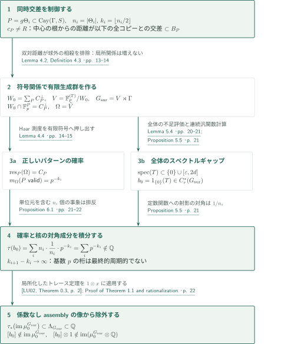
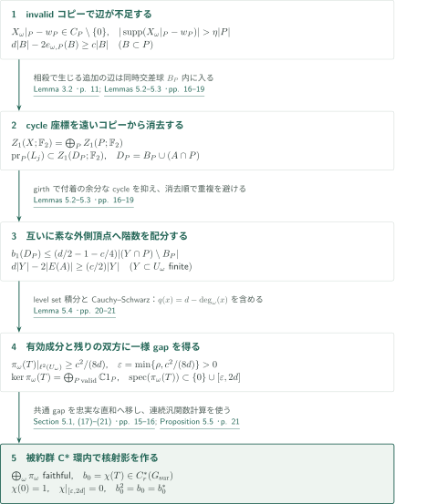

# An irrational-trace counterexample to reduced Baum–Connes

**符号による厳密な局所分布と、全成分を覆うスペクトルギャップ**

本稿は、有限体上のlamp加群をグラフ上の符号関係で割り、その半直積群の被約群C*環に無理数トレースの射影を構成すると主張する。要点は、von Neumann環に核射影を得るだけでなく、一様なスペクトルギャップによって射影を被約群C*環そのものに置くことである。これをassembly像のトレース制約と比較して、係数なし被約Baum–Connes写像の全射性を否定する。

## 1. 主要結果

### Theorem 1.1 — 無理数トレースと係数なしassemblyの非全射性

有限生成離散群 $G_{\mathrm{sur}}$ と射影 $b_0\in C_r^*(G_{\mathrm{sur}})$ が存在し、標準トレース $\tau_{G_{\mathrm{sur}}}(1)=1$ に関して

$$
\tau_{G_{\mathrm{sur}}}(b_0)\notin\mathbb Q,
\qquad
[b_0]\notin\operatorname{im}\!\left(
\mu_0^{G_{\mathrm{sur}}}:K_0^{G_{\mathrm{sur}}}(\underline EG_{\mathrm{sur}})
\longrightarrow K_0(C_r^*(G_{\mathrm{sur}}))\right).
$$

したがって、可算離散群に対する係数なし被約Baum–Connes予想は成り立たない、というのが原稿の主張である。ここでは整係数の複素K理論を用い、係数代数は自明作用を持つ $\mathbb C$ である。$\underline EG$ は有限部分群の固定点集合が可縮、無限部分群の固定点集合が空となるproper作用の分類空間であり、有限次元性や余コンパクト性は仮定しない。定義域は $G$-compact supportsを持つ同変Kホモロジーで、proper $G$-CWモデルの閉不変な $G$-compact部分空間 $Z$ にわたる $KK_0^G(C_0(Z),\mathbb C)$ の直接極限である。$G_{\mathrm{sur}}$ にtorsion-freeという条件は付されていない。

<!-- cite:main-result -->[Theorem 1.1 · p. 2](https://github.com/openai/math/blob/1581d4cbdd69a0faf34b2089614fe2a814316a6a/preprints/An-Irrational-Trace-Counterexample-to-Reduced-Baum-Connes-September-23-2026/paper.pdf)<!-- /cite -->

## 図の矢印に付した引用

<!-- reference-guide -->
略号のない定理・補題・節・式番号は本原稿 [An irrational-trace counterexample to reduced Baum–Connes](https://github.com/openai/math/blob/1581d4cbdd69a0faf34b2089614fe2a814316a6a/preprints/An-Irrational-Trace-Counterexample-to-Reduced-Baum-Connes-September-23-2026/paper.pdf) を指します。外部入力には次の略号を使います。

- [LU02](https://www.math.uni-bonn.de/people/lueck/data/trc.pdf) Wolfgang Lück — *The relation between the Baum-Connes Conjecture and the Trace Conjecture*：assembly像のトレース制約。全射性を仮定せず局所化後の像を用いる。2002 author-hosted typeset PDF, numbered 1–30 (not final journal pagination 123–152)。
- [Osa20](https://intlpress.com/api/bgcloud-front/resource/pdf/volume/1805558233924313090-1805558233924313090-a435a3d1f4b693c71097e3d66a7d45cd.pdf) Damian Osajda — *Small cancellation labellings of some infinite graphs and applications*：expander族の有限ラベル付けとCayleyグラフへの等長埋込み。Acta Mathematica 225 (2020), 159–191。
- [BH99](https://webhomes.maths.ed.ac.uk/~v1ranick/papers/bridsonhaefligerx.pdf) Martin R. Bridson, André Haefliger — *Metric Spaces of Non-Positive Curvature*：粗い線形充填評価から一様双曲性への移行。Springer, 1999; scanned book, print/PDF offset +23。
- [LPS88](https://courses.grainger.illinois.edu/cs598sgt/sp2015/LPS.pdf) Alexander Lubotzky, Ralph Phillips, Peter Sarnak — *Ramanujan graphs*：固定次数・大きなgirthを持つexpander族。Combinatorica 8 (1988), 261–277; published scan with visible folios。

各引用に結果番号とページを付します。誌面番号とPDF内の位置が異なる場合は両方を示します。GitHubの閲覧リンクではページ位置への自動移動を前提としません。
<!-- /reference-guide -->

## 2. Theorem 1.1 の証明 — 局所分布とスペクトル評価をトレースで結ぶ

<!-- proof-target:1 -->証明対象：[Theorem 1.1 · p. 2](https://github.com/openai/math/blob/1581d4cbdd69a0faf34b2089614fe2a814316a6a/preprints/An-Irrational-Trace-Counterexample-to-Reduced-Baum-Connes-September-23-2026/paper.pdf)<!-- /proof-target -->

**証明の道筋。** 等長に埋め込まれたexpanderコピー上の符号から、有限生成群 $G_{\mathrm{sur}}=V\rtimes\Gamma$ を作る。双対符号の距離が局所パターンの厳密な確率を保証し、符号自身の距離とコピーの交わりの幾何が一様ギャップを与える。後者から得た射影のトレースを前者で計算し、Lückの定理が与えるassembly像の有理性と比較する。ギャップの核心は次節で説明する。

### 1. 同時交差の制御から群と局所分布を作る

固定次数 $d$、一様なLaplacianギャップ $\rho>0$、増大するgirth $\sigma_i$ を持つexpander $\Theta_i$ を選ぶ。$n_i=|\Theta_i|$、$k_i=\lfloor n_i/2\rfloor$ とし、部分列によって $k_i$ は狭義増加かつ $k_{i+1}-k_i\to\infty$ とする。LPSの族を用い、Osajdaの定理に必要な次数上界・girthの増大・diameter/girthの有界性を満たして、有限アルファベット $S$ 上のラベルを付ける。そのgraphical presentationの群を $\Gamma$ とすると、各 $\Theta_i$ は $X=\operatorname{Cay}(\Gamma,S)$ に等長に入る。

<!-- cite:expanders -->[&#91;LPS88, Theorems 3.4 and 4.1, 誌面 pp. 267, 269 / PDF pp. 7, 9&#93;](https://courses.grainger.illinois.edu/cs598sgt/sp2015/LPS.pdf#page=7)<!-- /cite --> <!-- cite:labelling -->[&#91;Osa20, Theorem 2.7, 誌面 p. 173 / PDF p. 15&#93;](https://intlpress.com/api/bgcloud-front/resource/pdf/volume/1805558233924313090-1805558233924313090-a435a3d1f4b693c71097e3d66a7d45cd.pdf#page=15)<!-- /cite --> <!-- cite:embedding -->[&#91;Osa20, Lemma 3.1; Theorem 3.2, 誌面 p. 176 / PDF p. 18&#93;](https://intlpress.com/api/bgcloud-front/resource/pdf/volume/1805558233924313090-1805558233924313090-a435a3d1f4b693c71097e3d66a7d45cd.pdf#page=18)<!-- /cite --> <!-- cite:data -->[Proposition 3.1 · pp. 9–10](https://github.com/openai/math/blob/1581d4cbdd69a0faf34b2089614fe2a814316a6a/preprints/An-Irrational-Trace-Counterexample-to-Reduced-Baum-Connes-September-23-2026/paper.pdf)<!-- /cite -->

コピー $P=g\Theta_i$ ごとに中心 $c_P$ を加えてcone-offする。原稿は圧縮diagramの弧数評価から一様な粗い線形充填不等式を導き、Bridson–Haefligerの定理で、ラベルや $\lambda$ に依存しない双曲性定数を得る。その後で $\lambda$ を小さく選ぶ。この順序により、任意の根 $R$ と $c_P\ne R$ を満たすコピーに対し、$d(c_Q,R)\leq d(c_P,R)$ を満たす（同距離も含む）**すべての**別コピーとの交わりが、一つのintrinsic induced tree ball $B_P$ に入る。半径は $\sigma(P)/16$ 以下、頂点数は $\eta|P|$ 未満（$\eta=1/100$）である。単なる二つずつの小交差では、この同時包含を代用できない。

<!-- cite:hyperbolicity -->[&#91;BH99, III.H.2.1; III.H.2.9, 誌面 pp. 414, 419 / PDF pp. 437, 442&#93;](https://webhomes.maths.ed.ac.uk/~v1ranick/papers/bridsonhaefligerx.pdf#page=437)<!-- /cite --> <!-- cite:geometry -->[Proposition 2.3; Lemma 2.4 · pp. 7–9](https://github.com/openai/math/blob/1581d4cbdd69a0faf34b2089614fe2a814316a6a/preprints/An-Irrational-Trace-Counterexample-to-Reduced-Baum-Connes-September-23-2026/paper.pdf)<!-- /cite -->

一つの素数 $p>2$ を十分大きく選び、各頂点で許す $d$ 個の出辺ラベルを非零の $\mathbb F_p$ 元で符号化する。コピーの正しい局所ラベルを表す語を $w_P$ とする。Lemma 4.1は $w_P\in C_P\subset\mathbb F_p^P$、$\dim C_P=k_i$、さらに $C_P$ と $C_P^\perp$ の非零語のsupportがともに $\eta|P|$ より大きい符号を与える。この存在は、$w_P$ を含む $k_i$ 次元部分空間を無作為に選ぶ数え上げで示す。低weight語の個数を $p^{n_i/4}$ 未満で抑え、primal・dual双方に低weight語が入る確率の和を1未満にする。全コピーの双対関係を課して

$$
W_0=\sum_P C_P^\perp\subset\mathbb F_p^{(\Gamma)},\qquad
V=\mathbb F_p^{(\Gamma)}/W_0,\qquad G_{\mathrm{sur}}=V\rtimes\Gamma
$$

と置く。$W_0$ は $\Gamma$-不変で、$V$ は $v_*=[e_1]$ の $\Gamma$-軌道で生成されるため、$G_{\mathrm{sur}}$ は $S$ のliftと $(v_*,1)$ で有限生成される。

<!-- cite:codes -->[Lemma 4.1 · pp. 12–13](https://github.com/openai/math/blob/1581d4cbdd69a0faf34b2089614fe2a814316a6a/preprints/An-Irrational-Trace-Counterexample-to-Reduced-Baum-Connes-September-23-2026/paper.pdf)<!-- /cite --> <!-- cite:relations -->[Lemma 4.2; Definition 4.3 · pp. 13–14](https://github.com/openai/math/blob/1581d4cbdd69a0faf34b2089614fe2a814316a6a/preprints/An-Irrational-Trace-Counterexample-to-Reduced-Baum-Connes-September-23-2026/paper.pdf)<!-- /cite -->

鍵は $W_0\cap\mathbb F_p^P=C_P^\perp$ という等式である。$P$ 上にsupportを持つ有限和に別コピーの関係が含まれたら、根 $c_P$ から最遠のコピー $Q$ を取る。ほかの全supportとの交わりは $B_Q$ に入るが、双対語のsupportはその球より大きい。したがって外側に消去できない座標が残り、矛盾する。コンパクト双対 $\Omega=\operatorname{Hom}_{\mathbb F_p}(V,\mathbb F_p)$ への双対化で、制限 $\omega\mapsto X_\omega|_P$ の像は正確に $C_P$ となり、Haar測度はその一様分布へ移る。よってコピーが正しいパターンを取る確率は $p^{-k_i}$ である。

<!-- cite:relations -->[Lemma 4.2; Definition 4.3 · pp. 13–14](https://github.com/openai/math/blob/1581d4cbdd69a0faf34b2089614fe2a814316a6a/preprints/An-Irrational-Trace-Counterexample-to-Reduced-Baum-Connes-September-23-2026/paper.pdf)<!-- /cite --> <!-- cite:marginals -->[Lemma 4.4 · pp. 14–15](https://github.com/openai/math/blob/1581d4cbdd69a0faf34b2089614fe2a814316a6a/preprints/An-Irrational-Trace-Counterexample-to-Reduced-Baum-Connes-September-23-2026/paper.pdf)<!-- /cite -->

次節の作用素 $T$ の一様ギャップにより $b_0=1_{\{0\}}(T)\in C_r^*(G_{\mathrm{sur}})$ を得る。これは行列環内の類だけでも、von Neumann環内だけの射影でもない。

<!-- cite:projection -->[Proposition 5.5 · p. 21](https://github.com/openai/math/blob/1581d4cbdd69a0faf34b2089614fe2a814316a6a/preprints/An-Irrational-Trace-Counterexample-to-Reduced-Baum-Connes-September-23-2026/paper.pdf)<!-- /cite -->

### 2. コピー数と対角成分の相殺でトレースを得る

正しいパターンを持つコピーをvalidと呼ぶ。validコピーは有効辺グラフの互いに素な孤立成分で、$\pi_\omega(b_0)$ は各コピー上の定数関数への射影、残りでは零となる。型 $i$ のコピー上の対角成分は $1/n_i$ である。単位元を含む型 $i$ のコピーは、埋込みの頂点 $v$ ごとの移動 $g=\varphi_i(v)^{-1}$ に対応して正確に $n_i$ 個ある。これらがvalidである事象は、異なる型も含め互いに排反である。

$$
\tau_{G_{\mathrm{sur}}}(b_0)
=\int_\Omega\langle\pi_\omega(b_0)\delta_1,\delta_1\rangle\,dm_\Omega
=\sum_i n_i\frac1{n_i}p^{-k_i}
=\sum_i p^{-k_i}.
$$

この計算にコピー間の独立性は不要である。$p>2$ なので基数 $p$ 展開の非零桁は位置 $k_i$ の1だけであり、無限個の1の間隔が発散するため最終的周期性がない。したがってトレースは無理数で、$0<\tau(b_0)<1$ でもある。

<!-- cite:operator -->[Section 5.1, (17)–(21) · pp. 15–16](https://github.com/openai/math/blob/1581d4cbdd69a0faf34b2089614fe2a814316a6a/preprints/An-Irrational-Trace-Counterexample-to-Reduced-Baum-Connes-September-23-2026/paper.pdf)<!-- /cite --> <!-- cite:trace -->[Proposition 6.1 · pp. 21–22](https://github.com/openai/math/blob/1581d4cbdd69a0faf34b2089614fe2a814316a6a/preprints/An-Irrational-Trace-Counterexample-to-Reduced-Baum-Connes-September-23-2026/paper.pdf)<!-- /cite -->

### 3. proper作用のassembly像から除外する

任意の可算離散群 $G$ に対して $\Lambda_G=\mathbb Z[1/|F|:F\leq G\text{ finite}]\subset\mathbb Q$ とする。LückのTheorem 0.3は、$\Lambda_G$ で局所化したassemblyと標準トレースの合成の像が $\Lambda_G$ に等しいと述べる。整係数クラス $x$ に対して $1\otimes x$ に評価すれば

$$
\tau_{G*}(\mu_0^G(x))\in\Lambda_G\subset\mathbb Q
$$

を得る。ここにはassemblyの全射性も、局所化写像の単射性も必要ない。本稿のTheorem 1.2はこの帰結である。Lückの§4の定義域はproper空間の余コンパクト部分複体にわたる同変KK群の直接極限、§5の写像はその解析的指数であり、本稿は同じproper作用のassemblyを用いている。

<!-- cite:lueck -->[&#91;LU02, Theorem 0.3, p. 2&#93;](https://www.math.uni-bonn.de/people/lueck/data/trc.pdf#page=2)<!-- /cite --> <!-- cite:lueck-domain -->[&#91;LU02, Sections 4–5, pp. 23, 25&#93;](https://www.math.uni-bonn.de/people/lueck/data/trc.pdf#page=23)<!-- /cite --> <!-- cite:trace-theorem -->[Theorem 1.2 · p. 2](https://github.com/openai/math/blob/1581d4cbdd69a0faf34b2089614fe2a814316a6a/preprints/An-Irrational-Trace-Counterexample-to-Reduced-Baum-Connes-September-23-2026/paper.pdf)<!-- /cite -->

$[b_0]$ のトレースは無理数なので、この像には属さない。用いた同型 $C_r^*(V\rtimes\Gamma)\cong C(\Omega)\rtimes_r\Gamma$ は作用素を解析する表示であり、否定する写像は群 $G_{\mathrm{sur}}$ 自身の係数なしassemblyである。また有限個のassemblyクラスの有理係数線形結合のトレースも有理数なので、$[b_0]\otimes1$ は有理化したassemblyの像にも属さない（原稿p.22の番号なしの帰結）。

<!-- cite:assembly -->[Proof of Theorem 1.1 and rationalization · p. 22](https://github.com/openai/math/blob/1581d4cbdd69a0faf34b2089614fe2a814316a6a/preprints/An-Irrational-Trace-Counterexample-to-Reduced-Baum-Connes-September-23-2026/paper.pdf)<!-- /cite -->

## 3. Proposition 5.5 の証明 — 局所的な不足を全体のギャップへ移す

<!-- proof-target:2 -->証明対象：[Proposition 5.5 · p. 21](https://github.com/openai/math/blob/1581d4cbdd69a0faf34b2089614fe2a814316a6a/preprints/An-Irrational-Trace-Counterexample-to-Reduced-Baum-Connes-September-23-2026/paper.pdf)<!-- /proof-target -->

<!-- statement:proposition-5-5 -->
### Proposition 5.5 — 被約群C*環に属する核射影

Proposition 3.1と§4で選んだグラフ・符号・群に対し、$\Omega=\widehat V$ とする。$f_s\in C(\Omega)$ を「座標 $\omega(v_*)$ が出辺ラベル $s$ を許す」というclopen条件の射影、$u_s$ を $\Gamma$ の標準ユニタリとし、

$$
T=dI-\sum_{s\in S^{\pm1}}f_su_sf_{s^{-1}}
\in C(\Omega)\rtimes_r\Gamma\cong C_r^*(G_{\mathrm{sur}})
$$

と置く。各 $\omega$ で両端が許す辺だけを残したグラフを $\mathcal G_\omega$、validコピーの補集合を $U_\omega$ とすると、$\pi_\omega(T)=dI-\operatorname{Adj}(\mathcal G_\omega)$ である。このとき射影 $b_0\in C_r^*(G_{\mathrm{sur}})$ が存在し、すべての $\omega$ について $\pi_\omega(b_0)$ は $\ker\pi_\omega(T)$ への直交射影となる。各validコピー上では定数関数への射影、$\ell^2(U_\omega)$ では零であり、単位元での対角成分は、そこを含む唯一のvalidコピーが型 $i$ なら $1/n_i$、validコピーに属さなければ零である。

<!-- cite:operator -->[Section 5.1, (17)–(21) · pp. 15–16](https://github.com/openai/math/blob/1581d4cbdd69a0faf34b2089614fe2a814316a6a/preprints/An-Irrational-Trace-Counterexample-to-Reduced-Baum-Connes-September-23-2026/paper.pdf)<!-- /cite --> <!-- cite:projection -->[Proposition 5.5 · p. 21](https://github.com/openai/math/blob/1581d4cbdd69a0faf34b2089614fe2a814316a6a/preprints/An-Irrational-Trace-Counterexample-to-Reduced-Baum-Connes-September-23-2026/paper.pdf)<!-- /cite -->
<!-- /statement -->

図では有限集合 $Y\subset U_\omega$ 上の全有効辺グラフを $A$ とし、$L_j$ は $Z_1(A;\mathbb F_2)$ のうち先に消去したコピー座標が零である部分空間を表す。

### 1. 局所不足を重複なしに数える

invalidコピーでは $X_\omega|_P-w_P\in C_P\setminus\{0\}$ のsupportが $\eta|P|$ を超え、各不一致頂点で少なくとも一つの所定の辺のincidenceが欠ける。この欠損とexpanderの辺境界評価を合わせ、任意の $B\subset P$ に対し $d|B|-2e_{\omega,P}(B)\geq c|B|$ を得る。ここで $c=(\eta/2)\min\{\kappa,1\}>0$、$\kappa$ は辺拡大定数である。しかしコピーは重なるため、この評価をそのまま加算できない。

<!-- cite:deficit -->[Lemmas 5.2–5.3 · pp. 16–19](https://github.com/openai/math/blob/1581d4cbdd69a0faf34b2089614fe2a814316a6a/preprints/An-Irrational-Trace-Counterexample-to-Reduced-Baum-Connes-September-23-2026/paper.pdf)<!-- /cite -->

有限supportのcycle空間は $Z_1(X;\mathbb F_2)=\bigoplus_P Z_1(P;\mathbb F_2)$ と分解する。有限 $Y\subset U_\omega$ 上の有効辺グラフ $A$ のcycle空間について、根から遠い順にコピー座標を消去する。座標射影は辺の単なる制限ではないが、残りのコピーとの相殺で生まれる辺はすべて $B_P$ 内にある。したがってその座標は $D_P=B_P\cup(A\cap P)$ のcycle空間に入る。

<!-- cite:cycles -->[Lemma 3.2 · p. 11](https://github.com/openai/math/blob/1581d4cbdd69a0faf34b2089614fe2a814316a6a/preprints/An-Irrational-Trace-Counterexample-to-Reduced-Baum-Connes-September-23-2026/paper.pdf)<!-- /cite --> <!-- cite:deficit -->[Lemmas 5.2–5.3 · pp. 16–19](https://github.com/openai/math/blob/1581d4cbdd69a0faf34b2089614fe2a814316a6a/preprints/An-Irrational-Trace-Counterexample-to-Reduced-Baum-Connes-September-23-2026/paper.pdf)<!-- /cite -->

$B_P$ を除いた連結成分 $C$ が球へ $l_C$ 本の辺で付着すると、その寄与は $b_1(C)+\max(0,l_C-1)$ となる。girthと球の半径上界により異なる付着点間の距離が $\sigma(P)/2$ より大きくなり、付着による余分な階数を $4|C|/\sigma(P)$ で抑えられる。$\sigma(P)>20/c$ と局所不足を使うと

$$
b_1(D_P)\leq(d/2-1-c/4)|(Y\cap P)\setminus B_P|.
$$

消去順に対して外側集合 $(Y\cap P)\setminus B_P$ は互いに素である。そのため階数を加算でき、Eulerの公式から全体の不足

$$
d|Y|-2|E(A)|\geq(c/2)|Y|
$$

が従う。この外側頂点への配分が、個別expanderの評価を全体へ移す核心である。

<!-- cite:deficit -->[Lemmas 5.2–5.3 · pp. 16–19](https://github.com/openai/math/blob/1581d4cbdd69a0faf34b2089614fe2a814316a6a/preprints/An-Irrational-Trace-Counterexample-to-Reduced-Baum-Connes-September-23-2026/paper.pdf)<!-- /cite -->

### 2. 残りの成分にも一様な下界を置く

$U_\omega$ 上では $q(x)=d-\deg_\omega(x)\geq0$ という頂点ポテンシャルを残す必要がある。有限集合の不足を $|\xi|^2$ のlevel setで積分し、辺項とポテンシャル項に一緒にCauchy–Schwarzを適用すると

$$
\langle\pi_\omega(T)\xi,\xi\rangle
=\sum_{\{x,y\}\in E}|\xi(x)-\xi(y)|^2+\sum_xq(x)|\xi(x)|^2
\geq\frac{c^2}{8d}\|\xi\|^2
$$

となる。validコピー上では定数関数以外に $\rho$ のgapがあり、コピー同士および残りとの間に有効辺はない。従ってすべての $\omega$ に共通して

$$
\operatorname{spec}(\pi_\omega(T))\subset\{0\}\cup[\varepsilon,2d],
\qquad \varepsilon=\min\{\rho,c^2/(8d)\}>0,
\qquad\ker\pi_\omega(T)=\bigoplus_{P\,\mathrm{valid}}\mathbb C1_P.
$$

<!-- cite:spectral-gap -->[Lemma 5.4 · pp. 20–21](https://github.com/openai/math/blob/1581d4cbdd69a0faf34b2089614fe2a814316a6a/preprints/An-Irrational-Trace-Counterexample-to-Reduced-Baum-Connes-September-23-2026/paper.pdf)<!-- /cite -->

### 3. 忠実な表示から連続汎関数計算へ戻す

評価表現から誘導した正則表現の直和 $\bigoplus_\omega\pi_\omega$ は被約交差積に忠実である。一様なgapなので直和でも零以外のスペクトルが零へ近づかず、$C_r^*(G_{\mathrm{sur}})$ 内の $T$ 自身にも同じgapがある。$\chi(0)=1$、$\chi|_{[\varepsilon,2d]}=0$ となる連続関数を取り、$b_0=\chi(T)$ とすれば同じC*環内の射影になる。汎関数計算は各 $\pi_\omega$ と可換なので、核と対角成分の記述も従う。

<!-- cite:operator -->[Section 5.1, (17)–(21) · pp. 15–16](https://github.com/openai/math/blob/1581d4cbdd69a0faf34b2089614fe2a814316a6a/preprints/An-Irrational-Trace-Counterexample-to-Reduced-Baum-Connes-September-23-2026/paper.pdf)<!-- /cite --> <!-- cite:projection -->[Proposition 5.5 · p. 21](https://github.com/openai/math/blob/1581d4cbdd69a0faf34b2089614fe2a814316a6a/preprints/An-Irrational-Trace-Counterexample-to-Reduced-Baum-Connes-September-23-2026/paper.pdf)<!-- /cite -->

## 4. どの論文が、どの段階を担うか

LPSの結果はProposition 3.1のexpander族、Osajdaの結果は同命題の有限ラベルと等長埋込み、Bridson–Haefligerの結果はProposition 2.3の一様双曲性、Lückの結果はTheorem 1.2と主定理の最後のトレース比較を担う。符号の二つの距離、厳密な局所関係、全体のcycle階数評価は本稿内の論証である。

本稿の導入・構成・主定理の証明・参考文献を調べた範囲では、同カタログの他の2原稿を直接入力とする箇所は確認できなかった。共通するexpanderや射影という題材だけから、論文間の証明依存を作っていない。

## 5. 原典を読む入口と確認範囲

<!-- reading-list -->
- [Proposition 2.3; Lemma 2.4 · pp. 7–9](https://github.com/openai/math/blob/1581d4cbdd69a0faf34b2089614fe2a814316a6a/preprints/An-Irrational-Trace-Counterexample-to-Reduced-Baum-Connes-September-23-2026/paper.pdf) — 全コピーの交わりを一つの木球へ集める。
- [Lemma 4.2; Definition 4.3 · pp. 13–14](https://github.com/openai/math/blob/1581d4cbdd69a0faf34b2089614fe2a814316a6a/preprints/An-Irrational-Trace-Counterexample-to-Reduced-Baum-Connes-September-23-2026/paper.pdf) — 商加群の局所関係が増えないことと有限生成性。
- [Lemmas 5.2–5.3 · pp. 16–19](https://github.com/openai/math/blob/1581d4cbdd69a0faf34b2089614fe2a814316a6a/preprints/An-Irrational-Trace-Counterexample-to-Reduced-Baum-Connes-September-23-2026/paper.pdf) — cycle座標を消去し、互いに素な外側頂点へ階数を配分する。
- [Lemma 5.4 · pp. 20–21](https://github.com/openai/math/blob/1581d4cbdd69a0faf34b2089614fe2a814316a6a/preprints/An-Irrational-Trace-Counterexample-to-Reduced-Baum-Connes-September-23-2026/paper.pdf) — 不正成分を含む一様な下界を得る。
- [Proposition 6.1 · pp. 21–22](https://github.com/openai/math/blob/1581d4cbdd69a0faf34b2089614fe2a814316a6a/preprints/An-Irrational-Trace-Counterexample-to-Reduced-Baum-Connes-September-23-2026/paper.pdf) — コピー数・確率・対角成分からトレースを計算する。
- [Proof of Theorem 1.1 and rationalization · p. 22](https://github.com/openai/math/blob/1581d4cbdd69a0faf34b2089614fe2a814316a6a/preprints/An-Irrational-Trace-Counterexample-to-Reduced-Baum-Connes-September-23-2026/paper.pdf) — 係数なしassemblyと有理化後の非全射性。
<!-- /reading-list -->

編集側では、原稿の§§2–6の上記帰着と計算、主定理の定義域・値域・全結論、外部4文献の直接入力の記述と使用箇所を照合した。Lückの参照PDFは誌面1–30の著者公開組版であり、最終誌面123–152とはページ表記を区別した。LPSの刊行版scanではTheorems 3.4・4.1と欄外の誌面267・269頁をそれぞれPDF 7・9頁で目視確認した。

Lemma 2.2の特異な平面diagramの全手術とProposition 2.3のdisk fillingへの変換を独立に再構成したわけではない。外部入力定理の証明全体、その先の文献、Davis–Lück版との比較文献は未検証である。本稿の反例の主張を専門家査読や全証明の独立検証として認定するものではない。
