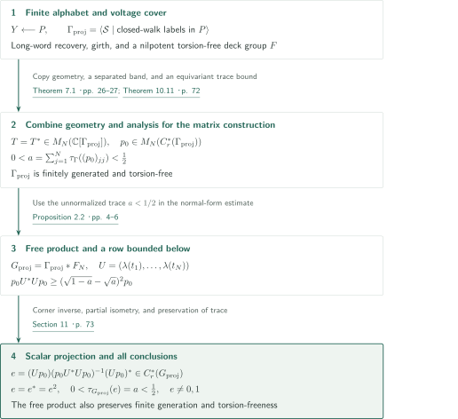
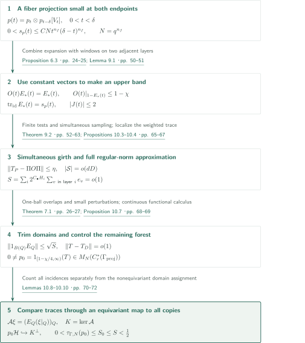
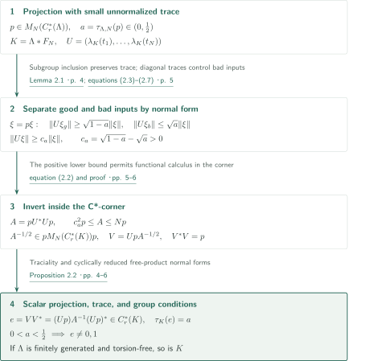

# A torsion-free counterexample to the Kadison–Kaplansky projection conjecture

**A separated spectral band of small trace, followed by scalar compression in a free product**

The manuscript claims a nontrivial projection in the reduced group C*-algebra of a torsion-free group. Its main construction retains a spectral gap for a finite matrix in the regular representation while making the **unnormalized** trace of the upper projection small. A separate free-product estimate then converts the matrix projection into a scalar one.

## 1. Main results

### Theorem 1.1 — A nontrivial scalar projection in the reduced group C*-algebra

There exist a finitely generated torsion-free discrete group $G_{\mathrm{proj}}$ and a projection $e=e^*=e^2\in C_r^*(G_{\mathrm{proj}})$ such that the canonical trace satisfies

$$0<\tau_{G_{\mathrm{proj}}}(e)<\frac12.$$

In particular, $e\ne0,1$. The target is the scalar reduced group C*-algebra; this is not a statement about the group ring, the maximal group C*-algebra, or merely a matrix algebra. Finite presentation is not asserted.

<!-- cite:main -->[Theorem 1.1 · p. 2](https://github.com/openai/math/blob/1581d4cbdd69a0faf34b2089614fe2a814316a6a/preprints/A-Torsion-Free-Counterexample-to-the-Kadison-Kaplansky-Projection-Conjecture-September-23-2026/paper.pdf)<!-- /cite -->

## References on the arrows

<!-- reference-guide -->
Unprefixed theorem, lemma, section and equation numbers refer to [A torsion-free counterexample to the Kadison–Kaplansky projection conjecture](https://github.com/openai/math/blob/1581d4cbdd69a0faf34b2089614fe2a814316a6a/preprints/A-Torsion-Free-Counterexample-to-the-Kadison-Kaplansky-Projection-Conjecture-September-23-2026/paper.pdf). External inputs use the following keys.

- [MT10](https://arxiv.org/pdf/0903.0544v3) Robin A. Moser and Gábor Tardos — *A constructive proof of the general Lovász Local Lemma*: Asymmetric local lemma for selecting expanding finite blocks. arXiv:0903.0544v3, 20 May 2009; published 2010.
- [BGW16](https://math.hawaii.edu/~erik/papers/kadison.pdf) Paul Baum, Erik Guentner and Rufus Willett — *Exactness and the Kadison–Kaplansky Conjecture*: Consequence after construction: integral trace on the trivial-coefficient assembly image. Author-hosted 40-page manuscript, retrieved 2026-10-15; published 2016.
- [OpenAI26a](https://github.com/openai/math/blob/1581d4cbdd69a0faf34b2089614fe2a814316a6a/preprints/A-Torsion-Free-Counterexample-to-Reduced-Baum-Connes-Injectivity-September-23-2026/paper.pdf) OpenAI — *A torsion-free counterexample to reduced Baum–Connes injectivity*: Comparison: failure of assembly injectivity; not a direct input. September 23, 2026.
- [OpenAI26c](https://github.com/openai/math/blob/1581d4cbdd69a0faf34b2089614fe2a814316a6a/preprints/An-Irrational-Trace-Counterexample-to-Reduced-Baum-Connes-September-23-2026/paper.pdf) OpenAI — *An irrational-trace counterexample to reduced Baum–Connes*: Comparison: irrational-trace failure of surjectivity; not a direct input. September 23, 2026.

Each citation gives the result and pages. When printed pagination differs from the PDF position, both are shown. GitHub previews do not automatically jump to the cited page.
<!-- /reference-guide -->

## 2. Proof of Theorem 1.1 — Connecting the matrix construction to a free product

<!-- proof-target:1 -->Proof target：[Theorem 1.1 · p. 2](https://github.com/openai/math/blob/1581d4cbdd69a0faf34b2089614fe2a814316a6a/preprints/A-Torsion-Free-Counterexample-to-the-Kadison-Kaplansky-Projection-Conjecture-September-23-2026/paper.pdf)<!-- /proof-target -->

**Proof route.** A voltage cover of a tower labeled by a finite alphabet embeds in a Cayley graph, giving a torsion-free group $\Gamma_{\mathrm{proj}}$ and a finite matrix $T$. The local model's upper spectral band passes to $T$, while equivariant restrictions to all copies bound the trace of its projection. Passing to $\Gamma_{\mathrm{proj}}*F_N$ then compresses the matrix projection using a single row. Section 3 explains the matrix construction; Section 4 explains the final compression.

### 1. Establishing the group hypotheses separately from the analytic output

The voltage group $F$ is a nilpotent torsion-free group with integer coordinates. It is a central product of two integer affine groups, identifying their centers with opposite signs. The identified subgroup is primitive in the central $\mathbb Z^2$, leaving an integer central coordinate. Positive powers multiply the first nonzero graded coordinate by that positive integer, excluding torsion. This alone does not imply that the presented group $\Gamma_{\mathrm{proj}}$ is torsion-free. Theorem 7.1 uses long-word recovery and a girth condition on the cover to obtain embedded copies, a single finite ball containing each copy's earlier intersections, and a forest of remaining edges. Proposition 7.14 uses the embedding of copy stabilizers in $F$ and the acyclicity of the cone complex. A subgroup of order $p$ would give the trivial module over $\mathbb F_p[C_p]$ a free resolution of length two, contradicting the periodic resolution with nonzero homology in arbitrarily high degrees. Finite generation follows from finiteness of the final alphabet.

<!-- cite:deck -->[Lemma 8.3; equation (8.5) · pp. 40–42](https://github.com/openai/math/blob/1581d4cbdd69a0faf34b2089614fe2a814316a6a/preprints/A-Torsion-Free-Counterexample-to-the-Kadison-Kaplansky-Projection-Conjecture-September-23-2026/paper.pdf)<!-- /cite --> <!-- cite:geometry -->[Theorem 7.1 · pp. 26–27](https://github.com/openai/math/blob/1581d4cbdd69a0faf34b2089614fe2a814316a6a/preprints/A-Torsion-Free-Counterexample-to-the-Kadison-Kaplansky-Projection-Conjecture-September-23-2026/paper.pdf)<!-- /cite --> <!-- cite:torsion -->[Proposition 7.14 · pp. 36–38](https://github.com/openai/math/blob/1581d4cbdd69a0faf34b2089614fe2a814316a6a/preprints/A-Torsion-Free-Counterexample-to-the-Kadison-Kaplansky-Projection-Conjecture-September-23-2026/paper.pdf)<!-- /cite -->

### 2. Obtaining an actual projection before passing to the free product

Theorem 10.11 supplies an actual projection $p_0\in M_N(C_r^*(\Gamma_{\mathrm{proj}}))$, not just an abstract $K_0$ class. The matrix trace is

$$\tau_{\Gamma,N}(p_0)=\sum_{j=1}^{N}\tau_\Gamma((p_0)_{jj}),$$

without division by $N$. Its value lies in $(0,1/2)$, so Proposition 2.2 applies. The free product $G_{\mathrm{proj}}=\Gamma_{\mathrm{proj}}*F_N$ preserves finite generation and torsion-freeness, and its constructed scalar projection has the same trace.

<!-- cite:matrix-end -->[Theorem 10.11 · p. 72](https://github.com/openai/math/blob/1581d4cbdd69a0faf34b2089614fe2a814316a6a/preprints/A-Torsion-Free-Counterexample-to-the-Kadison-Kaplansky-Projection-Conjecture-September-23-2026/paper.pdf)<!-- /cite --> <!-- cite:finish -->[Section 11 · p. 73](https://github.com/openai/math/blob/1581d4cbdd69a0faf34b2089614fe2a814316a6a/preprints/A-Torsion-Free-Counterexample-to-the-Kadison-Kaplansky-Projection-Conjecture-September-23-2026/paper.pdf)<!-- /cite -->

## 3. Proof of Theorem 3.1 — Preserving the gap and controlling the trace

<!-- proof-target:2 -->Proof target：[Theorem 3.1 · p. 6](https://github.com/openai/math/blob/1581d4cbdd69a0faf34b2089614fe2a814316a6a/preprints/A-Torsion-Free-Counterexample-to-the-Kadison-Kaplansky-Projection-Conjecture-September-23-2026/paper.pdf)<!-- /proof-target -->

<!-- statement:theorem-3-1 -->
### Theorem 3.1 — A matrix projection of small trace

There exist a finitely generated torsion-free discrete group $\Gamma_{\mathrm{proj}}$, a finite integer $N\ge1$, and a self-adjoint $T\in M_N(\mathbb C[\Gamma_{\mathrm{proj}}])$ whose spectrum in the regular representation has a nonempty separated subset. Its spectral projection $p_0$ satisfies

$$p_0\in M_N(C_r^*(\Gamma_{\mathrm{proj}})),\qquad 0<\tau_{\Gamma_{\mathrm{proj}},N}(p_0)<\frac12.$$

Separated means that the distance to the remainder of the spectrum is positive.

<!-- cite:matrix -->[Theorem 3.1 · p. 6](https://github.com/openai/math/blob/1581d4cbdd69a0faf34b2089614fe2a814316a6a/preprints/A-Torsion-Free-Counterexample-to-the-Kadison-Kaplansky-Projection-Conjecture-September-23-2026/paper.pdf)<!-- /cite -->
<!-- /statement -->

### 1. Combining expansion with trace decay at both endpoints

The tower $Y^0$ before pruning in Proposition 6.3 preserves normalized constants on each bipartite incidence and contracts their orthogonal complements by at least a uniform gap $\chi$. This constant-preservation property is not assumed unchanged for the pruned graph $Y$; the subsequent comparison uses the compression $\Pi O\Pi$. The vertex fraction $\beta_\ell$ lost in the pruning needed for label recovery tends uniformly to zero. To select expanding finite blocks, the proof estimates the dependency neighborhoods and probabilities of bad-cut events and applies the asymmetric Lovász local lemma. It does not choose a different final parameter for every layer of the infinite tower.

<!-- cite:tower -->[Proposition 6.3 · pp. 24–25](https://github.com/openai/math/blob/1581d4cbdd69a0faf34b2089614fe2a814316a6a/preprints/A-Torsion-Free-Counterexample-to-the-Kadison-Kaplansky-Projection-Conjecture-September-23-2026/paper.pdf)<!-- /cite --> <!-- cite:expansion -->[Proposition 5.4 · pp. 18–20](https://github.com/openai/math/blob/1581d4cbdd69a0faf34b2089614fe2a814316a6a/preprints/A-Torsion-Free-Counterexample-to-the-Kadison-Kaplansky-Projection-Conjecture-September-23-2026/paper.pdf)<!-- /cite --> <!-- cite:lll -->[&#91;MT10, Theorem 1.1, p. 1&#93;](https://arxiv.org/pdf/0903.0544v3#page=1)<!-- /cite -->

On the analytic side, for the central Fourier variable $t$ of $F$, the construction combines a twisted-convolution projection $p_t$ with $p_{t-\delta}$ shifted by a finite magnetic representation. Here $n_f=m(m-1)/2$ counts the strictly upper triangular coordinates used in the construction. With $\delta=q^{-1}$ and $N=q^{n_f}$, for $0<t<\delta$ one has

$$p(t)=p_t\otimes p_{t-\delta}[V_t],\qquad 0<s_p(t)=N\,\mathrm{tr}_t(p_t)\mathrm{tr}_{t-\delta}(p_{t-\delta})\le CNt^{n_f}(\delta-t)^{n_f}.$$

Absorbing the finite magnetic representation contributes the factor $N$ to the trace. Decay at both endpoints must survive this factor. Windows satisfying $\sum_i h_i(t)^2=1$ occupy at most two adjacent layers; their supporting layers escape toward the two ends of the tower as $t$ approaches the endpoints. A symmetric combination of normalized constant vectors gives the model $O(t)$ the eigenvalue $+1$. Expansion bounds all remaining positive spectrum by $1-\chi$.

<!-- cite:twisted -->[Proposition 8.7 · pp. 45–46](https://github.com/openai/math/blob/1581d4cbdd69a0faf34b2089614fe2a814316a6a/preprints/A-Torsion-Free-Counterexample-to-the-Kadison-Kaplansky-Projection-Conjecture-September-23-2026/paper.pdf)<!-- /cite --> <!-- cite:magnetic -->[Lemma 8.9; equations (8.20)–(8.21) · pp. 47–48](https://github.com/openai/math/blob/1581d4cbdd69a0faf34b2089614fe2a814316a6a/preprints/A-Torsion-Free-Counterexample-to-the-Kadison-Kaplansky-Projection-Conjecture-September-23-2026/paper.pdf)<!-- /cite --> <!-- cite:model -->[Lemma 9.1 · pp. 50–51](https://github.com/openai/math/blob/1581d4cbdd69a0faf34b2089614fe2a814316a6a/preprints/A-Torsion-Free-Counterexample-to-the-Kadison-Kaplansky-Projection-Conjecture-September-23-2026/paper.pdf)<!-- /cite -->

### 2. Enforcing girth and regular-norm approximation with the same voltages

Theorem 9.2 simultaneously chooses edge voltages $z_e\in F$ and finitely many matrix weights $W_e$ so that the cover has the required girth and

$$\|T_P-\Pi O\Pi\|\le\eta,\qquad |\mathcal S|=o(dD).$$

Here $\Pi$ retains the surviving vertices and $\mathcal S$ is the finite alphabet augmented by weight tags. Lemma 9.3 averages compressions to coordinate boxes in the nilpotent group, transferring finite matrix tests back to the **full regular operator norm**. Centered-moment estimates and bounds on the probability that a short closed walk has trivial holonomy make the total failure probability over all layers less than one. The claimed gap is not inferred merely from selected finite-dimensional representations.

<!-- cite:realization -->[Theorem 9.2 · pp. 52–63](https://github.com/openai/math/blob/1581d4cbdd69a0faf34b2089614fe2a814316a6a/preprints/A-Torsion-Free-Counterexample-to-the-Kadison-Kaplansky-Projection-Conjecture-September-23-2026/paper.pdf)<!-- /cite -->

### 3. Preserving the spectral gap with a nonequivariant domain assignment

Compression and a small perturbation of the model produce the cover's upper projection $E_P$. Let $e_v$ be its identity diagonal summed over matrix indices at a base vertex, and let $w_i=2^{C_\bullet H_i}$ be the geometric ball-size weight. Endpoint decay and decay of the resolvent across layers yield

$$S:=\sum_i w_i\sum_{v\text{ in layer }i}e_v\le96\mu_\ell\longrightarrow0.$$

There is no extra layer-cardinality or matrix-dimension factor in this estimate. Removing earlier intersections from a copy $Q$ produces disjoint domains $D_Q$ and loses at most $\sqrt S$ in the norm of its upper projection. The remaining edges form a forest, so their weighted adjacency has norm at most $4C_\eta\sqrt{|\mathcal S|/(dD)}=o(1)$. These two small errors give, with $\alpha=\chi/1000$,

$$\operatorname{spec}(T)\subset(-\infty,1-\chi+4\alpha]\cup[1-3\alpha,1+3\alpha].$$

The upper part is nonempty, and $1-\chi/4$ lies in the gap. Continuous functional calculus therefore places $p_0=1_{[1-\chi/4,\infty)}(T)$ **inside the reduced C*-algebra**. Existence of a spectral projection in the von Neumann algebra alone would not establish this membership.

<!-- cite:weighted -->[Proposition 8.11 · pp. 49–50](https://github.com/openai/math/blob/1581d4cbdd69a0faf34b2089614fe2a814316a6a/preprints/A-Torsion-Free-Counterexample-to-the-Kadison-Kaplansky-Projection-Conjecture-September-23-2026/paper.pdf)<!-- /cite --> <!-- cite:cover -->[Propositions 10.3–10.4 · pp. 65–67](https://github.com/openai/math/blob/1581d4cbdd69a0faf34b2089614fe2a814316a6a/preprints/A-Torsion-Free-Counterexample-to-the-Kadison-Kaplansky-Projection-Conjecture-September-23-2026/paper.pdf)<!-- /cite --> <!-- cite:gap -->[Proposition 10.7 · pp. 68–69](https://github.com/openai/math/blob/1581d4cbdd69a0faf34b2089614fe2a814316a6a/preprints/A-Torsion-Free-Counterexample-to-the-Kadison-Kaplansky-Projection-Conjecture-September-23-2026/paper.pdf)<!-- /cite -->

### 4. Bounding the trace through an equivariant map to all copies

The assignment of $D_Q$ need not be equivariant, so the preceding ordinary partial-isometry comparison does not by itself compare canonical traces. Set $\mathcal H=\ell^2(\Gamma_{\mathrm{proj}})\otimes\mathbb C^N$. Instead use all indexed copies and define $\mathcal A\xi=(E_Q(\xi|_Q))_Q$. The equivariant incidence bijection $(Q,x)\leftrightarrow(x,v)\in\Gamma_{\mathrm{proj}}\times V(Y)$ identifies the target upper space's identity trace with $S_0=\sum_v e_v\le S$.

The overlap-loss bound makes $\mathcal A$ bounded. On $K=\ker\mathcal A$, one has $\langle T\xi,\xi\rangle\le(1-\chi+3\alpha)\|\xi\|^2$, whereas the lower bound on the range of $p_0$ is $1-3\alpha$. Hence $P_{K^\perp}:p_0\mathcal H\to K^\perp$ is injective. Equivariant polar decomposition gives

$$0<\tau_{\Gamma,N}(p_0)\le\operatorname{Tr}_\Gamma(P_{K^\perp})\le S_0\le S<\frac12.$$

Strict positivity follows from $p_0\ne0$ and faithfulness of the trace. Geometry, magnetic representation, and approximation accuracy are fixed in order, followed by one sufficiently large finite $\ell$. The final step takes neither a limit group nor a limit projection.

<!-- cite:trace -->[Lemmas 10.8–10.10 · pp. 70–72](https://github.com/openai/math/blob/1581d4cbdd69a0faf34b2089614fe2a814316a6a/preprints/A-Torsion-Free-Counterexample-to-the-Kadison-Kaplansky-Projection-Conjecture-September-23-2026/paper.pdf)<!-- /cite --> <!-- cite:matrix-end -->[Theorem 10.11 · p. 72](https://github.com/openai/math/blob/1581d4cbdd69a0faf34b2089614fe2a814316a6a/preprints/A-Torsion-Free-Counterexample-to-the-Kadison-Kaplansky-Projection-Conjecture-September-23-2026/paper.pdf)<!-- /cite -->

## 4. Proof of Proposition 2.2 — From normal forms to compression inside the C*-algebra

<!-- proof-target:3 -->Proof target：[Proposition 2.2 · pp. 4–6](https://github.com/openai/math/blob/1581d4cbdd69a0faf34b2089614fe2a814316a6a/preprints/A-Torsion-Free-Counterexample-to-the-Kadison-Kaplansky-Projection-Conjecture-September-23-2026/paper.pdf)<!-- /proof-target -->

<!-- statement:proposition-2-2 -->
### Proposition 2.2 — Scalar compression after a free product

Let $\Lambda$ be a discrete group and let $p\in M_N(C_r^*(\Lambda))$ be a projection satisfying $0<a:=\tau_{\Lambda,N}(p)<1/2$. Set $K=\Lambda*F_N$, let $t_1,\ldots,t_N$ freely generate $F_N$, and put $U=(\lambda_K(t_1),\ldots,\lambda_K(t_N))$ and $A=pU^*Up$. Then $A$ is invertible in the corner $pM_N(C_r^*(K))p$, and

$$e=(Up)A^{-1}(Up)^*\in C_r^*(K)$$

is a projection with $\tau_K(e)=a$. If $\Lambda$ is finitely generated and torsion-free, so is $K$.

<!-- cite:compression -->[Proposition 2.2 · pp. 4–6](https://github.com/openai/math/blob/1581d4cbdd69a0faf34b2089614fe2a814316a6a/preprints/A-Torsion-Free-Counterexample-to-the-Kadison-Kaplansky-Projection-Conjecture-September-23-2026/paper.pdf)<!-- /cite -->
<!-- /statement -->

### 1. Controlling cancelling inputs by the trace

Subgroup inclusion preserves the reduced norm and trace. In coordinate $j$ of $\xi=p\xi$, call an input bad if its normal form starts with $t_j^{-1}$ and good otherwise. Good outputs have distinct initial letters $t_j$, hence disjoint supports. Each bad input position belongs to a unique bad coordinate. Cauchy–Schwarz using the projection's diagonal coefficients gives

$$\|U\xi_g\|\ge\sqrt{1-a}\,\|\xi\|,\qquad \|U\xi_b\|\le\sqrt a\,\|\xi\|.$$

Thus $\|U\xi\|\ge c_a\|\xi\|$ with $c_a=\sqrt{1-a}-\sqrt a>0$. A normalized matrix trace cannot replace $a$ in this estimate.

<!-- cite:subgroup -->[Lemma 2.1 · p. 4](https://github.com/openai/math/blob/1581d4cbdd69a0faf34b2089614fe2a814316a6a/preprints/A-Torsion-Free-Counterexample-to-the-Kadison-Kaplansky-Projection-Conjecture-September-23-2026/paper.pdf)<!-- /cite --> <!-- cite:row -->[equations (2.3)–(2.7) · p. 5](https://github.com/openai/math/blob/1581d4cbdd69a0faf34b2089614fe2a814316a6a/preprints/A-Torsion-Free-Counterexample-to-the-Kadison-Kaplansky-Projection-Conjecture-September-23-2026/paper.pdf)<!-- /cite -->

### 2. Constructing the actual projection using the corner inverse

The inequalities $c_a^2p\le A\le Np$ imply that $A^{-1}$ and $A^{-1/2}$ belong to the same C*-corner. The row $V=UpA^{-1/2}\in M_{1,N}(C_r^*(K))$ satisfies $V^*V=p$, and $e=VV^*$ is a projection in the scalar algebra. Traciality gives

$$\tau_K(e)=\sum_j\tau_K(V_jV_j^*)=\sum_j\tau_K(V_j^*V_j)=a.$$

The inequalities $0<a<1/2$ exclude both $e=0$ and $e=1$. This construction uses functional calculus in the corner and a finite row; it does not infer the existence of a projection merely from comparison of $K_0$ classes.

<!-- cite:corner -->[equation (2.2) and proof · pp. 5–6](https://github.com/openai/math/blob/1581d4cbdd69a0faf34b2089614fe2a814316a6a/preprints/A-Torsion-Free-Counterexample-to-the-Kadison-Kaplansky-Projection-Conjecture-September-23-2026/paper.pdf)<!-- /cite -->

### 3. Preserving the group conditions and completing the theorem

Take $\Lambda=\Gamma_{\mathrm{proj}}$ and $p=p_0$. Adjoining finitely many free generators preserves finite generation. Every nontrivial free-product element is conjugate either into a factor or to a cyclically reduced word of length at least two; positive powers of the latter have increasing length. As both factors are torsion-free, the free product is torsion-free. This supplies the group conditions and all projection conclusions of Theorem 1.1.

<!-- cite:compression -->[Proposition 2.2 · pp. 4–6](https://github.com/openai/math/blob/1581d4cbdd69a0faf34b2089614fe2a814316a6a/preprints/A-Torsion-Free-Counterexample-to-the-Kadison-Kaplansky-Projection-Conjecture-September-23-2026/paper.pdf)<!-- /cite --> <!-- cite:finish -->[Section 11 · p. 73](https://github.com/openai/math/blob/1581d4cbdd69a0faf34b2089614fe2a814316a6a/preprints/A-Torsion-Free-Counterexample-to-the-Kadison-Kaplansky-Projection-Conjecture-September-23-2026/paper.pdf)<!-- /cite -->

## 5. Which papers supply which steps

| Source and result | Used at | Role and required hypotheses | Checking scope |
|---|---|---|---|
| MT10, Theorem 1.1 | Proposition 5.4, pp.18–20 | Simultaneous avoidance from dependency neighborhoods and asymmetric probability bounds for finitely many bad-cut events | Statement and application compared; not every probability count independently recomputed |
| BGW16, Proposition 10.3 | §11, p.73 | Integral trace on the trivial-coefficient reduced assembly image for a countable torsion-free group | Statement and application hypotheses compared; proof of the index theorem outside scope |

<!-- cite:lll -->[&#91;MT10, Theorem 1.1, p. 1&#93;](https://arxiv.org/pdf/0903.0544v3#page=1)<!-- /cite --> <!-- cite:integrality -->[&#91;BGW16, Proposition 10.3, p. 36&#93;](https://math.hawaii.edu/~erik/papers/kadison.pdf#page=36)<!-- /cite -->

The latter is a consequence after the projection construction, not an input to it. The nonintegral trace of $[p_0]$ excludes it from the image of

$$\mu^r_{\Gamma,0}:K_0(B\Gamma)\longrightarrow K_0(C_r^*(\Gamma)).$$

The coefficient algebra is $\mathbb C$ with trivial action, $\Gamma=\Gamma_{\mathrm{proj}}$ is torsion-free, and the failure is surjectivity. This argument does not construct an assembly kernel class.

<!-- cite:finish -->[Section 11 · p. 73](https://github.com/openai/math/blob/1581d4cbdd69a0faf34b2089614fe2a814316a6a/preprints/A-Torsion-Free-Counterexample-to-the-Kadison-Kaplansky-Projection-Conjecture-September-23-2026/paper.pdf)<!-- /cite --> <!-- cite:integrality -->[&#91;BGW16, Proposition 10.3, p. 36&#93;](https://math.hawaii.edu/~erik/papers/kadison.pdf#page=36)<!-- /cite -->

Within the catalog, *A torsion-free counterexample to reduced Baum–Connes injectivity* asserts a different construction with a kernel class of infinite order. *An irrational-trace counterexample to reduced Baum–Connes* constructs an irrational-trace scalar projection without asserting torsion-freeness. The small nonintegral trace here must not be identified with an irrational trace. Within the compared main statements and introductions, and this manuscript's construction and bibliography, neither of those two papers was identified as a direct input to the present proof.

<!-- cite:injectivity-main -->[&#91;OpenAI26a, Theorem 1.1, p. 1&#93;](https://github.com/openai/math/blob/1581d4cbdd69a0faf34b2089614fe2a814316a6a/preprints/A-Torsion-Free-Counterexample-to-Reduced-Baum-Connes-Injectivity-September-23-2026/paper.pdf)<!-- /cite --> <!-- cite:irrational-main -->[&#91;OpenAI26c, Theorem 1.1, p. 2&#93;](https://github.com/openai/math/blob/1581d4cbdd69a0faf34b2089614fe2a814316a6a/preprints/An-Irrational-Trace-Counterexample-to-Reduced-Baum-Connes-September-23-2026/paper.pdf)<!-- /cite -->

## 6. Return to the sources

<!-- reading-list -->
- [Proposition 2.2 · pp. 4–6](https://github.com/openai/math/blob/1581d4cbdd69a0faf34b2089614fe2a814316a6a/preprints/A-Torsion-Free-Counterexample-to-the-Kadison-Kaplansky-Projection-Conjecture-September-23-2026/paper.pdf) — The separate matrix-to-scalar reduction.
- [Theorem 7.1 · pp. 26–27](https://github.com/openai/math/blob/1581d4cbdd69a0faf34b2089614fe2a814316a6a/preprints/A-Torsion-Free-Counterexample-to-the-Kadison-Kaplansky-Projection-Conjecture-September-23-2026/paper.pdf) — Hypotheses and geometric outputs for embedding the cover.
- [Lemma 8.9; equations (8.20)–(8.21) · pp. 47–48](https://github.com/openai/math/blob/1581d4cbdd69a0faf34b2089614fe2a814316a6a/preprints/A-Torsion-Free-Counterexample-to-the-Kadison-Kaplansky-Projection-Conjecture-September-23-2026/paper.pdf) — The fiber trace small at both endpoints, including the factor N.
- [Theorem 9.2 · pp. 52–63](https://github.com/openai/math/blob/1581d4cbdd69a0faf34b2089614fe2a814316a6a/preprints/A-Torsion-Free-Counterexample-to-the-Kadison-Kaplansky-Projection-Conjecture-September-23-2026/paper.pdf) — Simultaneous girth and regular-norm approximation.
- [Lemmas 10.8–10.10 · pp. 70–72](https://github.com/openai/math/blob/1581d4cbdd69a0faf34b2089614fe2a814316a6a/preprints/A-Torsion-Free-Counterexample-to-the-Kadison-Kaplansky-Projection-Conjecture-September-23-2026/paper.pdf) — The equivariant trace bound using all indexed copies.
- [Section 11 · p. 73](https://github.com/openai/math/blob/1581d4cbdd69a0faf34b2089614fe2a814316a6a/preprints/A-Torsion-Free-Counterexample-to-the-Kadison-Kaplansky-Projection-Conjecture-September-23-2026/paper.pdf) — Completion and the assembly consequence.
<!-- /reading-list -->

The editorial reading covered the compression in §2, incidence and torsion exclusion in §§7.5–7.6, twisted projections and endpoint trace bounds in §8, the model and simultaneous-realization reductions in §9, and the gap, trace, and completion arguments in §§10–11. The external statements and uses of the local lemma and assembly-image trace integrality were compared with their sources.

Not independently verified are all labeling tables and probability counts in §§4–6, all diagram transformations and the single-ball overlap estimate in §§7.2–7.4, the kernel identification in Lemma 8.5, and every template and rounding error in §§9.4–9.6. The article explains Theorems 7.1 and 9.2 as inputs from these internal constructions; it does not certify the complete main theorem. The separate manuscript cited for absence of group-ring idempotents was also outside this comparison. Complete external proofs and their further dependencies were not recursively verified.
