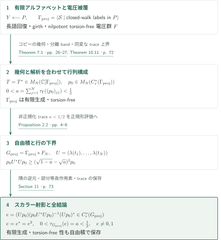
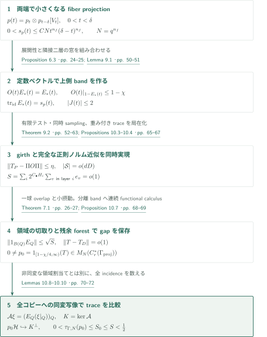
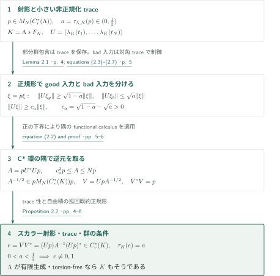

# A torsion-free counterexample to the Kadison–Kaplansky projection conjecture

**小トレースの分離スペクトル帯を構成し、自由積でスカラー射影へ圧縮する**

本稿は、torsion-free群の被約群C*環に非自明な射影を構成すると主張する。中心となるのは、有限行列の正則表現にスペクトルの隙間を保ちながら、その上側射影の**非正規化**トレースを小さくする構成である。行列射影からスカラー射影への移行には、別の自由積の評価を用いる。

## 1. 主要結果

### Theorem 1.1 — 被約群C*環の非自明なスカラー射影

有限生成torsion-free離散群 $G_{\mathrm{proj}}$ と射影 $e=e^*=e^2\in C_r^*(G_{\mathrm{proj}})$ が存在し、標準トレースについて

$$0<\tau_{G_{\mathrm{proj}}}(e)<\frac12$$

が成り立つ。特に $e\ne0,1$ である。対象はスカラーの被約群C*環であり、群環・最大群C*環・行列環における主張へ読み替えない。有限表示は結論に含まれない。

<!-- cite:main -->[Theorem 1.1 · p. 2](https://github.com/openai/math/blob/1581d4cbdd69a0faf34b2089614fe2a814316a6a/preprints/A-Torsion-Free-Counterexample-to-the-Kadison-Kaplansky-Projection-Conjecture-September-23-2026/paper.pdf)<!-- /cite -->

## 図の矢印に付した引用

<!-- reference-guide -->
略号のない定理・補題・節・式番号は本原稿 [A torsion-free counterexample to the Kadison–Kaplansky projection conjecture](https://github.com/openai/math/blob/1581d4cbdd69a0faf34b2089614fe2a814316a6a/preprints/A-Torsion-Free-Counterexample-to-the-Kadison-Kaplansky-Projection-Conjecture-September-23-2026/paper.pdf) を指します。外部入力には次の略号を使います。

- [MT10](https://arxiv.org/pdf/0903.0544v3) Robin A. Moser and Gábor Tardos — *A constructive proof of the general Lovász Local Lemma*：展開性を持つ有限ブロックを選ぶ非対称局所補題。arXiv:0903.0544v3, 20 May 2009; published 2010。
- [BGW16](https://math.hawaii.edu/~erik/papers/kadison.pdf) Paul Baum, Erik Guentner and Rufus Willett — *Exactness and the Kadison–Kaplansky Conjecture*：構成後の帰結：trivial-coefficient assembly像のトレース整数性。Author-hosted 40-page manuscript, retrieved 2026-10-15; published 2016。
- [OpenAI26a](https://github.com/openai/math/blob/1581d4cbdd69a0faf34b2089614fe2a814316a6a/preprints/A-Torsion-Free-Counterexample-to-Reduced-Baum-Connes-Injectivity-September-23-2026/paper.pdf) OpenAI — *A torsion-free counterexample to reduced Baum–Connes injectivity*：比較対象：assemblyの非単射。構成への直接入力ではない。September 23, 2026。
- [OpenAI26c](https://github.com/openai/math/blob/1581d4cbdd69a0faf34b2089614fe2a814316a6a/preprints/An-Irrational-Trace-Counterexample-to-Reduced-Baum-Connes-September-23-2026/paper.pdf) OpenAI — *An irrational-trace counterexample to reduced Baum–Connes*：比較対象：irrational-traceによる非全射。構成への直接入力ではない。September 23, 2026。

各引用に結果番号とページを付します。誌面番号とPDF内の位置が異なる場合は両方を示します。GitHubの閲覧リンクではページ位置への自動移動を前提としません。
<!-- /reference-guide -->

## 2. Theorem 1.1 の証明 — 行列構成と自由積の接続

<!-- proof-target:1 -->証明対象：[Theorem 1.1 · p. 2](https://github.com/openai/math/blob/1581d4cbdd69a0faf34b2089614fe2a814316a6a/preprints/A-Torsion-Free-Counterexample-to-the-Kadison-Kaplansky-Projection-Conjecture-September-23-2026/paper.pdf)<!-- /proof-target -->

**証明の道筋。** 有限アルファベットのtowerから作る電圧被覆をCayleyグラフへ埋め込み、torsion-free群 $\Gamma_{\mathrm{proj}}$ と有限行列 $T$ を得る。局所モデルの上側スペクトル帯を $T$ へ移し、全ての被覆コピーへの同変な制限写像で射影のトレースを抑える。最後に $\Gamma_{\mathrm{proj}}*F_N$ へ移り、行列射影を一つの行に圧縮する。行列構成は次節、最後の圧縮は第4節で説明する。

### 1. 群の仮定と解析的出力を別々に確保する

電圧群 $F$ は整数座標を持つnilpotent torsion-free群である。これは二つの整数affine群の中心を逆符号で同一視したcentral productであり、同一視する部分群が中心の $\mathbb Z^2$ でprimitiveなため、残る中心座標は整数座標のままである。重みが最小の非零座標は正の冪でその整数倍になるのでtorsionは生じない。ただし、その性質だけから表示群 $\Gamma_{\mathrm{proj}}$ のtorsion-free性が従うわけではない。Theorem 7.1は長語回復と被覆のgirth条件からコピーの埋込み、先行コピーとの交わりを含む一つの有限球、残余辺のforestを得る。Proposition 7.14はコピーの安定化群が $F$ に埋め込まれることとcone複体の非輪状性を用いる。位数 $p$ の部分群が存在すれば、$\mathbb F_p[C_p]$ 上の自明加群に長さ2の自由分解が生じ、任意の次数に非零homologyを持つ周期分解と矛盾する。有限生成は最終アルファベットが有限であることから得る。

<!-- cite:deck -->[Lemma 8.3; equation (8.5) · pp. 40–42](https://github.com/openai/math/blob/1581d4cbdd69a0faf34b2089614fe2a814316a6a/preprints/A-Torsion-Free-Counterexample-to-the-Kadison-Kaplansky-Projection-Conjecture-September-23-2026/paper.pdf)<!-- /cite --> <!-- cite:geometry -->[Theorem 7.1 · pp. 26–27](https://github.com/openai/math/blob/1581d4cbdd69a0faf34b2089614fe2a814316a6a/preprints/A-Torsion-Free-Counterexample-to-the-Kadison-Kaplansky-Projection-Conjecture-September-23-2026/paper.pdf)<!-- /cite --> <!-- cite:torsion -->[Proposition 7.14 · pp. 36–38](https://github.com/openai/math/blob/1581d4cbdd69a0faf34b2089614fe2a814316a6a/preprints/A-Torsion-Free-Counterexample-to-the-Kadison-Kaplansky-Projection-Conjecture-September-23-2026/paper.pdf)<!-- /cite -->

### 2. 射影そのものを得てから自由積へ移す

Theorem 10.11の出力は $K_0$ の抽象的な類だけではなく、$p_0\in M_N(C_r^*(\Gamma_{\mathrm{proj}}))$ という実際の射影である。行列トレースは

$$\tau_{\Gamma,N}(p_0)=\sum_{j=1}^{N}\tau_\Gamma((p_0)_{jj})$$

であり、$N$ では割らない。この量が $(0,1/2)$ に入るためProposition 2.2を適用できる。自由積 $G_{\mathrm{proj}}=\Gamma_{\mathrm{proj}}*F_N$ は有限生成とtorsion-free性を保ち、構成されるスカラー射影は同じトレースを持つ。

<!-- cite:matrix-end -->[Theorem 10.11 · p. 72](https://github.com/openai/math/blob/1581d4cbdd69a0faf34b2089614fe2a814316a6a/preprints/A-Torsion-Free-Counterexample-to-the-Kadison-Kaplansky-Projection-Conjecture-September-23-2026/paper.pdf)<!-- /cite --> <!-- cite:finish -->[Section 11 · p. 73](https://github.com/openai/math/blob/1581d4cbdd69a0faf34b2089614fe2a814316a6a/preprints/A-Torsion-Free-Counterexample-to-the-Kadison-Kaplansky-Projection-Conjecture-September-23-2026/paper.pdf)<!-- /cite -->

## 3. Theorem 3.1 の証明 — 隙間の保存とトレースの制御

<!-- proof-target:2 -->証明対象：[Theorem 3.1 · p. 6](https://github.com/openai/math/blob/1581d4cbdd69a0faf34b2089614fe2a814316a6a/preprints/A-Torsion-Free-Counterexample-to-the-Kadison-Kaplansky-Projection-Conjecture-September-23-2026/paper.pdf)<!-- /proof-target -->

<!-- statement:theorem-3-1 -->
### Theorem 3.1 — 小トレースの行列射影

有限生成torsion-free離散群 $\Gamma_{\mathrm{proj}}$、有限整数 $N\ge1$、自己共役元 $T\in M_N(\mathbb C[\Gamma_{\mathrm{proj}}])$ が存在する。その正則表現のスペクトルは非空の分離された部分集合を持ち、対応するスペクトル射影 $p_0$ は

$$p_0\in M_N(C_r^*(\Gamma_{\mathrm{proj}})),\qquad 0<\tau_{\Gamma_{\mathrm{proj}},N}(p_0)<\frac12$$

を満たす。分離は残りのスペクトルとの距離が正であることを意味する。

<!-- cite:matrix -->[Theorem 3.1 · p. 6](https://github.com/openai/math/blob/1581d4cbdd69a0faf34b2089614fe2a814316a6a/preprints/A-Torsion-Free-Counterexample-to-the-Kadison-Kaplansky-Projection-Conjecture-September-23-2026/paper.pdf)<!-- /cite -->
<!-- /statement -->

### 1. 展開性と両端のトレース減衰を組み合わせる

Proposition 6.3のpruning前のtower $Y^0$ は、各二部incidenceの正規化定数ベクトルを保ち、その直交補空間を一様に $1-\chi$ 以下へ縮める。pruning後の $Y$ にこの定数保存をそのまま仮定せず、後続の $\Pi O\Pi$ の圧縮評価へ接続する。ラベル回復のためのpruningで失う頂点割合 $\beta_\ell$ は一様に0へ向かう。展開性を持つ有限ブロックの選択では、bad-cut事象の依存近傍と確率を評価して非対称Lovász局所補題を適用する。無限個の層ごとに別の最終パラメータを選ぶ議論ではない。

<!-- cite:tower -->[Proposition 6.3 · pp. 24–25](https://github.com/openai/math/blob/1581d4cbdd69a0faf34b2089614fe2a814316a6a/preprints/A-Torsion-Free-Counterexample-to-the-Kadison-Kaplansky-Projection-Conjecture-September-23-2026/paper.pdf)<!-- /cite --> <!-- cite:expansion -->[Proposition 5.4 · pp. 18–20](https://github.com/openai/math/blob/1581d4cbdd69a0faf34b2089614fe2a814316a6a/preprints/A-Torsion-Free-Counterexample-to-the-Kadison-Kaplansky-Projection-Conjecture-September-23-2026/paper.pdf)<!-- /cite --> <!-- cite:lll -->[&#91;MT10, Theorem 1.1, p. 1&#93;](https://arxiv.org/pdf/0903.0544v3#page=1)<!-- /cite -->

解析側では、$F$ の中心Fourier変数 $t$ に対し、twisted convolutionの射影 $p_t$ と有限磁気表現によってずらした $p_{t-\delta}$ を組み合わせる。$n_f=m(m-1)/2$ は構成に使う厳密上三角座標の個数である。$\delta=q^{-1}$、$N=q^{n_f}$ とし、$0<t<\delta$ で

$$p(t)=p_t\otimes p_{t-\delta}[V_t],\qquad 0<s_p(t)=N\,\mathrm{tr}_t(p_t)\mathrm{tr}_{t-\delta}(p_{t-\delta})\le CNt^{n_f}(\delta-t)^{n_f}.$$

有限磁気表現の吸収はトレースに因子 $N$ を生む。その因子を含めても両端で減衰することが重要である。$\sum_i h_i(t)^2=1$ を満たす窓は高々二つの隣接層に支持を持ち、$t$ が端点へ近づくと支持層はtowerの両端へ逃げる。正規化定数ベクトル上の対称和がモデル $O(t)$ の固有値 $+1$ を与え、残りの正のスペクトルは展開性により $1-\chi$ 以下になる。

<!-- cite:twisted -->[Proposition 8.7 · pp. 45–46](https://github.com/openai/math/blob/1581d4cbdd69a0faf34b2089614fe2a814316a6a/preprints/A-Torsion-Free-Counterexample-to-the-Kadison-Kaplansky-Projection-Conjecture-September-23-2026/paper.pdf)<!-- /cite --> <!-- cite:magnetic -->[Lemma 8.9; equations (8.20)–(8.21) · pp. 47–48](https://github.com/openai/math/blob/1581d4cbdd69a0faf34b2089614fe2a814316a6a/preprints/A-Torsion-Free-Counterexample-to-the-Kadison-Kaplansky-Projection-Conjecture-September-23-2026/paper.pdf)<!-- /cite --> <!-- cite:model -->[Lemma 9.1 · pp. 50–51](https://github.com/openai/math/blob/1581d4cbdd69a0faf34b2089614fe2a814316a6a/preprints/A-Torsion-Free-Counterexample-to-the-Kadison-Kaplansky-Projection-Conjecture-September-23-2026/paper.pdf)<!-- /cite -->

### 2. 同じ電圧選択でgirthと正則ノルム近似を満たす

Theorem 9.2は各辺の電圧 $z_e\in F$ と有限種類の行列重み $W_e$ を同時に選び、被覆の必要なgirthと

$$\|T_P-\Pi O\Pi\|\le\eta,\qquad |\mathcal S|=o(dD)$$

を満たす。$\Pi$ はpruning後の頂点への圧縮、$\mathcal S$ は重みを付した有限アルファベットである。nilpotent群の座標箱への圧縮を平均するLemma 9.3により、有限行列のテストを**完全な正則表現のノルム**へ戻す。中心化moment評価と短い閉路のholonomyが自明になる確率の評価を合わせ、全層にわたる失敗確率の和を1未満にする。有限次元表現の一部だけを調べてgapを宣言する手順ではない。

<!-- cite:realization -->[Theorem 9.2 · pp. 52–63](https://github.com/openai/math/blob/1581d4cbdd69a0faf34b2089614fe2a814316a6a/preprints/A-Torsion-Free-Counterexample-to-the-Kadison-Kaplansky-Projection-Conjecture-September-23-2026/paper.pdf)<!-- /cite -->

### 3. 非同変な領域分割でスペクトルの隙間を保つ

被覆の上側射影 $E_P$ はモデルからの圧縮と小摂動で得る。各base頂点のidentity diagonalを $e_v$、幾何的な球サイズの重みを $w_i=2^{C_\bullet H_i}$ とすると、両端減衰とresolventの層方向減衰により

$$S:=\sum_i w_i\sum_{v\text{ in layer }i}e_v\le96\mu_\ell\longrightarrow0.$$

この $S$ は層の頂点数や行列サイズを余分に掛けた量ではない。コピー $Q$ の先行部分を除いた互いに素な領域 $D_Q$ では、失う上側射影のノルムが $\sqrt S$ 以下となる。残余辺はforestなので、その重み付きadjacencyのノルムは $4C_\eta\sqrt{|\mathcal S|/(dD)}=o(1)$ である。二つの小誤差により、$\alpha=\chi/1000$ として

$$\operatorname{spec}(T)\subset(-\infty,1-\chi+4\alpha]\cup[1-3\alpha,1+3\alpha]$$

を得る。上側は非空で、閾値 $1-\chi/4$ はgap内にある。したがって $p_0=1_{[1-\chi/4,\infty)}(T)$ は連続functional calculusにより**被約C*環内**に属する。von Neumann環内のスペクトル射影の存在だけでは、この所属は結論できない。

<!-- cite:weighted -->[Proposition 8.11 · pp. 49–50](https://github.com/openai/math/blob/1581d4cbdd69a0faf34b2089614fe2a814316a6a/preprints/A-Torsion-Free-Counterexample-to-the-Kadison-Kaplansky-Projection-Conjecture-September-23-2026/paper.pdf)<!-- /cite --> <!-- cite:cover -->[Propositions 10.3–10.4 · pp. 65–67](https://github.com/openai/math/blob/1581d4cbdd69a0faf34b2089614fe2a814316a6a/preprints/A-Torsion-Free-Counterexample-to-the-Kadison-Kaplansky-Projection-Conjecture-September-23-2026/paper.pdf)<!-- /cite --> <!-- cite:gap -->[Proposition 10.7 · pp. 68–69](https://github.com/openai/math/blob/1581d4cbdd69a0faf34b2089614fe2a814316a6a/preprints/A-Torsion-Free-Counterexample-to-the-Kadison-Kaplansky-Projection-Conjecture-September-23-2026/paper.pdf)<!-- /cite -->

### 4. 全コピーへの同変写像でトレースを抑える

領域 $D_Q$ の割当ては同変である必要がないため、前段の通常の部分等長同値だけでは標準トレースを比較できない。そこで $\mathcal H=\ell^2(\Gamma_{\mathrm{proj}})\otimes\mathbb C^N$ と置き、全indexed copiesを使い、$\mathcal A\xi=(E_Q(\xi|_Q))_Q$ を定義する。incidenceの同変な全単射 $(Q,x)\leftrightarrow(x,v)\in\Gamma_{\mathrm{proj}}\times V(Y)$ により、標的上側空間のidentity traceは $S_0=\sum_v e_v\le S$ となる。

重なりの損失評価は $\mathcal A$ の有界性を与える。$K=\ker\mathcal A$ 上では $\langle T\xi,\xi\rangle\le(1-\chi+3\alpha)\|\xi\|^2$ だが、$p_0$ の像では下界が $1-3\alpha$ である。従って $P_{K^\perp}:p_0\mathcal H\to K^\perp$ は単射となり、同変polar decompositionから

$$0<\tau_{\Gamma,N}(p_0)\le\operatorname{Tr}_\Gamma(P_{K^\perp})\le S_0\le S<\frac12$$

が従う。厳密な正値は $p_0\ne0$ とトレースの忠実性による。幾何、磁気表現、近似精度を順に固定し、一つの十分大きい有限 $\ell$ を選ぶ。最終段階で極限群や極限射影を取ってはいない。

<!-- cite:trace -->[Lemmas 10.8–10.10 · pp. 70–72](https://github.com/openai/math/blob/1581d4cbdd69a0faf34b2089614fe2a814316a6a/preprints/A-Torsion-Free-Counterexample-to-the-Kadison-Kaplansky-Projection-Conjecture-September-23-2026/paper.pdf)<!-- /cite --> <!-- cite:matrix-end -->[Theorem 10.11 · p. 72](https://github.com/openai/math/blob/1581d4cbdd69a0faf34b2089614fe2a814316a6a/preprints/A-Torsion-Free-Counterexample-to-the-Kadison-Kaplansky-Projection-Conjecture-September-23-2026/paper.pdf)<!-- /cite -->

## 4. Proposition 2.2 の証明 — 正規形からC*環内の圧縮へ

<!-- proof-target:3 -->証明対象：[Proposition 2.2 · pp. 4–6](https://github.com/openai/math/blob/1581d4cbdd69a0faf34b2089614fe2a814316a6a/preprints/A-Torsion-Free-Counterexample-to-the-Kadison-Kaplansky-Projection-Conjecture-September-23-2026/paper.pdf)<!-- /proof-target -->

<!-- statement:proposition-2-2 -->
### Proposition 2.2 — 自由積を取った後のスカラー圧縮

離散群 $\Lambda$ と射影 $p\in M_N(C_r^*(\Lambda))$ が $0<a:=\tau_{\Lambda,N}(p)<1/2$ を満たすとする。$K=\Lambda*F_N$ とし、自由生成元 $t_1,\ldots,t_N$ に対して $U=(\lambda_K(t_1),\ldots,\lambda_K(t_N))$、$A=pU^*Up$ と置く。$A$ は隅 $pM_N(C_r^*(K))p$ で可逆であり、

$$e=(Up)A^{-1}(Up)^*\in C_r^*(K)$$

は射影で $\tau_K(e)=a$ を満たす。$\Lambda$ が有限生成かつtorsion-freeなら $K$ もそうである。

<!-- cite:compression -->[Proposition 2.2 · pp. 4–6](https://github.com/openai/math/blob/1581d4cbdd69a0faf34b2089614fe2a814316a6a/preprints/A-Torsion-Free-Counterexample-to-the-Kadison-Kaplansky-Projection-Conjecture-September-23-2026/paper.pdf)<!-- /cite -->
<!-- /statement -->

### 1. 取り消しが起きる入力をトレースで抑える

部分群包含は被約ノルムとトレースを保つ。$\xi=p\xi$ の第 $j$ 成分を、正規形が $t_j^{-1}$ で始まるbad部分と残りのgood部分に分ける。good出力は先頭文字 $t_j$ により互いに素である。一方bad入力の各位置は一意のbad座標に属し、射影の対角係数を用いたCauchy–Schwarz評価から

$$\|U\xi_g\|\ge\sqrt{1-a}\,\|\xi\|,\qquad \|U\xi_b\|\le\sqrt a\,\|\xi\|$$

を得る。従って $\|U\xi\|\ge c_a\|\xi\|$、$c_a=\sqrt{1-a}-\sqrt a>0$ となる。正規化トレースではこの評価の $a$ を置き換えられない。

<!-- cite:subgroup -->[Lemma 2.1 · p. 4](https://github.com/openai/math/blob/1581d4cbdd69a0faf34b2089614fe2a814316a6a/preprints/A-Torsion-Free-Counterexample-to-the-Kadison-Kaplansky-Projection-Conjecture-September-23-2026/paper.pdf)<!-- /cite --> <!-- cite:row -->[equations (2.3)–(2.7) · p. 5](https://github.com/openai/math/blob/1581d4cbdd69a0faf34b2089614fe2a814316a6a/preprints/A-Torsion-Free-Counterexample-to-the-Kadison-Kaplansky-Projection-Conjecture-September-23-2026/paper.pdf)<!-- /cite -->

### 2. 隅の逆元を使って実際の射影を作る

$c_a^2p\le A\le Np$ なので $A^{-1}$ と $A^{-1/2}$ は同じC*環の隅に属する。$V=UpA^{-1/2}\in M_{1,N}(C_r^*(K))$ は $V^*V=p$ を満たし、$e=VV^*$ はスカラー代数内の射影である。トレース性から

$$\tau_K(e)=\sum_j\tau_K(V_jV_j^*)=\sum_j\tau_K(V_j^*V_j)=a.$$

$0<a<1/2$ は $e\ne0,1$ を同時に保証する。これは $K_0$ 類の比較を射影の存在と読み替える議論ではなく、同じ隅のfunctional calculusと有限行による構成である。

<!-- cite:corner -->[equation (2.2) and proof · pp. 5–6](https://github.com/openai/math/blob/1581d4cbdd69a0faf34b2089614fe2a814316a6a/preprints/A-Torsion-Free-Counterexample-to-the-Kadison-Kaplansky-Projection-Conjecture-September-23-2026/paper.pdf)<!-- /cite -->

### 3. 群の条件を保って主定理へ戻る

$\Lambda=\Gamma_{\mathrm{proj}}$、$p=p_0$ とする。有限個の自由生成元の追加は有限生成性を保つ。自由積の非自明元は因子内の元または長さ2以上の巡回既約語に共役であり、後者の正の冪の長さは増大する。両因子がtorsion-freeなので自由積にもtorsionはない。これでTheorem 1.1の群の条件と射影の全結論が揃う。

<!-- cite:compression -->[Proposition 2.2 · pp. 4–6](https://github.com/openai/math/blob/1581d4cbdd69a0faf34b2089614fe2a814316a6a/preprints/A-Torsion-Free-Counterexample-to-the-Kadison-Kaplansky-Projection-Conjecture-September-23-2026/paper.pdf)<!-- /cite --> <!-- cite:finish -->[Section 11 · p. 73](https://github.com/openai/math/blob/1581d4cbdd69a0faf34b2089614fe2a814316a6a/preprints/A-Torsion-Free-Counterexample-to-the-Kadison-Kaplansky-Projection-Conjecture-September-23-2026/paper.pdf)<!-- /cite -->

## 5. どの論文が、どの段階を担うか

| 供給元と結果 | 利用箇所 | 使用内容・必要な仮定 | 確認範囲 |
|---|---|---|---|
| MT10, Theorem 1.1 | Proposition 5.4, pp.18–20 | 有限bad-cut事象の依存近傍と非対称確率条件から同時回避 | 定理記述・適用箇所を照合。全確率計数の再計算は未実施 |
| BGW16, Proposition 10.3 | §11, p.73 | countable torsion-free群のtrivial-coefficient reduced assembly像のトレースは整数 | 定理記述・適用仮定を照合。指数定理の証明は対象外 |

<!-- cite:lll -->[&#91;MT10, Theorem 1.1, p. 1&#93;](https://arxiv.org/pdf/0903.0544v3#page=1)<!-- /cite --> <!-- cite:integrality -->[&#91;BGW16, Proposition 10.3, p. 36&#93;](https://math.hawaii.edu/~erik/papers/kadison.pdf#page=36)<!-- /cite -->

後者は射影構成への入力ではなく、その帰結である。$[p_0]$ の非整数トレースは

$$\mu^r_{\Gamma,0}:K_0(B\Gamma)\longrightarrow K_0(C_r^*(\Gamma))$$

の像に入らないことを示す。係数は自明作用の $\mathbb C$、$\Gamma=\Gamma_{\mathrm{proj}}$ はtorsion-freeであり、失敗するのは全射性である。この議論はassemblyの核を作らない。

<!-- cite:finish -->[Section 11 · p. 73](https://github.com/openai/math/blob/1581d4cbdd69a0faf34b2089614fe2a814316a6a/preprints/A-Torsion-Free-Counterexample-to-the-Kadison-Kaplansky-Projection-Conjecture-September-23-2026/paper.pdf)<!-- /cite --> <!-- cite:integrality -->[&#91;BGW16, Proposition 10.3, p. 36&#93;](https://math.hawaii.edu/~erik/papers/kadison.pdf#page=36)<!-- /cite -->

カタログ内の *A torsion-free counterexample to reduced Baum–Connes injectivity* は無限位数の核類を主張する別の構成であり、*An irrational-trace counterexample to reduced Baum–Connes* はtorsion-free性を主張せず、非有理トレースのスカラー射影を構成する。本稿の小さい非整数トレースを非有理トレースと同一視しない。比較した主結果・導入・本稿の構成と参考文献の範囲では、これら2本を本稿の直接入力とする接続は確認できなかった。

<!-- cite:injectivity-main -->[&#91;OpenAI26a, Theorem 1.1, p. 1&#93;](https://github.com/openai/math/blob/1581d4cbdd69a0faf34b2089614fe2a814316a6a/preprints/A-Torsion-Free-Counterexample-to-Reduced-Baum-Connes-Injectivity-September-23-2026/paper.pdf)<!-- /cite --> <!-- cite:irrational-main -->[&#91;OpenAI26c, Theorem 1.1, p. 2&#93;](https://github.com/openai/math/blob/1581d4cbdd69a0faf34b2089614fe2a814316a6a/preprints/An-Irrational-Trace-Counterexample-to-Reduced-Baum-Connes-September-23-2026/paper.pdf)<!-- /cite -->

## 6. 原典を読む入口と確認範囲

<!-- reading-list -->
- [Proposition 2.2 · pp. 4–6](https://github.com/openai/math/blob/1581d4cbdd69a0faf34b2089614fe2a814316a6a/preprints/A-Torsion-Free-Counterexample-to-the-Kadison-Kaplansky-Projection-Conjecture-September-23-2026/paper.pdf) — 行列からスカラーへの独立した帰着。
- [Theorem 7.1 · pp. 26–27](https://github.com/openai/math/blob/1581d4cbdd69a0faf34b2089614fe2a814316a6a/preprints/A-Torsion-Free-Counterexample-to-the-Kadison-Kaplansky-Projection-Conjecture-September-23-2026/paper.pdf) — coverをCayleyグラフへ移すための仮定と幾何的出力。
- [Lemma 8.9; equations (8.20)–(8.21) · pp. 47–48](https://github.com/openai/math/blob/1581d4cbdd69a0faf34b2089614fe2a814316a6a/preprints/A-Torsion-Free-Counterexample-to-the-Kadison-Kaplansky-Projection-Conjecture-September-23-2026/paper.pdf) — 両端で小さくなるfiber traceとNの因子。
- [Theorem 9.2 · pp. 52–63](https://github.com/openai/math/blob/1581d4cbdd69a0faf34b2089614fe2a814316a6a/preprints/A-Torsion-Free-Counterexample-to-the-Kadison-Kaplansky-Projection-Conjecture-September-23-2026/paper.pdf) — girthとregular norm近似の同時実現。
- [Lemmas 10.8–10.10 · pp. 70–72](https://github.com/openai/math/blob/1581d4cbdd69a0faf34b2089614fe2a814316a6a/preprints/A-Torsion-Free-Counterexample-to-the-Kadison-Kaplansky-Projection-Conjecture-September-23-2026/paper.pdf) — 全indexed copiesを用いた同変なtrace上界。
- [Section 11 · p. 73](https://github.com/openai/math/blob/1581d4cbdd69a0faf34b2089614fe2a814316a6a/preprints/A-Torsion-Free-Counterexample-to-the-Kadison-Kaplansky-Projection-Conjecture-September-23-2026/paper.pdf) — 主定理とassemblyへの帰結。
<!-- /reading-list -->

編集側では、§2の圧縮、§7.5–7.6のincidence・torsion排除、§8のtwisted射影と両端トレース、§9のモデルと同時実現の帰着、§10–11のgap・trace・主定理への接続を証明本文で読解した。局所補題とassembly像のトレース整数性は外部原典の記述・適用を照合した。

一方、§§4–6の全ラベル表と確率計数、§7.2–7.4の全diagram変形と一球overlap評価、Lemma 8.5の核同定、§§9.4–9.6の全template・rounding誤差は独立検証していない。これらの内部構成に依存するTheorem 7.1とTheorem 9.2を紹介する範囲を越えて、主定理全体の正しさを認定するものではない。本稿が別稿へ引用する群環のidempotent不存在も今回の照合対象外である。外部結果の全証明とその先の文献の再帰検証は行っていない。
