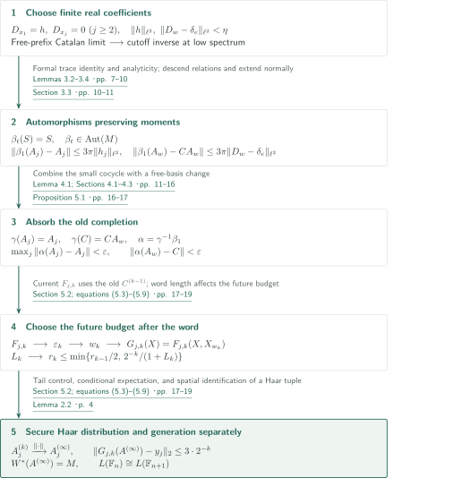
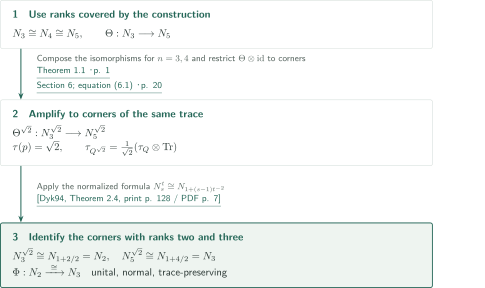
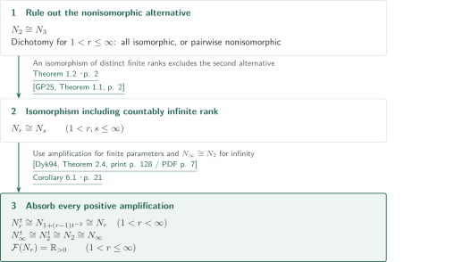
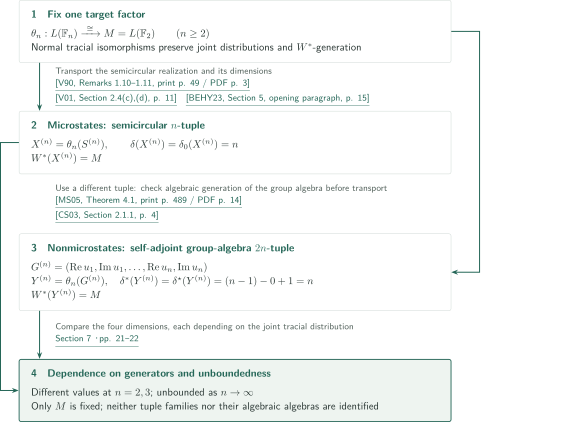

# An isomorphism of the free group factors

**Absorb an extra free generator using a small cocycle, then reach rank two by normalized amplification.**

The manuscript constructs a freely generating Haar $n$-tuple inside $L(\mathbb F_{n+1})$ for $n\ge3$. An iteration of small automorphisms establishes the limiting distribution and generation separately; interpolation enters afterwards through amplification. This account checks the manuscript's argument and direct inputs against source passages. It does not constitute independent referee certification.

## 1. Main results

### Theorem 1.1 — Consecutive ranks

For every integer $n\ge3$, there is a unital trace-preserving normal $*$-isomorphism
\[
L(\mathbb F_n)\cong L(\mathbb F_{n+1}).
\]
The factors carry their canonical normalized traces.

<!-- cite:main-rank -->[Theorem 1.1 · p. 1](https://github.com/openai/math/blob/1581d4cbdd69a0faf34b2089614fe2a814316a6a/preprints/An-isomorphism-of-the-free-group-factors-September-23-2026/An-isomorphism-of-the-free-group-factors-September-23-2026.pdf)<!-- /cite -->

### Theorem 1.2 — Ranks two and three

There exists a unital normal trace-preserving $*$-isomorphism
\[
\Phi:L(\mathbb F_2)\longrightarrow L(\mathbb F_3).
\]

<!-- cite:rank-two -->[Theorem 1.2 · p. 2](https://github.com/openai/math/blob/1581d4cbdd69a0faf34b2089614fe2a814316a6a/preprints/An-isomorphism-of-the-free-group-factors-September-23-2026/An-isomorphism-of-the-free-group-factors-September-23-2026.pdf)<!-- /cite -->

### Corollary 6.1 — The interpolated family and fundamental groups

For every $1<r,s\le\infty$, there is a unital normal trace-preserving $*$-isomorphism $L(\mathbb F_r)\cong L(\mathbb F_s)$. Moreover,
\[
\mathcal F(L(\mathbb F_r))=\mathbb R_{>0}\qquad(1<r\le\infty).
\]
Finite noninteger parameters denote interpolated free group factors; $\infty$ denotes countably infinite rank. The parameter $r=1$ is excluded.

<!-- cite:all-ranks -->[Corollary 6.1 · p. 21](https://github.com/openai/math/blob/1581d4cbdd69a0faf34b2089614fe2a814316a6a/preprints/An-isomorphism-of-the-free-group-factors-September-23-2026/An-isomorphism-of-the-free-group-factors-September-23-2026.pdf)<!-- /cite -->

### Corollary 7.1 — Dependence of free entropy dimensions on generators

Let $M=L(\mathbb F_2)$ with its canonical trace. For every integer $n\ge2$, there are a self-adjoint $n$-tuple $X^{(n)}$ and a self-adjoint $2n$-tuple $Y^{(n)}$ such that
\[
W^*(X^{(n)})=W^*(Y^{(n)})=M,
\]
\[
\delta(X^{(n)})=\delta_0(X^{(n)})=n,
\qquad
\delta^*(Y^{(n)})=\delta^\star(Y^{(n)})=n.
\]
Consequently none of the four dimensions is invariant under replacing a finite self-adjoint $W^*$-generating tuple, and each is unbounded on generating tuples of this single factor. The two tuple families need not coincide.

<!-- cite:entropy -->[Corollary 7.1 · pp. 21–22](https://github.com/openai/math/blob/1581d4cbdd69a0faf34b2089614fe2a814316a6a/preprints/An-isomorphism-of-the-free-group-factors-September-23-2026/An-isomorphism-of-the-free-group-factors-September-23-2026.pdf)<!-- /cite -->

## References on the arrows

<!-- reference-guide -->
Unprefixed theorem, lemma, section and equation numbers refer to [An isomorphism of the free group factors](https://github.com/openai/math/blob/1581d4cbdd69a0faf34b2089614fe2a814316a6a/preprints/An-isomorphism-of-the-free-group-factors-September-23-2026/An-isomorphism-of-the-free-group-factors-September-23-2026.pdf). External inputs use the following keys.

- [Dyk94](https://msp.org/pjm/1994/163-1/pjm-v163-n1-p06-p.pdf) Ken Dykema — *Interpolated free group factors*: Normalized amplification formula, used in Theorem 1.2.. Pacific Journal of Mathematics 163 (1994), 123–135; publisher PDF with cover.
- [GP25](https://arxiv.org/pdf/2305.08168v2) Isaac Goldbring and Jennifer Pi — *On the first-order free group factor alternative*: Explicit restatement of the classical isomorphism dichotomy including the infinite parameter, used in Corollary 6.1.. arXiv:2305.08168v2, 2 January 2025.
- [V90](https://math.berkeley.edu/~dvv/CircularSemi.pdf) Dan Voiculescu — *Circular and semicircular systems and free product factors*: Semicircular realization of free group factors, used in Corollary 7.1.. Progress in Mathematics 92 (1990), 45–60; author-hosted two-page scan.
- [V01](https://arxiv.org/pdf/math/0103168v1) Dan Voiculescu — *Free entropy*: Microstates dimension δ=n for a free semicircular family.. arXiv:math/0103168v1, 26 March 2001.
- [BEHY23](https://arxiv.org/pdf/2202.04714v2) Michael Brannan, Floris Elzinga, Samuel J. Harris, and Makoto Yamashita — *Crossed product equivalence of quantum automorphism groups of finite dimensional C∗-algebras*: The opening of §5 states δ₀=n for free semicircular tuples; checked in author preprint v2 rather than the journal layout.. arXiv:2202.04714v2, 21 February 2023; §5 corresponding to the cited published article.
- [MS05](https://mineyev.web.illinois.edu/art/non-microstates.pdf) Igor Mineyev and Dimitri Shlyakhtenko — *Non-microstates free entropy dimension for groups*: Computes δ* and δ⋆ from L²-Betti numbers for self-adjoint algebraic generators of a group algebra.. Geometric and Functional Analysis 15 (2005), 476–490; published PDF.
- [CS03](https://arxiv.org/pdf/math/0309343v1) Alain Connes and Dimitri Shlyakhtenko — *L2-homology for von Neumann algebras*: Free-group L²-Betti numbers β₀=0 and β₁=n−1.. arXiv:math/0309343v1, 20 September 2003.

Each citation gives the result and pages. When printed pagination differs from the PDF position, both are shown. GitHub previews do not automatically jump to the cited page.
<!-- /reference-guide -->

## 2. Proof of Theorem 1.1 — Small perturbations and a generating limit

<!-- proof-target:1 -->Proof target：[Theorem 1.1 · p. 1](https://github.com/openai/math/blob/1581d4cbdd69a0faf34b2089614fe2a814316a6a/preprints/An-isomorphism-of-the-free-group-factors-September-23-2026/An-isomorphism-of-the-free-group-factors-September-23-2026.pdf)<!-- /proof-target -->

**Proof route.** Start with a freely generating Haar tuple $(A_1,\ldots,A_n,C)$ in $M=L(\mathbb F_{n+1})$. A flow driven by conjugates of $S=\arg C$ turns a small group cocycle into a small automorphism. A word in an almost unchanged $n$-tuple then approximates the old generator $C$. Finally, an adaptive budget protects each approximation against subsequent perturbations. The diagram covers the entire route for this theorem; no interpolation is used here.

### 1. Descend the formal flow to normal automorphisms

Put $\Gamma=\mathbb F_n$, $S_g=A_gSA_g^*$, and $s(h)=\sum_g h(g)S_g$. Bounded Borel functional calculus gives $S$ with $e^{iS}=C$, $\tau(S)=0$, and $\|S\|\le\pi$. For finitely supported real $h_j$, define
\[
D_{x_j}=h_j,\qquad D_{gb}=D_g+\lambda(g)D_b,
\]
and solve the polynomial ODE in $B=C^*(A_1,\ldots,A_n,S)$:
\[
A'_j(t)=i\sum_g h_j(g)A_g(t)SA_g(t)^*A_j(t).
\]
Faithfulness of the finite trace keeps the solution unitary. Its bounded derivative and completeness yield global solutions in both time directions.

Freeness at time $t$ is not assumed. On the formal algebra of unitaries and one self-adjoint symbol, the manuscript proves $\tau\circ\mathrm{ev}_0\circ\partial=0$ and applies this to every iterated derivative. A nonidentity group label forces zero trace. Identity-label monomials reduce to polynomials in the free conjugate components $S_g$; the first variation conjugates one component by a unitary in the other components. Bounds on polynomial degree and coefficient sums establish real analyticity of actual solution moments. Their positive-order derivatives vanish initially, so the moments remain constant on the entire real line.

<!-- cite:trace -->[Lemmas 3.2–3.4 · pp. 7–10](https://github.com/openai/math/blob/1581d4cbdd69a0faf34b2089614fe2a814316a6a/preprints/An-isomorphism-of-the-free-group-factors-September-23-2026/An-isomorphism-of-the-free-group-factors-September-23-2026.pdf)<!-- /cite -->

Define $\varphi_t(\mathrm{ev}_0p)=\mathrm{ev}_tp$. Applying moment preservation to $p^*p$ and using faithfulness preserves the evaluation kernel, making the map well-defined. The formula
\[
\|b\|=\lim_{k\to\infty}\tau((b^*b)^k)^{1/(2k)}
\]
then gives isometry and injectivity. Solving the same ODE backwards inside $B_t=C^*(A_1(t),\ldots,A_n(t),S)$ proves $B_t=B$, hence surjectivity. The tracial isometry extends to a unitary on $L^2(M,\tau)$; conjugating the left representation gives a normal automorphism $\beta_t$. Point-norm continuity is asserted on $B$, not on all of $M$. Since $B$ includes the bounded logarithm $S=\arg C$, it is not identified here with the canonical reduced group $C^*$-algebra.

Only **after** constructing the automorphism does the proof use the creation–annihilation–diagonal estimate $\|s(h)\|\le3\pi\|h\|_{\ell^2}$. Differentiating $e^{-itS}A_w(t)$ in the correct order gives
\[
\|\beta_1(A_j)-A_j\|\le3\pi\|h_j\|_{\ell^2},\qquad
\|\beta_1(A_w)-CA_w\|\le3\pi\|D_w-\delta_e\|_{\ell^2}.
\]
Thus coefficient estimates control operator-norm displacements.

<!-- cite:free-sum -->[Lemmas 2.3–2.5 · pp. 4–6](https://github.com/openai/math/blob/1581d4cbdd69a0faf34b2089614fe2a814316a6a/preprints/An-isomorphism-of-the-free-group-factors-September-23-2026/An-isomorphism-of-the-free-group-factors-September-23-2026.pdf)<!-- /cite -->

<!-- cite:extension -->[Section 3.3 · pp. 10–11](https://github.com/openai/math/blob/1581d4cbdd69a0faf34b2089614fe2a814316a6a/preprints/An-isomorphism-of-the-free-group-factors-September-23-2026/An-isomorphism-of-the-free-group-factors-September-23-2026.pdf)<!-- /cite -->

### 2. Construct a small cocycle by cutoff inversion

The condition $n\ge3$ enters through the separate choices $a=x_1$ and $b_j=x_2^jx_3x_2^{-j}$. The prefixes $p_j=(ab_1)\cdots(ab_j)$ form a free family. With $w_m=p_ma$ and $T_m=1+\sum_{j=1}^m\lambda(p_j)$, the coefficients $h_1=h$, $h_j=0\ (j\ge2)$ give $D_{w_m}=T_mh$.

A Catalan moment count using noncrossing pairings of free words shows that the spectral measures of $Q_m/m$, where $Q_m=T_mT_m^*$, converge weakly to
\[
d\nu(x)=\frac1{2\pi}\sqrt{\frac{4-x}{x}}\,1_{(0,4)}(x)\,dx.
\]
The required property is $\nu(\{0\})=0$, not invertibility of every $Q_m$. First choose small $d>0$, then large $m$, and put
\[
E_m=1_{(dm,\infty)}(Q_m),\quad
R_m=Q_m^{-1}E_m,\quad h^{(0)}=T_m^*R_m\delta_e.
\]
Here $R_m$ denotes bounded functional calculus with the low spectrum removed. The identities $T_mh^{(0)}=E_m\delta_e$, $\|h^{(0)}\|_{\ell^2}^2\le(dm)^{-1}$, and $\|T_mh^{(0)}-\delta_e\|_{\ell^2}^2=\tau_\Gamma(1-E_m)$ make both required quantities small. Commutation with coefficientwise real conjugation makes the vector real. After $m$ is fixed, approximate it by a finitely supported real vector; $\|T_m\|\le m+1$ controls the final error.

<!-- cite:small-cocycle -->[Lemma 4.1; Sections 4.1–4.3 · pp. 11–16](https://github.com/openai/math/blob/1581d4cbdd69a0faf34b2089614fe2a814316a6a/preprints/An-isomorphism-of-the-free-group-factors-September-23-2026/An-isomorphism-of-the-free-group-factors-September-23-2026.pdf)<!-- /cite -->

### 3. Approximate the old completion and respect the order of choices

The flow alone approximates $CA_w$. The free-basis transformation $\gamma(A_j)=A_j$, $\gamma(C)=CA_w$ corrects this: setting $\alpha=\gamma^{-1}\circ\beta_1$ gives
\[
\max_j\|\alpha(A_j)-A_j\|<\varepsilon,\qquad
\|\alpha(A_w)-C\|<\varepsilon.
\]
The new completion is $C'=\alpha(C)=CA_w^*$, whereas the approximation target is the **old** $C$. The tuple $(\alpha(A),C')$ remains freely generating Haar, so the step can be repeated.

<!-- cite:perturb -->[Proposition 5.1 · pp. 16–17](https://github.com/openai/math/blob/1581d4cbdd69a0faf34b2089614fe2a814316a6a/preprints/An-isomorphism-of-the-free-group-factors-September-23-2026/An-isomorphism-of-the-free-group-factors-September-23-2026.pdf)<!-- /cite -->

Fix a countable dense family $(y_j)$ in $L^2(M)$. At stage $k$, choose word polynomials $F_{j,k}$ in the current tuple $(A^{(k-1)},C^{(k-1)})$ approximating $y_1,\ldots,y_k$ within $2^{-k}$. From their common Lipschitz bound $H_k$, choose
\[
0<\varepsilon_k<\min\{r_{k-1}/2,\,2^{-k}/(1+H_k)\}.
\]
Only **after** the perturbation returns a word $w_k$, define $G_{j,k}(X)=F_{j,k}(X,X_{w_k})$, obtain a common Lipschitz bound $L_k$, and choose
\[
0<r_k\le\min\{r_{k-1}/2,\,2^{-k}/(1+L_k)\}.
\]
In the first estimate, $X_{w_k}$ occupies a single unitary slot of $F_{j,k}$; its as-yet unknown word length is not needed to choose $\varepsilon_k$. The longer word only reduces the future budget $r_k$.

<!-- cite:limit -->[Section 5.2; equations (5.3)–(5.9) · pp. 17–19](https://github.com/openai/math/blob/1581d4cbdd69a0faf34b2089614fe2a814316a6a/preprints/An-isomorphism-of-the-free-group-factors-September-23-2026/An-isomorphism-of-the-free-group-factors-September-23-2026.pdf)<!-- /cite -->

### 4. Close the distribution and generation arguments separately

The bound $\sum_{\ell>k}\varepsilon_\ell\le r_k$ makes each $A_j^{(k)}$ converge in operator norm to a unitary $A_j^{(\infty)}$. Norm continuity of each fixed word and of the trace preserves the zero trace of every nonidentity word. Generation requires a separate estimate:
\[
\|G_{j,k}(A^{(\infty)})-y_j\|_2\le L_kr_k+2\cdot2^{-k}\le3\cdot2^{-k}\qquad(j\le k).
\]
For $N=W^*(A^{(\infty)})$, the trace-preserving conditional expectation $E_N$ extends to the orthogonal projection in $L^2$. It fixes this dense family, hence $N=M$. Neither uniform operator-norm bounds for the approximating polynomials nor convergence of $C^{(k)}$ is required.

Finally $V\delta_g=A_g^{(\infty)}$ defines a unitary $\ell^2(\mathbb F_n)\to L^2(M)$ intertwining the regular representation with left multiplication. The spatial identification of double commutants gives $L(\mathbb F_n)\to M$. Surjectivity follows from $N=M$, trace preservation from $V\delta_e=1$, and normality and injectivity from the spatial realization. The proof does not take a limit of the finite-stage automorphisms on the entire algebra.

<!-- cite:limit -->[Section 5.2; equations (5.3)–(5.9) · pp. 17–19](https://github.com/openai/math/blob/1581d4cbdd69a0faf34b2089614fe2a814316a6a/preprints/An-isomorphism-of-the-free-group-factors-September-23-2026/An-isomorphism-of-the-free-group-factors-September-23-2026.pdf)<!-- /cite -->

<!-- cite:haar -->[Lemma 2.2 · p. 4](https://github.com/openai/math/blob/1581d4cbdd69a0faf34b2089614fe2a814316a6a/preprints/An-isomorphism-of-the-free-group-factors-September-23-2026/An-isomorphism-of-the-free-group-factors-September-23-2026.pdf)<!-- /cite -->

## 3. Proof of Theorem 1.2 — Match the amplification parameters

<!-- proof-target:2 -->Proof target：[Theorem 1.2 · p. 2](https://github.com/openai/math/blob/1581d4cbdd69a0faf34b2089614fe2a814316a6a/preprints/An-isomorphism-of-the-free-group-factors-September-23-2026/An-isomorphism-of-the-free-group-factors-September-23-2026.pdf)<!-- /proof-target -->

Write $N_s=L(\mathbb F_s)$. In $Q^t=p(Q\overline\otimes B(\ell^2))p$, the projection has $(\tau_Q\otimes\mathrm{Tr})(p)=t$ and the corner trace is $t^{-1}(\tau_Q\otimes\mathrm{Tr})$; $\mathrm{Tr}$ assigns value one to rank-one projections. This is the normalization behind the exponent $t^{-2}$.

### 1. Why the proof passes from rank three to rank five

Apply Theorem 1.1 at $n=3,4$ to obtain $\Theta:N_3\to N_5$. The external formula
\[
N_s^t\cong N_{1+(s-1)t^{-2}}\quad(s>1,\ t>0)
\]
with $t=\sqrt2$ gives $N_3^{\sqrt2}\cong N_2$ and $N_5^{\sqrt2}\cong N_3$. Compose these identifications with $\Theta^{\sqrt2}$ to obtain $\Phi$. The map $\Theta\otimes\mathrm{id}$ sends a projection to one with the same finite trace and restricts to the normalized corners. Each map is unital, normal, trace-preserving, and bijective, and their composition retains these properties. The small-cocycle construction is not applied directly at $n=2$.

<!-- cite:dykema -->[&#91;Dyk94, Theorem 2.4, print p. 128 / PDF p. 7&#93;](https://msp.org/pjm/1994/163-1/pjm-v163-n1-p06-p.pdf#page=7)<!-- /cite -->

<!-- cite:amplification -->[Section 6; equation (6.1) · p. 20](https://github.com/openai/math/blob/1581d4cbdd69a0faf34b2089614fe2a814316a6a/preprints/An-isomorphism-of-the-free-group-factors-September-23-2026/An-isomorphism-of-the-free-group-factors-September-23-2026.pdf)<!-- /cite -->

## 4. Proof of Corollary 6.1 — The infinite parameter and fundamental groups

<!-- proof-target:3 -->Proof target：[Corollary 6.1 · p. 21](https://github.com/openai/math/blob/1581d4cbdd69a0faf34b2089614fe2a814316a6a/preprints/An-isomorphism-of-the-free-group-factors-September-23-2026/An-isomorphism-of-the-free-group-factors-September-23-2026.pdf)<!-- /proof-target -->

### 1. The infinite rank enters through the dichotomy

The classical dichotomy for the entire range $1<r\le\infty$ says that all factors are isomorphic or that distinct parameters always give nonisomorphic factors. Theorem 1.2 excludes the latter. The full-range statement was checked in Goldbring–Pi Theorem 1.1, which explicitly restates Rădulescu Corollary 4.7. The argument does not simply take an inductive limit of finite-rank isomorphisms.

<!-- cite:dichotomy -->[&#91;GP25, Theorem 1.1, p. 2&#93;](https://arxiv.org/pdf/2305.08168v2#page=2)<!-- /cite -->

### 2. Absorb every positive amplification

For finite $r>1$ and $t>0$, the parameter satisfies $1+(r-1)t^{-2}>1$. Amplification and the preceding conclusion give $N_r^t\cong N_r$. For $r=\infty$, amplify $N_\infty\cong N_2$ to obtain $N_\infty^t\cong N_2^t\cong N_2\cong N_\infty$. Thus every fundamental group is $\mathbb R_{>0}$. No formal substitution of infinity into the finite-parameter formula is needed.

<!-- cite:all-ranks -->[Corollary 6.1 · p. 21](https://github.com/openai/math/blob/1581d4cbdd69a0faf34b2089614fe2a814316a6a/preprints/An-isomorphism-of-the-free-group-factors-September-23-2026/An-isomorphism-of-the-free-group-factors-September-23-2026.pdf)<!-- /cite -->

## 5. Proof of Corollary 7.1 — Transport two different tuple families

<!-- proof-target:4 -->Proof target：[Corollary 7.1 · pp. 21–22](https://github.com/openai/math/blob/1581d4cbdd69a0faf34b2089614fe2a814316a6a/preprints/An-isomorphism-of-the-free-group-factors-September-23-2026/An-isomorphism-of-the-free-group-factors-September-23-2026.pdf)<!-- /proof-target -->

Theorems 1.1–1.2 give $\theta_n:L(\mathbb F_n)\to M=L(\mathbb F_2)$, with the identity for $n=2$. Trace preservation gives equality of the joint $*$-distributions of a self-adjoint tuple $Z$ and $\theta_n(Z)$. Normality and surjectivity give $W^*(\theta_n(Z))=\theta_n(W^*(Z))$.

### 1. Compute microstates dimensions on semicircular tuples

A free variance-one semicircular $n$-tuple $S^{(n)}$ generates $L(\mathbb F_n)$. The semicircular realization was checked in Voiculescu's account. Its semicircular normalization can be rescaled to variance one without changing the generated algebra. The one-variable formula for atomless laws and free additivity give $\delta(S^{(n)})=n$; the opening of the external §5 states $\delta_0(S^{(n)})=n$. Then $X^{(n)}=\theta_n(S^{(n)})$ retains generation and both values.

<!-- cite:semicircular -->[&#91;V90, Remarks 1.10–1.11, print p. 49 / PDF p. 3&#93;](https://math.berkeley.edu/~dvv/CircularSemi.pdf#page=3)<!-- /cite -->

<!-- cite:delta -->[&#91;V01, Section 2.4(c),(d), p. 11&#93;](https://arxiv.org/pdf/math/0103168v1#page=11)<!-- /cite -->

<!-- cite:delta-zero -->[&#91;BEHY23, Section 5, opening paragraph, p. 15&#93;](https://arxiv.org/pdf/2202.04714v2#page=15)<!-- /cite -->

### 2. Compute nonmicrostates dimensions on group-algebra generators

For the canonical group unitaries $u_j$, put $a_j=(u_j+u_j^*)/2$, $b_j=(u_j-u_j^*)/(2i)$, and $G^{(n)}=(a_1,b_1,\ldots,a_n,b_n)$. Since $u_j=a_j+ib_j$, this tuple generates $\mathbb C\mathbb F_n$ **algebraically**. It therefore meets Mineyev–Shlyakhtenko's hypotheses, yielding
\[
\delta^*(G^{(n)})=\delta^\star(G^{(n)})
=\beta_1^{(2)}(\mathbb F_n)-\beta_0^{(2)}(\mathbb F_n)+1=n.
\]
Perform this computation before transport and set $Y^{(n)}=\theta_n(G^{(n)})$. The group-algebra theorem is not applied directly to an arbitrary $W^*$-generating tuple.

<!-- cite:group-entropy -->[&#91;MS05, Theorem 4.1, print p. 489 / PDF p. 14&#93;](https://mineyev.web.illinois.edu/art/non-microstates.pdf#page=14)<!-- /cite -->

<!-- cite:betti -->[&#91;CS03, Section 2.1.1, p. 4&#93;](https://arxiv.org/pdf/math/0309343v1#page=4)<!-- /cite -->

### 3. Noninvariance and unboundedness

All four dimensions depend only on the joint tracial distribution, so transport preserves the relevant values. Comparing $n=2$ and $n=3$ gives different values on generators of the same factor; letting $n$ increase gives unboundedness. The algebraic $*$-algebras generated by the transported tuples are not fixed as $n$ varies. There is consequently no conflict with algebraic-generator invariance in the group-algebra theorem.

<!-- cite:entropy-proof -->[Section 7 · pp. 21–22](https://github.com/openai/math/blob/1581d4cbdd69a0faf34b2089614fe2a814316a6a/preprints/An-isomorphism-of-the-free-group-factors-September-23-2026/An-isomorphism-of-the-free-group-factors-September-23-2026.pdf)<!-- /cite -->

## 6. External inputs and their uses

| Input | Used at | Hypotheses and checking scope |
|---|---|---|
| Dykema's amplification formula | Theorem 1.2; Corollary 6.1 | Finite real parameter $s>1$ and $t>0$. Theorem 2.4 and the normalization on manuscript p.20 were compared. |
| Rădulescu's dichotomy as restated by Goldbring–Pi | Corollary 6.1 | The range $1<r\le\infty$ was checked; the original Rădulescu proof was not read. |
| Semicircular realization and the $\delta,\delta_0$ computations | The $X^{(n)}$ part of Corollary 7.1 | Statements and values for free semicircular tuples checked in external sources; their complete proofs were not reverified. |
| Mineyev–Shlyakhtenko and free-group Betti numbers | The $Y^{(n)}$ part of Corollary 7.1 | Self-adjoint algebraic generators of the group algebra of a finitely generated group; checked before transport. |

The free-sum estimate, flow, and Catalan calculation in §§2–5 are proved in the manuscript. References to Fox calculus, cyclomorphy, free monotone transport, and Ricard–Xu estimates provide methodological background; they are not recorded here as external theorems substituted into the proof. As the manuscript explicitly states, it also uses no result from Shlyakhtenko's Fuchsian-group-factor preprint.

## 7. Return to the sources

<!-- reading-list -->
- [Lemmas 3.2–3.4 · pp. 7–10](https://github.com/openai/math/blob/1581d4cbdd69a0faf34b2089614fe2a814316a6a/preprints/An-isomorphism-of-the-free-group-factors-September-23-2026/An-isomorphism-of-the-free-group-factors-September-23-2026.pdf) — From a formal derivation to actual moment invariance.
- [Section 3.3 · pp. 10–11](https://github.com/openai/math/blob/1581d4cbdd69a0faf34b2089614fe2a814316a6a/preprints/An-isomorphism-of-the-free-group-factors-September-23-2026/An-isomorphism-of-the-free-group-factors-September-23-2026.pdf) — Distinguish relation descent, surjectivity, and normal extension.
- [Lemma 4.1; Sections 4.1–4.3 · pp. 11–16](https://github.com/openai/math/blob/1581d4cbdd69a0faf34b2089614fe2a814316a6a/preprints/An-isomorphism-of-the-free-group-factors-September-23-2026/An-isomorphism-of-the-free-group-factors-September-23-2026.pdf) — Read the free prefixes, spectral limit, and cutoff inverse.
- [Section 5.2; equations (5.3)–(5.9) · pp. 17–19](https://github.com/openai/math/blob/1581d4cbdd69a0faf34b2089614fe2a814316a6a/preprints/An-isomorphism-of-the-free-group-factors-September-23-2026/An-isomorphism-of-the-free-group-factors-September-23-2026.pdf) — Order of choices after finding a word, and generation in the limit.
- [Section 6; equation (6.1) · p. 20](https://github.com/openai/math/blob/1581d4cbdd69a0faf34b2089614fe2a814316a6a/preprints/An-isomorphism-of-the-free-group-factors-September-23-2026/An-isomorphism-of-the-free-group-factors-September-23-2026.pdf) — Normalization and the √2 amplification to rank two.
- [Corollary 6.1 · p. 21](https://github.com/openai/math/blob/1581d4cbdd69a0faf34b2089614fe2a814316a6a/preprints/An-isomorphism-of-the-free-group-factors-September-23-2026/An-isomorphism-of-the-free-group-factors-September-23-2026.pdf) — Dichotomy for the infinite parameter and fundamental groups.
- [Section 7 · pp. 21–22](https://github.com/openai/math/blob/1581d4cbdd69a0faf34b2089614fe2a814316a6a/preprints/An-isomorphism-of-the-free-group-factors-September-23-2026/An-isomorphism-of-the-free-group-factors-September-23-2026.pdf) — Two different tuple families and transport of distributions.
<!-- /reading-list -->

The indicated passages in §§2–7 were read and self-checked for every stated conclusion, definition and extension of maps, rank restrictions, approximation topology, order of error choices, amplification normalization, and the two generator families. Checking an input's statement and application is distinct from verifying its entire proof.

Unresolved scope: direct reading of Rădulescu's original Corollary 4.7 (an explicit restatement is used here); correspondence with the journal pagination of Brannan–Elzinga–Harris–Yamashita (checked in author preprint v2 §5); and the proofs of external inputs and their further dependencies. No independent expert review or formal verification was performed.
