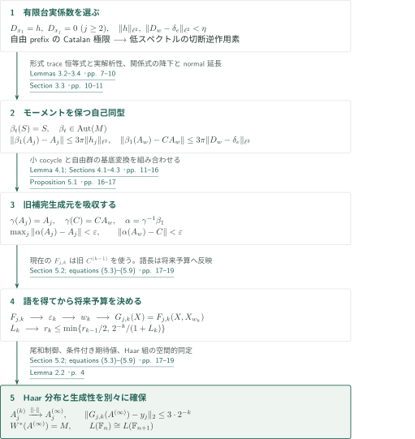
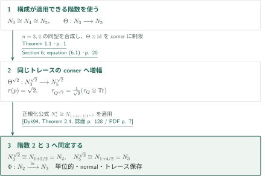
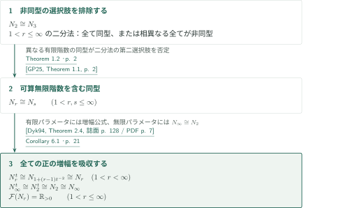
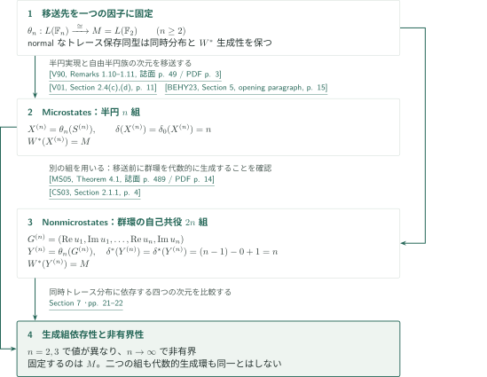

# An isomorphism of the free group factors

**小さいcocycleから余分な自由生成元を吸収し、正規化増幅で階数2へ戻す。**

本原稿は、$n\ge3$に対して$L(\mathbb F_{n+1})$内に自由に生成するHaar $n$組を構成する。局所的な自己同型の反復で組の分布と生成性を別々に確保し、その後に補間自由群因子の増幅公式を使う。以下は原稿の論証と直接入力の照合に基づく概説であり、独立した査読による正しさの認定ではない。

## 1. 主要結果

### Theorem 1.1 — 隣接階数の同型

すべての整数$n\ge3$について、単位的・トレース保存・normalな$*$同型
\[
L(\mathbb F_n)\cong L(\mathbb F_{n+1})
\]
が存在する。各因子のトレースは標準の正規化トレースである。

<!-- cite:main-rank -->[Theorem 1.1 · p. 1](https://github.com/openai/math/blob/1581d4cbdd69a0faf34b2089614fe2a814316a6a/preprints/An-isomorphism-of-the-free-group-factors-September-23-2026/An-isomorphism-of-the-free-group-factors-September-23-2026.pdf)<!-- /cite -->

### Theorem 1.2 — 階数2と3

単位的・normal・トレース保存な$*$同型
\[
\Phi:L(\mathbb F_2)\longrightarrow L(\mathbb F_3)
\]
が存在する。

<!-- cite:rank-two -->[Theorem 1.2 · p. 2](https://github.com/openai/math/blob/1581d4cbdd69a0faf34b2089614fe2a814316a6a/preprints/An-isomorphism-of-the-free-group-factors-September-23-2026/An-isomorphism-of-the-free-group-factors-September-23-2026.pdf)<!-- /cite -->

### Corollary 6.1 — 補間族全体と基本群

$1<r,s\le\infty$のすべてについて、単位的・normal・トレース保存な$*$同型$L(\mathbb F_r)\cong L(\mathbb F_s)$が存在する。さらに
\[
\mathcal F(L(\mathbb F_r))=\mathbb R_{>0}\qquad(1<r\le\infty).
\]
有限非整数の$r$では補間自由群因子を意味し、$\infty$は可算無限階数である。$r=1$は含まない。

<!-- cite:all-ranks -->[Corollary 6.1 · p. 21](https://github.com/openai/math/blob/1581d4cbdd69a0faf34b2089614fe2a814316a6a/preprints/An-isomorphism-of-the-free-group-factors-September-23-2026/An-isomorphism-of-the-free-group-factors-September-23-2026.pdf)<!-- /cite -->

### Corollary 7.1 — 自由エントロピー次元の生成組依存性

$M=L(\mathbb F_2)$に標準トレースを入れる。すべての整数$n\ge2$について、自己共役$n$組$X^{(n)}$と自己共役$2n$組$Y^{(n)}$が存在し、
\[
W^*(X^{(n)})=W^*(Y^{(n)})=M,
\]
\[
\delta(X^{(n)})=\delta_0(X^{(n)})=n,
\qquad
\delta^*(Y^{(n)})=\delta^\star(Y^{(n)})=n.
\]
したがって四つの次元はいずれも有限自己共役$W^*$生成組の変更に対して不変でなく、この一つの因子の生成組上で非有界となる。二つの組が同一であるとは主張しない。

<!-- cite:entropy -->[Corollary 7.1 · pp. 21–22](https://github.com/openai/math/blob/1581d4cbdd69a0faf34b2089614fe2a814316a6a/preprints/An-isomorphism-of-the-free-group-factors-September-23-2026/An-isomorphism-of-the-free-group-factors-September-23-2026.pdf)<!-- /cite -->

## 図の矢印に付した引用

<!-- reference-guide -->
略号のない定理・補題・節・式番号は本原稿 [An isomorphism of the free group factors](https://github.com/openai/math/blob/1581d4cbdd69a0faf34b2089614fe2a814316a6a/preprints/An-isomorphism-of-the-free-group-factors-September-23-2026/An-isomorphism-of-the-free-group-factors-September-23-2026.pdf) を指します。外部入力には次の略号を使います。

- [Dyk94](https://msp.org/pjm/1994/163-1/pjm-v163-n1-p06-p.pdf) Ken Dykema — *Interpolated free group factors*：正規化された増幅公式。Theorem 1.2で使用。。Pacific Journal of Mathematics 163 (1994), 123–135; publisher PDF with cover。
- [GP25](https://arxiv.org/pdf/2305.08168v2) Isaac Goldbring and Jennifer Pi — *On the first-order free group factor alternative*：無限パラメータを含む古典的同型二分法の明示的再掲。Corollary 6.1で使用。。arXiv:2305.08168v2, 2 January 2025。
- [V90](https://math.berkeley.edu/~dvv/CircularSemi.pdf) Dan Voiculescu — *Circular and semicircular systems and free product factors*：半円族による自由群因子の実現。Corollary 7.1で使用。。Progress in Mathematics 92 (1990), 45–60; author-hosted two-page scan。
- [V01](https://arxiv.org/pdf/math/0103168v1) Dan Voiculescu — *Free entropy*：自由な半円族のmicrostates次元δ=n。。arXiv:math/0103168v1, 26 March 2001。
- [BEHY23](https://arxiv.org/pdf/2202.04714v2) Michael Brannan, Floris Elzinga, Samuel J. Harris, and Makoto Yamashita — *Crossed product equivalence of quantum automorphism groups of finite dimensional C∗-algebras*：§5冒頭の自由半円族についてのδ₀=nの記述。誌面版に代え著者プレプリントv2を照合。。arXiv:2202.04714v2, 21 February 2023; §5 corresponding to the cited published article。
- [MS05](https://mineyev.web.illinois.edu/art/non-microstates.pdf) Igor Mineyev and Dimitri Shlyakhtenko — *Non-microstates free entropy dimension for groups*：群環を代数的に生成する自己共役組のδ*、δ⋆をL²-Betti数で計算。。Geometric and Functional Analysis 15 (2005), 476–490; published PDF。
- [CS03](https://arxiv.org/pdf/math/0309343v1) Alain Connes and Dimitri Shlyakhtenko — *L2-homology for von Neumann algebras*：自由群のL²-Betti数β₀=0、β₁=n−1。。arXiv:math/0309343v1, 20 September 2003。

各引用に結果番号とページを付します。誌面番号とPDF内の位置が異なる場合は両方を示します。GitHubの閲覧リンクではページ位置への自動移動を前提としません。
<!-- /reference-guide -->

## 2. Theorem 1.1 の証明 — 小さい摂動と生成する極限

<!-- proof-target:1 -->証明対象：[Theorem 1.1 · p. 1](https://github.com/openai/math/blob/1581d4cbdd69a0faf34b2089614fe2a814316a6a/preprints/An-isomorphism-of-the-free-group-factors-September-23-2026/An-isomorphism-of-the-free-group-factors-September-23-2026.pdf)<!-- /proof-target -->

**証明の道筋。** $M=L(\mathbb F_{n+1})$の自由に生成するHaar組$(A_1,\ldots,A_n,C)$から出発する。$S=\arg C$とその共役を係数とするflowが、小さい群cocycleを小さい自己同型へ変換する。これにより、ほとんど動かない$n$組の語で旧生成元$C$を近似できる。最後に、各近似を将来の摂動から守る誤差予算を設ける。以下の図はこの定理の全経路であり、補間理論はまだ使わない。

### 1. 形式的flowを実際のnormal自己同型へ降ろす

$\Gamma=\mathbb F_n$、$S_g=A_gSA_g^*$、$s(h)=\sum_g h(g)S_g$とおく。$S$は有界Borel汎関数計算による対数で、$e^{iS}=C$、$\tau(S)=0$、$\|S\|\le\pi$を満たす。有限台の実係数$h_j$からcocycleを
\[
D_{x_j}=h_j,\qquad D_{gb}=D_g+\lambda(g)D_b
\]
で定め、$B=C^*(A_1,\ldots,A_n,S)$内の多項式ODE
\[
A'_j(t)=i\sum_g h_j(g)A_g(t)SA_g(t)^*A_j(t)
\]
を解く。有限トレースの忠実性により解はunitaryであり続け、有界導関数と完備性が両時間方向の大域解を与える。

ここで自由性を時刻$t$へ先取りしない。形式的なunitaryと自己共役元の代数上で$\tau\circ\mathrm{ev}_0\circ\partial=0$を証明し、すべての反復微分にも適用する。群ラベルが非自明ならトレースはゼロであり、ラベルが自明なら自由な共役成分$S_g$の一つだけを他成分のunitaryで共役する第一変分に帰着する。実際の解の微分を多項式次数と係数和で評価してモーメントの実解析性を得るため、初期時刻の全導関数消失から全時刻のモーメント不変性が従う。

<!-- cite:trace -->[Lemmas 3.2–3.4 · pp. 7–10](https://github.com/openai/math/blob/1581d4cbdd69a0faf34b2089614fe2a814316a6a/preprints/An-isomorphism-of-the-free-group-factors-September-23-2026/An-isomorphism-of-the-free-group-factors-September-23-2026.pdf)<!-- /cite -->

$\varphi_t(\mathrm{ev}_0p)=\mathrm{ev}_tp$は、$p^*p$のトレースと忠実性により評価核を保ち、well-definedとなる。さらに
\[
\|b\|=\lim_{k\to\infty}\tau((b^*b)^k)^{1/(2k)}
\]
が等長性と単射性を与える。$B_t=C^*(A_1(t),\ldots,A_n(t),S)$内で同じODEを逆時間へ解くことで$B_t=B$、したがって全射性を得る。トレース保存等長写像を$L^2(M,\tau)$上のunitaryへ延長し、左表現を共役するとnormal自己同型$\beta_t$となる。point-norm連続性は$B$上の主張であり、$M$全体上には要求しない。この$B$は$S=\arg C$を含み、標準の被約群$C^*$環と同一視していない。

自由和の生成・消滅・対角成分の評価$\|s(h)\|\le3\pi\|h\|_{\ell^2}$を、自己同型の構成**後**に使う。積の順序を保って$e^{-itS}A_w(t)$を微分すれば、
\[
\|\beta_1(A_j)-A_j\|\le3\pi\|h_j\|_{\ell^2},\qquad
\|\beta_1(A_w)-CA_w\|\le3\pi\|D_w-\delta_e\|_{\ell^2}
\]
を得る。これが係数空間の問題と作用素ノルムの問題をつなぐ。

<!-- cite:free-sum -->[Lemmas 2.3–2.5 · pp. 4–6](https://github.com/openai/math/blob/1581d4cbdd69a0faf34b2089614fe2a814316a6a/preprints/An-isomorphism-of-the-free-group-factors-September-23-2026/An-isomorphism-of-the-free-group-factors-September-23-2026.pdf)<!-- /cite -->

<!-- cite:extension -->[Section 3.3 · pp. 10–11](https://github.com/openai/math/blob/1581d4cbdd69a0faf34b2089614fe2a814316a6a/preprints/An-isomorphism-of-the-free-group-factors-September-23-2026/An-isomorphism-of-the-free-group-factors-September-23-2026.pdf)<!-- /cite -->

### 2. スペクトルの打切りで小さいcocycleを作る

$n\ge3$の仮定は、$a=x_1$と$b_j=x_2^jx_3x_2^{-j}$を分離して使うところに入る。$p_j=(ab_1)\cdots(ab_j)$は自由な族をなし、$w_m=p_ma$、$T_m=1+\sum_{j=1}^m\lambda(p_j)$とすると、$h_1=h$、$h_j=0\ (j\ge2)$に対して$D_{w_m}=T_mh$となる。

$Q_m=T_mT_m^*$として$Q_m/m$のスペクトル測度は、自由語の非交差対合を数えるCatalanモーメント計算により
\[
d\nu(x)=\frac1{2\pi}\sqrt{\frac{4-x}{x}}\,1_{(0,4)}(x)\,dx
\]
へ弱収束する。必要なのは$\nu(\{0\})=0$であって、各$Q_m$の可逆性ではない。小さい$d>0$を先に選び、次に$m$を大きくして
\[
E_m=1_{(dm,\infty)}(Q_m),\quad
R_m=Q_m^{-1}E_m,\quad h^{(0)}=T_m^*R_m\delta_e
\]
とする。ここで$R_m$はゼロ側を切り落とした有界汎関数計算である。$T_mh^{(0)}=E_m\delta_e$、$\|h^{(0)}\|_{\ell^2}^2\le(dm)^{-1}$、$\|T_mh^{(0)}-\delta_e\|_{\ell^2}^2=\tau_\Gamma(1-E_m)$がそれぞれ小さくなる。実係数共役との可換性を確認してから有限台実ベクトルへ近似する。$m$を固定した後の$\|T_m\|\le m+1$が最後の近似誤差を制御する。

<!-- cite:small-cocycle -->[Lemma 4.1; Sections 4.1–4.3 · pp. 11–16](https://github.com/openai/math/blob/1581d4cbdd69a0faf34b2089614fe2a814316a6a/preprints/An-isomorphism-of-the-free-group-factors-September-23-2026/An-isomorphism-of-the-free-group-factors-September-23-2026.pdf)<!-- /cite -->

### 3. 旧補完生成元を近似し、選択順序を固定する

flowだけでは$CA_w$を近似している。自由群の基底変換$\gamma(A_j)=A_j$、$\gamma(C)=CA_w$を使い、$\alpha=\gamma^{-1}\circ\beta_1$と置くと
\[
\max_j\|\alpha(A_j)-A_j\|<\varepsilon,\qquad
\|\alpha(A_w)-C\|<\varepsilon.
\]
新しい補完生成元は$C'=\alpha(C)=CA_w^*$であり、近似対象の**旧**$C$とは異なる。$(\alpha(A),C')$は再び自由に生成するHaar組なので、同じ操作を反復できる。

<!-- cite:perturb -->[Proposition 5.1 · pp. 16–17](https://github.com/openai/math/blob/1581d4cbdd69a0faf34b2089614fe2a814316a6a/preprints/An-isomorphism-of-the-free-group-factors-September-23-2026/An-isomorphism-of-the-free-group-factors-September-23-2026.pdf)<!-- /cite -->

$L^2(M)$に稠密な可算族$(y_j)$を固定する。段階$k$では現在の組$(A^{(k-1)},C^{(k-1)})$による語多項式$F_{j,k}$で$y_1,\ldots,y_k$を$2^{-k}$以内に近似し、その共通Lipschitz定数$H_k$から
\[
0<\varepsilon_k<\min\{r_{k-1}/2,\,2^{-k}/(1+H_k)\}
\]
を選ぶ。摂動が語$w_k$を返した**後**に$G_{j,k}(X)=F_{j,k}(X,X_{w_k})$と、その共通定数$L_k$を定め、
\[
0<r_k\le\min\{r_{k-1}/2,\,2^{-k}/(1+L_k)\}
\]
を選ぶ。最初の評価では$X_{w_k}$は$F_{j,k}$の一つのunitary slotであり、まだ未知の語長を$\varepsilon_k$へ入れていない。語長の増大は将来予算$r_k$だけに反映される。

<!-- cite:limit -->[Section 5.2; equations (5.3)–(5.9) · pp. 17–19](https://github.com/openai/math/blob/1581d4cbdd69a0faf34b2089614fe2a814316a6a/preprints/An-isomorphism-of-the-free-group-factors-September-23-2026/An-isomorphism-of-the-free-group-factors-September-23-2026.pdf)<!-- /cite -->

### 4. 分布の保存と生成性を別に閉じる

$\sum_{\ell>k}\varepsilon_\ell\le r_k$により$A_j^{(k)}$は作用素ノルムでunitary $A_j^{(\infty)}$へ収束する。固定した語の評価とトレースのノルム連続性から、極限でも非自明語のトレースはゼロである。一方、生成性はそれだけでは従わない。予算の選び方から
\[
\|G_{j,k}(A^{(\infty)})-y_j\|_2\le L_kr_k+2\cdot2^{-k}\le3\cdot2^{-k}\qquad(j\le k)
\]
を得る。$N=W^*(A^{(\infty)})$へのトレース保存条件付き期待値$E_N$は$L^2$上の直交射影であり、この稠密族を固定するので$N=M$となる。近似多項式の作用素ノルムの一様有界性や、$C^{(k)}$の収束は不要である。

最後に$V\delta_g=A_g^{(\infty)}$は$\ell^2(\mathbb F_n)\to L^2(M)$のunitaryとなる。群左正則表現と$A_g^{(\infty)}$による左乗法を絡めるため、二重可換子の空間的同型が$L(\mathbb F_n)\to M$を与える。全射性は$N=M$、トレース保存は$V\delta_e=1$、normal性と単射性はこの空間的実現から従う。有限段階の自己同型列全体を極限へ延長して同型を作る議論ではない。

<!-- cite:limit -->[Section 5.2; equations (5.3)–(5.9) · pp. 17–19](https://github.com/openai/math/blob/1581d4cbdd69a0faf34b2089614fe2a814316a6a/preprints/An-isomorphism-of-the-free-group-factors-September-23-2026/An-isomorphism-of-the-free-group-factors-September-23-2026.pdf)<!-- /cite -->

<!-- cite:haar -->[Lemma 2.2 · p. 4](https://github.com/openai/math/blob/1581d4cbdd69a0faf34b2089614fe2a814316a6a/preprints/An-isomorphism-of-the-free-group-factors-September-23-2026/An-isomorphism-of-the-free-group-factors-September-23-2026.pdf)<!-- /cite -->

## 3. Theorem 1.2 の証明 — 増幅パラメータを揃える

<!-- proof-target:2 -->証明対象：[Theorem 1.2 · p. 2](https://github.com/openai/math/blob/1581d4cbdd69a0faf34b2089614fe2a814316a6a/preprints/An-isomorphism-of-the-free-group-factors-September-23-2026/An-isomorphism-of-the-free-group-factors-September-23-2026.pdf)<!-- /proof-target -->

$N_s=L(\mathbb F_s)$と書く。$Q^t=p(Q\overline\otimes B(\ell^2))p$では$(\tau_Q\otimes\mathrm{Tr})(p)=t$、cornerのトレースは$t^{-1}(\tau_Q\otimes\mathrm{Tr})$、$\mathrm{Tr}$は階数1射影に値1を取る。これが以下の$t^{-2}$の正規化である。

### 1. 階数3から5を経由する理由

Theorem 1.1を$n=3,4$に適用して$\Theta:N_3\to N_5$を作る。外部増幅公式
\[
N_s^t\cong N_{1+(s-1)t^{-2}}\quad(s>1,\ t>0)
\]
に$t=\sqrt2$を代入すると、$N_3^{\sqrt2}\cong N_2$、$N_5^{\sqrt2}\cong N_3$となる。従ってこの二つの同型と$\Theta^{\sqrt2}$の合成が$\Phi$である。$\Theta\otimes\mathrm{id}$は同じ有限トレースの射影を送り、正規化cornerへ制限されるため、単位・normal性・トレース保存・全単射性が合成に保たれる。$n=2$に小cocycle構成を直接適用してはいない。

<!-- cite:dykema -->[&#91;Dyk94, Theorem 2.4, 誌面 p. 128 / PDF p. 7&#93;](https://msp.org/pjm/1994/163-1/pjm-v163-n1-p06-p.pdf#page=7)<!-- /cite -->

<!-- cite:amplification -->[Section 6; equation (6.1) · p. 20](https://github.com/openai/math/blob/1581d4cbdd69a0faf34b2089614fe2a814316a6a/preprints/An-isomorphism-of-the-free-group-factors-September-23-2026/An-isomorphism-of-the-free-group-factors-September-23-2026.pdf)<!-- /cite -->

## 4. Corollary 6.1 の証明 — 無限パラメータと基本群

<!-- proof-target:3 -->証明対象：[Corollary 6.1 · p. 21](https://github.com/openai/math/blob/1581d4cbdd69a0faf34b2089614fe2a814316a6a/preprints/An-isomorphism-of-the-free-group-factors-September-23-2026/An-isomorphism-of-the-free-group-factors-September-23-2026.pdf)<!-- /proof-target -->

### 1. 無限階数は二分法から入る

古典的二分法は$1<r\le\infty$全体について「すべて同型」または「異なるパラメータはすべて非同型」と述べる。Theorem 1.2が後者を排除する。この無限パラメータを含む記述はGoldbring–PiのTheorem 1.1で照合したもので、そこではRădulescuのCorollary 4.7の再掲と明示される。有限階数の同型列を単に帰納極限に取る説明は用いない。

<!-- cite:dichotomy -->[&#91;GP25, Theorem 1.1, p. 2&#93;](https://arxiv.org/pdf/2305.08168v2#page=2)<!-- /cite -->

### 2. すべての正の増幅を吸収する

有限$r>1$と$t>0$では$1+(r-1)t^{-2}>1$なので、増幅公式と前段の同型から$N_r^t\cong N_r$を得る。$r=\infty$では$N_\infty\cong N_2$を増幅し、$N_\infty^t\cong N_2^t\cong N_2\cong N_\infty$とつなぐ。これで各基本群が$\mathbb R_{>0}$になる。$\infty$を有限パラメータ用公式へ形式代入する必要はない。

<!-- cite:all-ranks -->[Corollary 6.1 · p. 21](https://github.com/openai/math/blob/1581d4cbdd69a0faf34b2089614fe2a814316a6a/preprints/An-isomorphism-of-the-free-group-factors-September-23-2026/An-isomorphism-of-the-free-group-factors-September-23-2026.pdf)<!-- /cite -->

## 5. Corollary 7.1 の証明 — 二種類の生成組を移送する

<!-- proof-target:4 -->証明対象：[Corollary 7.1 · pp. 21–22](https://github.com/openai/math/blob/1581d4cbdd69a0faf34b2089614fe2a814316a6a/preprints/An-isomorphism-of-the-free-group-factors-September-23-2026/An-isomorphism-of-the-free-group-factors-September-23-2026.pdf)<!-- /proof-target -->

$\theta_n:L(\mathbb F_n)\to M=L(\mathbb F_2)$をTheorems 1.1–1.2から得る（$n=2$は恒等写像）。トレース保存により、各自己共役組$Z$と$\theta_n(Z)$の同時$*$分布は一致する。normal性と全射性から$W^*(\theta_n(Z))=\theta_n(W^*(Z))$である。

### 1. Microstates次元は半円族で計算する

自由な分散1の半円$n$組$S^{(n)}$は$L(\mathbb F_n)$を生成する。Voiculescuの半円実現の記述を照合した。参照版の半円則のスケールは分散1にスカラー倍して合わせられ、生成する代数は変わらない。非原子的分布についての一変数公式と自由加法性から$\delta(S^{(n)})=n$、外部文献§5冒頭から$\delta_0(S^{(n)})=n$を得る。$X^{(n)}=\theta_n(S^{(n)})$は生成性と両方の値を保つ。

<!-- cite:semicircular -->[&#91;V90, Remarks 1.10–1.11, 誌面 p. 49 / PDF p. 3&#93;](https://math.berkeley.edu/~dvv/CircularSemi.pdf#page=3)<!-- /cite -->

<!-- cite:delta -->[&#91;V01, Section 2.4(c),(d), p. 11&#93;](https://arxiv.org/pdf/math/0103168v1#page=11)<!-- /cite -->

<!-- cite:delta-zero -->[&#91;BEHY23, Section 5, opening paragraph, p. 15&#93;](https://arxiv.org/pdf/2202.04714v2#page=15)<!-- /cite -->

### 2. Nonmicrostates次元は群環生成組で計算する

標準群unitary $u_j$から$a_j=(u_j+u_j^*)/2$、$b_j=(u_j-u_j^*)/(2i)$、$G^{(n)}=(a_1,b_1,\ldots,a_n,b_n)$を作る。$u_j=a_j+ib_j$なので、この組は$\mathbb C\mathbb F_n$を**代数的に**生成する。従ってMineyev–Shlyakhtenkoの入力仮定を満たし、
\[
\delta^*(G^{(n)})=\delta^\star(G^{(n)})
=\beta_1^{(2)}(\mathbb F_n)-\beta_0^{(2)}(\mathbb F_n)+1=n
\]
を得る。この計算を移送前に行い、$Y^{(n)}=\theta_n(G^{(n)})$と置く。一般の$W^*$生成組へ群環の定理を直接適用していない。

<!-- cite:group-entropy -->[&#91;MS05, Theorem 4.1, 誌面 p. 489 / PDF p. 14&#93;](https://mineyev.web.illinois.edu/art/non-microstates.pdf#page=14)<!-- /cite -->

<!-- cite:betti -->[&#91;CS03, Section 2.1.1, p. 4&#93;](https://arxiv.org/pdf/math/0309343v1#page=4)<!-- /cite -->

### 3. 非不変性と非有界性

四つの次元はいずれも同時トレース分布に依存するので、対応する組を移送しても値は変わらない。$n=2,3$を比較すれば同一因子の生成組で異なる値となり、$n\to\infty$で非有界となる。$n$を変えたとき移送された組の代数的$*$環は固定していないため、群環定理の代数的生成組不変性とは矛盾しない。

<!-- cite:entropy-proof -->[Section 7 · pp. 21–22](https://github.com/openai/math/blob/1581d4cbdd69a0faf34b2089614fe2a814316a6a/preprints/An-isomorphism-of-the-free-group-factors-September-23-2026/An-isomorphism-of-the-free-group-factors-September-23-2026.pdf)<!-- /cite -->

## 6. 直接入力と使用箇所

| 供給する結果 | 利用箇所 | 適用条件・照合範囲 |
|---|---|---|
| Dykemaの増幅公式 | Theorem 1.2、Corollary 6.1 | 有限実パラメータ$s>1$と$t>0$。Theorem 2.4の記述と原稿p.20の正規化を照合。 |
| Goldbring–Piに再掲されたRădulescuの二分法 | Corollary 6.1 | $1<r\le\infty$の範囲を確認。Rădulescu原典の証明は未読。 |
| 半円実現と$\delta,\delta_0$の計算 | Corollary 7.1の$X^{(n)}$ | 自由な半円族の記述と値を外部原典で確認。入力の証明全体は再検証しない。 |
| Mineyev–Shlyakhtenkoと自由群のBetti数 | Corollary 7.1の$Y^{(n)}$ | 有限生成群の群環を代数的に生成する自己共役組。移送前の適用を確認。 |

§§2–5の自由和評価・flow・Catalan計算は原稿内で証明される。Foxの微分、cyclomorphy、free monotone transport、Ricard–Xuの評価への言及は方法上の背景であり、この概説で外部定理を代入した直接依存としては扱わない。原稿が明記するとおり、ShlyakhtenkoのFuchsian群因子のプレプリントの結果も使用しない。

## 7. 原典を読む入口と確認範囲

<!-- reading-list -->
- [Lemmas 3.2–3.4 · pp. 7–10](https://github.com/openai/math/blob/1581d4cbdd69a0faf34b2089614fe2a814316a6a/preprints/An-isomorphism-of-the-free-group-factors-September-23-2026/An-isomorphism-of-the-free-group-factors-September-23-2026.pdf) — 形式的微分から実際のモーメント不変性へ。
- [Section 3.3 · pp. 10–11](https://github.com/openai/math/blob/1581d4cbdd69a0faf34b2089614fe2a814316a6a/preprints/An-isomorphism-of-the-free-group-factors-September-23-2026/An-isomorphism-of-the-free-group-factors-September-23-2026.pdf) — 関係式の降下・全射性・normal延長を区別する。
- [Lemma 4.1; Sections 4.1–4.3 · pp. 11–16](https://github.com/openai/math/blob/1581d4cbdd69a0faf34b2089614fe2a814316a6a/preprints/An-isomorphism-of-the-free-group-factors-September-23-2026/An-isomorphism-of-the-free-group-factors-September-23-2026.pdf) — 自由なprefix、スペクトル極限、打切り逆作用素を読む。
- [Section 5.2; equations (5.3)–(5.9) · pp. 17–19](https://github.com/openai/math/blob/1581d4cbdd69a0faf34b2089614fe2a814316a6a/preprints/An-isomorphism-of-the-free-group-factors-September-23-2026/An-isomorphism-of-the-free-group-factors-September-23-2026.pdf) — 語を得た後に将来誤差を固定する順序と生成性。
- [Section 6; equation (6.1) · p. 20](https://github.com/openai/math/blob/1581d4cbdd69a0faf34b2089614fe2a814316a6a/preprints/An-isomorphism-of-the-free-group-factors-September-23-2026/An-isomorphism-of-the-free-group-factors-September-23-2026.pdf) — 正規化と√2増幅によるrank 2への帰着。
- [Corollary 6.1 · p. 21](https://github.com/openai/math/blob/1581d4cbdd69a0faf34b2089614fe2a814316a6a/preprints/An-isomorphism-of-the-free-group-factors-September-23-2026/An-isomorphism-of-the-free-group-factors-September-23-2026.pdf) — 無限パラメータと基本群への二分法の適用。
- [Section 7 · pp. 21–22](https://github.com/openai/math/blob/1581d4cbdd69a0faf34b2089614fe2a814316a6a/preprints/An-isomorphism-of-the-free-group-factors-September-23-2026/An-isomorphism-of-the-free-group-factors-September-23-2026.pdf) — 異なる二種類の生成組と分布の移送。
<!-- /reading-list -->

本文§§2–7の上記接続を読み、主張の全結論、写像の定義と延長、階数条件、近似位相、誤差選択順序、増幅正規化、二種類の生成組を自己点検した。入力の記述と利用条件の照合は、入力定理そのものの全証明検証とは区別する。

保留は、Rădulescuの原典Corollary 4.7の直接読解（ここでは明示的な再掲を使用）、Brannan–Elzinga–Harris–Yamashitaの誌面版とのページ対応（§5の著者プレプリントv2で照合）、各外部入力の証明とその先の依存文献の検証である。専門家による独立査読・形式検証は行っていない。
