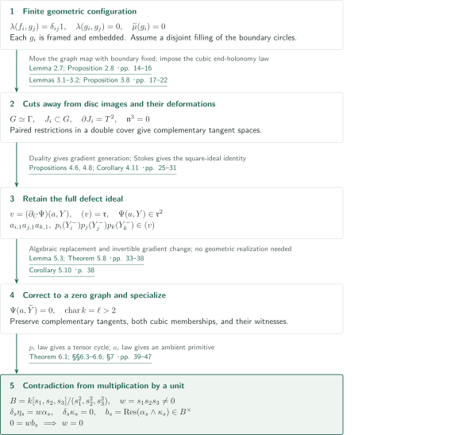
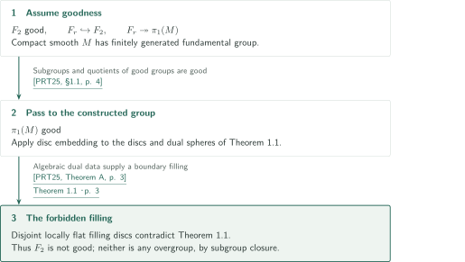
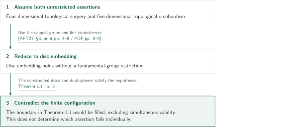

# A boundary-only obstruction to four-dimensional disk embedding

**Turn a boundary filling into deformation data of cuts, then force two cubic laws to conflict in a Frobenius–Koszul complex.**

The manuscript constructs a finite configuration satisfying the algebraic input for four-dimensional disc embedding and claims that its boundary link has no disjoint locally flat disc filling. Neither relative homotopy classes nor output framings are prescribed. This article describes the manuscript's argument; it is not an independent verification of the entire proof.

## 1. Main results

### Theorem 1.1 — Nonfilling determined by the boundary alone

There exist a compact connected oriented smooth four-manifold $M$ with nonempty boundary, an integer $k\geq1$, proper generic disc immersions $f_i:(D^2,S^1)\to(M,\partial M)$, and framed sphere maps $g_i:S^2\to M$ such that the union of the boundary restrictions is an embedding and, over $\mathbb Z[\pi_1(M)]$,

$$
\lambda(f_i,g_j)=\delta_{ij}1,\qquad \lambda(g_i,g_j)=0,\qquad \widetilde\mu(g_i)=0,
$$

but the specified boundary circles do not bound pairwise disjoint proper locally flat embedded discs in $M$. Each $g_i$ can be chosen smoothly embedded; distinct spheres may intersect. Here $\widetilde\mu$ is the reduced Wall invariant valued in $\mathbb Z[\pi_1(M)]/\langle h-h^{-1},\mathbb Z\cdot1\rangle_{\rm add}$. No vanishing of the intersection invariants among the input discs is assumed.

<!-- cite:main -->[Theorem 1.1 · p. 3](https://github.com/openai/math/blob/1581d4cbdd69a0faf34b2089614fe2a814316a6a/preprints/A-boundary-only-obstruction-to-four-dimensional-disk-embedding-September-24-2026/paper.pdf)<!-- /cite -->

### Corollary 1.2 — Nongoodness of free groups

The free group $F_2$ is not good in the sense of Freedman–Quinn. Every group containing a subgroup isomorphic to $F_2$ is also not good. This does not identify the constructed manifold's fundamental group with $F_2$.

<!-- cite:free -->[Corollary 1.2 · p. 4](https://github.com/openai/math/blob/1581d4cbdd69a0faf34b2089614fe2a814316a6a/preprints/A-boundary-only-obstruction-to-four-dimensional-disk-embedding-September-24-2026/paper.pdf)<!-- /cite -->

### Corollary 1.3 — Incompatibility of two unrestricted assertions

The unrestricted four-dimensional topological surgery assertion and five-dimensional topological $s$-cobordism assertion cannot both hold. The former asserts that a degree-one normal map from a compact four-manifold to a four-dimensional Poincaré pair $(Z,\partial Z)$, inducing a $\mathbb Z[\pi_1(Z)]$-homology equivalence on the boundary and having zero Wall obstruction, is normally bordant relative to the boundary to a homotopy equivalence. The latter asserts that a compact five-dimensional topological $s$-cobordism with a specified boundary product is homeomorphic to a product extending that structure. Neither assertion restricts the fundamental group. The corollary does not identify which assertion fails individually.

<!-- cite:surgery -->[Corollary 1.3 · p. 5](https://github.com/openai/math/blob/1581d4cbdd69a0faf34b2089614fe2a814316a6a/preprints/A-boundary-only-obstruction-to-four-dimensional-disk-embedding-September-24-2026/paper.pdf)<!-- /cite -->

## References on the arrows

<!-- reference-guide -->
Unprefixed theorem, lemma, section and equation numbers refer to [A boundary-only obstruction to four-dimensional disk embedding](https://github.com/openai/math/blob/1581d4cbdd69a0faf34b2089614fe2a814316a6a/preprints/A-boundary-only-obstruction-to-four-dimensional-disk-embedding-September-24-2026/paper.pdf). External inputs use the following keys.

- [PRT25](https://www.maths.gla.ac.uk/~mpowell/s00029-025-01069-y.pdf) Mark Powell, Arunima Ray, Peter Teichner — *The 4-dimensional disc embedding theorem and dual spheres*: Good-group disc embedding and closure under subgroups and quotients in Corollary 1.2. Selecta Mathematica 31 (2025), Article 80; publisher PDF.
- [KPT21](https://eprints.gla.ac.uk/280401/1/280401.pdf) Min Hoon Kim, Mark Powell, Peter Teichner — *The round handle problem*: Reduction from surgery together with s-cobordism to disc embedding in Corollary 1.3. Author Accepted Manuscript deposited 26 September 2022; published 2021.
- [DSGJ-v3](https://arxiv.org/pdf/1709.01049v3) Alessandro De Stefani, Eloísa Grifo, Jack Jeffries — *A Zariski–Nagata theorem for smooth Z-algebras*: Differential-operator test for symbolic powers in Lemma 5.3. arXiv:1709.01049v3.
- [Stacks](https://stacks.math.columbia.edu/tag/00MA) The Stacks Project Authors — *The Stacks Project*: Descent of the Taylor tuple from completion in Lemma 5.3; tags have no page numbering. Tags 00MA, 00MB, 00MC; web statements checked 2026-10-21.

Each citation gives the result and pages. When printed pagination differs from the PDF position, both are shown. GitHub previews do not automatically jump to the cited page.
<!-- /reference-guide -->

## 2. Proof of Theorem 1.1 — From geometry to a finite-complex contradiction

<!-- proof-target:1 -->Proof target：[Theorem 1.1 · p. 3](https://github.com/openai/math/blob/1581d4cbdd69a0faf34b2089614fe2a814316a6a/preprints/A-boundary-only-obstruction-to-four-dimensional-disk-embedding-September-24-2026/paper.pdf)<!-- /proof-target -->

**Proof route.** Start with a graph-type four-manifold having $d=5$ special edges. Construct algebraic duals in the exterior of capped-stage bases and extract cuts from a hypothetical boundary filling. Algebraize and correct the resulting representation-deformation potentials, specialize to positive characteristic, and use the incompatibility of two cubic laws in one finite differential-form complex.

### 1. Construct duals in the exterior and protect the actual disc images

Inside a graph-type manifold $G$, a finite family of capped stages encodes all independently conjugated triple commutators $[z_a^{c_1},[z_b^{c_2},z_c^{c_3}]]$. Delete only neighborhoods of the base surfaces to obtain $M$. Shallow caps give the input discs $f_r$, while compression of product tori using upper-stage caps gives $g_r$. Besides individual embeddedness and trivial normal bundles of the spheres, the retained unused caps kill the intersection-label comparison loops in $\pi_1(M)$. Opposite-sign intersections therefore cancel coefficient by coefficient in the group ring. Cancellation merely in $\pi_1(G)$ would not suffice.

<!-- cite:geometry -->[Lemmas 2.4–2.5; Corollary 2.6 · pp. 12–14](https://github.com/openai/math/blob/1581d4cbdd69a0faf34b2089614fe2a814316a6a/preprints/A-boundary-only-obstruction-to-four-dimensional-disk-embedding-September-24-2026/paper.pdf)<!-- /cite -->

Move the graph map on the actual images of hypothetical filling discs into the $h$-subgraph. Injectivity on fundamental groups and $\pi_2(\Gamma)=0$ permit this change relative to the boundary. Smooth the map away from the protected disc images and take regular levels on the special edges. This produces smooth three-dimensional walls $J_i$, each with one boundary torus. The hypothetical discs themselves need not be smoothed or homotoped to the original caps. The cut manifold $X$ may be disconnected, and closed wall components are retained.

<!-- cite:cuts -->[Lemma 2.7; Proposition 2.8 · pp. 14–16](https://github.com/openai/math/blob/1581d4cbdd69a0faf34b2089614fe2a814316a6a/preprints/A-boundary-only-obstruction-to-four-dimensional-disk-embedding-September-24-2026/paper.pdf)<!-- /cite -->

### 2. Retain the full ideal and both cubic laws

Mayer–Vietoris for a double cover gives complementary tangent images of the paired wall restrictions. For the adjoint representation of $SL_2(\mathbb C)$, a finite set of conjugation operators spans $\operatorname{End}(\mathfrak{sl}_2)$. Leading triple-commutator terms and Nakayama's lemma imply $\mathfrak n^3=0$ for the ideal of end-holonomy deviations in the deformation ring.

<!-- cite:deformation -->[Lemmas 3.1–3.2; Proposition 3.8 · pp. 17–22](https://github.com/openai/math/blob/1581d4cbdd69a0faf34b2089614fe2a814316a6a/preprints/A-boundary-only-obstruction-to-four-dimensional-disk-embedding-September-24-2026/paper.pdf)<!-- /cite -->

With wall coordinates $(a_i,y_i)$ and restrictions $(a_i,Y_i^+)$ and $(0,Y_i^-)$, boundary-polarized Chern–Simons potentials give

$$
\Psi(a,C)=\sum_i\bigl(P_i(a_i,C_i^+)-P_i(0,C_i^-)\bigr),\qquad v=(\partial_C\Psi)(a,Y).
$$

Differentiate before substitution. For the full defect ideal $\mathfrak r$, the manuscript proves $(v)=\mathfrak r$ and $\Psi(a,Y)\in\mathfrak r^2$. The first uses duality and the wall-restriction isomorphism to kill any missed minimal obstruction, contradicting the impossibility of a flat lift. The second glues boundary connections and applies Stokes to express the value through curvature squared. Setting $p_i(y_i)=\partial_{a_{i,1}}P_i(0,y_i)$ yields, for every triple including repetitions,

$$
a_{i,1}a_{j,1}a_{k,1}\in(v),\qquad
p_i(Y_i^-)p_j(Y_j^-)p_k(Y_k^-)\in(v).
$$

The second membership comes from the boundary term in polarized variation. Vanishing on the common zero set would not provide the required input for the next stage.

<!-- cite:ideals -->[Propositions 4.6, 4.8; Corollary 4.11 · pp. 25–31](https://github.com/openai/math/blob/1581d4cbdd69a0faf34b2089614fe2a814316a6a/preprints/A-boundary-only-obstruction-to-four-dimensional-disk-embedding-September-24-2026/paper.pdf)<!-- /cite -->

### 3. Preserve witnesses through replacement, correction, and specialization

Lemma 5.3 replaces a formal potential, whose gradient jets are representable in one smooth algebraic local ring, by a single algebraic primitive modulo any prescribed ideal power. Faithful flatness of completion descends the whole Taylor tuple; differential tests for symbolic powers also control embedded components. After sufficiently high-order replacement, the square-ideal identity allows a correction $\widetilde Y=Y+Bv$ with $\Psi(a,\widetilde Y)=0$ exactly. An invertible change of gradient generators and difference factorizations transport the witnesses for both cubic memberships.

<!-- cite:dsgj-input -->[&#91;DSGJ-v3, Theorem 3.6, p. 7&#93;](https://arxiv.org/pdf/1709.01049v3#page=7)<!-- /cite -->

<!-- cite:replacement -->[Lemma 5.3; Theorem 5.8 · pp. 33–38](https://github.com/openai/math/blob/1581d4cbdd69a0faf34b2089614fe2a814316a6a/preprints/A-boundary-only-obstruction-to-four-dimensional-disk-embedding-September-24-2026/paper.pdf)<!-- /cite -->

The potentials, corrected map, membership witnesses, and inverse tangent determinant all lie over one finitely generated $\mathbb Z$-algebra. Specialization to a finite field of sufficiently large characteristic $\ell>2$ preserves them. The corrected graph need not geometrically represent representations. Only the replacement data are specialized, not the original complex integrals.

<!-- cite:specialization -->[Corollary 5.10 · p. 38](https://github.com/openai/math/blob/1581d4cbdd69a0faf34b2089614fe2a814316a6a/preprints/A-boundary-only-obstruction-to-four-dimensional-disk-embedding-September-24-2026/paper.pdf)<!-- /cite -->

### 4. Kill a nonzero product in the same Frobenius quotient

Put $F(C)=\Psi(0,C)$ and use $\delta=dF\wedge$ on differential forms over $T=k[[C]]/(C_\nu^\ell)_\nu$. The complementary zero graphs give normal cycles $\alpha,\beta$ with nonzero residue pairing. The cubic law for the $p_i$ and a tensor-kernel calculation select a tensor with at least $d-2\geq3$ suitable positive factors.

Over $B=k[s_1,s_2,s_3]/(s_1^2,s_2^2,s_3^2)$, lift that tensor to a cycle $\kappa_s$ and construct the moving graph's normal cycle $\alpha_s$ in the same coordinate Frobenius quotient. The mixed terms $s_is_j$ and $s_1s_2s_3$ are retained. The cubic law for the $a$ coordinates supplies an ambient primitive with $\delta_s\eta_s=w\alpha_s$, where $w=s_1s_2s_3$. Meanwhile $b_s=\operatorname{Res}(\alpha_s\wedge\kappa_s)$ has nonzero constant term and is a unit. Thus $0=wb_s$ forces $w=0$, contrary to the squarefree monomial basis of $B$. This excludes the hypothetical boundary filling and, together with the constructed algebraic input, proves the theorem.

<!-- cite:obstruction -->[Theorem 6.1; §§6.3–6.6; §7 · pp. 39–47](https://github.com/openai/math/blob/1581d4cbdd69a0faf34b2089614fe2a814316a6a/preprints/A-boundary-only-obstruction-to-four-dimensional-disk-embedding-September-24-2026/paper.pdf)<!-- /cite -->

## 3. Proof of Corollary 1.2 — Pass goodness through subgroups and quotients

<!-- proof-target:2 -->Proof target：[Corollary 1.2 · p. 4](https://github.com/openai/math/blob/1581d4cbdd69a0faf34b2089614fe2a814316a6a/preprints/A-boundary-only-obstruction-to-four-dimensional-disk-embedding-September-24-2026/paper.pdf)<!-- /proof-target -->

### 1. Goodness of the constructed group would give a filling

Since $M$ is compact and smooth, $\pi_1(M)$ is finitely presented, hence finitely generated. If it were good, the disc embedding theorem would apply to the intersection data and framed algebraic duals and supply the boundary filling forbidden by Theorem 1.1.

<!-- cite:prt-theorem -->[&#91;PRT25, Theorem A, p. 3&#93;](https://www.maths.gla.ac.uk/~mpowell/s00029-025-01069-y.pdf#page=3)<!-- /cite -->

### 2. Transfer the conclusion to $F_2$ and its overgroups

Choose $r\geq2$ generators to obtain $F_r\twoheadrightarrow\pi_1(M)$. The elements $a^jba^{-j}$ ($0\leq j<r$) freely generate a copy of $F_r$ in $F_2=\langle a,b\rangle$. Closure of goodness under subgroups and quotients would make $\pi_1(M)$ good if $F_2$ were good. Subgroup closure also excludes goodness for every group containing $F_2$.

<!-- cite:prt-closure -->[&#91;PRT25, §1.1, p. 4&#93;](https://www.maths.gla.ac.uk/~mpowell/s00029-025-01069-y.pdf#page=4)<!-- /cite -->

## 4. Proof of Corollary 1.3 — Assume surgery and s-cobordism together

<!-- proof-target:3 -->Proof target：[Corollary 1.3 · p. 5](https://github.com/openai/math/blob/1581d4cbdd69a0faf34b2089614fe2a814316a6a/preprints/A-boundary-only-obstruction-to-four-dimensional-disk-embedding-September-24-2026/paper.pdf)<!-- /proof-target -->

### 1. Simultaneous validity gives unrestricted disc embedding

The manuscript uses the reduction in Round handle problem from the two assertions together to disc embedding without a fundamental-group restriction. The finite configuration of Theorem 1.1 satisfies its algebraic and boundary hypotheses, so the forbidden filling would exist. Nongoodness of $F_2$ alone does not replace this implication.

<!-- cite:kpt-input -->[&#91;KPT21, §3, print pp. 7–8 / PDF pp. 8–9&#93;](https://eprints.gla.ac.uk/280401/1/280401.pdf#page=8)<!-- /cite -->

## 5. Which papers supply which steps

The cuts, deformations, and positive-characteristic contradiction form an internal chain. The manuscript does not use the marked-tensor or PD4 manuscript in this catalog as an input. The central external inputs are the good-group disc embedding theorem in Corollary 1.2, the surgery reduction in Corollary 1.3, and completion and differential symbolic-power tests in Lemma 5.3. The manuscript also identifies standard inputs such as duality and the regular-value theorem.

<!-- cite:replacement -->[Lemma 5.3; Theorem 5.8 · pp. 33–38](https://github.com/openai/math/blob/1581d4cbdd69a0faf34b2089614fe2a814316a6a/preprints/A-boundary-only-obstruction-to-four-dimensional-disk-embedding-September-24-2026/paper.pdf)<!-- /cite -->

## 6. Return to the sources

<!-- reading-list -->
- [Lemmas 2.4–2.5; Corollary 2.6 · pp. 12–14](https://github.com/openai/math/blob/1581d4cbdd69a0faf34b2089614fe2a814316a6a/preprints/A-boundary-only-obstruction-to-four-dimensional-disk-embedding-September-24-2026/paper.pdf) — Check exterior group-ring labels and framings
- [Lemma 2.7; Proposition 2.8 · pp. 14–16](https://github.com/openai/math/blob/1581d4cbdd69a0faf34b2089614fe2a814316a6a/preprints/A-boundary-only-obstruction-to-four-dimensional-disk-embedding-September-24-2026/paper.pdf) — Read the construction of cuts using only boundary images
- [Propositions 4.6, 4.8; Corollary 4.11 · pp. 25–31](https://github.com/openai/math/blob/1581d4cbdd69a0faf34b2089614fe2a814316a6a/preprints/A-boundary-only-obstruction-to-four-dimensional-disk-embedding-September-24-2026/paper.pdf) — Track the two ideal identities and cubic laws
- [Lemma 5.3; Theorem 5.8 · pp. 33–38](https://github.com/openai/math/blob/1581d4cbdd69a0faf34b2089614fe2a814316a6a/preprints/A-boundary-only-obstruction-to-four-dimensional-disk-embedding-September-24-2026/paper.pdf) — Follow coefficient control through replacement and correction
- [Theorem 6.1; §§6.3–6.6; §7 · pp. 39–47](https://github.com/openai/math/blob/1581d4cbdd69a0faf34b2089614fe2a814316a6a/preprints/A-boundary-only-obstruction-to-four-dimensional-disk-embedding-September-24-2026/paper.pdf) — Read the contradiction in one finite complex and its application
<!-- /reading-list -->

The reading covered the main statements; framings, group-ring cancellation, and cuts in §2; complementarity and the two ideal identities in §§3–4; replacement and correction in §5; tensor selection, mixed terms, the common Frobenius quotient, and the residue contradiction in §6; and their assembly in §7. This does not independently reprove every local construction, identity, or external input. External checking covered the statements and application conditions of PRT25 Theorem A and §1.1, KPT21 §3, DSGJ-v3 Theorem 3.6 and Lemma 2.3, and Stacks Tags 00MA–00MC. Other excellence tags and the original texts for duality and regular values were not rechecked here.
