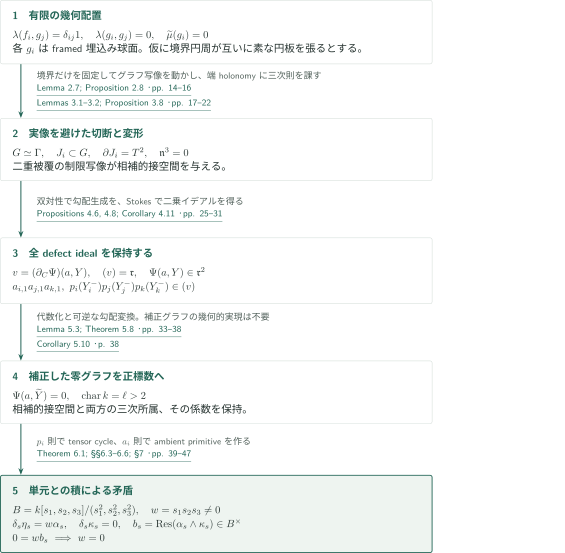
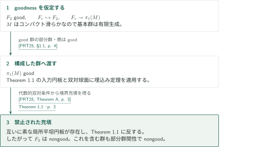
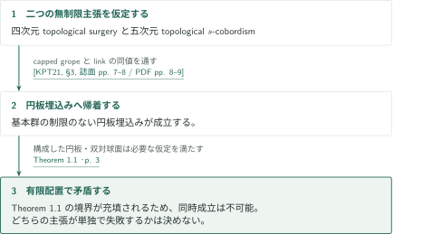

# A boundary-only obstruction to four-dimensional disk embedding

**境界充填を切断面の変形データへ移し、二つの三次則をFrobenius–Koszul複体で衝突させる。**

本稿は、四次元円板埋込みの代数的入力を満たす有限配置を構成し、その境界リンクには互いに素な局所平坦円板による充填が存在しないと主張する。仮想的な円板の相対ホモトピー類も出力framingも指定しない。以下は原稿の論証の概説であり、全証明の独立検証ではない。

## 1. 主要結果

### Theorem 1.1 — 境界だけで決まる非充填

空でない境界をもつコンパクト連結有向滑らかな四次元多様体 $M$、整数 $k\geq1$、properな一般位置の円板はめ込み $f_i:(D^2,S^1)\to(M,\partial M)$、framedな球面写像 $g_i:S^2\to M$ が存在し、境界制限の和は埋込みで、$\mathbb Z[\pi_1(M)]$ 上で

$$
\lambda(f_i,g_j)=\delta_{ij}1,\qquad \lambda(g_i,g_j)=0,\qquad \widetilde\mu(g_i)=0
$$

を満たすが、指定された境界円周は $M$ 内で互いに素なproper局所平坦埋込み円板を張らない。各 $g_i$ は滑らかな埋込み球面に選べるが、異なる球面同士の交差は許される。$\widetilde\mu$ は $\mathbb Z[\pi_1(M)]/\langle h-h^{-1},\mathbb Z\cdot1\rangle_{\rm add}$ に値をとるreduced Wall invariantである。入力円板同士の交点不変量の消滅は仮定していない。

<!-- cite:main -->[Theorem 1.1 · p. 3](https://github.com/openai/math/blob/1581d4cbdd69a0faf34b2089614fe2a814316a6a/preprints/A-boundary-only-obstruction-to-four-dimensional-disk-embedding-September-24-2026/paper.pdf)<!-- /cite -->

### Corollary 1.2 — 自由群のnongoodness

Freedman–Quinnの意味で自由群 $F_2$ はgoodでない。$F_2$ と同型な部分群を含むすべての群もgoodでない。これは構成した多様体の基本群が $F_2$ であるという主張ではない。

<!-- cite:free -->[Corollary 1.2 · p. 4](https://github.com/openai/math/blob/1581d4cbdd69a0faf34b2089614fe2a814316a6a/preprints/A-boundary-only-obstruction-to-four-dimensional-disk-embedding-September-24-2026/paper.pdf)<!-- /cite -->

### Corollary 1.3 — 二つの無制限主張の両立不可能性

基本群に制限を設けない四次元topological surgery assertionと五次元topological $s$-cobordism assertionは同時には成立しない。前者は、コンパクト四次元多様体から四次元Poincaré pair $(Z,\partial Z)$ への写像について、境界で $\mathbb Z[\pi_1(Z)]$-homology equivalenceでありWall障害が零のdegree-one normal mapから、境界相対のnormal bordismを経てhomotopy equivalenceを得る主張である。後者は、境界の指定product構造をもつコンパクト五次元topological $s$-cobordismが、その構造を延長するproductに同相であるという主張である。どちらが単独で失敗するかは結論していない。

<!-- cite:surgery -->[Corollary 1.3 · p. 5](https://github.com/openai/math/blob/1581d4cbdd69a0faf34b2089614fe2a814316a6a/preprints/A-boundary-only-obstruction-to-four-dimensional-disk-embedding-September-24-2026/paper.pdf)<!-- /cite -->

## 図の矢印に付した引用

<!-- reference-guide -->
略号のない定理・補題・節・式番号は本原稿 [A boundary-only obstruction to four-dimensional disk embedding](https://github.com/openai/math/blob/1581d4cbdd69a0faf34b2089614fe2a814316a6a/preprints/A-boundary-only-obstruction-to-four-dimensional-disk-embedding-September-24-2026/paper.pdf) を指します。外部入力には次の略号を使います。

- [PRT25](https://www.maths.gla.ac.uk/~mpowell/s00029-025-01069-y.pdf) Mark Powell, Arunima Ray, Peter Teichner — *The 4-dimensional disc embedding theorem and dual spheres*：good群の円板埋込み定理と部分群・商に関する閉性をCorollary 1.2で使う。Selecta Mathematica 31 (2025), Article 80; publisher PDF。
- [KPT21](https://eprints.gla.ac.uk/280401/1/280401.pdf) Min Hoon Kim, Mark Powell, Peter Teichner — *The round handle problem*：surgeryとs-cobordismの同時成立から円板埋込みへの帰着をCorollary 1.3で使う。Author Accepted Manuscript deposited 26 September 2022; published 2021。
- [DSGJ-v3](https://arxiv.org/pdf/1709.01049v3) Alessandro De Stefani, Eloísa Grifo, Jack Jeffries — *A Zariski–Nagata theorem for smooth Z-algebras*：Lemma 5.3で微分作用素によるsymbolic power判定を使う。arXiv:1709.01049v3。
- [Stacks](https://stacks.math.columbia.edu/tag/00MA) The Stacks Project Authors — *The Stacks Project*：Lemma 5.3でTaylor tupleを完備化から降下する。タグはページ番号を持たない。Tags 00MA, 00MB, 00MC; web statements checked 2026-10-21。

各引用に結果番号とページを付します。誌面番号とPDF内の位置が異なる場合は両方を示します。GitHubの閲覧リンクではページ位置への自動移動を前提としません。
<!-- /reference-guide -->

## 2. Theorem 1.1 の証明 — 幾何配置から有限複体の矛盾へ

<!-- proof-target:1 -->証明対象：[Theorem 1.1 · p. 3](https://github.com/openai/math/blob/1581d4cbdd69a0faf34b2089614fe2a814316a6a/preprints/A-boundary-only-obstruction-to-four-dimensional-disk-embedding-September-24-2026/paper.pdf)<!-- /proof-target -->

**証明の道筋。** $d=5$ 個の特殊辺をもつグラフ型四次元多様体から出発する。capped stagesを除いた外部で代数的双対を作り、仮想的な境界充填から切断面を得る。その表現変形のポテンシャルを代数化・補正して正標数へ移し、二種類の三次則が同一の有限微分形式複体で両立しないことを使う。

### 1. 双対を外部で構成し、円板の実像を保護して切断する

グラフ型多様体 $G$ に、独立に共役された全三重交換子 $[z_a^{c_1},[z_b^{c_2},z_c^{c_3}]]$ を表す有限個のcapped stagesを入れる。基底曲面の管状近傍だけを除いて $M$ とし、浅いcapを入力円板 $f_r$、積トーラスを上段capで圧縮して $g_r$ とする。$g_r$ の個別の埋込みと法束の自明性に加え、残された未使用capが交点ラベルの比較ループを $\pi_1(M)$ 内で殺すため、符号が逆の交点は群環係数ごと相殺する。この点は $\pi_1(G)$ での相殺では足りない。

<!-- cite:geometry -->[Lemmas 2.4–2.5; Corollary 2.6 · pp. 12–14](https://github.com/openai/math/blob/1581d4cbdd69a0faf34b2089614fe2a814316a6a/preprints/A-boundary-only-obstruction-to-four-dimensional-disk-embedding-September-24-2026/paper.pdf)<!-- /cite -->

仮想的な充填円板の実像上でグラフ写像を $h$-部分グラフへ移す。部分グラフの基本群の単射性と $\pi_2(\Gamma)=0$ により、境界を固定したこの変更ができる。円板実像の近傍を避けて写像を滑らかにし、特殊辺の正則値逆像を取ると、各々境界トーラスを一つもつ滑らかな三次元壁 $J_i$ が得られる。仮想的な円板自身を滑らかにする必要も、元のcapとホモトピックにする必要もない。切断後の $X$ は非連結でもよく、閉じた壁成分も捨てない。

<!-- cite:cuts -->[Lemma 2.7; Proposition 2.8 · pp. 14–16](https://github.com/openai/math/blob/1581d4cbdd69a0faf34b2089614fe2a814316a6a/preprints/A-boundary-only-obstruction-to-four-dimensional-disk-embedding-September-24-2026/paper.pdf)<!-- /cite -->

### 2. イデアルそのものと二つの三次則を得る

二重被覆のMayer–Vietoris列は、壁への二組の制限の接空間が相補的であることを与える。$SL_2(\mathbb C)$ の随伴表現では、有限個の共役作用が $\operatorname{End}(\mathfrak{sl}_2)$ を張る。三重交換子の先頭項とNakayamaの補題から、端のholonomyの偏差が生成するイデアル $\mathfrak n$ は変形環で $\mathfrak n^3=0$ を満たす。

<!-- cite:deformation -->[Lemmas 3.1–3.2; Proposition 3.8 · pp. 17–22](https://github.com/openai/math/blob/1581d4cbdd69a0faf34b2089614fe2a814316a6a/preprints/A-boundary-only-obstruction-to-four-dimensional-disk-embedding-September-24-2026/paper.pdf)<!-- /cite -->

壁座標を $(a_i,y_i)$、制限を $(a_i,Y_i^+)$ と $(0,Y_i^-)$ とし、境界でpolarizeしたChern–Simonsポテンシャルから

$$
\Psi(a,C)=\sum_i\bigl(P_i(a_i,C_i^+)-P_i(0,C_i^-)\bigr),\qquad v=(\partial_C\Psi)(a,Y)
$$

を作る。微分は代入より先に取る。全defect ideal $\mathfrak r$ について $(v)=\mathfrak r$ と $\Psi(a,Y)\in\mathfrak r^2$ を示す。前者は、取り逃した最小障害を双対性と壁制限の同型で零にし、flat lift不可能性に矛盾させる議論である。後者は境界で接続を貼り合わせ、Stokesにより曲率の二乗へ移す。さらに $p_i(y_i)=\partial_{a_{i,1}}P_i(0,y_i)$ と置くと、繰返しを含む全三つ組について

$$
a_{i,1}a_{j,1}a_{k,1}\in(v),\qquad
p_i(Y_i^-)p_j(Y_j^-)p_k(Y_k^-)\in(v).
$$

第二の所属はpolarized variationの境界項から得る。両者を単なる零点集合の消滅へ弱めては後段へ渡せない。

<!-- cite:ideals -->[Propositions 4.6, 4.8; Corollary 4.11 · pp. 25–31](https://github.com/openai/math/blob/1581d4cbdd69a0faf34b2089614fe2a814316a6a/preprints/A-boundary-only-obstruction-to-four-dimensional-disk-embedding-September-24-2026/paper.pdf)<!-- /cite -->

### 3. 代数化・補正・特殊化で所属の係数も保持する

Lemma 5.3は、同じ滑らかな代数局所環で勾配の任意高次jetを表せる形式ポテンシャルを、任意のイデアル冪まで単一の代数的原始関数で置き換える。Taylor tuple全体の降下に完備化の忠実平坦性を使い、微分によるsymbolic power判定で埋込み成分も制御する。十分高次の置換後、二乗イデアルの式から $\widetilde Y=Y+Bv$ を構成して $\Psi(a,\widetilde Y)=0$ を厳密にする。勾配生成元の可逆変換と差の因数分解により、両方の三次所属の係数も運ぶ。

<!-- cite:dsgj-input -->[&#91;DSGJ-v3, Theorem 3.6, p. 7&#93;](https://arxiv.org/pdf/1709.01049v3#page=7)<!-- /cite -->

<!-- cite:replacement -->[Lemma 5.3; Theorem 5.8 · pp. 33–38](https://github.com/openai/math/blob/1581d4cbdd69a0faf34b2089614fe2a814316a6a/preprints/A-boundary-only-obstruction-to-four-dimensional-disk-embedding-September-24-2026/paper.pdf)<!-- /cite -->

ポテンシャル、補正写像、所属を示す係数、接空間行列式の逆元を一つの有限生成 $\mathbb Z$-代数に収め、十分大きい標数 $\ell>2$ の有限体へ特殊化する。補正写像は表現を幾何的に実現する必要がない。特殊化するのは代数化後のデータであり、もとの複素積分そのものではない。

<!-- cite:specialization -->[Corollary 5.10 · p. 38](https://github.com/openai/math/blob/1581d4cbdd69a0faf34b2089614fe2a814316a6a/preprints/A-boundary-only-obstruction-to-four-dimensional-disk-embedding-September-24-2026/paper.pdf)<!-- /cite -->

### 4. 同じFrobenius商で非零の積を零にする

$F(C)=\Psi(0,C)$ とし、$T=k[[C]]/(C_\nu^\ell)_\nu$ の微分形式上で $\delta=dF\wedge$ を考える。相補的な零グラフは非零residue pairingをもつnormal cycles $\alpha,\beta$ を与える。$p_i$ の三次則とtensor-kernel計算から、$d-2\geq3$ 個の適した正側因子をもつtensorを選べる。

三つのsquare-zeroパラメータを導入した $B=k[s_1,s_2,s_3]/(s_1^2,s_2^2,s_3^2)$ 上で、そのtensorをcycle $\kappa_s$ に持ち上げ、動くグラフのnormal cycle $\alpha_s$ を同じ座標Frobenius商で作る。混合項 $s_is_j$ と $s_1s_2s_3$ も保持する。$a$ の三次則から、$w=s_1s_2s_3$ に対して $\delta_s\eta_s=w\alpha_s$ となるambient primitiveが得られる。一方、$b_s=\operatorname{Res}(\alpha_s\wedge\kappa_s)$ は定数項が非零なので単元である。したがって $0=wb_s$ は $w=0$ を強制し、$B$ のsquarefree単項式基底に反する。これで仮想的な境界充填を排除し、構成済みの代数的入力と合わせて主定理を得る。

<!-- cite:obstruction -->[Theorem 6.1; §§6.3–6.6; §7 · pp. 39–47](https://github.com/openai/math/blob/1581d4cbdd69a0faf34b2089614fe2a814316a6a/preprints/A-boundary-only-obstruction-to-four-dimensional-disk-embedding-September-24-2026/paper.pdf)<!-- /cite -->

## 3. Corollary 1.2 の証明 — 部分群と商へgoodnessを渡す

<!-- proof-target:2 -->証明対象：[Corollary 1.2 · p. 4](https://github.com/openai/math/blob/1581d4cbdd69a0faf34b2089614fe2a814316a6a/preprints/A-boundary-only-obstruction-to-four-dimensional-disk-embedding-September-24-2026/paper.pdf)<!-- /proof-target -->

### 1. 構成した群がgoodなら充填が存在する

$M$ がコンパクト滑らかなので $\pi_1(M)$ は有限表示をもち、特に有限生成である。この群がgoodなら、入力の交点条件とframed双対球面に円板埋込み定理を適用でき、Theorem 1.1が禁じる境界充填を得てしまう。

<!-- cite:prt-theorem -->[&#91;PRT25, Theorem A, p. 3&#93;](https://www.maths.gla.ac.uk/~mpowell/s00029-025-01069-y.pdf#page=3)<!-- /cite -->

### 2. $F_2$ とそれを含む群へ結論を移す

$r\geq2$ 個の生成元を選ぶと $F_r\twoheadrightarrow\pi_1(M)$ がある。$F_2=\langle a,b\rangle$ の元 $a^jba^{-j}$ ($0\leq j<r$) は自由に $F_r$ を生成する。goodnessの部分群・商に関する閉性から、$F_2$ がgoodなら $\pi_1(M)$ もgoodとなる。さらに $F_2$ を含むgood群があれば部分群閉性に反する。

<!-- cite:prt-closure -->[&#91;PRT25, §1.1, p. 4&#93;](https://www.maths.gla.ac.uk/~mpowell/s00029-025-01069-y.pdf#page=4)<!-- /cite -->

## 4. Corollary 1.3 の証明 — surgeryと$s$-cobordismの同時仮定

<!-- proof-target:3 -->証明対象：[Corollary 1.3 · p. 5](https://github.com/openai/math/blob/1581d4cbdd69a0faf34b2089614fe2a814316a6a/preprints/A-boundary-only-obstruction-to-four-dimensional-disk-embedding-September-24-2026/paper.pdf)<!-- /proof-target -->

### 1. 同時成立から無制限の円板埋込みへ

原稿はRound handle problemの帰着を使い、二つの主張の同時成立から基本群の制限のない円板埋込みを得る。Theorem 1.1の有限配置がその代数的・境界的仮定を満たすため、禁止した充填が再び得られる。$F_2$ のnongoodnessだけでこの含意を代用していない。

<!-- cite:kpt-input -->[&#91;KPT21, §3, 誌面 pp. 7–8 / PDF pp. 8–9&#93;](https://eprints.gla.ac.uk/280401/1/280401.pdf#page=8)<!-- /cite -->

## 5. どの論文が、どの段階を担うか

主証明の切断・変形・正標数矛盾は本稿内の連鎖であり、同じカタログのmarked tensor原稿やPD4原稿を入力として引用する連鎖ではない。外部入力の中心は、Corollary 1.2で使うgood-group円板埋込み定理、Corollary 1.3で使うsurgeryの帰着、Lemma 5.3で使う完備化と微分的symbolic power判定である。双対性や正則値定理の標準的な入力も原稿中で明示されている。

<!-- cite:replacement -->[Lemma 5.3; Theorem 5.8 · pp. 33–38](https://github.com/openai/math/blob/1581d4cbdd69a0faf34b2089614fe2a814316a6a/preprints/A-boundary-only-obstruction-to-four-dimensional-disk-embedding-September-24-2026/paper.pdf)<!-- /cite -->

## 6. 原典を読む入口と確認範囲

<!-- reading-list -->
- [Lemmas 2.4–2.5; Corollary 2.6 · pp. 12–14](https://github.com/openai/math/blob/1581d4cbdd69a0faf34b2089614fe2a814316a6a/preprints/A-boundary-only-obstruction-to-four-dimensional-disk-embedding-September-24-2026/paper.pdf) — 外部の群環ラベルとframingを確認する
- [Lemma 2.7; Proposition 2.8 · pp. 14–16](https://github.com/openai/math/blob/1581d4cbdd69a0faf34b2089614fe2a814316a6a/preprints/A-boundary-only-obstruction-to-four-dimensional-disk-embedding-September-24-2026/paper.pdf) — 境界像だけを使う切断の構成を読む
- [Propositions 4.6, 4.8; Corollary 4.11 · pp. 25–31](https://github.com/openai/math/blob/1581d4cbdd69a0faf34b2089614fe2a814316a6a/preprints/A-boundary-only-obstruction-to-four-dimensional-disk-embedding-September-24-2026/paper.pdf) — 二つのイデアル等式と三次則を追う
- [Lemma 5.3; Theorem 5.8 · pp. 33–38](https://github.com/openai/math/blob/1581d4cbdd69a0faf34b2089614fe2a814316a6a/preprints/A-boundary-only-obstruction-to-four-dimensional-disk-embedding-September-24-2026/paper.pdf) — 代数化と補正による係数の保存を読む
- [Theorem 6.1; §§6.3–6.6; §7 · pp. 39–47](https://github.com/openai/math/blob/1581d4cbdd69a0faf34b2089614fe2a814316a6a/preprints/A-boundary-only-obstruction-to-four-dimensional-disk-embedding-September-24-2026/paper.pdf) — 同じ有限複体での矛盾と主定理への適用を読む
<!-- /reading-list -->

主要結果、§2のframing・群環ラベルの相殺と切断、§§3–4の相補性と二つのイデアル等式、§5の代数化・補正、§6のtensor選択・混合項・同一Frobenius商・residue矛盾、§7の適用を読んで接続を整理した。これは各局所構成・全恒等式・外部入力の証明までを独立に再証明したものではない。外部ではPRT25のTheorem A・§1.1、KPT21の§3、DSGJ-v3のTheorem 3.6・Lemma 2.3、StacksのTags 00MA–00MCの記述と使用条件を照合した。その他のexcellenceに関するタグ、双対性・正則値定理の原典本文は今回再照合していない。
