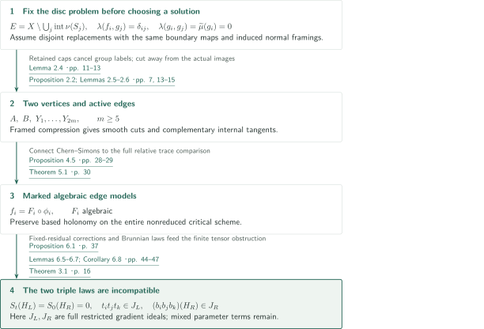
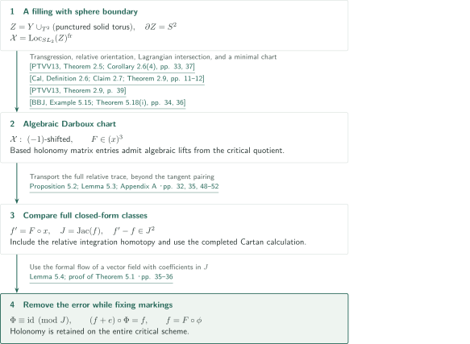
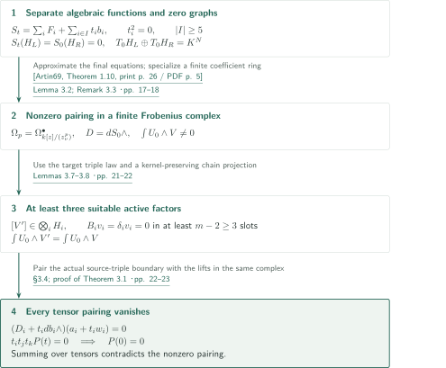

# A marked tensor obstruction to four-dimensional disk embedding

**Algebraize while preserving based holonomy, then compare two vertex triple laws in a finite tensor complex.**

The manuscript claims nonexistence of locally flat disc replacements preserving the input boundary maps and induced normal framings. It prescribes no relative homotopy classes for the replacements. The markings specify based curves and paths in the construction, not additional conditions on replacement discs. This article describes the manuscript's argument.

## 1. Main results

### Theorem 1.1 — No replacement preserving boundary maps and induced framings

There exist a compact connected oriented smooth four-manifold $M$ with boundary, an integer $k\geq1$, proper generic disc immersions $f_i:(D^2,S^1)\to(M,\partial M)$ with disjoint embedded boundary circles, and generically immersed framed spheres $g_i:S^2\to M$ such that, with fixed whiskers and values in $\mathbb Z[\pi_1M]$,

$$
\lambda(f_i,g_j)=\delta_{ij},\qquad\lambda(g_i,g_j)=0,\qquad\widetilde\mu(g_i)=0,
$$

but there are no pairwise disjoint proper locally flat embedded discs with the same boundary maps and the boundary normal framings induced by the $f_i$. The diagonal equations $\lambda(g_i,g_i)=0$ are included. The target of $\widetilde\mu$ is the additive quotient $\mathbb Z[\pi_1M]/\langle h-h^{-1},\mathbb Z\cdot1\rangle_{\rm add}$. Neither preservation of the relative homotopy classes of the discs nor output dual spheres are required.

<!-- cite:main -->[Theorem 1.1 · p. 2](https://github.com/openai/math/blob/1581d4cbdd69a0faf34b2089614fe2a814316a6a/preprints/A-marked-tensor-obstruction-to-four-dimensional-disk-embedding-September-24-2026/paper.pdf)<!-- /cite -->

## References on the arrows

<!-- reference-guide -->
Unprefixed theorem, lemma, section and equation numbers refer to [A marked tensor obstruction to four-dimensional disk embedding](https://github.com/openai/math/blob/1581d4cbdd69a0faf34b2089614fe2a814316a6a/preprints/A-marked-tensor-obstruction-to-four-dimensional-disk-embedding-September-24-2026/paper.pdf). External inputs use the following keys.

- [PTVV13](https://arxiv.org/pdf/1111.3209v4) Tony Pantev, Bertrand Toën, Michel Vaquié, Gabriele Vezzosi — *Shifted symplectic structures*: Betti transgression over the sphere and derived Lagrangian intersection; checked in the numbered arXiv version. arXiv:1111.3209v4, 22 April 2013.
- [Cal](https://arxiv.org/pdf/1306.3235v2) Damien Calaque — *Lagrangian structures on mapping stacks and semi-classical TFTs*: Relative orientation supplies a Lagrangian boundary restriction. arXiv:1306.3235v2, 7 November 2014.
- [BBJ](https://arxiv.org/pdf/1305.6302v4) Christopher Brav, Vittoria Bussi, Dominic Joyce — *A Darboux theorem for derived schemes with shifted symplectic structure*: A minimal algebraic Darboux chart in shift −1. arXiv:1305.6302v4, 29 August 2018.
- [Artin69](https://www.numdam.org/article/PMIHES_1969__36__23_0.pdf) Michael Artin — *Algebraic approximation of structures over complete local rings*: Approximate the final finite polynomial systems for graphs and witnesses while retaining first jets. Publications Mathématiques de l’IHÉS 36 (1969), 23–58; Numdam scan.
- [Getzler09](https://annals.math.princeton.edu/wp-content/uploads/annals-v170-n1-p07-p.pdf) Ezra Getzler — *Lie theory for nilpotent L∞-algebras*: Nilpotent Maurer–Cartan comparison used in Appendix A; the derived-coefficient extension is proved in the manuscript. Annals of Mathematics 170 (2009), 271–301; publisher PDF.

Each citation gives the result and pages. When printed pagination differs from the PDF position, both are shown. GitHub previews do not automatically jump to the cited page.
<!-- /reference-guide -->

## 2. Proof of Theorem 1.1 — From a fixed disc problem to two vertices

<!-- proof-target:1 -->Proof target：[Theorem 1.1 · p. 2](https://github.com/openai/math/blob/1581d4cbdd69a0faf34b2089614fe2a814316a6a/preprints/A-marked-tensor-obstruction-to-four-dimensional-disk-embedding-September-24-2026/paper.pdf)<!-- /proof-target -->

**Proof route.** Before choosing any hypothetical solution, construct an exterior $E$ with finitely many grope relations and algebraic dual spheres. A solution preserving framings allows bottom-surface compression and smooth cuts producing two vertices $A,B$ and $2m$ edges $Y_i$. The next section explains the separate algebraic edge potentials and markings; Section 4 explains why the resulting data cannot exist.

### 1. Fix the input first and cut using a framed filling

Choose $m\geq5$ and $p\geq9$. Install triple-commutator-type grope words on three distinct ports for every finite independent choice of conjugations and signs. Each word has the Brunnian deletion property and cubic leading term $[Z_1,[Z_2,Z_3]]$. In the exterior $E$ of the bottom-surface tubes, shallow caps give $f_j$ and compressed rim tori give $g_j$. The unused upper caps kill label-comparison loops in $\pi_1(E)$: cancel the two inner cap sheets while holding the outer copy fixed. Individual embeddedness and product framings of the spheres also give the diagonal equations and $\widetilde\mu=0$.

<!-- cite:geometry -->[Lemma 2.4 · pp. 11–13](https://github.com/openai/math/blob/1581d4cbdd69a0faf34b2089614fe2a814316a6a/preprints/A-marked-tensor-obstruction-to-four-dimensional-disk-embedding-September-24-2026/paper.pdf)<!-- /cite -->

Compress the bottom surfaces using hypothetical replacement caps. Their prescribed framings ensure the required locally flat compression and product collars. Regularize a map to the plumbing tree away from the actual disc images, obtaining connected walls and vertex regions. In the parity double-cover quotient, exactly $m$ of the $2m$ edges joining $A$ and $B$ are active. One original coordinate direction on each boundary torus dies and the other survives; together with Mayer–Vietoris restriction isomorphisms, this gives complementary internal tangent spaces.

<!-- cite:cuts -->[Proposition 2.2; Lemmas 2.5–2.6 · pp. 7, 13–15](https://github.com/openai/math/blob/1581d4cbdd69a0faf34b2089614fe2a814316a6a/preprints/A-marked-tensor-obstruction-to-four-dimensional-disk-embedding-September-24-2026/paper.pdf)<!-- /cite -->

### 2. Correct vertex graphs with their residual ideals fixed

Each edge's based connection slice has a central potential $f_i$ and a square-zero boundary variation $f_i+t_i b_i^{\rm form}$. Its internal Jacobian ideal equals the full curvature ideal. Fix vertex residual lists $r_P$ and $I_P=(r_P)$ for $P=A,B$. Stokes and duality give

$$
S_P(H_P)\in I_P^2,\qquad(\partial_hS_P)(H_P)=M_Pr_P,
$$

where $M_P$ has a unit full-column minor. Corrections by $I_P$-multiples make the values exactly zero while retaining the residual quotients and markings. Apply Theorem 5.1 separately to the edges, recenter the background, and only then pass to $K=\mathbb C((\sigma))$.

<!-- cite:vertices -->[Lemmas 6.3–6.4 · pp. 41–43](https://github.com/openai/math/blob/1581d4cbdd69a0faf34b2089614fe2a814316a6a/preprints/A-marked-tensor-obstruction-to-four-dimensional-disk-embedding-September-24-2026/paper.pdf)<!-- /cite -->

### 3. Transport triple laws on the nonreduced quotients

Nine adjoint matrices span $\operatorname{End}(\mathfrak{sl}_2\otimes K)$. Independently conjugated Brunnian laws therefore detect every coefficient belonging to three distinct active edges. Higher terms lie in the maximal ideal times the relevant triple ideal. Nakayama gives $t_it_jt_k\in I_A$ on side $A$ and products of three distinct edge holonomy deviations in $I_B$ on side $B$.

The holonomy logarithm itself is not claimed to be algebraic. Using algebraic matrix lifts $G_i$, replace the perturbations by

$$
b_i=-\epsilon_i\operatorname{tr}\!\left(T_i\left((G_i-1)-\tfrac12(G_i-1)^2\right)\right).
$$

The error is at least cubic in the deviations. The relation $G_i(H_A)-1\in(I_A,t_i)$ and $t_i^2=0$ control the resulting value and gradient errors. A finite correction increasing powers of the full parameter ideal restores the zero graph. One does not impose $(t_1,\ldots,t_m)^2=0$: mixed squarefree monomials remain. Proposition 6.1 now supplies every hypothesis of Theorem 3.1. Its contradiction proves that the fixed disc problem in $E$ has no solution.

<!-- cite:triple -->[Proposition 6.1 · p. 37; Lemmas 6.5–6.7; Corollary 6.8 · pp. 44–47](https://github.com/openai/math/blob/1581d4cbdd69a0faf34b2089614fe2a814316a6a/preprints/A-marked-tensor-obstruction-to-four-dimensional-disk-embedding-September-24-2026/paper.pdf)<!-- /cite -->

## 3. Proof of Theorem 5.1 — Algebraization preserving critical-scheme markings

<!-- proof-target:2 -->Proof target：[Theorem 5.1 · p. 30](https://github.com/openai/math/blob/1581d4cbdd69a0faf34b2089614fe2a814316a6a/preprints/A-marked-tensor-obstruction-to-four-dimensional-disk-embedding-September-24-2026/paper.pdf)<!-- /proof-target -->

<!-- statement:theorem-5-1 -->
### Theorem 5.1 — Algebraic edge potential with markings

Let $Y$ be a compact connected oriented smooth three-manifold with connected torus boundary. Choose based coordinate circles $\alpha,\beta$ so that the image of $H^1(Y)\to H^1(\partial Y)$ evaluates on $\alpha$ and vanishes on $\beta$. For the central potential $f$ and boundary complex $C$ of Proposition 4.5, put $N=\dim(H^1(C)\otimes\mathfrak{sl}_2)$, $R=\mathbb C[[h_1,\ldots,h_N]]$, and $J=\operatorname{Jac}(f)$. There are an invertible formal coordinate change $x=\phi(h)$ and an algebraic power series $F\in(x)^3$ with $f=F\circ\phi$. For any fixed finite collection of based loops, every matrix entry of their holonomies is the pullback of an algebraic power series in the $x$ coordinates on $\operatorname{Spf}(R/J)$. This identification holds on the entire possibly nonreduced critical scheme, in particular for the based $\beta$-holonomy.

<!-- cite:algebraic -->[Theorem 5.1 · p. 30](https://github.com/openai/math/blob/1581d4cbdd69a0faf34b2089614fe2a814316a6a/preprints/A-marked-tensor-obstruction-to-four-dimensional-disk-embedding-September-24-2026/paper.pdf)<!-- /cite -->
<!-- /statement -->

### 1. Obtain an algebraic critical chart from a punctured filling

Glue a solid torus minus an open ball to $Y$, taking $\alpha$ as the meridian, to obtain $\partial Z=S^2$. Transgress the trace-pairing 2-shifted form on $BG$ over the sphere to obtain a 0-shifted form. Relative orientation and Poincaré–Lefschetz duality make $\operatorname{Loc}_G(Z)\to\operatorname{Loc}_G(S^2)$ Lagrangian. Its derived intersection with the based-sphere Lagrangian gives a $(-1)$-shifted form on $\operatorname{Loc}_G(Z)^{\rm fr}$. Section 5.1 checks finite CW type, duality with perfect coefficients, and finite presentation. A minimal Darboux chart then supplies $F\in(x)^3$. Regular based holonomies lift from its critical quotient to the smooth chart.

<!-- cite:ptvv-transgression -->[&#91;PTVV13, Theorem 2.5; Corollary 2.6(4), pp. 33, 37&#93;](https://arxiv.org/pdf/1111.3209v4#page=33)<!-- /cite -->

<!-- cite:calaque -->[&#91;Cal, Definition 2.6; Claim 2.7; Theorem 2.9, pp. 11–12&#93;](https://arxiv.org/pdf/1306.3235v2#page=11)<!-- /cite -->

<!-- cite:ptvv-intersection -->[&#91;PTVV13, Theorem 2.9, p. 39&#93;](https://arxiv.org/pdf/1111.3209v4#page=39)<!-- /cite -->

<!-- cite:bbj -->[&#91;BBJ, Example 5.15; Theorem 5.18(i), pp. 34, 36&#93;](https://arxiv.org/pdf/1305.6302v4#page=34)<!-- /cite -->

### 2. Compare full relative closed forms to obtain a squared error

An isomorphism of critical schemes or agreement of tangent pairings alone does not identify the prescribed $f$. Proposition 5.2 and Appendix A carry the formal group nerve's trace cocycle $\tfrac12\kappa(\delta a,\delta a)$ through derived coefficients, source restrictions, and relative integration, comparing the full closed-form class and the boundary isotropic homotopy. Rather than simply reinterpreting Getzler's ordinary nilpotent comparison on derived coefficients, Appendix A constructs that extension separately.

Consequently the Hamiltonian forms for the transferred Darboux potential $f'$ and for $f$ are homotopic as full closed forms. In the completed Cartan calculation, $j$ contractions land in $J^j$ and the remainder tends to arbitrarily high order. After normalizing constants, this gives $f-f'\in J^2$.

<!-- cite:getzler-groupoid -->[&#91;Getzler09, Theorem 5.4, print p. 295 / PDF p. 27&#93;](https://annals.math.princeton.edu/wp-content/uploads/annals-v170-n1-p07-p.pdf#page=27)<!-- /cite -->

<!-- cite:getzler-equivalence -->[&#91;Getzler09, Corollary 5.11, print p. 299 / PDF p. 31&#93;](https://annals.math.princeton.edu/wp-content/uploads/annals-v170-n1-p07-p.pdf#page=31)<!-- /cite -->

<!-- cite:comparison -->[Proposition 5.2; Lemma 5.3; Appendix A · pp. 32, 35, 48–52](https://github.com/openai/math/blob/1581d4cbdd69a0faf34b2089614fe2a814316a6a/preprints/A-marked-tensor-obstruction-to-four-dimensional-disk-embedding-September-24-2026/paper.pdf)<!-- /cite -->

### 3. Use a flow that is the identity on the critical quotient

Write $e=f'-f\in J^2$ as $e=\sum v_i\partial_i f$ with $v_i\in J$. Since $f\in(h)^3$, the matrix $D$ in $\nabla e=D\nabla f$ has entries in the maximal ideal. The formal flow of $X_t=-(1+tD)^{-T}v$ for $f_t=f+te$ removes the error. Its coefficients lie in $J$, so the flow is the identity on $R/J$ and preserves every previously identified holonomy marking. This proves both the identity of functions and marking preservation on the full critical scheme.

<!-- cite:flow -->[Lemma 5.4; proof of Theorem 5.1 · pp. 35–36](https://github.com/openai/math/blob/1581d4cbdd69a0faf34b2089614fe2a814316a6a/preprints/A-marked-tensor-obstruction-to-four-dimensional-disk-embedding-September-24-2026/paper.pdf)<!-- /cite -->

## 4. Proof of Theorem 3.1 — A finite tensor obstruction to the two triple laws

<!-- proof-target:3 -->Proof target：[Theorem 3.1 · p. 16](https://github.com/openai/math/blob/1581d4cbdd69a0faf34b2089614fe2a814316a6a/preprints/A-marked-tensor-obstruction-to-four-dimensional-disk-embedding-September-24-2026/paper.pdf)<!-- /proof-target -->

<!-- statement:theorem-3-1 -->
### Theorem 3.1 — Finite tensor obstruction

Let $K$ have characteristic zero, let $h=(h_1,\ldots,h_n)$ be coordinate blocks of total dimension $N$, and let $I\subset\{1,\ldots,n\}$ be an active set with $|I|=m\geq5$. Take algebraic power series $F_i(h_i)$ for $1\leq i\leq n$ and $b_i(h_i)$ for $i\in I$, each depending only on its own block, and set

$$
T=K[t_i:i\in I]/(t_i^2:i\in I),\quad S_0=\sum_iF_i,\quad S_t=S_0+\sum_{i\in I}t_ib_i.
$$

For $a$ coordinates $x$ and $N-a$ coordinates $y$, there cannot exist $H_L\in(x,t)T[[x]]^N$ and $H_R\in(y)K[[y]]^N$ with injective complementary central tangents, $S_t(H_L)=S_0(H_R)=0$, and, for every three distinct $i,j,k\in I$,

$$
t_it_jt_k\in((\partial_{h_\nu}S_t)(H_L))_\nu,\qquad
(b_ib_jb_k)(H_R)\in((\partial_{h_\nu}S_0)(H_R))_\nu.
$$

Differentiate before substitution with external parameters fixed. These are actual gradient ideals, without passing to radicals.

<!-- cite:tensor -->[Theorem 3.1 · p. 16](https://github.com/openai/math/blob/1581d4cbdd69a0faf34b2089614fe2a814316a6a/preprints/A-marked-tensor-obstruction-to-four-dimensional-disk-embedding-September-24-2026/paper.pdf)<!-- /cite -->
<!-- /statement -->

### 1. Approximate and specialize only the final equations

Fix $F_i,b_i$ and expand graph coordinates and membership witnesses in the squarefree parameter basis. Apply Artin approximation to separate finite polynomial systems on the two sides, retaining first jets. No equations differentiate unknown graph functions, and no nested approximation is needed. Descend finite étale presentations and inverse units to one finitely generated coefficient ring and specialize to large positive characteristic. If $K=\mathbb C((\sigma))$, treat each coefficient appearing in these finite presentations as a single element; do not reduce Laurent series term by term.

<!-- cite:artin -->[&#91;Artin69, Theorem 1.10, print p. 26 / PDF p. 5&#93;](https://www.numdam.org/article/PMIHES_1969__36__23_0.pdf#page=5)<!-- /cite -->

<!-- cite:approximation -->[Lemma 3.2; Remark 3.3 · pp. 17–18](https://github.com/openai/math/blob/1581d4cbdd69a0faf34b2089614fe2a814316a6a/preprints/A-marked-tensor-obstruction-to-four-dimensional-disk-embedding-September-24-2026/paper.pdf)<!-- /cite -->

### 2. Use two homologies to obtain three suitable factors

In characteristic $p>2$, let $\Omega_p$ be the forms over the coordinate Frobenius quotient $k[z]/(z_\nu^p)$ and put $D=dS_0\wedge$. Normal cycles $U_0,V$ of the transverse graphs have nonzero pairing. Block separation gives $H(\Omega_p,D)=\bigotimes_iH_i$. Let $\delta_i$ be induced by ordinary exterior differentiation and $B_i$ be multiplication by $b_i$.

The target triple law puts $[V]$ in a sum of tensors with all but at most two active factors in $\ker B_i$. A chain projection for $\delta$ replaces it, without changing the pairing, by a sum with at least $m-2\geq3$ factors in $\ker B_i\cap\ker\delta_i$. The actual representing forms need not be $d$-closed.

<!-- cite:projection -->[Lemmas 3.7–3.8 · pp. 21–22](https://github.com/openai/math/blob/1581d4cbdd69a0faf34b2089614fe2a814316a6a/preprints/A-marked-tensor-obstruction-to-four-dimensional-disk-embedding-September-24-2026/paper.pdf)<!-- /cite -->

### 3. Lift each tensor over three parameters and kill its constant pairing

On the three selected factors, $[\delta_i,B_i]=[db_i\wedge]$ acts trivially, so solve $D_iw_i=-db_i\wedge a_i$. Tensor the lifts $a_i+t_iw_i$ to obtain an actual cycle over $k[t_i,t_j,t_k]/(t_i^2,t_j^2,t_k^2)$. The product includes mixed terms.

The source triple law supplies an actual boundary identity in the same complex. Pairing gives $t_it_jt_kP(t)=0$, hence $P(0)=0$ by the squarefree basis. Choose a suitable triple separately for each tensor and sum: the original nonzero pairing must vanish. The argument does not interchange homology with a nonflat coefficient specialization.

<!-- cite:lifts -->[§3.4; proof of Theorem 3.1 · pp. 22–23](https://github.com/openai/math/blob/1581d4cbdd69a0faf34b2089614fe2a814316a6a/preprints/A-marked-tensor-obstruction-to-four-dimensional-disk-embedding-September-24-2026/paper.pdf)<!-- /cite -->

## 5. Which papers supply which steps

PTVV transgression and Lagrangian intersection, Calaque's relative orientation, and the BBJ Darboux chart supply the algebraic model in Theorem 5.1. The full relative trace comparison with the manuscript's potential, the squared-Jacobian error, and the flow fixing markings are internal steps. Artin approximation enters Theorem 3.1 only after this algebraization and the vertex corrections.

The boundary-only manuscript in this catalog asserts nonfilling of boundary images without prescribing output framings. The present theorem excludes replacements with prescribed boundary maps and induced framings, again without prescribing relative homotopy classes. Their configurations and algebraization methods differ; neither is treated here as a proof input for the other. This manuscript makes no separate counterexample claim for ordinary or simple surgery or five-dimensional $s$-cobordism.

<!-- cite:scope -->[Remark 7.1 · p. 48](https://github.com/openai/math/blob/1581d4cbdd69a0faf34b2089614fe2a814316a6a/preprints/A-marked-tensor-obstruction-to-four-dimensional-disk-embedding-September-24-2026/paper.pdf)<!-- /cite -->

## 6. Return to the sources

<!-- reading-list -->
- [Lemma 2.4 · pp. 11–13](https://github.com/openai/math/blob/1581d4cbdd69a0faf34b2089614fe2a814316a6a/preprints/A-marked-tensor-obstruction-to-four-dimensional-disk-embedding-September-24-2026/paper.pdf) — Read exterior group-ring labels and framings
- [Theorem 5.1 · p. 30](https://github.com/openai/math/blob/1581d4cbdd69a0faf34b2089614fe2a814316a6a/preprints/A-marked-tensor-obstruction-to-four-dimensional-disk-embedding-September-24-2026/paper.pdf) — Check algebraization and the markings it preserves
- [Proposition 5.2; Lemma 5.3; Appendix A · pp. 32, 35, 48–52](https://github.com/openai/math/blob/1581d4cbdd69a0faf34b2089614fe2a814316a6a/preprints/A-marked-tensor-obstruction-to-four-dimensional-disk-embedding-September-24-2026/paper.pdf) — Track the scope of the full relative closed-form comparison
- [Proposition 6.1 · p. 37; Lemmas 6.5–6.7; Corollary 6.8 · pp. 44–47](https://github.com/openai/math/blob/1581d4cbdd69a0faf34b2089614fe2a814316a6a/preprints/A-marked-tensor-obstruction-to-four-dimensional-disk-embedding-September-24-2026/paper.pdf) — Read how the two vertices supply triple memberships
- [Theorem 3.1 · p. 16](https://github.com/openai/math/blob/1581d4cbdd69a0faf34b2089614fe2a814316a6a/preprints/A-marked-tensor-obstruction-to-four-dimensional-disk-embedding-September-24-2026/paper.pdf) — Check every hypothesis of the final obstruction
- [Remark 7.1 · p. 48](https://github.com/openai/math/blob/1581d4cbdd69a0faf34b2089614fe2a814316a6a/preprints/A-marked-tensor-obstruction-to-four-dimensional-disk-embedding-September-24-2026/paper.pdf) — Check the output conditions and the stated surgery scope
<!-- /reading-list -->

The reading covered the main theorem; framings, group-ring labels, and cuts in §2; approximation, the two homologies, and lifts in §3; full gradient ideals and algebraization in §§4–5; Appendix A's relative trace comparison; residual corrections and triple laws in §6; and the conclusion in §7. The statements and application conditions were checked for PTVV (numbered arXiv v4), Calaque, BBJ, Artin Theorem 1.10, and Getzler Theorem 5.4 and Corollary 5.11. Dupont’s original text and other Getzler inputs were not rechecked here. This does not independently verify every cochain transfer, sign in the derived comparison, or local plumbing operation; complete proofs of external results are also outside the checking scope.
