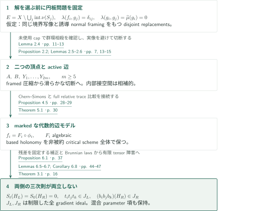
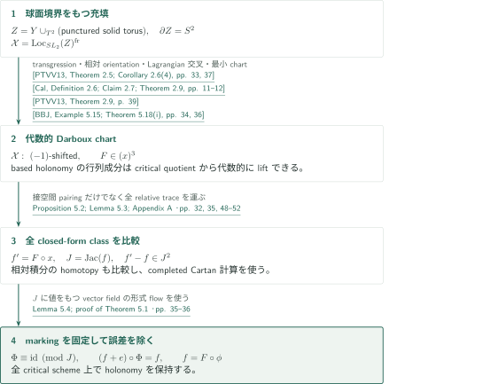
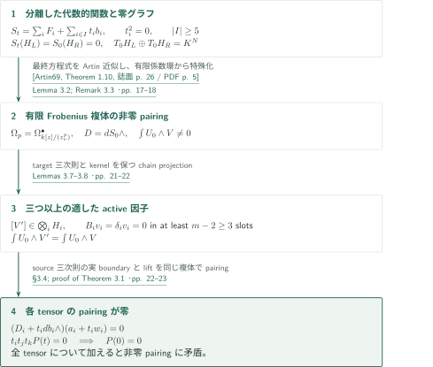

# A marked tensor obstruction to four-dimensional disk embedding

**based holonomyを保つ代数化と、二つの頂点から得る三次則を有限tensor複体で比較する。**

本稿は、入力円板と同じ境界写像・誘導normal framingを保つ局所平坦な円板置換の非存在を主張する。置換円板の相対ホモトピー類は指定しない。証明のmarkingは構成中のbased曲線と経路の指定であり、置換円板に追加条件を課すものではない。以下は原稿の論証の概説である。

## 1. 主要結果

### Theorem 1.1 — 境界写像と誘導framingを保つ置換の非存在

境界をもつコンパクト連結有向滑らかな四次元多様体 $M$、整数 $k\geq1$、互いに素な埋込み境界円周をもつproperな一般位置の円板はめ込み $f_i:(D^2,S^1)\to(M,\partial M)$、一般位置のframed球面はめ込み $g_i:S^2\to M$ が存在し、whiskerを固定した $\mathbb Z[\pi_1M]$ 上で

$$
\lambda(f_i,g_j)=\delta_{ij},\qquad\lambda(g_i,g_j)=0,\qquad\widetilde\mu(g_i)=0
$$

を満たすが、$f_i$ と同じ境界写像および $f_i$ が誘導する境界normal framingをもつ、互いに素なproper局所平坦埋込み円板は存在しない。対角式 $\lambda(g_i,g_i)=0$ も含まれる。$\widetilde\mu$ の値域は加法商 $\mathbb Z[\pi_1M]/\langle h-h^{-1},\mathbb Z\cdot1\rangle_{\rm add}$ である。出力円板の相対ホモトピー類の保持も、出力双対球面の存在も要求していない。

<!-- cite:main -->[Theorem 1.1 · p. 2](https://github.com/openai/math/blob/1581d4cbdd69a0faf34b2089614fe2a814316a6a/preprints/A-marked-tensor-obstruction-to-four-dimensional-disk-embedding-September-24-2026/paper.pdf)<!-- /cite -->

## 図の矢印に付した引用

<!-- reference-guide -->
略号のない定理・補題・節・式番号は本原稿 [A marked tensor obstruction to four-dimensional disk embedding](https://github.com/openai/math/blob/1581d4cbdd69a0faf34b2089614fe2a814316a6a/preprints/A-marked-tensor-obstruction-to-four-dimensional-disk-embedding-September-24-2026/paper.pdf) を指します。外部入力には次の略号を使います。

- [PTVV13](https://arxiv.org/pdf/1111.3209v4) Tony Pantev, Bertrand Toën, Michel Vaquié, Gabriele Vezzosi — *Shifted symplectic structures*：球面へのBetti transgressionと二つのLagrangianの導来交叉。番号付きarXiv版を照合。arXiv:1111.3209v4, 22 April 2013。
- [Cal](https://arxiv.org/pdf/1306.3235v2) Damien Calaque — *Lagrangian structures on mapping stacks and semi-classical TFTs*：相対orientationから境界restrictionのLagrangian構造を供給。arXiv:1306.3235v2, 7 November 2014。
- [BBJ](https://arxiv.org/pdf/1305.6302v4) Christopher Brav, Vittoria Bussi, Dominic Joyce — *A Darboux theorem for derived schemes with shifted symplectic structure*：shift −1の最小代数的Darboux chartを供給。arXiv:1305.6302v4, 29 August 2018。
- [Artin69](https://www.numdam.org/article/PMIHES_1969__36__23_0.pdf) Michael Artin — *Algebraic approximation of structures over complete local rings*：最終のグラフ・所属係数の有限多項式系を一次jetを保って近似。Publications Mathématiques de l’IHÉS 36 (1969), 23–58; Numdam scan。
- [Getzler09](https://annals.math.princeton.edu/wp-content/uploads/annals-v170-n1-p07-p.pdf) Ezra Getzler — *Lie theory for nilpotent L∞-algebras*：Appendix Aのnilpotent Maurer–Cartan比較の入力。導来係数への拡張は本稿の論証。Annals of Mathematics 170 (2009), 271–301; publisher PDF。

各引用に結果番号とページを付します。誌面番号とPDF内の位置が異なる場合は両方を示します。GitHubの閲覧リンクではページ位置への自動移動を前提としません。
<!-- /reference-guide -->

## 2. Theorem 1.1 の証明 — 固定した円板問題から二つの頂点へ

<!-- proof-target:1 -->証明対象：[Theorem 1.1 · p. 2](https://github.com/openai/math/blob/1581d4cbdd69a0faf34b2089614fe2a814316a6a/preprints/A-marked-tensor-obstruction-to-four-dimensional-disk-embedding-September-24-2026/paper.pdf)<!-- /proof-target -->

**証明の道筋。** 仮想的な解を選ぶ前に有限個のgrope関係と双対球面を備えた外部 $E$ を作る。framingを保つ解があれば、底面の圧縮と滑らかな切断によって二つの頂点 $A,B$ と $2m$ 個の辺 $Y_i$ を得る。辺ごとの代数的ポテンシャルとmarkingを作る段階を次節、得られたデータの不可能性を第4節で説明する。

### 1. 入力配置を先に固定し、framedな充填から切断を作る

$m\geq5$、$p\geq9$ とし、三つの異なるportに対する三重交換子型のgrope wordを、独立な共役・符号のすべての有限選択について設置する。各wordは一つのslotを消すと自明となるBrunnian性と、三次先頭項 $[Z_1,[Z_2,Z_3]]$ をもつ。底面の管状近傍を除いた $E$ で、浅いcapが $f_j$、圧縮したrim torusが $g_j$ を与える。未使用の上段capが群環ラベルの比較ループを $\pi_1(E)$ 内で殺し、同一の外側copy内で二枚の内側capを相殺する。個々の球面の埋込みとproduct framingが対角式と $\widetilde\mu=0$ も与える。

<!-- cite:geometry -->[Lemma 2.4 · pp. 11–13](https://github.com/openai/math/blob/1581d4cbdd69a0faf34b2089614fe2a814316a6a/preprints/A-marked-tensor-obstruction-to-four-dimensional-disk-embedding-September-24-2026/paper.pdf)<!-- /cite -->

仮想的な置換capを使って底面を圧縮する。指定framingはこの圧縮の局所平坦性とproduct collarを保証する箇所で必要となる。得た円板の実像を避けて木への写像を正則化し、連結な切断面・頂点領域を作る。parity二重被覆の商では、$A,B$ を結ぶ $2m$ 本の辺のうち $m$ 本がactiveとなる。元の二つの座標方向の一方が各境界トーラスで消え、他方が残ることと、Mayer–Vietorisの制限同型が内部接空間の相補性を供給する。

<!-- cite:cuts -->[Proposition 2.2; Lemmas 2.5–2.6 · pp. 7, 13–15](https://github.com/openai/math/blob/1581d4cbdd69a0faf34b2089614fe2a814316a6a/preprints/A-marked-tensor-obstruction-to-four-dimensional-disk-embedding-September-24-2026/paper.pdf)<!-- /cite -->

### 2. 残差イデアルを固定して頂点グラフを補正する

各辺のbased接続スライスには、central potential $f_i$ とsquare-zero境界変分 $f_i+t_i b_i^{\rm form}$ がある。その内部Jacobian idealは曲率idealそのものである。頂点の残差リスト $r_P$ と $I_P=(r_P)$ ($P=A,B$) を固定すると、Stokesと双対性が

$$
S_P(H_P)\in I_P^2,\qquad(\partial_hS_P)(H_P)=M_Pr_P
$$

を与え、$M_P$ は単元となる最大列minorをもつ。$I_P$ の倍数による補正で値を厳密に零にし、残差商とmarkingを保つ。辺ごとにTheorem 5.1を適用してcentral potentialを代数化し、背景をrecenterしてから $K=\mathbb C((\sigma))$ へ移る。

<!-- cite:vertices -->[Lemmas 6.3–6.4 · pp. 41–43](https://github.com/openai/math/blob/1581d4cbdd69a0faf34b2089614fe2a814316a6a/preprints/A-marked-tensor-obstruction-to-four-dimensional-disk-embedding-September-24-2026/paper.pdf)<!-- /cite -->

### 3. 非被約商上の三次則を最終データへ渡す

九つの随伴行列が $\operatorname{End}(\mathfrak{sl}_2\otimes K)$ を張るため、独立共役されたBrunnian lawsの三次項からすべての異なるactive三つ組の係数を取り出せる。高次項は対象三次idealの最大ideal倍に入り、Nakayamaにより、$A$ 側では $t_it_jt_k\in I_A$、$B$ 側では三つの異なる辺のholonomy偏差の積が $I_B$ に入る。

holonomy logarithm自体を代数的と呼ばず、代数的な行列lift $G_i$ を使って

$$
b_i=-\epsilon_i\operatorname{tr}\!\left(T_i\left((G_i-1)-\tfrac12(G_i-1)^2\right)\right)
$$

へ置き換える。差は偏差の三次以上であり、$G_i(H_A)-1\in(I_A,t_i)$ と $t_i^2=0$ により、新たな値誤差・勾配誤差を制御できる。全parameter idealの冪を一段ずつ増やす有限補正で零グラフを回復する。$(t_1,\ldots,t_m)^2=0$ とはせず、混合squarefree単項式を残す。こうしてProposition 6.1はTheorem 3.1の全仮定を満たし、矛盾から固定した $E$ の円板問題が解けないことを得る。

<!-- cite:triple -->[Proposition 6.1 · p. 37; Lemmas 6.5–6.7; Corollary 6.8 · pp. 44–47](https://github.com/openai/math/blob/1581d4cbdd69a0faf34b2089614fe2a814316a6a/preprints/A-marked-tensor-obstruction-to-four-dimensional-disk-embedding-September-24-2026/paper.pdf)<!-- /cite -->

## 3. Theorem 5.1 の証明 — critical schemeのmarkingを保つ代数化

<!-- proof-target:2 -->証明対象：[Theorem 5.1 · p. 30](https://github.com/openai/math/blob/1581d4cbdd69a0faf34b2089614fe2a814316a6a/preprints/A-marked-tensor-obstruction-to-four-dimensional-disk-embedding-September-24-2026/paper.pdf)<!-- /proof-target -->

<!-- statement:theorem-5-1 -->
### Theorem 5.1 — Algebraic edge potential with markings

$Y$ を連結トーラス境界をもつコンパクト連結有向滑らかな三次元多様体とし、based座標円周 $\alpha,\beta$ は $H^1(Y)\to H^1(\partial Y)$ の像が $\alpha$ に値をもち $\beta$ に零となるように選ぶ。Proposition 4.5のcentral potential $f$ と境界複体 $C$ に対し、$N=\dim(H^1(C)\otimes\mathfrak{sl}_2)$、$R=\mathbb C[[h_1,\ldots,h_N]]$、$J=\operatorname{Jac}(f)$ と置く。可逆形式座標変換 $x=\phi(h)$ と代数的冪級数 $F\in(x)^3$ が存在して $f=F\circ\phi$ となる。固定した任意の有限個のbased loopsのholonomy行列成分は、$x$ 座標の代数的冪級数を $\operatorname{Spf}(R/J)$ へ引き戻したものとして表せる。このmarkingの同一視は非被約成分も含むcritical scheme全体で成り立ち、とくに $\beta$-holonomyを保つ。

<!-- cite:algebraic -->[Theorem 5.1 · p. 30](https://github.com/openai/math/blob/1581d4cbdd69a0faf34b2089614fe2a814316a6a/preprints/A-marked-tensor-obstruction-to-four-dimensional-disk-embedding-September-24-2026/paper.pdf)<!-- /cite -->
<!-- /statement -->

### 1. punctured fillingから代数的critical chartを得る

$\alpha$ をmeridianとして、開球を除いたsolid torusを $Y$ に貼り、$\partial Z=S^2$ とする。$BG$ のtrace pairingの2-shifted formを球面へtransgressして0-shifted formを得る。相対orientationとPoincaré–Lefschetz双対性により $\operatorname{Loc}_G(Z)\to\operatorname{Loc}_G(S^2)$ はLagrangianとなる。based sphere側のLagrangianとの導来交叉は $\operatorname{Loc}_G(Z)^{\rm fr}$ に $(-1)$-shifted formを与える。有限CW型・perfect coefficient上の双対性・有限表示という適用条件を§5.1で確認し、Darboux定理の最小chartから $F\in(x)^3$ を得る。正則なbased holonomyはそのcritical quotientから滑らかなchartへliftできる。

<!-- cite:ptvv-transgression -->[&#91;PTVV13, Theorem 2.5; Corollary 2.6(4), pp. 33, 37&#93;](https://arxiv.org/pdf/1111.3209v4#page=33)<!-- /cite -->

<!-- cite:calaque -->[&#91;Cal, Definition 2.6; Claim 2.7; Theorem 2.9, pp. 11–12&#93;](https://arxiv.org/pdf/1306.3235v2#page=11)<!-- /cite -->

<!-- cite:ptvv-intersection -->[&#91;PTVV13, Theorem 2.9, p. 39&#93;](https://arxiv.org/pdf/1111.3209v4#page=39)<!-- /cite -->

<!-- cite:bbj -->[&#91;BBJ, Example 5.15; Theorem 5.18(i), pp. 34, 36&#93;](https://arxiv.org/pdf/1305.6302v4#page=34)<!-- /cite -->

### 2. full relative closed formを比較して二乗誤差を得る

critical schemeの同型や接空間pairingの一致だけでは、与えられた $f$ との一致は出ない。Proposition 5.2とAppendix Aは、formal group nerveのtrace cocycle $\tfrac12\kappa(\delta a,\delta a)$ を導来係数・source restriction・相対積分まで運び、全closed-form classと境界のisotropic homotopyを比較する。Getzlerの通常のnilpotent比較をそのまま導来係数へ読み替えず、Appendix Aはその拡張を別に構成する。

その結果、移したDarboux potential $f'$ と $f$ のHamiltonian formsはfull closed formsとしてホモトピックになる。completed Cartan計算では $j$ 回の縮約が $J^j$ に入り、剰余の次数が無限に上がるため、定数を正規化して $f-f'\in J^2$ が従う。

<!-- cite:getzler-groupoid -->[&#91;Getzler09, Theorem 5.4, 誌面 p. 295 / PDF p. 27&#93;](https://annals.math.princeton.edu/wp-content/uploads/annals-v170-n1-p07-p.pdf#page=27)<!-- /cite -->

<!-- cite:getzler-equivalence -->[&#91;Getzler09, Corollary 5.11, 誌面 p. 299 / PDF p. 31&#93;](https://annals.math.princeton.edu/wp-content/uploads/annals-v170-n1-p07-p.pdf#page=31)<!-- /cite -->

<!-- cite:comparison -->[Proposition 5.2; Lemma 5.3; Appendix A · pp. 32, 35, 48–52](https://github.com/openai/math/blob/1581d4cbdd69a0faf34b2089614fe2a814316a6a/preprints/A-marked-tensor-obstruction-to-four-dimensional-disk-embedding-September-24-2026/paper.pdf)<!-- /cite -->

### 3. critical quotientで恒等なflowを使う

$e=f'-f\in J^2$ を $e=\sum v_i\partial_i f$、$v_i\in J$ と書く。$f\in(h)^3$ なので $\nabla e=D\nabla f$ の $D$ は最大idealに入り、$f_t=f+te$ に対するvector field $X_t=-(1+tD)^{-T}v$ の形式flowが誤差を消す。係数が $J$ に属するためflowは $R/J$ 上で恒等であり、先に同一視したholonomy markingも変えない。これが関数の一致と全critical scheme上のmarking保存を同時に与える。

<!-- cite:flow -->[Lemma 5.4; proof of Theorem 5.1 · pp. 35–36](https://github.com/openai/math/blob/1581d4cbdd69a0faf34b2089614fe2a814316a6a/preprints/A-marked-tensor-obstruction-to-four-dimensional-disk-embedding-September-24-2026/paper.pdf)<!-- /cite -->

## 4. Theorem 3.1 の証明 — 二種類の三次則の有限tensor障害

<!-- proof-target:3 -->証明対象：[Theorem 3.1 · p. 16](https://github.com/openai/math/blob/1581d4cbdd69a0faf34b2089614fe2a814316a6a/preprints/A-marked-tensor-obstruction-to-four-dimensional-disk-embedding-September-24-2026/paper.pdf)<!-- /proof-target -->

<!-- statement:theorem-3-1 -->
### Theorem 3.1 — Finite tensor obstruction

$K$ を標数零の体、$h=(h_1,\ldots,h_n)$ を総次元 $N$ の座標block、$I\subset\{1,\ldots,n\}$ を $|I|=m\geq5$ のactive集合とする。各blockだけに依存する代数的冪級数 $F_i(h_i)$ ($1\leq i\leq n$)、$b_i(h_i)$ ($i\in I$) と

$$
T=K[t_i:i\in I]/(t_i^2:i\in I),\quad S_0=\sum_iF_i,\quad S_t=S_0+\sum_{i\in I}t_ib_i
$$

を考える。$x$ が $a$ 座標、$y$ が $N-a$ 座標のとき、$H_L\in(x,t)T[[x]]^N$、$H_R\in(y)K[[y]]^N$ が、中央接写像の単射性・相補性、$S_t(H_L)=S_0(H_R)=0$、およびすべての異なる $i,j,k\in I$ について

$$
t_it_jt_k\in((\partial_{h_\nu}S_t)(H_L))_\nu,\qquad
(b_ib_jb_k)(H_R)\in((\partial_{h_\nu}S_0)(H_R))_\nu
$$

を満たすことはない。微分は外部parameterを固定して代入より前に行い、idealはradicalを取らない実際のgradient idealである。

<!-- cite:tensor -->[Theorem 3.1 · p. 16](https://github.com/openai/math/blob/1581d4cbdd69a0faf34b2089614fe2a814316a6a/preprints/A-marked-tensor-obstruction-to-four-dimensional-disk-embedding-September-24-2026/paper.pdf)<!-- /cite -->
<!-- /statement -->

### 1. 最終の方程式だけを近似・特殊化する

$F_i,b_i$ を固定し、グラフ座標とideal所属を示す係数をsquarefree parameter基底で展開する。Artin近似を左右別々の有限多項式系へ適用し、一次jetを保持する。未知グラフ関数を微分する方程式やnested approximationは不要である。有限のétale表示と逆元を一つの有限生成係数環へ降下し、大きな正標数へ特殊化する。$K=\mathbb C((\sigma))$ の場合も有限表示に出る係数を一個の元として扱い、Laurent級数を項別に還元しない。

<!-- cite:artin -->[&#91;Artin69, Theorem 1.10, 誌面 p. 26 / PDF p. 5&#93;](https://www.numdam.org/article/PMIHES_1969__36__23_0.pdf#page=5)<!-- /cite -->

<!-- cite:approximation -->[Lemma 3.2; Remark 3.3 · pp. 17–18](https://github.com/openai/math/blob/1581d4cbdd69a0faf34b2089614fe2a814316a6a/preprints/A-marked-tensor-obstruction-to-four-dimensional-disk-embedding-September-24-2026/paper.pdf)<!-- /cite -->

### 2. 二段階のhomologyで三つの適した因子を得る

標数 $p>2$ で $\Omega_p$ を座標Frobenius商 $k[z]/(z_\nu^p)$ 上の微分形式とし、$D=dS_0\wedge$ を考える。横断する二つのグラフのnormal cycles $U_0,V$ は非零pairingをもつ。block分離により $H(\Omega_p,D)=\bigotimes_iH_i$ と分解し、通常の外微分が誘導する微分を $\delta_i$、$b_i$ の乗法を $B_i$ とする。

右側の三次則から $[V]$ は、active因子のうち高々二つを除いて $\ker B_i$ に入るtensorの和である。$\delta$ に関するchain projectionを施すと、pairingを変えずに少なくとも $m-2\geq3$ 因子が $\ker B_i\cap\ker\delta_i$ に入るtensorの和へ移せる。代表微分形式そのものの $d$-closed性を仮定していない。

<!-- cite:projection -->[Lemmas 3.7–3.8 · pp. 21–22](https://github.com/openai/math/blob/1581d4cbdd69a0faf34b2089614fe2a814316a6a/preprints/A-marked-tensor-obstruction-to-four-dimensional-disk-embedding-September-24-2026/paper.pdf)<!-- /cite -->

### 3. 各tensorを三parameterで持ち上げ、定数pairingを零にする

選んだ三因子では $[\delta_i,B_i]=[db_i\wedge]$ が零に作用するので、$D_iw_i=-db_i\wedge a_i$ を解ける。各 $a_i+t_iw_i$ をtensor積にして、$k[t_i,t_j,t_k]/(t_i^2,t_j^2,t_k^2)$ 上の実際のcycleを得る。積には混合項も含まれる。

左側の三次則は同じ複体の実際のboundary identityを与え、pairingすると $t_it_jt_kP(t)=0$ となる。squarefree基底から $P(0)=0$。tensorごとに適した三つ組を選んで足すと、元の非零pairingが零となり矛盾する。非平坦な係数特殊化とhomologyの交換は使わない。

<!-- cite:lifts -->[§3.4; proof of Theorem 3.1 · pp. 22–23](https://github.com/openai/math/blob/1581d4cbdd69a0faf34b2089614fe2a814316a6a/preprints/A-marked-tensor-obstruction-to-four-dimensional-disk-embedding-September-24-2026/paper.pdf)<!-- /cite -->

## 5. どの論文が、どの段階を担うか

PTVVのtransgression・Lagrangian intersection、Calaqueのrelative orientation、BBJのDarboux chartはTheorem 5.1の代数的モデルの供給に使われる。そのモデルと本稿のポテンシャルを結ぶfull relative trace比較、二乗Jacobian誤差、markingを固定するflowは本稿が担う。Artin近似はこの代数化と頂点補正を終えた後のTheorem 3.1で使う。

同じカタログのboundary-only原稿は出力framingも指定しない境界像の非充填を述べる。本稿の結論は境界写像と誘導framingを指定した置換の否定であり、相対ホモトピー類はやはり不指定である。二稿の幾何配置・代数化は異なり、ここでは一方を他方の証明入力と扱わない。本稿はordinary/simple surgeryや五次元$s$-cobordismの個別反例を別途主張していない。

<!-- cite:scope -->[Remark 7.1 · p. 48](https://github.com/openai/math/blob/1581d4cbdd69a0faf34b2089614fe2a814316a6a/preprints/A-marked-tensor-obstruction-to-four-dimensional-disk-embedding-September-24-2026/paper.pdf)<!-- /cite -->

## 6. 原典を読む入口と確認範囲

<!-- reading-list -->
- [Lemma 2.4 · pp. 11–13](https://github.com/openai/math/blob/1581d4cbdd69a0faf34b2089614fe2a814316a6a/preprints/A-marked-tensor-obstruction-to-four-dimensional-disk-embedding-September-24-2026/paper.pdf) — 外部での群環ラベルとframingを読む
- [Theorem 5.1 · p. 30](https://github.com/openai/math/blob/1581d4cbdd69a0faf34b2089614fe2a814316a6a/preprints/A-marked-tensor-obstruction-to-four-dimensional-disk-embedding-September-24-2026/paper.pdf) — 代数化の主張と保存するmarkingを確認する
- [Proposition 5.2; Lemma 5.3; Appendix A · pp. 32, 35, 48–52](https://github.com/openai/math/blob/1581d4cbdd69a0faf34b2089614fe2a814316a6a/preprints/A-marked-tensor-obstruction-to-four-dimensional-disk-embedding-September-24-2026/paper.pdf) — full relative closed-form比較の範囲を追う
- [Proposition 6.1 · p. 37; Lemmas 6.5–6.7; Corollary 6.8 · pp. 44–47](https://github.com/openai/math/blob/1581d4cbdd69a0faf34b2089614fe2a814316a6a/preprints/A-marked-tensor-obstruction-to-four-dimensional-disk-embedding-September-24-2026/paper.pdf) — 二つの頂点で三次所属を作る箇所を読む
- [Theorem 3.1 · p. 16](https://github.com/openai/math/blob/1581d4cbdd69a0faf34b2089614fe2a814316a6a/preprints/A-marked-tensor-obstruction-to-four-dimensional-disk-embedding-September-24-2026/paper.pdf) — 最終障害のすべての仮定を確認する
- [Remark 7.1 · p. 48](https://github.com/openai/math/blob/1581d4cbdd69a0faf34b2089614fe2a814316a6a/preprints/A-marked-tensor-obstruction-to-four-dimensional-disk-embedding-September-24-2026/paper.pdf) — 出力に課す条件とsurgeryへの主張の範囲を確認する
<!-- /reading-list -->

主定理、§2のframingと群環ラベル・切断、§3の近似と二段階homology・lift、§§4–5の全gradient idealと代数化、Appendix Aのrelative trace比較、§6の残差補正と三次則、§7の結論を読んだ。外部のPTVV（番号付きarXiv v4）・Calaque・BBJ、ArtinのTheorem 1.10、GetzlerのTheorem 5.4・Corollary 5.11は記述と適用条件を照合した。Dupontの原典およびGetzlerの他の入力箇所は今回再照合していない。全cochain transfer、導来比較の全符号、局所plumbing操作を独立に再検証したものではなく、外部結果の証明全体も対象外である。
