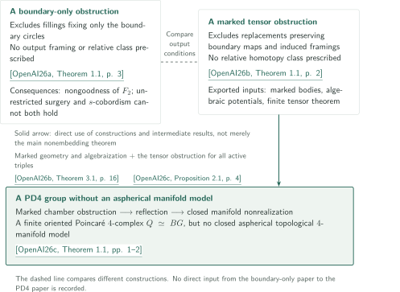

# Counterexamples to disk embedding and Wall’s manifold conjecture

**Different boundary conditions and a marked route to PD4 nonrealization**

The catalogue treats two four-dimensional disk obstructions: one fixing only the boundary circles, and another also retaining induced normal framings. The latter paper's marked geometry, algebraic potentials, and finite tensor theorem feed directly into the realization problem for finitely presented integral PD4 groups as groups of closed aspherical topological four-manifolds. This guide follows the manuscripts' claims and the connections between their proofs.

<!-- PDF placement: site headquarters inserts the English catalogue PDF immediately after this introduction and before the official inventory. Not generated in Stage 1. -->

## 1. Papers in official catalogue order

CATALOGINVENTORYTOKEN

## 2. How the results fit together

<!-- reference-guide -->
All three keys refer to manuscripts by OpenAI dated September 24, 2026. Source citations in the diagram and text include result numbers and pages; article links use paper titles.

- [OpenAI26a](https://github.com/openai/math/blob/1581d4cbdd69a0faf34b2089614fe2a814316a6a/preprints/A-boundary-only-obstruction-to-four-dimensional-disk-embedding-September-24-2026/paper.pdf) — *A boundary-only obstruction to four-dimensional disk embedding*. A construction excluding arbitrary locally flat fillings of the specified boundary circles.
- [OpenAI26b](https://github.com/openai/math/blob/1581d4cbdd69a0faf34b2089614fe2a814316a6a/preprints/A-marked-tensor-obstruction-to-four-dimensional-disk-embedding-September-24-2026/paper.pdf) — *A marked tensor obstruction to four-dimensional disk embedding*. A construction excluding replacements preserving boundary maps and induced framings, and supplying intermediate inputs to the next paper.
- [OpenAI26c](https://github.com/openai/math/blob/1581d4cbdd69a0faf34b2089614fe2a814316a6a/preprints/A-PD4-group-without-an-aspherical-manifold-model-September-24-2026/paper.pdf) — *A PD4 group without an aspherical manifold model*. Reflection and stabilized sphere removal transfer a marked relative obstruction to closed manifold nonrealization.
<!-- /reference-guide -->

### 1. The disk conclusions impose different output conditions

[A boundary-only obstruction](../boundary-only-disk-embedding/article.en.md) has framed algebraic dual spheres in its input but excludes boundary fillings without requiring output framings, geometric duals, or relative homotopy classes. The main theorem of [A marked tensor obstruction](../marked-tensor-disk-embedding/article.en.md) excludes replacements preserving boundary maps and the input disks' induced normal framings. It also leaves the replacement disks' relative homotopy classes unspecified. These are compared as different constructions; their examples and ambient manifolds are not identified.

<!-- cite:boundary-main -->[&#91;OpenAI26a, Theorem 1.1, p. 3&#93;](https://github.com/openai/math/blob/1581d4cbdd69a0faf34b2089614fe2a814316a6a/preprints/A-boundary-only-obstruction-to-four-dimensional-disk-embedding-September-24-2026/paper.pdf)<!-- /cite -->

<!-- cite:boundary-output -->[&#91;OpenAI26a, Proposition 2.8; §7, pp. 16, 47&#93;](https://github.com/openai/math/blob/1581d4cbdd69a0faf34b2089614fe2a814316a6a/preprints/A-boundary-only-obstruction-to-four-dimensional-disk-embedding-September-24-2026/paper.pdf)<!-- /cite -->

<!-- cite:marked-main -->[&#91;OpenAI26b, Theorem 1.1, p. 2&#93;](https://github.com/openai/math/blob/1581d4cbdd69a0faf34b2089614fe2a814316a6a/preprints/A-marked-tensor-obstruction-to-four-dimensional-disk-embedding-September-24-2026/paper.pdf)<!-- /cite -->

### 2. The PD4 paper imports intermediate results from the marked paper

[A PD4 group without an aspherical manifold model](../pd4-no-aspherical-model/article.en.md) uses more than the marked paper's main nonembedding theorem. Marked grope bodies and exterior duals construct its chamber; algebraization and Vertex data apply to cuts extracted from a hypothetical filling; the finite tensor theorem gives the contradiction. An additional form algebra on punctured vertices transfers this interface to arbitrary topological fillings.

Reflection then constructs a finite oriented aspherical Poincaré four-complex. A hypothetical manifold model gives, through a marked stable product, a graph-type filling of the original boundary, contradicting the chamber obstruction. The solid arrow records direct use of the intermediate results. No direct dependency from the boundary-only paper to the PD4 paper is recorded in the proof passages examined.

<!-- cite:pd4-input -->[&#91;OpenAI26c, §2.1; Proposition 2.1; §2.4, pp. 4–5, 8–10&#93;](https://github.com/openai/math/blob/1581d4cbdd69a0faf34b2089614fe2a814316a6a/preprints/A-PD4-group-without-an-aspherical-manifold-model-September-24-2026/paper.pdf)<!-- /cite -->

<!-- cite:pd4-reflection -->[&#91;OpenAI26c, Proposition 3.2, pp. 13–14&#93;](https://github.com/openai/math/blob/1581d4cbdd69a0faf34b2089614fe2a814316a6a/preprints/A-PD4-group-without-an-aspherical-manifold-model-September-24-2026/paper.pdf)<!-- /cite -->

<!-- cite:pd4-end -->[&#91;OpenAI26c, Proposition 4.5; Proposition 5.5, pp. 19–20, 29–30&#93;](https://github.com/openai/math/blob/1581d4cbdd69a0faf34b2089614fe2a814316a6a/preprints/A-PD4-group-without-an-aspherical-manifold-model-September-24-2026/paper.pdf)<!-- /cite -->

## 3. Follow an input into its application

| Input from the marked paper | Use in the PD4 paper | Content and connecting hypotheses |
|---|---|---|
| Lemmas 2.3–2.4 | §§2.1–2.3, Proposition 2.1(1)–(2) | Bodies realizing all conjugated boundary laws and algebraic duals; the tube-side marking is retained in constructing the hyperbolic basis |
| Proposition 4.5, Theorem 5.1, Propositions 5.2 and 6.1 | §§2.1 and 2.4 | Markings on nonreduced critical schemes and algebraic potentials in separate coordinate blocks; PD4 Lemma 2.4 supplies filled cohomology and Stokes for topological vertices |
| Theorem 3.1 | Proposition 2.1(3), end of §2.4 | The contradiction uses $m\ge5$, characteristic zero, complementary tangents, all mixed nilpotent terms, and actual gradient-ideal memberships for every active triple |

<!-- cite:marked-geometry -->[&#91;OpenAI26b, Lemmas 2.3–2.4, pp. 9–12&#93;](https://github.com/openai/math/blob/1581d4cbdd69a0faf34b2089614fe2a814316a6a/preprints/A-marked-tensor-obstruction-to-four-dimensional-disk-embedding-September-24-2026/paper.pdf)<!-- /cite -->

<!-- cite:marked-algebra -->[&#91;OpenAI26b, Proposition 4.5; Theorem 5.1; Proposition 5.2; Proposition 6.1, pp. 29–30, 32, 37&#93;](https://github.com/openai/math/blob/1581d4cbdd69a0faf34b2089614fe2a814316a6a/preprints/A-marked-tensor-obstruction-to-four-dimensional-disk-embedding-September-24-2026/paper.pdf)<!-- /cite -->

<!-- cite:marked-tensor -->[&#91;OpenAI26b, Theorem 3.1, p. 16&#93;](https://github.com/openai/math/blob/1581d4cbdd69a0faf34b2089614fe2a814316a6a/preprints/A-marked-tensor-obstruction-to-four-dimensional-disk-embedding-September-24-2026/paper.pdf)<!-- /cite -->

The [marked chamber section of the PD4 article](../pd4-no-aspherical-model/article.en.md#proof-2) explains these conditions and stages. Comparing an input statement with its application is distinct from independently verifying its entire proof.

## 4. Scope of the consequences and sources

The boundary-only paper deduces nongoodness of $F_2$ and every group containing it as a subgroup; it does not identify the constructed manifold's group with $F_2$. It also concludes that the unrestricted topological surgery and $s$-cobordism assertions **cannot both hold**, without deciding which fails separately. The PD4 paper asserts nonrealization in **dimension four** for a group with finite BG. These consequences should not be conflated into one implication.

<!-- cite:boundary-consequences -->[&#91;OpenAI26a, Corollaries 1.2–1.3, pp. 4–5&#93;](https://github.com/openai/math/blob/1581d4cbdd69a0faf34b2089614fe2a814316a6a/preprints/A-boundary-only-obstruction-to-four-dimensional-disk-embedding-September-24-2026/paper.pdf)<!-- /cite -->

<!-- cite:pd4-main -->[&#91;OpenAI26c, Theorem 1.1, pp. 1–2&#93;](https://github.com/openai/math/blob/1581d4cbdd69a0faf34b2089614fe2a814316a6a/preprints/A-PD4-group-without-an-aspherical-manifold-model-September-24-2026/paper.pdf)<!-- /cite -->

The official subject is Topology (304–321). The displayed title follows item 305 in the official overview; CONTENTS.md instead uses *Four-dimensional disk embedding and Wall's conjecture*. The reference commit is `1581d4cbdd69a0faf34b2089614fe2a814316a6a`; both printed and PDF overview pagination place the item on page 33. All three manuscripts are dated September 24, 2026.

<!-- cite:catalog -->[OpenAI Research Catalog · Catalogue 305, Topology · p. 33](https://github.com/openai/math/blob/1581d4cbdd69a0faf34b2089614fe2a814316a6a/overview.pdf)<!-- /cite -->

Each article connects all conclusions of its main results to a proof overview and records direct inputs, application passages, and unchecked points. The original text of Quinn's relative stable product theorem used by the PD4 paper was not acquired, so that external connection remains unchecked. The original statements of the external CAT(0), Farrell–Jones, and punctured-smoothing inputs were also not compared in this pass. The work is not a complete independent proof verification or completed expert peer review.
