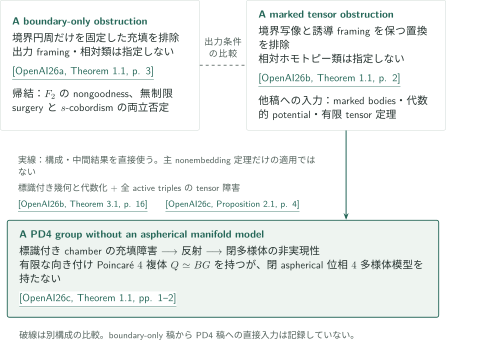

# 円板埋め込みとWallの多様体予想に対する反例

**境界条件の違いと、標識付き充填障害からPD4群への接続**

4次元の円板埋め込みについて、境界円周だけを固定する障害と、誘導normal framingも保持する障害を扱う。後者の標識付き幾何構成・代数的potential・有限tensor定理は、有限表示の整係数PD4群を閉aspherical位相4多様体で実現する問題へ直接使われる。以下は原稿が主張する結果とその証明の接続を案内する。

<!-- PDF placement: site headquarters inserts the Japanese catalogue PDF immediately after this introduction and before the official inventory. Not generated in Stage 1. -->

## 1. 公式順の記事一覧

CATALOGINVENTORYTOKEN

## 2. 全体の見取り図

<!-- reference-guide -->
文献キーは3本ともOpenAIによる2026年9月24日版を指す。図・本文の原典引用には結果番号とページを付し、記事への導線には論文名を用いる。

- [OpenAI26a](https://github.com/openai/math/blob/1581d4cbdd69a0faf34b2089614fe2a814316a6a/preprints/A-boundary-only-obstruction-to-four-dimensional-disk-embedding-September-24-2026/paper.pdf) — *A boundary-only obstruction to four-dimensional disk embedding*。境界円周への任意の局所平坦充填を排除する構成。
- [OpenAI26b](https://github.com/openai/math/blob/1581d4cbdd69a0faf34b2089614fe2a814316a6a/preprints/A-marked-tensor-obstruction-to-four-dimensional-disk-embedding-September-24-2026/paper.pdf) — *A marked tensor obstruction to four-dimensional disk embedding*。境界写像・誘導framingを保持する置換を排除し、後続稿へ中間結果を供給する構成。
- [OpenAI26c](https://github.com/openai/math/blob/1581d4cbdd69a0faf34b2089614fe2a814316a6a/preprints/A-PD4-group-without-an-aspherical-manifold-model-September-24-2026/paper.pdf) — *A PD4 group without an aspherical manifold model*。標識付き相対障害を、反射と安定化後の球面除去で閉多様体の非実現性へ移す。
<!-- /reference-guide -->

### 1. 円板に課す出力条件が異なる

[A boundary-only obstruction](../boundary-only-disk-embedding/article.ja.md) は、入力にframed algebraic dual spheresを備え、出力円板にframing・geometric dual・相対ホモトピー類を指定しない境界充填そのものを排除する。[A marked tensor obstruction](../marked-tensor-disk-embedding/article.ja.md) の主定理は、境界写像と入力から誘導されるnormal framingを保持する置換を排除する。こちらも置換円板の相対ホモトピー類は指定しない。二つの原稿の例やambient manifoldを同一と見なさず、別の構成として比較する。

<!-- cite:boundary-main -->[&#91;OpenAI26a, Theorem 1.1, p. 3&#93;](https://github.com/openai/math/blob/1581d4cbdd69a0faf34b2089614fe2a814316a6a/preprints/A-boundary-only-obstruction-to-four-dimensional-disk-embedding-September-24-2026/paper.pdf)<!-- /cite -->

<!-- cite:boundary-output -->[&#91;OpenAI26a, Proposition 2.8; §7, pp. 16, 47&#93;](https://github.com/openai/math/blob/1581d4cbdd69a0faf34b2089614fe2a814316a6a/preprints/A-boundary-only-obstruction-to-four-dimensional-disk-embedding-September-24-2026/paper.pdf)<!-- /cite -->

<!-- cite:marked-main -->[&#91;OpenAI26b, Theorem 1.1, p. 2&#93;](https://github.com/openai/math/blob/1581d4cbdd69a0faf34b2089614fe2a814316a6a/preprints/A-marked-tensor-obstruction-to-four-dimensional-disk-embedding-September-24-2026/paper.pdf)<!-- /cite -->

### 2. PD4論文への入力はmarked論文の中間結果

[A PD4 group without an aspherical manifold model](../pd4-no-aspherical-model/article.ja.md) が使うのは、marked論文の主nonembedding theoremだけではない。共役路を記録したgrope bodiesと外部双対を使ってchamberを作り、仮想充填から得たcut dataに対してpotentialの代数化とVertex dataを適用し、有限tensor定理で矛盾する。PD4稿は、穿孔したvertexの形式代数を追加して、この入力を任意の位相充填へ移す。

その後、反射によって有限・向き付けられたaspherical Poincaré 4複体を作る。仮想的多様体模型から標識付き安定積を経由して元の境界のgraph型充填を取り出し、chamber障害と矛盾させる。図の実線はこの中間結果の直接利用を表す。boundary-only稿からPD4稿への直接依存は、調べた証明箇所には記録していない。

<!-- cite:pd4-input -->[&#91;OpenAI26c, §2.1; Proposition 2.1; §2.4, pp. 4–5, 8–10&#93;](https://github.com/openai/math/blob/1581d4cbdd69a0faf34b2089614fe2a814316a6a/preprints/A-PD4-group-without-an-aspherical-manifold-model-September-24-2026/paper.pdf)<!-- /cite -->

<!-- cite:pd4-reflection -->[&#91;OpenAI26c, Proposition 3.2, pp. 13–14&#93;](https://github.com/openai/math/blob/1581d4cbdd69a0faf34b2089614fe2a814316a6a/preprints/A-PD4-group-without-an-aspherical-manifold-model-September-24-2026/paper.pdf)<!-- /cite -->

<!-- cite:pd4-end -->[&#91;OpenAI26c, Proposition 4.5; Proposition 5.5, pp. 19–20, 29–30&#93;](https://github.com/openai/math/blob/1581d4cbdd69a0faf34b2089614fe2a814316a6a/preprints/A-PD4-group-without-an-aspherical-manifold-model-September-24-2026/paper.pdf)<!-- /cite -->

## 3. どの結果を、どこで使うか

| marked論文の入力 | PD4論文の利用箇所 | 使う内容・接続条件 |
|---|---|---|
| Lemmas 2.3–2.4 | §§2.1–2.3、Proposition 2.1(1)–(2) | 全共役付き境界法則を実現するbodyと代数的双対。tube sideの標識を保持して双曲基底を構成する |
| Proposition 4.5、Theorem 5.1、Propositions 5.2・6.1 | §§2.1・2.4 | 非被約critical scheme上の標識と別座標blockに依存する代数的potential。位相vertexのfilled cohomologyとStokesをPD4 Lemma 2.4が補う |
| Theorem 3.1 | Proposition 2.1(3)、§2.4末尾 | $m\ge5$、標数0、相補的接空間、全混合nilpotent項、全active triplesの真のgradient ideal所属を使って矛盾する |

<!-- cite:marked-geometry -->[&#91;OpenAI26b, Lemmas 2.3–2.4, pp. 9–12&#93;](https://github.com/openai/math/blob/1581d4cbdd69a0faf34b2089614fe2a814316a6a/preprints/A-marked-tensor-obstruction-to-four-dimensional-disk-embedding-September-24-2026/paper.pdf)<!-- /cite -->

<!-- cite:marked-algebra -->[&#91;OpenAI26b, Proposition 4.5; Theorem 5.1; Proposition 5.2; Proposition 6.1, pp. 29–30, 32, 37&#93;](https://github.com/openai/math/blob/1581d4cbdd69a0faf34b2089614fe2a814316a6a/preprints/A-marked-tensor-obstruction-to-four-dimensional-disk-embedding-September-24-2026/paper.pdf)<!-- /cite -->

<!-- cite:marked-tensor -->[&#91;OpenAI26b, Theorem 3.1, p. 16&#93;](https://github.com/openai/math/blob/1581d4cbdd69a0faf34b2089614fe2a814316a6a/preprints/A-marked-tensor-obstruction-to-four-dimensional-disk-embedding-September-24-2026/paper.pdf)<!-- /cite -->

適用条件と段階ごとの説明は[PD4記事の標識付きchamber](../pd4-no-aspherical-model/article.ja.md#proof-2)から辿れる。入力定理の記述と使用箇所を照合したことと、入力定理の全証明を独立検証したことは別である。

## 4. 帰結の範囲と原典

boundary-only稿は $F_2$ のnongoodnessと、$F_2$ を部分群に含む群のnongoodnessを帰結するが、構成した多様体の基本群を $F_2$ と同定するわけではない。また、無制限のtopological surgeryと $s$-cobordismの主張が**両方は成立しない**と結論し、どちらが単独で破れるかを決めない。PD4稿は有限BGを持つ群の**4次元**非実現性を主張する。これらの帰結を同じ論理的含意として扱わない。

<!-- cite:boundary-consequences -->[&#91;OpenAI26a, Corollaries 1.2–1.3, pp. 4–5&#93;](https://github.com/openai/math/blob/1581d4cbdd69a0faf34b2089614fe2a814316a6a/preprints/A-boundary-only-obstruction-to-four-dimensional-disk-embedding-September-24-2026/paper.pdf)<!-- /cite -->

<!-- cite:pd4-main -->[&#91;OpenAI26c, Theorem 1.1, pp. 1–2&#93;](https://github.com/openai/math/blob/1581d4cbdd69a0faf34b2089614fe2a814316a6a/preprints/A-PD4-group-without-an-aspherical-manifold-model-September-24-2026/paper.pdf)<!-- /cite -->

公式分野はTopology（304–321）。表示名は公式overviewの305見出しに合わせた。CONTENTS.mdでは *Four-dimensional disk embedding and Wall's conjecture* と表記される。参照版はcommit `1581d4cbdd69a0faf34b2089614fe2a814316a6a`、overviewの誌面・PDFとも33ページ。3原稿とも2026年9月24日版である。

<!-- cite:catalog -->[OpenAI Research Catalog · Catalogue 305, Topology · p. 33](https://github.com/openai/math/blob/1581d4cbdd69a0faf34b2089614fe2a814316a6a/overview.pdf)<!-- /cite -->

各記事は主要結果の全結論と証明の帰着を示し、直接入力の記述・使用箇所と未確認範囲を記録している。PD4稿で使うQuinnの相対安定積の原典本文は未取得であり、この外部接続は未確認として残す。CAT(0)・Farrell–Jones・穿孔平滑化の外部原典の結果記述も今回は未照合である。全証明の独立検証や専門家査読の完了を意味しない。
