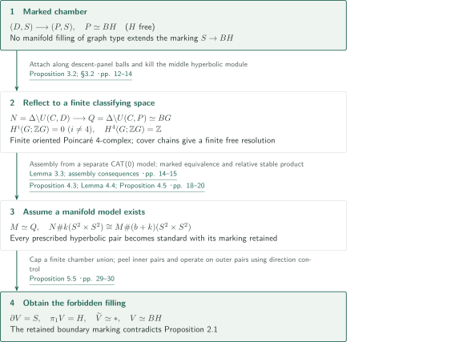
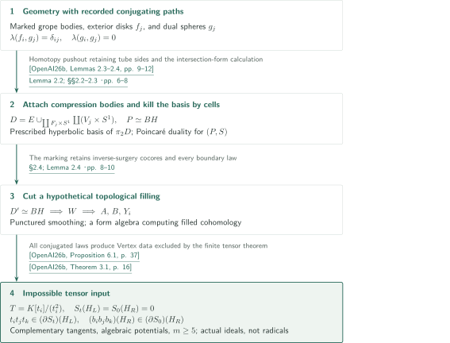
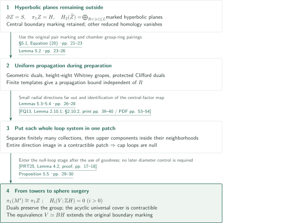

# A PD4 group without an aspherical manifold model

**Transporting a marked filling obstruction to closed manifold nonrealization through reflection and stabilized sphere removal**

The manuscript constructs an oriented integral Poincaré duality group with a finite four-dimensional classifying space and asserts that it is not the fundamental group of any closed aspherical topological four-manifold. Its starting point is a Poincaré pair of free-group graph type whose prescribed boundary map admits no manifold filling.

## 1. Main results

### Theorem 1.1 — A PD4 group with finite BG and no manifold model

There exist a finitely presented group $G$ and a finite, oriented, four-dimensional aspherical Poincaré complex $Q$ with $\pi_1Q=G$ such that

$$H^i(G;\mathbb ZG)=0\quad(i\ne4),\qquad H^4(G;\mathbb ZG)\cong\mathbb Z,$$

with trivial right $G$-action on the last group, but no closed aspherical topological four-manifold has fundamental group $G$. In particular, the trivial left $\mathbb ZG$-module $\mathbb Z$ has a finite resolution by finitely generated free modules.

<!-- cite:main -->[Theorem 1.1 · pp. 1–2](https://github.com/openai/math/blob/1581d4cbdd69a0faf34b2089614fe2a814316a6a/preprints/A-PD4-group-without-an-aspherical-manifold-model-September-24-2026/paper.pdf)<!-- /cite -->

This is an existence assertion in dimension four, not a counterexample in every dimension. The manuscript's conclusion is distinct from the editorial checking scope stated below.

## References on the arrows

<!-- reference-guide -->
Unprefixed theorem, lemma, section and equation numbers refer to [A PD4 group without an aspherical manifold model](https://github.com/openai/math/blob/1581d4cbdd69a0faf34b2089614fe2a814316a6a/preprints/A-PD4-group-without-an-aspherical-manifold-model-September-24-2026/paper.pdf). External inputs use the following keys.

- [OpenAI26b](https://github.com/openai/math/blob/1581d4cbdd69a0faf34b2089614fe2a814316a6a/preprints/A-marked-tensor-obstruction-to-four-dimensional-disk-embedding-September-24-2026/paper.pdf) OpenAI — *A marked tensor obstruction to four-dimensional disk embedding*: Marked geometry, algebraic potentials, and the finite tensor obstruction. September 24, 2026.
- [KL22](https://arxiv.org/pdf/2007.03399v3) Daniel Kasprowski and Markus Land — *Topological 4-manifolds with 4-dimensional fundamental group*: Normal-invariant removal and s-cobordism. arXiv:2007.03399v3.
- [PRT25](https://www.maths.gla.ac.uk/~mpowell/s00029-025-01069-y.pdf) Mark Powell, Arunima Ray, and Peter Teichner — *The 4-dimensional disc embedding theorem and dual spheres*: Towers and dual spheres after obtaining null loops. Selecta Mathematica 31 (2025), article 80; published PDF.
- [FQ13](https://archive.mpim-bonn.mpg.de/id/eprint/4789/2/FreedmanQuinn-TopologyOf4Manifolds-Reformatted2013.pdf) Michael H. Freedman and Frank Quinn — *Topology of 4-manifolds*: Two-phase separation of small capped gropes. January 2013 reformatted, unrevised edition.
- [Qui83](https://doi.org/10.1016/0166-8641(83)90049-4) Frank Quinn — *The stable topology of 4-manifolds*: Relative stable product; original text not checked. Topology and its Applications 15 (1983), 71–77; full text not acquired.

Each citation gives the result and pages. When printed pagination differs from the PDF position, both are shown. GitHub previews do not automatically jump to the cited page.
<!-- /reference-guide -->

## 2. Proof of Theorem 1.1 — Finite BG and a reverse reduction from a hypothetical manifold

<!-- proof-target:1 -->Proof target：[Theorem 1.1 · pp. 1–2](https://github.com/openai/math/blob/1581d4cbdd69a0faf34b2089614fe2a814316a6a/preprints/A-PD4-group-without-an-aspherical-manifold-model-September-24-2026/paper.pdf)<!-- /proof-target -->

**Proof route.** Reflect the [marked chamber](#proof-2) to construct $Q\simeq BG$. A hypothetical manifold model $M$ gives a stable product preserving all prescribed hyperbolic pairs and hence a sphere problem in finitely many chambers. [Direction control and sphere surgery](#proof-3) remove its middle homology and produce the forbidden boundary filling.

### 1. Reflection supplies finiteness, asphericity, and integral duality separately

A finite flag triangulation of $S=\partial D$ defines a right-angled Coxeter group $C$. Taking the finite chamber quotient by $\Delta=\ker(C\to(\mathbb Z/2)^{V})$ gives a closed oriented four-manifold $N=\Delta\backslash U(C,D)$ and a finite complex $Q=\Delta\backslash U(C,P)$. In the reflected development using the universal cover of $P$, each new chamber attaches along a ball of descent panels. The resulting universal cover is contractible.

Meanwhile, $Q$ is obtained from $N$ by attaching three-cells along its entire prescribed middle sphere basis. Nonsingularity of the hyperbolic form lets the cap-product map descend to the quotient by the middle homology summand and its cohomological annihilator. This gives four-dimensional Poincaré duality. The orientation-preserving action gives the trivial right action on $H^4(G;\mathbb ZG)$. The cellular chains of the finite $K(G,1)$ supply the finite free resolution, and its finiteness also supplies finite presentability.

<!-- cite:reflection -->[Proposition 3.2; §3.2 · pp. 12–14](https://github.com/openai/math/blob/1581d4cbdd69a0faf34b2089614fe2a814316a6a/preprints/A-PD4-group-without-an-aspherical-manifold-model-September-24-2026/paper.pdf)<!-- /cite -->

### 2. Stabilization must retain the specified sphere marking

The dualizing module makes the hypothetical $M\simeq Q$ orientable. For $L=M\#b(S^2\times S^2)$, the modules $\pi_2N$ and $\pi_2L$ carry the same prescribed hyperbolic form. In the common second Postnikov stage $EG\times_GK(A,2)$, integral cup-product tests identify the fundamental classes and yield a homotopy equivalence inducing this **particular** module isomorphism.

Separately, a CAT(0) model over a support tree supplies Farrell–Jones assembly. It does not directly provide four-dimensional disk embedding. Kasprowski–Land's normal-invariant calculation gives an $s$-cobordism; Quinn's relative stable product then makes all sphere pairs, including the added pairs, geometrically standard. A stable homeomorphism of the ends alone would not preserve the chamber labels needed for the subsequent removals.

<!-- cite:cat-model -->[Lemma 3.3; assembly consequences · pp. 14–15](https://github.com/openai/math/blob/1581d4cbdd69a0faf34b2089614fe2a814316a6a/preprints/A-PD4-group-without-an-aspherical-manifold-model-September-24-2026/paper.pdf)<!-- /cite -->

<!-- cite:kl-surgery -->[&#91;KL22, Lemma 2.3; Theorem 3.1; Lemma 3.3, pp. 5–7&#93;](https://arxiv.org/pdf/2007.03399v3#page=5)<!-- /cite -->

<!-- cite:marked-stable -->[Proposition 4.3; Lemma 4.4; Proposition 4.5 · pp. 18–20](https://github.com/openai/math/blob/1581d4cbdd69a0faf34b2089614fe2a814316a6a/preprints/A-PD4-group-without-an-aspherical-manifold-model-September-24-2026/paper.pdf)<!-- /cite -->

### 3. The hypothetical model produces the prohibited filling

Remove the near-central standard pairs in the periodically lifted system and cap the noncentral boundary factors by simply connected complementary fillings. Direction control solves the remaining sphere problem and produces $V$ with $\partial V=S$, $\pi_1V=H$, and contractible $\widetilde V$, retaining the original map $S\to BH$. This contradicts Proposition 2.1(3). The preservation of that marking is what turns the construction into a nonrealization argument.

<!-- cite:removal -->[Proposition 5.5 · pp. 29–30](https://github.com/openai/math/blob/1581d4cbdd69a0faf34b2089614fe2a814316a6a/preprints/A-PD4-group-without-an-aspherical-manifold-model-September-24-2026/paper.pdf)<!-- /cite -->

## 3. Proof of Proposition 2.1 — Excluding fillings with the prescribed boundary marking

<!-- proof-target:2 -->Proof target：[Proposition 2.1 · p. 4](https://github.com/openai/math/blob/1581d4cbdd69a0faf34b2089614fe2a814316a6a/preprints/A-PD4-group-without-an-aspherical-manifold-model-September-24-2026/paper.pdf)<!-- /proof-target -->

<!-- statement:proposition-2-1 -->
### Proposition 2.1 — The marked chamber

There exist a compact connected oriented smooth four-manifold $D$ with connected boundary $S$, a finitely generated free group $H$, and a map $c:D\to BH$ inducing an isomorphism on fundamental groups. The space $D$ has the homotopy type of a finite graph with $2k$ two-spheres attached and has a specified hyperbolic $\mathbb ZH$-basis of $\pi_2D$, represented by framed immersed spheres with vanishing Wall self-intersection obstructions. Attaching three-cells along the entire basis gives $P\simeq BH$, and $(P,S)$ is an oriented Poincaré pair of formal dimension four. There is no compact oriented topological four-manifold $D'$ with identified boundary $S$ and a homotopy equivalence $D'\to BH$ restricting to a map homotopic to $c|_S$.

<!-- cite:chamber -->[Proposition 2.1 · p. 4](https://github.com/openai/math/blob/1581d4cbdd69a0faf34b2089614fe2a814316a6a/preprints/A-PD4-group-without-an-aspherical-manifold-model-September-24-2026/paper.pdf)<!-- /cite -->
<!-- /statement -->

### 1. The companion supplies more than its nonembedding theorem

The inputs are finitely many grope bodies with independent conjugating paths and algebraic dual spheres in their exterior. Remove tubes of the lower punctured tori $F_j$, obtaining $E$, and attach $V_j\times S^1$, where $V_j$ compresses $F_j$ to a disk. The homotopy-pushout identification includes the actual tube sides; it adds one free generator and two two-spheres for each $F_j$. The dual-sphere intersection calculation supplies a hyperbolic basis. Killing the whole basis with three-cells gives $P\simeq BH$. No embedded sphere surgery is used at this stage.

<!-- cite:marked-geometry -->[&#91;OpenAI26b, Lemmas 2.3–2.4, pp. 9–12&#93;](https://github.com/openai/math/blob/1581d4cbdd69a0faf34b2089614fe2a814316a6a/preprints/A-marked-tensor-obstruction-to-four-dimensional-disk-embedding-September-24-2026/paper.pdf)<!-- /cite -->

<!-- cite:chamber-build -->[Lemma 2.2; §§2.2–2.3 · pp. 6–8](https://github.com/openai/math/blob/1581d4cbdd69a0faf34b2089614fe2a814316a6a/preprints/A-PD4-group-without-an-aspherical-manifold-model-September-24-2026/paper.pdf)<!-- /cite -->

### 2. A topological filling produces cut data

Given $D'$, attach the two-handles undoing the boundary surgery to obtain $W$ with the original graph type and boundary map. Their cocores kill the required boundary words by embedded disks. Quinn's punctured smoothing permits regular levels of a tree-valued map away from the disks and punctures, giving connected vertex pieces and cuts with torus boundary.

The topological vertices cannot simply be treated as smooth. Lemma 2.4 uses positive-degree forms vanishing near the punctures and degree-zero functions separately constant near each puncture. This algebra computes the cohomology of the **filled space** and preserves coefficientwise Stokes and based-holonomy calculations. This additional step transfers the companion's smooth vertex argument to arbitrary topological fillings.

<!-- cite:topological-transfer -->[§2.4; Lemma 2.4 · pp. 8–10](https://github.com/openai/math/blob/1581d4cbdd69a0faf34b2089614fe2a814316a6a/preprints/A-PD4-group-without-an-aspherical-manifold-model-September-24-2026/paper.pdf)<!-- /cite -->

### 3. Mixed nilpotent terms and actual gradient ideals carry the contradiction

Choose $m\ge5$ and $p\ge9$ in the construction. Mayer–Vietoris in the parity cover makes the degree-two difference-of-restrictions map an isomorphism; the degree-one map is an isomorphism after setting extra-loop evaluations to zero. The surviving peripheral directions determine $m\ge5$ active edges. All independently conjugated boundary laws enter the companion's Vertex data construction, yielding

$$T=K[t_i:i\in I]/(t_i^2),\quad S_0=\sum F_i,\quad S_t=S_0+\sum_{i\in I}t_i b_i$$

and formal graphs $H_L,H_R$ with complementary tangent spaces. They satisfy $S_t(H_L)=S_0(H_R)=0$ and, for every distinct active triple,

$$t_it_jt_k\in\bigl((\partial_{h_\nu}S_t)(H_L)\bigr)_\nu,\qquad (b_ib_jb_k)(H_R)\in\bigl((\partial_{h_\nu}S_0)(H_R)\bigr)_\nu.$$

$K$ has characteristic zero (it may be $\mathbb C((\sigma))$), and each $F_i(h_i),b_i(h_i)$ depends only on the separate coordinate block for edge $i$. This separated algebraicity, retention of mixed square-free terms in $T$, and membership in actual gradient ideals rather than their radicals are exactly the hypotheses needed by the Finite tensor obstruction. These data therefore cannot exist. The argument extracts constructions, potentials, algebraization, and the tensor theorem from the marked paper, rather than applying its main nonembedding theorem directly.

<!-- cite:vertex -->[&#91;OpenAI26b, Proposition 6.1, p. 37&#93;](https://github.com/openai/math/blob/1581d4cbdd69a0faf34b2089614fe2a814316a6a/preprints/A-marked-tensor-obstruction-to-four-dimensional-disk-embedding-September-24-2026/paper.pdf)<!-- /cite -->

<!-- cite:tensor -->[&#91;OpenAI26b, Theorem 3.1, p. 16&#93;](https://github.com/openai/math/blob/1581d4cbdd69a0faf34b2089614fe2a814316a6a/preprints/A-marked-tensor-obstruction-to-four-dimensional-disk-embedding-September-24-2026/paper.pdf)<!-- /cite -->

## 4. Proof of Proposition 5.5 — Sphere surgery after direction control

<!-- proof-target:3 -->Proof target：[Proposition 5.5 · pp. 29–30](https://github.com/openai/math/blob/1581d4cbdd69a0faf34b2089614fe2a814316a6a/preprints/A-PD4-group-without-an-aspherical-manifold-model-September-24-2026/paper.pdf)<!-- /proof-target -->

<!-- statement:proposition-5-5 -->
### Proposition 5.5 — Removing the remaining hyperbolic planes

The compact manifold $Z=Z_{R,L}$ constructed in §5 has $\partial Z=S$, $\pi_1Z=H$, and universal-cover reduced homology concentrated in degree two, freely generated by the prescribed hyperbolic pairs with chamber labels $R<|v|\le L$. Interior surgeries on this $Z$ produce a compact oriented topological four-manifold $V$ with boundary $S$, fundamental group $H$, and contractible universal cover. Its boundary map $S\to BH$ is the original central chamber marking.

<!-- cite:removal -->[Proposition 5.5 · pp. 29–30](https://github.com/openai/math/blob/1581d4cbdd69a0faf34b2089614fe2a814316a6a/preprints/A-PD4-group-without-an-aspherical-manifold-model-September-24-2026/paper.pdf)<!-- /cite -->
<!-- /statement -->

### 1. The removed-pair marking identifies the surviving homology

Capping the noncentral boundary factors of a finite chamber union changes the free product of chamber groups to its projection onto the central factor $H$. Replace the standard $S^2\times S^2$ neighborhoods labelled by $|v|\le R$ with four-balls. Including their based homotopies to the original chamber pairs in the finite region ensures that exactly the near-central labelled summands are deleted. This gives the surviving hyperbolic basis in Equation (20).

<!-- cite:peeling -->[§5.1, Equation (20) · pp. 21–23](https://github.com/openai/math/blob/1581d4cbdd69a0faf34b2089614fe2a814316a6a/preprints/A-PD4-group-without-an-aspherical-manifold-model-September-24-2026/paper.pdf)<!-- /cite -->

### 2. Keep the entire loop system in one direction patch

Lemma 5.2 prepares the outer sphere system with geometric duals and high Whitney gropes, with propagation independent of $R$. Radial directions of bounded-diameter sets far out in the Davis complex become uniformly small. Lemma 5.3 identifies the homomorphism induced by the direction map followed by $S\to BH$ with the central-factor map. Consequently a loop system whose **entire image lies in one contractible patch** is nullhomotopic in $Z$.

Lemma 5.4 first separates collections assigned to finitely many patches, then separates their individual upper components within each collection's neighborhood. The second phase need not bound each cap's gallery diameter uniformly. It preserves containment of the whole image in a single contractible patch, so even loops traversing many intersections are null.

<!-- cite:preparation -->[Lemma 5.2 · pp. 23–26](https://github.com/openai/math/blob/1581d4cbdd69a0faf34b2089614fe2a814316a6a/preprints/A-PD4-group-without-an-aspherical-manifold-model-September-24-2026/paper.pdf)<!-- /cite -->

<!-- cite:fq-separation -->[&#91;FQ13, Lemma 2.10.1; §2.10.2, print pp. 39–40 / PDF pp. 53–54&#93;](https://archive.mpim-bonn.mpg.de/id/eprint/4789/2/FreedmanQuinn-TopologyOf4Manifolds-Reformatted2013.pdf#page=53)<!-- /cite -->

<!-- cite:directions -->[Lemmas 5.3–5.4 · pp. 26–28](https://github.com/openai/math/blob/1581d4cbdd69a0faf34b2089614fe2a814316a6a/preprints/A-PD4-group-without-an-aspherical-manifold-model-September-24-2026/paper.pdf)<!-- /cite -->

### 3. Replace precisely the goodness-dependent step and then construct towers

Geometric duals kill meridians, so inclusion of the complement $M'$ of plumbed neighborhoods of the $a_i$ into $Z$ induces a fundamental-group isomorphism. Cap double-point loops are therefore nullhomotopic in $M'$ as well. The manuscript then enters the proof of Powell–Ray–Teichner's Lemma 4.2 after its use of goodness. The protected Clifford capped surfaces must also remain geometric duals. The argument neither assumes nor proves goodness of the entire free group $H$.

From this point onward, null homotopies, tower caps, and final Whitney disks may range throughout $Z$. Surgery on the resulting framed embedded Lagrangian spheres preserves the fundamental group because of their dual spheres. Computing the surgery trace from both ends gives $H_i(V;\mathbb ZH)=0$ for $i>0$. The simply connected acyclic universal cover has CW homotopy type, so it is contractible and $V\simeq BH$. All surgeries are interior, preserving the boundary marking.

<!-- cite:prt-towers -->[&#91;PRT25, Lemma 4.2, proof, pp. 17–18&#93;](https://www.maths.gla.ac.uk/~mpowell/s00029-025-01069-y.pdf#page=17)<!-- /cite -->

<!-- cite:towers -->[§5.5, Equation (22) · pp. 28–29](https://github.com/openai/math/blob/1581d4cbdd69a0faf34b2089614fe2a814316a6a/preprints/A-PD4-group-without-an-aspherical-manifold-model-September-24-2026/paper.pdf)<!-- /cite -->

<!-- cite:removal -->[Proposition 5.5 · pp. 29–30](https://github.com/openai/math/blob/1581d4cbdd69a0faf34b2089614fe2a814316a6a/preprints/A-PD4-group-without-an-aspherical-manifold-model-September-24-2026/paper.pdf)<!-- /cite -->

## 5. Which papers supply which steps

| Source and result | Used at | Role and required hypotheses | Checking scope |
|---|---|---|---|
| A marked tensor obstruction: Lemmas 2.3–2.4, Proposition 4.5, Theorem 5.1, Propositions 5.2 and 6.1, Theorem 3.1 | [Marked chamber](#proof-2) | Marked bodies and exterior duals, markings on nonreduced critical schemes, algebraicity, gradient-ideal memberships for every active triple | Input statements and their uses in §§2.1 and 2.4 compared; the companion's full proofs were not independently verified |
| Kasprowski–Land; Quinn | [Marked stable realization](#proof-1-step-2) | Almost-spin manifolds, Farrell–Jones, the specified normal invariant, and a relative product | The manuscript's hypotheses and uses were read; external-source checking is recorded below |
| Freedman–Quinn; Powell–Ray–Teichner | [Direction control and towers](#proof-3-step-2) | Separation of small upper gropes, null double-point loops, and protected geometric duals | The manuscript's replacement null-loop step and subsequent input conditions were read; this is not verification of the full external proofs |

The direct input within the catalogue consists of constructions and intermediate results from the marked tensor paper. No direct input from the boundary-only paper occurs in the citations and proof passages examined here.

## 6. Return to the sources

<!-- reading-list -->
- [Theorem 1.1 · pp. 1–2](https://github.com/openai/math/blob/1581d4cbdd69a0faf34b2089614fe2a814316a6a/preprints/A-PD4-group-without-an-aspherical-manifold-model-September-24-2026/paper.pdf) — Hypotheses, quantifiers, and all conclusions
- [Lemma 2.2; §§2.2–2.3 · pp. 6–8](https://github.com/openai/math/blob/1581d4cbdd69a0faf34b2089614fe2a814316a6a/preprints/A-PD4-group-without-an-aspherical-manifold-model-September-24-2026/paper.pdf) — Construction retaining tube sides and duality
- [§2.4; Lemma 2.4 · pp. 8–10](https://github.com/openai/math/blob/1581d4cbdd69a0faf34b2089614fe2a814316a6a/preprints/A-PD4-group-without-an-aspherical-manifold-model-September-24-2026/paper.pdf) — Transfer from topological fillings to tensor inputs
- [Proposition 3.2; §3.2 · pp. 12–14](https://github.com/openai/math/blob/1581d4cbdd69a0faf34b2089614fe2a814316a6a/preprints/A-PD4-group-without-an-aspherical-manifold-model-September-24-2026/paper.pdf) — Finite BG and integral duality
- [Proposition 4.3; Lemma 4.4; Proposition 4.5 · pp. 18–20](https://github.com/openai/math/blob/1581d4cbdd69a0faf34b2089614fe2a814316a6a/preprints/A-PD4-group-without-an-aspherical-manifold-model-September-24-2026/paper.pdf) — Stabilization preserving the specified sphere marking
- [Lemmas 5.3–5.4 · pp. 26–28](https://github.com/openai/math/blob/1581d4cbdd69a0faf34b2089614fe2a814316a6a/preprints/A-PD4-group-without-an-aspherical-manifold-model-September-24-2026/paper.pdf) — Direction control of entire loop systems
- [§5.5, Equation (22) · pp. 28–29](https://github.com/openai/math/blob/1581d4cbdd69a0faf34b2089614fe2a814316a6a/preprints/A-PD4-group-without-an-aspherical-manifold-model-September-24-2026/paper.pdf) — Passage from null loops to towers
- [Proposition 5.5 · pp. 29–30](https://github.com/openai/math/blob/1581d4cbdd69a0faf34b2089614fe2a814316a6a/preprints/A-PD4-group-without-an-aspherical-manifold-model-September-24-2026/paper.pdf) — Surgery trace and contractibility
<!-- /reading-list -->

The passages read include Theorem 1.1, Proposition 2.1, reflection and duality in §3, preservation of markings in §4, and the filling, preparation, direction, tower, and surgery arguments in §5. Statements of direct inputs from the marked tensor paper were compared with their uses here. Particular checkpoints were the passage to topological vertices, integral markings, entire cap loop systems, and the final regular-coefficient surgery calculation.

External passages checked include Kasprowski–Land’s Lemmas 2.3 and 3.3 and Theorem 3.1, the statement and relevant proof steps of Powell–Ray–Teichner’s Lemma 4.2, and Freedman–Quinn’s Lemma 2.10.1 and §2.10.2. The original text of Quinn’s stable product theorem was not acquired; only its presentation and application in §4.2 were read. That external connection remains unchecked.

For the external CAT(0), Farrell–Jones, and punctured-smoothing inputs, their presentation and use in this manuscript were read, but their statements in the cited original sources were not checked in this pass.

The complete external proofs concerning CAT(0) geometry, assembly, smoothing, stable products, and disk embedding, as well as the marked paper's full algebraization and finite tensor proofs, were not independently verified. Nor does this constitute a complete independent verification of uniform finite-template control or every geometric operation from the marked stable product to the final sphere surgeries. This article explains the manuscript's proof architecture and input–application relations; it is not an editorial certification of a solution to Wall's problem.
