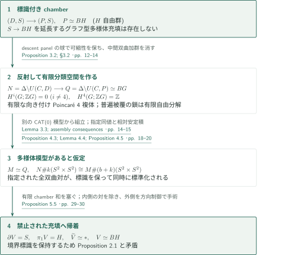
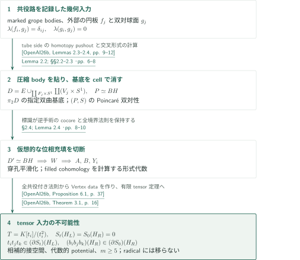
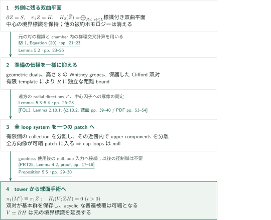

# A PD4 group without an aspherical manifold model

**標識付き充填の障害を、反射と安定化後の球面除去で閉多様体の非実現性へ移す**

本原稿は、有限な4次元分類空間を持つ向き付け可能な整係数Poincaré双対群を構成し、その群を基本群とする閉aspherical位相4多様体が存在しないと主張する。出発点は、自由群のグラフをホモトピー型に持つPoincaré対であり、その境界写像を保持する多様体充填が不可能であるという相対的障害である。

## 1. 主要結果

### Theorem 1.1 — 有限分類空間を持つPD4群の多様体非実現性

有限表示群 $G$ と、有限・向き付けられた・4次元のaspherical Poincaré複体 $Q$ が存在し、$\pi_1Q=G$ および

$$H^i(G;\mathbb ZG)=0\quad(i\ne4),\qquad H^4(G;\mathbb ZG)\cong\mathbb Z$$

を満たす。最後の群への右 $G$ 作用は自明である。しかし、基本群が $G$ である閉aspherical位相4多様体は存在しない。特に、自明な左 $\mathbb ZG$ 加群 $\mathbb Z$ は有限生成自由加群による有限分解を持つ。

<!-- cite:main -->[Theorem 1.1 · pp. 1–2](https://github.com/openai/math/blob/1581d4cbdd69a0faf34b2089614fe2a814316a6a/preprints/A-PD4-group-without-an-aspherical-manifold-model-September-24-2026/paper.pdf)<!-- /cite -->

これは4次元における存在主張であり、各次元で反例を与える主張ではない。原稿の結論と、以下に記す編集上の確認範囲を区別する。

## 図の矢印に付した引用

<!-- reference-guide -->
略号のない定理・補題・節・式番号は本原稿 [A PD4 group without an aspherical manifold model](https://github.com/openai/math/blob/1581d4cbdd69a0faf34b2089614fe2a814316a6a/preprints/A-PD4-group-without-an-aspherical-manifold-model-September-24-2026/paper.pdf) を指します。外部入力には次の略号を使います。

- [OpenAI26b](https://github.com/openai/math/blob/1581d4cbdd69a0faf34b2089614fe2a814316a6a/preprints/A-marked-tensor-obstruction-to-four-dimensional-disk-embedding-September-24-2026/paper.pdf) OpenAI — *A marked tensor obstruction to four-dimensional disk embedding*：標識付き幾何構成・potentialの代数化・有限tensor障害。September 24, 2026。
- [KL22](https://arxiv.org/pdf/2007.03399v3) Daniel Kasprowski and Markus Land — *Topological 4-manifolds with 4-dimensional fundamental group*：normal invariantの除去とs-cobordism。arXiv:2007.03399v3。
- [PRT25](https://www.maths.gla.ac.uk/~mpowell/s00029-025-01069-y.pdf) Mark Powell, Arunima Ray, and Peter Teichner — *The 4-dimensional disc embedding theorem and dual spheres*：null-loop条件を得た後のtowerと双対球面。Selecta Mathematica 31 (2025), article 80; published PDF。
- [FQ13](https://archive.mpim-bonn.mpg.de/id/eprint/4789/2/FreedmanQuinn-TopologyOf4Manifolds-Reformatted2013.pdf) Michael H. Freedman and Frank Quinn — *Topology of 4-manifolds*：小さいcapped gropesの二段階分離。January 2013 reformatted, unrevised edition。
- [Qui83](https://doi.org/10.1016/0166-8641(83)90049-4) Frank Quinn — *The stable topology of 4-manifolds*：相対的安定積；原典本文未照合。Topology and its Applications 15 (1983), 71–77; full text not acquired。

各引用に結果番号とページを付します。誌面番号とPDF内の位置が異なる場合は両方を示します。GitHubの閲覧リンクではページ位置への自動移動を前提としません。
<!-- /reference-guide -->

## 2. Theorem 1.1 の証明 — 有限BGと仮想的多様体からの逆帰着

<!-- proof-target:1 -->証明対象：[Theorem 1.1 · pp. 1–2](https://github.com/openai/math/blob/1581d4cbdd69a0faf34b2089614fe2a814316a6a/preprints/A-PD4-group-without-an-aspherical-manifold-model-September-24-2026/paper.pdf)<!-- /proof-target -->

**証明の道筋。** [標識付きchamber](#proof-2)を反射して $Q\simeq BG$ を作る。仮に多様体模型 $M$ が存在すると、指定した全双曲対を保持する安定積から、有限個のchamberの球面問題を構成できる。[方向制御と球面手術](#proof-3)がその中間ホモロジーを除き、禁止されている境界充填を与える。

### 1. 反射は有限性・asphericity・整係数双対性を別々に与える

$S=\partial D$ の有限flag三角形分割から直角Coxeter群 $C$ を作り、$\Delta=\ker(C\to(\mathbb Z/2)^{V})$ による有限chamber商を取る。$N=\Delta\backslash U(C,D)$ は閉向き付け4多様体、$Q=\Delta\backslash U(C,P)$ は有限複体となる。$P$ の普遍被覆を使った反射developmentでは、新しいchamberはdescent panelの球に沿って接着されるため、普遍被覆が可縮である。

一方、$Q$ は $N$ の指定された中間球面の基底すべてに3-cellを付けた空間である。双曲型の非退化交叉形式を使い、ホモロジーの中間直和因子の商と、コホモロジーのそのannihilator上へcap積を降ろす。これが4次元Poincaré双対性を与え、向きを保つ作用が $H^4(G;\mathbb ZG)$ の右作用の自明性を与える。有限 $K(G,1)$ のcellular鎖複体は所要の有限自由分解であり、有限表示性もこの有限複体から従う。

<!-- cite:reflection -->[Proposition 3.2; §3.2 · pp. 12–14](https://github.com/openai/math/blob/1581d4cbdd69a0faf34b2089614fe2a814316a6a/preprints/A-PD4-group-without-an-aspherical-manifold-model-September-24-2026/paper.pdf)<!-- /cite -->

### 2. 安定化では指定した球面の標識を保持する

仮想的な $M\simeq Q$ は双対化加群により向き付け可能である。$L=M\#b(S^2\times S^2)$ と置くと、$N$ と $L$ の $\pi_2$ は指定した同じ双曲形式を持つ。原稿は共通の第2 Postnikov段階 $EG\times_GK(A,2)$ において、整係数のcup積検査で基本類を比較し、この**指定された**加群同型を誘導するホモトピー同値を得る。

別途、support tree上のCAT(0)模型がFarrell–Jonesの組立写像を供給する。これは4次元の円板埋め込みを直接与えるものではない。Kasprowski–Landのnormal invariant計算による $s$-cobordismと、Quinnの相対的な安定積を経由し、追加された対も含むすべての球面対を幾何学的標準対へ移す。単に安定同相な両端があるだけでは、後段で除くchamberごとの標識を保証できない。

<!-- cite:cat-model -->[Lemma 3.3; assembly consequences · pp. 14–15](https://github.com/openai/math/blob/1581d4cbdd69a0faf34b2089614fe2a814316a6a/preprints/A-PD4-group-without-an-aspherical-manifold-model-September-24-2026/paper.pdf)<!-- /cite -->

<!-- cite:kl-surgery -->[&#91;KL22, Lemma 2.3; Theorem 3.1; Lemma 3.3, pp. 5–7&#93;](https://arxiv.org/pdf/2007.03399v3#page=5)<!-- /cite -->

<!-- cite:marked-stable -->[Proposition 4.3; Lemma 4.4; Proposition 4.5 · pp. 18–20](https://github.com/openai/math/blob/1581d4cbdd69a0faf34b2089614fe2a814316a6a/preprints/A-PD4-group-without-an-aspherical-manifold-model-September-24-2026/paper.pdf)<!-- /cite -->

### 3. 仮想模型から禁止された充填へ戻る

周期的に持ち上げた標準対のうち中心付近のものを除き、非中心chamberの境界を単連結な補完充填で塞ぐ。残る球面問題を方向制御によって処理すると、$\partial V=S$、$\pi_1V=H$、$\widetilde V$ 可縮で、境界写像も元の $S\to BH$ と一致する $V$ が得られる。これはProposition 2.1(3)と矛盾する。非実現性を担うのは、この標識を保持した帰着である。

<!-- cite:removal -->[Proposition 5.5 · pp. 29–30](https://github.com/openai/math/blob/1581d4cbdd69a0faf34b2089614fe2a814316a6a/preprints/A-PD4-group-without-an-aspherical-manifold-model-September-24-2026/paper.pdf)<!-- /cite -->

## 3. Proposition 2.1 の証明 — 境界の標識を保った充填を排除する

<!-- proof-target:2 -->証明対象：[Proposition 2.1 · p. 4](https://github.com/openai/math/blob/1581d4cbdd69a0faf34b2089614fe2a814316a6a/preprints/A-PD4-group-without-an-aspherical-manifold-model-September-24-2026/paper.pdf)<!-- /proof-target -->

<!-- statement:proposition-2-1 -->
### Proposition 2.1 — 標識付きchamber

連結境界 $S$ を持つコンパクト連結向き付け滑らかな4多様体 $D$、有限生成自由群 $H$、$\pi_1$ 上の同型を誘導する $c:D\to BH$ が存在する。$D$ は有限グラフに $2k$ 個の2球面を付けたホモトピー型を持ち、$\pi_2D$ は $\mathbb ZH$ 上の指定された双曲基底を持つ。その基底はframed immersed spheresで表され、Wallの自己交叉障害は消える。全基底球面に3-cellを付けた $P$ は $BH$ とホモトピー同値で、$(P,S)$ は向き付けられた形式次元4のPoincaré対である。しかし、境界を $S$ と同定し、境界上で $c|_S$ とホモトピックなホモトピー同値 $D'\to BH$ を持つコンパクト向き付け位相4多様体 $D'$ は存在しない。

<!-- cite:chamber -->[Proposition 2.1 · p. 4](https://github.com/openai/math/blob/1581d4cbdd69a0faf34b2089614fe2a814316a6a/preprints/A-PD4-group-without-an-aspherical-manifold-model-September-24-2026/paper.pdf)<!-- /cite -->
<!-- /statement -->

### 1. companionから取り出すのは非埋め込み定理だけではない

入力は、独立な共役路を備える有限個のgrope bodyと、その外部の代数的双対球面である。下段のpunctured tori $F_j$ の管を除いた $E$ に、$F_j$ を円板へ圧縮する $V_j$ の積 $V_j\times S^1$ を貼る。tube sideを含むhomotopy pushoutの同定により、一つの $F_j$ ごとに自由生成元1個と2球面2個が加わる。双対球面の交叉計算から双曲基底を作り、全基底を3-cellで消すと $P\simeq BH$ となる。この段階は埋め込まれた球面手術を使わない。

<!-- cite:marked-geometry -->[&#91;OpenAI26b, Lemmas 2.3–2.4, pp. 9–12&#93;](https://github.com/openai/math/blob/1581d4cbdd69a0faf34b2089614fe2a814316a6a/preprints/A-marked-tensor-obstruction-to-four-dimensional-disk-embedding-September-24-2026/paper.pdf)<!-- /cite -->

<!-- cite:chamber-build -->[Lemma 2.2; §§2.2–2.3 · pp. 6–8](https://github.com/openai/math/blob/1581d4cbdd69a0faf34b2089614fe2a814316a6a/preprints/A-PD4-group-without-an-aspherical-manifold-model-September-24-2026/paper.pdf)<!-- /cite -->

### 2. 位相充填から切断データを作る

仮に $D'$ があれば、境界手術を逆にする2-handlesを付けて、元のgraph型と境界写像を持つ $W$ を作る。handleのcocoreは必要な境界語を埋め込まれた円板で殺す。Quinnの穿孔平滑化を用い、円板と穿孔を避けてtree値写像のregular levelsを取り、連結なvertex piecesとtorus境界を持つcutsを得る。

位相的vertexをそのまま滑らかと見なすことはできない。Lemma 2.4は、穿孔近傍で正次数形式が消え、0次関数が各穿孔近傍で別々に定数となる微分形式代数を使う。これが**穿孔を埋めた空間**のコホモロジーを計算し、係数ごとのStokes計算とbased holonomyの計算を維持する。この追加段階が、companionの滑らかなvertex計算を任意の位相充填へ移す。

<!-- cite:topological-transfer -->[§2.4; Lemma 2.4 · pp. 8–10](https://github.com/openai/math/blob/1581d4cbdd69a0faf34b2089614fe2a814316a6a/preprints/A-PD4-group-without-an-aspherical-manifold-model-September-24-2026/paper.pdf)<!-- /cite -->

### 3. 混合nilpotent項と真のgradient idealが矛盾を担う

構成で $m\ge5$、$p\ge9$ を選ぶ。parity coverのMayer–Vietoris計算から、degree 2の差制限写像は同型となり、degree 1でもextra-loop評価をゼロに制限すれば同型になる。生き残る周辺方向を選ぶと $m\ge5$ 本のactive edgesを得る。全共役付き境界法則を使い、companionのVertex dataを適用して

$$T=K[t_i:i\in I]/(t_i^2),\quad S_0=\sum F_i,\quad S_t=S_0+\sum_{i\in I}t_i b_i$$

と相補的接空間を持つ形式グラフ $H_L,H_R$ を得る。満たすのは $S_t(H_L)=S_0(H_R)=0$ と、すべての相異なるactive triplesについて

$$t_it_jt_k\in\bigl((\partial_{h_\nu}S_t)(H_L)\bigr)_\nu,\qquad (b_ib_jb_k)(H_R)\in\bigl((\partial_{h_\nu}S_0)(H_R)\bigr)_\nu.$$

$K$ は標数0の体（$\mathbb C((\sigma))$ と取れる）であり、各 $F_i(h_i),b_i(h_i)$ は辺 $i$ ごとの別々の座標blockにだけ依存する。この分離された代数性、混合square-free項を残した $T$、radicalではないgradient idealへの所属が、Finite tensor obstructionの仮定そのものである。したがって、このデータは存在しない。marked論文の主定理を直接引用して充填を排除するのではなく、その構成・potential・代数化・tensor定理を取り出して適用する。

<!-- cite:vertex -->[&#91;OpenAI26b, Proposition 6.1, p. 37&#93;](https://github.com/openai/math/blob/1581d4cbdd69a0faf34b2089614fe2a814316a6a/preprints/A-marked-tensor-obstruction-to-four-dimensional-disk-embedding-September-24-2026/paper.pdf)<!-- /cite -->

<!-- cite:tensor -->[&#91;OpenAI26b, Theorem 3.1, p. 16&#93;](https://github.com/openai/math/blob/1581d4cbdd69a0faf34b2089614fe2a814316a6a/preprints/A-marked-tensor-obstruction-to-four-dimensional-disk-embedding-September-24-2026/paper.pdf)<!-- /cite -->

## 4. Proposition 5.5 の証明 — 方向制御の後に球面を手術する

<!-- proof-target:3 -->証明対象：[Proposition 5.5 · pp. 29–30](https://github.com/openai/math/blob/1581d4cbdd69a0faf34b2089614fe2a814316a6a/preprints/A-PD4-group-without-an-aspherical-manifold-model-September-24-2026/paper.pdf)<!-- /proof-target -->

<!-- statement:proposition-5-5 -->
### Proposition 5.5 — 残る双曲平面の除去

§5で構成されたコンパクト多様体 $Z=Z_{R,L}$ は、$\partial Z=S$、$\pi_1Z=H$ を満たし、普遍被覆の被約ホモロジーは次数2だけにあり、$R<|v|\le L$ のchamberの指定双曲対で自由に生成される。この $Z$ に内部手術を施して、境界 $S$、基本群 $H$、可縮な普遍被覆を持つコンパクト向き付け位相4多様体 $V$ を得る。その境界写像 $S\to BH$ は元の中心chamberの標識である。

<!-- cite:removal -->[Proposition 5.5 · pp. 29–30](https://github.com/openai/math/blob/1581d4cbdd69a0faf34b2089614fe2a814316a6a/preprints/A-PD4-group-without-an-aspherical-manifold-model-September-24-2026/paper.pdf)<!-- /cite -->
<!-- /statement -->

### 1. 取り除いた対の標識が残存ホモロジーを特定する

有限chamber和の非中心境界を補完充填で塞ぐと、基本群はchamber群の自由積から中心因子 $H$ への射影となる。次に $|v|\le R$ の標準 $S^2\times S^2$ 近傍を4-ballに置き換える。元のchamber対とのbased homotopiesを有限領域に含めることで、消えた加群因子が正確に中心近傍の標識と一致する。これが式(20)の残存双曲基底を与える。

<!-- cite:peeling -->[§5.1, Equation (20) · pp. 21–23](https://github.com/openai/math/blob/1581d4cbdd69a0faf34b2089614fe2a814316a6a/preprints/A-PD4-group-without-an-aspherical-manifold-model-September-24-2026/paper.pdf)<!-- /cite -->

### 2. 一つのdirection patchに全loop systemを収める

Lemma 5.2は、外側のsphere systemをgeometric dualsと高いWhitney gropesへ準備し、その伝播距離を $R$ に独立に抑える。Davis complexの遠方では有界径の集合のradial directionsが一様に小さくなる。Lemma 5.3では、方向写像と $S\to BH$ の合成が中心因子への写像を誘導すると確認するため、**全像が一つの可縮patchに入る**loop systemは $Z$ 内でnullhomotopicとなる。

Lemma 5.4は最初に有限個のpatchごとのcollectionを分離し、次に各collectionの近傍内で個々のupper componentsを分離する。第2段階の個々のcapには一様なgallery径を要求しない。保つのは全像が同じ可縮patchに留まることであり、多数の交点を巡るloopにもnullityが従う。

<!-- cite:preparation -->[Lemma 5.2 · pp. 23–26](https://github.com/openai/math/blob/1581d4cbdd69a0faf34b2089614fe2a814316a6a/preprints/A-PD4-group-without-an-aspherical-manifold-model-September-24-2026/paper.pdf)<!-- /cite -->

<!-- cite:fq-separation -->[&#91;FQ13, Lemma 2.10.1; §2.10.2, 誌面 pp. 39–40 / PDF pp. 53–54&#93;](https://archive.mpim-bonn.mpg.de/id/eprint/4789/2/FreedmanQuinn-TopologyOf4Manifolds-Reformatted2013.pdf#page=53)<!-- /cite -->

<!-- cite:directions -->[Lemmas 5.3–5.4 · pp. 26–28](https://github.com/openai/math/blob/1581d4cbdd69a0faf34b2089614fe2a814316a6a/preprints/A-PD4-group-without-an-aspherical-manifold-model-September-24-2026/paper.pdf)<!-- /cite -->

### 3. goodnessの代用箇所を限定してtowerを作る

geometric dualsがmeridiansを殺すので、$a_i$ のplumbed neighborhoodsの補空間 $M'$ から $Z$ への写像は $\pi_1$ 同型を誘導する。従ってcapのdouble-point loopsは $M'$ 内でもnullhomotopicである。原稿はここからPowell–Ray–TeichnerのLemma 4.2の証明のうちgoodnessを使った後のtower構成へ接続する。保護したClifford capped surfacesを幾何学的双対として保持することも必要である。自由群 $H$ 全体についてgoodnessを仮定したり証明したりする議論ではない。

これ以降のnull homotopies・tower caps・最終Whitney discsは $Z$ 全体を動いてよい。得られたframed embedded Lagrangian spheresを手術すると、双対球面により基本群が保存される。手術traceの相対鎖複体を両側から計算すれば、$H_i(V;\mathbb ZH)=0$（$i>0$）。単連結かつacyclicな普遍被覆はCWホモトピー型を持つので可縮となり、$V\simeq BH$ が従う。手術は内部だけであり、境界標識も保存される。

<!-- cite:prt-towers -->[&#91;PRT25, Lemma 4.2, proof, pp. 17–18&#93;](https://www.maths.gla.ac.uk/~mpowell/s00029-025-01069-y.pdf#page=17)<!-- /cite -->

<!-- cite:towers -->[§5.5, Equation (22) · pp. 28–29](https://github.com/openai/math/blob/1581d4cbdd69a0faf34b2089614fe2a814316a6a/preprints/A-PD4-group-without-an-aspherical-manifold-model-September-24-2026/paper.pdf)<!-- /cite -->

<!-- cite:removal -->[Proposition 5.5 · pp. 29–30](https://github.com/openai/math/blob/1581d4cbdd69a0faf34b2089614fe2a814316a6a/preprints/A-PD4-group-without-an-aspherical-manifold-model-September-24-2026/paper.pdf)<!-- /cite -->

## 5. どの論文が、どの段階を担うか

| 供給元と結果 | 利用箇所 | 使用内容・必要な仮定 | 確認範囲 |
|---|---|---|---|
| A marked tensor obstruction：Lemmas 2.3–2.4、Proposition 4.5、Theorem 5.1、Propositions 5.2・6.1、Theorem 3.1 | [標識付きchamber](#proof-2) | marked bodiesと外部双対、非被約critical scheme上の標識、代数性、全active triplesのgradient-ideal所属 | 入力の記述と本稿§2.1・§2.4の使用を照合。companionの全証明を再検証していない |
| Kasprowski–Land、Quinn | [安定した標識の実現](#proof-1-step-2) | almost-spin、Farrell–Jones、指定したnormal invariantと相対積 | 本稿の条件確認と利用の範囲を読解。外部原典の確認状況は末尾に記載 |
| Freedman–Quinn、Powell–Ray–Teichner | [方向制御とtower](#proof-3-step-2) | 小さいupper gropeの分離、null double-point loops、保護されたgeometric duals | 本稿の代替null-loop段階と、その後の入力条件を読解。外部証明全体の検証ではない |

カタログ内で直接使うのはmarked tensor論文の構成・中間結果である。boundary-only論文から本稿への直接入力は、ここで読んだ原稿の引用・証明箇所には見当たらない。

## 6. 原典を読む入口と確認範囲

<!-- reading-list -->
- [Theorem 1.1 · pp. 1–2](https://github.com/openai/math/blob/1581d4cbdd69a0faf34b2089614fe2a814316a6a/preprints/A-PD4-group-without-an-aspherical-manifold-model-September-24-2026/paper.pdf) — 仮定・量化と全結論
- [Lemma 2.2; §§2.2–2.3 · pp. 6–8](https://github.com/openai/math/blob/1581d4cbdd69a0faf34b2089614fe2a814316a6a/preprints/A-PD4-group-without-an-aspherical-manifold-model-September-24-2026/paper.pdf) — tube sideと双対性を保持する構成
- [§2.4; Lemma 2.4 · pp. 8–10](https://github.com/openai/math/blob/1581d4cbdd69a0faf34b2089614fe2a814316a6a/preprints/A-PD4-group-without-an-aspherical-manifold-model-September-24-2026/paper.pdf) — 位相充填からtensor入力への移行
- [Proposition 3.2; §3.2 · pp. 12–14](https://github.com/openai/math/blob/1581d4cbdd69a0faf34b2089614fe2a814316a6a/preprints/A-PD4-group-without-an-aspherical-manifold-model-September-24-2026/paper.pdf) — 有限BGと整係数双対性
- [Proposition 4.3; Lemma 4.4; Proposition 4.5 · pp. 18–20](https://github.com/openai/math/blob/1581d4cbdd69a0faf34b2089614fe2a814316a6a/preprints/A-PD4-group-without-an-aspherical-manifold-model-September-24-2026/paper.pdf) — 指定球面のmarkingを保持する安定化
- [Lemmas 5.3–5.4 · pp. 26–28](https://github.com/openai/math/blob/1581d4cbdd69a0faf34b2089614fe2a814316a6a/preprints/A-PD4-group-without-an-aspherical-manifold-model-September-24-2026/paper.pdf) — 全loop systemの方向制御
- [§5.5, Equation (22) · pp. 28–29](https://github.com/openai/math/blob/1581d4cbdd69a0faf34b2089614fe2a814316a6a/preprints/A-PD4-group-without-an-aspherical-manifold-model-September-24-2026/paper.pdf) — null loopsからtowerへ進む接続
- [Proposition 5.5 · pp. 29–30](https://github.com/openai/math/blob/1581d4cbdd69a0faf34b2089614fe2a814316a6a/preprints/A-PD4-group-without-an-aspherical-manifold-model-September-24-2026/paper.pdf) — 手術traceと可縮性の結論
<!-- /reading-list -->

本稿のTheorem 1.1、Proposition 2.1、反射と双対性の§3、標識を保持する§4、§5の充填・準備・方向制御・tower・手術の該当本文を読んだ。marked tensor論文では、直接入力の結果の記述と本稿での使用を照合した。とくに、位相vertexへの移行、整係数の標識、capの全loop system、最終手術の正則係数計算を確認箇所とした。

Kasprowski–LandのLemmas 2.3・3.3とTheorem 3.1、Powell–Ray–TeichnerのLemma 4.2の記述と証明の接続箇所、Freedman–QuinnのLemma 2.10.1と§2.10.2は外部原典でも照合した。Quinnの安定積定理は原典本文を取得できておらず、本稿§4.2による紹介・適用の確認に留まる。この接続は未確認として残す。

CAT(0)・Farrell–Jones・穿孔平滑化の外部原典については、本稿での記述と使用箇所を読んだが、引用先の結果の記述自体は今回照合していない。

外部のCAT(0)・組立・平滑化・安定積・disk embedding各定理の全証明、marked tensor論文の代数化と有限tensor定理の全証明は独立検証していない。有限局所templateによる一様制御や、標識付き安定積から最終sphere surgeryまでの全幾何学的操作について、独立した完全検証を行ったという意味ではない。これは原稿の証明構成と入力・適用関係の概説であり、Wallの問題の解決を編集側が認定するものではない。
