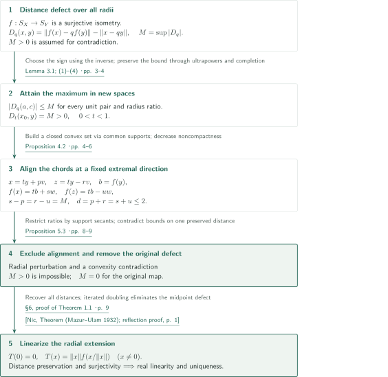
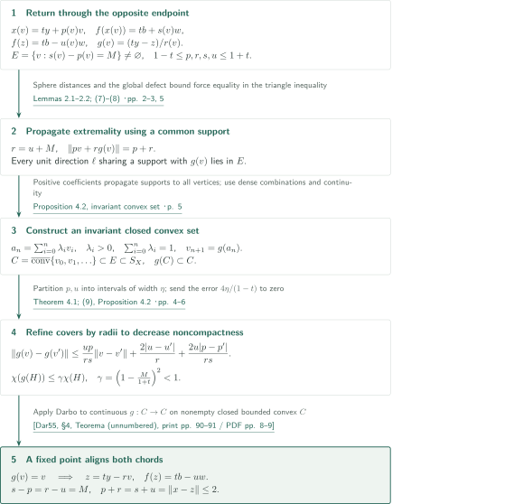
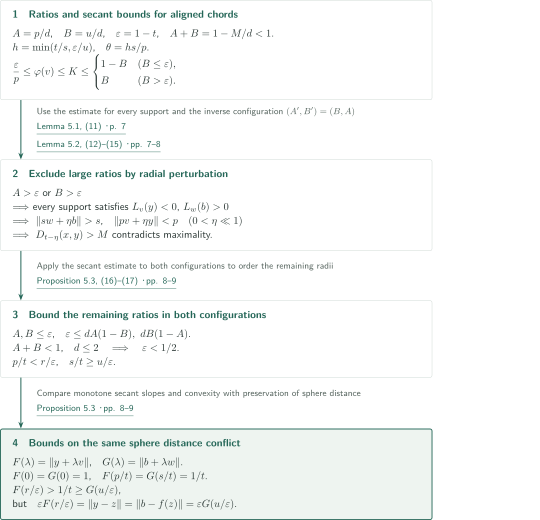

# A positive solution to Tingley’s problem

**From attainment of the maximal defect to chord alignment by decreasing noncompactness**

The manuscript claims that every surjective isometry between the unit spheres of real Banach spaces extends uniquely to a real-linear isometry of the spaces. Assuming that distances between different radii are not preserved, it passes to another pair of spaces where the maximal defect is attained. The central step combines propagation through common supporting functionals with Darbo’s fixed-point theorem to align two chords.

## 1. Main results

### Theorem 1.1 — The unique real-linear extension of a sphere isometry

Let $X,Y$ be nonzero real Banach spaces and $f:S_X\to S_Y$ a surjective isometry. Then
$$
T(0)=0,\qquad T(x)=\|x\|f\!\left(\frac{x}{\|x\|}\right)\quad(x\ne0)
$$
is a surjective real-linear isometry and the unique linear extension of $f$. No restrictions on dimension, separability, reflexivity, smoothness, or strict convexity are imposed. For complex Banach spaces regarded as real spaces, the conclusion is still real linearity; complex linearity is not asserted.

<!-- cite:main-result -->[Theorem 1.1 · p. 1](https://github.com/openai/math/blob/1581d4cbdd69a0faf34b2089614fe2a814316a6a/preprints/A-positive-solution-to-Tingleys-problem-September-23-2026/paper.pdf)<!-- /cite -->

## References on the arrows

<!-- reference-guide -->
Unprefixed theorem, lemma, section and equation numbers refer to [A positive solution to Tingley’s problem](https://github.com/openai/math/blob/1581d4cbdd69a0faf34b2089614fe2a814316a6a/preprints/A-positive-solution-to-Tingleys-problem-September-23-2026/paper.pdf). External inputs use the following keys.

- [Dar55](https://www.numdam.org/item/RSMUP_1955__24__84_0/) Gabriele Darbo — *Punti uniti in trasformazioni a codominio non compatto*: Fixed points for maps uniformly contracting noncompactness, formulated as Theorem 4.1 and also proved in Appendix A. 1955 publication, print pp. 84–92; NUMDAM scan with a cover page.
- [Nic](https://arxiv.org/pdf/1306.2380v1) Bogdan Nica — *The Mazur–Ulam theorem*: Midpoint reflection for linearizing an onto isometry of the whole spaces; reproduced in §6. Fetched from arXiv:1306.2380v1. Margin: 10 June 2013; internal Date: 27 November 2024; discrepancy retained.

Each citation gives the result and pages. When printed pagination differs from the PDF position, both are shown. GitHub previews do not automatically jump to the cited page.
<!-- /reference-guide -->

## 2. Proof of Theorem 1.1 — Remove the metric defect before linearizing

<!-- proof-target:1 -->Proof target：[Theorem 1.1 · p. 1](https://github.com/openai/math/blob/1581d4cbdd69a0faf34b2089614fe2a814316a6a/preprints/A-positive-solution-to-Tingleys-problem-September-23-2026/paper.pdf)<!-- /proof-target -->

**Proof route.** Consider the supremum $M$ of the distance defect at radius ratio $q$. If $M>0$, Lemma 3.1 produces an attained maximum; [Proposition 4.2 aligns the chords](#proof-2), and [Proposition 5.3 rules out the configuration](#proof-3). Thus the original map has zero defect, so its radial extension $T$ is an onto metric isometry. Midpoint reflection then gives real linearity.

$$
D_q(x,y)=\|f(x)-qf(y)\|-\|x-qy\|,\qquad
M=\sup_{x,y\in S_X,\,0\le q\le1}|D_q(x,y)|.
$$

### 1. Pass to a sphere isometry attaining the supremum

Since $D_0=D_1=0$ and the defects are uniformly $2$-Lipschitz in $q$, one has $|D_q|\le2\min(q,1-q)$. Choose a sequence approaching $M>0$, replacing $f$ by its inverse if necessary to make the defects positive. A subsequence of radius ratios converges to $t\in[M/2,1-M/2]$; the uniform estimate allows all ratios to be replaced by $t$.

Applying $f$ termwise to unit-vector representatives induces an onto sphere isometry on the ultrapower quotients. Independence of representatives follows from distance preservation, and surjectivity from applying $f^{-1}$ termwise. After completion, the bound $|D_q|\le M$ still holds for **every radius ratio and every pair of unit vectors**, while $D_t(x_0,y)=M$ for a selected pair. This global bound is essential for the later radial perturbations. The argument does not classify the new sphere map: it proves that such an attained configuration cannot exist.

<!-- cite:attainment -->[Lemma 3.1; (1)–(4) · pp. 3–4](https://github.com/openai/math/blob/1581d4cbdd69a0faf34b2089614fe2a814316a6a/preprints/A-positive-solution-to-Tingleys-problem-September-23-2026/paper.pdf)<!-- /cite -->

### 2. Exclude the aligned chords and recover all distances

Proposition 4.2 aligns chords through $ty$ and $tf(y)$, with corresponding endpoints and radial differences equal to $M$. Proposition 5.3 excludes this configuration using supports and convexity of the norm. Hence the original map also has $M=0$.

For $a=\alpha x$, $c=\beta y$, with $x,y\in S_X$ and $\alpha\ge\beta>0$, put $q=\beta/\alpha$. Then
$$
\|T(a)-T(c)\|=\alpha\|f(x)-qf(y)\|
=\alpha\|x-qy\|=\|a-c\|.
$$
Reversing the radius ordering and including zero cover the remaining cases. Surjectivity of $f$ gives, for each $b\ne0$, a unit vector $y$ with $f(y)=b/\|b\|$, hence $T(\|b\|y)=b$.

<!-- cite:metric-extension -->[Propositions 4.2, 5.3; §6 · pp. 4, 8–9](https://github.com/openai/math/blob/1581d4cbdd69a0faf34b2089614fe2a814316a6a/preprints/A-positive-solution-to-Tingleys-problem-September-23-2026/paper.pdf)<!-- /cite -->

### 3. Double the midpoint defect to obtain real linearity and uniqueness

For an onto isometry $F$, set $m=(a+c)/2$, $m'=(F(a)+F(c))/2$, and $\delta=\|F(m)-m'\|$. Conjugating reflection $R$ about $m'$ gives $H=F^{-1}RF$, which exchanges $a,c$ and has midpoint defect $2\delta$. Every onto isometry, however, has midpoint defect bounded by $\|a-c\|/2$. Iterated doubling forces $\delta=0$.

Midpoint preservation and $T(0)=0$ yield additivity, rational homogeneity, and then real homogeneity by continuity. Any linear extension is determined by $x=\|x\|(x/\|x\|)$, proving uniqueness. Section 6 reproduces this Mazur–Ulam step using Nica’s reflection presentation.

<!-- cite:linear-extension -->[§6, proof of Theorem 1.1 · p. 9](https://github.com/openai/math/blob/1581d4cbdd69a0faf34b2089614fe2a814316a6a/preprints/A-positive-solution-to-Tingleys-problem-September-23-2026/paper.pdf)<!-- /cite -->

<!-- cite:nica -->[&#91;Nic, Theorem (Mazur–Ulam 1932); reflection proof, p. 1&#93;](https://arxiv.org/pdf/1306.2380v1#page=1)<!-- /cite -->

## 3. Proof of Proposition 4.2 — Propagate extremal directions into a closed convex set

<!-- proof-target:2 -->Proof target：[Proposition 4.2 · pp. 4–6](https://github.com/openai/math/blob/1581d4cbdd69a0faf34b2089614fe2a814316a6a/preprints/A-positive-solution-to-Tingleys-problem-September-23-2026/paper.pdf)<!-- /proof-target -->

<!-- statement:proposition-4-2 -->
### Proposition 4.2 — Alignment of chords with maximal defect

Let $f:S_X\to S_Y$ be a surjective sphere isometry between nonzero real Banach spaces. Assume $|D_q(a,c)|\le M$ for every $a,c\in S_X$ and $q\in[0,1]$, and $D_t(x_0,y)=M>0$ for some $x_0,y\in S_X$, $0<t<1$. Put $b=f(y)$. There exist $x,z\in S_X$, $v\in S_X$, $w\in S_Y$, and positive $p,r,s,u\in[1-t,1+t]$ such that
$$
\begin{aligned}
x&=ty+pv,&z&=ty-rv,\\
f(x)&=tb+sw,&f(z)&=tb-uw,
\end{aligned}
\qquad
s-p=r-u=M,\quad d:=p+r=s+u=\|x-z\|\le2.
$$
The endpoint $x$ need not be the original maximizing point $x_0$.

<!-- cite:alignment -->[Proposition 4.2 · pp. 4–6](https://github.com/openai/math/blob/1581d4cbdd69a0faf34b2089614fe2a814316a6a/preprints/A-positive-solution-to-Tingleys-problem-September-23-2026/paper.pdf)<!-- /cite -->
<!-- /statement -->

**Proof route.** Continuous radial contact defines a return map $g$ through the opposite endpoint. The proof does not assume convexity of the entire extremal set $E$: it constructs an invariant closed convex subset $C$ using common supports. It proves contraction of the measure of noncompactness, rather than an ordinary metric contraction, to obtain a fixed point.

### 1. Return through the opposite endpoint

For $v\in S_X$, take $x(v)=ty+p(v)v\in S_X$ and write $f(x(v))=tb+sw$. The sphere contact from $tb$ in direction $-w$ is $tb-uw=f(z)$. Define
$$
r=\|z-ty\|,\qquad g(v)=\frac{ty-z}{r}.
$$
Lemma 2.2 gives uniqueness and continuity of contacts, with all four radii in $[1-t,1+t]$. The extremal set $E=\{v\in S_X:s(v)-p(v)=M\}$ is nonempty and closed.

For $v\in E$, sphere distance preservation and the opposite signed defect bound give
$$
s+u=\|x(v)-z\|\le p+r,\qquad r-u\le M=s-p.
$$
Both inequalities must be equalities. Thus $r=u+M$ and $\|pv+rg(v)\|=p+r$, so Lemma 2.1 supplies a common support for $v,g(v)$. Every unit direction $\ell$ sharing a support with $g(v)$ satisfies $p(\ell)+r\le s(\ell)+u$ and therefore belongs to $E$. This propagation permits the next convex-set construction.

<!-- cite:return-support -->[Lemmas 2.1–2.2; (7)–(8) · pp. 2–3, 5](https://github.com/openai/math/blob/1581d4cbdd69a0faf34b2089614fe2a814316a6a/preprints/A-positive-solution-to-Tingleys-problem-September-23-2026/paper.pdf)<!-- /cite -->

### 2. Construct an invariant closed convex set inside the sphere

Starting with $v_0\in E$, choose a convex combination $a_n$ assigning **strictly positive coefficients to all** $v_0,\ldots,v_n$, and set $v_{n+1}=g(a_n)$. A common support of $a_n,v_{n+1}$, extended to the finite-dimensional span, equals one on each $v_i$ by positivity of the coefficients. The enlarged convex hull remains on the sphere and belongs to $E$ by propagation.

Choose $a_n$ to approximate every finite rational convex combination repeatedly. Then the $a_n$ are dense in $C=\overline{\operatorname{conv}}\{v_0,v_1,\ldots\}$. Closedness of $E$ and continuity of $g$ show that $C\subset E$ is nonempty, closed, bounded, and convex, and that $g(C)\subset C$. Only the constructed set is separable; the ambient spaces remain unrestricted.

<!-- cite:invariant-set -->[Proposition 4.2, invariant convex set · p. 5](https://github.com/openai/math/blob/1581d4cbdd69a0faf34b2089614fe2a814316a6a/preprints/A-positive-solution-to-Tingleys-problem-September-23-2026/paper.pdf)<!-- /cite -->

### 3. Refine covers by radii to meet Darbo’s hypothesis

For $v,v'\in E$, the manuscript obtains
$$
\|g(v)-g(v')\|\le\frac{up}{rs}\|v-v'\|
+\frac{2|u-u'|}{r}+\frac{2u|p-p'|}{rs}.
$$
The identities $r=u+M$, $s=p+M$ give $up/(rs)\le\gamma=(1-M/(1+t))^2<1$. The additional radial differences prevent this from directly asserting metric contraction.

Refine a finite diameter cover of $H\subset C$ according to intervals of length $\eta$ for the values of $p,u$. Since $r,s\ge1-t$, each image has diameter at most $\gamma\delta+4\eta/(1-t)$. Sending $\eta\downarrow0$ yields $\chi(g(H))\le\gamma\chi(H)$ for Kuratowski’s measure of noncompactness. The Darbo form in Theorem 4.1 now gives $g(v)=v$, so $z=ty-rv$ and the endpoint correspondences hold simultaneously. This is the alignment needed for the main theorem.

<!-- cite:noncompactness -->[Theorem 4.1; (9), Proposition 4.2 · pp. 4–6](https://github.com/openai/math/blob/1581d4cbdd69a0faf34b2089614fe2a814316a6a/preprints/A-positive-solution-to-Tingleys-problem-September-23-2026/paper.pdf)<!-- /cite -->

<!-- cite:darbo -->[&#91;Dar55, §4, Teorema (unnumbered), print pp. 90–91 / PDF pp. 8–9&#93;](https://www.numdam.org/item/RSMUP_1955__24__84_0/)<!-- /cite -->

## 4. Proof of Proposition 5.3 — Contradictions from support signs and convexity

<!-- proof-target:3 -->Proof target：[Proposition 5.3 · pp. 8–9](https://github.com/openai/math/blob/1581d4cbdd69a0faf34b2089614fe2a814316a6a/preprints/A-positive-solution-to-Tingleys-problem-September-23-2026/paper.pdf)<!-- /proof-target -->

<!-- statement:proposition-5-3 -->
### Proposition 5.3 — No attained positive maximal defect

There are no nonzero real Banach spaces and surjective isometry $f:S_X\to S_Y$ for which $|D_q(a,c)|\le M$ for every $a,c\in S_X$ and $q\in[0,1]$, while $D_t(x_0,y)=M>0$ for some $x_0,y\in S_X$ and $0<t<1$. The proof uses the aligned configuration of Proposition 4.2.

<!-- cite:contradiction -->[Proposition 5.3 · pp. 8–9](https://github.com/openai/math/blob/1581d4cbdd69a0faf34b2089614fe2a814316a6a/preprints/A-positive-solution-to-Tingleys-problem-September-23-2026/paper.pdf)<!-- /cite -->
<!-- /statement -->

**Proof route.** Set $A=p/d$, $B=u/d$, and $\varepsilon=1-t$. Retaining $A+B=1-M/d<1$, first exclude $A>\varepsilon$ or $B>\varepsilon$ by radial perturbation. In the remaining case $A,B\le\varepsilon$, two convex functions give incompatible bounds on a preserved sphere distance.

$K$ is the secant value defined below, and $\varphi$ is any support at $v+\theta y$. In the diagram, $L_v,L_w$ are arbitrary supports at $v,w$, respectively.

### 1. Move to an endpoint radius to bound a secant

Put $h=\min(t/s,\varepsilon/u)$, $\theta=hs/p$, and
$$
K=\frac{\|(r/u)v+hy\|-\|(p/s)v+hy\|}{r/u-p/s}.
$$
Both $t-sh,t+uh$ lie in $[0,1]$, and one is an endpoint. In the weighted sum of the corresponding defects $\Delta_x=D_{t-sh}(x,y)$ and $\Delta_z=-D_{t+uh}(z,y)$, the target norm cancels, giving $(u\Delta_x+s\Delta_z)/d=MK$. One defect vanishes and the other is at most $M$, yielding $K\le1-B$ if $B\le\varepsilon$, and $K\le B$ if $B>\varepsilon$.

Every support $\varphi$ at $v+\theta y$ bounds this secant below. Comparing it with a support at $v+(t/p)y$ gives the other bound in Lemma 5.1:
$$
\frac{\varepsilon}{p}\le\varphi(v)\le K.
$$
The perturbation step requires this estimate for **every support**, not merely a chosen one.

<!-- cite:secant -->[Lemma 5.1, (11) · p. 7](https://github.com/openai/math/blob/1581d4cbdd69a0faf34b2089614fe2a814316a6a/preprints/A-positive-solution-to-Tingleys-problem-September-23-2026/paper.pdf)<!-- /cite -->

### 2. Exclude large ratios using support signs

If $B>\varepsilon$, Lemma 5.1 gives $pu/(d\varepsilon)\ge1$. For any support $L$ at $v$, let $j=L(y)$. Excluding equality in the support estimate gives
$$
1-j>\frac{1-B}{\theta}=\frac{pu}{d\varepsilon}\ge1,
$$
so every support at $v$ is negative on $y$. Since $\|rv-ty\|=1$, one obtains $r<1$ and hence $u<1$; then $Au\ge\varepsilon$ implies $A>\varepsilon$.

For $f^{-1}$, the aligned configuration has $(p',s',r',u')=(u,r,s,p)$ and $(v',w',y',b')=(-w,-v,b,y)$, so $(A',B')=(B,A)$. Consequently, if either ratio exceeds $\varepsilon$, both do, and every support at $w$ is positive on $b$. For sufficiently small $\eta>0$,
$$
\|sw+\eta b\|>s,\qquad \|pv+\eta y\|<p.
$$
The defect at radius $t-\eta$ then exceeds $M=s-p$. The strict decrease in the second inequality follows from compactness of the dual unit ball of $\operatorname{span}\{v,y\}$ and the sign of every support.

<!-- cite:perturbation -->[Lemma 5.2, (12)–(15) · pp. 7–8](https://github.com/openai/math/blob/1581d4cbdd69a0faf34b2089614fe2a814316a6a/preprints/A-positive-solution-to-Tingleys-problem-September-23-2026/paper.pdf)<!-- /cite -->

### 3. In the remaining regime, bounds on a preserved distance conflict

For $A,B\le\varepsilon$, apply Lemma 5.1 to the original and inverse configurations:
$$
\varepsilon\le dA(1-B),\qquad\varepsilon\le dB(1-A).
$$
Since $A+B<1$, the smaller product on the right is strictly below $d/4$. As $d\le2$, this gives $\varepsilon<1/2$. Thus $A\le\varepsilon<t$ and $1-B\ge t$, which imply
$$
\frac pt<\frac r\varepsilon,\qquad\frac st\ge\frac u\varepsilon.
$$
The convex functions $F(\lambda)=\|y+\lambda v\|$ and $G(\lambda)=\|b+\lambda w\|$ satisfy $F(0)=G(0)=1$ and $F(p/t)=G(s/t)=1/t>1$. Monotonicity of secant slopes yields $F(r/\varepsilon)>1/t$, whereas convexity gives $G(u/\varepsilon)\le1/t$. But sphere distance preservation requires
$$
\varepsilon F(r/\varepsilon)=\|y-z\|
=\|b-f(z)\|=\varepsilon G(u/\varepsilon),
$$
a contradiction. Attainment of a positive maximal defect is excluded, completing the return to Theorem 1.1.

<!-- cite:final-convexity -->[Proposition 5.3, (16)–(17) · pp. 8–9](https://github.com/openai/math/blob/1581d4cbdd69a0faf34b2089614fe2a814316a6a/preprints/A-positive-solution-to-Tingleys-problem-September-23-2026/paper.pdf)<!-- /cite -->

## 5. Which papers supply which steps

| Source and result | Used at | Role and required hypotheses | Checking scope |
|---|---|---|---|
| Darbo’s fixed-point theorem | Theorem 4.1 and the end of Proposition 4.2 (pp. 4, 6) | Obtain a fixed point on a nonempty closed bounded convex $C$ for continuous $g:C\to C$ uniformly contracting $\chi$. Constructing $C$ and proving the estimate are the manuscript’s work. | External statement and application hypotheses compared. Appendix A also supplies a proof. Independent verification of the external proof is outside scope. |
| Nica’s reflection presentation of Mazur–Ulam | §6 (p. 9) | Establish midpoint preservation and real linearity after an onto metric isometry of the entire spaces has already been obtained. | Compared defect doubling, its uniform bound, and the manuscript’s surjectivity and zero-fixing conditions. |

<!-- cite:darbo -->[&#91;Dar55, §4, Teorema (unnumbered), print pp. 90–91 / PDF pp. 8–9&#93;](https://www.numdam.org/item/RSMUP_1955__24__84_0/)<!-- /cite -->

<!-- cite:nica -->[&#91;Nic, Theorem (Mazur–Ulam 1932); reflection proof, p. 1&#93;](https://arxiv.org/pdf/1306.2380v1#page=1)<!-- /cite -->

Finite-dimensional supports and extension are proved in Lemma 2.1, continuity of radial contact in Lemma 2.2, and ultrapower attainment in Lemma 3.1. Historical references to Hahn–Banach and ultrapowers are not drawn as additional, unchecked external theorem dependencies. Appendix A proves Theorem 4.1 through properties of noncompactness, the simplex fixed-point theorem, and the compact convex fixed-point theorem; these form an internal supporting route.

## 6. Return to the sources

<!-- reading-list -->
- [Theorem 1.1 · p. 1](https://github.com/openai/math/blob/1581d4cbdd69a0faf34b2089614fe2a814316a6a/preprints/A-positive-solution-to-Tingleys-problem-September-23-2026/paper.pdf) — Check the nonzero real Banach hypotheses and the onto, real-linear, isometric, unique conclusions
- [Lemma 3.1; (1)–(4) · pp. 3–4](https://github.com/openai/math/blob/1581d4cbdd69a0faf34b2089614fe2a814316a6a/preprints/A-positive-solution-to-Tingleys-problem-September-23-2026/paper.pdf) — Read inverse replacement, attainment in new spaces, and preservation of the global defect bound
- [Proposition 4.2 · pp. 4–6](https://github.com/openai/math/blob/1581d4cbdd69a0faf34b2089614fe2a814316a6a/preprints/A-positive-solution-to-Tingleys-problem-September-23-2026/paper.pdf) — Follow support propagation, the invariant closed convex set, and noncompactness contraction
- [Lemma 5.1, (11) · p. 7](https://github.com/openai/math/blob/1581d4cbdd69a0faf34b2089614fe2a814316a6a/preprints/A-positive-solution-to-Tingleys-problem-September-23-2026/paper.pdf) — Read the cancellation of two defects and the secant estimate for every support
- [Lemma 5.2, (12)–(15) · pp. 7–8](https://github.com/openai/math/blob/1581d4cbdd69a0faf34b2089614fe2a814316a6a/preprints/A-positive-solution-to-Tingleys-problem-September-23-2026/paper.pdf) — Track support signs through the inverse configuration and the small radial perturbation
- [Proposition 5.3 · pp. 8–9](https://github.com/openai/math/blob/1581d4cbdd69a0faf34b2089614fe2a814316a6a/preprints/A-positive-solution-to-Tingleys-problem-September-23-2026/paper.pdf) — Check the remaining ratio regime and the final conflict between F and G at the same sphere distance
- [§6, proof of Theorem 1.1 · p. 9](https://github.com/openai/math/blob/1581d4cbdd69a0faf34b2089614fe2a814316a6a/preprints/A-positive-solution-to-Tingleys-problem-September-23-2026/paper.pdf) — Read the passage from all-radius distance preservation to real linearity and uniqueness
- [Appendix A, Lemmas A.1–A.3; proof of Theorem 4.1 · pp. 9–11](https://github.com/openai/math/blob/1581d4cbdd69a0faf34b2089614fe2a814316a6a/preprints/A-positive-solution-to-Tingleys-problem-September-23-2026/paper.pdf) — Inspect the internal auxiliary route proving Theorem 4.1
<!-- /reading-list -->

This overview reads and compares the hypotheses and all conclusions of Theorem 1.1, and the supporting-functional, attainment, invariant-set, noncompactness, radial-perturbation, convexity, and real-linearity arguments in §§2–6. The connection from Appendix A to Theorem 4.1 was checked. It presents the authors’ claim and proof strategy; it does not certify independent verification of the complete proof, expert peer review, or formal verification. Recursive verification of external proofs and checking every prior result cited in the introduction are outside scope.

<!-- cite:reading-scope -->[§§2–6; Appendix A · pp. 2–11](https://github.com/openai/math/blob/1581d4cbdd69a0faf34b2089614fe2a814316a6a/preprints/A-positive-solution-to-Tingleys-problem-September-23-2026/paper.pdf)<!-- /cite -->
