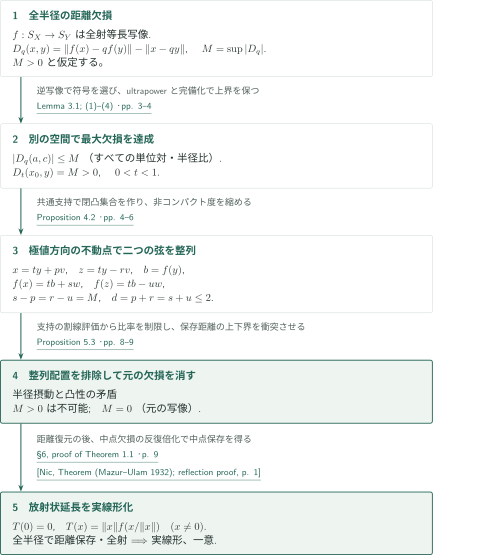
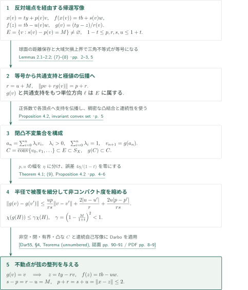
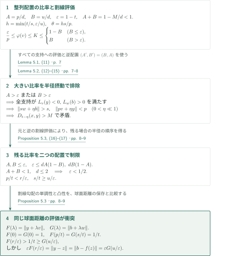

# A positive solution to Tingley’s problem

**最大欠損の達成から、非コンパクト度の縮小による弦の整列へ**

本原稿は、実Banach空間の単位球面間の全射等長写像が、空間全体の実線形等長写像へ一意に延長されると主張する。異なる半径の間の距離が保存されないと仮定し、その最大欠損を達成する別の空間へ移る。核心は、共通支持汎関数による極値方向の伝播とDarboの不動点定理を組み合わせ、二つの弦を整列させる点にある。

## 1. 主要結果

### Theorem 1.1 — 球面等長写像の一意な実線形延長

$X,Y$を非零の実Banach空間とし、$f:S_X\to S_Y$を全射等長写像とする。このとき
$$
T(0)=0,\qquad T(x)=\|x\|f\!\left(\frac{x}{\|x\|}\right)\quad(x\ne0)
$$
は全射実線形等長写像であり、$f$の唯一の線形延長である。次元、可分性、反射性、滑らかさ、狭義凸性は仮定しない。複素Banach空間に適用する場合の結論も実線形性であり、複素線形性は含まない。

<!-- cite:main-result -->[Theorem 1.1 · p. 1](https://github.com/openai/math/blob/1581d4cbdd69a0faf34b2089614fe2a814316a6a/preprints/A-positive-solution-to-Tingleys-problem-September-23-2026/paper.pdf)<!-- /cite -->

## 図の矢印に付した引用

<!-- reference-guide -->
略号のない定理・補題・節・式番号は本原稿 [A positive solution to Tingley’s problem](https://github.com/openai/math/blob/1581d4cbdd69a0faf34b2089614fe2a814316a6a/preprints/A-positive-solution-to-Tingleys-problem-September-23-2026/paper.pdf) を指します。外部入力には次の略号を使います。

- [Dar55](https://www.numdam.org/item/RSMUP_1955__24__84_0/) Gabriele Darbo — *Punti uniti in trasformazioni a codominio non compatto*：非コンパクト度を一様に縮める自己写像の不動点。本稿Theorem 4.1で定式化され、Appendix Aでも証明される。1955年刊、誌面pp. 84–92。NUMDAMの表紙付きスキャン。
- [Nic](https://arxiv.org/pdf/1306.2380v1) Bogdan Nica — *The Mazur–Ulam theorem*：全空間の全射等長写像を中点反射で実線形化する段階。本稿§6がこの提示を再現する。arXiv:1306.2380v1のURLから取得。欄外は2013年6月10日、本文Dateは2024年11月27日であり、不一致を保持。

各引用に結果番号とページを付します。誌面番号とPDF内の位置が異なる場合は両方を示します。GitHubの閲覧リンクではページ位置への自動移動を前提としません。
<!-- /reference-guide -->

## 2. Theorem 1.1 の証明 — 距離欠損を消してから線形化する

<!-- proof-target:1 -->証明対象：[Theorem 1.1 · p. 1](https://github.com/openai/math/blob/1581d4cbdd69a0faf34b2089614fe2a814316a6a/preprints/A-positive-solution-to-Tingleys-problem-September-23-2026/paper.pdf)<!-- /proof-target -->

**証明の道筋。** 半径比$q$に対する距離欠損の上限$M$を考える。$M>0$ならLemma 3.1により最大値が達成される状況へ移し、[Proposition 4.2の整列](#proof-2)と[Proposition 5.3の矛盾](#proof-3)を適用する。したがって元の写像の$M$も零であり、放射状延長$T$が全射距離等長写像となる。最後に中点反射の議論で実線形性を得る。

$$
D_q(x,y)=\|f(x)-qf(y)\|-\|x-qy\|,\qquad
M=\sup_{x,y\in S_X,\,0\le q\le1}|D_q(x,y)|.
$$

### 1. 上限を達成する球面等長写像へ移す

$D_0=D_1=0$と$q$についての一様な$2$-Lipschitz性から、$|D_q|\le2\min(q,1-q)$である。$M>0$に近づく列を選び、必要なら$f^{-1}$へ交換して欠損の符号を正にする。半径比の部分列を$t\in[M/2,1-M/2]$へ収束させ、一様Lipschitz評価で全項の半径比を$t$に固定する。

単位ベクトル列に$f$を項ごとに作用させると、ultrapowerの商の単位球面上に全射等長写像が定まる。代表元の独立性と全射性は、それぞれ$f$の距離保存と$f^{-1}$の項別作用から従う。完備化後にも、**すべての半径比と単位ベクトル対に対する**$|D_q|\le M$が保たれ、ある$x_0,y,t$で$D_t(x_0,y)=M$となる。後の半径摂動には、この大域的上界を保った達成が必要である。新しい空間の等長写像を分類するのでなく、この達成状況が存在できないことを示す。

<!-- cite:attainment -->[Lemma 3.1; (1)–(4) · pp. 3–4](https://github.com/openai/math/blob/1581d4cbdd69a0faf34b2089614fe2a814316a6a/preprints/A-positive-solution-to-Tingleys-problem-September-23-2026/paper.pdf)<!-- /cite -->

### 2. 整列した弦を排除し、全半径の距離を復元する

Proposition 4.2は、$ty$と$tf(y)$を通る二つの弦について、端点の対応だけでなく四つの半径の差を$M$に揃える。Proposition 5.3はその配置を支持汎関数とノルムの凸性から排除する。この矛盾により、元の$f$でも$M=0$である。

$a=\alpha x$, $c=\beta y$、$x,y\in S_X$、$\alpha\ge\beta>0$に対し$q=\beta/\alpha$と置けば
$$
\|T(a)-T(c)\|=\alpha\|f(x)-qf(y)\|
=\alpha\|x-qy\|=\|a-c\|.
$$
半径の順序を交換した場合と零を含む場合も扱える。$f$の全射性から、任意の$b\ne0$について$f(y)=b/\|b\|$となる$y\in S_X$があり、$T(\|b\|y)=b$である。

<!-- cite:metric-extension -->[Propositions 4.2, 5.3; §6 · pp. 4, 8–9](https://github.com/openai/math/blob/1581d4cbdd69a0faf34b2089614fe2a814316a6a/preprints/A-positive-solution-to-Tingleys-problem-September-23-2026/paper.pdf)<!-- /cite -->

### 3. 中点欠損の倍化で実線形性と一意性を得る

全射等長写像$F$について、$m=(a+c)/2$, $m'=(F(a)+F(c))/2$、中点欠損$\delta=\|F(m)-m'\|$と置く。$m'$を中心とする反射$R$を$F$で共役すると、$H=F^{-1}RF$は$a,c$を交換し、その中点欠損は$2\delta$になる。一方、どの全射等長写像でも欠損は$\|a-c\|/2$以下である。反復による倍化との両立には$\delta=0$が必要となる。

$T(0)=0$と中点保存から加法性、有理斉次性、連続性による実斉次性が順に従う。任意の線形延長は$x=\|x\|(x/\|x\|)$で値が決まるため一意である。本稿§6はこのMazur–Ulamの段階をNicaの反射による提示に沿って再証明している。

<!-- cite:linear-extension -->[§6, proof of Theorem 1.1 · p. 9](https://github.com/openai/math/blob/1581d4cbdd69a0faf34b2089614fe2a814316a6a/preprints/A-positive-solution-to-Tingleys-problem-September-23-2026/paper.pdf)<!-- /cite -->

<!-- cite:nica -->[&#91;Nic, Theorem (Mazur–Ulam 1932); reflection proof, p. 1&#93;](https://arxiv.org/pdf/1306.2380v1#page=1)<!-- /cite -->

## 3. Proposition 4.2 の証明 — 極値方向を閉凸集合へ伝播する

<!-- proof-target:2 -->証明対象：[Proposition 4.2 · pp. 4–6](https://github.com/openai/math/blob/1581d4cbdd69a0faf34b2089614fe2a814316a6a/preprints/A-positive-solution-to-Tingleys-problem-September-23-2026/paper.pdf)<!-- /proof-target -->

<!-- statement:proposition-4-2 -->
### Proposition 4.2 — 最大欠損をもつ弦の整列

$f:S_X\to S_Y$が非零の実Banach空間間の全射球面等長写像であり、すべての$a,c\in S_X$, $q\in[0,1]$について$|D_q(a,c)|\le M$、かつある$x_0,y\in S_X$, $0<t<1$について$D_t(x_0,y)=M>0$とする。$b=f(y)$と置く。このとき$x,z\in S_X$, $v\in S_X$, $w\in S_Y$と正数$p,r,s,u\in[1-t,1+t]$が存在し、
$$
\begin{aligned}
x&=ty+pv,&z&=ty-rv,\\
f(x)&=tb+sw,&f(z)&=tb-uw,
\end{aligned}
\qquad
s-p=r-u=M,\quad d:=p+r=s+u=\|x-z\|\le2
$$
を満たす。端点$x$は当初の最大点$x_0$と一致するとは限らない。

<!-- cite:alignment -->[Proposition 4.2 · pp. 4–6](https://github.com/openai/math/blob/1581d4cbdd69a0faf34b2089614fe2a814316a6a/preprints/A-positive-solution-to-Tingleys-problem-September-23-2026/paper.pdf)<!-- /cite -->
<!-- /statement -->

**証明の道筋。** 球面接点の連続性から反対側の端点を経由する帰還写像$g$を作る。極値集合$E$全体の凸性を仮定せず、共通支持を使って$E$内に不変な閉凸集合$C$を構成する。$g$は通常の距離について縮小するとは示さず、非コンパクト度の縮小を示して不動点を得る。

### 1. 反対端点を経由する帰還写像

方向$v\in S_X$から、$x(v)=ty+p(v)v\in S_X$を取り、$f(x(v))=tb+sw$と書く。$tb$から方向$-w$へ進んだ球面接点を$tb-uw=f(z)$とし、
$$
r=\|z-ty\|,\qquad g(v)=\frac{ty-z}{r}
$$
と定める。Lemma 2.2により接点は一意で連続に変わり、四つの半径は$[1-t,1+t]$に入る。$E=\{v\in S_X:s(v)-p(v)=M\}$は非空閉集合である。

$v\in E$なら、球面の距離保存と逆向きの欠損上界から
$$
s+u=\|x(v)-z\|\le p+r,\qquad r-u\le M=s-p
$$
となり、両方とも等号である。したがって$r=u+M$、$\|pv+rg(v)\|=p+r$であり、Lemma 2.1により$v,g(v)$は共通支持をもつ。さらに$g(v)$と共通支持をもつ任意の単位方向$\ell$について$p(\ell)+r\le s(\ell)+u$となり、$\ell\in E$が従う。この伝播が次の凸集合の構成を可能にする。

<!-- cite:return-support -->[Lemmas 2.1–2.2; (7)–(8) · pp. 2–3, 5](https://github.com/openai/math/blob/1581d4cbdd69a0faf34b2089614fe2a814316a6a/preprints/A-positive-solution-to-Tingleys-problem-September-23-2026/paper.pdf)<!-- /cite -->

### 2. 球面内に閉凸不変集合を構成する

$v_0\in E$から始め、既に得た$v_0,\ldots,v_n$の**すべてに正の係数**を与える凸結合$a_n$を取り、$v_{n+1}=g(a_n)$とする。$a_n,v_{n+1}$の共通支持を有限次元の線形包へ延長すると、係数の正値性から各$v_i$でも値が$1$となる。拡大した凸包は球面上にあり、伝播則によって$E$に含まれる。

有理係数の有限凸結合を繰り返し近似するよう$a_n$を選ぶと、$a_n$は$C=\overline{\operatorname{conv}}\{v_0,v_1,\ldots\}$に稠密になる。$E$の閉性と$g$の連続性から、$C\subset E$は非空・閉・有界・凸であり、$g(C)\subset C$である。可分なのは構成した$C$だけで、周囲の空間に可分性は要求しない。

<!-- cite:invariant-set -->[Proposition 4.2, invariant convex set · p. 5](https://github.com/openai/math/blob/1581d4cbdd69a0faf34b2089614fe2a814316a6a/preprints/A-positive-solution-to-Tingleys-problem-September-23-2026/paper.pdf)<!-- /cite -->

### 3. 半径を細分した被覆でDarboの仮定を満たす

$v,v'\in E$について、本稿の評価は
$$
\|g(v)-g(v')\|\le\frac{up}{rs}\|v-v'\|
+\frac{2|u-u'|}{r}+\frac{2u|p-p'|}{rs}.
$$
$r=u+M$, $s=p+M$より$up/(rs)\le\gamma=(1-M/(1+t))^2<1$となる。しかし半径の差を含むため、これだけで距離縮小写像とはいえない。

$H\subset C$の有限直径被覆を、$p,u$の値が各々幅$\eta$の区間に入るよう細分する。$r,s\ge1-t$により各像の直径は$\gamma\delta+4\eta/(1-t)$以下であり、$\eta\downarrow0$としてKuratowski非コンパクト度の評価$\chi(g(H))\le\gamma\chi(H)$を得る。Theorem 4.1のDarbo型定理を適用し、$g(v)=v$を得ると、$z=ty-rv$と端点の対応が同時に成立する。これが主定理で必要な整列配置である。

<!-- cite:noncompactness -->[Theorem 4.1; (9), Proposition 4.2 · pp. 4–6](https://github.com/openai/math/blob/1581d4cbdd69a0faf34b2089614fe2a814316a6a/preprints/A-positive-solution-to-Tingleys-problem-September-23-2026/paper.pdf)<!-- /cite -->

<!-- cite:darbo -->[&#91;Dar55, §4, Teorema (unnumbered), 誌面 pp. 90–91 / PDF pp. 8–9&#93;](https://www.numdam.org/item/RSMUP_1955__24__84_0/)<!-- /cite -->

## 4. Proposition 5.3 の証明 — 支持の符号と凸性による二段階の矛盾

<!-- proof-target:3 -->証明対象：[Proposition 5.3 · pp. 8–9](https://github.com/openai/math/blob/1581d4cbdd69a0faf34b2089614fe2a814316a6a/preprints/A-positive-solution-to-Tingleys-problem-September-23-2026/paper.pdf)<!-- /proof-target -->

<!-- statement:proposition-5-3 -->
### Proposition 5.3 — 正の最大欠損は達成されない

非零の実Banach空間と全射等長写像$f:S_X\to S_Y$について、すべての$a,c\in S_X$, $q\in[0,1]$で$|D_q(a,c)|\le M$であり、ある$x_0,y\in S_X$, $0<t<1$で$D_t(x_0,y)=M>0$となる状況は存在しない。証明にはProposition 4.2の整列配置を使う。

<!-- cite:contradiction -->[Proposition 5.3 · pp. 8–9](https://github.com/openai/math/blob/1581d4cbdd69a0faf34b2089614fe2a814316a6a/preprints/A-positive-solution-to-Tingleys-problem-September-23-2026/paper.pdf)<!-- /cite -->
<!-- /statement -->

**証明の道筋。** $A=p/d$, $B=u/d$, $\varepsilon=1-t$と置く。$A+B=1-M/d<1$を保ちながら、まず$A>\varepsilon$または$B>\varepsilon$を半径摂動で排除する。残る$A,B\le\varepsilon$では、同一の球面距離を二つの凸関数で評価して矛盾する。

$K$は下で定義する割線の値、$\varphi$は$v+\theta y$での任意の支持を表す。図の$L_v,L_w$はそれぞれ$v,w$での任意の支持である。

### 1. 端の半径まで動かして割線を評価する

$h=\min(t/s,\varepsilon/u)$、$\theta=hs/p$と置き、
$$
K=\frac{\|(r/u)v+hy\|-\|(p/s)v+hy\|}{r/u-p/s}
$$
を考える。$t-sh$と$t+uh$は$[0,1]$内にあり、一方は端点である。対応する欠損$\Delta_x=D_{t-sh}(x,y)$、$\Delta_z=-D_{t+uh}(z,y)$の加重和では$Y$側のノルムが消え、$(u\Delta_x+s\Delta_z)/d=MK$となる。一方の欠損が零、他方が$M$以下であることから、$K\le1-B$（$B\le\varepsilon$）、$K\le B$（$B>\varepsilon$）を得る。

$v+\theta y$での任意の支持$\varphi$はこの割線を下から評価する。$v+(t/p)y$の支持と比較すれば、Lemma 5.1の
$$
\frac{\varepsilon}{p}\le\varphi(v)\le K
$$
が得られる。次の摂動には、この評価が特定の支持だけでなく**すべての支持**に成り立つことが必要である。

<!-- cite:secant -->[Lemma 5.1, (11) · p. 7](https://github.com/openai/math/blob/1581d4cbdd69a0faf34b2089614fe2a814316a6a/preprints/A-positive-solution-to-Tingleys-problem-September-23-2026/paper.pdf)<!-- /cite -->

### 2. 大きい比率を支持の符号で排除する

$B>\varepsilon$ならLemma 5.1から$pu/(d\varepsilon)\ge1$となる。$v$での任意の支持$L$に対し$j=L(y)$とすると、同補題の等号の場合を除くことで
$$
1-j>\frac{1-B}{\theta}=\frac{pu}{d\varepsilon}\ge1
$$
が得られ、すべての支持が$y$上で負になる。$\|rv-ty\|=1$から$r<1$、したがって$u<1$となり、$Au\ge\varepsilon$から$A>\varepsilon$も従う。

$f^{-1}$には$(p',s',r',u')=(u,r,s,p)$、$(v',w',y',b')=(-w,-v,b,y)$の整列配置があり、$(A',B')=(B,A)$である。したがってどちらかが$\varepsilon$を超えれば、両方が超え、$w$でのすべての支持は$b$上で正となる。十分小さい$\eta>0$に対して
$$
\|sw+\eta b\|>s,\qquad \|pv+\eta y\|
[Lemma 5.2, (12)–(15) · pp. 7–8](https://github.com/openai/math/blob/1581d4cbdd69a0faf34b2089614fe2a814316a6a/preprints/A-positive-solution-to-Tingleys-problem-September-23-2026/paper.pdf)<!-- /cite -->

### 3. 残る比率では保存される距離の上下界が衝突する

$A,B\le\varepsilon$のもとで、元の配置と逆配置にLemma 5.1を適用すると
$$
\varepsilon\le dA(1-B),\qquad\varepsilon\le dB(1-A).
$$
$A+B<1$より右辺の二つの積の小さい方は$d/4$未満であり、$d\le2$から$\varepsilon<1/2$となる。よって$A\le\varepsilon<t$, $1-B\ge t$であり、
$$
\frac pt<\frac r\varepsilon,\qquad\frac st\ge\frac u\varepsilon.
$$
凸関数$F(\lambda)=\|y+\lambda v\|$, $G(\lambda)=\|b+\lambda w\|$は$F(0)=G(0)=1$、$F(p/t)=G(s/t)=1/t>1$を満たす。割線勾配の単調性により$F(r/\varepsilon)>1/t$、凸性により$G(u/\varepsilon)\le1/t$となる。しかし
$$
\varepsilon F(r/\varepsilon)=\|y-z\|
=\|b-f(z)\|=\varepsilon G(u/\varepsilon)
$$
は球面上の距離保存そのものであり、矛盾する。これで正の最大欠損の達成が排除され、Theorem 1.1へ戻れる。

<!-- cite:final-convexity -->[Proposition 5.3, (16)–(17) · pp. 8–9](https://github.com/openai/math/blob/1581d4cbdd69a0faf34b2089614fe2a814316a6a/preprints/A-positive-solution-to-Tingleys-problem-September-23-2026/paper.pdf)<!-- /cite -->

## 5. どの論文が、どの段階を担うか

| 供給元と結果 | 利用箇所 | 使用内容・必要な仮定 | 確認範囲 |
|---|---|---|---|
| Darboの不動点定理 | Theorem 4.1、Proposition 4.2の末尾（pp. 4, 6） | 非空・閉・有界・凸な$C$、連続な$g:C\to C$、一様な$\chi$縮小から不動点を得る。$C$の構成と縮小評価は本稿が担う。 | 外部の記述と本稿の適用条件を照合。本稿Appendix Aにも証明がある。外部原典の全証明の独立検証は範囲外。 |
| NicaによるMazur–Ulam定理の反射による提示 | §6（p. 9） | 球面からの延長ではなく、既に得た空間全体の全射等長写像の中点保存と実線形化を担う。 | 中点欠損の倍化と一様上界、本稿での全射性・零固定を照合。 |

<!-- cite:darbo -->[&#91;Dar55, §4, Teorema (unnumbered), 誌面 pp. 90–91 / PDF pp. 8–9&#93;](https://www.numdam.org/item/RSMUP_1955__24__84_0/)<!-- /cite -->

<!-- cite:nica -->[&#91;Nic, Theorem (Mazur–Ulam 1932); reflection proof, p. 1&#93;](https://arxiv.org/pdf/1306.2380v1#page=1)<!-- /cite -->

有限次元の支持汎関数とその延長はLemma 2.1、半径接点の連続性はLemma 2.2、ultrapowerによる最大値の達成はLemma 3.1で本稿内に証明される。Hahn–Banachやultrapowerの歴史的引用を、未照合の外部定理への追加依存として図に描いてはいない。Appendix Aでは非コンパクト度の性質、単体不動点、コンパクト凸集合の不動点を経てTheorem 4.1を証明する。これらは本稿内の補助経路である。

## 6. 原典を読む入口と確認範囲

<!-- reading-list -->
- [Theorem 1.1 · p. 1](https://github.com/openai/math/blob/1581d4cbdd69a0faf34b2089614fe2a814316a6a/preprints/A-positive-solution-to-Tingleys-problem-September-23-2026/paper.pdf) — 非零実Banach空間という仮定と、全射・実線形・等長・一意の結論を確認する
- [Lemma 3.1; (1)–(4) · pp. 3–4](https://github.com/openai/math/blob/1581d4cbdd69a0faf34b2089614fe2a814316a6a/preprints/A-positive-solution-to-Tingleys-problem-September-23-2026/paper.pdf) — 逆写像への交換、別の空間での最大値達成、全半径の欠損上界の保存を読む
- [Proposition 4.2 · pp. 4–6](https://github.com/openai/math/blob/1581d4cbdd69a0faf34b2089614fe2a814316a6a/preprints/A-positive-solution-to-Tingleys-problem-September-23-2026/paper.pdf) — 共通支持による伝播、閉凸不変集合、非コンパクト度縮小の接続を読む
- [Lemma 5.1, (11) · p. 7](https://github.com/openai/math/blob/1581d4cbdd69a0faf34b2089614fe2a814316a6a/preprints/A-positive-solution-to-Tingleys-problem-September-23-2026/paper.pdf) — 二つの欠損の消去と、すべての支持に対する割線評価を読む
- [Lemma 5.2, (12)–(15) · pp. 7–8](https://github.com/openai/math/blob/1581d4cbdd69a0faf34b2089614fe2a814316a6a/preprints/A-positive-solution-to-Tingleys-problem-September-23-2026/paper.pdf) — 逆配置を使った支持の符号と、小さい半径摂動による矛盾を追う
- [Proposition 5.3 · pp. 8–9](https://github.com/openai/math/blob/1581d4cbdd69a0faf34b2089614fe2a814316a6a/preprints/A-positive-solution-to-Tingleys-problem-September-23-2026/paper.pdf) — 残る比率の範囲と、FとGが同じ球面距離を表す最終矛盾を確認する
- [§6, proof of Theorem 1.1 · p. 9](https://github.com/openai/math/blob/1581d4cbdd69a0faf34b2089614fe2a814316a6a/preprints/A-positive-solution-to-Tingleys-problem-September-23-2026/paper.pdf) — 全半径の距離復元から実線形性・一意性までを読む
- [Appendix A, Lemmas A.1–A.3; proof of Theorem 4.1 · pp. 9–11](https://github.com/openai/math/blob/1581d4cbdd69a0faf34b2089614fe2a814316a6a/preprints/A-positive-solution-to-Tingleys-problem-September-23-2026/paper.pdf) — 本稿内でTheorem 4.1を証明する補助経路を確認する
<!-- /reading-list -->

本概説では、Theorem 1.1の仮定と全結論、§§2–6の支持・最大値達成・不変集合・非コンパクト度評価・半径摂動・凸性の矛盾・実線形化を読解し、主要な接続を原典と照合した。Appendix AはTheorem 4.1への接続を確認した。これは著者の主張と証明戦略を案内するものであり、全証明の独立検証、専門家査読、形式検証を意味しない。外部定理の証明の再帰的検証と、Introductionの先行研究全件の結果照合は行っていない。

<!-- cite:reading-scope -->[§§2–6; Appendix A · pp. 2–11](https://github.com/openai/math/blob/1581d4cbdd69a0faf34b2089614fe2a814316a6a/preprints/A-positive-solution-to-Tingleys-problem-September-23-2026/paper.pdf)<!-- /cite -->
