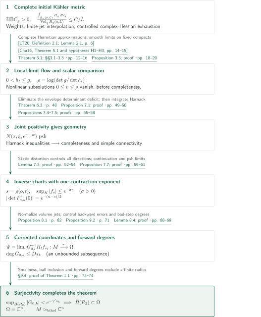
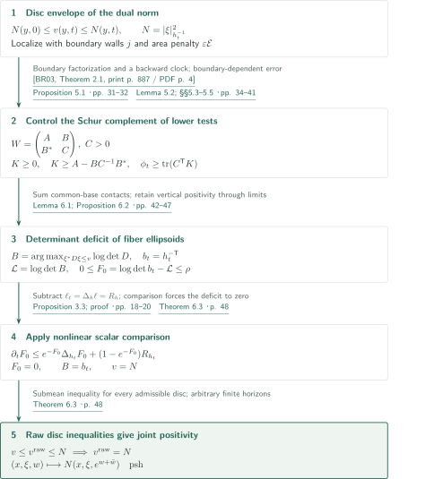
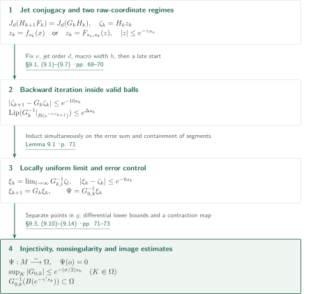

# Uniformization of complete Kähler manifolds with positive bisectional curvature

**From a cotangent disc envelope to Harnack inequalities, then from nonuniformly shrinking charts to all of affine space**

The manuscript constructs a Kähler–Ricci flow without an upper curvature bound or a volume-growth assumption and obtains shrinking coordinates from joint plurisubharmonicity of its dual norm. The final issue is surjectivity: the authors control the degrees of forward polynomial compositions in a volume clock. This article explains that proof route, with the editorial checking scope distinguished at the end.

## 1. Main results

### Theorem 1.1 — Biholomorphic uniformization from positive bisectional curvature

Let $M$ be a connected noncompact complex manifold of complex dimension $n\geq1$. If $M$ admits a smooth complete Kähler metric $g$ with strictly positive holomorphic bisectional curvature at every point, then $M$ is biholomorphic to $\mathbb C^n$.

Positivity is pointwise. No uniform positive lower bound, finite upper curvature bound, volume-growth, noncollapsing, Ricci-pinching or simple-connectivity hypothesis is added. The conclusion is a biholomorphism of complex manifolds; it does not identify the given metric isometrically with the Euclidean metric. Steinness and contractibility follow from the conclusion.

<!-- cite:main -->[Theorem 1.1 · p. 2](https://github.com/openai/math/blob/fd4aeeb2ee4fc729c18d98444fed42fd0529eeeb/preprints/Uniformization-of-complete-Kahler-manifolds-with-positive-bisectional-curvature-September-23-2026/paper.pdf)<!-- /cite -->

The convention takes $\mathrm{Rm}(a,b,b,a)$ as the sectional-curvature numerator and assumes, for every pair of real unit tangent vectors $u,v$,
$$
\mathrm{Rm}(u,v,v,u)+\mathrm{Rm}(u,Jv,Jv,u)>0.
$$
In complex dimension one this sum is Gaussian curvature. The flow and Laplacian are normalized by
$$
\partial_t h_t=-\operatorname{Ric}(h_t),\qquad
\operatorname{Ric}(h)=-\partial\bar\partial\log\det h,\qquad
\Delta_h=\operatorname{tr}_h\partial\bar\partial,
$$
with $\sqrt{-1}$ suppressed in the identification with real $(1,1)$-forms. Fix $o\in M$ and write $r=d_g(o,\cdot)$.

<!-- cite:conventions -->[§1.3 · p. 5](https://github.com/openai/math/blob/fd4aeeb2ee4fc729c18d98444fed42fd0529eeeb/preprints/Uniformization-of-complete-Kahler-manifolds-with-positive-bisectional-curvature-September-23-2026/paper.pdf)<!-- /cite -->

## References on the arrows

<!-- reference-guide -->
Unprefixed theorem, lemma, section and equation numbers refer to [Uniformization of complete Kähler manifolds with positive bisectional curvature](https://github.com/openai/math/blob/fd4aeeb2ee4fc729c18d98444fed42fd0529eeeb/preprints/Uniformization-of-complete-Kahler-manifolds-with-positive-bisectional-curvature-September-23-2026/paper.pdf). External inputs use the following keys.

- [CZ05](https://arxiv.org/pdf/math/0211374v1) Bing-Long Chen; Xi-Ping Zhu — *Volume growth and curvature decay of positively curved Kähler manifolds*: Linear averaged scalar-curvature decay for the initial metric, allowing a center-dependent constant. arXiv:math/0211374v1 (2002); journal publication 2005.
- [Dem82](https://www.numdam.org/item/10.24033/asens.1434.pdf) Jean-Pierre Demailly — *Estimations L² pour l’opérateur ∂̄ d’un fibré vectoriel holomorphe semi-positif au-dessus d’une variété kählérienne complète*: Griffiths-to-Nakano positivity and weighted ∂̄ estimates for jet interpolation and distortion. Ann. Sci. École Norm. Sup. (4) 15 (1982), 457–511; Numdam scan.
- [LT20](https://arxiv.org/pdf/1708.00141v2) Man-Chun Lee; Luen-Fai Tam — *Chern–Ricci flows on noncompact complex manifolds*: Short-time existence on each complete Hermitian approximation with bounded geometry of infinite order. arXiv:1708.00141v2; journal publication 2020.
- [Chu16](https://arxiv.org/pdf/1410.3354v3) Jianchun Chu — *C²,α regularities and estimates for nonlinear elliptic and parabolic equations in geometry*: Uniformly parabolic transformed-Hessian estimates converting local two-sided metric bounds into regularity. arXiv:1410.3354v3; journal publication 2016.
- [BR03](https://www.numdam.org/item/10.5802/aif.1964.pdf) Bo Berndtsson; Jean-Pierre Rosay — *Quasi-isometric vector bundles and bounded factorization of holomorphic matrices*: Factorization of a positive boundary matrix as H*H with H and H⁻¹ holomorphic and smooth up to the circle. Ann. Inst. Fourier 53 (2003), 885–901; Numdam scan.
- [FL14](https://arxiv.org/pdf/1402.4342v3) Franc Forstnerič; Finnur Lárusson — *Oka properties of groups of holomorphic and algebraic automorphisms of complex affine space*: Shear decomposition of divergence-free homogeneous fields; an algebraic input to finite-jet realization, not an application of the full Oka theorem. arXiv:1402.4342v3 (2017-03-29); journal publication 2014.

Each citation gives the result and pages. When printed pagination differs from the PDF position, both are shown. GitHub previews do not automatically jump to the cited page.
<!-- /reference-guide -->

## 2. Theorem 1.1 — Proof overview of the main theorem

<!-- proof-target:1 -->Proof target：[Theorem 1.1 · p. 2](https://github.com/openai/math/blob/fd4aeeb2ee4fc729c18d98444fed42fd0529eeeb/preprints/Uniformization-of-complete-Kahler-manifolds-with-positive-bisectional-curvature-September-23-2026/paper.pdf)<!-- /proof-target -->

See [Theorem 1.1](#theorem-1-1) for the statement. **Proof route.** Weights and average-curvature estimates for the initial metric give a local-limit flow and scalar comparison without assuming positive-time completeness. The [disc envelope and fiber ellipsoids](#proof-1) reduce to that comparison, yielding Harnack inequalities, completeness, simple connectivity and shrinking inverse charts. After constructing the [corrected-coordinate limit](#proof-2), forward degree bounds force its image to be all of $\mathbb C^n$.

### 1. Transfer initial completeness into local limits and scalar comparison

Proposition 2.1 supplies a strictly psh weight with at most linear growth, finite-jet interpolation, nonvanishing canonical sections, and an exhaustion $u\asymp1+r$ with $|\partial u|_g\leq C$ and $|\partial\bar\partial u|_g\leq C/u$. Tangent-field interpolation uses positivity of $E\otimes\det E$ and weighted $L^2$ solvability; Nakano positivity of $T^{1,0}M$ itself is not assumed. The averaged curvature estimate is $\frac{\int_{B_g(o,L)}R_g\,dV_g}{\operatorname{Vol}_g B_g(o,L)}\leq C/L$ at the fixed center $o$. It supplies neither a center-uniform constant nor maximal volume growth.

<!-- cite:initial -->[Proposition 2.1; §2.1 · pp. 6–8](https://github.com/openai/math/blob/fd4aeeb2ee4fc729c18d98444fed42fd0529eeeb/preprints/Uniformization-of-complete-Kahler-manifolds-with-positive-bisectional-curvature-September-23-2026/paper.pdf)<!-- /cite --> <!-- cite:nakano -->[&#91;Dem82, Theorem 2.6, print p. 467 / PDF p. 12&#93;](https://www.numdam.org/item/10.24033/asens.1434.pdf#page=12)<!-- /cite --> <!-- cite:l2 -->[&#91;Dem82, Theorem 5.1, print p. 475 / PDF p. 20&#93;](https://www.numdam.org/item/10.24033/asens.1434.pdf#page=20)<!-- /cite --> <!-- cite:cz -->[&#91;CZ05, Theorem 2, p. 2&#93;](https://arxiv.org/pdf/math/0211374v1#page=2)<!-- /cite -->

On $\{u<L\}$, a conformal blow-up near the boundary produces a complete Hermitian metric $\alpha_L$ with bounded geometry of infinite order. LT20 gives short-time Chern–Ricci flow for each approximation. Potential barriers from canonical sections and a largest-eigenvalue estimate yield two-sided metric bounds on fixed compact sets and time intervals. Chu16 and local higher estimates give a diagonal subsequence converging in local $C^\infty$, including one-sided initial derivatives, with $h_0=g$, $0<h_t\leq g$ and $R_{h_t}\geq0$. Completeness of the approximations alone is not used to infer completeness of the limit.

<!-- cite:flow -->[Theorem 3.1; §§3.1–3.3 · pp. 12–16](https://github.com/openai/math/blob/fd4aeeb2ee4fc729c18d98444fed42fd0529eeeb/preprints/Uniformization-of-complete-Kahler-manifolds-with-positive-bisectional-curvature-September-23-2026/paper.pdf)<!-- /cite --> <!-- cite:lt -->[&#91;LT20, Definition 2.1; Lemma 2.1, p. 6&#93;](https://arxiv.org/pdf/1708.00141v2#page=6)<!-- /cite --> <!-- cite:chu -->[&#91;Chu16, Theorem 5.1 and hypotheses H1–H3, pp. 14–15&#93;](https://arxiv.org/pdf/1410.3354v3#page=14)<!-- /cite -->

The volume loss $\rho=\log(\det g/\det h_t)$ satisfies $\frac{\int_{B_g(o,L)}\rho\,dV_g}{\operatorname{Vol}_g B_g(o,L)}\leq C_TL$ on finite time intervals. An integrable weight $\chi\asymp u^{-k}$ adapted to $g-h_t$ satisfies $\partial\bar\partial\chi\leq C_T\chi h_t$. Together with the cofactor bound $|\operatorname{tr}_{h_t}B|dV_{h_t}\leq C_n|B|_g dV_g$, it removes the error at infinity. Proposition 3.3 proves, for upper semicontinuous viscosity subsolutions with $0\leq v\leq\rho$,
$$
\partial_tv\leq e^{-v}\Delta_{h_t}v+(1-e^{-v})R_{h_t}\quad\Longrightarrow\quad v=0.
$$
For its smooth majorant $w$, the identity $\partial_t[(e^w-1)dV_{h_t}]=(\Delta_{h_t}w)dV_{h_t}$ closes the weighted-mass Gronwall argument.

<!-- cite:comparison -->[Proposition 3.3; proof · pp. 18–20](https://github.com/openai/math/blob/fd4aeeb2ee4fc729c18d98444fed42fd0529eeeb/preprints/Uniformization-of-complete-Kahler-manifolds-with-positive-bisectional-curvature-September-23-2026/paper.pdf)<!-- /cite --> <!-- cite:majorant -->[Lemma 3.4; §3.6 · pp. 19–22](https://github.com/openai/math/blob/fd4aeeb2ee4fc729c18d98444fed42fd0529eeeb/preprints/Uniformization-of-complete-Kahler-manifolds-with-positive-bisectional-curvature-September-23-2026/paper.pdf)<!-- /cite -->

### 2. Joint positivity yields Harnack inequalities and completeness

Once Theorem 6.3 proves that $N(x,\xi,e^{w+\bar w})$ is psh, the spatial and temporal curvature blocks give nonnegative bisectional curvature and matrix/scalar Harnack inequalities. Initial strict positivity gives positive Ricci curvature on fixed compact sets at small times, and the matrix inequality propagates it. The scalar inequality is integrated along piecewise smooth paths approximating the distance; this precedes completeness and requires no global minimizing geodesic.

<!-- cite:joint -->[Theorem 6.3 · p. 48](https://github.com/openai/math/blob/fd4aeeb2ee4fc729c18d98444fed42fd0529eeeb/preprints/Uniformization-of-complete-Kahler-manifolds-with-positive-bisectional-curvature-September-23-2026/paper.pdf)<!-- /cite --> <!-- cite:harnack -->[Proposition 7.1; proof · pp. 49–50](https://github.com/openai/math/blob/fd4aeeb2ee4fc729c18d98444fed42fd0529eeeb/preprints/Uniformization-of-complete-Kahler-manifolds-with-positive-bisectional-curvature-September-23-2026/paper.pdf)<!-- /cite -->

The least exit length $\ell_L(t)$ from the initial ball $B_g(o,L)$ then satisfies $1+\ell_L(t)\geq(1+L)e^{-2C_T\sqrt t}$. Letting $L\to\infty$ proves completeness of every positive-time slice. Here $C_T$ depends on the finite time interval and the fixed initial geometry.

### 3. Spread volume contraction to every direction and every compact set

Set $\tau=\log t$, $s=\rho(o,t)$ and $q(s)=ds/d\tau=tR(o,t)$. If $B,A$ are the greatest and least initial-metric singular lengths of a local chart, Lemma 7.3 gives $B\leq C(1+A)^C$. Thus determinant loss forces contraction in every direction. Its constants depend on the fixed compact set, chart radius, lower metric bound and initial geometry in a neighborhood, independently of the particular chart's total distortion. Uniformly on each fixed compact, as $s\to\infty$,
$$
\rho(x,t)/s\longrightarrow1,\qquad e^{-2s}g\leq h_t\leq e^{-c_Ks}g.
$$

<!-- cite:distortion -->[Lemma 7.3; proof · pp. 52–54](https://github.com/openai/math/blob/fd4aeeb2ee4fc729c18d98444fed42fd0529eeeb/preprints/Uniformization-of-complete-Kahler-manifolds-with-positive-bisectional-curvature-September-23-2026/paper.pdf)<!-- /cite --> <!-- cite:windows -->[Propositions 7.4–7.5; proofs · pp. 55–58](https://github.com/openai/math/blob/fd4aeeb2ee4fc729c18d98444fed42fd0529eeeb/preprints/Uniformization-of-complete-Kahler-manifolds-with-positive-bisectional-curvature-September-23-2026/paper.pdf)<!-- /cite -->

On selected Ricci-pinched windows, rescaled flows pulled back to tangent-space balls have local $C^\infty$ subsequential limits. Equality in the limiting Harnack inequality forces the real Hessian of scalar curvature to be strictly negative. This estimate transfers back to small intrinsic balls in the original manifolds. The scalar-curvature gradient flow contracts each fixed loop, proving simple connectivity. Neither a global noncollapsed limit nor global injectivity of the local charts is assumed.

Simple connectivity allows coherent continuation of inverse charts $f_s$ over an exhaustion. The initial bound $\sup_K|f_s|\leq C_Ke^{-a_Ks}$ is improved using local $L^1$ psh subsequential limits of $s^{-1}\log|f_s|$ and the Liouville principle of Lemma 7.6. This yields one $\sigma>0$ for all fixed compacts: $\sup_K|f_s|\leq e^{-\sigma s}$, with a starting threshold allowed to depend on $K$. Transitions $F_{s,u}$ retain $|\det F'_{s,u}(0)|=e^{-(u-s)/2}$ and jet/small-ball bounds uniform in the later endpoint $u$.

<!-- cite:charts -->[Proposition 7.7; proof · pp. 59–61](https://github.com/openai/math/blob/fd4aeeb2ee4fc729c18d98444fed42fd0529eeeb/preprints/Uniformization-of-complete-Kahler-manifolds-with-positive-bisectional-curvature-September-23-2026/paper.pdf)<!-- /cite -->

### 4. Account for nonuniform contraction through forward degrees

For a fixed jet order $d$, Proposition 8.1 constructs local coordinate changes $H_k$ and polynomial automorphisms $G_k$ satisfying $J_d(H_{k+1}F_k)=J_d(G_kH_k)$. It first removes the nonconstant Jacobian jet, then realizes divergence-free homogeneous fields by shears. The nonlinear shears have Jacobian one; the full $G_k$ retains the constant determinant of its contracting linear part. For $n=1$, divergence-free homogeneous fields of degree at least two vanish, so the construction also covers that case.

<!-- cite:models -->[Proposition 8.1 · p. 62](https://github.com/openai/math/blob/fd4aeeb2ee4fc729c18d98444fed42fd0529eeeb/preprints/Uniformization-of-complete-Kahler-manifolds-with-positive-bisectional-curvature-September-23-2026/paper.pdf)<!-- /cite --> <!-- cite:jets -->[Lemma 8.2 · p. 63](https://github.com/openai/math/blob/fd4aeeb2ee4fc729c18d98444fed42fd0529eeeb/preprints/Uniformization-of-complete-Kahler-manifolds-with-positive-bisectional-curvature-September-23-2026/paper.pdf)<!-- /cite --> <!-- cite:shears -->[&#91;FL14, Proof of Theorem 3.1 (divergence-free shears), pp. 8–9&#93;](https://arxiv.org/pdf/1402.4342v3#page=8)<!-- /cite -->

The manuscript preserves weighted component degrees on regular intervals and charges degree growth on bad intervals to growth of $q$. Since $\liminf_{s\to\infty}q(s)/s\leq2$, the forward compositions $G_{0,k}=G_{k-1}\circ\cdots\circ G_0$ satisfy $\deg G_{0,k}\leq Ds_k$ along an unbounded subsequence. [Proposition 9.2](#proposition-9-2) turns the corrected-coordinate limit into a biholomorphism $\Psi:M\to\Omega\subset\mathbb C^n$. At this stage a proper image remains possible.

<!-- cite:degree -->[Lemma 8.4; proof · pp. 68–69](https://github.com/openai/math/blob/fd4aeeb2ee4fc729c18d98444fed42fd0529eeeb/preprints/Uniformization-of-complete-Kahler-manifolds-with-positive-bisectional-curvature-September-23-2026/paper.pdf)<!-- /cite --> <!-- cite:coordinates -->[Proposition 9.2 · p. 71](https://github.com/openai/math/blob/fd4aeeb2ee4fc729c18d98444fed42fd0529eeeb/preprints/Uniformization-of-complete-Kahler-manifolds-with-positive-bisectional-curvature-September-23-2026/paper.pdf)<!-- /cite -->

### 5. Surjectivity follows by contradicting a maximal ball radius

Take $0<\gamma'<\sigma/2$ and suppose $R_* =\sup\{R:B(R)\subset\Omega\}<\infty$. For the degree-controlled subsequence choose $0<R_1<R_*<R_2$ with $D\log(R_2/R_1)<\sigma/2-\gamma'$. Since $\overline{B(R_1)}\Subset\Omega$, Proposition 9.2 and polynomial growth give
$$
\sup_{B(R_2)}|G_{0,k}|
\leq (R_2/R_1)^{Ds_k}e^{-(\sigma/2)s_k}
<e^{-\gamma's_k}.
$$
The same proposition gives $G_{0,k}^{-1}(B(e^{-\gamma's_k}))\subset\Omega$, hence $B(R_2)\subset\Omega$, a contradiction. Therefore $\Omega=\mathbb C^n$. Together with injectivity and nonsingularity, this proves the asserted biholomorphism, and hence Steinness and contractibility. This final step needs neither inverse-composition degree bounds nor a uniform instantaneous contraction ratio.

<!-- cite:surjective -->[§9.4; proof of Theorem 1.1 · pp. 73–74](https://github.com/openai/math/blob/fd4aeeb2ee4fc729c18d98444fed42fd0529eeeb/preprints/Uniformization-of-complete-Kahler-manifolds-with-positive-bisectional-curvature-September-23-2026/paper.pdf)<!-- /cite -->

## 3. Proof of Theorem 6.3 — Reduce the disc envelope to scalar comparison

<!-- proof-target:2 -->Proof target：[Theorem 6.3 · p. 48](https://github.com/openai/math/blob/fd4aeeb2ee4fc729c18d98444fed42fd0529eeeb/preprints/Uniformization-of-complete-Kahler-manifolds-with-positive-bisectional-curvature-September-23-2026/paper.pdf)<!-- /proof-target -->

<!-- statement:theorem-6-3 -->
### Theorem 6.3 — Equality of the disc envelope and the dual norm

For the flow $h_t$ of Theorem 3.1, put $Y=T^{*(1,0)}M$ and $N(x,\xi,t)=|\xi|^2_{h_t^{-1}}$. For any finite $T>0$, let $v$ be the lower semicontinuous regularization of the infimum of boundary averages $\langle N(f,se^{w+\bar w})\rangle$ over holomorphic discs centered at $(y,s)$, with $w(0)=0$ and $se^{w+\bar w}<T$. Then $v=N$ on $Y\times(0,T)$, and $(x,\xi,w)\mapsto N(x,\xi,e^{w+\bar w})$ is psh on $Y\times\mathbb C$.

<!-- cite:joint -->[Theorem 6.3 · p. 48](https://github.com/openai/math/blob/fd4aeeb2ee4fc729c18d98444fed42fd0529eeeb/preprints/Uniformization-of-complete-Kahler-manifolds-with-positive-bisectional-curvature-September-23-2026/paper.pdf)<!-- /cite -->
<!-- /statement -->

### 1. Obtain boundary estimates that survive removal of the area penalty

Initial dual-norm positivity and $h_t\leq g$ give $N(\cdot,0)\leq v\leq N(\cdot,t)$. The disc infimum need not be attained. Boundary walls and a penalty $\varepsilon\mathcal E$ confine disc interiors to a compact set for fixed wall index $j$ and $\varepsilon>0$. That interior compact may depend on $\varepsilon$, but the coefficient in the final deformation error $C_j\varepsilon(1+\mathcal E)$ must depend only on boundary data. The minimizing-sequence limit, $\varepsilon\downarrow0$, and the subsequent $j\to\infty$ are distinct steps.

<!-- cite:envelope -->[§4; Lemma 4.1 · pp. 22–23](https://github.com/openai/math/blob/fd4aeeb2ee4fc729c18d98444fed42fd0529eeeb/preprints/Uniformization-of-complete-Kahler-manifolds-with-positive-bisectional-curvature-September-23-2026/paper.pdf)<!-- /cite --> <!-- cite:deformation -->[Lemma 5.2; §§5.3–5.5 · pp. 34–41](https://github.com/openai/math/blob/fd4aeeb2ee4fc729c18d98444fed42fd0529eeeb/preprints/Uniformization-of-complete-Kahler-manifolds-with-positive-bisectional-curvature-September-23-2026/paper.pdf)<!-- /cite -->

After removing the negative part of the boundary Hessian, a positive majorant is factored as $H^*H$. The holomorphic invertible factors smooth up to the boundary supplied by BR03 permit disc-dependent test directions. Clock deformations run backward to remain admissible even when boundary times approach $T$. For a lower-test Hessian $W=\bigl(\begin{smallmatrix}A&B\\B^*&C\end{smallmatrix}\bigr)$ with $C>0$, Proposition 5.1 supplies $K\geq0$, $K\geq A-BC^{-1}B^*$ and $\partial_t\phi\geq\operatorname{tr}(C^{\mathsf T}K)$. This is not an assertion that the horizontal Hessian itself is nonnegative.

<!-- cite:factor -->[&#91;BR03, Theorem 2.1, print p. 887 / PDF p. 4&#93;](https://www.numdam.org/item/10.5802/aif.1964.pdf#page=4)<!-- /cite --> <!-- cite:disc -->[Proposition 5.1 · pp. 31–32](https://github.com/openai/math/blob/fd4aeeb2ee4fc729c18d98444fed42fd0529eeeb/preprints/Uniformization-of-complete-Kahler-manifolds-with-positive-bisectional-curvature-September-23-2026/paper.pdf)<!-- /cite -->

### 2. Sum common-base contacts to obtain the determinant inequality

In each cotangent fiber maximize $\log\det B$ among $B>0$ with $\xi^*B\xi\leq v(x,\xi,t)$. Set $\mathcal L=\log\det B$, $b_t=h_t^{-\mathsf T}$ and $F_0=\log\det b_t-\mathcal L$. Then $0\leq F_0\leq\rho$. In coordinates where $B=I$, contact vectors satisfy $\sum_i\alpha_i\xi_i\xi_i^*=I$; replicating the list makes $\max_i\alpha_i$ small.

A product support and inf-convolution select simultaneous contacts with one shared $x,t$. The vertical Levi blocks remain positive, allowing Proposition 5.1 and summation of Schur complements. The temporary decrease of the test Hessian is removed at each fixed contact before removing regularization and finally passing to small contact weights. Proposition 6.2 yields $\partial_t\mathcal L\geq e^{-F_0}\Delta_{h_t}\mathcal L$ in the lower viscosity sense.

<!-- cite:ellipsoid -->[Lemma 6.1; Proposition 6.2 · pp. 42–47](https://github.com/openai/math/blob/fd4aeeb2ee4fc729c18d98444fed42fd0529eeeb/preprints/Uniformization-of-complete-Kahler-manifolds-with-positive-bisectional-curvature-September-23-2026/paper.pdf)<!-- /cite -->

### 3. Return from zero determinant deficit to the disc inequality

The function $\ell=\log\det b_t$ satisfies $\partial_t\ell=\Delta_{h_t}\ell=R_{h_t}$. Thus $F_0$ satisfies the upper viscosity inequality of Proposition 3.3, giving $F_0=0$. Since $B\leq b_t$ and $\det B=\det b_t$, we have $B=b_t$, hence $N\leq v\leq N$. Also $v\leq v^{\rm raw}\leq N$, so the raw disc infimum equals $N$ and every admissible disc satisfies the submean inequality. Arbitrary finite horizons give joint positivity including complexified logarithmic time.

<!-- cite:comparison -->[Proposition 3.3; proof · pp. 18–20](https://github.com/openai/math/blob/fd4aeeb2ee4fc729c18d98444fed42fd0529eeeb/preprints/Uniformization-of-complete-Kahler-manifolds-with-positive-bisectional-curvature-September-23-2026/paper.pdf)<!-- /cite --> <!-- cite:joint -->[Theorem 6.3 · p. 48](https://github.com/openai/math/blob/fd4aeeb2ee4fc729c18d98444fed42fd0529eeeb/preprints/Uniformization-of-complete-Kahler-manifolds-with-positive-bisectional-curvature-September-23-2026/paper.pdf)<!-- /cite -->

## 4. Proof of Proposition 9.2 — Corrected-coordinate limits and ball inclusion

<!-- proof-target:3 -->Proof target：[Proposition 9.2 · p. 71](https://github.com/openai/math/blob/fd4aeeb2ee4fc729c18d98444fed42fd0529eeeb/preprints/Uniformization-of-complete-Kahler-manifolds-with-positive-bisectional-curvature-September-23-2026/paper.pdf)<!-- /proof-target -->

<!-- statement:proposition-9-2 -->
### Proposition 9.2 — Global coordinates and quantitative image control

Use the inverse charts $f_s$, coordinate changes $H_k$ and polynomial automorphisms $G_k$ of Propositions 7.7 and 8.1, with constants fixed in the order of §9.1. In particular, $0<\gamma<\gamma'<\min\{\sigma/2,1\}$. The locally uniform limit on the exhaustion
$$
\Psi(x)=\lim_{l\to\infty}G_{0,l}^{-1}H_lf_{s_l}(x)
$$
is injective and holomorphic, satisfies $\Psi(o)=0$, and is a biholomorphism onto the open set $\Omega=\Psi(M)$. On every compact $K\subset\Omega$, for sufficiently large $k$, $\sup_K|G_{0,k}|\leq e^{-(\sigma/2)s_k}$. For every sufficiently large $k$, one also has $G_{0,k}^{-1}(B(e^{-\gamma's_k}))\subset\Omega$.

<!-- cite:coordinates -->[Proposition 9.2 · p. 71](https://github.com/openai/math/blob/fd4aeeb2ee4fc729c18d98444fed42fd0529eeeb/preprints/Uniformization-of-complete-Kahler-manifolds-with-positive-bisectional-curvature-September-23-2026/paper.pdf)<!-- /cite -->
<!-- /statement -->

### 1. Sum jet errors inside the valid domains of backward iteration

The manuscript chooses $\nu>0$ from the contraction exponents, then $d$ with $(d+1)\nu>30$, then a small macro width $h$, and finally a late starting time. This order uses independence from $h$ of the coefficient $C_d$ multiplying $\Delta s_k$. For $\zeta_k=H_k(z_k)$ the defect $r_k=\zeta_{k+1}-G_k\zeta_k$ is bounded by $e^{-10s_k}$. The Lipschitz bound for $G_k^{-1}$ is used only inside its prescribed $B(e^{-\nu s_{k+1}})$.

<!-- cite:parameters -->[§9.1, (9.1)–(9.7) · pp. 69–70](https://github.com/openai/math/blob/fd4aeeb2ee4fc729c18d98444fed42fd0529eeeb/preprints/Uniformization-of-complete-Kahler-manifolds-with-positive-bisectional-curvature-September-23-2026/paper.pdf)<!-- /cite -->

Backward induction proves the error bound and containment of the comparison segments in those balls simultaneously. The sum $\sum_{i\geq k}e^{-10s_i+s_{i+1}-s_k}\leq e^{-6s_k}$ closes the argument. Thus $\xi_k=\lim_{l\to\infty}G_{k,l}^{-1}\zeta_l$ converges locally uniformly and satisfies $\xi_{k+1}=G_k\xi_k$. Two regimes are used: $z_k=f_{s_k}(x)$ on fixed compact sets and $z_k=F_{s_a,s_k}(z)$ from shrinking chart balls. The latter is needed for ball inclusion.

<!-- cite:convergence -->[Lemma 9.1 · p. 71](https://github.com/openai/math/blob/fd4aeeb2ee4fc729c18d98444fed42fd0529eeeb/preprints/Uniformization-of-complete-Kahler-manifolds-with-positive-bisectional-curvature-September-23-2026/paper.pdf)<!-- /cite -->

### 2. Prove injectivity and nonsingularity as well as holomorphic convergence

Coherent inverse charts and $\xi_{k+1}=G_k\xi_k$ patch the local limits. If two points have the same image, their raw coordinates differ by at most $e^{-5s_k}$. Comparing with $h_{t(s_k)}\geq e^{-2s_k}g$ produces a path exiting a fixed initial-metric ball with length tending to zero, a contradiction.

Nonsingularity does not follow merely from locally uniform convergence. The lower bound $cs_k^{-C}e^{-s_k}$ for $d(H_kf_{s_k})$ is compared with the differential error obtained by applying Cauchy estimates to the $e^{-6s_k}$ error on a slightly larger fixed neighborhood. Hence $d\Psi$ is nonsingular. Injectivity and the local inverse theorem show that $\Psi:M\to\Omega$ is biholomorphic. Applying chart contraction on $\Psi^{-1}(K)$ yields forward smallness on each compact subset of the image.

<!-- cite:coordinate-proof -->[§9.3, (9.10)–(9.14) · pp. 71–73](https://github.com/openai/math/blob/fd4aeeb2ee4fc729c18d98444fed42fd0529eeeb/preprints/Uniformization-of-complete-Kahler-manifolds-with-positive-bisectional-curvature-September-23-2026/paper.pdf)<!-- /cite -->

### 3. Produce a ball contained in the transformed image

On $B(e^{-\gamma s_k})$, compare $T_k=G_{0,k}\Psi\Phi_{s_k}$ with the linear part $A_k=H_k'(0)$. Polynomial bounds for $A_k^{-1}$ and Cauchy estimates make the differential of $A_k^{-1}(T_k-A_k)$ small. Since $\gamma'>\gamma$, for $|w|\leq e^{-\gamma's_k}$ the equation $z=A_k^{-1}w-A_k^{-1}(T_k(z)-A_kz)$ is solved by a contraction on a small ball. Thus $B(e^{-\gamma's_k})\subset G_{0,k}(\Omega)$. This inclusion and forward smallness apply to the same $G_{0,k}$ in the [final step of the main theorem](#proof-overview-step-5).

<!-- cite:coordinate-proof -->[§9.3, (9.10)–(9.14) · pp. 71–73](https://github.com/openai/math/blob/fd4aeeb2ee4fc729c18d98444fed42fd0529eeeb/preprints/Uniformization-of-complete-Kahler-manifolds-with-positive-bisectional-curvature-September-23-2026/paper.pdf)<!-- /cite -->

## 5. Which papers supply which steps

| Source and result | Used in this manuscript | Role and required hypotheses | Checking scope |
|---|---|---|---|
| <!-- cite:cz -->[&#91;CZ05, Theorem 2, p. 2&#93;](https://arxiv.org/pdf/math/0211374v1#page=2)<!-- /cite --> | Proposition 2.1(v), p.12 | Complete, noncompact, positive bisectional curvature; the constant may depend on the fixed center. The manuscript also constructs its required cutoffs. | Source statement and its role checked. |
| <!-- cite:nakano -->[&#91;Dem82, Theorem 2.6, print p. 467 / PDF p. 12&#93;](https://www.numdam.org/item/10.24033/asens.1434.pdf#page=12)<!-- /cite -->; <!-- cite:l2 -->[&#91;Dem82, Theorem 5.1, print p. 475 / PDF p. 20&#93;](https://www.numdam.org/item/10.24033/asens.1434.pdf#page=20)<!-- /cite --> | §2.1, p.7; Lemma 7.3, p.54 | Nakano positivity of $E\otimes\det E$, weighted curvature, compact support and logarithmic poles fixing jets. | Statements and coefficient-bundle/weight uses checked; not an independent verification of every auxiliary estimate. |
| <!-- cite:lt -->[&#91;LT20, Definition 2.1; Lemma 2.1, p. 6&#93;](https://arxiv.org/pdf/1708.00141v2#page=6)<!-- /cite -->; <!-- cite:chu -->[&#91;Chu16, Theorem 5.1 and hypotheses H1–H3, pp. 14–15&#93;](https://arxiv.org/pdf/1410.3354v3#page=14)<!-- /cite --> | §§3.1–3.3, pp.13–15 | Bounded geometry of each approximation; uniform ellipticity, concavity and Hölder coefficients. Limits are taken on fixed compacts. | Statement/application correspondence checked; no global bounded geometry is assumed for the limit. |
| <!-- cite:factor -->[&#91;BR03, Theorem 2.1, print p. 887 / PDF p. 4&#93;](https://www.numdam.org/item/10.5802/aif.1964.pdf#page=4)<!-- /cite --> | Lemma 4.6; §5.3, p.39 | Smooth positive-definite boundary matrix and invertible holomorphic factors. The manuscript adds the needed seminorm estimate. | Factorization statement and use checked; the additional estimate was not fully verified independently. |
| <!-- cite:shears -->[&#91;FL14, Proof of Theorem 3.1 (divergence-free shears), pp. 8–9&#93;](https://arxiv.org/pdf/1402.4342v3#page=8)<!-- /cite --> | Lemma 8.2, p.63 | Finite shear decompositions of divergence-free homogeneous fields; degrees and coefficients controlled for fixed $n,d$. | Shear statement and finite-jet use checked; the full Oka theorem is not the input. |

Cao's Harnack inequalities, Chau–Tam's chart constructions and uniformization of non-autonomous basins are antecedents or comparisons discussed by the manuscript. It constructs the Harnack inequalities and nonuniform models it needs; these earlier theorems are not turned into direct proof arrows without checking their hypotheses.

## 6. Return to the sources

<!-- reading-list -->
- [Theorem 3.1; §§3.1–3.3 · pp. 12–16](https://github.com/openai/math/blob/fd4aeeb2ee4fc729c18d98444fed42fd0529eeeb/preprints/Uniformization-of-complete-Kahler-manifolds-with-positive-bisectional-curvature-September-23-2026/paper.pdf) — Local limits of approximations, before positive-time completeness.
- [Proposition 3.3; proof · pp. 18–20](https://github.com/openai/math/blob/fd4aeeb2ee4fc729c18d98444fed42fd0529eeeb/preprints/Uniformization-of-complete-Kahler-manifolds-with-positive-bisectional-curvature-September-23-2026/paper.pdf) — The χ weight and volume-form cancellation in nonlinear comparison.
- [Lemma 5.2; §§5.3–5.5 · pp. 34–41](https://github.com/openai/math/blob/fd4aeeb2ee4fc729c18d98444fed42fd0529eeeb/preprints/Uniformization-of-complete-Kahler-manifolds-with-positive-bisectional-curvature-September-23-2026/paper.pdf) — Area penalties, boundary-dependent constants and the order of limits.
- [Lemma 6.1; Proposition 6.2 · pp. 42–47](https://github.com/openai/math/blob/fd4aeeb2ee4fc729c18d98444fed42fd0529eeeb/preprints/Uniformization-of-complete-Kahler-manifolds-with-positive-bisectional-curvature-September-23-2026/paper.pdf) — Common-base contacts and the scalar inequality.
- [Propositions 7.4–7.5; proofs · pp. 55–58](https://github.com/openai/math/blob/fd4aeeb2ee4fc729c18d98444fed42fd0529eeeb/preprints/Uniformization-of-complete-Kahler-manifolds-with-positive-bisectional-curvature-September-23-2026/paper.pdf) — Local Harnack-equality limits and loop contraction.
- [Proposition 7.7; proof · pp. 59–61](https://github.com/openai/math/blob/fd4aeeb2ee4fc729c18d98444fed42fd0529eeeb/preprints/Uniformization-of-complete-Kahler-manifolds-with-positive-bisectional-curvature-September-23-2026/paper.pdf) — One contraction exponent for all fixed compact sets.
- [Lemma 8.4; proof · pp. 68–69](https://github.com/openai/math/blob/fd4aeeb2ee4fc729c18d98444fed42fd0529eeeb/preprints/Uniformization-of-complete-Kahler-manifolds-with-positive-bisectional-curvature-September-23-2026/paper.pdf) — Subsequential control of forward degrees.
- [§9.3, (9.10)–(9.14) · pp. 71–73](https://github.com/openai/math/blob/fd4aeeb2ee4fc729c18d98444fed42fd0529eeeb/preprints/Uniformization-of-complete-Kahler-manifolds-with-positive-bisectional-curvature-September-23-2026/paper.pdf) — Locally uniform convergence, injectivity, nonsingularity and ball inclusion.
- [§9.4; proof of Theorem 1.1 · pp. 73–74](https://github.com/openai/math/blob/fd4aeeb2ee4fc729c18d98444fed42fd0529eeeb/preprints/Uniformization-of-complete-Kahler-manifolds-with-positive-bisectional-curvature-September-23-2026/paper.pdf) — The maximal-ball contradiction giving surjectivity.
<!-- /reading-list -->

Editorial checking covered the main theorem and the two intermediate statements presented here; the order of flow construction and comparison; elimination of the envelope's determinant deficit; Harnack-to-completeness and simple-connectivity passages; the common contraction exponent; and convergence, injectivity, nonsingularity and surjectivity of the corrected coordinates. Statements and uses in the six external references in the table were compared. This was a single author's self-check, not an independent review.

The external self-adjointness/finite-propagation inputs for Hodge heat, all auxiliary disc-compactness and deformation estimates, the full viscosity-contact regularization argument, all rate-order/macro-grid/linear-alignment details in §§8.2–8.4, and every external textbook, heat-kernel, mean-value and local Ricci-flow derivative result have not been checked in their original sources. In particular, the complete technical estimates of Proposition 8.1 are not editorially certified. These connections represent reading of the authors' argument and limited input comparisons, not certification of the mathematical correctness of all 77 pages.
