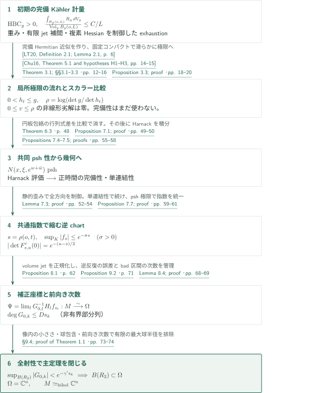
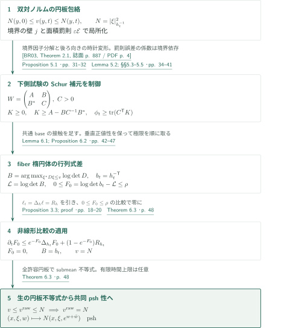
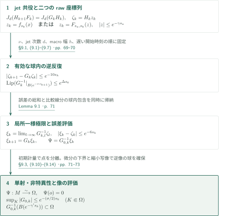

# Uniformization of complete Kähler manifolds with positive bisectional curvature

**余接束の円板包絡からHarnack評価を作り、非一様に縮む座標を全空間へ貼り合わせる**

本原稿は、曲率上界や体積成長の仮定を置かずにKähler–Ricci流を構成し、その双対ノルムの時空間的な多重劣調和性から縮小座標を得る。最後の問題は座標像の全射性であり、多項式モデルの前向き合成の次数を体積時計で制御することで解決すると著者は主張する。以下はその証明経路の概説であり、末尾に編集側の照合範囲を区別する。

## 1. 主要結果

### Theorem 1.1 — 正の正則二断面曲率から双正則一意化へ

$M$を複素次元$n\geq1$の連結な非コンパクト複素多様体とする。$M$が、正則二断面曲率が各点で狭義正である滑らかな完備Kähler計量$g$を持つならば、$M$は$\mathbb C^n$と双正則である。

正値性は点ごとの条件である。一様な正の下界、有限の曲率上界、体積成長、非崩壊、Ricci pinching、単連結性は追加仮定ではない。結論は複素多様体の双正則性であって、与えられた計量のEuclidean計量との等長性ではない。Stein性と可縮性はこの結論から従う。

<!-- cite:main -->[Theorem 1.1 · p. 2](https://github.com/openai/math/blob/fd4aeeb2ee4fc729c18d98444fed42fd0529eeeb/preprints/Uniformization-of-complete-Kahler-manifolds-with-positive-bisectional-curvature-September-23-2026/paper.pdf)<!-- /cite -->

原典では$\mathrm{Rm}(a,b,b,a)$を断面曲率の分子とし、任意の実単位接ベクトル$u,v$について
$$
\mathrm{Rm}(u,v,v,u)+\mathrm{Rm}(u,Jv,Jv,u)>0
$$
を仮定する。複素次元1ではこの和はGaussian曲率である。流れ・Laplacianの規約は
$$
\partial_t h_t=-\operatorname{Ric}(h_t),\qquad
\operatorname{Ric}(h)=-\partial\bar\partial\log\det h,\qquad
\Delta_h=\operatorname{tr}_h\partial\bar\partial
$$
で、実$(1,1)$形式との同一視では$\sqrt{-1}$を省略している。以下、$o\in M$を固定し、$r=d_g(o,\cdot)$とする。

<!-- cite:conventions -->[§1.3 · p. 5](https://github.com/openai/math/blob/fd4aeeb2ee4fc729c18d98444fed42fd0529eeeb/preprints/Uniformization-of-complete-Kahler-manifolds-with-positive-bisectional-curvature-September-23-2026/paper.pdf)<!-- /cite -->

## 図の矢印に付した引用

<!-- reference-guide -->
略号のない定理・補題・節・式番号は本原稿 [Uniformization of complete Kähler manifolds with positive bisectional curvature](https://github.com/openai/math/blob/fd4aeeb2ee4fc729c18d98444fed42fd0529eeeb/preprints/Uniformization-of-complete-Kahler-manifolds-with-positive-bisectional-curvature-September-23-2026/paper.pdf) を指します。外部入力には次の略号を使います。

- [CZ05](https://arxiv.org/pdf/math/0211374v1) Bing-Long Chen; Xi-Ping Zhu — *Volume growth and curvature decay of positively curved Kähler manifolds*：初期計量の平均スカラー曲率の線形減衰。中心に依存する定数を許す。arXiv:math/0211374v1 (2002); journal publication 2005。
- [Dem82](https://www.numdam.org/item/10.24033/asens.1434.pdf) Jean-Pierre Demailly — *Estimations L² pour l’opérateur ∂̄ d’un fibré vectoriel holomorphe semi-positif au-dessus d’une variété kählérienne complète*：GriffithsからNakanoへの正値性と重み付き∂̄解法。jet補間・歪み評価に使う。Ann. Sci. École Norm. Sup. (4) 15 (1982), 457–511; Numdam scan。
- [LT20](https://arxiv.org/pdf/1708.00141v2) Man-Chun Lee; Luen-Fai Tam — *Chern–Ricci flows on noncompact complex manifolds*：各完備Hermitian近似上での短時間存在。無限位数のbounded geometryを確認して適用。arXiv:1708.00141v2; journal publication 2020。
- [Chu16](https://arxiv.org/pdf/1410.3354v3) Jianchun Chu — *C²,α regularities and estimates for nonlinear elliptic and parabolic equations in geometry*：変換Hessianの一様放物型評価。局所的な計量の両側評価を高階評価へつなぐ。arXiv:1410.3354v3; journal publication 2016。
- [BR03](https://www.numdam.org/item/10.5802/aif.1964.pdf) Bo Berndtsson; Jean-Pierre Rosay — *Quasi-isometric vector bundles and bounded factorization of holomorphic matrices*：正定値な円周上の行列をH*Hに分解。境界まで滑らかなHとH⁻¹を円板変形に使う。Ann. Inst. Fourier 53 (2003), 885–901; Numdam scan。
- [FL14](https://arxiv.org/pdf/1402.4342v3) Franc Forstnerič; Finnur Lárusson — *Oka properties of groups of holomorphic and algebraic automorphisms of complex affine space*：発散ゼロの斉次ベクトル場のshear分解。全Oka定理を適用せず、有限jet実現に使う代数的入力の参照。arXiv:1402.4342v3 (2017-03-29); journal publication 2014。

各引用に結果番号とページを付します。誌面番号とPDF内の位置が異なる場合は両方を示します。GitHubの閲覧リンクではページ位置への自動移動を前提としません。
<!-- /reference-guide -->

## 2. Theorem 1.1 — 主定理の証明概略

<!-- proof-target:1 -->証明対象：[Theorem 1.1 · p. 2](https://github.com/openai/math/blob/fd4aeeb2ee4fc729c18d98444fed42fd0529eeeb/preprints/Uniformization-of-complete-Kahler-manifolds-with-positive-bisectional-curvature-September-23-2026/paper.pdf)<!-- /proof-target -->

主張は[Theorem 1.1](#theorem-1-1)を参照。**証明の道筋。** 初期計量上の重みと平均曲率評価から局所極限の流れを作り、完備性を前提にしない比較原理を用意する。[円板包絡と楕円体](#proof-1)がこの比較原理へ帰着してHarnack評価を与え、完備性・単連結性・縮小逆座標を順に導く。[補正座標の極限](#proof-2)を構成した後、前向き次数評価で像が$\mathbb C^n$全体であることを示す。

### 1. 初期の完備性を、局所極限と比較原理へ渡す

Proposition 2.1は、線形成長以下の狭義psh重み、有限jet補間、消失しない標準束切断、$u\asymp1+r$で$|\partial u|_g\leq C$、$|\partial\bar\partial u|_g\leq C/u$となるexhaustionを用意する。接ベクトル場の補間には$T^{1,0}M$自身のNakano正値性を仮定せず、$E\otimes\det E$の正値性と重み付き$L^2$解法を使う。平均曲率評価は固定中心$o$における$\frac{\int_{B_g(o,L)}R_g\,dV_g}{\operatorname{Vol}_g B_g(o,L)}\leq C/L$であり、中心に一様な定数や最大体積成長へ読み替えない。

<!-- cite:initial -->[Proposition 2.1; §2.1 · pp. 6–8](https://github.com/openai/math/blob/fd4aeeb2ee4fc729c18d98444fed42fd0529eeeb/preprints/Uniformization-of-complete-Kahler-manifolds-with-positive-bisectional-curvature-September-23-2026/paper.pdf)<!-- /cite --> <!-- cite:nakano -->[&#91;Dem82, Theorem 2.6, 誌面 p. 467 / PDF p. 12&#93;](https://www.numdam.org/item/10.24033/asens.1434.pdf#page=12)<!-- /cite --> <!-- cite:l2 -->[&#91;Dem82, Theorem 5.1, 誌面 p. 475 / PDF p. 20&#93;](https://www.numdam.org/item/10.24033/asens.1434.pdf#page=20)<!-- /cite --> <!-- cite:cz -->[&#91;CZ05, Theorem 2, p. 2&#93;](https://arxiv.org/pdf/math/0211374v1#page=2)<!-- /cite -->

$\{u<L\}$上で境界付近をconformalに吹き上げ、完備で無限位数のbounded geometryを持つHermitian計量$\alpha_L$を作る。LT20はこの各近似の短時間Chern–Ricci流に適用する。標準束切断から得たpotential障壁と最大固有値評価で、固定コンパクト・固定時間区間上の両側計量評価を得る。Chu16の一様放物型評価と局所高階評価から対角部分列を取り、初期時刻の片側微分も含む局所$C^\infty$収束によって$h_0=g$、$0<h_t\leq g$、$R_{h_t}\geq0$を得る。近似の完備性だけから極限の完備性を結論してはいない。

<!-- cite:flow -->[Theorem 3.1; §§3.1–3.3 · pp. 12–16](https://github.com/openai/math/blob/fd4aeeb2ee4fc729c18d98444fed42fd0529eeeb/preprints/Uniformization-of-complete-Kahler-manifolds-with-positive-bisectional-curvature-September-23-2026/paper.pdf)<!-- /cite --> <!-- cite:lt -->[&#91;LT20, Definition 2.1; Lemma 2.1, p. 6&#93;](https://arxiv.org/pdf/1708.00141v2#page=6)<!-- /cite --> <!-- cite:chu -->[&#91;Chu16, Theorem 5.1 and hypotheses H1–H3, pp. 14–15&#93;](https://arxiv.org/pdf/1410.3354v3#page=14)<!-- /cite -->

$\rho=\log(\det g/\det h_t)$には有限時間で$\frac{\int_{B_g(o,L)}\rho\,dV_g}{\operatorname{Vol}_g B_g(o,L)}\leq C_TL$が成り立つ。$g-h_t$に適合した可積分重み$\chi\asymp u^{-k}$は$\partial\bar\partial\chi\leq C_T\chi h_t$を満たす。これと$|\operatorname{tr}_{h_t}B|dV_{h_t}\leq C_n|B|_g dV_g$という余因子評価により、無限遠の誤差を消す。Proposition 3.3は$0\leq v\leq\rho$の上半連続粘性劣解に対し
$$
\partial_tv\leq e^{-v}\Delta_{h_t}v+(1-e^{-v})R_{h_t}\quad\Longrightarrow\quad v=0
$$
を証明する。その滑らかなmajorant $w$では$\partial_t[(e^w-1)dV_{h_t}]=(\Delta_{h_t}w)dV_{h_t}$となり、重み付き質量のGronwall評価が閉じる。

<!-- cite:comparison -->[Proposition 3.3; proof · pp. 18–20](https://github.com/openai/math/blob/fd4aeeb2ee4fc729c18d98444fed42fd0529eeeb/preprints/Uniformization-of-complete-Kahler-manifolds-with-positive-bisectional-curvature-September-23-2026/paper.pdf)<!-- /cite --> <!-- cite:majorant -->[Lemma 3.4; §3.6 · pp. 19–22](https://github.com/openai/math/blob/fd4aeeb2ee4fc729c18d98444fed42fd0529eeeb/preprints/Uniformization-of-complete-Kahler-manifolds-with-positive-bisectional-curvature-September-23-2026/paper.pdf)<!-- /cite -->

### 2. 双対ノルムの共同psh性がHarnack評価と完備性を与える

Theorem 6.3が$N(x,\xi,e^{w+\bar w})$のpsh性を示すと、空間・時間の曲率blockから非負正則二断面曲率とmatrix/scalar Harnack不等式が得られる。初期の狭義正値性は固定コンパクト上でRicci正値性を与え、matrix不等式がこれを正時間へ伝播させる。距離を近似する区分的に滑らかな経路上でscalar不等式を積分するため、この時点では完備性や大域的最短測地線を使わない。

<!-- cite:joint -->[Theorem 6.3 · p. 48](https://github.com/openai/math/blob/fd4aeeb2ee4fc729c18d98444fed42fd0529eeeb/preprints/Uniformization-of-complete-Kahler-manifolds-with-positive-bisectional-curvature-September-23-2026/paper.pdf)<!-- /cite --> <!-- cite:harnack -->[Proposition 7.1; proof · pp. 49–50](https://github.com/openai/math/blob/fd4aeeb2ee4fc729c18d98444fed42fd0529eeeb/preprints/Uniformization-of-complete-Kahler-manifolds-with-positive-bisectional-curvature-September-23-2026/paper.pdf)<!-- /cite -->

その後、初期の球$B_g(o,L)$からの最短退出長$\ell_L(t)$に対して$1+\ell_L(t)\geq(1+L)e^{-2C_T\sqrt t}$を得る。$L\to\infty$により全ての正時間sliceが完備になる。ここで$C_T$は有限時間区間と固定初期幾何に依存する。

### 3. 体積時計の収縮を全方向・全コンパクトへ広げる

$\tau=\log t$、$s=\rho(o,t)$、$q(s)=ds/d\tau=tR(o,t)$と置く。局所chartの最大・最小の初期計量での特異長を$B,A$とすると、Lemma 7.3の$B\leq C(1+A)^C$が行列式の減少を全方向の収縮へ変える。この定数は固定コンパクト、chart半径、下側計量評価、近傍の初期幾何に依存し、特定のchartの全歪みには依存しない。$s\to\infty$で各固定コンパクト上
$$
\rho(x,t)/s\longrightarrow1,\qquad e^{-2s}g\leq h_t\leq e^{-c_Ks}g
$$
を得る。

<!-- cite:distortion -->[Lemma 7.3; proof · pp. 52–54](https://github.com/openai/math/blob/fd4aeeb2ee4fc729c18d98444fed42fd0529eeeb/preprints/Uniformization-of-complete-Kahler-manifolds-with-positive-bisectional-curvature-September-23-2026/paper.pdf)<!-- /cite --> <!-- cite:windows -->[Propositions 7.4–7.5; proofs · pp. 55–58](https://github.com/openai/math/blob/fd4aeeb2ee4fc729c18d98444fed42fd0529eeeb/preprints/Uniformization-of-complete-Kahler-manifolds-with-positive-bisectional-curvature-September-23-2026/paper.pdf)<!-- /cite -->

選んだRicci pinching区間で再尺度化した流れを接空間の球へ引き戻し、局所$C^\infty$部分列極限を取る。Harnackの等号は極限のスカラー曲率の実Hessianを狭義負にし、元の多様体の小さい内在的球へその評価を戻せる。スカラー曲率の勾配流で固定ループを縮めて単連結性を示す。大域的な非崩壊極限や、局所chartの大域単射性は仮定しない。

単連結性により逆chart $f_s$をexhaustion上で整合的に続ける。まず得る$\sup_K|f_s|\leq C_Ke^{-a_Ks}$を、$s^{-1}\log|f_s|$の局所$L^1$ psh部分列極限とLemma 7.6のLiouville性で改善し、全ての固定コンパクトに共通の$\sigma>0$を得る：$\sup_K|f_s|\leq e^{-\sigma s}$。成立し始める時刻は$K$に依存してよい。transition $F_{s,u}$には$|\det F'_{s,u}(0)|=e^{-(u-s)/2}$と、後の時刻$u$に一様なjet・小球評価が残る。

<!-- cite:charts -->[Proposition 7.7; proof · pp. 59–61](https://github.com/openai/math/blob/fd4aeeb2ee4fc729c18d98444fed42fd0529eeeb/preprints/Uniformization-of-complete-Kahler-manifolds-with-positive-bisectional-curvature-September-23-2026/paper.pdf)<!-- /cite -->

### 4. 非一様収縮の損失を前向きの次数に記録する

Proposition 8.1は固定jet次数$d$に対して、局所座標変更$H_k$と多項式自己同型$G_k$を作り、$J_d(H_{k+1}F_k)=J_d(G_kH_k)$を満たす。Jacobianの非定数jetを先に消し、発散ゼロの斉次場をshearで実現する。非線形shearのJacobianは1だが、$G_k$全体のJacobianは収縮する線形部分の定数である。$n=1$では次数2以上の発散ゼロの斉次場は零であり、この構成も扱う。

<!-- cite:models -->[Proposition 8.1 · p. 62](https://github.com/openai/math/blob/fd4aeeb2ee4fc729c18d98444fed42fd0529eeeb/preprints/Uniformization-of-complete-Kahler-manifolds-with-positive-bisectional-curvature-September-23-2026/paper.pdf)<!-- /cite --> <!-- cite:jets -->[Lemma 8.2 · p. 63](https://github.com/openai/math/blob/fd4aeeb2ee4fc729c18d98444fed42fd0529eeeb/preprints/Uniformization-of-complete-Kahler-manifolds-with-positive-bisectional-curvature-September-23-2026/paper.pdf)<!-- /cite --> <!-- cite:shears -->[&#91;FL14, Proof of Theorem 3.1 (divergence-free shears), pp. 8–9&#93;](https://arxiv.org/pdf/1402.4342v3#page=8)<!-- /cite -->

原典はregular区間で重み付き次数を保ち、bad区間での次数増加を$q$の増大に割り当てる。$\liminf_{s\to\infty}q(s)/s\leq2$から、前向き合成$G_{0,k}=G_{k-1}\circ\cdots\circ G_0$に$\deg G_{0,k}\leq Ds_k$となる非有界部分列を得る。[Proposition 9.2](#proposition-9-2)は補正座標の極限を双正則写像$\Psi:M\to\Omega\subset\mathbb C^n$にする。この段階では像が真部分領域である可能性が残る。

<!-- cite:degree -->[Lemma 8.4; proof · pp. 68–69](https://github.com/openai/math/blob/fd4aeeb2ee4fc729c18d98444fed42fd0529eeeb/preprints/Uniformization-of-complete-Kahler-manifolds-with-positive-bisectional-curvature-September-23-2026/paper.pdf)<!-- /cite --> <!-- cite:coordinates -->[Proposition 9.2 · p. 71](https://github.com/openai/math/blob/fd4aeeb2ee4fc729c18d98444fed42fd0529eeeb/preprints/Uniformization-of-complete-Kahler-manifolds-with-positive-bisectional-curvature-September-23-2026/paper.pdf)<!-- /cite -->

### 5. 最大球半径の背理法で全射性を閉じる

$0<\gamma'<\sigma/2$とし、$R_* =\sup\{R:B(R)\subset\Omega\}<\infty$を仮定する。次数を抑えた部分列に対し、$0<R_1<R_*<R_2$を$D\log(R_2/R_1)<\sigma/2-\gamma'$となるように選ぶ。$\overline{B(R_1)}\Subset\Omega$なので、Proposition 9.2と多項式の成長評価から
$$
\sup_{B(R_2)}|G_{0,k}|
\leq (R_2/R_1)^{Ds_k}e^{-(\sigma/2)s_k}
<e^{-\gamma's_k}.
$$
同じ命題の$G_{0,k}^{-1}(B(e^{-\gamma's_k}))\subset\Omega$を使えば$B(R_2)\subset\Omega$となり矛盾する。よって$\Omega=\mathbb C^n$。単射・非特異性と合わせて主定理の双正則性が得られ、Stein性と可縮性も従う。逆合成の次数上界や、一様な瞬間収縮比はこの最終段階には不要である。

<!-- cite:surjective -->[§9.4; proof of Theorem 1.1 · pp. 73–74](https://github.com/openai/math/blob/fd4aeeb2ee4fc729c18d98444fed42fd0529eeeb/preprints/Uniformization-of-complete-Kahler-manifolds-with-positive-bisectional-curvature-September-23-2026/paper.pdf)<!-- /cite -->

## 3. Theorem 6.3 の証明 — 円板包絡をスカラー比較へ帰着する

<!-- proof-target:2 -->証明対象：[Theorem 6.3 · p. 48](https://github.com/openai/math/blob/fd4aeeb2ee4fc729c18d98444fed42fd0529eeeb/preprints/Uniformization-of-complete-Kahler-manifolds-with-positive-bisectional-curvature-September-23-2026/paper.pdf)<!-- /proof-target -->

<!-- statement:theorem-6-3 -->
### Theorem 6.3 — 円板包絡と双対ノルムの一致

Theorem 3.1の流れ$h_t$に対し、$Y=T^{*(1,0)}M$、$N(x,\xi,t)=|\xi|^2_{h_t^{-1}}$とする。任意の有限$T>0$について、中心$(y,s)$、$w(0)=0$、$se^{w+\bar w}<T$を満たす正則円板の境界平均$\langle N(f,se^{w+\bar w})\rangle$の下限を下半連続正則化したものを$v$とする。このとき$v=N$が$Y\times(0,T)$上で成り立ち、$(x,\xi,w)\mapsto N(x,\xi,e^{w+\bar w})$は$Y\times\mathbb C$上でpshである。

<!-- cite:joint -->[Theorem 6.3 · p. 48](https://github.com/openai/math/blob/fd4aeeb2ee4fc729c18d98444fed42fd0529eeeb/preprints/Uniformization-of-complete-Kahler-manifolds-with-positive-bisectional-curvature-September-23-2026/paper.pdf)<!-- /cite -->
<!-- /statement -->

### 1. 面積罰則を消しても残る境界評価を作る

初期双対ノルムのpsh性と$h_t\leq g$から$N(\cdot,0)\leq v\leq N(\cdot,t)$。円板の下限が達成されるとは仮定しない。境界をコンパクトに制限する壁と$\varepsilon\mathcal E$を加え、固定した壁$j$と$\varepsilon>0$で内部像をコンパクトに閉じ込める。内部のコンパクトは$\varepsilon$に依存してよいが、変形評価の最終誤差$C_j\varepsilon(1+\mathcal E)$の係数は境界データだけに依存させる。最小化列の極限、$\varepsilon\downarrow0$、その後の$j\to\infty$を区別することが必要である。

<!-- cite:envelope -->[§4; Lemma 4.1 · pp. 22–23](https://github.com/openai/math/blob/fd4aeeb2ee4fc729c18d98444fed42fd0529eeeb/preprints/Uniformization-of-complete-Kahler-manifolds-with-positive-bisectional-curvature-September-23-2026/paper.pdf)<!-- /cite --> <!-- cite:deformation -->[Lemma 5.2; §§5.3–5.5 · pp. 34–41](https://github.com/openai/math/blob/fd4aeeb2ee4fc729c18d98444fed42fd0529eeeb/preprints/Uniformization-of-complete-Kahler-manifolds-with-positive-bisectional-curvature-September-23-2026/paper.pdf)<!-- /cite -->

境界Hessianの負部分を除き、正定値majorantを$H^*H$に分解する。BR03の境界まで滑らかな可逆正則因子が、円板に依存する試験方向を許す。時間変形は後ろ向きに取り、境界時間が$T$に近い場合も許容性を保つ。Proposition 5.1は垂直block $C>0$の下側試験Hessian $W=\bigl(\begin{smallmatrix}A&B\\B^*&C\end{smallmatrix}\bigr)$について、$K\geq0$、$K\geq A-BC^{-1}B^*$、$\partial_t\phi\geq\operatorname{tr}(C^{\mathsf T}K)$を供給する。水平Hessian自身が非負だと置き換えない。

<!-- cite:factor -->[&#91;BR03, Theorem 2.1, 誌面 p. 887 / PDF p. 4&#93;](https://www.numdam.org/item/10.5802/aif.1964.pdf#page=4)<!-- /cite --> <!-- cite:disc -->[Proposition 5.1 · pp. 31–32](https://github.com/openai/math/blob/fd4aeeb2ee4fc729c18d98444fed42fd0529eeeb/preprints/Uniformization-of-complete-Kahler-manifolds-with-positive-bisectional-curvature-September-23-2026/paper.pdf)<!-- /cite -->

### 2. 共通baseの接触を足して行列式の不等式を得る

各余接fiberで$\xi^*B\xi\leq v(x,\xi,t)$を満たす$B>0$の$\log\det B$を最大化し、$\mathcal L=\log\det B$、$b_t=h_t^{-\mathsf T}$、$F_0=\log\det b_t-\mathcal L$と置く。$0\leq F_0\leq\rho$である。$B=I$の座標で接触ベクトルを$\sum_i\alpha_i\xi_i\xi_i^*=I$と取り、複製によって$\max_i\alpha_i$を小さくする。

各接触で別々のbaseを選ぶのではなく、共通の$x,t$を保つ積のsupportとinf-convolutionで同時接触を選ぶ。垂直Levi blockの正値性を保持してProposition 5.1を適用し、Schur補元を足す。下側試験のHessianの微小減少を各固定接触で先に消し、その後に正則化、最後に接触重みを極限へ送る。Proposition 6.2は$\partial_t\mathcal L\geq e^{-F_0}\Delta_{h_t}\mathcal L$を下側粘性の意味で与える。

<!-- cite:ellipsoid -->[Lemma 6.1; Proposition 6.2 · pp. 42–47](https://github.com/openai/math/blob/fd4aeeb2ee4fc729c18d98444fed42fd0529eeeb/preprints/Uniformization-of-complete-Kahler-manifolds-with-positive-bisectional-curvature-September-23-2026/paper.pdf)<!-- /cite -->

### 3. 行列式差ゼロからノルムの円板不等式へ戻る

$\ell=\log\det b_t$は$\partial_t\ell=\Delta_{h_t}\ell=R_{h_t}$を満たす。したがって$F_0$はProposition 3.3の上側粘性不等式を満たし、$F_0=0$となる。$B\leq b_t$かつ$\det B=\det b_t$なので$B=b_t$、従って$N\leq v\leq N$である。さらに$v\leq v^{\rm raw}\leq N$から生の円板下限も$N$に等しく、全ての許容円板でsubmean不等式が得られる。任意の有限時間上限を選べるので、複素化した対数時間を含む共同psh性に至る。

<!-- cite:comparison -->[Proposition 3.3; proof · pp. 18–20](https://github.com/openai/math/blob/fd4aeeb2ee4fc729c18d98444fed42fd0529eeeb/preprints/Uniformization-of-complete-Kahler-manifolds-with-positive-bisectional-curvature-September-23-2026/paper.pdf)<!-- /cite --> <!-- cite:joint -->[Theorem 6.3 · p. 48](https://github.com/openai/math/blob/fd4aeeb2ee4fc729c18d98444fed42fd0529eeeb/preprints/Uniformization-of-complete-Kahler-manifolds-with-positive-bisectional-curvature-September-23-2026/paper.pdf)<!-- /cite -->

## 4. Proposition 9.2 の証明 — 補正座標の極限と球包含

<!-- proof-target:3 -->証明対象：[Proposition 9.2 · p. 71](https://github.com/openai/math/blob/fd4aeeb2ee4fc729c18d98444fed42fd0529eeeb/preprints/Uniformization-of-complete-Kahler-manifolds-with-positive-bisectional-curvature-September-23-2026/paper.pdf)<!-- /proof-target -->

<!-- statement:proposition-9-2 -->
### Proposition 9.2 — 全多様体上の座標と像の定量評価

Propositions 7.7・8.1の逆chart $f_s$、座標変更$H_k$、多項式自己同型$G_k$を用い、§9.1の順序で定数を固定する。特に$0<\gamma<\gamma'<\min\{\sigma/2,1\}$とする。exhaustion上の局所一様極限
$$
\Psi(x)=\lim_{l\to\infty}G_{0,l}^{-1}H_lf_{s_l}(x)
$$
は$\Psi(o)=0$を満たす単射正則写像であり、開集合$\Omega=\Psi(M)$への双正則写像となる。任意のコンパクト$K\subset\Omega$で、十分大きな$k$に対して$\sup_K|G_{0,k}|\leq e^{-(\sigma/2)s_k}$。また全ての十分大きな$k$で$G_{0,k}^{-1}(B(e^{-\gamma's_k}))\subset\Omega$が成り立つ。

<!-- cite:coordinates -->[Proposition 9.2 · p. 71](https://github.com/openai/math/blob/fd4aeeb2ee4fc729c18d98444fed42fd0529eeeb/preprints/Uniformization-of-complete-Kahler-manifolds-with-positive-bisectional-curvature-September-23-2026/paper.pdf)<!-- /cite -->
<!-- /statement -->

### 1. jet誤差を逆反復の有効領域内で総和する

原典は収縮指数に応じて$\nu>0$、次に$(d+1)\nu>30$となる$d$、その後に小さいmacro幅$h$、最後に十分遅い開始時刻を選ぶ。$\Delta s_k$の係数$C_d$が$h$に依存しないことがこの順序を可能にする。$\zeta_k=H_k(z_k)$に対して欠損$r_k=\zeta_{k+1}-G_k\zeta_k$を$e^{-10s_k}$以下にし、$G_k^{-1}$のLipschitz評価は指定された$B(e^{-\nu s_{k+1}})$内だけで使う。

<!-- cite:parameters -->[§9.1, (9.1)–(9.7) · pp. 69–70](https://github.com/openai/math/blob/fd4aeeb2ee4fc729c18d98444fed42fd0529eeeb/preprints/Uniformization-of-complete-Kahler-manifolds-with-positive-bisectional-curvature-September-23-2026/paper.pdf)<!-- /cite -->

逆向き帰納では、誤差評価と比較線分がこの球から出ないことを同時に示す。誤差和$\sum_{i\geq k}e^{-10s_i+s_{i+1}-s_k}\leq e^{-6s_k}$が閉じ、$\xi_k=\lim_{l\to\infty}G_{k,l}^{-1}\zeta_l$は局所一様に収束し、$\xi_{k+1}=G_k\xi_k$を満たす。対象は固定コンパクト上の$z_k=f_{s_k}(x)$と、縮小chart球からの$z_k=F_{s_a,s_k}(z)$の二種類であり、後者が球包含に必要になる。

<!-- cite:convergence -->[Lemma 9.1 · p. 71](https://github.com/openai/math/blob/fd4aeeb2ee4fc729c18d98444fed42fd0529eeeb/preprints/Uniformization-of-complete-Kahler-manifolds-with-positive-bisectional-curvature-September-23-2026/paper.pdf)<!-- /cite -->

### 2. 極限の正則性から単射性・非特異性まで確認する

逆chartの整合性と$\xi_{k+1}=G_k\xi_k$で局所極限を貼り合わせる。単射性は、同じ像を持つ二点のraw座標差が$e^{-5s_k}$以下になることと、$h_{t(s_k)}\geq e^{-2s_k}g$を比較し、初期計量の固定球から退出する経路の長さが零へ向かう矛盾で得る。

微分の非特異性は局所一様収束だけからは結論しない。$d(H_kf_{s_k})$の下界$cs_k^{-C}e^{-s_k}$に対し、少し大きな固定近傍での誤差$e^{-6s_k}$をCauchy評価して微分誤差を抑える。これにより$d\Psi$は非特異となり、単射性と局所逆写像定理から$\Psi:M\to\Omega$は双正則である。$\Psi^{-1}(K)$上のchart収縮を使うと、像内コンパクトでの前向き小ささも従う。

<!-- cite:coordinate-proof -->[§9.3, (9.10)–(9.14) · pp. 71–73](https://github.com/openai/math/blob/fd4aeeb2ee4fc729c18d98444fed42fd0529eeeb/preprints/Uniformization-of-complete-Kahler-manifolds-with-positive-bisectional-curvature-September-23-2026/paper.pdf)<!-- /cite -->

### 3. 縮小chart球から像に含まれる球を得る

$T_k=G_{0,k}\Psi\Phi_{s_k}$を$B(e^{-\gamma s_k})$で線形部分$A_k=H_k'(0)$と比較する。$A_k^{-1}$の多項式上界とCauchy評価で$A_k^{-1}(T_k-A_k)$の微分を小さくする。$\gamma'>\gamma$により、$|w|\leq e^{-\gamma's_k}$に対する$z=A_k^{-1}w-A_k^{-1}(T_k(z)-A_kz)$は小球上の縮小写像となる。よって$B(e^{-\gamma's_k})\subset G_{0,k}(\Omega)$。この球包含と前向き小ささが、[主定理の最終段階](#proof-overview-step-5)で同じ$G_{0,k}$に適用される。

<!-- cite:coordinate-proof -->[§9.3, (9.10)–(9.14) · pp. 71–73](https://github.com/openai/math/blob/fd4aeeb2ee4fc729c18d98444fed42fd0529eeeb/preprints/Uniformization-of-complete-Kahler-manifolds-with-positive-bisectional-curvature-September-23-2026/paper.pdf)<!-- /cite -->

## 5. どの論文が、どの段階を担うか

| 供給元と結果 | 本稿の使用箇所 | 使用内容・適用条件 | 確認範囲 |
|---|---|---|---|
| <!-- cite:cz -->[&#91;CZ05, Theorem 2, p. 2&#93;](https://arxiv.org/pdf/math/0211374v1#page=2)<!-- /cite --> | Proposition 2.1(v), p.12 | 完備・非コンパクト・正の二断面曲率。定数は固定中心に依存してよい。原稿は必要なcutoffも構成する。 | 原典の定理記述と本稿の用途を照合。 |
| <!-- cite:nakano -->[&#91;Dem82, Theorem 2.6, 誌面 p. 467 / PDF p. 12&#93;](https://www.numdam.org/item/10.24033/asens.1434.pdf#page=12)<!-- /cite -->；<!-- cite:l2 -->[&#91;Dem82, Theorem 5.1, 誌面 p. 475 / PDF p. 20&#93;](https://www.numdam.org/item/10.24033/asens.1434.pdf#page=20)<!-- /cite --> | §2.1, p.7; Lemma 7.3, p.54 | $E\otimes\det E$のNakano正値性、重みの曲率、compact supportと対数極によるjetの固定。 | 両定理の記述と係数束・重みの用途を照合。全補助評価の独立検証は未実施。 |
| <!-- cite:lt -->[&#91;LT20, Definition 2.1; Lemma 2.1, p. 6&#93;](https://arxiv.org/pdf/1708.00141v2#page=6)<!-- /cite -->；<!-- cite:chu -->[&#91;Chu16, Theorem 5.1 and hypotheses H1–H3, pp. 14–15&#93;](https://arxiv.org/pdf/1410.3354v3#page=14)<!-- /cite --> | §§3.1–3.3, pp.13–15 | 各近似のbounded geometry、一様楕円性・凹性・Hölder係数。固定コンパクトで極限を取る。 | 記述と適用の対応を照合。大域的なbounded geometryは極限に仮定しない。 |
| <!-- cite:factor -->[&#91;BR03, Theorem 2.1, 誌面 p. 887 / PDF p. 4&#93;](https://www.numdam.org/item/10.5802/aif.1964.pdf#page=4)<!-- /cite --> | Lemma 4.6; §5.3, p.39 | 滑らかな正定値境界行列と正則可逆因子。必要なseminorm評価は本稿で追加。 | 分解定理の記述と使用箇所を照合。追加評価の全検証は未実施。 |
| <!-- cite:shears -->[&#91;FL14, Proof of Theorem 3.1 (divergence-free shears), pp. 8–9&#93;](https://arxiv.org/pdf/1402.4342v3#page=8)<!-- /cite --> | Lemma 8.2, p.63 | 発散ゼロの斉次場を有限個のshearで表す。固定$n,d$で次数・係数を管理。 | 参照先のshear記述と本稿の有限jet構成を照合。全Oka定理の利用ではない。 |

CaoのHarnack評価、Chau–Tamのchart構成、非自律吸引域の一意化は原稿が説明する先行手法・比較である。本稿では必要なHarnack評価と非一様モデルを別に構成しており、先行定理の仮定を確認せず主定理への直接依存の矢印にはしない。

## 6. 原典を読む入口と確認範囲

<!-- reading-list -->
- [Theorem 3.1; §§3.1–3.3 · pp. 12–16](https://github.com/openai/math/blob/fd4aeeb2ee4fc729c18d98444fed42fd0529eeeb/preprints/Uniformization-of-complete-Kahler-manifolds-with-positive-bisectional-curvature-September-23-2026/paper.pdf) — 近似の局所極限と完備性を後で示す順序
- [Proposition 3.3; proof · pp. 18–20](https://github.com/openai/math/blob/fd4aeeb2ee4fc729c18d98444fed42fd0529eeeb/preprints/Uniformization-of-complete-Kahler-manifolds-with-positive-bisectional-curvature-September-23-2026/paper.pdf) — χ重みと非線形比較の体積形式の相殺
- [Lemma 5.2; §§5.3–5.5 · pp. 34–41](https://github.com/openai/math/blob/fd4aeeb2ee4fc729c18d98444fed42fd0529eeeb/preprints/Uniformization-of-complete-Kahler-manifolds-with-positive-bisectional-curvature-September-23-2026/paper.pdf) — 面積罰則と境界定数の区別、極限の順序
- [Lemma 6.1; Proposition 6.2 · pp. 42–47](https://github.com/openai/math/blob/fd4aeeb2ee4fc729c18d98444fed42fd0529eeeb/preprints/Uniformization-of-complete-Kahler-manifolds-with-positive-bisectional-curvature-September-23-2026/paper.pdf) — 共通baseを保つ接触からスカラー不等式へ
- [Propositions 7.4–7.5; proofs · pp. 55–58](https://github.com/openai/math/blob/fd4aeeb2ee4fc729c18d98444fed42fd0529eeeb/preprints/Uniformization-of-complete-Kahler-manifolds-with-positive-bisectional-curvature-September-23-2026/paper.pdf) — Harnack等号の局所極限とループ収縮
- [Proposition 7.7; proof · pp. 59–61](https://github.com/openai/math/blob/fd4aeeb2ee4fc729c18d98444fed42fd0529eeeb/preprints/Uniformization-of-complete-Kahler-manifolds-with-positive-bisectional-curvature-September-23-2026/paper.pdf) — コンパクトに共通の収縮指数
- [Lemma 8.4; proof · pp. 68–69](https://github.com/openai/math/blob/fd4aeeb2ee4fc729c18d98444fed42fd0529eeeb/preprints/Uniformization-of-complete-Kahler-manifolds-with-positive-bisectional-curvature-September-23-2026/paper.pdf) — 前向き合成の次数を部分列上で制御
- [§9.3, (9.10)–(9.14) · pp. 71–73](https://github.com/openai/math/blob/fd4aeeb2ee4fc729c18d98444fed42fd0529eeeb/preprints/Uniformization-of-complete-Kahler-manifolds-with-positive-bisectional-curvature-September-23-2026/paper.pdf) — 局所一様収束、単射、微分の非特異性、球包含
- [§9.4; proof of Theorem 1.1 · pp. 73–74](https://github.com/openai/math/blob/fd4aeeb2ee4fc729c18d98444fed42fd0529eeeb/preprints/Uniformization-of-complete-Kahler-manifolds-with-positive-bisectional-curvature-September-23-2026/paper.pdf) — 最大球半径の背理法で全射性を得る
<!-- /reading-list -->

編集側では、主定理と本記事の二つの中間主張、流れと比較の順序、包絡の行列式差を消す接続、Harnackから完備性・単連結性への議論、共通収縮指数、補正座標の収束・単射・非特異性・全射の各箇所を原典本文と照合した。表の6外部文献については入力の記述と用途を確認した。これは単独制作の自己点検であり、独立査読ではない。

Hodge熱の自己共役性・有限伝播の外部入力、円板コンパクト性と変形の全補助評価、粘性接触の全正則化議論、§§8.2–8.4のrate順序・macro-grid・線形alignmentの全詳細、教科書の放物型正則性・熱核・平均値評価・局所Ricci流微分評価を含む全外部結果の原典照合は未完了である。特にProposition 8.1の全技術的見積りを編集側が独立に証明済みとは扱わない。掲載した接続は著者の論証の読解と限定した入力照合であり、77ページ全体の数学的正しさの認定ではない。
