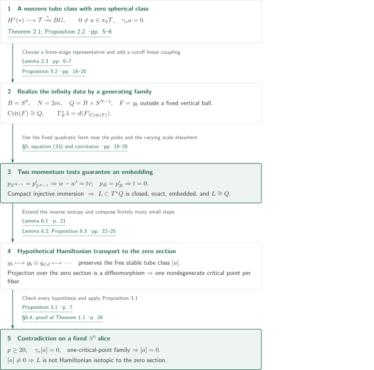
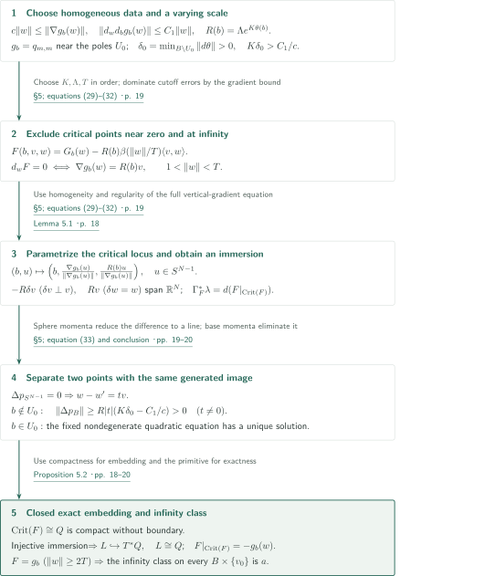
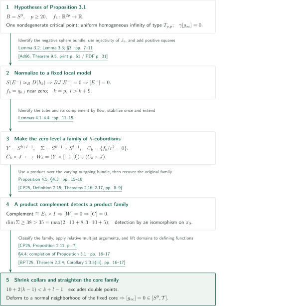
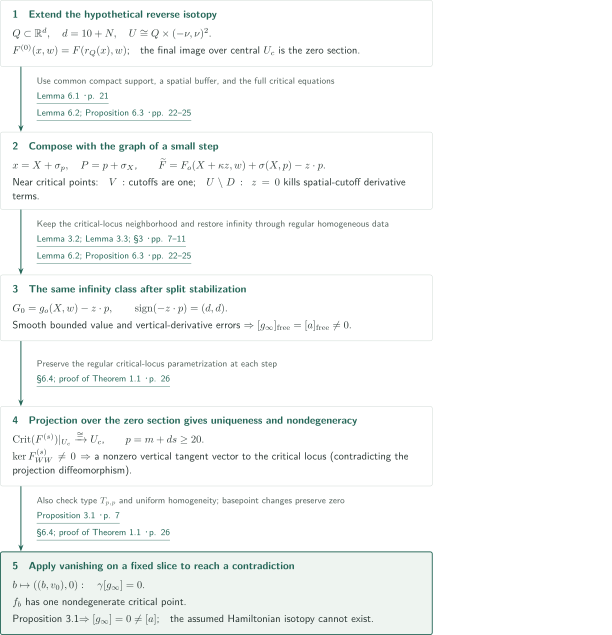

# A counterexample to the nearby Lagrangian conjecture

**Realizing a stable tube class by an embedding and obstructing transport to a one-critical-point family**

The manuscript argues that a nonzero stable tube class placed at infinity in a generating family prevents Hamiltonian transport of the resulting closed exact Lagrangian to the zero section. The construction separates possible double points of the generated immersion using momenta in the sphere and $S^9$ directions. This article explains the claims and proof route of the September 23, 2026 version; it does not constitute independent verification of the entire proof.

## 1. Main results

### Theorem 1.1 — A closed exact embedded counterexample diffeomorphic to the base

For some sufficiently large even integer $N$, the manifold
$$
Q=S^9\times S^{N-1}
$$
admits a closed exact smoothly embedded Lagrangian $L\subset T^*Q$ such that $L$ is diffeomorphic to $Q$ and no compactly supported Hamiltonian isotopy carries the zero section to $L$. Thus $\dim L=\dim Q=N+8$ and $\dim T^*Q=2N+16$. The quantifier is “some sufficiently large even integer $N$”; it does not assert counterexamples over every base or in every dimension.

Closed means compact without boundary, and exact means that the restriction of the canonical one-form $\lambda$ is globally $df$. The conjecture is formulated for a closed connected smooth manifold $Q$: whether every closed exact embedded Lagrangian in $T^*Q$ is Hamiltonian isotopic to its zero section. Hamiltonians are supported, for all times, in one fixed compact set, with conventions $\omega=d\lambda$ and $\iota_{X_{H_t}}\omega=-dH_t$. A cutoff equal to one near the compact isotopy trace imposes this support condition while preserving the flow on that trace.

<!-- cite:main -->[Theorem 1.1; §1 · p. 1](https://github.com/openai/math/blob/4eaee87548250b2682affda7d05d947c05554bae/preprints/A-counterexample-to-the-nearby-Lagrangian-conjecture-September-23-2026/paper.pdf)<!-- /cite -->

## References on the arrows

<!-- reference-guide -->
Unprefixed theorem, lemma, section and equation numbers refer to [A counterexample to the nearby Lagrangian conjecture](https://github.com/openai/math/blob/4eaee87548250b2682affda7d05d947c05554bae/preprints/A-counterexample-to-the-nearby-Lagrangian-conjecture-September-23-2026/paper.pdf). External inputs use the following keys.

- [AIS26](https://arxiv.org/pdf/2603.28007v2) Daniel Álvarez-Gavela; Kiyoshi Igusa; Michael G. Sullivan — *Legendrian and Lagrangian higher torsion*: Tube fibration and the quadratic-form composite BJ. arXiv:2603.28007v2, 19 August 2026.
- [Rog14](https://arxiv.org/pdf/1403.5998v1) John Rognes — *Algebraic K-theory of strict ring spectra*: Two-primary smooth Whitehead group in degree ten. arXiv:1403.5998v1, 24 March 2014.
- [CP25](https://arxiv.org/pdf/2506.06110v1) Sylvain Courte; Noah Porcelli — *On the parametrised Whitehead torsion of families of nearby Lagrangian submanifolds*: Classification of h-cobordism families, interval stabilization, and connectivity estimates. arXiv:2506.06110v1, 6 June 2025.
- [Ad66](https://www.sas.rochester.edu/mth/sites/doug-ravenel/otherpapers/Adams-JX4.pdf) J. F. Adams — *On the groups J(X). IV*: Injectivity of J8 and J9. Topology 5 (1966), 21–71; published version.
- [IWX23](https://www.numdam.org/item/10.1007/s10240-023-00139-1.pdf) Daniel C. Isaksen; Guozhen Wang; Zhouli Xu — *Stable homotopy groups of spheres: from dimension 0 to 90*: The ninth stable stem. Publications Mathématiques de l’IHÉS 137 (2023), 107–243; published version.
- [BPT25](https://arxiv.org/pdf/2503.04348v1) Maciej Borodzik; Mark Powell; Peter Teichner — *Link concordance implies link homotopy*: Avoidance of bad multijet strata for the core family. arXiv:2503.04348v1, 6 March 2025.
- [Hat02](https://pi.math.cornell.edu/~hatcher/AT/AT.pdf) Allen Hatcher — *Algebraic Topology*: Homological Whitehead theorem for simply connected CW types. 2002 book; author-hosted PDF accessed 4 November 2026.
- [Bott59](https://webhomes.maths.ed.ac.uk/~v1ranick/papers/bott4.pdf) Raoul Bott — *The stable homotopy of the classical groups*: Bott periodicity and the groups π8O and π9O. 1959 published article scan, Annals of Mathematics 70(2), 313–337; one repository cover page.
- [WJR13](https://www.sas.rochester.edu/mth/sites/doug-ravenel/otherpapers/WJR.pdf) Friedhelm Waldhausen; Bjørn Jahren; John Rognes — *Spaces of PL Manifolds and Categories of Simple Maps*: Stable parametrized h-cobordism theorem, collared interval product and extension, and the cofiber definition of Whdiff; checked in a prepublication manuscript. Checked version: undated Rochester-hosted prepublication manuscript (166 pages; PDF creation metadata 2012-02-29); not compared word for word with the cited 2013 published book.
- [Mil65](https://webhomes.maths.ed.ac.uk/~v1ranick/surgery/hcobord.pdf) John Milnor — *Lectures on the h-Cobordism Theorem*: Products for each simply connected h-cobordism; fixing the incoming end and producing a product family are separate steps. 1965 Princeton University Press edition scan; title and copyright pages checked.
- [AACK25](https://arxiv.org/pdf/2505.12515v2) Mohammed Abouzaid; Daniel Álvarez-Gavela; Sylvain Courte; Thomas Kragh — *Normal invariant of nearby Lagrangians via twisted derivative*: Identify the spherical-fibration classifying map through tube-type functions and negative-domain frames. arXiv:2505.12515v2, stamp 22 October 2025; manuscript date 23 October 2025.

Each citation gives the result and pages. When printed pagination differs from the PDF position, both are shown. GitHub previews do not automatically jump to the cited page.
<!-- /reference-guide -->

## 2. Theorem 1.1 — Proof overview of the main theorem

<!-- proof-target:1 -->Proof target：[Theorem 1.1; §1 · p. 1](https://github.com/openai/math/blob/4eaee87548250b2682affda7d05d947c05554bae/preprints/A-counterexample-to-the-nearby-Lagrangian-conjecture-September-23-2026/paper.pdf)<!-- /proof-target -->

**Proof route.** Start with the stable smooth tube space $\mathcal T$ and the map $\gamma:\mathcal T\to BG$ recording the stable spherical fibration of negative domains. Construct an embedded Lagrangian from a generating family whose infinity data represent a nonzero element of $\ker\gamma_*$. Hypothetical transport to the zero section preserves this same tube class, while Proposition 3.1 makes the resulting one-critical-point family have zero class. The [next section](#proof-1) treats the realization, [the following section](#proof-2) the vanishing proposition, and [the final proof section](#proof-3) the transport and contradiction.

### 1. Start with a nonzero tube class having zero spherical class

Let $T_{k,l}$ be the component of the standard form $q_{k,l}(x,y)=-\|x\|^2+\|y\|^2$ among regular angular functions. The homogeneous extension of $h$ is $g(ru)=r^2h(u)$, and its negative domain is a smooth tube of type $S^{k-1}\times D^l$. Adding positive and negative squares gives $\mathcal T=\operatorname{hocolim}_mT_{m,m}$.

The manuscript's Theorem 2.1 uses a fiber sequence $H^s(*)\to\mathcal T\xrightarrow{\gamma}BG$ and identifies the composite from quadratic forms $BO\to\mathcal T\to BG$ with $BJ$. For the boundary map $\partial:\pi_{10}BG\to\pi_9H^s(*)$, the group $\pi_{10}BG=\pi_9^S\cong(\mathbb Z/2)^3$ contains the order-two image of $J_9$ in the kernel, so $|\operatorname{im}\partial|\le4$. The two-primary part of $\pi_9H^s(*)\cong\pi_{10}\operatorname{Wh}^{\mathrm{diff}}(*)$ is $\mathbb Z/8\oplus(\mathbb Z/2)^2$, of order 32. The boundary map is therefore not surjective, producing
$$
0\ne a\in\pi_9\mathcal T,\qquad\gamma_*a=0.
$$
The separate injectivity of $J_8$ will trivialize the negative eigenbundle of a one-critical-point family.

<!-- cite:kernel -->[Theorem 2.1; Proposition 2.2 · pp. 5–6](https://github.com/openai/math/blob/4eaee87548250b2682affda7d05d947c05554bae/preprints/A-counterexample-to-the-nearby-Lagrangian-conjecture-September-23-2026/paper.pdf)<!-- /cite -->

### 2. Separate realization of the class from the embedding argument

Lemma 2.3 represents $a$ at a sufficiently large finite stage $T_{m,m}$, $m\ge20$, by a family $g_b$ that is standard quadratic near both critical points of a height function $\theta:S^9\to\mathbb R$. Set $N=2m$ and add the auxiliary sphere $S^{N-1}$ to the base. Proposition 5.2 parametrizes the critical locus by $S^9\times S^{N-1}$ and successively establishes Morse-family regularity, injectivity using momenta, and compactness. These give a smooth embedding, closedness, and a diffeomorphism with the base; $\Gamma_F^*\lambda=d(F|_{\operatorname{Crit}(F)})$ gives exactness.

<!-- cite:representative -->[Lemma 2.3 · pp. 6–7](https://github.com/openai/math/blob/4eaee87548250b2682affda7d05d947c05554bae/preprints/A-counterexample-to-the-nearby-Lagrangian-conjecture-September-23-2026/paper.pdf)<!-- /cite --> <!-- cite:realization -->[Proposition 5.2 · pp. 18–20](https://github.com/openai/math/blob/4eaee87548250b2682affda7d05d947c05554bae/preprints/A-counterexample-to-the-nearby-Lagrangian-conjecture-September-23-2026/paper.pdf)<!-- /cite -->

### 3. Hypothetical isotopy forces the same class to vanish

Extend the reverse isotopy to a Euclidean neighborhood and transport the generating family through finitely many small Hamiltonian steps. Each step adds a fixed split quadratic form and performs only a homotopy through regular homogeneous data. At the zero section, the critical-locus projection becomes a diffeomorphism, giving exactly one nondegenerate critical point in each fiber. Restriction to the $S^9$ slice at a fixed $v_0\in S^{N-1}$ retains the nonzero class $a$ and zero spherical class. Proposition 3.1 makes the stable tube class of this same family zero, a contradiction. This argument transports the constructed generating family; it does not require defining a numerical invariant of the Lagrangian from every possible generating family.

<!-- cite:final -->[§6.4; proof of Theorem 1.1 · p. 26](https://github.com/openai/math/blob/4eaee87548250b2682affda7d05d947c05554bae/preprints/A-counterexample-to-the-nearby-Lagrangian-conjecture-September-23-2026/paper.pdf)<!-- /cite -->

## 3. Proposition 5.2 — From a generating family to a closed exact embedding

<!-- proof-target:2 -->Proof target：[Proposition 5.2 · pp. 18–20](https://github.com/openai/math/blob/4eaee87548250b2682affda7d05d947c05554bae/preprints/A-counterexample-to-the-nearby-Lagrangian-conjecture-September-23-2026/paper.pdf)<!-- /proof-target -->

<!-- statement:proposition-5-2 -->
### Proposition 5.2 — An embedded realization with nonzero infinity data

Let $B=S^9$, $N=2m$, and fix the family $g_b$ and class $a$ chosen in Lemma 2.3. On $Q=B\times S^{N-1}$ there is a smooth Morse family $F:Q\times\mathbb R^N\to\mathbb R$, equal to $g_b(w)$ outside a uniform vertical ball. Its generating map is a diffeomorphism from $\operatorname{Crit}(F)$ onto a closed exact embedded Lagrangian $L\subset T^*Q$, and $\operatorname{Crit}(F)\cong L\cong Q$. The tube class at infinity on every slice $B\times\{v_0\}$ is $a$.

<!-- cite:realization -->[Proposition 5.2 · pp. 18–20](https://github.com/openai/math/blob/4eaee87548250b2682affda7d05d947c05554bae/preprints/A-counterexample-to-the-nearby-Lagrangian-conjecture-September-23-2026/paper.pdf)<!-- /cite -->
<!-- /statement -->

### 1. A cutoff linear coupling fixes the critical equation

Write $c\|w\|\le\|\nabla g_b(w)\|\le C\|w\|$ and $\|d_wd_bg_b(w)\|\le C_1\|w\|$. Outside pole neighborhoods $U_0$, where $g_b=q_{m,m}$, put $\delta_0=\min_{B\setminus U_0}\|d\theta\|>0$. First choose $K\delta_0>C_1/c$ and set $R(b)=\Lambda e^{K\theta(b)}$. Let $G_b$ smooth $g_b$ only near the origin, and let $\beta$ equal one on $[0,1]$ and zero on $[2,\infty)$. Use
$$
F(b,v,w)=G_b(w)-R(b)\beta(\|w\|/T)\langle v,w\rangle.
$$
Put $D_\beta=\sup_{s\ge0}(|\beta(s)|+s|\beta'(s)|)$ and choose $K,\Lambda,T$ in this order: $\Lambda$ excludes critical points with $\|w\|\le1$, and $T>\max\{1,R_{\max}/c,D_\beta R_{\max}/c\}$ excludes the exterior and the cutoff region. Every critical point lies in $1<\|w\|<T$, and the necessary and sufficient equation is $\nabla g_b(w)=R(b)v$.

<!-- cite:critical -->[§5; equations (29)–(32) · p. 19](https://github.com/openai/math/blob/4eaee87548250b2682affda7d05d947c05554bae/preprints/A-counterexample-to-the-nearby-Lagrangian-conjecture-September-23-2026/paper.pdf)<!-- /cite -->

### 2. The parametrization is a diffeomorphism; regularity uses all variables

Homogeneity gives the smooth parametrization
$$
(b,u)\longmapsto\left(b,\frac{\nabla g_b(u)}{\|\nabla g_b(u)\|},
\frac{R(b)u}{\|\nabla g_b(u)\|}\right),\qquad u\in S^{N-1},
$$
with inverse $u=w/\|w\|$. Variations in $v^\perp$ contribute $-R\delta v$, and radial variation of $w$ contributes $Rv$, making the differential of the full vertical-gradient equation surjective. This is the Morse-family condition; invertibility of every fiber Hessian is not asserted here. Lemma 5.1 gives an exact Lagrangian immersion $\Gamma_F(b,v,w)=(b,v;d_{b,v}F)$.

<!-- cite:morse -->[Lemma 5.1 · p. 18](https://github.com/openai/math/blob/4eaee87548250b2682affda7d05d947c05554bae/preprints/A-counterexample-to-the-nearby-Lagrangian-conjecture-September-23-2026/paper.pdf)<!-- /cite --> <!-- cite:critical -->[§5; equations (29)–(32) · p. 19](https://github.com/openai/math/blob/4eaee87548250b2682affda7d05d947c05554bae/preprints/A-counterexample-to-the-nearby-Lagrangian-conjecture-September-23-2026/paper.pdf)<!-- /cite -->

### 3. Two momentum tests and compactness give an embedding

Points with the same image first have the same $(b,v)$. Their sphere momenta are $d_vF(\dot v)=-R\langle w,\dot v\rangle$ for $\dot v\perp v$, so equality implies $w-w'=tv$. The segment between these points lies in the radius-$R/c$ ball. The $C^1$ extension of $d_bg_b$ makes the estimate
$$
\|d_bg_b(w)-d_bg_b(w')\|\le(C_1/c)R|t|
$$
valid even if the segment crosses the origin. The difference of the $B$-momenta is
$$
\Delta p_B=d_bg_b(w)-d_bg_b(w')-KRt\,d\theta_b.
$$
For $b\notin U_0$, its norm is at least $R|t|(K\delta_0-C_1/c)$, forcing $t=0$. Within $U_0$, the gradient equation for the fixed nondegenerate quadratic form already has a unique solution. Thus the immersion is globally injective.

The critical locus is compact without boundary, so the injective immersion is an embedding. Its image $L$ is closed and diffeomorphic to $Q$, with primitive $F|_{\operatorname{Crit}(F)}=-g_b(w)$. Since $F=g_b$ for $\|w\|\ge2T$, the infinity class is unchanged. A diffeomorphism of abstract manifolds is distinguished here from a Hamiltonian isotopy inside the cotangent bundle.

<!-- cite:separation -->[§5; equation (33) and conclusion · pp. 19–20](https://github.com/openai/math/blob/4eaee87548250b2682affda7d05d947c05554bae/preprints/A-counterexample-to-the-nearby-Lagrangian-conjecture-September-23-2026/paper.pdf)<!-- /cite -->

## 4. Proposition 3.1 — Why a one-critical-point family has zero tube class

<!-- proof-target:3 -->Proof target：[Proposition 3.1 · p. 7](https://github.com/openai/math/blob/4eaee87548250b2682affda7d05d947c05554bae/preprints/A-counterexample-to-the-nearby-Lagrangian-conjecture-September-23-2026/paper.pdf)<!-- /proof-target -->

<!-- statement:proposition-3-1 -->
### Proposition 3.1 — One critical point and zero spherical class

Let $B=S^9$ and $p\ge20$. Suppose a smooth family $f_b:\mathbb R^{2p}\to\mathbb R$ agrees outside one fixed ball with smooth degree-two homogeneous data in $T_{p,p}$; each fiber has exactly one nondegenerate critical point varying smoothly with $b$; and the stable spherical class of the infinity family is zero in $[B,BG]$. Then its stable tube class is zero in $[B,\mathcal T]$. Smoothness of the homogeneous data means smoothness away from the origin with a $C^1$ extension at the origin.

<!-- cite:one-critical -->[Proposition 3.1 · p. 7](https://github.com/openai/math/blob/4eaee87548250b2682affda7d05d947c05554bae/preprints/A-counterexample-to-the-nearby-Lagrangian-conjecture-September-23-2026/paper.pdf)<!-- /cite -->
<!-- /statement -->

### 1. The spherical hypothesis fixes the local quadratic model

Move the critical point to the origin, make its value zero, and replace the function locally by its Hessian quadratic form. Gradient lower bounds compared with cutoff errors exclude additional critical points. Lemma 3.2 identifies a negative sublevel with the negative domain at infinity and shows that attaching the single Morse handle gives a contractible positive sublevel, forcing Morse index $p$. It also constructs a fiber homotopy equivalence from the sphere bundle of the negative eigenbundle $E^-$ to the family of negative domains at infinity.

Thus zero spherical class implies $BJ[E^-]=0$. Injectivity of $J_8:\pi_9BO\to\pi_9BG$ and the stable range $p\ge20$ make the negative-eigenspace map nullhomotopic even in the finite Grassmannian. A radial cutoff varying slowly on a logarithmic scale fixes the local model as $q_{p,p}$. Add positive squares and use Lemma 3.3 to smooth the homogeneous data; the local model becomes $q_{k,l}$ with $k=p$ and $l>k+9$. Adding the missing negative squares later returns to diagonal stabilization.

<!-- cite:normalization -->[Lemma 3.2; Lemma 3.3; §3 · pp. 7–11](https://github.com/openai/math/blob/4eaee87548250b2682affda7d05d947c05554bae/preprints/A-counterexample-to-the-nearby-Lagrangian-conjecture-September-23-2026/paper.pdf)<!-- /cite -->

### 2. Distinguish products fiber by fiber from a product family

Between the inner and outer spheres, put $s_b(u,t)=f_b(r(t)u)/r(t)^2$. A regular band around $C_b=\{s_b=0\}$ is $C_b\times J$. Flows in the sign regions embed the fixed inner negative tube into the outer one and identify the complement with $C_b$. Both boundary inclusions are homotopy equivalences, making $C_b$ a family of $h$-cobordisms on $\Sigma=S^{k-1}\times S^{l-1}$.

The ordinary $h$-cobordism theorem on each fiber does not provide product structures varying smoothly over $S^9$. The manuscript performs one interval stabilization and extends it into the fixed cylinder on $Y=S^{k+l-1}$, obtaining $W_b=(Y\times[-1,0])\cup(C_b\times J)$. A flow identifies its complement as a product $E_b\times I$ over its possibly varying outgoing boundary bundle $E\to B$. Absorbing that outgoing product collar makes the total a fixed cylinder, so $[W]=0$.

<!-- cite:cobordism -->[Lemmas 4.1–4.4 · pp. 11–15](https://github.com/openai/math/blob/4eaee87548250b2682affda7d05d947c05554bae/preprints/A-counterexample-to-the-nearby-Lagrangian-conjecture-September-23-2026/paper.pdf)<!-- /cite -->

### 3. Detect the original family in the stable range and straighten its cores

In Proposition 4.5, $\dim\Sigma=k+l-2\ge38$ exceeds the Igusa bound $\max(2r+8,3r+5)=35$ for $r=10$. Connectivity of the collar embedding $\Sigma\times J\hookrightarrow Y$, together with connectivity estimates for stable $h$-cobordisms, makes stabilization followed by extension an isomorphism on $\pi_9$. Therefore $[W]=0$ implies $[C]=0$, and classification of families supplies a product structure relative to the incoming end.

<!-- cite:detect -->[Proposition 4.5; §4.3 · pp. 15–16](https://github.com/openai/math/blob/4eaee87548250b2682affda7d05d947c05554bae/preprints/A-counterexample-to-the-nearby-Lagrangian-conjecture-September-23-2026/paper.pdf)<!-- /cite --> <!-- cite:cp-stability -->[&#91;CP25, Definition 2.15; Theorems 2.16–2.17, pp. 8–9&#93;](https://arxiv.org/pdf/2506.06110v1#page=8)<!-- /cite --> <!-- cite:cp-classification -->[&#91;CP25, Proposition 2.11, p. 7&#93;](https://arxiv.org/pdf/2506.06110v1#page=7)<!-- /cite -->

Shrink the product collar attached to the outer tube and deform the tube to a small round normal neighborhood of its core. To keep a homotopy of cores fiberwise embedded, the argument uses parameter dimension ten, including time, and
$$
10+2(k-1)<k+l-1,
$$
together with the codimension estimate for rank defects. This explains the earlier requirement $l>k+9$. Moving to the fixed standard core and lifting the homotopy of domains to defining functions makes the tube family nullhomotopic.

<!-- cite:cores -->[§4.4; completion of Proposition 3.1 · pp. 16–17](https://github.com/openai/math/blob/4eaee87548250b2682affda7d05d947c05554bae/preprints/A-counterexample-to-the-nearby-Lagrangian-conjecture-September-23-2026/paper.pdf)<!-- /cite -->

## 5. Theorem 1.1 — Hamiltonian transport and the final contradiction

<!-- proof-target:4 -->Proof target：[Theorem 1.1; §1 · p. 1](https://github.com/openai/math/blob/4eaee87548250b2682affda7d05d947c05554bae/preprints/A-counterexample-to-the-nearby-Lagrangian-conjecture-September-23-2026/paper.pdf)<!-- /proof-target -->

**What transport must preserve.** For this generating family, both the regular critical parametrization and the same stable tube class at infinity must survive. A standard theorem for a fixed quadratic function at infinity is not applied without justification to the varying family $g_b$.

### 1. Realize the reverse isotopy in a Euclidean neighborhood

Embed $Q$ in $\mathbb R^{10}\times\mathbb R^N=\mathbb R^d$, $d=10+N$, and use two radial coordinates for a neighborhood $U\cong Q\times(-\nu,\nu)^2$. Cylindrize the initial family as $F^{(0)}(x,w)=F(r_Q(x),w)$. Lemma 6.1 extends the hypothetical reverse Hamiltonian isotopy with compact support to $T^*\mathbb R^d$. A sufficiently wide cutoff in radial momenta makes radial positions constant along trajectories from the cylinder. Over a central region $U_c$, the final image is exactly the zero section. Constant radial position also prevents other branches of the cylinder from entering the central region.

<!-- cite:extension -->[Lemma 6.1 · p. 21](https://github.com/openai/math/blob/4eaee87548250b2682affda7d05d947c05554bae/preprints/A-counterexample-to-the-nearby-Lagrangian-conjecture-September-23-2026/paper.pdf)<!-- /cite -->

### 2. Add fixed split forms and preserve the infinity class

The graph of a small step has mixed coordinates $(X,p)$ and a compactly supported function $\sigma$ with $x=X+\sigma_p$ and $P=p+\sigma_X$. The local composition family is $F_o(X+z,w)+\sigma(X,p)-z\cdot p$. Proposition 6.3 uses a spatial buffer and logarithmic cutoff, replacing the shift by $X+\kappa z$ to define it globally. It differentiates the full critical equations first; $z=\sigma_p$ and a gradient estimate show that the vertical cutoffs $\beta_1,\chi$ are one near critical points. On $V$, where the spatial cutoff $\zeta_1$ is one, the mixed graph equations are recovered directly. Outside $D$, which contains the spatial support of $\sigma$, one has $z=0$, so terms involving derivatives of $\zeta_1$ vanish even where that cutoff varies. These two regions establish regularity and a diffeomorphism between old and new critical loci.

The homogeneous reference is $G_0(X,w,z,p)=g_o(X,w)-z\cdot p$. Its difference from the new function and the full vertical first derivative of that difference are uniformly bounded. Lemma 3.3 restores exact homogeneity without changing a neighborhood of the critical locus. The form $-z\cdot p$ has signature $(d,d)$, and smoothing is a homotopy through regular homogeneous functions. Hence every fixed compact slice retains its free stable tube class. Iterating through finitely many steps $s$ gives a family in $2p=2m+2ds$ variables.

<!-- cite:transport-step -->[Lemma 6.2; Proposition 6.3 · pp. 22–25](https://github.com/openai/math/blob/4eaee87548250b2682affda7d05d947c05554bae/preprints/A-counterexample-to-the-nearby-Lagrangian-conjecture-September-23-2026/paper.pdf)<!-- /cite -->

### 3. At the zero section the Hessian is nondegenerate, so vanishing applies

Over $U_c$ the generating map is a diffeomorphism onto the zero section, making $\operatorname{Crit}(F^{(s)})|_{U_c}\to U_c$ a diffeomorphism. Each fiber therefore has one critical point, varying smoothly. A nonzero Hessian-kernel vector $v$ would give a tangent vector $(0,v)$ to the regular critical locus in the kernel of the projection differential. This is impossible; the Hessian is invertible.

Restricting to the fixed slice $b\mapsto((b,v_0),0)$ gives a family over $S^9$ satisfying every hypothesis of Proposition 3.1: $p=m+ds\ge20$, type $T_{p,p}$, uniform homogeneous infinity data, exactly one nondegenerate critical point, and zero spherical class. Its free tube class, however, equals the nonzero free class of $a$. Basepoint changes cause no problem, since the fundamental-group action fixes zero and cannot turn a nonzero based class into a freely null class. The contradiction with Proposition 3.1 proves that the constructed $L$ is not Hamiltonian isotopic to the zero section.

<!-- cite:final -->[§6.4; proof of Theorem 1.1 · p. 26](https://github.com/openai/math/blob/4eaee87548250b2682affda7d05d947c05554bae/preprints/A-counterexample-to-the-nearby-Lagrangian-conjecture-September-23-2026/paper.pdf)<!-- /cite -->

## 6. Which papers supply which steps

| Source and result | Used at | Role and hypotheses | Checking scope |
|---|---|---|---|
| <!-- cite:ais-tubes -->[&#91;AIS26, Theorem 3.30; Remark 3.34, pp. 25–26&#93;](https://arxiv.org/pdf/2603.28007v2#page=25)<!-- /cite --> | Theorem 2.1; Proposition 2.2 | Stable tube fibration and the connection from quadratic forms to $BJ$ | External statements and their use checked; the complete comparison of function, domain, and frame models is not independently verified |
| <!-- cite:aack-model -->[&#91;AACK25, Definition 4.3; Propositions 4.4, 4.6–4.7, pp. 26–28&#93;](https://arxiv.org/pdf/2505.12515v2#page=26)<!-- /cite --> | §2.1; Theorem 2.1 | Identify $\gamma$ with the stable spherical-fibration classifier through negative-domain homotopy frames | Definitions, proposition statements, and use on the specified stable component checked; complete model-comparison details not verified |
| <!-- cite:adams -->[&#91;Ad66, Theorem 9.5, print p. 51 / PDF p. 31&#93;](https://www.sas.rochester.edu/mth/sites/doug-ravenel/otherpapers/Adams-JX4.pdf#page=31)<!-- /cite --> | Proposition 2.2; §3.1 | Injectivity from the isomorphism $e_{\mathbb R}\circ J$ for $r=8,9$ | Statement and both degree-specific uses checked |
| <!-- cite:stable-stem -->[&#91;IWX23, Table 1, degree 9, print p. 113 / PDF p. 7&#93;](https://www.numdam.org/item/10.1007/s10240-023-00139-1.pdf#page=7)<!-- /cite --> | Proposition 2.2 | The ninth stable stem is $(\mathbb Z/2)^3$ | Degree nine in the published Table 1 checked |
| <!-- cite:rognes -->[&#91;Rog14, Theorem 3.3, p. 8&#93;](https://arxiv.org/pdf/1403.5998v1#page=8)<!-- /cite --> | Proposition 2.2 | The order-32 two-primary part of $\pi_{10}\operatorname{Wh}^{\mathrm{diff}}(*)$ | Degree ten of the table and its use in the order argument checked; proof of the calculation not verified |
| <!-- cite:cp-stability -->[&#91;CP25, Definition 2.15; Theorems 2.16–2.17, pp. 8–9&#93;](https://arxiv.org/pdf/2506.06110v1#page=8)<!-- /cite --> | Proposition 4.5 | Connectivity of interval stabilization and maps on stable $h$-cobordisms | Statements, dimension 38 versus required bound 35, and detection on $\pi_9$ checked |
| <!-- cite:cp-classification -->[&#91;CP25, Proposition 2.11, p. 7&#93;](https://arxiv.org/pdf/2506.06110v1#page=7)<!-- /cite --> | §4.3 | Passing from zero in $[S^9,H(\Sigma)]$ to a product family | Classification for compact parameter spaces and its use checked; distinguished from products only fiber by fiber |
| <!-- cite:multijet -->[&#91;BPT25, Theorem 2.3.4; Corollary 2.3.5(iii), pp. 16–17&#93;](https://arxiv.org/pdf/2503.04348v1#page=16)<!-- /cite --> | §4.4 | Avoid double points and rank defects with parameter dimension ten | Statements and inequalities checked; compact-parameter and endpoint-relative cutoff extensions are the manuscript's own argument |
| <!-- cite:whitehead -->[&#91;Hat02, Corollary 4.33, print p. 367 / PDF p. 376&#93;](https://pi.math.cornell.edu/~hatcher/AT/AT.pdf#page=376)<!-- /cite --> | Lemmas 3.2, 4.2 | Turn homology equivalences of simply connected CW types into homotopy equivalences | Statement and uses checked |
| <!-- cite:bott -->[&#91;Bott59, Corollary to Theorem II, equation (1.5) and following group list, print pp. 314–315 / PDF pp. 3–4&#93;](https://webhomes.maths.ed.ac.uk/~v1ranick/papers/bott4.pdf#page=3)<!-- /cite --> | Proposition 2.2 | $\pi_8O=\pi_9O=\mathbb Z/2$ | Periodicity and the group list checked |
| <!-- cite:wjr-stable -->[&#91;WJR13, Theorems 0.1, 0.3, pp. 2, 4&#93;](https://www.sas.rochester.edu/mth/sites/doug-ravenel/otherpapers/WJR.pdf#page=2)<!-- /cite -->; <!-- cite:wjr-model -->[&#91;WJR13, Definitions 1.1.1, 1.1.3, 1.3.4, pp. 7–8, 18&#93;](https://www.sas.rochester.edu/mth/sites/doug-ravenel/otherpapers/WJR.pdf#page=7)<!-- /cite --> | §2.2; §§4.2–4.3 | $H^s\simeq\Omega\operatorname{Wh}^{\mathrm{diff}}$, collared interval products, and natural extension | Required statements and applications checked in a prepublication manuscript; no word-for-word comparison with the 2013 book |
| <!-- cite:milnor -->[&#91;Mil65, Theorem 9.1, print p. 107 / PDF p. 112&#93;](https://webhomes.maths.ed.ac.uk/~v1ranick/surgery/hcobord.pdf#page=112)<!-- /cite --> | §4.2 | Each simply connected $h$-cobordism is a product | Dimension, simple connectivity, and relative homology checked; the manuscript separately fixes the incoming end and proves the family is a product |

For these eleven references, the directly used statements and applications were checked. This does not verify their complete proofs. WJR was checked in the undated Rochester-hosted prepublication manuscript (166 pages; PDF creation metadata 2012-02-29), with matching theorem numbers, without a word-for-word comparison with the 2013 published book cited by the manuscript.

<!-- cite:kernel -->[Theorem 2.1; Proposition 2.2 · pp. 5–6](https://github.com/openai/math/blob/4eaee87548250b2682affda7d05d947c05554bae/preprints/A-counterexample-to-the-nearby-Lagrangian-conjecture-September-23-2026/paper.pdf)<!-- /cite --> <!-- cite:normalization -->[Lemma 3.2; Lemma 3.3; §3 · pp. 7–11](https://github.com/openai/math/blob/4eaee87548250b2682affda7d05d947c05554bae/preprints/A-counterexample-to-the-nearby-Lagrangian-conjecture-September-23-2026/paper.pdf)<!-- /cite --> <!-- cite:detect -->[Proposition 4.5; §4.3 · pp. 15–16](https://github.com/openai/math/blob/4eaee87548250b2682affda7d05d947c05554bae/preprints/A-counterexample-to-the-nearby-Lagrangian-conjecture-September-23-2026/paper.pdf)<!-- /cite --> <!-- cite:cores -->[§4.4; completion of Proposition 3.1 · pp. 16–17](https://github.com/openai/math/blob/4eaee87548250b2682affda7d05d947c05554bae/preprints/A-counterexample-to-the-nearby-Lagrangian-conjecture-September-23-2026/paper.pdf)<!-- /cite -->

The preceding Legendrian higher-torsion examples provide background and a methodological comparison; they do not directly supply an embedded cotangent projection. Global injectivity is established separately in Proposition 5.2. Nor does the manuscript substitute the $S^9$ parameter of the infinity data into Courte–Porcelli's torsion-vanishing results for families of whole nearby Lagrangians. The required Hamiltonian transport is constructed in §6 itself.

## 7. Return to the sources

<!-- reading-list -->
- [Theorem 1.1; §1 · p. 1](https://github.com/openai/math/blob/4eaee87548250b2682affda7d05d947c05554bae/preprints/A-counterexample-to-the-nearby-Lagrangian-conjecture-September-23-2026/paper.pdf) — Support convention and existential quantifier
- [Theorem 2.1; Proposition 2.2 · pp. 5–6](https://github.com/openai/math/blob/4eaee87548250b2682affda7d05d947c05554bae/preprints/A-counterexample-to-the-nearby-Lagrangian-conjecture-September-23-2026/paper.pdf) — Produce the kernel class from orders 32 and at most 4
- [Proposition 5.2 · pp. 18–20](https://github.com/openai/math/blob/4eaee87548250b2682affda7d05d947c05554bae/preprints/A-counterexample-to-the-nearby-Lagrangian-conjecture-September-23-2026/paper.pdf) — Critical locus, regularity, and the two momentum tests
- [Proposition 3.1 · p. 7](https://github.com/openai/math/blob/4eaee87548250b2682affda7d05d947c05554bae/preprints/A-counterexample-to-the-nearby-Lagrangian-conjecture-September-23-2026/paper.pdf) — Exact hypotheses of the vanishing proposition
- [Proposition 4.5; §4.3 · pp. 15–16](https://github.com/openai/math/blob/4eaee87548250b2682affda7d05d947c05554bae/preprints/A-counterexample-to-the-nearby-Lagrangian-conjecture-September-23-2026/paper.pdf) — Stable range detecting a product family
- [Lemma 6.2; Proposition 6.3 · pp. 22–25](https://github.com/openai/math/blob/4eaee87548250b2682affda7d05d947c05554bae/preprints/A-counterexample-to-the-nearby-Lagrangian-conjecture-September-23-2026/paper.pdf) — Full cutoff critical equations and split stabilization
- [§6.4; proof of Theorem 1.1 · p. 26](https://github.com/openai/math/blob/4eaee87548250b2682affda7d05d947c05554bae/preprints/A-counterexample-to-the-nearby-Lagrangian-conjecture-September-23-2026/paper.pdf) — From zero-graph projection to Hessian nondegeneracy and the slice contradiction
<!-- /reading-list -->

The proof text in §§2–6 was read, and the main theorem's quantifiers, critical-locus parametrization, Morse-family regularity, two-momentum injectivity test, closedness, exactness, diffeomorphism with the base, and final Hessian argument and contradiction were compared with it. External checking is limited to the statements and uses specified in the table.

Outstanding work includes a word-for-word comparison of the WJR prepublication manuscript with its 2013 book version, all technical identifications between smooth tube models, the complete compatibility of corner rounding with transition maps, the relative multijet argument, and an independent reconstruction of all cutoff estimates in Hamiltonian transport. The correctness of the complete proof, expert peer review, and formal verification are not certified. Exhaustive dependencies on other catalogues are also uninvestigated.
