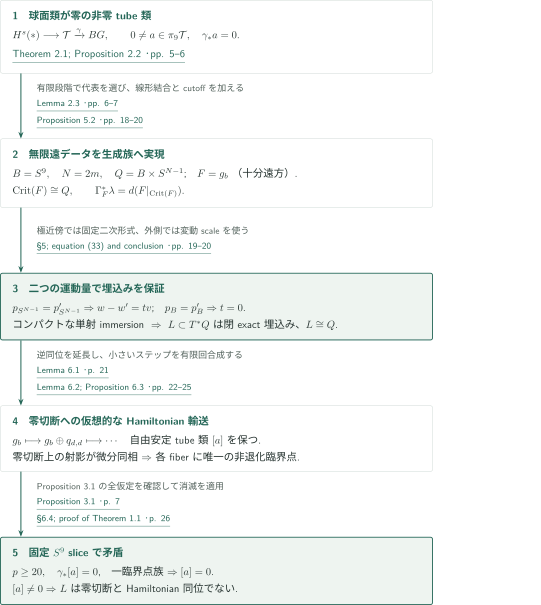
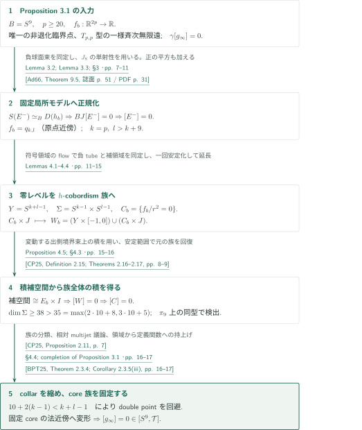

# A counterexample to the nearby Lagrangian conjecture

**無限遠の安定tube類を埋込みへ実現し、一臨界点族への輸送を妨げる**

本原稿は、生成族の無限遠に置いた非零の安定tube類を保ちながら、閉exact Lagrangianを零切断へHamiltonian輸送することはできないと論じる。構成の核心は、生成族から得られるimmersionの二重点候補を、球面方向と $S^9$ 方向の二つの運動量で排除する点にある。以下は2026年9月23日版の主張と証明経路の概説であり、原稿全体の独立検証を意味しない。

## 1. 主要結果

### Theorem 1.1 — 底と微分同相な閉exact埋込みの反例

ある十分大きい偶数 $N$ に対し、
$$
Q=S^9\times S^{N-1}
$$
の余接束に、閉exactで滑らかに埋め込まれたLagrangian $L\subset T^*Q$ が存在し、$L$ は $Q$ と微分同相であるが、零切断を $L$ に移すコンパクト台Hamiltonian同位は存在しない。したがって $\dim L=\dim Q=N+8$、$\dim T^*Q=2N+16$ である。量化は「ある十分大きい偶数 $N$」であり、すべての底やすべての次元での反例を主張しない。

ここで閉とはコンパクトかつ境界なし、exactとは標準1形式 $\lambda$ の制限が大域的に $df$ となること。原稿の予想の定式化は、閉連結滑らかな $Q$ に対するすべての閉exact埋込みLagrangianが零切断とHamiltonian同位か、というものである。Hamiltonianは全時間にわたって一つの固定コンパクト集合に台を持ち、規約は $\omega=d\lambda$、$\iota_{X_{H_t}}\omega=-dH_t$。コンパクトな同位の軌跡の近傍で1となるcutoffにより、その軌跡上の流れを保ったままこの台条件を課せる。

<!-- cite:main -->[Theorem 1.1; §1 · p. 1](https://github.com/openai/math/blob/4eaee87548250b2682affda7d05d947c05554bae/preprints/A-counterexample-to-the-nearby-Lagrangian-conjecture-September-23-2026/paper.pdf)<!-- /cite -->

## 図の矢印に付した引用

<!-- reference-guide -->
略号のない定理・補題・節・式番号は本原稿 [A counterexample to the nearby Lagrangian conjecture](https://github.com/openai/math/blob/4eaee87548250b2682affda7d05d947c05554bae/preprints/A-counterexample-to-the-nearby-Lagrangian-conjecture-September-23-2026/paper.pdf) を指します。外部入力には次の略号を使います。

- [AIS26](https://arxiv.org/pdf/2603.28007v2) Daniel Álvarez-Gavela; Kiyoshi Igusa; Michael G. Sullivan — *Legendrian and Lagrangian higher torsion*：tube fibrationと二次形式のBJへの接続。arXiv:2603.28007v2, 19 August 2026。
- [Rog14](https://arxiv.org/pdf/1403.5998v1) John Rognes — *Algebraic K-theory of strict ring spectra*：degree 10のsmooth Whitehead群の2-primary計算。arXiv:1403.5998v1, 24 March 2014。
- [CP25](https://arxiv.org/pdf/2506.06110v1) Sylvain Courte; Noah Porcelli — *On the parametrised Whitehead torsion of families of nearby Lagrangian submanifolds*：h-cobordism族の分類、区間安定化と連結性評価。arXiv:2506.06110v1, 6 June 2025。
- [Ad66](https://www.sas.rochester.edu/mth/sites/doug-ravenel/otherpapers/Adams-JX4.pdf) J. F. Adams — *On the groups J(X). IV*：J8とJ9の単射性。Topology 5 (1966), 21–71; published version。
- [IWX23](https://www.numdam.org/item/10.1007/s10240-023-00139-1.pdf) Daniel C. Isaksen; Guozhen Wang; Zhouli Xu — *Stable homotopy groups of spheres: from dimension 0 to 90*：第9安定stemの群構造。Publications Mathématiques de l’IHÉS 137 (2023), 107–243; published version。
- [BPT25](https://arxiv.org/pdf/2503.04348v1) Maciej Borodzik; Mark Powell; Peter Teichner — *Link concordance implies link homotopy*：core族の多重jetの悪いstratum回避。arXiv:2503.04348v1, 6 March 2025。
- [Hat02](https://pi.math.cornell.edu/~hatcher/AT/AT.pdf) Allen Hatcher — *Algebraic Topology*：単連結CW型へのhomological Whitehead定理。2002 book; author-hosted PDF accessed 4 November 2026。
- [Bott59](https://webhomes.maths.ed.ac.uk/~v1ranick/papers/bott4.pdf) Raoul Bott — *The stable homotopy of the classical groups*：Bott周期性とπ8O、π9Oの群計算。1959 published article scan, Annals of Mathematics 70(2), 313–337; one repository cover page。
- [WJR13](https://www.sas.rochester.edu/mth/sites/doug-ravenel/otherpapers/WJR.pdf) Friedhelm Waldhausen; Bjørn Jahren; John Rognes — *Spaces of PL Manifolds and Categories of Simple Maps*：安定parametrized h-cobordism定理、collared区間積と延長、Whdiffのcofiber定義。参照版は出版前原稿。参照版：Rochester掲載の無日付出版前原稿（166ページ、PDF作成metadata 2012-02-29）。原稿が引用する2013年出版版との逐語比較は未実施。
- [Mil65](https://webhomes.maths.ed.ac.uk/~v1ranick/surgery/hcobord.pdf) John Milnor — *Lectures on the h-Cobordism Theorem*：単連結h-cobordismの各fiberの積性。incoming固定と族全体の積性は別の接続。1965 Princeton University Press edition scan; title and copyright pages checked。
- [AACK25](https://arxiv.org/pdf/2505.12515v2) Mohammed Abouzaid; Daniel Álvarez-Gavela; Sylvain Courte; Thomas Kragh — *Normal invariant of nearby Lagrangians via twisted derivative*：tube型関数とnegative-domain frame模型から球面束分類写像を同定する。arXiv:2505.12515v2, stamp 22 October 2025; manuscript date 23 October 2025。

各引用に結果番号とページを付します。誌面番号とPDF内の位置が異なる場合は両方を示します。GitHubの閲覧リンクではページ位置への自動移動を前提としません。
<!-- /reference-guide -->

## 2. Theorem 1.1 — 主定理の証明概略

<!-- proof-target:1 -->証明対象：[Theorem 1.1; §1 · p. 1](https://github.com/openai/math/blob/4eaee87548250b2682affda7d05d947c05554bae/preprints/A-counterexample-to-the-nearby-Lagrangian-conjecture-September-23-2026/paper.pdf)<!-- /proof-target -->

**証明の道筋。** 安定smooth tube空間 $\mathcal T$ と負領域の安定球面束を記録する $\gamma:\mathcal T\to BG$ から出発する。$\ker\gamma_*$ の非零元を無限遠データに持つ生成族を構成し、埋込みを得る。零切断への仮想的な輸送はこの同じtube類を保つが、輸送後の一臨界点族にProposition 3.1を適用すると類が零になる。構成は[次節](#proof-1)、消滅命題は[その次の節](#proof-2)、輸送と矛盾は[最終段階](#proof-3)で説明する。

### 1. 出発点は球面類が零の非零tube類

標準形式 $q_{k,l}(x,y)=-\|x\|^2+\|y\|^2$ と同じ成分にある正則な角関数の空間を $T_{k,l}$ とする。$h$ の斉次拡張は $g(ru)=r^2h(u)$ であり、負領域は $S^{k-1}\times D^l$ 型のsmooth tubeになる。正負の平方を加える安定化で $\mathcal T=\operatorname{hocolim}_m T_{m,m}$ を得る。

原稿のTheorem 2.1は $H^s(*)\to\mathcal T\xrightarrow{\gamma}BG$ というfiber sequenceと、二次形式からの写像 $BO\to\mathcal T$ の合成が $BJ$ になることを用いる。長完全列の境界写像 $\partial:\pi_{10}BG\to\pi_9H^s(*)$ では、$\pi_{10}BG=\pi_9^S\cong(\mathbb Z/2)^3$ のうち $J_9$ の位数2の像が核に入るため $|\operatorname{im}\partial|\le4$。一方、$\pi_9H^s(*)\cong\pi_{10}\operatorname{Wh}^{\mathrm{diff}}(*)$ の2-primary部分は $\mathbb Z/8\oplus(\mathbb Z/2)^2$、位数32である。よって境界写像は全射でなく、
$$
0\ne a\in\pi_9\mathcal T,\qquad \gamma_*a=0
$$
を得る。別途用いる $J_8$ の単射性は、一臨界点族の負固有束を自明化するための入力である。

<!-- cite:kernel -->[Theorem 2.1; Proposition 2.2 · pp. 5–6](https://github.com/openai/math/blob/4eaee87548250b2682affda7d05d947c05554bae/preprints/A-counterexample-to-the-nearby-Lagrangian-conjecture-September-23-2026/paper.pdf)<!-- /cite -->

### 2. 類の実現と埋込みの判定を分ける

Lemma 2.3は $a$ を十分大きい有限段階 $T_{m,m}$、$m\ge20$ に実現し、高さ関数 $\theta:S^9\to\mathbb R$ の二つの臨界点の近傍で標準二次形式となる族 $g_b$ を選ぶ。$N=2m$ とし、補助球面 $S^{N-1}$ を底へ加える。Proposition 5.2は臨界集合を $S^9\times S^{N-1}$ でパラメータ化し、Morse familyの正則性、運動量による単射性、コンパクト性を順に用いる。これでsmooth embedding、閉性、底との微分同相が得られ、$\Gamma_F^*\lambda=d(F|_{\operatorname{Crit}(F)})$ がexact性を与える。

<!-- cite:representative -->[Lemma 2.3 · pp. 6–7](https://github.com/openai/math/blob/4eaee87548250b2682affda7d05d947c05554bae/preprints/A-counterexample-to-the-nearby-Lagrangian-conjecture-September-23-2026/paper.pdf)<!-- /cite --> <!-- cite:realization -->[Proposition 5.2 · pp. 18–20](https://github.com/openai/math/blob/4eaee87548250b2682affda7d05d947c05554bae/preprints/A-counterexample-to-the-nearby-Lagrangian-conjecture-September-23-2026/paper.pdf)<!-- /cite -->

### 3. 仮想的な同位が同じ類を消してしまう

零切断への逆同位をEuclidean近傍へ延長し、有限個の小さいHamiltonianステップで生成族を輸送する。各ステップは固定split二次形式を加え、正則な斉次データのhomotopyしか行わない。零切断上では臨界集合の底射影が微分同相になり、各fiberにちょうど一つの非退化臨界点が生じる。固定 $v_0\in S^{N-1}$ に沿う $S^9$ sliceは、非零類 $a$ と球面類零を維持する。Proposition 3.1は同じ族の安定tube類を零とするので矛盾する。この論証は、任意の生成族からLagrangian固有の数値不変量を定義することを要求せず、構成した生成族を輸送して矛盾を得る。

<!-- cite:final -->[§6.4; proof of Theorem 1.1 · p. 26](https://github.com/openai/math/blob/4eaee87548250b2682affda7d05d947c05554bae/preprints/A-counterexample-to-the-nearby-Lagrangian-conjecture-September-23-2026/paper.pdf)<!-- /cite -->

## 3. Proposition 5.2 — 生成族から閉exact埋込みへ

<!-- proof-target:2 -->証明対象：[Proposition 5.2 · pp. 18–20](https://github.com/openai/math/blob/4eaee87548250b2682affda7d05d947c05554bae/preprints/A-counterexample-to-the-nearby-Lagrangian-conjecture-September-23-2026/paper.pdf)<!-- /proof-target -->

<!-- statement:proposition-5-2 -->
### Proposition 5.2 — 非零の無限遠データを持つ埋込み実現

$B=S^9$、$N=2m$ とし、Lemma 2.3で選んだ族 $g_b$ と類 $a$ を固定する。$Q=B\times S^{N-1}$ 上には滑らかなMorse family $F:Q\times\mathbb R^N\to\mathbb R$ が存在し、一様な垂直球の外で $g_b(w)$ に等しい。その生成写像は $\operatorname{Crit}(F)$ から閉exact埋込みLagrangian $L\subset T^*Q$ への微分同相であり、$\operatorname{Crit}(F)\cong L\cong Q$。各slice $B\times\{v_0\}$ の無限遠のtube類は $a$ である。

<!-- cite:realization -->[Proposition 5.2 · pp. 18–20](https://github.com/openai/math/blob/4eaee87548250b2682affda7d05d947c05554bae/preprints/A-counterexample-to-the-nearby-Lagrangian-conjecture-September-23-2026/paper.pdf)<!-- /cite -->
<!-- /statement -->

### 1. 線形結合のcutoffで臨界方程式を固定する

$c\|w\|\le\|\nabla g_b(w)\|\le C\|w\|$、$\|d_wd_bg_b(w)\|\le C_1\|w\|$ とする。$g_b=q_{m,m}$ となる二極近傍 $U_0$ の外で $\delta_0=\min_{B\setminus U_0}\|d\theta\|>0$。まず $K\delta_0>C_1/c$ を取り、$R(b)=\Lambda e^{K\theta(b)}$ と置く。$G_b$ は原点近傍だけを平滑化した $g_b$、$\beta$ は $[0,1]$ 上で1、$[2,\infty)$ 上で0のcutoffとし、
$$
F(b,v,w)=G_b(w)-R(b)\beta(\|w\|/T)\langle v,w\rangle
$$
を使う。$D_\beta=\sup_{s\ge0}(|\beta(s)|+s|\beta'(s)|)$ と置き、$K,\Lambda,T$ の順に選び、$\Lambda$ で $\|w\|\le1$ の臨界点を排除し、$T>\max\{1,R_{\max}/c,D_\beta R_{\max}/c\}$ で外側とcutoff領域を排除する。したがってすべての臨界点は $1<\|w\|<T$ にあり、その必要十分条件は $\nabla g_b(w)=R(b)v$ となる。

<!-- cite:critical -->[§5; equations (29)–(32) · p. 19](https://github.com/openai/math/blob/4eaee87548250b2682affda7d05d947c05554bae/preprints/A-counterexample-to-the-nearby-Lagrangian-conjecture-September-23-2026/paper.pdf)<!-- /cite -->

### 2. パラメータ化は微分同相、正則性は全変数で判定する

斉次性により臨界集合は
$$
(b,u)\longmapsto\left(b,\frac{\nabla g_b(u)}{\|\nabla g_b(u)\|},
\frac{R(b)u}{\|\nabla g_b(u)\|}\right),\qquad u\in S^{N-1}
$$
で滑らかにパラメータ化され、逆は $u=w/\|w\|$。$v^\perp$ 方向の変分が $-R\delta v$、$w$ の動径変分が $Rv$ を与え、全垂直勾配方程式の微分は全射となる。これはMorse family条件であり、各fiber Hessianの可逆性はこの段階では主張しない。Lemma 5.1により $\Gamma_F(b,v,w)=(b,v;d_{b,v}F)$ はexact Lagrangian immersionとなる。

<!-- cite:morse -->[Lemma 5.1 · p. 18](https://github.com/openai/math/blob/4eaee87548250b2682affda7d05d947c05554bae/preprints/A-counterexample-to-the-nearby-Lagrangian-conjecture-September-23-2026/paper.pdf)<!-- /cite --> <!-- cite:critical -->[§5; equations (29)–(32) · p. 19](https://github.com/openai/math/blob/4eaee87548250b2682affda7d05d947c05554bae/preprints/A-counterexample-to-the-nearby-Lagrangian-conjecture-September-23-2026/paper.pdf)<!-- /cite -->

### 3. 二つの運動量とコンパクト性でembeddingへ進む

同じ像を持つ二点はまず同じ $(b,v)$ を持つ。球面方向の運動量は $d_vF(\dot v)=-R\langle w,\dot v\rangle$、$\dot v\perp v$ なので、その一致から $w-w'=tv$。両端を結ぶ線分は半径 $R/c$ の球内にあり、$d_bg_b$ の $C^1$ 延長により原点を通る線分にも
$$
\|d_bg_b(w)-d_bg_b(w')\|\le (C_1/c)R|t|
$$
が使える。$B$ 方向の運動量差は
$$
\Delta p_B=d_bg_b(w)-d_bg_b(w')-KRt\,d\theta_b.
$$
$b\notin U_0$ では $\|\Delta p_B\|\ge R|t|(K\delta_0-C_1/c)$ だから $t=0$。$b\in U_0$ では固定非退化二次形式の勾配方程式自体が一意解を持つ。よって全域で単射である。

臨界集合はコンパクトで境界がなく、単射immersionはembeddingになる。その像 $L$ は閉で $Q$ と微分同相であり、primitiveは $F|_{\operatorname{Crit}(F)}=-g_b(w)$。$\|w\|\ge2T$ で $F=g_b$ だから無限遠類も維持される。抽象多様体の微分同相と、余接束内のHamiltonian同位はここで区別される。

<!-- cite:separation -->[§5; equation (33) and conclusion · pp. 19–20](https://github.com/openai/math/blob/4eaee87548250b2682affda7d05d947c05554bae/preprints/A-counterexample-to-the-nearby-Lagrangian-conjecture-September-23-2026/paper.pdf)<!-- /cite -->

## 4. Proposition 3.1 — 一臨界点族のtube類が消える理由

<!-- proof-target:3 -->証明対象：[Proposition 3.1 · p. 7](https://github.com/openai/math/blob/4eaee87548250b2682affda7d05d947c05554bae/preprints/A-counterexample-to-the-nearby-Lagrangian-conjecture-September-23-2026/paper.pdf)<!-- /proof-target -->

<!-- statement:proposition-3-1 -->
### Proposition 3.1 — 球面類零の一臨界点族

$B=S^9$、$p\ge20$ とする。滑らかな族 $f_b:\mathbb R^{2p}\to\mathbb R$ が、一つの固定球の外で $T_{p,p}$ に属する滑らかな2次斉次データに一致し、各fiberに滑らかに動くちょうど一つの非退化臨界点を持ち、その無限遠の安定球面類が $[B,BG]$ で零なら、無限遠の安定tube類も $[B,\mathcal T]$ で零である。斉次データの滑らかさは原点の外での滑らかさと原点での $C^1$ 延長を意味する。

<!-- cite:one-critical -->[Proposition 3.1 · p. 7](https://github.com/openai/math/blob/4eaee87548250b2682affda7d05d947c05554bae/preprints/A-counterexample-to-the-nearby-Lagrangian-conjecture-September-23-2026/paper.pdf)<!-- /cite -->
<!-- /statement -->

### 1. 球面束の自明性から固定局所二次形式を得る

臨界点を原点へ移し、臨界値を0にし、局所でHessianの二次形式に置き換える。勾配の下界とcutoff誤差の比較が余分な臨界点の出現を防ぐ。Lemma 3.2は、負部分levelが無限遠の負領域と同じ球面homotopy型を持ち、唯一のMorse handleを付けた正部分levelが可縮になることから、Morse indexが $p$ であると示す。さらに負固有束 $E^-$ の単位球面束を無限遠の負領域族へfiber homotopy同値で結ぶ。

したがって球面類零は $BJ[E^-]=0$ を意味する。$J_8:\pi_9BO\to\pi_9BG$ の単射性と $p\ge20$ の安定範囲により負固有空間の写像は有限Grassmannianでもnullhomotopicとなる。対数的にゆっくり変化する動径cutoffで局所モデルを固定 $q_{p,p}$ にする。正の平方を追加しLemma 3.3で斉次データを平滑化すると、局所モデルは $q_{k,l}$、$k=p$、$l>k+9$ となる。後で不足する負の平方を加えれば対角安定化へ戻れる。

<!-- cite:normalization -->[Lemma 3.2; Lemma 3.3; §3 · pp. 7–11](https://github.com/openai/math/blob/4eaee87548250b2682affda7d05d947c05554bae/preprints/A-counterexample-to-the-nearby-Lagrangian-conjecture-September-23-2026/paper.pdf)<!-- /cite -->

### 2. 各fiberが積であることと、族全体が積であることを分ける

内外球面間で $s_b(u,t)=f_b(r(t)u)/r(t)^2$ と置く。零レベル $C_b=\{s_b=0\}$ の正則bandは $C_b\times J$ となる。符号領域のflowが内側の固定負tubeを外側へ埋め込み、その補集合を $C_b$ と同定する。両境界包含はhomotopy同値であり、$C_b$ は $\Sigma=S^{k-1}\times S^{l-1}$ 上の $h$-cobordism族となる。

各fiberの $h$-cobordism定理だけでは、$S^9$ 全体で滑らかに選べる積構造は得られない。原稿は一回の区間安定化を $Y=S^{k+l-1}$ の固定円筒へ延長し、$W_b=(Y\times[-1,0])\cup(C_b\times J)$ を作る。補空間を、その変動し得る出側境界束 $E\to B$ 上の積 $E_b\times I$ としてflowで同定する。出側の積collarを吸収すると全体は固定円筒となり、$[W]=0$ を得る。

<!-- cite:cobordism -->[Lemmas 4.1–4.4 · pp. 11–15](https://github.com/openai/math/blob/4eaee87548250b2682affda7d05d947c05554bae/preprints/A-counterexample-to-the-nearby-Lagrangian-conjecture-September-23-2026/paper.pdf)<!-- /cite -->

### 3. 安定範囲で元の族を回復し、coreを固定する

Proposition 4.5では $\dim\Sigma=k+l-2\ge38$ に対し、$r=10$ のIgusa安定範囲 $\max(2r+8,3r+5)=35$ を使う。collar埋込み $\Sigma\times J\hookrightarrow Y$ の連結性と安定 $h$-cobordismの連結性評価を合わせ、元の族から安定化・延長後への写像が $\pi_9$ 上で同型になる。したがって $[W]=0$ から $[C]=0$ を戻し、族の分類を用いてincoming end相対の積構造を得る。

<!-- cite:detect -->[Proposition 4.5; §4.3 · pp. 15–16](https://github.com/openai/math/blob/4eaee87548250b2682affda7d05d947c05554bae/preprints/A-counterexample-to-the-nearby-Lagrangian-conjecture-September-23-2026/paper.pdf)<!-- /cite --> <!-- cite:cp-stability -->[&#91;CP25, Definition 2.15; Theorems 2.16–2.17, pp. 8–9&#93;](https://arxiv.org/pdf/2506.06110v1#page=8)<!-- /cite --> <!-- cite:cp-classification -->[&#91;CP25, Proposition 2.11, p. 7&#93;](https://arxiv.org/pdf/2506.06110v1#page=7)<!-- /cite -->

外側tubeに付いた積collarを縮め、coreの小さい丸い法近傍に変形する。core族のhomotopyを各fiberでembeddingに保つには、時間を含むparameter次元10に対する
$$
10+2(k-1)<k+l-1
$$
とrank欠損の余次元評価を用いる。$l>k+9$ はこのために先に確保した。coreを固定標準coreへ動かし、領域のhomotopyを定義関数へ持ち上げるとtube族がnullになる。

<!-- cite:cores -->[§4.4; completion of Proposition 3.1 · pp. 16–17](https://github.com/openai/math/blob/4eaee87548250b2682affda7d05d947c05554bae/preprints/A-counterexample-to-the-nearby-Lagrangian-conjecture-September-23-2026/paper.pdf)<!-- /cite -->

## 5. Theorem 1.1 — Hamiltonian輸送と最終矛盾

<!-- proof-target:4 -->証明対象：[Theorem 1.1; §1 · p. 1](https://github.com/openai/math/blob/4eaee87548250b2682affda7d05d947c05554bae/preprints/A-counterexample-to-the-nearby-Lagrangian-conjecture-September-23-2026/paper.pdf)<!-- /proof-target -->

**輸送で必要なこと。** 構成した生成族について、正則臨界集合のパラメータ化と無限遠の同じ安定tube類を同時に保つ。固定二次形式を無限遠に持つ場合の標準定理を、変動する $g_b$ に説明なしで適用することはしない。

### 1. 逆同位をEuclidean近傍で実現する

$Q\subset\mathbb R^{10}\times\mathbb R^N=\mathbb R^d$、$d=10+N$ の二つの動径座標で近傍 $U\cong Q\times(-\nu,\nu)^2$ を取る。初期生成族を $F^{(0)}(x,w)=F(r_Q(x),w)$ として円筒化する。Lemma 6.1は仮想的な逆Hamiltonian同位をコンパクト台で $T^*\mathbb R^d$ へ延長する。動径運動量のcutoffを十分広く取ると、円筒からの軌道の動径位置は一定になり、中央領域 $U_c$ 上の最終像は正確に零切断となる。外側の円筒から中央へ別の枝が入り込まないこともこの位置一定性で保証する。

<!-- cite:extension -->[Lemma 6.1 · p. 21](https://github.com/openai/math/blob/4eaee87548250b2682affda7d05d947c05554bae/preprints/A-counterexample-to-the-nearby-Lagrangian-conjecture-September-23-2026/paper.pdf)<!-- /cite -->

### 2. 固定split二次形式を加え、無限遠の類を保存する

小さいステップのgraphには混合座標 $(X,p)$ があり、コンパクト台の $\sigma$ によって $x=X+\sigma_p$、$P=p+\sigma_X$ と書ける。局所的な合成生成族は $F_o(X+z,w)+\sigma(X,p)-z\cdot p$。Proposition 6.3は空間のbufferと対数cutoffを用い、平行移動を $X+\kappa z$ に置き換えて全域に定義する。全臨界方程式を先に微分し、$z=\sigma_p$ と勾配評価から臨界点近傍で垂直cutoff $\beta_1,\chi$ が1となることを示す。空間cutoff $\zeta_1$ が1の領域 $V$ では混合graph方程式をそのまま回復する。他方、$\sigma$ の空間台を含む $D$ の外では $z=0$ となり、$\zeta_1$ が変動してもその微分を含む項が消える。この二領域の処理で、新旧臨界集合の微分同相と正則性を保つ。

斉次参照関数は $G_0(X,w,z,p)=g_o(X,w)-z\cdot p$。新関数との差は値と垂直一次微分について一様有界であり、Lemma 3.3により臨界点近傍を変えずに厳密な斉次データへ平滑化できる。$-z\cdot p$ のsignatureは $(d,d)$ で、平滑化も正則斉次関数内のhomotopyである。したがって各固定compact slice上の自由安定tube類を保つ。この手順を有限回 $s$ 繰り返し、$2p=2m+2ds$ 変数の生成族を得る。

<!-- cite:transport-step -->[Lemma 6.2; Proposition 6.3 · pp. 22–25](https://github.com/openai/math/blob/4eaee87548250b2682affda7d05d947c05554bae/preprints/A-counterexample-to-the-nearby-Lagrangian-conjecture-September-23-2026/paper.pdf)<!-- /cite -->

### 3. 零切断ではHessianも非退化となり、消滅命題が適用できる

$U_c$ 上では生成写像が零切断への微分同相なので、$\operatorname{Crit}(F^{(s)})|_{U_c}\to U_c$ も微分同相である。したがって各fiberの臨界点は一意で滑らかに動く。Hessianの核に $v\ne0$ があれば $(0,v)$ は正則臨界集合の接ベクトルであり、底射影の微分の核に入ってしまう。よってHessianは可逆である。

固定slice $b\mapsto((b,v_0),0)$ に制限すると、$B=S^9$ 上の族は $p=m+ds\ge20$、$T_{p,p}$ 型、一様な斉次無限遠、一意の非退化臨界点、球面類零というProposition 3.1の全条件を満たす。一方その自由tube類は $a$ の自由類に等しく非零である。基点の移動があっても基本群の作用は零類を固定するため、非零のbased classは自由null classにならない。Proposition 3.1との矛盾が、構成した $L$ と零切断の非Hamiltonian同位性を与える。

<!-- cite:final -->[§6.4; proof of Theorem 1.1 · p. 26](https://github.com/openai/math/blob/4eaee87548250b2682affda7d05d947c05554bae/preprints/A-counterexample-to-the-nearby-Lagrangian-conjecture-September-23-2026/paper.pdf)<!-- /cite -->

## 6. どの論文が、どの段階を担うか

| 供給元と結果 | 利用箇所 | 使用内容・適用条件 | 確認範囲 |
|---|---|---|---|
| <!-- cite:ais-tubes -->[&#91;AIS26, Theorem 3.30; Remark 3.34, pp. 25–26&#93;](https://arxiv.org/pdf/2603.28007v2#page=25)<!-- /cite --> | Theorem 2.1、Proposition 2.2 | 安定tube fibrationと二次形式からの $BJ$ の接続 | 外部の記述と本稿の使用を照合。関数・領域・frame模型の比較全体は独立検証していない |
| <!-- cite:aack-model -->[&#91;AACK25, Definition 4.3; Propositions 4.4, 4.6–4.7, pp. 26–28&#93;](https://arxiv.org/pdf/2505.12515v2#page=26)<!-- /cite --> | §2.1、Theorem 2.1 | 負領域のhomotopy frameから $\gamma$ を安定球面束の分類写像と同定 | 定義・命題の記述と指定安定成分での使用を照合。模型比較の全技術は未検証 |
| <!-- cite:adams -->[&#91;Ad66, Theorem 9.5, 誌面 p. 51 / PDF p. 31&#93;](https://www.sas.rochester.edu/mth/sites/doug-ravenel/otherpapers/Adams-JX4.pdf#page=31)<!-- /cite --> | Proposition 2.2、§3.1 | $r=8,9$ に対する $e_{\mathbb R}\circ J$ の同型から単射性 | 記述と二つの次数での適用を照合 |
| <!-- cite:stable-stem -->[&#91;IWX23, Table 1, degree 9, 誌面 p. 113 / PDF p. 7&#93;](https://www.numdam.org/item/10.1007/s10240-023-00139-1.pdf#page=7)<!-- /cite --> | Proposition 2.2 | 第9安定stemは $(\mathbb Z/2)^3$ | 出版版Table 1のdegree 9を照合 |
| <!-- cite:rognes -->[&#91;Rog14, Theorem 3.3, p. 8&#93;](https://arxiv.org/pdf/1403.5998v1#page=8)<!-- /cite --> | Proposition 2.2 | $\pi_{10}\operatorname{Wh}^{\mathrm{diff}}(*)$ の2-primary部分の位数32 | 表のdegree 10と本稿の位数議論を照合。計算の証明は未検証 |
| <!-- cite:cp-stability -->[&#91;CP25, Definition 2.15; Theorems 2.16–2.17, pp. 8–9&#93;](https://arxiv.org/pdf/2506.06110v1#page=8)<!-- /cite --> | Proposition 4.5 | 区間安定化と安定 $h$-cobordism写像の連結性 | 記述、次元38と必要下界35、$\pi_9$ の検出への使用を照合 |
| <!-- cite:cp-classification -->[&#91;CP25, Proposition 2.11, p. 7&#93;](https://arxiv.org/pdf/2506.06110v1#page=7)<!-- /cite --> | §4.3 | $[S^9,H(\Sigma)]$ の零から族全体の積構造を得る | compact parameterの族の分類と使用を照合。各fiberの積だけとの違いを保持 |
| <!-- cite:multijet -->[&#91;BPT25, Theorem 2.3.4; Corollary 2.3.5(iii), pp. 16–17&#93;](https://arxiv.org/pdf/2503.04348v1#page=16)<!-- /cite --> | §4.4 | parameter次元10でdouble point・rank欠損を避ける | 定理記述と不等式を照合。compact parameterと端点相対へのcutoff拡張は本稿自身の議論 |
| <!-- cite:whitehead -->[&#91;Hat02, Corollary 4.33, 誌面 p. 367 / PDF p. 376&#93;](https://pi.math.cornell.edu/~hatcher/AT/AT.pdf#page=376)<!-- /cite --> | Lemmas 3.2、4.2 | 単連結CW型のhomology同値をhomotopy同値へ | 定理記述と使用を照合 |
| <!-- cite:bott -->[&#91;Bott59, Corollary to Theorem II, equation (1.5) and following group list, 誌面 pp. 314–315 / PDF pp. 3–4&#93;](https://webhomes.maths.ed.ac.uk/~v1ranick/papers/bott4.pdf#page=3)<!-- /cite --> | Proposition 2.2 | $\pi_8O=\pi_9O=\mathbb Z/2$ | 周期性と群列を照合 |
| <!-- cite:wjr-stable -->[&#91;WJR13, Theorems 0.1, 0.3, pp. 2, 4&#93;](https://www.sas.rochester.edu/mth/sites/doug-ravenel/otherpapers/WJR.pdf#page=2)<!-- /cite -->; <!-- cite:wjr-model -->[&#91;WJR13, Definitions 1.1.1, 1.1.3, 1.3.4, pp. 7–8, 18&#93;](https://www.sas.rochester.edu/mth/sites/doug-ravenel/otherpapers/WJR.pdf#page=7)<!-- /cite --> | §2.2、§§4.2–4.3 | $H^s\simeq\Omega\operatorname{Wh}^{\mathrm{diff}}$、collared区間積・延長の自然性 | 所要記述と適用を出版前原稿で照合。2013年出版版との逐語比較は未実施 |
| <!-- cite:milnor -->[&#91;Mil65, Theorem 9.1, 誌面 p. 107 / PDF p. 112&#93;](https://webhomes.maths.ed.ac.uk/~v1ranick/surgery/hcobord.pdf#page=112)<!-- /cite --> | §4.2 | 単連結の各 $h$-cobordismが積になる | 次元・単連結性・相対homology条件を照合。incoming固定は本稿の補正、族全体の積性は別の議論 |

上表の11文献について、ここで直接使う記述と適用箇所を照合した。外部結果の証明全体を検証した意味ではない。WJRの参照版は、定理番号が一致するRochester掲載の無日付出版前原稿（166ページ、PDF作成metadata 2012-02-29）であり、本稿参考文献の2013年出版版と逐語比較してはいない。

<!-- cite:kernel -->[Theorem 2.1; Proposition 2.2 · pp. 5–6](https://github.com/openai/math/blob/4eaee87548250b2682affda7d05d947c05554bae/preprints/A-counterexample-to-the-nearby-Lagrangian-conjecture-September-23-2026/paper.pdf)<!-- /cite --> <!-- cite:normalization -->[Lemma 3.2; Lemma 3.3; §3 · pp. 7–11](https://github.com/openai/math/blob/4eaee87548250b2682affda7d05d947c05554bae/preprints/A-counterexample-to-the-nearby-Lagrangian-conjecture-September-23-2026/paper.pdf)<!-- /cite --> <!-- cite:detect -->[Proposition 4.5; §4.3 · pp. 15–16](https://github.com/openai/math/blob/4eaee87548250b2682affda7d05d947c05554bae/preprints/A-counterexample-to-the-nearby-Lagrangian-conjecture-September-23-2026/paper.pdf)<!-- /cite --> <!-- cite:cores -->[§4.4; completion of Proposition 3.1 · pp. 16–17](https://github.com/openai/math/blob/4eaee87548250b2682affda7d05d947c05554bae/preprints/A-counterexample-to-the-nearby-Lagrangian-conjecture-September-23-2026/paper.pdf)<!-- /cite -->

Legendrian higher torsionの先行例は背景と方法上の参照であり、余接束への射影が埋込みであることをそのまま供給しない。本稿の大域単射性はProposition 5.2で別途証明される。またCourte–Porcelliのnearby Lagrangianの族のtorsion消滅結果を、この生成族の無限遠を動かす $S^9$ parameterに置き換えて使用してはいない。Hamiltonian輸送についても、本稿は§6に必要な構成を与えている。

## 7. 原典を読む入口と確認範囲

<!-- reading-list -->
- [Theorem 1.1; §1 · p. 1](https://github.com/openai/math/blob/4eaee87548250b2682affda7d05d947c05554bae/preprints/A-counterexample-to-the-nearby-Lagrangian-conjecture-September-23-2026/paper.pdf) — 予想の台条件と主定理の存在量化
- [Theorem 2.1; Proposition 2.2 · pp. 5–6](https://github.com/openai/math/blob/4eaee87548250b2682affda7d05d947c05554bae/preprints/A-counterexample-to-the-nearby-Lagrangian-conjecture-September-23-2026/paper.pdf) — 位数32と境界写像の像の上界4からkernel類を作る
- [Proposition 5.2 · pp. 18–20](https://github.com/openai/math/blob/4eaee87548250b2682affda7d05d947c05554bae/preprints/A-counterexample-to-the-nearby-Lagrangian-conjecture-September-23-2026/paper.pdf) — 臨界集合・正則性・二つの運動量の分離
- [Proposition 3.1 · p. 7](https://github.com/openai/math/blob/4eaee87548250b2682affda7d05d947c05554bae/preprints/A-counterexample-to-the-nearby-Lagrangian-conjecture-September-23-2026/paper.pdf) — 消滅命題の正確な仮定
- [Proposition 4.5; §4.3 · pp. 15–16](https://github.com/openai/math/blob/4eaee87548250b2682affda7d05d947c05554bae/preprints/A-counterexample-to-the-nearby-Lagrangian-conjecture-September-23-2026/paper.pdf) — 族の積構造を回復する安定範囲
- [Lemma 6.2; Proposition 6.3 · pp. 22–25](https://github.com/openai/math/blob/4eaee87548250b2682affda7d05d947c05554bae/preprints/A-counterexample-to-the-nearby-Lagrangian-conjecture-September-23-2026/paper.pdf) — 全cutoff臨界方程式とsplit安定化
- [§6.4; proof of Theorem 1.1 · p. 26](https://github.com/openai/math/blob/4eaee87548250b2682affda7d05d947c05554bae/preprints/A-counterexample-to-the-nearby-Lagrangian-conjecture-September-23-2026/paper.pdf) — zero graphの射影からHessian非退化、sliceでの矛盾へ
<!-- /reading-list -->

原稿の§§2–6の証明本文を読み、主定理の量化、臨界集合のパラメータ化、Morse familyの正則性、二つの運動量による単射性、閉性・exact性・微分同相への接続、輸送後のHessian非退化と最終矛盾を照合した。外部入力は上表の定理記述と適用箇所の照合に限る。

未完了は、WJR出版前原稿と2013年出版版の逐語比較、smooth tubeの各模型間の同一視の全技術、corner roundingと遷移写像の全整合性、相対多重jet議論、Hamiltonian輸送の全cutoff評価を独立に再構成する検証である。これらを含む全証明の正しさ、専門家査読、形式検証は認定していない。他カタログとの全依存関係も未調査である。
