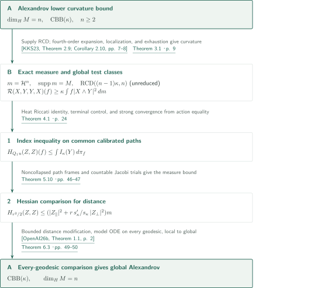
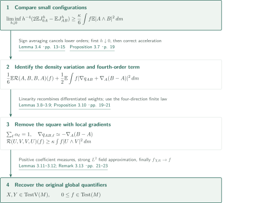
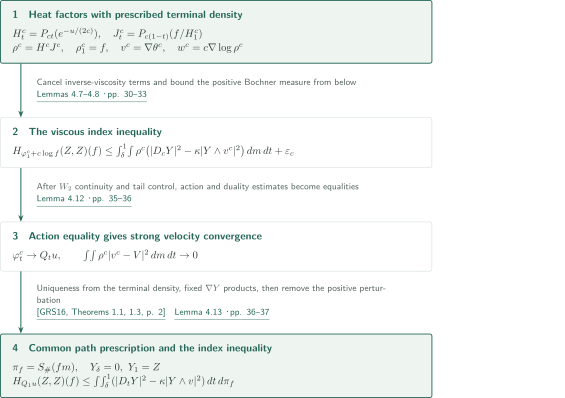
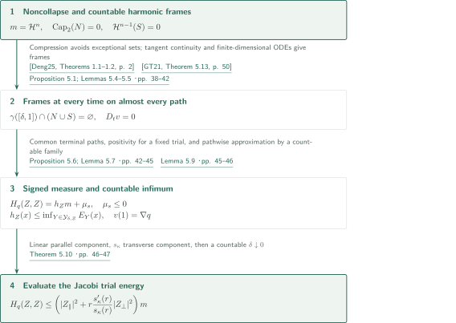
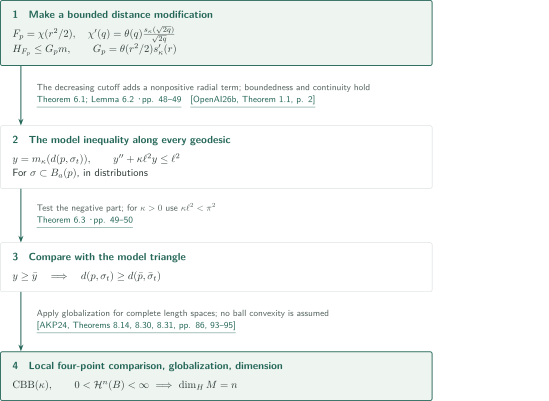

# Gigli’s distributional curvature characterization of Alexandrov spaces

**From fourth-order transport expansions to global distributional curvature, and from heat-regularized index forms to comparison along every geodesic**

The manuscript characterizes Alexandrov lower curvature bounds in integer dimension $n\ge2$ using the exact Hausdorff measure and Gigli’s distributional curvature. The forward implication extracts curvature from integrated small configurations. The reverse implication passes through an index inequality, the weak Hessian of distance, and a model equation along every geodesic.

## 1. Main results

### Theorem 1.1 — Gigli’s characterization

Let $n\ge2$ be an integer, $\kappa\in\mathbb R$, and $(M,d)$ a complete separable metric space. The following are equivalent.

- **(A)** $(M,d)$ is an $n$-dimensional Alexandrov space with curvature at least $\kappa$.
- **(B)** With **exactly** $m=\mathcal H_d^n$, $(M,d,m)$ has full support, satisfies the **unreduced** $\mathrm{RCD}((n-1)\kappa,n)$ condition, and for every $X,Y\in\mathrm{TestV}(M)$ and every nonnegative $f\in\mathrm{Test}(M)$,

$$
\mathcal R(X,Y,Y,X)(f)\ge\kappa\int_M f\bigl(|X|^2|Y|^2-\langle X,Y\rangle^2\bigr)\,dm.
$$

Here $\Delta$ is the nonpositive $L^2$ generator, and

$$
\mathrm{Test}(M)=\{f\in D(\Delta): f\text{ has a bounded globally Lipschitz representative, }\Delta f\in W^{1,2}(M)\},
\qquad
\mathrm{TestV}(M)=\Bigl\{\sum_{j=1}^{\ell}a_j\nabla b_j:\ell<\infty,\ a_j,b_j\in\mathrm{Test}(M)\Bigr\}.
$$

With $[X,Y]=\nabla_XY-\nabla_YX$, the curvature functional, including its sign convention, is

$$
\begin{aligned}
\mathcal R(X,Y,Z,W)(f)=\int_M\bigl[&-\langle\nabla_X(fW),\nabla_YZ\rangle-f\langle\nabla_YZ,W\rangle\operatorname{div}X\\
&+\langle\nabla_Y(fW),\nabla_XZ\rangle+f\langle\nabla_XZ,W\rangle\operatorname{div}Y
-f\langle\nabla_{[X,Y]}Z,W\rangle\bigr]\,dm.
\end{aligned}
$$

The measure is not replaced by an arbitrary equivalent measure, and neither fields nor weights are restricted to compact support. For positive curvature, Alexandrov comparison is understood at the usual model scale.

<!-- cite:main -->[Theorem 1.1; (1.1)–(1.4) · p. 2](https://github.com/openai/math/blob/1581d4cbdd69a0faf34b2089614fe2a814316a6a/preprints/Giglis-distributional-curvature-characterization-of-Alexandrov-spaces-September-24-2026/main.pdf)<!-- /cite -->

## References on the arrows

<!-- reference-guide -->
Unprefixed theorem, lemma, section and equation numbers refer to [Gigli’s distributional curvature characterization of Alexandrov spaces](https://github.com/openai/math/blob/1581d4cbdd69a0faf34b2089614fe2a814316a6a/preprints/Giglis-distributional-curvature-characterization-of-Alexandrov-spaces-September-24-2026/main.pdf). External inputs use the following keys.

- [KKS23](https://arxiv.org/pdf/2003.06242v1) Vitali Kapovitch, Christian Ketterer, Karl-Theodor Sturm — *On gluing Alexandrov spaces with lower Ricci curvature bounds*: Alexandrov-to-unreduced-RCD input. arXiv:2003.06242v1 (2020); published 2023.
- [Gig19](https://arxiv.org/pdf/1902.02282v1) Nicola Gigli — *Riemann curvature tensor on RCD spaces and possible applications*: Curvature sign, symmetries, and tensoriality over test functions. arXiv:1902.02282v1 (2019).
- [GRS16](https://arxiv.org/pdf/1305.4849v1) Nicola Gigli, Tapio Rajala, Karl-Theodor Sturm — *Optimal maps and exponentiation on finite-dimensional spaces with Ricci curvature bounded from below*: Uniqueness of optimal paths from an absolutely continuous endpoint. arXiv:1305.4849v1 (2013); published 2016.
- [GH15](https://arxiv.org/pdf/1406.6350v1) Nicola Gigli, Bang-Xian Han — *The continuity equation on metric measure spaces*: Continuity equation and action for bounded-compression Wasserstein curves. arXiv:1406.6350v1 (2014); published 2015.
- [JLZ16](https://arxiv.org/pdf/1407.5289v2) Renjin Jiang, Huaiqian Li, Huichun Zhang — *Heat kernel bounds on metric measure spaces and some applications*: Gaussian heat bounds after weakening the Ricci parameter to a negative value. arXiv:1407.5289v2 (2015); published 2016.
- [DPG18](https://arxiv.org/pdf/1708.02060v3) Guido De Philippis, Nicola Gigli — *Non-collapsed spaces with Ricci curvature bounded from below*: Euclidean tangents, dimension, and volume control from noncollapse. arXiv:1708.02060v3 (2018).
- [BPS21](https://arxiv.org/pdf/2001.07911v1) Elia Bruè, Enrico Pasqualetto, Daniele Semola — *Rectifiability of RCD(K, N) spaces via δ-splitting maps*: Harmonic splitting maps near Euclidean rescalings. arXiv:2001.07911v1 (2020); published 2021.
- [Deng25](https://arxiv.org/pdf/2009.07956v2) Qin Deng — *Hölder continuity of tangent cones in RCD(K, N) spaces and applications to non-branching*: Continuity of tangents from the same rescaling sequence along every geodesic. arXiv:2009.07956v2; published 2025.
- [GT21](https://arxiv.org/pdf/1802.02463v1) Nicola Gigli, Luca Tamanini — *Second order differentiation formula on RCD∗(K, N) spaces*: Second-order differentiation along bounded-support optimal geodesic test plans. arXiv:1802.02463v1 (2018); published 2021.
- [AKP24](https://anton-petrunin.github.io/book/arXiv.pdf) Stephanie Alexander, Vitali Kapovitch, Anton Petrunin — *Alexandrov Geometry: Foundations*: Point-on-side comparison, local four-point criterion, and globalization for complete length spaces. Updated online PDF, retrieved 2026-10-19; book published 2024. Numbering matches the manuscript’s cited 2026-09-24 online version..
- [OpenAI26b](https://github.com/openai/math/blob/1581d4cbdd69a0faf34b2089614fe2a814316a6a/preprints/Weak-Hessian-bounds-along-every-geodesic-in-RCD-spaces-September-24-2026/weak-hessian-geodesics.pdf) OpenAI — *Weak Hessian bounds along every geodesic in RCD spaces*: From weak Hessian upper bounds for bounded functions to second-derivative inequalities along every geodesic. September 24, 2026.

Each citation gives the result and pages. When printed pagination differs from the PDF position, both are shown. GitHub previews do not automatically jump to the cited page.
<!-- /reference-guide -->

## 2. Theorem 1.1 — Proof overview of the main theorem

<!-- proof-target:1 -->Proof target：[Theorem 1.1; (1.1)–(1.4) · p. 2](https://github.com/openai/math/blob/1581d4cbdd69a0faf34b2089614fe2a814316a6a/preprints/Giglis-distributional-curvature-characterization-of-Alexandrov-spaces-September-24-2026/main.pdf)<!-- /proof-target -->

**Proof route.** The metric-measure part of the forward implication uses established Alexandrov theory. The new tensor inequality comes from removing the error in a fourth-order transport expansion by localization, followed by extension to the global test classes. In the reverse implication, (B) gives a heat-regularized index inequality. Noncollapse supplies frames along entire paths and a countable trial family, yielding Hessian comparison for distance. A bounded distance modification permits application of the companion weak-Hessian theorem; comparison along every geodesic then passes from local to global.

### 1. From (A) to (B)

The external Alexandrov-to-RCD theorem supplies unreduced $\mathrm{RCD}((n-1)\kappa,n)$, without restricting to spaces without boundary. The additional content of Theorem 3.1 is the curvature inequality for all $X,Y,f$, obtained using weak derivatives alone.

<!-- cite:kks -->[&#91;KKS23, Theorem 2.9; Corollary 2.10, pp. 7–8&#93;](https://arxiv.org/pdf/2003.06242v1#page=7)<!-- /cite -->

### 2. From (B) to (A)

Theorem 4.1 selects the same calibrated geodesic from each terminal point when the terminal weight changes. This permits the pointwise countable infimum of trial energies in Theorem 5.10. Theorem 6.3 then obtains both comparison along every geodesic and $\dim_HM=n$. The companion theorem supplies the passage from almost-everywhere path information to an arbitrary prescribed geodesic.

<!-- cite:conclusion -->[§7, proof of Theorem 1.1 · p. 50](https://github.com/openai/math/blob/1581d4cbdd69a0faf34b2089614fe2a814316a6a/preprints/Giglis-distributional-curvature-characterization-of-Alexandrov-spaces-September-24-2026/main.pdf)<!-- /cite -->

## 3. Theorem 3.1 — From configuration comparison to the global test classes

<!-- proof-target:2 -->Proof target：[Theorem 3.1 · p. 9](https://github.com/openai/math/blob/1581d4cbdd69a0faf34b2089614fe2a814316a6a/preprints/Giglis-distributional-curvature-characterization-of-Alexandrov-spaces-September-24-2026/main.pdf)<!-- /proof-target -->

<!-- statement:theorem-3-1 -->
### Theorem 3.1 — The forward implication

Let $(M,d)$ be a complete $n$-dimensional Alexandrov space, $n\ge2$, with curvature bounded below by $\kappa$, and put $m=\mathcal H_d^n$. Then it has full support, is unreduced $\mathrm{RCD}((n-1)\kappa,n)$, and satisfies the curvature inequality of Theorem 1.1 for every $X,Y\in\mathrm{TestV}(M)$ and every nonnegative $f\in\mathrm{Test}(M)$.

<!-- cite:forward -->[Theorem 3.1 · p. 9](https://github.com/openai/math/blob/1581d4cbdd69a0faf34b2089614fe2a814316a6a/preprints/Giglis-distributional-curvature-characterization-of-Alexandrov-spaces-September-24-2026/main.pdf)<!-- /cite -->
<!-- /statement -->

### 1. Geometric and analytic bounds for the same energy difference

Choose gradients $A,B$ of compact test functions with bounded Laplacian independently from a finite sign-symmetric law. Use short flows with velocity $hA+h^2tS_A$. Write $J_{0A}^h$ for their radial action and $J_{AB}^h$ for the optimal transport action between endpoint measures. Alexandrov cosine comparison gives

$$
\liminf_{h\downarrow0}\frac{2\mathbb EJ_{0A}^h-\mathbb EJ_{AB}^h}{h^4}
\ge\frac\kappa6\int f\,\mathbb E|A\wedge B|^2\,dm.
$$

For the other bound, the weak $L^2$ first variation of interpolation densities and weighted strong convergence of velocities permit an expansion with Sobolev dual potentials. Sign symmetry removes odd terms. First send $h\downarrow0$; then let $S_A\to-\nabla_AA$ to remove the radial acceleration defect. The remaining difference is controlled by curvature and a nonnegative square:

$$
\frac\kappa6\int f\,\mathbb E|A\wedge B|^2\,dm
\le\frac16\mathbb E\mathcal R(A,B,B,A)(f)
+\frac12\mathbb E\int f|\nabla q_{AB}+\nabla_A(B-A)|^2\,dm.
$$

This is an integrated weak-calculus argument. Pairing the first density variation with fixed $L^2$ Hessian coefficients is what justifies the fourth-order term.

<!-- cite:fourth -->[Lemmas 3.3–3.6; Proposition 3.7 · pp. 12–19](https://github.com/openai/math/blob/1581d4cbdd69a0faf34b2089614fe2a814316a6a/preprints/Giglis-distributional-curvature-characterization-of-Alexandrov-spaces-September-24-2026/main.pdf)<!-- /cite -->

### 2. Local gradient choices remove the square

A general $L^2$ vector field need not be approximable by one gradient, but it can be approximated using separate gradients on a finite partition. Apply Lemma 3.9 to $-\nabla_A(B-A)$ and split the weight into $f\alpha_\ell$. Linearity in the weight and $\sum\alpha_\ell=1$ recombine even the differentiated-weight terms exactly, so no uniform bound on the partition derivatives is needed. The square error tends to zero. For the uniform law on $\{U,-U,V,-V\}$, only mixed pairs remain, giving the sectional inequality.

<!-- cite:localization -->[Lemmas 3.8–3.9; Proposition 3.10 · pp. 19–21](https://github.com/openai/math/blob/1581d4cbdd69a0faf34b2089614fe2a814316a6a/preprints/Giglis-distributional-curvature-characterization-of-Alexandrov-spaces-September-24-2026/main.pdf)<!-- /cite -->

### 3. Globalization comes last

For a fixed finite gradient family, constant-coefficient nonnegative curvature functionals are positive Radon measures. Positivity of the resulting coefficient polynomial on rational vectors extends the inequality to variable test coefficients. Local approximation by potentials with bounded Laplacian then gives strong $L^2$ convergence of the fields, their divergences, and their covariant derivatives, which passes the curvature functional to the limit. Finally exhaust the support of the weight using $f\chi_R$. The original tensor integrands are globally integrable, and terms involving $d\chi_R$ are controlled by $L^1$ tails. This order recovers the original global quantifiers of Theorem 1.1.

<!-- cite:global-tests -->[Lemmas 3.11–3.12; Remark 3.13 · pp. 21–23](https://github.com/openai/math/blob/1581d4cbdd69a0faf34b2089614fe2a814316a6a/preprints/Giglis-distributional-curvature-characterization-of-Alexandrov-spaces-September-24-2026/main.pdf)<!-- /cite -->

<!-- cite:gigli -->[&#91;Gig19, Definition 2.6; Proposition 2.7, pp. 5–6&#93;](https://arxiv.org/pdf/1902.02282v1#page=5)<!-- /cite -->

## 4. Theorem 4.1 — From heat regularization to the index inequality

<!-- proof-target:3 -->Proof target：[Theorem 4.1 · p. 24](https://github.com/openai/math/blob/1581d4cbdd69a0faf34b2089614fe2a814316a6a/preprints/Giglis-distributional-curvature-characterization-of-Alexandrov-spaces-September-24-2026/main.pdf)<!-- /proof-target -->

<!-- statement:theorem-4-1 -->
### Theorem 4.1 — The index inequality along calibrated paths

Assume (B). Let $u$ be bounded globally Lipschitz and constant outside a compact set, and put $\Phi_t=Q_tu=\inf_y\{u(y)+d(\cdot,y)^2/(2t)\}$. Outside one $m$-null set there is a Borel path prescription $S(x)_1=x$ satisfying the calibration identity

$$
\Phi_1(S(x)_1)=u(S(x)_0)+d(S(x)_0,S(x)_1)^2/2.
$$

For every nonnegative compactly supported Lipschitz weight $f$, $\pi_f=S_\#(fm)$ has terminal measure $fm$, bounded speed, and bounded compression on each $[\delta,1]$, $\delta>0$.

For every compact test gradient $Z$, $0<\delta<1$, and finite trial $Y_t=\sum_j a_j(t)\nabla g_j$, where $a_j\in C^\infty([\delta,1])$ and $g_j$ are compact test functions, satisfying the **global field identities** $Y_\delta=0,Y_1=Z$,

$$
H_{\Phi_1}(Z,Z)(f)\le\int\!\int_\delta^1
\bigl(|\partial_tY+\nabla_vY|^2-\kappa|Y\wedge v|^2\bigr)(\gamma_t)\,dt\,d\pi_f(\gamma).
$$

The prescription $S$ and velocity representative are independent of $Z,Y,f$. The weak Hessian is the functional

$$
H_F(Z,Z)(f)=-\int\operatorname{div}(fZ)\langle\nabla F,Z\rangle\,dm-\int f\langle\nabla F,\nabla_ZZ\rangle\,dm.
$$

<!-- cite:index -->[Theorem 4.1 · p. 24](https://github.com/openai/math/blob/1581d4cbdd69a0faf34b2089614fe2a814316a6a/preprints/Giglis-distributional-curvature-characterization-of-Alexandrov-spaces-September-24-2026/main.pdf)<!-- /cite -->
<!-- /statement -->

### 1. Fix the terminal density and control the singular Bochner term

First take $f=f_0+\lambda e^{-Dd(o,\cdot)}>0$. For viscosity $c>0$, construct $H_t^c=P_{ct}(e^{-u/(2c)})$, $J_t^c=P_{c(1-t)}(f/H_1^c)$, and $\rho_t^c=H_t^cJ_t^c$. Put $\varphi=-2c\log H$, $\psi=2c\log J$, $\theta=(\psi+\varphi)/2$, and $b=c\log\rho$. Then $v^c=\nabla\theta$ is the continuity-equation velocity and $w^c=\nabla b$ the density correction.

Applying (B) in the Riccati identity and completing a square gives the index integrand and the acceleration error $H_{|w^c|^2/2+c\Delta b^c}$. Smallness of $w^c$ alone cannot handle the $1/c$ terms introduced by differentiating the density. The manuscript cancels these terms exactly before decomposing the remaining Bochner measure into a nonnegative measure and an $L^2$ remainder. The bound $c\Delta b^c\ge-e_c(t)$ with $\|e_c\|_{L^1(\delta,1)}\to0$, applied to quasi-continuous representatives, controls the singular measure contribution uniformly as the terminal cutoff $T\uparrow1$.

<!-- cite:heat-index -->[Lemmas 4.5–4.8; Proposition 4.9 · pp. 28–33](https://github.com/openai/math/blob/1581d4cbdd69a0faf34b2089614fe2a814316a6a/preprints/Giglis-distributional-curvature-characterization-of-Alexandrov-spaces-September-24-2026/main.pdf)<!-- /cite -->

<!-- cite:jlz -->[&#91;JLZ16, Theorem 1.2, p. 2&#93;](https://arxiv.org/pdf/1407.5289v2#page=2)<!-- /cite -->

### 2. Equality of actions justifies the quadratic-energy limit

Convergence $\varphi_t^c\to Q_tu$ and $W_2$ compactness of the density curves alone do not pass the index form to the limit. The action identity and Hopf–Lax duality force equality throughout the intervening estimates. This simultaneously identifies the limit as a Wasserstein geodesic and gives

$$
\int_\delta^1\!\int\rho_t^c|v_t^c-V_t|^2\,dm\,dt\longrightarrow0.
$$

Truncation extends this convergence to multiplication by the fixed $L^2$ coefficient $\nabla Y$. Uniqueness of optimal transport viewed backward from the absolutely continuous terminal measure gives the same path prescription under changes of terminal weight. The limits are $T\uparrow1$, then $c\downarrow0$, then $\lambda\downarrow0$. Bounded compression is never assumed at the point-source time zero.

<!-- cite:transport-limit -->[Lemmas 4.10–4.13; proof of Theorem 4.1 · pp. 33–37](https://github.com/openai/math/blob/1581d4cbdd69a0faf34b2089614fe2a814316a6a/preprints/Giglis-distributional-curvature-characterization-of-Alexandrov-spaces-September-24-2026/main.pdf)<!-- /cite -->

<!-- cite:gh -->[&#91;GH15, Theorem 3.5, p. 11&#93;](https://arxiv.org/pdf/1406.6350v1#page=11)<!-- /cite --> <!-- cite:grs -->[&#91;GRS16, Theorems 1.1, 1.3, p. 2&#93;](https://arxiv.org/pdf/1305.4849v1#page=2)<!-- /cite -->

## 5. Theorem 5.10 — Frames on entire paths and Hessian comparison

<!-- proof-target:4 -->Proof target：[Theorem 5.10 · pp. 46–47](https://github.com/openai/math/blob/1581d4cbdd69a0faf34b2089614fe2a814316a6a/preprints/Giglis-distributional-curvature-characterization-of-Alexandrov-spaces-September-24-2026/main.pdf)<!-- /proof-target -->

<!-- statement:theorem-5-10 -->
### Theorem 5.10 — Distributional Hessian comparison

Assume (B). Choose $R_\kappa>0$, with $R_\kappa\sqrt\kappa<\pi/2$ when $\kappa>0$. For every $p\in M$, put $r=d(p,\cdot)$ and $q=r^2/2$. Let $s_\kappa''+\kappa s_\kappa=0$, $s_\kappa(0)=0$, $s_\kappa'(0)=1$. For every compact test gradient $Z$, $H_q(Z,Z)$ on $B(p,R_\kappa)$ is a signed Radon measure with nonpositive singular part, and

$$
H_q(Z,Z)\le\left(|Z_\parallel|^2+r\frac{s_\kappa'(r)}{s_\kappa(r)}|Z_\perp|^2\right)m.
$$

Here $|\nabla q|=r$ a.e.; on $r>0$, $Z_\parallel=\langle Z,\nabla q\rangle\nabla q/r^2$ and $Z_\perp=Z-Z_\parallel$. At $r=0$, the coefficient is interpreted as $|Z|^2$. The inequality holds against every nonnegative compactly supported Lipschitz weight on the ball, and the radius is independent of $p$.

<!-- cite:hessian -->[Theorem 5.10 · pp. 46–47](https://github.com/openai/math/blob/1581d4cbdd69a0faf34b2089614fe2a814316a6a/preprints/Giglis-distributional-curvature-characterization-of-Alexandrov-spaces-September-24-2026/main.pdf)<!-- /cite -->
<!-- /statement -->

### 1. Upgrade spatial a.e. frames to frames at every path time

Noncollapse, $m=\mathcal H^n$, gives $n$-dimensional Euclidean tangents almost everywhere. A countable selection of harmonic splitting maps and an energy estimate for Gram-matrix rank defects split the exceptional set into a set $N$ of zero 2-capacity and an $\mathcal H^{n-1}$-null set $S$. Almost every **entire path** of a bounded-speed, bounded-compression plan avoids both. Deng’s Hölder continuity of tangent cones from the same rescaling sequence extends regularity from a dense set of times to all interior times. Compression handles the endpoints.

Positive minors of the continuous Gram matrices give local time-dependent frames. Solving finite-dimensional ODEs with $L^2$ connection coefficients constructs parallel frames. Gigli–Tamanini’s second-order differentiation formula makes the path velocity parallel. These constructions use the noncollapsed RCD hypotheses; the sectional bound enters in the radial application below.

<!-- cite:frames -->[Proposition 5.1; Lemmas 5.4–5.5; Proposition 5.6 · pp. 38–44](https://github.com/openai/math/blob/1581d4cbdd69a0faf34b2089614fe2a814316a6a/preprints/Giglis-distributional-curvature-characterization-of-Alexandrov-spaces-September-24-2026/main.pdf)<!-- /cite -->

<!-- cite:dpg -->[&#91;DPG18, Theorem 1.12; Corollary 2.14, pp. 7, 17&#93;](https://arxiv.org/pdf/1708.02060v3#page=7)<!-- /cite -->

<!-- cite:bps -->[&#91;BPS21, Proposition 1.4, p. 5&#93;](https://arxiv.org/pdf/2001.07911v1#page=5)<!-- /cite --> <!-- cite:deng -->[&#91;Deng25, Theorems 1.1–1.2, p. 2&#93;](https://arxiv.org/pdf/2009.07956v2#page=2)<!-- /cite --> <!-- cite:gt -->[&#91;GT21, Theorem 5.13, p. 50&#93;](https://arxiv.org/pdf/1802.02463v1#page=50)<!-- /cite -->

### 2. The countable infimum and the Jacobi trial

For $u=\min\{2R_\kappa r,2R_\kappa^2\}$, $Q_1u=q$ on the ball and $p$ is the unique minimizer. The calibrated paths are radial geodesics from $p$. An $L^2$ terminal difference-quotient estimate identifies $v(1)=\nabla q$.

One fixed trial gives $E_0m-H_q(Z,Z)\ge0$. Riesz representation yields $H_q(Z,Z)=h_Zm+\mu_s$ with $\mu_s\le0$. A countable trial family satisfying global endpoint identities then gives $h_Z(x)\le\inf_Y E_Y(x)$ outside one common null set. Along each path, let $P_\parallel,P_\perp$ be the parallel translates of $Z_\parallel,Z_\perp$. The field

$$
W_t=\frac{t-\delta}{1-\delta}P_\parallel(t)
+\frac{s_\kappa((t-\delta)r)}{s_\kappa((1-\delta)r)}P_\perp(t)
$$

is approximated by the countable family in the pathwise $W^{1,2}$ norm. Its index energy equals

$$
\frac{|Z_\parallel|^2}{1-\delta}+r\frac{s_\kappa'((1-\delta)r)}{s_\kappa((1-\delta)r)}|Z_\perp|^2.
$$

A countable sequence $\delta\downarrow0$ gives the stated measure inequality. No measurable selection of the pathwise approximating sequences, and no density in an integrated space of fields along the whole plan, is required.

<!-- cite:jacobi -->[Lemmas 5.7–5.9; Theorem 5.10 · pp. 44–47](https://github.com/openai/math/blob/1581d4cbdd69a0faf34b2089614fe2a814316a6a/preprints/Giglis-distributional-curvature-characterization-of-Alexandrov-spaces-September-24-2026/main.pdf)<!-- /cite -->

## 6. Theorem 6.3 — From every-geodesic model inequalities to global comparison

<!-- proof-target:5 -->Proof target：[Theorem 6.3 · pp. 49–50](https://github.com/openai/math/blob/1581d4cbdd69a0faf34b2089614fe2a814316a6a/preprints/Giglis-distributional-curvature-characterization-of-Alexandrov-spaces-September-24-2026/main.pdf)<!-- /proof-target -->

<!-- statement:theorem-6-3 -->
### Theorem 6.3 — Alexandrov comparison

Assume (B) of Theorem 1.1: integer $n\ge2$, $m=\mathcal H_d^n$, full-support unreduced $\mathrm{RCD}((n-1)\kappa,n)$, and the curvature lower bound for all global test fields and all nonnegative global test weights. Then $(M,d)$ is an **$n$-dimensional** Alexandrov space with curvature at least $\kappa$.

<!-- cite:comparison -->[Theorem 6.3 · pp. 49–50](https://github.com/openai/math/blob/1581d4cbdd69a0faf34b2089614fe2a814316a6a/preprints/Giglis-distributional-curvature-characterization-of-Alexandrov-spaces-September-24-2026/main.pdf)<!-- /cite -->
<!-- /statement -->

### 1. Construct bounded functions to which the companion theorem applies

Put $m_\kappa(r)=\int_0^r s_\kappa(s)\,ds$. Fix $0<a<b<R_\kappa$ and a smooth nonincreasing $\theta$ equal to one on $[0,a^2/2]$ and zero on $[b^2/2,\infty)$. Define $\chi(0)=0$, $\chi'(q)=\theta(q)s_\kappa(\sqrt{2q})/\sqrt{2q}$, and $F_p=\chi(r^2/2)$. Then $F_p$ is bounded globally Lipschitz and constant outside the ball. In the Hessian chain rule, the additional radial term $r\theta's_\kappa$ is nonpositive, and the singular part retains its sign. Thus the bounded continuous function $G_p=\theta(r^2/2)s_\kappa'(r)$ satisfies $H_{F_p}(Z,Z)(h)\le\int hG_p|Z|^2dm$ for every compact test gradient $Z$ and nonnegative compact Lipschitz weight $h$. On $B_a(p)$, $F_p=m_\kappa(r)$ and $G_p=1-\kappa F_p$.

For a full-support $\mathrm{RCD}(K,N)$ space with $1<N<\infty$, the companion theorem turns precisely these boundedness, continuity, and weak-Hessian hypotheses into $(F_p\circ\sigma)''\le\ell^2G_p\circ\sigma$ along **every** constant-speed minimizing geodesic $\sigma$ of length $\ell$, in distributions on $(0,1)$. Neither $F_p\in L^2(m)$ nor an $L^2$ Hessian is required. The reference measure in this application remains unchanged.

<!-- cite:bounded-distance -->[Theorem 6.1; Lemma 6.2 · pp. 48–49](https://github.com/openai/math/blob/1581d4cbdd69a0faf34b2089614fe2a814316a6a/preprints/Giglis-distributional-curvature-characterization-of-Alexandrov-spaces-September-24-2026/main.pdf)<!-- /cite -->

<!-- cite:companion -->[&#91;OpenAI26b, Theorem 1.1, p. 2&#93;](https://github.com/openai/math/blob/1581d4cbdd69a0faf34b2089614fe2a814316a6a/preprints/Weak-Hessian-bounds-along-every-geodesic-in-RCD-spaces-September-24-2026/weak-hessian-geodesics.pdf)<!-- /cite -->

### 2. The model ODE, local four-point comparison, globalization, and dimension

For a triangle $[pxy]$ of perimeter less than $a$, its chosen side $\sigma$ lies in $B_a(p)$. Hence $y=m_\kappa(d(p,\sigma_t))$ satisfies $y''+\kappa\ell^2y\le\ell^2$. The corresponding function $\bar y$ on the model triangle solves the equality with the same endpoint values. Testing with the negative part of $y-\bar y$ gives $y\ge\bar y$ directly when $\kappa\le0$, and by the Dirichlet Poincaré inequality and $\kappa\ell^2<\pi^2$ when $\kappa>0$. Monotonicity of $m_\kappa$ recovers point-on-side distance comparison.

Converting these short-triangle comparisons to four-point comparison in a small ball uses ambient minimizing segments; convexity of the ball is not assumed. The local CBB criterion and globalization for complete length spaces give $\mathrm{CBB}(\kappa)$. Finally, every nonempty bounded ball has positive finite $\mathcal H^n$ measure. A countable exhaustion gives $\dim_HM=n$, completing both the curvature and dimension conclusions of (B)$\Rightarrow$(A).

<!-- cite:comparison -->[Theorem 6.3 · pp. 49–50](https://github.com/openai/math/blob/1581d4cbdd69a0faf34b2089614fe2a814316a6a/preprints/Giglis-distributional-curvature-characterization-of-Alexandrov-spaces-September-24-2026/main.pdf)<!-- /cite -->

<!-- cite:akp -->[&#91;AKP24, Theorems 8.14, 8.30, 8.31, pp. 86, 93–95&#93;](https://anton-petrunin.github.io/book/arXiv.pdf#page=86)<!-- /cite -->

## 7. Which papers supply which steps

| Source | Use in this manuscript | Role and hypotheses | Checking scope |
|---|---|---|---|
| Kapovitch–Ketterer–Sturm | Theorem 3.1 | Unreduced RCD for an $n$-dimensional Alexandrov space with the exact measure $\mathcal H^n$ | Statements of Theorem 2.9 / Corollary 2.10 in the cited version and their application checked |
| Bruè–Pasqualetto–Semola, Deng, Gigli–Tamanini | Proposition 5.1, Lemma 5.5, Proposition 5.6 | Harmonic frames near Euclidean rescalings, tangent continuity along every geodesic, and parallel velocity. Splitting uses auxiliary dimension $N=n+1$ and a point residual factor | Statements in the specified versions and their connections checked; external proofs are outside scope |
| Weak Hessian bounds along every geodesic in RCD spaces | Theorem 6.1, Lemma 6.2, Theorem 6.3 | From weak Hessians of bounded distance modifications to every-geodesic inequalities; a general RCD result without noncollapse | All hypotheses of Theorem 1.1 and this application checked; no circular input from the characterization |
| Alexander–Kapovitch–Petrunin | Theorem 6.3 | From point-on-side comparison to local CBB, then global CBB for a complete length space | Theorems 8.14 / 8.30 / 8.31 in the downloaded online version and their application checked |

<!-- cite:kks -->[&#91;KKS23, Theorem 2.9; Corollary 2.10, pp. 7–8&#93;](https://arxiv.org/pdf/2003.06242v1#page=7)<!-- /cite --> <!-- cite:bps -->[&#91;BPS21, Proposition 1.4, p. 5&#93;](https://arxiv.org/pdf/2001.07911v1#page=5)<!-- /cite --> <!-- cite:deng -->[&#91;Deng25, Theorems 1.1–1.2, p. 2&#93;](https://arxiv.org/pdf/2009.07956v2#page=2)<!-- /cite --> <!-- cite:gt -->[&#91;GT21, Theorem 5.13, p. 50&#93;](https://arxiv.org/pdf/1802.02463v1#page=50)<!-- /cite --> <!-- cite:companion -->[&#91;OpenAI26b, Theorem 1.1, p. 2&#93;](https://github.com/openai/math/blob/1581d4cbdd69a0faf34b2089614fe2a814316a6a/preprints/Weak-Hessian-bounds-along-every-geodesic-in-RCD-spaces-September-24-2026/weak-hessian-geodesics.pdf)<!-- /cite --> <!-- cite:akp -->[&#91;AKP24, Theorems 8.14, 8.30, 8.31, pp. 86, 93–95&#93;](https://anton-petrunin.github.io/book/arXiv.pdf#page=86)<!-- /cite -->

## 8. Return to the sources

<!-- reading-list -->
- [Theorem 1.1; (1.1)–(1.4) · p. 2](https://github.com/openai/math/blob/1581d4cbdd69a0faf34b2089614fe2a814316a6a/preprints/Giglis-distributional-curvature-characterization-of-Alexandrov-spaces-September-24-2026/main.pdf) — Measure, global classes, sign convention, and both implications
- [Lemmas 3.3–3.6; Proposition 3.7 · pp. 12–19](https://github.com/openai/math/blob/1581d4cbdd69a0faf34b2089614fe2a814316a6a/preprints/Giglis-distributional-curvature-characterization-of-Alexandrov-spaces-September-24-2026/main.pdf) — Compare configurations with the fourth-order transport expansion
- [Lemmas 3.11–3.12; Remark 3.13 · pp. 21–23](https://github.com/openai/math/blob/1581d4cbdd69a0faf34b2089614fe2a814316a6a/preprints/Giglis-distributional-curvature-characterization-of-Alexandrov-spaces-September-24-2026/main.pdf) — Recover the original global quantifiers
- [Lemmas 4.5–4.8; Proposition 4.9 · pp. 28–33](https://github.com/openai/math/blob/1581d4cbdd69a0faf34b2089614fe2a814316a6a/preprints/Giglis-distributional-curvature-characterization-of-Alexandrov-spaces-September-24-2026/main.pdf) — Uniform terminal control including singular Bochner measures
- [Lemmas 4.10–4.13; proof of Theorem 4.1 · pp. 33–37](https://github.com/openai/math/blob/1581d4cbdd69a0faf34b2089614fe2a814316a6a/preprints/Giglis-distributional-curvature-characterization-of-Alexandrov-spaces-September-24-2026/main.pdf) — Equality of actions, strong velocity convergence, and common path prescription
- [Proposition 5.1; Lemmas 5.4–5.5; Proposition 5.6 · pp. 38–44](https://github.com/openai/math/blob/1581d4cbdd69a0faf34b2089614fe2a814316a6a/preprints/Giglis-distributional-curvature-characterization-of-Alexandrov-spaces-September-24-2026/main.pdf) — Exceptional-set avoidance and frames at every path time
- [Theorem 5.10 · pp. 46–47](https://github.com/openai/math/blob/1581d4cbdd69a0faf34b2089614fe2a814316a6a/preprints/Giglis-distributional-curvature-characterization-of-Alexandrov-spaces-September-24-2026/main.pdf) — Countable infimum, signed measure, and Jacobi trial
- [Theorem 6.1; Lemma 6.2 · pp. 48–49](https://github.com/openai/math/blob/1581d4cbdd69a0faf34b2089614fe2a814316a6a/preprints/Giglis-distributional-curvature-characterization-of-Alexandrov-spaces-September-24-2026/main.pdf) — Bounded modifications meeting the companion hypotheses
- [Theorem 6.3 · pp. 49–50](https://github.com/openai/math/blob/1581d4cbdd69a0faf34b2089614fe2a814316a6a/preprints/Giglis-distributional-curvature-characterization-of-Alexandrov-spaces-September-24-2026/main.pdf) — Model ODE, local-to-global passage, and dimension
<!-- /reading-list -->

The reading covers the main statement; the configurations, density variation, fourth-order expansion, localization, and globalization in §3; the heat factors, singular Bochner terms, and action limit in §4; the exceptional sets, frames, countable trials, and Jacobi estimate in §5; and the distance modification and local-to-global argument in §§6–7. The external-input table records the scope of statement and application checks.

**Limits of the check.** We have not independently rederived every term of the long fourth-order expansion, every constant in the heat-kernel estimates, or all analytic lemmas, including the identification of capacities and Sobolev representatives. The foundational RCD references have not been recursively verified in full. The manuscript’s claimed characterization is distinguished from the statements and proof connections checked for this exposition.

The result numbering and statements in the retrieved AKP online PDF were checked; file identity with the 24 September 2026 snapshot cited by the manuscript has not been established.
