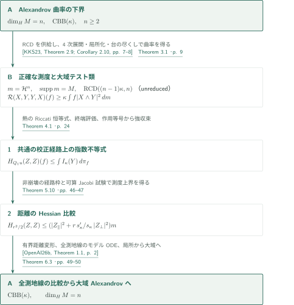
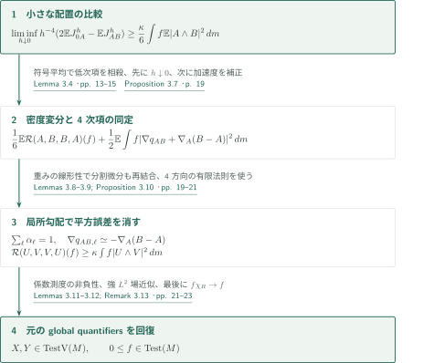
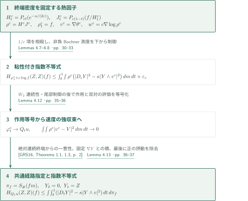
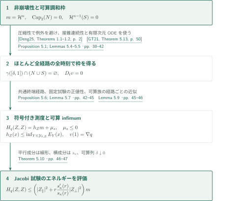
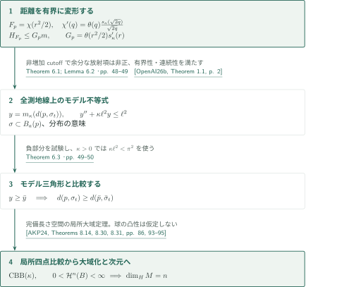

# Gigli’s distributional curvature characterization of Alexandrov spaces

**4次の輸送展開から大域的曲率テンソルへ、熱正則化した指数形式から全測地線の比較へ**

本原稿は、整数次元 $n\ge2$ におけるAlexandrov下方曲率条件を、正確なHausdorff測度とGigliの分布曲率で特徴付ける。順方向では小さな配置の比較を積分して曲率を取り出し、逆方向では指数不等式、距離の弱Hessian、全測地線上のモデル方程式を経由する。

## 1. 主要結果

### Theorem 1.1 — Gigliの特徴付け

$n\ge2$ を整数、$\kappa\in\mathbb R$、$(M,d)$ を完備可分距離空間とする。次は同値である。

- **(A)** $(M,d)$ は曲率 $\ge\kappa$ の $n$ 次元Alexandrov空間である。
- **(B)** **正確に** $m=\mathcal H_d^n$ とすると、$(M,d,m)$ はfull supportを持つ **unreduced** $\mathrm{RCD}((n-1)\kappa,n)$ 空間であり、すべての $X,Y\in\mathrm{TestV}(M)$ とすべての非負 $f\in\mathrm{Test}(M)$ に対し

$$
\mathcal R(X,Y,Y,X)(f)\ge\kappa\int_M f\bigl(|X|^2|Y|^2-\langle X,Y\rangle^2\bigr)\,dm.
$$

ここで $\Delta$ は非正の $L^2$ 生成作用素であり、

$$
\mathrm{Test}(M)=\{f\in D(\Delta): f\text{ は有界な大域的Lipschitz代表を持ち、 }\Delta f\in W^{1,2}(M)\},
\qquad
\mathrm{TestV}(M)=\Bigl\{\sum_{j=1}^{\ell}a_j\nabla b_j:\ell<\infty,\ a_j,b_j\in\mathrm{Test}(M)\Bigr\}.
$$

$[X,Y]=\nabla_XY-\nabla_YX$ として、符号規約を含む曲率の定義は

$$
\begin{aligned}
\mathcal R(X,Y,Z,W)(f)=\int_M\bigl[&-\langle\nabla_X(fW),\nabla_YZ\rangle-f\langle\nabla_YZ,W\rangle\operatorname{div}X\\
&+\langle\nabla_Y(fW),\nabla_XZ\rangle+f\langle\nabla_XZ,W\rangle\operatorname{div}Y
-f\langle\nabla_{[X,Y]}Z,W\rangle\bigr]\,dm.
\end{aligned}
$$

測度を $\mathcal H^n$ と同値な任意の測度に置き換えず、テスト場・重みをコンパクト台に制限しない。正の曲率ではAlexandrov比較を通常のモデル尺度で解釈する。

<!-- cite:main -->[Theorem 1.1; (1.1)–(1.4) · p. 2](https://github.com/openai/math/blob/1581d4cbdd69a0faf34b2089614fe2a814316a6a/preprints/Giglis-distributional-curvature-characterization-of-Alexandrov-spaces-September-24-2026/main.pdf)<!-- /cite -->

## 図の矢印に付した引用

<!-- reference-guide -->
略号のない定理・補題・節・式番号は本原稿 [Gigli’s distributional curvature characterization of Alexandrov spaces](https://github.com/openai/math/blob/1581d4cbdd69a0faf34b2089614fe2a814316a6a/preprints/Giglis-distributional-curvature-characterization-of-Alexandrov-spaces-September-24-2026/main.pdf) を指します。外部入力には次の略号を使います。

- [KKS23](https://arxiv.org/pdf/2003.06242v1) Vitali Kapovitch, Christian Ketterer, Karl-Theodor Sturm — *On gluing Alexandrov spaces with lower Ricci curvature bounds*：Alexandrov空間からunreduced RCDへの入力。arXiv:2003.06242v1 (2020); published 2023。
- [Gig19](https://arxiv.org/pdf/1902.02282v1) Nicola Gigli — *Riemann curvature tensor on RCD spaces and possible applications*：曲率の符号・対称性・テスト関数上のテンソル性。arXiv:1902.02282v1 (2019)。
- [GRS16](https://arxiv.org/pdf/1305.4849v1) Nicola Gigli, Tapio Rajala, Karl-Theodor Sturm — *Optimal maps and exponentiation on finite-dimensional spaces with Ricci curvature bounded from below*：絶対連続端点からの最適経路の一意性。arXiv:1305.4849v1 (2013); published 2016。
- [GH15](https://arxiv.org/pdf/1406.6350v1) Nicola Gigli, Bang-Xian Han — *The continuity equation on metric measure spaces*：有界圧縮のWasserstein曲線と連続の方程式・作用。arXiv:1406.6350v1 (2014); published 2015。
- [JLZ16](https://arxiv.org/pdf/1407.5289v2) Renjin Jiang, Huaiqian Li, Huichun Zhang — *Heat kernel bounds on metric measure spaces and some applications*：負のRicci下界へ弱めたGaussian熱核評価。arXiv:1407.5289v2 (2015); published 2016。
- [DPG18](https://arxiv.org/pdf/1708.02060v3) Guido De Philippis, Nicola Gigli — *Non-collapsed spaces with Ricci curvature bounded from below*：非崩壊性からEuclid接錐・次元・体積評価。arXiv:1708.02060v3 (2018)。
- [BPS21](https://arxiv.org/pdf/2001.07911v1) Elia Bruè, Enrico Pasqualetto, Daniele Semola — *Rectifiability of RCD(K, N) spaces via δ-splitting maps*：Euclid拡大近傍の調和splitting map。arXiv:2001.07911v1 (2020); published 2021。
- [Deng25](https://arxiv.org/pdf/2009.07956v2) Qin Deng — *Hölder continuity of tangent cones in RCD(K, N) spaces and applications to non-branching*：全測地線上で同じ拡大列に沿う接錐の連続性。arXiv:2009.07956v2; published 2025。
- [GT21](https://arxiv.org/pdf/1802.02463v1) Nicola Gigli, Luca Tamanini — *Second order differentiation formula on RCD∗(K, N) spaces*：有界台最適測地線計画の2階微分公式。arXiv:1802.02463v1 (2018); published 2021。
- [AKP24](https://anton-petrunin.github.io/book/arXiv.pdf) Stephanie Alexander, Vitali Kapovitch, Anton Petrunin — *Alexandrov Geometry: Foundations*：辺上比較・局所四点条件・完備長さ空間の大域化。Updated online PDF, retrieved 2026-10-19; book published 2024. Numbering matches the manuscript’s cited 2026-09-24 online version.。
- [OpenAI26b](https://github.com/openai/math/blob/1581d4cbdd69a0faf34b2089614fe2a814316a6a/preprints/Weak-Hessian-bounds-along-every-geodesic-in-RCD-spaces-September-24-2026/weak-hessian-geodesics.pdf) OpenAI — *Weak Hessian bounds along every geodesic in RCD spaces*：有界関数の弱Hessian上界から全測地線の2階微分不等式へ。September 24, 2026。

各引用に結果番号とページを付します。誌面番号とPDF内の位置が異なる場合は両方を示します。GitHubの閲覧リンクではページ位置への自動移動を前提としません。
<!-- /reference-guide -->

## 2. Theorem 1.1 — 主定理の証明概略

<!-- proof-target:1 -->証明対象：[Theorem 1.1; (1.1)–(1.4) · p. 2](https://github.com/openai/math/blob/1581d4cbdd69a0faf34b2089614fe2a814316a6a/preprints/Giglis-distributional-curvature-characterization-of-Alexandrov-spaces-September-24-2026/main.pdf)<!-- /proof-target -->

**証明の道筋。** 順方向の測度・RCD部分は既存のAlexandrov理論を使う。新たに得るテンソル不等式は、4次輸送展開の誤差を局所化して消し、最後に大域的テスト類へ延長する。逆方向では(B)から熱正則化した指数不等式を得て、非崩壊性を使った経路上の枠と可算試験場により距離のHessian比較を導く。別論文の弱Hessian定理を適用するために距離を有界に変形し、全測地線上の比較を局所から大域へ移す。

### 1. (A)から(B)へ

外部のAlexandrov-to-RCD定理は境界のない場合だけに限定されず、unreduced $\mathrm{RCD}((n-1)\kappa,n)$ を供給する。本稿Theorem 3.1の追加部分は、弱微分だけから全 $X,Y,f$ に対する曲率不等式を得る点にある。

<!-- cite:kks -->[&#91;KKS23, Theorem 2.9; Corollary 2.10, pp. 7–8&#93;](https://arxiv.org/pdf/2003.06242v1#page=7)<!-- /cite -->

### 2. (B)から(A)へ

Theorem 4.1の指数形式は各終点から同じ校正測地線を選ぶため、終端重みを変えても経路が変わらない。これがTheorem 5.10で試験場のエネルギーの可算infimumを取る根拠になる。そこからTheorem 6.3は、すべての測地線に沿う比較と $\dim_H M=n$ の両方を得る。RCDが与えるほとんど至る所の経路情報から、特定の任意の測地線への移行はcompanion theoremが担う。

<!-- cite:conclusion -->[§7, proof of Theorem 1.1 · p. 50](https://github.com/openai/math/blob/1581d4cbdd69a0faf34b2089614fe2a814316a6a/preprints/Giglis-distributional-curvature-characterization-of-Alexandrov-spaces-September-24-2026/main.pdf)<!-- /cite -->

## 3. Theorem 3.1 — 配置比較から大域的テスト類へ

<!-- proof-target:2 -->証明対象：[Theorem 3.1 · p. 9](https://github.com/openai/math/blob/1581d4cbdd69a0faf34b2089614fe2a814316a6a/preprints/Giglis-distributional-curvature-characterization-of-Alexandrov-spaces-September-24-2026/main.pdf)<!-- /proof-target -->

<!-- statement:theorem-3-1 -->
### Theorem 3.1 — 順方向

$(M,d)$ を完備な $n$ 次元Alexandrov空間、$n\ge2$、曲率下界を $\kappa$ とし、$m=\mathcal H_d^n$ とする。このときfull supportを持つunreduced $\mathrm{RCD}((n-1)\kappa,n)$ 空間であり、すべての $X,Y\in\mathrm{TestV}(M)$ と非負 $f\in\mathrm{Test}(M)$ に対してTheorem 1.1の曲率不等式が成り立つ。

<!-- cite:forward -->[Theorem 3.1 · p. 9](https://github.com/openai/math/blob/1581d4cbdd69a0faf34b2089614fe2a814316a6a/preprints/Giglis-distributional-curvature-characterization-of-Alexandrov-spaces-September-24-2026/main.pdf)<!-- /cite -->
<!-- /statement -->

### 1. 同じエネルギー差の幾何学的下界と解析的上界

有界Laplacianを持つコンパクト台テスト関数の勾配 $A,B$ を、符号反転不変な有限確率法則から独立に選ぶ。短い流れの速度を $hA+h^2tS_A$ とし、$J_{0A}^h$ を放射状の流れの作用、$J_{AB}^h$ を終端測度間の最適輸送作用とする。Alexandrovの余弦比較は

$$
\liminf_{h\downarrow0}\frac{2\mathbb EJ_{0A}^h-\mathbb EJ_{AB}^h}{h^4}
\ge\frac\kappa6\int f\,\mathbb E|A\wedge B|^2\,dm
$$

を与える。一方、補間密度の差商の弱 $L^2$ 収束と速度の重み付き強収束を使い、Sobolev双対ポテンシャルで同じ差を展開する。符号対称性が奇数次項を消す。先に $h\downarrow0$ とし、その後 $S_A\to-\nabla_AA$ として放射状加速度の誤差を除くと、残る差は曲率と非負平方

$$
\frac\kappa6\int f\,\mathbb E|A\wedge B|^2\,dm
\le\frac16\mathbb E\mathcal R(A,B,B,A)(f)
+\frac12\mathbb E\int f|\nabla q_{AB}+\nabla_A(B-A)|^2\,dm
$$

で支配される。これは単なる点ごとの滑らかな曲率展開ではない。密度の1次変分を固定された $L^2$ Hessian係数と組み合わせることが4次項の正当化を担う。

<!-- cite:fourth -->[Lemmas 3.3–3.6; Proposition 3.7 · pp. 12–19](https://github.com/openai/math/blob/1581d4cbdd69a0faf34b2089614fe2a814316a6a/preprints/Giglis-distributional-curvature-characterization-of-Alexandrov-spaces-September-24-2026/main.pdf)<!-- /cite -->

### 2. 局所的な勾配選択で平方を消す

一般の $L^2$ ベクトル場は一つの勾配では近似できないが、有限分割上で別々の勾配を選べば近似できる。Lemma 3.9を $-\nabla_A(B-A)$ に適用し、重みを $f\alpha_\ell$ に分ける。曲率は重みに線形なので $\sum\alpha_\ell=1$ により重みの微分項も正確に再結合し、分割の微分に一様評価を要求せず平方誤差を消せる。法則を $\{U,-U,V,-V\}$ の一様分布とすれば、混合項だけから所望の断面曲率不等式が残る。

<!-- cite:localization -->[Lemmas 3.8–3.9; Proposition 3.10 · pp. 19–21](https://github.com/openai/math/blob/1581d4cbdd69a0faf34b2089614fe2a814316a6a/preprints/Giglis-distributional-curvature-characterization-of-Alexandrov-spaces-September-24-2026/main.pdf)<!-- /cite -->

### 3. 大域化は最後に行う

固定した有限勾配族について、定数係数の非負曲率汎関数を正Radon測度として表し、係数多項式の有理点での非負性から変数テスト係数に延長する。続いて元のテスト関数を局所的に有界Laplacianの関数で近似し、場・発散・共変微分の強 $L^2$ 収束で曲率を通す。最後に重み $f\chi_R$ の台を増やす。元のテンソル積分は大域的に可積分であり、$d\chi_R$ の誤差は $L^1$ の尾部に落ちる。この順序によりTheorem 1.1の元のglobal quantifiersを回復する。

<!-- cite:global-tests -->[Lemmas 3.11–3.12; Remark 3.13 · pp. 21–23](https://github.com/openai/math/blob/1581d4cbdd69a0faf34b2089614fe2a814316a6a/preprints/Giglis-distributional-curvature-characterization-of-Alexandrov-spaces-September-24-2026/main.pdf)<!-- /cite -->

<!-- cite:gigli -->[&#91;Gig19, Definition 2.6; Proposition 2.7, pp. 5–6&#93;](https://arxiv.org/pdf/1902.02282v1#page=5)<!-- /cite -->

## 4. Theorem 4.1 — 熱正則化から指数不等式へ

<!-- proof-target:3 -->証明対象：[Theorem 4.1 · p. 24](https://github.com/openai/math/blob/1581d4cbdd69a0faf34b2089614fe2a814316a6a/preprints/Giglis-distributional-curvature-characterization-of-Alexandrov-spaces-September-24-2026/main.pdf)<!-- /proof-target -->

<!-- statement:theorem-4-1 -->
### Theorem 4.1 — 校正経路に沿う指数不等式

(B)を仮定する。有界大域的Lipschitz関数 $u$ はコンパクト集合外で定数とし、$\Phi_t=Q_tu=\inf_y\{u(y)+d(\cdot,y)^2/(2t)\}$ とおく。$m$-零集合外にBorelな経路指定 $S(x)_1=x$ があり、次の校正条件を満たす。

$$
\Phi_1(S(x)_1)=u(S(x)_0)+d(S(x)_0,S(x)_1)^2/2.
$$

任意の非負コンパクト台Lipschitz重み $f$ に対し $\pi_f=S_\#(fm)$ は終端測度 $fm$、有界速度、各 $[\delta,1]$ ($\delta>0$) で有界圧縮を持つ。

任意のコンパクト台テスト勾配 $Z$、$0<\delta<1$、有限和 $Y_t=\sum_j a_j(t)\nabla g_j$ ($a_j\in C^\infty([\delta,1])$、$g_j$ はコンパクト台テスト関数) で、**大域的な場の恒等式** $Y_\delta=0,Y_1=Z$ を満たすものについて

$$
H_{\Phi_1}(Z,Z)(f)\le\int\!\int_\delta^1
\bigl(|\partial_tY+\nabla_vY|^2-\kappa|Y\wedge v|^2\bigr)(\gamma_t)\,dt\,d\pi_f(\gamma).
$$

$S$ と速度代表は $Z,Y,f$ に依存しない。弱Hessianは次の汎関数である。

$$
H_F(Z,Z)(f)=-\int\operatorname{div}(fZ)\langle\nabla F,Z\rangle\,dm-\int f\langle\nabla F,\nabla_ZZ\rangle\,dm.
$$

<!-- cite:index -->[Theorem 4.1 · p. 24](https://github.com/openai/math/blob/1581d4cbdd69a0faf34b2089614fe2a814316a6a/preprints/Giglis-distributional-curvature-characterization-of-Alexandrov-spaces-September-24-2026/main.pdf)<!-- /cite -->
<!-- /statement -->

### 1. 終端密度を固定し、特異Bochner項を制御する

まず $f=f_0+\lambda e^{-Dd(o,\cdot)}>0$ とし、粘性 $c>0$ に対し $H_t^c=P_{ct}(e^{-u/(2c)})$、$J_t^c=P_{c(1-t)}(f/H_1^c)$、$\rho_t^c=H_t^cJ_t^c$ を作る。$\varphi=-2c\log H$、$\psi=2c\log J$、$\theta=(\psi+\varphi)/2$、$b=c\log\rho$ とすると $v^c=\nabla\theta$ は連続の方程式の速度、$w^c=\nabla b$ は密度の補正である。

Riccati型恒等式の曲率項に(B)を適用し平方完成すると、指数形式と加速度誤差 $H_{|w^c|^2/2+c\Delta b^c}$ が現れる。$w^c\to0$ だけでは密度微分の $1/c$ を処理できない。本稿はこれらを先に正確に相殺し、残るBochner測度を非負部分と $L^2$ 部分に分ける。$c\Delta b^c\ge-e_c(t)$、$\|e_c\|_{L^1(\delta,1)}\to0$ を準連続代表に用い、特異測度も含め終端 $T\uparrow1$ に一様な下側誤差評価を得る。

<!-- cite:heat-index -->[Lemmas 4.5–4.8; Proposition 4.9 · pp. 28–33](https://github.com/openai/math/blob/1581d4cbdd69a0faf34b2089614fe2a814316a6a/preprints/Giglis-distributional-curvature-characterization-of-Alexandrov-spaces-September-24-2026/main.pdf)<!-- /cite -->

<!-- cite:jlz -->[&#91;JLZ16, Theorem 1.2, p. 2&#93;](https://arxiv.org/pdf/1407.5289v2#page=2)<!-- /cite -->

### 2. 作用の等号が二次エネルギーの極限を保証する

$\varphi_t^c\to Q_tu$ と密度曲線の $W_2$ コンパクト性だけでは指数形式を通せない。作用恒等式とHopf–Lax双対不等式の間の評価がすべて等号になり、極限がWasserstein測地線であることと

$$
\int_\delta^1\!\int\rho_t^c|v_t^c-V_t|^2\,dm\,dt\longrightarrow0
$$

を同時に与える。固定 $L^2$ 係数を切断してこの収束を $\nabla Y$ にも適用する。絶対連続な終端から時間を逆向きに見た最適輸送の一意性が、終端重みを変えても同じ経路を選ぶことを保証する。順に $T\uparrow1$、$c\downarrow0$、$\lambda\downarrow0$ として主張へ至る。点源である時刻0に有界圧縮を仮定していない。

<!-- cite:transport-limit -->[Lemmas 4.10–4.13; proof of Theorem 4.1 · pp. 33–37](https://github.com/openai/math/blob/1581d4cbdd69a0faf34b2089614fe2a814316a6a/preprints/Giglis-distributional-curvature-characterization-of-Alexandrov-spaces-September-24-2026/main.pdf)<!-- /cite -->

<!-- cite:gh -->[&#91;GH15, Theorem 3.5, p. 11&#93;](https://arxiv.org/pdf/1406.6350v1#page=11)<!-- /cite --> <!-- cite:grs -->[&#91;GRS16, Theorems 1.1, 1.3, p. 2&#93;](https://arxiv.org/pdf/1305.4849v1#page=2)<!-- /cite -->

## 5. Theorem 5.10 — 経路全体の枠とHessian比較

<!-- proof-target:4 -->証明対象：[Theorem 5.10 · pp. 46–47](https://github.com/openai/math/blob/1581d4cbdd69a0faf34b2089614fe2a814316a6a/preprints/Giglis-distributional-curvature-characterization-of-Alexandrov-spaces-September-24-2026/main.pdf)<!-- /proof-target -->

<!-- statement:theorem-5-10 -->
### Theorem 5.10 — 分布的Hessian比較

(B)を仮定する。$R_\kappa>0$ を取り、$\kappa>0$ では $R_\kappa\sqrt\kappa<\pi/2$ とする。任意の $p\in M$ に対し $r=d(p,\cdot)$、$q=r^2/2$ とおく。$s_\kappa''+\kappa s_\kappa=0$、$s_\kappa(0)=0$、$s_\kappa'(0)=1$ とする。各コンパクト台テスト勾配 $Z$ について、$B(p,R_\kappa)$ 上の $H_q(Z,Z)$ は符号付きRadon測度で、特異部分は非正、かつ

$$
H_q(Z,Z)\le\left(|Z_\parallel|^2+r\frac{s_\kappa'(r)}{s_\kappa(r)}|Z_\perp|^2\right)m.
$$

ここで $|\nabla q|=r$ a.e.、$r>0$ 上で $Z_\parallel=\langle Z,\nabla q\rangle\nabla q/r^2$、$Z_\perp=Z-Z_\parallel$。$r=0$ では右辺係数を $|Z|^2$ と解釈する。不等式は球内のすべての非負コンパクト台Lipschitz重みに対して成り立ち、半径は $p$ に依存しない。

<!-- cite:hessian -->[Theorem 5.10 · pp. 46–47](https://github.com/openai/math/blob/1581d4cbdd69a0faf34b2089614fe2a814316a6a/preprints/Giglis-distributional-curvature-characterization-of-Alexandrov-spaces-September-24-2026/main.pdf)<!-- /cite -->
<!-- /statement -->

### 1. a.e.の空間的枠を経路の全時刻の枠へ移す

非崩壊性 $m=\mathcal H^n$ は $n$ 次元Euclid接錐をa.e.に与える。調和splitting mapを可算に選び、Gram行列の階数欠損をSobolevエネルギーで評価すると、例外集合は2-capacity零集合 $N$ と $\mathcal H^{n-1}$ 零集合 $S$ に分けられる。有界速度・有界圧縮の経路計画は、ほとんどすべての**経路全体**で両者を避ける。Dengの同じ拡大列に沿う接錐のHölder連続性は、稠密な正則時刻からすべての内部時刻へ正則性を延長する。端点は圧縮性で扱う。

連続Gram行列の正定値小行列を時間区間ごとに選び、$L^2$ 接続係数を持つ有限次元ODEを解くと平行枠を得る。Gigli–Tamaniniの2階微分公式から経路速度は平行となる。これらは非崩壊RCD空間の結果であり、曲率テンソル下界は次の放射状適用で使う。

<!-- cite:frames -->[Proposition 5.1; Lemmas 5.4–5.5; Proposition 5.6 · pp. 38–44](https://github.com/openai/math/blob/1581d4cbdd69a0faf34b2089614fe2a814316a6a/preprints/Giglis-distributional-curvature-characterization-of-Alexandrov-spaces-September-24-2026/main.pdf)<!-- /cite -->

<!-- cite:dpg -->[&#91;DPG18, Theorem 1.12; Corollary 2.14, pp. 7, 17&#93;](https://arxiv.org/pdf/1708.02060v3#page=7)<!-- /cite -->

<!-- cite:bps -->[&#91;BPS21, Proposition 1.4, p. 5&#93;](https://arxiv.org/pdf/2001.07911v1#page=5)<!-- /cite --> <!-- cite:deng -->[&#91;Deng25, Theorems 1.1–1.2, p. 2&#93;](https://arxiv.org/pdf/2009.07956v2#page=2)<!-- /cite --> <!-- cite:gt -->[&#91;GT21, Theorem 5.13, p. 50&#93;](https://arxiv.org/pdf/1802.02463v1#page=50)<!-- /cite -->

### 2. 可算infimumとJacobi場

$u=\min\{2R_\kappa r,2R_\kappa^2\}$ なら球内で $Q_1u=q$、唯一の最小点は $p$ である。校正経路は $p$ からの放射状測地線となり、端点差商の $L^2$ 評価で $v(1)=\nabla q$ を得る。

一つの試験場で $E_0m-H_q(Z,Z)\ge0$ を示すと、Riesz表現により $H_q(Z,Z)=h_Zm+\mu_s$、$\mu_s\le0$ が得られる。大域的端点条件を満たす可算試験場族を使えば、共通零集合外で $h_Z(x)\le\inf_Y E_Y(x)$ とできる。各経路では、$Z_\parallel,Z_\perp$ を平行移動した $P_\parallel,P_\perp$ に対して

$$
W_t=\frac{t-\delta}{1-\delta}P_\parallel(t)
+\frac{s_\kappa((t-\delta)r)}{s_\kappa((1-\delta)r)}P_\perp(t)
$$

を可算族で経路ごとの $W^{1,2}$ ノルムに近似する。その指数エネルギーは

$$
\frac{|Z_\parallel|^2}{1-\delta}+r\frac{s_\kappa'((1-\delta)r)}{s_\kappa((1-\delta)r)}|Z_\perp|^2.
$$

可算列 $\delta\downarrow0$ で目的の測度不等式になる。経路ごとの近似列を可測選択する必要も、計画全体での積分ノルムの稠密性を仮定する必要もない。

<!-- cite:jacobi -->[Lemmas 5.7–5.9; Theorem 5.10 · pp. 44–47](https://github.com/openai/math/blob/1581d4cbdd69a0faf34b2089614fe2a814316a6a/preprints/Giglis-distributional-curvature-characterization-of-Alexandrov-spaces-September-24-2026/main.pdf)<!-- /cite -->

## 6. Theorem 6.3 — 全測地線のモデル不等式から大域比較へ

<!-- proof-target:5 -->証明対象：[Theorem 6.3 · pp. 49–50](https://github.com/openai/math/blob/1581d4cbdd69a0faf34b2089614fe2a814316a6a/preprints/Giglis-distributional-curvature-characterization-of-Alexandrov-spaces-September-24-2026/main.pdf)<!-- /proof-target -->

<!-- statement:theorem-6-3 -->
### Theorem 6.3 — Alexandrov比較

Theorem 1.1の(B)、すなわち整数 $n\ge2$、$m=\mathcal H_d^n$、full-support unreduced $\mathrm{RCD}((n-1)\kappa,n)$ と全global test fields・非負global test weightsに対する曲率下界を仮定する。このとき $(M,d)$ は曲率 $\ge\kappa$ の **$n$ 次元**Alexandrov空間である。

<!-- cite:comparison -->[Theorem 6.3 · pp. 49–50](https://github.com/openai/math/blob/1581d4cbdd69a0faf34b2089614fe2a814316a6a/preprints/Giglis-distributional-curvature-characterization-of-Alexandrov-spaces-September-24-2026/main.pdf)<!-- /cite -->
<!-- /statement -->

### 1. companion theoremに入る有界関数を作る

$m_\kappa(r)=\int_0^r s_\kappa(s)\,ds$ とする。$0<a<b<R_\kappa$ を固定し、$\theta$ は $[0,a^2/2]$ で1、$[b^2/2,\infty)$ で0の非増加滑らかな関数とする。$\chi(0)=0$、$\chi'(q)=\theta(q)s_\kappa(\sqrt{2q})/\sqrt{2q}$、$F_p=\chi(r^2/2)$ とおけば、$F_p$ は有界大域的Lipschitzで、球外で定数となる。Hessianの連鎖則で放射成分に加わる $r\theta's_\kappa$ は非正であり、特異部分の符号も保たれる。したがって、有界連続な $G_p=\theta(r^2/2)s_\kappa'(r)$ に対し、すべてのコンパクト台テスト勾配 $Z$ と非負コンパクト台Lipschitz重み $h$ で $H_{F_p}(Z,Z)(h)\le\int hG_p|Z|^2dm$。$B_a(p)$ 内では $F_p=m_\kappa(r)$、$G_p=1-\kappa F_p$ である。

companion theoremはfull-support $\mathrm{RCD}(K,N)$、$1<N<\infty$、この有界性・連続性・弱Hessian条件から、**すべての**長さ $\ell$ の定速最短測地線 $\sigma$ 上で $(F_p\circ\sigma)''\le\ell^2G_p\circ\sigma$ を $(0,1)$ 上の分布の意味で与える。$F_p\in L^2(m)$ や $L^2$ Hessianは不要であり、ここで基準測度を変える必要もない。

<!-- cite:bounded-distance -->[Theorem 6.1; Lemma 6.2 · pp. 48–49](https://github.com/openai/math/blob/1581d4cbdd69a0faf34b2089614fe2a814316a6a/preprints/Giglis-distributional-curvature-characterization-of-Alexandrov-spaces-September-24-2026/main.pdf)<!-- /cite -->

<!-- cite:companion -->[&#91;OpenAI26b, Theorem 1.1, p. 2&#93;](https://github.com/openai/math/blob/1581d4cbdd69a0faf34b2089614fe2a814316a6a/preprints/Weak-Hessian-bounds-along-every-geodesic-in-RCD-spaces-September-24-2026/weak-hessian-geodesics.pdf)<!-- /cite -->

### 2. モデルODE、局所四点条件、大域化、次元

周長 $<a$ の三角形 $[pxy]$ の選んだ辺 $\sigma$ は $B_a(p)$ に収まるため、$y=m_\kappa(d(p,\sigma_t))$ は $y''+\kappa\ell^2y\le\ell^2$ を満たす。モデル三角形の対応関数 $\bar y$ は同じ端点値を持つ等式解。$y-\bar y$ の負部分を試験関数にすると、$\kappa\le0$ では直接、$\kappa>0$ では $\kappa\ell^2<\pi^2$ とDirichlet Poincaré不等式から $y\ge\bar y$ を得る。$m_\kappa$ の単調性で辺上の距離比較に戻る。

この短い三角形の比較を小球内の四点比較へ変換する際、すべての線分は周囲の空間の最短線分であり、球の凸性は仮定しない。局所CBB判定と完備長さ空間の大域化定理で $\mathrm{CBB}(\kappa)$ となる。最後に各非空有界球は正で有限な $\mathcal H^n$ 測度を持ち、可算尽くしで $\dim_HM=n$。これで(B)から(A)の曲率と次元の両結論が揃う。

<!-- cite:comparison -->[Theorem 6.3 · pp. 49–50](https://github.com/openai/math/blob/1581d4cbdd69a0faf34b2089614fe2a814316a6a/preprints/Giglis-distributional-curvature-characterization-of-Alexandrov-spaces-September-24-2026/main.pdf)<!-- /cite -->

<!-- cite:akp -->[&#91;AKP24, Theorems 8.14, 8.30, 8.31, pp. 86, 93–95&#93;](https://anton-petrunin.github.io/book/arXiv.pdf#page=86)<!-- /cite -->

## 7. どの論文が、どの段階を担うか

| 供給元 | 本稿の使用箇所 | 役割と適用条件 | 確認範囲 |
|---|---|---|---|
| Kapovitch–Ketterer–Sturm | Theorem 3.1 | $n$ 次元Alexandrov空間と正確な $\mathcal H^n$ からunreduced RCDを供給 | 指定版Theorem 2.9 / Corollary 2.10と適用を照合 |
| Bruè–Pasqualetto–Semola、Deng、Gigli–Tamanini | Proposition 5.1、Lemma 5.5、Proposition 5.6 | Euclid拡大に近い調和枠、全測地線の接錐連続性、速度の平行性。splittingでは補助次元 $N=n+1$ と一点残余因子を用いる | 指定版の結果記述と本文の接続を照合。外部証明全体は対象外 |
| Weak Hessian bounds along every geodesic in RCD spaces | Theorem 6.1、Lemma 6.2、Theorem 6.3 | 有界距離変形の弱Hessian評価を全測地線の不等式へ。非崩壊性を要求しない一般RCD定理 | Theorem 1.1の全仮定と適用を照合。本稿からの循環入力はない |
| Alexander–Kapovitch–Petrunin | Theorem 6.3 | 辺上比較から局所CBB、完備長さ空間から大域CBBへ | 取得したオンライン版のTheorems 8.14 / 8.30 / 8.31と適用を照合 |

<!-- cite:kks -->[&#91;KKS23, Theorem 2.9; Corollary 2.10, pp. 7–8&#93;](https://arxiv.org/pdf/2003.06242v1#page=7)<!-- /cite --> <!-- cite:bps -->[&#91;BPS21, Proposition 1.4, p. 5&#93;](https://arxiv.org/pdf/2001.07911v1#page=5)<!-- /cite --> <!-- cite:deng -->[&#91;Deng25, Theorems 1.1–1.2, p. 2&#93;](https://arxiv.org/pdf/2009.07956v2#page=2)<!-- /cite --> <!-- cite:gt -->[&#91;GT21, Theorem 5.13, p. 50&#93;](https://arxiv.org/pdf/1802.02463v1#page=50)<!-- /cite --> <!-- cite:companion -->[&#91;OpenAI26b, Theorem 1.1, p. 2&#93;](https://github.com/openai/math/blob/1581d4cbdd69a0faf34b2089614fe2a814316a6a/preprints/Weak-Hessian-bounds-along-every-geodesic-in-RCD-spaces-September-24-2026/weak-hessian-geodesics.pdf)<!-- /cite --> <!-- cite:akp -->[&#91;AKP24, Theorems 8.14, 8.30, 8.31, pp. 86, 93–95&#93;](https://anton-petrunin.github.io/book/arXiv.pdf#page=86)<!-- /cite -->

## 8. 原典を読む入口と確認範囲

<!-- reading-list -->
- [Theorem 1.1; (1.1)–(1.4) · p. 2](https://github.com/openai/math/blob/1581d4cbdd69a0faf34b2089614fe2a814316a6a/preprints/Giglis-distributional-curvature-characterization-of-Alexandrov-spaces-September-24-2026/main.pdf) — 測度・大域テスト類・符号と両方向の主張
- [Lemmas 3.3–3.6; Proposition 3.7 · pp. 12–19](https://github.com/openai/math/blob/1581d4cbdd69a0faf34b2089614fe2a814316a6a/preprints/Giglis-distributional-curvature-characterization-of-Alexandrov-spaces-September-24-2026/main.pdf) — 幾何配置と4次輸送展開を比較する核心
- [Lemmas 3.11–3.12; Remark 3.13 · pp. 21–23](https://github.com/openai/math/blob/1581d4cbdd69a0faf34b2089614fe2a814316a6a/preprints/Giglis-distributional-curvature-characterization-of-Alexandrov-spaces-September-24-2026/main.pdf) — 局所化から元のglobal quantifiersへの延長
- [Lemmas 4.5–4.8; Proposition 4.9 · pp. 28–33](https://github.com/openai/math/blob/1581d4cbdd69a0faf34b2089614fe2a814316a6a/preprints/Giglis-distributional-curvature-characterization-of-Alexandrov-spaces-September-24-2026/main.pdf) — 特異Bochner測度を含む終端一様評価
- [Lemmas 4.10–4.13; proof of Theorem 4.1 · pp. 33–37](https://github.com/openai/math/blob/1581d4cbdd69a0faf34b2089614fe2a814316a6a/preprints/Giglis-distributional-curvature-characterization-of-Alexandrov-spaces-September-24-2026/main.pdf) — 作用等号・速度強収束・共通経路指定
- [Proposition 5.1; Lemmas 5.4–5.5; Proposition 5.6 · pp. 38–44](https://github.com/openai/math/blob/1581d4cbdd69a0faf34b2089614fe2a814316a6a/preprints/Giglis-distributional-curvature-characterization-of-Alexandrov-spaces-September-24-2026/main.pdf) — 例外集合除去と経路全時刻の枠
- [Theorem 5.10 · pp. 46–47](https://github.com/openai/math/blob/1581d4cbdd69a0faf34b2089614fe2a814316a6a/preprints/Giglis-distributional-curvature-characterization-of-Alexandrov-spaces-September-24-2026/main.pdf) — 可算infimum、符号付き測度、Jacobi試験
- [Theorem 6.1; Lemma 6.2 · pp. 48–49](https://github.com/openai/math/blob/1581d4cbdd69a0faf34b2089614fe2a814316a6a/preprints/Giglis-distributional-curvature-characterization-of-Alexandrov-spaces-September-24-2026/main.pdf) — companionの仮定を満たす有界距離変形
- [Theorem 6.3 · pp. 49–50](https://github.com/openai/math/blob/1581d4cbdd69a0faf34b2089614fe2a814316a6a/preprints/Giglis-distributional-curvature-characterization-of-Alexandrov-spaces-September-24-2026/main.pdf) — モデルODE、局所大域、次元の結論
<!-- /reading-list -->

主定理、§3の配置・密度変分・4次展開・局所化・大域化、§4の熱因子・特異Bochner項・作用極限、§5の例外集合・枠・可算試験・Jacobi評価、§6–7の距離変形と局所大域の証明本文を読んで接続を整理した。外部入力は上記の記述と適用を照合した範囲を示している。

**確認の限界。** 長い4次展開の全項、熱核評価からの全定数の導出、容量とSobolev代表の同一視を含む全解析補題について独立の再証明は行っていない。基礎RCD解析の全引用先まで再帰的に証明検証したものではない。原稿が主張する特徴付けの紹介と、編集側が確認した記述・帰着の範囲を区別する。

AKPのオンラインPDFは今回取得した版の番号・記述を照合したが、原稿が参照する2026年9月24日のスナップショットとのファイル同一性は未確認である。
