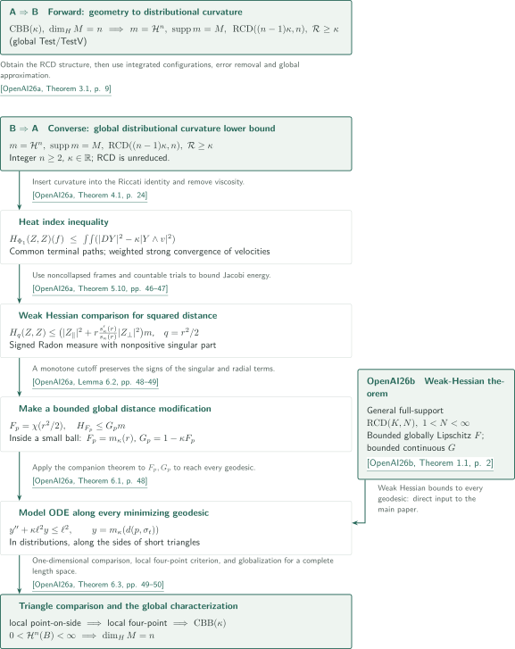

# Catalogue 356 — Gigli’s characterization of Alexandrov curvature

The two papers establish the equivalence between Gigli’s distributional curvature lower bound and an Alexandrov lower curvature bound, together with the weak-Hessian theorem used in the converse.

## The two papers in official catalogue order

CATALOGINVENTORYTOKEN

## References on the arrows

- **OpenAI26a**: OpenAI, *Gigli’s distributional curvature characterization of Alexandrov spaces*, September 24, 2026. Both directions of the characterization and the application of the weak-Hessian input. <!-- cite:main -->[&#91;OpenAI26a, Theorem 1.1, p. 2&#93;](https://github.com/openai/math/blob/1581d4cbdd69a0faf34b2089614fe2a814316a6a/preprints/Giglis-distributional-curvature-characterization-of-Alexandrov-spaces-September-24-2026/main.pdf)<!-- /cite -->
- **OpenAI26b**: OpenAI, *Weak Hessian bounds along every geodesic in RCD spaces*, September 24, 2026. Passage from a weak Hessian bound to a distributional inequality along every geodesic. <!-- cite:companion -->[&#91;OpenAI26b, Theorem 1.1, p. 2&#93;](https://github.com/openai/math/blob/1581d4cbdd69a0faf34b2089614fe2a814316a6a/preprints/Weak-Hessian-bounds-along-every-geodesic-in-RCD-spaces-September-24-2026/weak-hessian-geodesics.pdf)<!-- /cite -->

## Both directions and the companion input

The forward implication first obtains the RCD structure from $\operatorname{CBB}(\kappa)$. Integrated short-flow expansions, local removal of a square error, approximation and exhaustion then recover the curvature inequality on the original global $\operatorname{Test}/\operatorname{TestV}$ classes. The converse builds a heat-regularized index inequality from the curvature lower bound. Frames defined at every time along almost every path of suitable test plans, together with countable trials and noncollapse, turn it into weak Hessian comparison for squared distance. The [characterization article](../gigli-characterization/article.en.md) explains these steps.

The second paper enters after constructing a bounded global distance modification. Theorem 6.1 of the main paper is precisely Theorem 1.1 of the companion, supplying the model ODE along every minimizing geodesic. Comparison for short triangles yields the local four-point condition and then globalization; the exact measure $\mathcal H^n$ recovers dimension $n$.

<!-- cite:interface -->[&#91;OpenAI26a, Theorem 6.1, p. 48&#93;](https://github.com/openai/math/blob/1581d4cbdd69a0faf34b2089614fe2a814316a6a/preprints/Giglis-distributional-curvature-characterization-of-Alexandrov-spaces-September-24-2026/main.pdf)<!-- /cite -->

<!-- cite:comparison -->[&#91;OpenAI26a, Theorem 6.3, pp. 49–50&#93;](https://github.com/openai/math/blob/1581d4cbdd69a0faf34b2089614fe2a814316a6a/preprints/Giglis-distributional-curvature-characterization-of-Alexandrov-spaces-September-24-2026/main.pdf)<!-- /cite -->

The companion itself applies to general full-support finite-dimensional RCD spaces, including collapsed spaces. It requires neither global $L^2$ integrability of $F$ nor an $L^2$ Hessian. The [weak-Hessian article](../weak-hessian-geodesics/article.en.md) explains bounded measure changes, closure in the generator domain and concentration of endpoint measures. Its proof does not depend on the characterization or its frame construction.

## Sources and checking scope

The official subject is **Differential geometry (333–361)**. The catalogue and both manuscripts are fixed at commit `1581d4cbdd69a0faf34b2089614fe2a814316a6a`; both manuscript versions are dated September 24, 2026.

<!-- cite:catalog-source -->[&#91;OpenAICatalog, Catalogue 356, p. 38&#93;](https://github.com/openai/math/blob/1581d4cbdd69a0faf34b2089614fe2a814316a6a/overview.pdf)<!-- /cite -->

We compared the principal statements, the core reductions in both directions of the main paper, the companion’s proof text and its application in the main paper against the sources. Each article records the statements and uses of external inputs and the remaining unchecked scope. This does not independently verify every estimate or lemma of the main paper or the complete proofs of external references.
