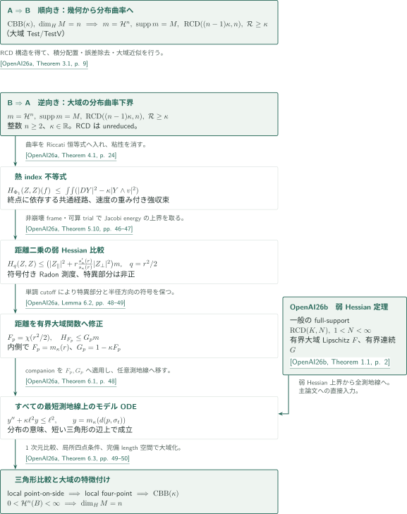

# カタログ356 — GigliによるAlexandrov曲率の特徴付け

**Gigli’s characterization of Alexandrov curvature**

Gigliの分布曲率下界とAlexandrovの曲率下界の同値、およびその逆向きで使う弱Hessianの全測地線定理を扱う。公式収録は2本。

## 全2篇の要点（公式カタログ順）

CATALOGINVENTORYTOKEN

## 図の矢印に付した引用

- **OpenAI26a**: OpenAI, *Gigli’s distributional curvature characterization of Alexandrov spaces*, September 24, 2026。特徴付けの両方向と、弱Hessian入力を使う段階。<!-- cite:main -->[&#91;OpenAI26a, Theorem 1.1, p. 2&#93;](https://github.com/openai/math/blob/1581d4cbdd69a0faf34b2089614fe2a814316a6a/preprints/Giglis-distributional-curvature-characterization-of-Alexandrov-spaces-September-24-2026/main.pdf)<!-- /cite -->
- **OpenAI26b**: OpenAI, *Weak Hessian bounds along every geodesic in RCD spaces*, September 24, 2026。弱Hessianから任意測地線上の分布不等式への移行。<!-- cite:companion -->[&#91;OpenAI26b, Theorem 1.1, p. 2&#93;](https://github.com/openai/math/blob/1581d4cbdd69a0faf34b2089614fe2a814316a6a/preprints/Weak-Hessian-bounds-along-every-geodesic-in-RCD-spaces-September-24-2026/weak-hessian-geodesics.pdf)<!-- /cite -->

## 同値の両方向とcompanionの入力

順向きでは$\operatorname{CBB}(\kappa)$からRCD構造を得た後、積分された短いflowの展開、局所的な二乗誤差の除去、近似とexhaustionによって、元の大域$\operatorname{Test}/\operatorname{TestV}$で曲率不等式を得る。逆向きでは、曲率下界から熱正則化したindex不等式を作り、非崩壊性を使い、適切なtest planのほとんどすべての経路について全時刻で構成したframeと可算trialを介して、距離二乗の弱Hessian比較へ進む。詳細は[特徴付けの記事](../gigli-characterization/article.ja.md)にまとめた。

2本目が入るのは、有界大域距離修正を作った後の段階である。主論文のTheorem 6.1はcompanionのTheorem 1.1そのものであり、すべての最短測地線上のモデルODEを供給する。短い三角形の比較から局所四点条件、局所大域定理へ進み、最後に正確な$\mathcal H^n$から次元$n$を回収する。

<!-- cite:interface -->[&#91;OpenAI26a, Theorem 6.1, p. 48&#93;](https://github.com/openai/math/blob/1581d4cbdd69a0faf34b2089614fe2a814316a6a/preprints/Giglis-distributional-curvature-characterization-of-Alexandrov-spaces-September-24-2026/main.pdf)<!-- /cite -->

<!-- cite:comparison -->[&#91;OpenAI26a, Theorem 6.3, pp. 49–50&#93;](https://github.com/openai/math/blob/1581d4cbdd69a0faf34b2089614fe2a814316a6a/preprints/Giglis-distributional-curvature-characterization-of-Alexandrov-spaces-September-24-2026/main.pdf)<!-- /cite -->

companion自体は一般のfull-support有限次元RCD空間で成立し、崩壊を許す。 $F$の大域$L^2$性も$L^2$-Hessianも仮定しない。有界測度変更、generator domainの閉包、端点測度の集中の役割は[弱Hessianの記事](../weak-hessian-geodesics/article.ja.md)で説明する。主論文の特徴付けやframe構成への逆向きの証明依存はない。

## 原典・確認範囲

公式分野は **Differential geometry（微分幾何学、333–361）**。公式一覧と両原稿はcommit `1581d4cbdd69a0faf34b2089614fe2a814316a6a` に固定した。原稿版はいずれも2026年9月24日。

<!-- cite:catalog-source -->[&#91;OpenAICatalog, Catalogue 356, p. 38&#93;](https://github.com/openai/math/blob/1581d4cbdd69a0faf34b2089614fe2a814316a6a/overview.pdf)<!-- /cite -->

両論文の主要な主張、主論文の順向き・逆向きの核心帰着、companionの証明本文と主論文への適用を原典で照合した。各記事に外部入力の記述・使用箇所と未確認範囲を記録する。主論文の全評価・全補題、外部文献の全証明を独立に検証したものではない。
