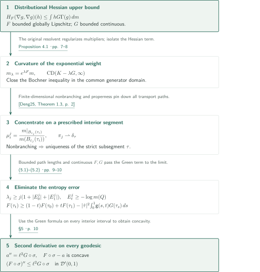
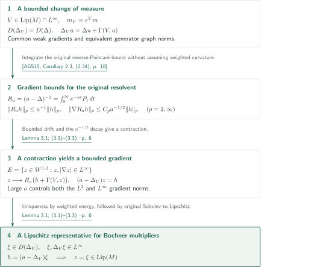
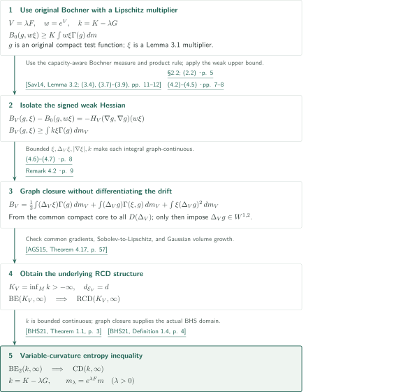

# Weak Hessian bounds along every geodesic in RCD spaces

**Closing the weighted Bochner inequality and concentrating entropy on a prescribed geodesic**

The manuscript passes from a distributional Hessian upper bound on a finite-dimensional RCD space to a second-derivative upper bound along every minimizing geodesic. Analytically, a resolvent built from the original heat flow controls multipliers for the weighted generator. Geometrically, nonbranching concentrates optimal transport on an arbitrary prescribed interior subsegment.

## 1. Main results

### Theorem 1.1 — A distributional inequality along every minimizing geodesic

Let $(M,d,m)$ be complete and separable, with $\operatorname{supp}m=M$ and $m$ finite on bounded sets, and assume $\operatorname{RCD}(K,N)$ with $K\in\mathbb R$ and $1<N<\infty$. The manuscript uses unreduced $\operatorname{CD}(K,N)$ together with quadratic Cheeger energy. The Laplacian is the nonpositive $L^2$ generator; write $\Gamma(u,v)=\langle\nabla u,\nabla v\rangle$ and $\Gamma(u)=\Gamma(u,u)$.

Let $F:M\to\mathbb R$ be bounded and globally Lipschitz, and $G:M\to\mathbb R$ bounded and continuous. Set
\[
\operatorname{Test}(M)=\{g\in D(\Delta):g\text{ has a bounded globally Lipschitz representative,}\ \Delta g\in W^{1,2}(M)\}.
\]
For compactly supported $g\in\operatorname{Test}(M)$, $Y=\nabla g$, and $h\in\operatorname{Lip}_c(M)$, define
\[
H_F(Y,Y)(h)=-\int_M\operatorname{div}(hY)\langle\nabla F,Y\rangle\,dm
-\int_M h\langle\nabla F,\nabla_Y Y\rangle\,dm,
\]
where $\operatorname{div}(hY)=\Gamma(h,g)+h\Delta g$ and $\nabla_Y Y=\nabla(\Gamma(g)/2)$. Suppose that for every such $g$ and every nonnegative $h\in\operatorname{Lip}_c(M)$,
\[
H_F(\nabla g,\nabla g)(h)\le\int_M hG\Gamma(g)\,dm.
\]
Then **every** constant-speed minimizing geodesic $\sigma:[0,1]\to M$, of length $\ell$, satisfies
\[
(F\circ\sigma)''\le\ell^2G\circ\sigma\quad\text{in }\mathcal D'(0,1).
\]
Equivalently, for every $0\le\varphi\in C_c^\infty(0,1)$,
\[
\int_0^1 F(\sigma_t)\varphi''(t)\,dt\le\ell^2\int_0^1G(\sigma_t)\varphi(t)\,dt.
\]
When $G=c$ is constant, $F(\sigma_t)-c\ell^2t^2/2$ is concave. Neither $m(M)<\infty$ nor $F\in L^2(m)$ is assumed: the weak Hessian definition only needs local first-order Sobolev regularity of $F$.

<!-- cite:main -->[Theorem 1.1; (1.1)–(1.4) · p. 2](https://github.com/openai/math/blob/1581d4cbdd69a0faf34b2089614fe2a814316a6a/preprints/Weak-Hessian-bounds-along-every-geodesic-in-RCD-spaces-September-24-2026/weak-hessian-geodesics.pdf)<!-- /cite -->

## References on the arrows

<!-- reference-guide -->
Unprefixed theorem, lemma, section and equation numbers refer to [Weak Hessian bounds along every geodesic in RCD spaces](https://github.com/openai/math/blob/1581d4cbdd69a0faf34b2089614fe2a814316a6a/preprints/Weak-Hessian-bounds-along-every-geodesic-in-RCD-spaces-September-24-2026/weak-hessian-geodesics.pdf). External inputs use the following keys.

- [AGS15](https://arxiv.org/pdf/1209.5786v4) Luigi Ambrosio, Nicola Gigli, Giuseppe Savaré — *Bakry–Émery curvature-dimension condition and Riemannian Ricci curvature bounds*: Original heat reverse-Poincaré estimate; intrinsic distance and constant BE–RCD equivalence. arXiv:1209.5786v4.
- [BHS21](https://arxiv.org/pdf/1906.09186v1) Mathias Braun, Karen Habermann, Karl-Theodor Sturm — *Optimal transport, gradient estimates, and pathwise Brownian coupling on spaces with variable Ricci bounds*: Variable-curvature BE₂–CD equivalence on an existing RCD space and the Green-kernel entropy formula. arXiv:1906.09186v1.
- [Deng25](https://arxiv.org/pdf/2009.07956v2) Qin Deng — *Hölder continuity of tangent cones in RCD(K,N) spaces and applications to non-branching*: Nonbranching of all geodesics in finite-dimensional RCD spaces. arXiv:2009.07956v2.
- [Sav14](https://arxiv.org/pdf/1304.0643v2) Giuseppe Savaré — *Self-improvement of the Bakry–Émery condition and Wasserstein contraction of the heat flow in RCD(K,∞) metric measure spaces*: Measure-valued Bochner inequality and multiplier representatives outside capacity-zero sets. arXiv:1304.0643v2.
- [Gig18](https://arxiv.org/pdf/1407.0809v1) Nicola Gigli — *Nonsmooth differential geometry—an approach tailored for spaces with Ricci curvature bounded from below*: Hessian-square estimate for the original test class. arXiv:1407.0809v1.
- [GT21](https://arxiv.org/pdf/1802.02463v1) Nicola Gigli, Luca Tamanini — *Second order differentiation formula on RCD∗(K,N) spaces*: Original heat regularization, good cutoffs, and the Hessian estimate on the Laplacian domain. arXiv:1802.02463v1.

Each citation gives the result and pages. When printed pagination differs from the PDF position, both are shown. GitHub previews do not automatically jump to the cited page.
<!-- /reference-guide -->

## 2. Theorem 1.1 — Proof overview of the main theorem

<!-- proof-target:1 -->Proof target：[Theorem 1.1; (1.1)–(1.4) · p. 2](https://github.com/openai/math/blob/1581d4cbdd69a0faf34b2089614fe2a814316a6a/preprints/Weak-Hessian-bounds-along-every-geodesic-in-RCD-spaces-September-24-2026/weak-hessian-geodesics.pdf)<!-- /proof-target -->

**Proof route.** The [section on Proposition 4.1](#proof-2) establishes $\operatorname{CD}(K-\lambda G,\infty)$ for $m_\lambda=e^{\lambda F}m$. The multiplier regularity needed there is proved in the [section on Lemma 3.1](#proof-1). Here the overview includes the final passage from that curvature bound to one prescribed geodesic. The case $\ell=0$ is immediate, so assume $\ell>0$. Write $\mathsf g(s,t)=\min\{s,t\}-st$ for the Dirichlet Green kernel.

### 1. Nonbranching fixes each interior subsegment

Deng's nonbranching theorem makes every **strict interior subsegment** of $\sigma$ the unique minimizer between its endpoints. Otherwise, replacing it by a different minimizer and retaining the preceding and following portions of $\sigma$ produces two minimizing geodesics of the same total length agreeing on a nontrivial initial interval. This uses nonbranching of all geodesics; essential nonbranching of transport plans alone would not justify the argument.

<!-- cite:deng -->[&#91;Deng25, Theorem 1.3, p. 2&#93;](https://arxiv.org/pdf/2009.07956v2#page=2)<!-- /cite -->

Let $\tau:[0,1]\to M$ be the constant-speed reparametrization of such a subsegment. For $\varepsilon_j\downarrow0$, put
\[
\mu_i^j=\frac{m|_{B_{\varepsilon_j}(\tau_i)}}{m(B_{\varepsilon_j}(\tau_i))},\qquad
E_i^j=\operatorname{Ent}_m(\mu_i^j)=-\log m(B_{\varepsilon_j}(\tau_i)),\quad i=0,1.
\]
Full support and local finiteness make the denominators positive and finite. Choose $\lambda_j\ge j(1+|E_0^j|+|E_1^j|)$ and use the curvature bound for $m_{\lambda_j}$ to obtain a dynamical optimal plan $\pi_j$. Properness and the endpoint support constraints put all relevant paths inside one compact set $Q$, with lengths bounded by $L$. Arzelà–Ascoli and uniqueness of $\tau$ show that every limit of such paths is $\tau$, hence $\pi_j\rightharpoonup\delta_\tau$. This argument depends only on the metric and the endpoints, although the weighted measures vary with $j$.

<!-- cite:localize -->[§5 · p. 9](https://github.com/openai/math/blob/1581d4cbdd69a0faf34b2089614fe2a814316a6a/preprints/Weak-Hessian-bounds-along-every-geodesic-in-RCD-spaces-September-24-2026/weak-hessian-geodesics.pdf)<!-- /cite -->

### 2. Remove the entropy error while retaining variable G

Set $\mu_t^j=(e_t)_\#\pi_j$, $A_t^j=\int F\,d\mu_t^j$, $E_t^j=\operatorname{Ent}_m(\mu_t^j)$, and
\[
C_t^j=\int\!\int_0^1\mathsf g(s,t)|\dot\gamma|^2\,ds\,d\pi_j(\gamma),\qquad
D_t^j=\int\!\int_0^1\mathsf g(s,t)G(\gamma_s)|\dot\gamma|^2\,ds\,d\pi_j(\gamma).
\]
Substituting $\operatorname{Ent}_{m_{\lambda_j}}(\mu)=\operatorname{Ent}_m(\mu)-\lambda_j\int F\,d\mu$ into the curvature inequality gives
\[
A_t^j\ge(1-t)A_0^j+tA_1^j-D_t^j+
\frac{E_t^j-(1-t)E_0^j-tE_1^j+KC_t^j}{\lambda_j}.
\]
Jensen's inequality gives $E_t^j\ge-\log m(Q)$, and $0\le C_t^j\le L^2/8$. The final term therefore has nonnegative lower limit, uniformly in $t$. Continuity of $F,G$ on $Q$ and uniform convergence of the paths yield
\[
F(\tau_t)\ge(1-t)F(\tau_0)+tF(\tau_1)
-|\dot\tau|^2\int_0^1\mathsf g(s,t)G(\tau_s)\,ds.
\]
Continuity preserves the spatial variation of $G$ along the limiting path, rather than replacing it by $\sup G$.

<!-- cite:entropy -->[(5.1)–(5.2) · pp. 9–10](https://github.com/openai/math/blob/1581d4cbdd69a0faf34b2089614fe2a814316a6a/preprints/Weak-Hessian-bounds-along-every-geodesic-in-RCD-spaces-September-24-2026/weak-hessian-geodesics.pdf)<!-- /cite -->

<!-- cite:bhs-cd -->[&#91;BHS21, Definition 1.2, p. 3&#93;](https://arxiv.org/pdf/1906.09186v1#page=3)<!-- /cite -->

### 3. Chord inequalities on all interior intervals give the distributional derivative

On an arbitrary compact interval inside $(0,1)$ choose $a\in C^2$ with $a''(t)=\ell^2G(\sigma_t)$. Apply the preceding inequality on every subinterval, restoring the squared-length factor from reparametrization. The Green formula says exactly that $F\circ\sigma-a$ lies above each of its chords. It is concave, so its second distributional derivative is nonpositive. For constant $G=c$, take $a(t)=c\ell^2t^2/2$. No global $L^2$ integrability of $F$ enters this argument.

<!-- cite:finish -->[§5 · p. 10](https://github.com/openai/math/blob/1581d4cbdd69a0faf34b2089614fe2a814316a6a/preprints/Weak-Hessian-bounds-along-every-geodesic-in-RCD-spaces-September-24-2026/weak-hessian-geodesics.pdf)<!-- /cite -->

## 3. Lemma 3.1 — The common generator domain and multiplier regularity

<!-- proof-target:2 -->Proof target：[Lemma 3.1; (3.1)–(3.3) · p. 6](https://github.com/openai/math/blob/1581d4cbdd69a0faf34b2089614fe2a814316a6a/preprints/Weak-Hessian-bounds-along-every-geodesic-in-RCD-spaces-September-24-2026/weak-hessian-geodesics.pdf)<!-- /proof-target -->

<!-- statement:lemma-3-1 -->
### Lemma 3.1 — The generator under a bounded Lipschitz weight

On a full-support $\operatorname{RCD}(K,N)$ space as in the main result, let $V$ be bounded and globally Lipschitz. Set $m_V=e^Vm$, and let $\Delta_V$ be the nonpositive generator of its Cheeger energy. The Sobolev spaces and weak gradients agree, and
\[
D(\Delta_V)=D(\Delta),\qquad \Delta_Vu=\Delta u+\Gamma(V,u).
\]
The two generator graph norms are equivalent. Moreover, every $\xi\in D(\Delta_V)$ with $\xi,\Delta_V\xi\in L^\infty$ has a globally Lipschitz representative.

<!-- cite:drift -->[Lemma 3.1; (3.1)–(3.3) · p. 6](https://github.com/openai/math/blob/1581d4cbdd69a0faf34b2089614fe2a814316a6a/preprints/Weak-Hessian-bounds-along-every-geodesic-in-RCD-spaces-September-24-2026/weak-hessian-geodesics.pdf)<!-- /cite -->
<!-- /statement -->

### 1. Equivalent measures give a common graph domain

Bounds above and below on $e^V$ identify the compression conditions on test plans and hence weak gradients; the $W^{1,2}$ norms are equivalent. Multiplying test functions in the weak generator definition by $e^{\pm V}$ gives the drift formula. Since $|\nabla V|\in L^\infty$, the drift lies in $L^2$. The identity $\|\nabla u\|_2^2=-\int u\Delta u\,dm$ and its weighted counterpart then give equivalence of graph norms.

<!-- cite:drift -->[Lemma 3.1; (3.1)–(3.3) · p. 6](https://github.com/openai/math/blob/1581d4cbdd69a0faf34b2089614fe2a814316a6a/preprints/Weak-Hessian-bounds-along-every-geodesic-in-RCD-spaces-September-24-2026/weak-hessian-geodesics.pdf)<!-- /cite -->

### 2. A contraction built from the original resolvent

Put $R_a=(a-\Delta)^{-1}=\int_0^\infty e^{-at}P_t\,dt$. The Markov property and reverse-Poincaré estimate for the original heat semigroup give, for sufficiently large $a$ and $p=2,\infty$,
\[
\|R_ah\|_p\le a^{-1}\|h\|_p,\qquad
\|\nabla R_ah\|_p\le C_pa^{-1/2}\|h\|_p.
\]
Equip $E=\{z\in W^{1,2}:z,|\nabla z|\in L^\infty\}$ with the sum of these four norms. For large $a$, $z\mapsto R_a(h+\Gamma(V,z))$ is a contraction on $E$. Its fixed point solves $(a-\Delta_V)z=h$. Taking $h=(a-\Delta_V)\xi\in L^2\cap L^\infty$, the weighted energy identity gives uniqueness and identifies $z=\xi$. Apply Sobolev-to-Lipschitz on the original space. No weighted curvature bound has yet been assumed, so the argument is not circular.

<!-- cite:ags-heat -->[&#91;AGS15, Corollary 2.3, (2.34), p. 18&#93;](https://arxiv.org/pdf/1209.5786v4#page=18)<!-- /cite -->

<!-- cite:drift -->[Lemma 3.1; (3.1)–(3.3) · p. 6](https://github.com/openai/math/blob/1581d4cbdd69a0faf34b2089614fe2a814316a6a/preprints/Weak-Hessian-bounds-along-every-geodesic-in-RCD-spaces-September-24-2026/weak-hessian-geodesics.pdf)<!-- /cite -->

## 4. Proposition 4.1 — From the weak Hessian bound to variable curvature

<!-- proof-target:3 -->Proof target：[Proposition 4.1 · pp. 7–8](https://github.com/openai/math/blob/1581d4cbdd69a0faf34b2089614fe2a814316a6a/preprints/Weak-Hessian-bounds-along-every-geodesic-in-RCD-spaces-September-24-2026/weak-hessian-geodesics.pdf)<!-- /proof-target -->

<!-- statement:proposition-4-1 -->
### Proposition 4.1 — Exponential reweighting changes curvature

Assume the same space, $F,G$, and weak Hessian inequality as in Theorem 1.1, quantified over every compactly supported $g\in\operatorname{Test}(M)$ and every nonnegative $h\in\operatorname{Lip}_c(M)$. Then, for **every** $\lambda>0$, keeping the metric $d$ unchanged,
\[
(M,d,m_\lambda),\qquad m_\lambda=e^{\lambda F}m,
\]
satisfies $\operatorname{CD}(K-\lambda G,\infty)$.

<!-- cite:curvature -->[Proposition 4.1 · pp. 7–8](https://github.com/openai/math/blob/1581d4cbdd69a0faf34b2089614fe2a814316a6a/preprints/Weak-Hessian-bounds-along-every-geodesic-in-RCD-spaces-September-24-2026/weak-hessian-geodesics.pdf)<!-- /cite -->
<!-- /statement -->

### 1. Lipschitz multipliers extract precisely the weak Hessian

Write $V=\lambda F$, $w=e^V$, and $k=K-\lambda G$. Fix nonnegative $\xi\in D(\Delta_V)$ with $\xi,\Delta_V\xi\in L^\infty$; Lemma 3.1 makes $\xi$ Lipschitz. For a compactly supported original test function $g$, set $q=\Gamma(g)/2$ and use
\[
B_V(g,\xi)=-\int w\Gamma(\xi,q)\,dm
+\int w[\xi\Delta_Vg+\Gamma(\xi,g)]\Delta_Vg\,dm.
\]
The original Bochner measure charges no capacity-zero set. Test approximation with common compact support and a uniform Lipschitz bound therefore allows integration against the Lipschitz multiplier $w\xi$. A cutoff equal to one near $\operatorname{supp}g$ handles the multiplier's possible noncompact support.

The product rule and the very definition of the weak Hessian give
\[
B_V(g,\xi)-B_0(g,w\xi)=-H_V(\nabla g,\nabla g)(w\xi).
\]
Combining the original Bochner lower bound with the upper bound on $H_V=\lambda H_F$ yields $B_V(g,\xi)\ge\int k\xi\Gamma(g)\,dm_V$. The minus sign in this Hessian identity explains the curvature term $K-\lambda G$.

<!-- cite:bochner -->[§2.2; (2.2) · p. 5; (4.2)–(4.5) · pp. 7–8](https://github.com/openai/math/blob/1581d4cbdd69a0faf34b2089614fe2a814316a6a/preprints/Weak-Hessian-bounds-along-every-geodesic-in-RCD-spaces-September-24-2026/weak-hessian-geodesics.pdf)<!-- /cite -->

<!-- cite:sav-measure -->[&#91;Sav14, Lemma 3.2; (3.4), (3.7)–(3.9), pp. 11–12&#93;](https://arxiv.org/pdf/1304.0643v2#page=11)<!-- /cite -->

<!-- cite:gig-hessian -->[&#91;Gig18, Theorem 3.3.8, p. 110&#93;](https://arxiv.org/pdf/1407.0809v1#page=110)<!-- /cite -->

### 2. Close in the graph norm before using the weighted test class

The drift in $\Delta_Vg=\Delta g+\Gamma(V,g)$ need not be differentiable. In Remark 4.2, taking $V=-|x_1|$ and $g=x_1$ locally near the origin gives $\Delta_Vg=-\operatorname{sign}(x_1)$ there, which is not even locally $W^{1,2}$.

First rewrite $B_V$ as
\[
\frac12\int(\Delta_V\xi)\Gamma(g)\,dm_V
+\int(\Delta_Vg)\Gamma(\xi,g)\,dm_V
+\int\xi(\Delta_Vg)^2\,dm_V.
\]
Boundedness of $\xi,\Delta_V\xi,|\nabla\xi|,k$ makes this expression continuous under $\Delta_V$ graph convergence. The original heat flow and good cutoffs supply a compact test core; graph-norm equivalence in Lemma 3.1 transfers it to the weighted generator. Close the inequality for all $g\in D(\Delta_V)$ first. Only then impose $\Delta_Vg\in W^{1,2}$ and integrate by parts to obtain
\[
\frac12\int(\Delta_V\xi)\Gamma(g)\,dm_V
-\int\xi\Gamma(g,\Delta_Vg)\,dm_V
\ge\int k\xi\Gamma(g)\,dm_V.
\]
In particular it holds on the actual BHS domain for $\operatorname{BE}_2(k,\infty)$, which additionally requires $\Gamma(g)\in L^\infty$.

<!-- cite:closure -->[(4.6)–(4.7) · p. 8; Remark 4.2 · p. 9](https://github.com/openai/math/blob/1581d4cbdd69a0faf34b2089614fe2a814316a6a/preprints/Weak-Hessian-bounds-along-every-geodesic-in-RCD-spaces-September-24-2026/weak-hessian-geodesics.pdf)<!-- /cite -->

<!-- cite:gt-core -->[&#91;GT21, Appendix A, (A.7), Lemma A.2, (A.13), pp. 54–56&#93;](https://arxiv.org/pdf/1802.02463v1#page=54)<!-- /cite -->

<!-- cite:bhs-be -->[&#91;BHS21, Definition 1.4, p. 4&#93;](https://arxiv.org/pdf/1906.09186v1#page=4)<!-- /cite -->

### 3. Establish a constant-curvature RCD structure first

The BHS variable-curvature equivalence requires the underlying space already to satisfy an RCD condition with some constant lower bound. First lower $k$ to $K_V=\inf k> -\infty$. The common weak gradients and Sobolev-to-Lipschitz property identify the intrinsic distance of $\mathcal E_V=2\operatorname{Ch}_V$ with $d$. AGS Theorem 3.9 gives an energy measure space, Theorem 3.14 gives upper regularity and conservativity, and Definition 3.16 identifies a Riemannian energy measure space. Gaussian volume growth survives bounded equivalence of measures, supplying the remaining hypothesis of Theorem 4.17. This yields $\operatorname{RCD}(K_V,\infty)$. Now $k$ is bounded and continuous, hence lower semicontinuous and lower bounded; the preceding $\operatorname{BE}_2$ inequality gives $\operatorname{CD}(k,\infty)$.

<!-- cite:ags-geometry -->[&#91;AGS15, Theorem 3.9, p. 33; Theorem 3.14, p. 38; Definition 3.16, p. 40&#93;](https://arxiv.org/pdf/1209.5786v4#page=33)<!-- /cite -->

<!-- cite:ags-rcd -->[&#91;AGS15, Theorem 4.17, p. 57&#93;](https://arxiv.org/pdf/1209.5786v4#page=57)<!-- /cite -->

<!-- cite:bhs-equivalence -->[&#91;BHS21, Theorem 1.1, p. 3&#93;](https://arxiv.org/pdf/1906.09186v1#page=3)<!-- /cite -->

## 5. Which papers supply which steps

| Source and result | Used at | Role and required hypotheses | Checking scope |
|---|---|---|---|
| <!-- cite:deng -->[&#91;Deng25, Theorem 1.3, p. 2&#93;](https://arxiv.org/pdf/2009.07956v2#page=2)<!-- /cite --> | §5, Theorem 1.1 | Finite-dimensional nonbranching for $1<N<\infty$ gives uniqueness of strict subsegments | Statement on p.2 and application on pp.9–10 compared |
| <!-- cite:ags-heat -->[&#91;AGS15, Corollary 2.3, (2.34), p. 18&#93;](https://arxiv.org/pdf/1209.5786v4#page=18)<!-- /cite --> / <!-- cite:ags-geometry -->[&#91;AGS15, Theorem 3.9, p. 33; Theorem 3.14, p. 38; Definition 3.16, p. 40&#93;](https://arxiv.org/pdf/1209.5786v4#page=33)<!-- /cite --> / <!-- cite:ags-rcd -->[&#91;AGS15, Theorem 4.17, p. 57&#93;](https://arxiv.org/pdf/1209.5786v4#page=57)<!-- /cite --> | Lemma 3.1, Proposition 4.1 | Original heat gradient regularization and constant BE→RCD after identifying the intrinsic distance | Input statements and hypotheses on pp.18, 33, 38, 40, 57 compared |
| <!-- cite:bhs-cd -->[&#91;BHS21, Definition 1.2, p. 3&#93;](https://arxiv.org/pdf/1906.09186v1#page=3)<!-- /cite --> / <!-- cite:bhs-be -->[&#91;BHS21, Definition 1.4, p. 4&#93;](https://arxiv.org/pdf/1906.09186v1#page=4)<!-- /cite --> / <!-- cite:bhs-equivalence -->[&#91;BHS21, Theorem 1.1, p. 3&#93;](https://arxiv.org/pdf/1906.09186v1#page=3)<!-- /cite --> | Proposition 4.1, §5 | BE$_2$→CD for bounded continuous $k$ on an existing RCD space; Green-kernel entropy formula | Statements, domains, and signs on pp.3–4 compared |
| <!-- cite:sav-measure -->[&#91;Sav14, Lemma 3.2; (3.4), (3.7)–(3.9), pp. 11–12&#93;](https://arxiv.org/pdf/1304.0643v2#page=11)<!-- /cite --> / <!-- cite:gig-hessian -->[&#91;Gig18, Theorem 3.3.8, p. 110&#93;](https://arxiv.org/pdf/1407.0809v1#page=110)<!-- /cite --> | §2.2, Proposition 4.1 | Bochner measures, capacity-zero sets, and the Hessian-square term in the original inequality | Specified-version statements and Lipschitz multiplier approximation compared |
| <!-- cite:gt-core -->[&#91;GT21, Appendix A, (A.7), Lemma A.2, (A.13), pp. 54–56&#93;](https://arxiv.org/pdf/1802.02463v1#page=54)<!-- /cite --> | Lemma 2.1, Proposition 4.1 | Bounded-Laplacian heat regularization, good cutoffs, graph core, and Hessian approximation | v1 pp.54–56 compared with manuscript pp.4–5 |

This table records direct inputs to the proof. The earlier Hessian-to-convexity approaches discussed in the introduction are distinguished from the external theorems used here. Connections with the other manuscript in catalogue 356 are recorded in the catalogue overview.

## 6. Return to the sources

<!-- reading-list -->
- [Theorem 1.1; (1.1)–(1.4) · p. 2](https://github.com/openai/math/blob/1581d4cbdd69a0faf34b2089614fe2a814316a6a/preprints/Weak-Hessian-bounds-along-every-geodesic-in-RCD-spaces-September-24-2026/weak-hessian-geodesics.pdf) — Read the test class, weak Hessian, and quantification over every geodesic.
- [Lemma 2.1 · pp. 4–5](https://github.com/openai/math/blob/1581d4cbdd69a0faf34b2089614fe2a814316a6a/preprints/Weak-Hessian-bounds-along-every-geodesic-in-RCD-spaces-September-24-2026/weak-hessian-geodesics.pdf) — Construct the compact core and Lipschitz multiplier approximation from the original heat flow.
- [Lemma 3.1; (3.1)–(3.3) · p. 6](https://github.com/openai/math/blob/1581d4cbdd69a0faf34b2089614fe2a814316a6a/preprints/Weak-Hessian-bounds-along-every-geodesic-in-RCD-spaces-September-24-2026/weak-hessian-geodesics.pdf) — Follow the common weighted generator domain and resolvent regularity.
- [Proposition 4.1 · pp. 7–8](https://github.com/openai/math/blob/1581d4cbdd69a0faf34b2089614fe2a814316a6a/preprints/Weak-Hessian-bounds-along-every-geodesic-in-RCD-spaces-September-24-2026/weak-hessian-geodesics.pdf) — Read the Hessian identity, graph closure, and two stages of curvature equivalence.
- [(5.1)–(5.2) · pp. 9–10](https://github.com/openai/math/blob/1581d4cbdd69a0faf34b2089614fe2a814316a6a/preprints/Weak-Hessian-bounds-along-every-geodesic-in-RCD-spaces-September-24-2026/weak-hessian-geodesics.pdf) — Check the choice of lambda dominating endpoint entropy and the Green-kernel limit.
- [§5 · p. 10](https://github.com/openai/math/blob/1581d4cbdd69a0faf34b2089614fe2a814316a6a/preprints/Weak-Hessian-bounds-along-every-geodesic-in-RCD-spaces-September-24-2026/weak-hessian-geodesics.pdf) — Pass from every interior interval to the distributional second-derivative bound.
<!-- /reading-list -->

The statements and proof passages of Theorem 1.1, Lemmas 2.1 and 3.1, Proposition 4.1, and §5 were read, and the external input statements, application hypotheses, versions, and pages listed above were compared. The checks addressed the difference between original test functions and the weighted domain, graph closure, uniqueness of strict subsegments, and the simultaneous limit involving $\lambda_j$ and endpoint entropy. Complete proofs of the external results and their dependencies were not recursively verified; no expert peer review or formal verification is claimed. In particular, the full foundations of measure-valued Bochner calculus and heat-flow estimates remain external inputs.
