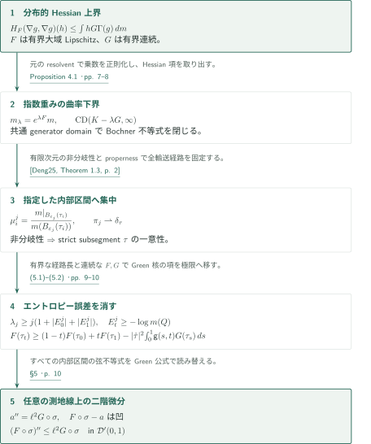
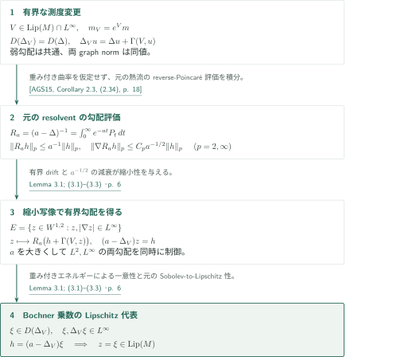

# Weak Hessian bounds along every geodesic in RCD spaces

**重み付きBochner不等式の閉包と、指定した測地線へのエントロピー集中**

本原稿は、有限次元RCD空間上の分布的Hessian上界を、すべての最短測地線上の二階微分上界へ移す。解析側では元の熱流によるresolventを使って重み付き生成作用素の試験関数を制御し、幾何側では非分岐性によって任意に指定した測地線の内部区間へ最適輸送を集中させる。

## 1. 主要結果

### Theorem 1.1 — すべての最短測地線上の分布不等式

$(M,d,m)$は完備可分、$\operatorname{supp}m=M$、有界集合上で$m$が有限な$\operatorname{RCD}(K,N)$空間とする。$K\in\mathbb R$、$1<N<\infty$であり、原稿のRCDはunreduced $\operatorname{CD}(K,N)$とCheeger energyの二次性を意味する。Laplacianは非正の$L^2$生成作用素とし、$\Gamma(u,v)=\langle\nabla u,\nabla v\rangle$、$\Gamma(u)=\Gamma(u,u)$と書く。

$F:M\to\mathbb R$は有界かつ大域的Lipschitz、$G:M\to\mathbb R$は有界連続とする。ここで
\[
\operatorname{Test}(M)=\{g\in D(\Delta):g\text{ は有界な大域的Lipschitz代表を持ち、}\ \Delta g\in W^{1,2}(M)\}.
\]
コンパクト台を持つ$g\in\operatorname{Test}(M)$、$Y=\nabla g$、$h\in\operatorname{Lip}_c(M)$に対し、
\[
H_F(Y,Y)(h)=-\int_M\operatorname{div}(hY)\langle\nabla F,Y\rangle\,dm
-\int_M h\langle\nabla F,\nabla_Y Y\rangle\,dm,
\]
ただし$\operatorname{div}(hY)=\Gamma(h,g)+h\Delta g$、$\nabla_Y Y=\nabla(\Gamma(g)/2)$とする。すべてのそのような$g$とすべての非負$h\in\operatorname{Lip}_c(M)$について
\[
H_F(\nabla g,\nabla g)(h)\le\int_M hG\Gamma(g)\,dm
\]
を仮定する。このとき、**任意の**定速最短測地線$\sigma:[0,1]\to M$（長さ$\ell$）について
\[
(F\circ\sigma)''\le\ell^2G\circ\sigma\quad\text{in }\mathcal D'(0,1).
\]
すなわち、すべての$0\le\varphi\in C_c^\infty(0,1)$に対し
\[
\int_0^1 F(\sigma_t)\varphi''(t)\,dt\le\ell^2\int_0^1G(\sigma_t)\varphi(t)\,dt.
\]
$G=c$が定数なら$F(\sigma_t)-c\ell^2t^2/2$は凹関数となる。$m(M)<\infty$や$F\in L^2(m)$は仮定しない。弱Hessianの定義には$F$の局所一階Sobolev正則性しか使わない。

<!-- cite:main -->[Theorem 1.1; (1.1)–(1.4) · p. 2](https://github.com/openai/math/blob/1581d4cbdd69a0faf34b2089614fe2a814316a6a/preprints/Weak-Hessian-bounds-along-every-geodesic-in-RCD-spaces-September-24-2026/weak-hessian-geodesics.pdf)<!-- /cite -->

## 図の矢印に付した引用

<!-- reference-guide -->
略号のない定理・補題・節・式番号は本原稿 [Weak Hessian bounds along every geodesic in RCD spaces](https://github.com/openai/math/blob/1581d4cbdd69a0faf34b2089614fe2a814316a6a/preprints/Weak-Hessian-bounds-along-every-geodesic-in-RCD-spaces-September-24-2026/weak-hessian-geodesics.pdf) を指します。外部入力には次の略号を使います。

- [AGS15](https://arxiv.org/pdf/1209.5786v4) Luigi Ambrosio, Nicola Gigli, Giuseppe Savaré — *Bakry–Émery curvature-dimension condition and Riemannian Ricci curvature bounds*：元の熱流のreverse-Poincaré評価、intrinsic distance・定数BEとRCDの同値。arXiv:1209.5786v4。
- [BHS21](https://arxiv.org/pdf/1906.09186v1) Mathias Braun, Karen Habermann, Karl-Theodor Sturm — *Optimal transport, gradient estimates, and pathwise Brownian coupling on spaces with variable Ricci bounds*：既存RCD空間上の変動曲率BE₂とCDの同値、およびGreen核エントロピー式。arXiv:1906.09186v1。
- [Deng25](https://arxiv.org/pdf/2009.07956v2) Qin Deng — *Hölder continuity of tangent cones in RCD(K,N) spaces and applications to non-branching*：有限次元RCD空間の全測地線の非分岐性。arXiv:2009.07956v2。
- [Sav14](https://arxiv.org/pdf/1304.0643v2) Giuseppe Savaré — *Self-improvement of the Bakry–Émery condition and Wasserstein contraction of the heat flow in RCD(K,∞) metric measure spaces*：測度値Bochner不等式と容量零集合を除く乗数の評価。arXiv:1304.0643v2。
- [Gig18](https://arxiv.org/pdf/1407.0809v1) Nicola Gigli — *Nonsmooth differential geometry—an approach tailored for spaces with Ricci curvature bounded from below*：元のtest classのHessian二乗評価。arXiv:1407.0809v1。
- [GT21](https://arxiv.org/pdf/1802.02463v1) Nicola Gigli, Luca Tamanini — *Second order differentiation formula on RCD∗(K,N) spaces*：元の熱流の正則化、良いcutoff、Laplacian領域のHessian評価。arXiv:1802.02463v1。

各引用に結果番号とページを付します。誌面番号とPDF内の位置が異なる場合は両方を示します。GitHubの閲覧リンクではページ位置への自動移動を前提としません。
<!-- /reference-guide -->

## 2. Theorem 1.1 — 主定理の証明概略

<!-- proof-target:1 -->証明対象：[Theorem 1.1; (1.1)–(1.4) · p. 2](https://github.com/openai/math/blob/1581d4cbdd69a0faf34b2089614fe2a814316a6a/preprints/Weak-Hessian-bounds-along-every-geodesic-in-RCD-spaces-September-24-2026/weak-hessian-geodesics.pdf)<!-- /proof-target -->

**証明の道筋。** $m_\lambda=e^{\lambda F}m$に対する$\operatorname{CD}(K-\lambda G,\infty)$を[Proposition 4.1の節](#proof-2)で得る。その証明が必要とする乗数の正則性は[Lemma 3.1の節](#proof-1)に分ける。ここではその曲率下界から、一つの指定された測地線へ移る後半までを示す。$\ell=0$は自明なので$\ell>0$とする。$\mathsf g(s,t)=\min\{s,t\}-st$をDirichlet Green核と書く。

### 1. 非分岐性で内部区間を固定する

Dengの非分岐定理により、$\sigma$の**strict interior subsegment**はその両端を結ぶ唯一の最短測地線である。別の最短曲線があれば、内部区間をそれに置換して$\sigma$の前後へつなぐことで、同じ全長を持ち非自明な初期区間を共有する二つの最短測地線が生じる。ここで必要なのは全測地線の非分岐性であり、輸送計画に関するessential nonbranchingだけではこの議論にならない。

<!-- cite:deng -->[&#91;Deng25, Theorem 1.3, p. 2&#93;](https://arxiv.org/pdf/2009.07956v2#page=2)<!-- /cite -->

内部区間の定速再パラメータ化を$\tau:[0,1]\to M$とし、$\varepsilon_j\downarrow0$に対して
\[
\mu_i^j=\frac{m|_{B_{\varepsilon_j}(\tau_i)}}{m(B_{\varepsilon_j}(\tau_i))},\qquad
E_i^j=\operatorname{Ent}_m(\mu_i^j)=-\log m(B_{\varepsilon_j}(\tau_i)),\quad i=0,1
\]
と置く。full supportと局所有限性が分母の正値・有限性を与える。$\lambda_j\ge j(1+|E_0^j|+|E_1^j|)$を選び、$m_{\lambda_j}$に対する曲率下界を適用して動的最適計画$\pi_j$を得る。propernessと端点支持の制約により、関連する全経路は一つのコンパクト集合$Q$内にあり、長さも$L$以下である。Arzelà–Ascoliと$\tau$の一意性から、どの経路列の極限も$\tau$となり、$\pi_j\rightharpoonup\delta_\tau$を得る。重み付き測度が$j$ごとに変化しても、この結論は距離と端点のみに依存する。

<!-- cite:localize -->[§5 · p. 9](https://github.com/openai/math/blob/1581d4cbdd69a0faf34b2089614fe2a814316a6a/preprints/Weak-Hessian-bounds-along-every-geodesic-in-RCD-spaces-September-24-2026/weak-hessian-geodesics.pdf)<!-- /cite -->

### 2. エントロピー誤差を消し、変動するGを残す

$\mu_t^j=(e_t)_\#\pi_j$、$A_t^j=\int F\,d\mu_t^j$、$E_t^j=\operatorname{Ent}_m(\mu_t^j)$とし、
\[
C_t^j=\int\!\int_0^1\mathsf g(s,t)|\dot\gamma|^2\,ds\,d\pi_j(\gamma),\qquad
D_t^j=\int\!\int_0^1\mathsf g(s,t)G(\gamma_s)|\dot\gamma|^2\,ds\,d\pi_j(\gamma)
\]
と置く。エントロピーの恒等式$\operatorname{Ent}_{m_{\lambda_j}}(\mu)=\operatorname{Ent}_m(\mu)-\lambda_j\int F\,d\mu$を代入すると、曲率不等式は
\[
A_t^j\ge(1-t)A_0^j+tA_1^j-D_t^j+
\frac{E_t^j-(1-t)E_0^j-tE_1^j+KC_t^j}{\lambda_j}
\]
となる。Jensen不等式は$E_t^j\ge-\log m(Q)$を与え、$0\le C_t^j\le L^2/8$である。したがって最後の項の下極限は$t$について一様に非負となる。$F,G$の$Q$上の連続性と経路の一様収束を使って
\[
F(\tau_t)\ge(1-t)F(\tau_0)+tF(\tau_1)
-|\dot\tau|^2\int_0^1\mathsf g(s,t)G(\tau_s)\,ds
\]
を得る。単に$G$を$\sup G$へ置き換えるのではなく、連続性によって経路に沿う変動を極限に保存する。

<!-- cite:entropy -->[(5.1)–(5.2) · pp. 9–10](https://github.com/openai/math/blob/1581d4cbdd69a0faf34b2089614fe2a814316a6a/preprints/Weak-Hessian-bounds-along-every-geodesic-in-RCD-spaces-September-24-2026/weak-hessian-geodesics.pdf)<!-- /cite -->

<!-- cite:bhs-cd -->[&#91;BHS21, Definition 1.2, p. 3&#93;](https://arxiv.org/pdf/1906.09186v1#page=3)<!-- /cite -->

### 3. すべての内部区間の弦不等式から分布微分へ

$(0,1)$の任意のコンパクト区間で$a''(t)=\ell^2G(\sigma_t)$を満たす$C^2$関数$a$を選ぶ。すべての部分区間に先の不等式を適用し、再パラメータ化に伴う長さの二乗を戻すと、Green公式により$F\circ\sigma-a$が各弦の上にあることと同値になる。したがってこれは凹関数であり、分布二階微分は非正である。定数$G=c$の場合は$a(t)=c\ell^2t^2/2$でよい。ここまでの議論は$F$の大域$L^2$可積分性を使わない。

<!-- cite:finish -->[§5 · p. 10](https://github.com/openai/math/blob/1581d4cbdd69a0faf34b2089614fe2a814316a6a/preprints/Weak-Hessian-bounds-along-every-geodesic-in-RCD-spaces-September-24-2026/weak-hessian-geodesics.pdf)<!-- /cite -->

## 3. Lemma 3.1 — 生成作用素の共通領域と乗数の正則性

<!-- proof-target:2 -->証明対象：[Lemma 3.1; (3.1)–(3.3) · p. 6](https://github.com/openai/math/blob/1581d4cbdd69a0faf34b2089614fe2a814316a6a/preprints/Weak-Hessian-bounds-along-every-geodesic-in-RCD-spaces-September-24-2026/weak-hessian-geodesics.pdf)<!-- /proof-target -->

<!-- statement:lemma-3-1 -->
### Lemma 3.1 — 有界Lipschitz重みによる生成作用素

主要結果と同じfull-support $\operatorname{RCD}(K,N)$空間上で、$V$を有界かつ大域的Lipschitzとする。$m_V=e^Vm$、$\Delta_V$を$m_V$のCheeger energyの非正生成作用素とすると、Sobolev空間と弱勾配は一致し、
\[
D(\Delta_V)=D(\Delta),\qquad \Delta_Vu=\Delta u+\Gamma(V,u)
\]
であり、両生成作用素のgraph normは同値である。さらに任意の$\xi\in D(\Delta_V)$について、$\xi,\Delta_V\xi\in L^\infty$なら$\xi$は大域的Lipschitz代表を持つ。

<!-- cite:drift -->[Lemma 3.1; (3.1)–(3.3) · p. 6](https://github.com/openai/math/blob/1581d4cbdd69a0faf34b2089614fe2a814316a6a/preprints/Weak-Hessian-bounds-along-every-geodesic-in-RCD-spaces-September-24-2026/weak-hessian-geodesics.pdf)<!-- /cite -->
<!-- /statement -->

### 1. 測度の同値性から共通のgraph domainへ

$e^V$が上下から正の定数で挟まれるため、test planの圧縮条件と弱勾配は共通であり、$W^{1,2}$ノルムは同値になる。生成作用素の弱い定義で試験関数を$e^{\pm V}$倍するとdrift公式が従う。$|\nabla V|\in L^\infty$によりdriftは$L^2$に属し、$\|\nabla u\|_2^2=-\int u\Delta u\,dm$とその重み付き版からgraph normの同値性が出る。

<!-- cite:drift -->[Lemma 3.1; (3.1)–(3.3) · p. 6](https://github.com/openai/math/blob/1581d4cbdd69a0faf34b2089614fe2a814316a6a/preprints/Weak-Hessian-bounds-along-every-geodesic-in-RCD-spaces-September-24-2026/weak-hessian-geodesics.pdf)<!-- /cite -->

### 2. 元のresolventの縮小写像を使う

$R_a=(a-\Delta)^{-1}=\int_0^\infty e^{-at}P_t\,dt$と置く。元の熱半群のMarkov性・reverse Poincaré評価から、十分大きい$a$について$p=2,\infty$で
\[
\|R_ah\|_p\le a^{-1}\|h\|_p,\qquad
\|\nabla R_ah\|_p\le C_pa^{-1/2}\|h\|_p
\]
が得られる。$E=\{z\in W^{1,2}:z,|\nabla z|\in L^\infty\}$に四つのノルムの和を入れると、$z\mapsto R_a(h+\Gamma(V,z))$は$a$を大きく取って縮小写像になる。その不動点は$(a-\Delta_V)z=h$を解く。$h=(a-\Delta_V)\xi\in L^2\cap L^\infty$とすれば、重み付きエネルギー恒等式による一意性から$z=\xi$。元の空間のSobolev-to-Lipschitz性を適用する。まだ重み付き空間の曲率下界を仮定していない点が循環を避ける。

<!-- cite:ags-heat -->[&#91;AGS15, Corollary 2.3, (2.34), p. 18&#93;](https://arxiv.org/pdf/1209.5786v4#page=18)<!-- /cite -->

<!-- cite:drift -->[Lemma 3.1; (3.1)–(3.3) · p. 6](https://github.com/openai/math/blob/1581d4cbdd69a0faf34b2089614fe2a814316a6a/preprints/Weak-Hessian-bounds-along-every-geodesic-in-RCD-spaces-September-24-2026/weak-hessian-geodesics.pdf)<!-- /cite -->

## 4. Proposition 4.1 — 弱Hessian上界から変動曲率下界へ

<!-- proof-target:3 -->証明対象：[Proposition 4.1 · pp. 7–8](https://github.com/openai/math/blob/1581d4cbdd69a0faf34b2089614fe2a814316a6a/preprints/Weak-Hessian-bounds-along-every-geodesic-in-RCD-spaces-September-24-2026/weak-hessian-geodesics.pdf)<!-- /proof-target -->

<!-- statement:proposition-4-1 -->
### Proposition 4.1 — 指数重みで曲率を変更する

Theorem 1.1と同じ空間、$F,G$およびすべてのコンパクト台$g\in\operatorname{Test}(M)$・非負$h\in\operatorname{Lip}_c(M)$に対する弱Hessian不等式を仮定する。このとき**すべての**$\lambda>0$について、距離$d$を変えずに
\[
(M,d,m_\lambda),\qquad m_\lambda=e^{\lambda F}m,
\]
は$\operatorname{CD}(K-\lambda G,\infty)$を満たす。

<!-- cite:curvature -->[Proposition 4.1 · pp. 7–8](https://github.com/openai/math/blob/1581d4cbdd69a0faf34b2089614fe2a814316a6a/preprints/Weak-Hessian-bounds-along-every-geodesic-in-RCD-spaces-September-24-2026/weak-hessian-geodesics.pdf)<!-- /cite -->
<!-- /statement -->

### 1. Lipschitz乗数で弱Hessianを正確に取り出す

$V=\lambda F$、$w=e^V$、$k=K-\lambda G$とし、非負$\xi\in D(\Delta_V)$で$\xi,\Delta_V\xi\in L^\infty$を固定する。Lemma 3.1により$\xi$はLipschitzである。コンパクト台の元のtest関数$g$に対し$q=\Gamma(g)/2$と置き、
\[
B_V(g,\xi)=-\int w\Gamma(\xi,q)\,dm
+\int w[\xi\Delta_Vg+\Gamma(\xi,g)]\Delta_Vg\,dm
\]
を使う。元のBochner測度は容量零集合を荷重せず、共通コンパクト台・一様Lipschitz評価を持つtest近似を通じてLipschitz乗数$w\xi$で積分できる。$\operatorname{supp}g$の近傍で1のcutoffを挿入すれば、非コンパクトな乗数も扱える。

積の法則と弱Hessianの定義そのものから
\[
B_V(g,\xi)-B_0(g,w\xi)=-H_V(\nabla g,\nabla g)(w\xi)
\]
を得る。元のBochner下界と$H_V=\lambda H_F$の上界を合わせると$B_V(g,\xi)\ge\int k\xi\Gamma(g)\,dm_V$となる。右辺の符号が$K-\lambda G$となるのは、このHessian項の負号による。

<!-- cite:bochner -->[§2.2; (2.2) · p. 5; (4.2)–(4.5) · pp. 7–8](https://github.com/openai/math/blob/1581d4cbdd69a0faf34b2089614fe2a814316a6a/preprints/Weak-Hessian-bounds-along-every-geodesic-in-RCD-spaces-September-24-2026/weak-hessian-geodesics.pdf)<!-- /cite -->

<!-- cite:sav-measure -->[&#91;Sav14, Lemma 3.2; (3.4), (3.7)–(3.9), pp. 11–12&#93;](https://arxiv.org/pdf/1304.0643v2#page=11)<!-- /cite -->

<!-- cite:gig-hessian -->[&#91;Gig18, Theorem 3.3.8, p. 110&#93;](https://arxiv.org/pdf/1407.0809v1#page=110)<!-- /cite -->

### 2. weighted test classへ飛ばず、graph normで閉じる

$\Delta_Vg=\Delta g+\Gamma(V,g)$のdriftを微分できるとは限らない。原稿のRemark 4.2では、原点近傍で$V=-|x_1|$、$g=x_1$とすると$\Delta_Vg=-\operatorname{sign}(x_1)$となり、局所的にも$W^{1,2}$に属さない例を挙げる。

そこで$B_V$を先に
\[
\frac12\int(\Delta_V\xi)\Gamma(g)\,dm_V
+\int(\Delta_Vg)\Gamma(\xi,g)\,dm_V
+\int\xi(\Delta_Vg)^2\,dm_V
\]
へ書き直す。この形なら$\xi,\Delta_V\xi,|\nabla\xi|,k$の有界性により$\Delta_V$のgraph convergenceで連続である。元の熱流と良いcutoffから得たコンパクトtest coreを、Lemma 3.1のgraph norm同値で移し、すべての$g\in D(\Delta_V)$へ閉包する。その後で$\Delta_Vg\in W^{1,2}$を課して部分積分すれば
\[
\frac12\int(\Delta_V\xi)\Gamma(g)\,dm_V
-\int\xi\Gamma(g,\Delta_Vg)\,dm_V
\ge\int k\xi\Gamma(g)\,dm_V
\]
を得る。特に$\Gamma(g)\in L^\infty$を追加したBHSの$\operatorname{BE}_2(k,\infty)$の実際の定義域で成立する。

<!-- cite:closure -->[(4.6)–(4.7) · p. 8; Remark 4.2 · p. 9](https://github.com/openai/math/blob/1581d4cbdd69a0faf34b2089614fe2a814316a6a/preprints/Weak-Hessian-bounds-along-every-geodesic-in-RCD-spaces-September-24-2026/weak-hessian-geodesics.pdf)<!-- /cite -->

<!-- cite:gt-core -->[&#91;GT21, Appendix A, (A.7), Lemma A.2, (A.13), pp. 54–56&#93;](https://arxiv.org/pdf/1802.02463v1#page=54)<!-- /cite -->

<!-- cite:bhs-be -->[&#91;BHS21, Definition 1.4, p. 4&#93;](https://arxiv.org/pdf/1906.09186v1#page=4)<!-- /cite -->

### 3. まず定数曲率のRCD構造を確保する

BHSの変動曲率同値は、基礎空間が既に何らかの定数下界を持つRCD空間であることを要求する。まず$K_V=\inf k> -\infty$に下げる。共通の弱勾配とSobolev-to-Lipschitz性により、$\mathcal E_V=2\operatorname{Ch}_V$のintrinsic distanceは元の$d$に一致する。AGSのTheorem 3.9でenergy measure space、Theorem 3.14でupper regularityと保存性、Definition 3.16でRiemannian energy measure spaceを確認する。Gaussian volume growthは有界同値な測度への変更で保たれ、Theorem 4.17の仮定を満たす。これで$\operatorname{RCD}(K_V,\infty)$を得た後、$k$が有界連続、したがって下半連続かつ下から有界であることと先の$\operatorname{BE}_2$を使って$\operatorname{CD}(k,\infty)$へ進む。

<!-- cite:ags-geometry -->[&#91;AGS15, Theorem 3.9, p. 33; Theorem 3.14, p. 38; Definition 3.16, p. 40&#93;](https://arxiv.org/pdf/1209.5786v4#page=33)<!-- /cite -->

<!-- cite:ags-rcd -->[&#91;AGS15, Theorem 4.17, p. 57&#93;](https://arxiv.org/pdf/1209.5786v4#page=57)<!-- /cite -->

<!-- cite:bhs-equivalence -->[&#91;BHS21, Theorem 1.1, p. 3&#93;](https://arxiv.org/pdf/1906.09186v1#page=3)<!-- /cite -->

## 5. どの論文が、どの段階を担うか

| 供給元と結果 | 利用箇所 | 使用内容・必要な仮定 | 確認範囲 |
|---|---|---|---|
| <!-- cite:deng -->[&#91;Deng25, Theorem 1.3, p. 2&#93;](https://arxiv.org/pdf/2009.07956v2#page=2)<!-- /cite --> | §5、Theorem 1.1 | 有限次元$1<N<\infty$の非分岐性からstrict subsegmentの一意性 | 原典p.2の主張と本稿pp.9–10の適用を照合 |
| <!-- cite:ags-heat -->[&#91;AGS15, Corollary 2.3, (2.34), p. 18&#93;](https://arxiv.org/pdf/1209.5786v4#page=18)<!-- /cite --> / <!-- cite:ags-geometry -->[&#91;AGS15, Theorem 3.9, p. 33; Theorem 3.14, p. 38; Definition 3.16, p. 40&#93;](https://arxiv.org/pdf/1209.5786v4#page=33)<!-- /cite --> / <!-- cite:ags-rcd -->[&#91;AGS15, Theorem 4.17, p. 57&#93;](https://arxiv.org/pdf/1209.5786v4#page=57)<!-- /cite --> | Lemma 3.1、Proposition 4.1 | 元の熱流の勾配正則化、および実際のintrinsic distanceを確認した上での定数BE→RCD | pp.18、33、38、40、57の入力記述と使用仮定を照合 |
| <!-- cite:bhs-cd -->[&#91;BHS21, Definition 1.2, p. 3&#93;](https://arxiv.org/pdf/1906.09186v1#page=3)<!-- /cite --> / <!-- cite:bhs-be -->[&#91;BHS21, Definition 1.4, p. 4&#93;](https://arxiv.org/pdf/1906.09186v1#page=4)<!-- /cite --> / <!-- cite:bhs-equivalence -->[&#91;BHS21, Theorem 1.1, p. 3&#93;](https://arxiv.org/pdf/1906.09186v1#page=3)<!-- /cite --> | Proposition 4.1、§5 | 既存RCD構造上の有界連続$k$についてBE$_2$→CDとGreen核エントロピー式 | pp.3–4の記述・定義域・符号を照合 |
| <!-- cite:sav-measure -->[&#91;Sav14, Lemma 3.2; (3.4), (3.7)–(3.9), pp. 11–12&#93;](https://arxiv.org/pdf/1304.0643v2#page=11)<!-- /cite --> / <!-- cite:gig-hessian -->[&#91;Gig18, Theorem 3.3.8, p. 110&#93;](https://arxiv.org/pdf/1407.0809v1#page=110)<!-- /cite --> | §2.2、Proposition 4.1 | Bochner測度、容量零集合、Hessian二乗項による元の不等式 | 指定版の該当記述と本稿のLipschitz乗数近似を照合 |
| <!-- cite:gt-core -->[&#91;GT21, Appendix A, (A.7), Lemma A.2, (A.13), pp. 54–56&#93;](https://arxiv.org/pdf/1802.02463v1#page=54)<!-- /cite --> | Lemma 2.1、Proposition 4.1 | bounded-Laplacian熱正則化、良いcutoff、graph coreとHessian近似 | v1 pp.54–56と本稿pp.4–5を照合 |

この表は主証明への直接入力をまとめる。原稿導入で比較される既存のHessian-to-convexity法と、この証明で必要な外部定理は区別する。カタログ356内の別原稿との接続はカタログ案内側で整理する。

## 6. 原典を読む入口と確認範囲

<!-- reading-list -->
- [Theorem 1.1; (1.1)–(1.4) · p. 2](https://github.com/openai/math/blob/1581d4cbdd69a0faf34b2089614fe2a814316a6a/preprints/Weak-Hessian-bounds-along-every-geodesic-in-RCD-spaces-September-24-2026/weak-hessian-geodesics.pdf) — test class・弱Hessian・すべての測地線という量化を読む。
- [Lemma 2.1 · pp. 4–5](https://github.com/openai/math/blob/1581d4cbdd69a0faf34b2089614fe2a814316a6a/preprints/Weak-Hessian-bounds-along-every-geodesic-in-RCD-spaces-September-24-2026/weak-hessian-geodesics.pdf) — 元の熱流からコンパクトcoreとLipschitz乗数近似を作る。
- [Lemma 3.1; (3.1)–(3.3) · p. 6](https://github.com/openai/math/blob/1581d4cbdd69a0faf34b2089614fe2a814316a6a/preprints/Weak-Hessian-bounds-along-every-geodesic-in-RCD-spaces-September-24-2026/weak-hessian-geodesics.pdf) — weighted generatorの共通領域とresolventによる正則性を追う。
- [Proposition 4.1 · pp. 7–8](https://github.com/openai/math/blob/1581d4cbdd69a0faf34b2089614fe2a814316a6a/preprints/Weak-Hessian-bounds-along-every-geodesic-in-RCD-spaces-September-24-2026/weak-hessian-geodesics.pdf) — Hessian恒等式、graph閉包、二段階の曲率同値を読む。
- [(5.1)–(5.2) · pp. 9–10](https://github.com/openai/math/blob/1581d4cbdd69a0faf34b2089614fe2a814316a6a/preprints/Weak-Hessian-bounds-along-every-geodesic-in-RCD-spaces-September-24-2026/weak-hessian-geodesics.pdf) — 端点エントロピーを支配するλの選択とGreen核の極限を確認する。
- [§5 · p. 10](https://github.com/openai/math/blob/1581d4cbdd69a0faf34b2089614fe2a814316a6a/preprints/Weak-Hessian-bounds-along-every-geodesic-in-RCD-spaces-September-24-2026/weak-hessian-geodesics.pdf) — すべての内部区間から分布微分上界へ戻る。
<!-- /reading-list -->

本稿のTheorem 1.1、Lemma 2.1、Lemma 3.1、Proposition 4.1と§5の証明本文を読み、上表の外部入力の記述・適用仮定・版・ページを照合した。元のtest classと重み付き定義域の差、graph閉包、strict subsegmentの一意性、$\lambda_j$と端点エントロピーの同時極限を確認対象とした。外部文献の証明全体やその依存文献を再帰的に検証したものではなく、専門家査読・形式検証も行っていない。とくに測度値Bochner計算とheat-flow評価の全基礎理論は外部入力としている。
