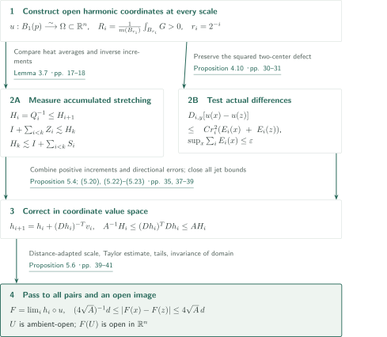
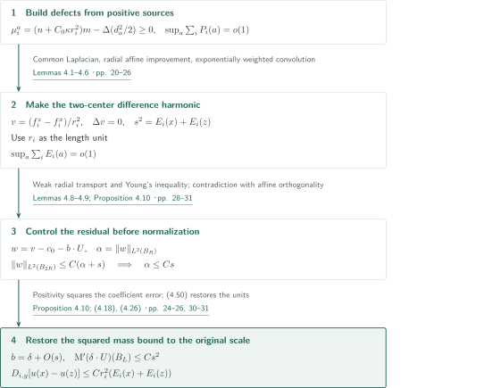
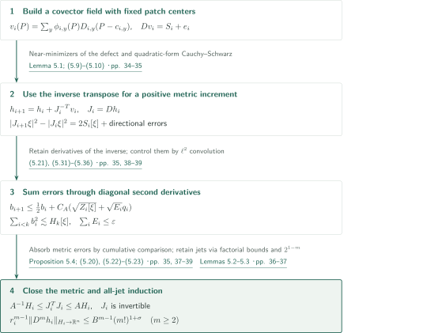
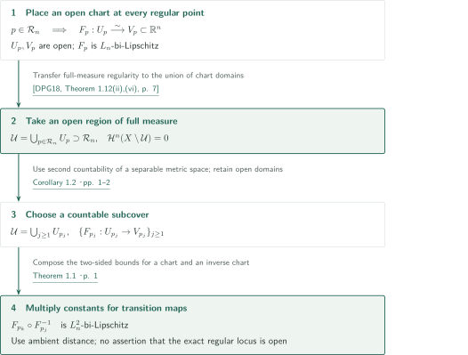

# Bi-Lipschitz Coordinates at Regular Points of Noncollapsed RCD Spaces

**Integrating potentially unbounded inverse Gram matrices through summable directional errors**

The manuscript constructs open bi-Lipschitz coordinates around each prescribed regular point of a noncollapsed RCD space, using the restricted ambient distance. It does not assume uniform nondegeneracy of the harmonic coordinate differential: smooth maps on coordinate value space compensate for degeneration across scales. This article explains the proposed argument; it does not certify the correctness of the entire proof.

## 1. Main results

### Theorem 1.1 — Open bi-Lipschitz coordinates at every regular point

For every integer $n\ge2$ there is $L_n\ge1$ such that the following holds. For every $K\in\mathbb R$, every noncollapsed $\operatorname{RCD}(K,n)$ space $(X,d,\mathcal H_d^n)$, and every $p\in X$, if **every** pointed Gromov–Hausdorff tangent at $p$ is pointed-isometric to $(\mathbb R^n,|\cdot|,0)$, there are an open neighborhood $U\subset X$ of $p$, an open set $V\subset\mathbb R^n$, and a homeomorphism $F:U\to V$ satisfying

$$L_n^{-1}d(x,z)\le |F(x)-F(z)|\le L_n d(x,z)\qquad(x,z\in U).$$

Here RCD means **full unreduced $\operatorname{CD}(K,n)$ with quadratic Cheeger energy**, and the reference measure is exactly $\mathcal H_d^n$. Spaces are complete, separable and geodesic, and the measure has full support and is finite on bounded sets. The distance is $d|_{U\times U}$, rather than an intrinsic distance on $U$. The distortion depends only on dimension; the neighborhood radius may depend on the space and the point.

<!-- cite:main -->[Theorem 1.1 · p. 1](https://github.com/openai/math/blob/1581d4cbdd69a0faf34b2089614fe2a814316a6a/preprints/Bi-Lipschitz-Coordinates-at-Regular-Points-of-Noncollapsed-RCD-Spaces-September-25-2026/paper.pdf)<!-- /cite -->

### Corollary 1.2 — An open manifold region of full measure

Under the hypotheses of Theorem 1.1 there is an open set $\mathcal U\subset X$ containing all $n$-regular points, with $\mathcal H_d^n(X\setminus\mathcal U)=0$. It has a countable atlas of $L_n$-bi-Lipschitz charts from ambient-open subsets of $\mathcal U$ onto open subsets of $\mathbb R^n$. Each chart uses the restricted ambient distance, and transition maps are $L_n^2$-bi-Lipschitz. The region may contain points outside the regular locus; the corollary does not assert that the regular locus itself is open.

<!-- cite:cor -->[Corollary 1.2 · pp. 1–2](https://github.com/openai/math/blob/1581d4cbdd69a0faf34b2089614fe2a814316a6a/preprints/Bi-Lipschitz-Coordinates-at-Regular-Points-of-Noncollapsed-RCD-Spaces-September-25-2026/paper.pdf)<!-- /cite -->

## References on the arrows

<!-- reference-guide -->
Unprefixed theorem, lemma, section and equation numbers refer to [Bi-Lipschitz Coordinates at Regular RCD Points](https://github.com/openai/math/blob/1581d4cbdd69a0faf34b2089614fe2a814316a6a/preprints/Bi-Lipschitz-Coordinates-at-Regular-Points-of-Noncollapsed-RCD-Spaces-September-25-2026/paper.pdf). External inputs use the following keys.

- [AH18](https://arxiv.org/pdf/1703.04939v1) Luigi Ambrosio and Shouhei Honda — *Local spectral convergence in RCD∗(K,N) spaces*: Interior harmonic approximation, directly used to construct the coordinates in Lemma 2.2. arXiv:1703.04939v1 (2017); journal publication 2018.
- [JLZ16](https://arxiv.org/pdf/1407.5289v2) Renjin Jiang, Huaiqian Li and Huichun Zhang — *Heat kernel bounds on metric measure spaces and some applications*: Gaussian heat-kernel and gradient bounds, direct inputs in §3.1. arXiv:1407.5289v2; journal publication 2016.
- [DPG18](https://arxiv.org/pdf/1708.02060v3) Guido De Philippis and Nicola Gigli — *Non-collapsed spaces with Ricci curvature bounded from below*: Noncollapsed volume convergence, almost rigidity, density bounds at every point, and full-measure regularity for the corollary. arXiv:1708.02060v3, 23 June 2025; journal publication 2018.
- [Hat02](https://pi.math.cornell.edu/~hatcher/AT/AT.pdf) Allen Hatcher — *Algebraic Topology*: Invariance of domain for the continuous injection on the open value domain in Proposition 5.6. Cambridge University Press, 2002; author electronic edition retrieved 2026-10-19.
- [MN19](https://arxiv.org/pdf/1405.2222v3) Andrea Mondino and Aaron Naber — *Structure theory of metric measure spaces with lower Ricci curvature bounds*: Background comparison: rectifiability on a.e. measurable pieces; not a direct input to the main theorem. arXiv:1405.2222v3; journal publication 2019.

Each citation gives the result and pages. When printed pagination differs from the PDF position, both are shown. GitHub previews do not automatically jump to the cited page.
<!-- /reference-guide -->

## 2. Theorem 1.1 — Proof overview of the main theorem

<!-- proof-target:1 -->Proof target：[Theorem 1.1 · p. 1](https://github.com/openai/math/blob/1581d4cbdd69a0faf34b2089614fe2a814316a6a/preprints/Bi-Lipschitz-Coordinates-at-Regular-Points-of-Noncollapsed-RCD-Spaces-September-25-2026/paper.pdf)<!-- /proof-target -->

**Proof route.** Construct open harmonic coordinates $u$ on a rescaled space. Heat averages make the stretching corresponding to their inverse Gram matrices monotone, and accumulated Bochner mass controls that stretching. Independently, evaluation of the same mass on actual coordinate differences has summable defects. These two inputs drive a smooth iteration. The derivative estimates in [Proposition 5.4](#proof-2) become all-pairs estimates in [Proposition 5.6](#proof-3).

### 1. Normalization at every center and scale, and open harmonic coordinates

Rescale at the regular point by $d_\nu=s_\nu^{-1}d$ and $m_\nu=s_\nu^{-n}\mathcal H_d^n$. Noncollapsed volume convergence and Bishop–Gromov comparison keep volume ratios almost Euclidean at every center in a fixed large region and at all smaller radii. Lemma 2.2 combines this with almost-volume rigidity and constructs harmonic columns $u=(u^1,\ldots,u^n)^T$ on expanding domains. The direct input from [AH18] is strong $H^{1,2}$ harmonic approximation on **strictly interior balls**. Neither convergence of an entire boundary-value problem nor regularity of the neighboring points is assumed.

$$r_i=2^{-i},\qquad G=(\langle\nabla u^j,\nabla u^k\rangle)_{j,k},\qquad R_i(y)=\frac{1}{m(B_{r_i}(y))}\int_{B_{r_i}(y)}G\,dm.$$

Lemma 2.3 proves $R_i(y)>0$ at all centers and dyadic scales and Euclidean approximation by $R_i(y)^{-1/2}(u-u(y))/r_i$. Testing distinct points at a scale comparable to their separation gives injectivity. Lemma 2.5 iterates approximate surjectivity at smaller scales to reduce a target-value residual. The centers move by a convergent geometric series; completeness produces a preimage and hence inclusion of a central ellipsoid in the image. Thus $u:B_1(p)\to\Omega=u(B_1(p))$ is a homeomorphism onto an open set. Uniform bi-Lipschitz control is not yet concluded.

<!-- cite:coordinates -->[Lemmas 2.2–2.5 · pp. 6–9](https://github.com/openai/math/blob/1581d4cbdd69a0faf34b2089614fe2a814316a6a/preprints/Bi-Lipschitz-Coordinates-at-Regular-Points-of-Noncollapsed-RCD-Spaces-September-25-2026/paper.pdf)<!-- /cite -->

<!-- cite:dpg-volume -->[&#91;DPG18, Theorems 1.2, 1.3, 1.6, pp. 3–4&#93;](https://arxiv.org/pdf/1708.02060v3#page=3)<!-- /cite -->

<!-- cite:dpg-density -->[&#91;DPG18, Corollary 2.14, p. 17&#93;](https://arxiv.org/pdf/1708.02060v3#page=17)<!-- /cite -->

<!-- cite:ah-approx -->[&#91;AH18, Corollary 4.12, p. 20&#93;](https://arxiv.org/pdf/1703.04939v1#page=20)<!-- /cite -->

### 2. Separate cumulative stretching from directional error

The positive semidefinite matrix-valued measure $\mathrm M=\tfrac12\Delta G+\kappa Gm$ retains its singular part. For a fixed enlargement $L$, put

$$D_{i,y}=R_i(y)^{-1}\bigl[r_i^{2-n}\mathrm M(B_{Lr_i}(y))\bigr]R_i(y)^{-1}.$$

Corrected heat averages $Q_i=P_{r_i^2}(\chi G)+\lambda r_i^2I$ and their inverses $H_i=Q_i^{-1}$ satisfy $Q_i\sim R_i$ and $H_i\le H_{i+1}$. Gaussian heat-kernel bounds and the gradient estimate are direct inputs from [JLZ16]. Lemma 3.1 first turns the gradient estimate into a difference estimate, then uses continuity and full support to extend it to every source pole. This avoids integrating an arbitrary almost-everywhere gradient representative against a singular measure.

At each scale choose a bounded number of centers within $O(r_i)$ of $x$, and write $Z_i=\sum_yD_{i,y}$ and $S_i=\sum_y\theta_{i,y}D_{i,y}$. When $0\le\theta_{i,y}\le1$ and one weight-one mass ball contains $B_{r_i}(x)$, Lemma 3.7 gives

$$Z_i\le\varepsilon H_i,\qquad I+\sum_{i<k}Z_i\le C_*H_k,\qquad H_k\le C_*\Bigl(I+\sum_{i<k}S_i\Bigr).$$

The matrices $H_k$ need not remain bounded. In addition to telescoping inverse increments, the argument bounds the cost of switching from ball to heat normalization by the final $H_k$; no commutativity is assumed. Independently, the next section evaluates $D_{i,y}$ on actual differences $u(x)-u(z)$ and obtains summable defects.

<!-- cite:cumulative -->[Lemmas 3.2–3.7 · pp. 11–18](https://github.com/openai/math/blob/1581d4cbdd69a0faf34b2089614fe2a814316a6a/preprints/Bi-Lipschitz-Coordinates-at-Regular-Points-of-Noncollapsed-RCD-Spaces-September-25-2026/paper.pdf)<!-- /cite -->

<!-- cite:heat -->[&#91;JLZ16, Theorem 1.2; Corollary 1.2, pp. 2–3&#93;](https://arxiv.org/pdf/1407.5289v2#page=2)<!-- /cite -->

### 3. Fix dimensional constants before choosing the rescaling

First fix the enlargements, the Gevrey order of the cutoff, $C_*,A,B$, and the final pair-comparison scale ratio $D$, using only dimension. Then choose a sufficiently late rescaling. Returning to the original metric multiplies coordinate values by $s_\nu$ as well, preserving $L_n=4\sqrt{A(n)}$. The required rescaling and the original neighborhood radius may depend on the point and the space.

<!-- cite:finish-main -->[Proof of Theorem 1.1 · p. 41](https://github.com/openai/math/blob/1581d4cbdd69a0faf34b2089614fe2a814316a6a/preprints/Bi-Lipschitz-Coordinates-at-Regular-Points-of-Noncollapsed-RCD-Spaces-September-25-2026/paper.pdf)<!-- /cite -->

## 3. Proposition 4.10 — Summable control along two-center differences

<!-- proof-target:2 -->Proof target：[Proposition 4.10; (4.18), (4.26) · pp. 24–26, 30–31](https://github.com/openai/math/blob/1581d4cbdd69a0faf34b2089614fe2a814316a6a/preprints/Bi-Lipschitz-Coordinates-at-Regular-Points-of-Noncollapsed-RCD-Spaces-September-25-2026/paper.pdf)<!-- /proof-target -->

<!-- statement:proposition-4-10 -->
### Proposition 4.10 — Summable directional pinching

Use the rescaling sequence and harmonic columns of Lemma 2.2, and fix any $L,C_{\mathrm{sep}}>1$. For all sufficiently late rescalings, nonnegative functions $E_i(a)$, $a\in B_4(p)$ and $i\ge0$, can be chosen simultaneously with

$$\sup_{a\in B_4(p)}\sum_{i\ge0}E_i(a)=o(1),\qquad \inf_{a\in B_4(p)}E_i(a)>0\quad\text{for each fixed }i.$$

Here $P_i(a)$ is the defect $r_i^{-n}\mu_i^a(B_{8Sr_i}(a))+\kappa r_i^2$ of Lemma 4.2, with positive measure $\mu_i^a=(n+C_0\kappa r_i^2)m-\Delta(d_a^2/2)$ and fixed enlargement $S$. The construction (4.26) allows $E_i\ge P_i$. For every $x,z,y\in B_4(p)$ satisfying $d(x,y),d(z,y)\le C_{\mathrm{sep}}r_i$, the matrices defined above satisfy

$$D_{i,y}[u(x)-u(z)]\le Cr_i^2\{E_i(x)+E_i(z)\}.$$

The same functions work at all centers and all dyadic scales; enlargement constants are fixed before the late-space threshold is chosen.

<!-- cite:directional -->[Proposition 4.10; (4.18), (4.26) · pp. 24–26, 30–31](https://github.com/openai/math/blob/1581d4cbdd69a0faf34b2089614fe2a814316a6a/preprints/Bi-Lipschitz-Coordinates-at-Regular-Points-of-Noncollapsed-RCD-Spaces-September-25-2026/paper.pdf)<!-- /cite -->
<!-- /statement -->

### 1. Turn volume defects into summable energies

The Poisson replacements $f_i^a$ of $q^a=d_a^2/2$ have a common constant Laplacian. Incorporating the mass of the positive measure $\mu_i^a=(n+C_0\kappa r_i^2)m-\Delta q^a$ into $P_i(a)$ and telescoping dyadic volume-ratio differences gives $\sup_a\sum_iP_i(a)=o(1)$. The positive-source $L^1$ gradient estimate in Lemma 4.1 is **linear in the mass**, allowing the shifted Bochner measure to be bounded by $P_i(a)$. Harmonic correction of radial derivatives and affine improvement, convolved with exponential decay, produce $E_i$ in Lemma 4.6. Smallness at each separate scale would not by itself give this summability.

<!-- cite:poisson -->[Lemmas 4.1–4.6 · pp. 20–26](https://github.com/openai/math/blob/1581d4cbdd69a0faf34b2089614fe2a814316a6a/preprints/Bi-Lipschitz-Coordinates-at-Regular-Points-of-Noncollapsed-RCD-Spaces-September-25-2026/paper.pdf)<!-- /cite -->

### 2. Preserve squared error before normalizing the projection residual

In unit-scale coordinates, the difference $v$ of the two Poisson replacements is harmonic because their constant Laplacians agree. Set $s^2=E_i(x)+E_i(z)$, project $v$ onto the affine harmonic coordinate span, and let $\alpha$ be the $L^2$ norm of the residual $w$. **Before** dividing by $\alpha$, Lemma 4.8 tests a weak radial transport equation and obtains $\|w\|_{L^2(B_{2R})}\le C(\alpha+s)$. The coefficient error uses the unnormalized $\|w\|_\infty$ bound and Young's inequality to retain $Cs^2$.

If $\alpha/s\to\infty$, normalized residuals converge to a Euclidean harmonic limit. Its Euler-type equation forces it to be affine, while its projection orthogonality and unit norm give a contradiction. Thus $\alpha\le Cs$. The resulting coefficient $b$ differs from the actual normalized coordinate difference $\delta$ by $O(s)$; positivity of the Bochner measure makes its mass contribution $O(s^2)$. Restoring the powers of $r_i$ using (4.50) gives the proposition.

<!-- cite:radial -->[Lemmas 4.8–4.9; Proposition 4.10 · pp. 28–31](https://github.com/openai/math/blob/1581d4cbdd69a0faf34b2089614fe2a814316a6a/preprints/Bi-Lipschitz-Coordinates-at-Regular-Points-of-Noncollapsed-RCD-Spaces-September-25-2026/paper.pdf)<!-- /cite -->

## 4. Proposition 5.4 — Inverse-transpose updates and the metric induction

<!-- proof-target:3 -->Proof target：[Proposition 5.4; (5.20), (5.22)–(5.23) · pp. 35, 37–39](https://github.com/openai/math/blob/1581d4cbdd69a0faf34b2089614fe2a814316a6a/preprints/Bi-Lipschitz-Coordinates-at-Regular-Points-of-Noncollapsed-RCD-Spaces-September-25-2026/paper.pdf)<!-- /proof-target -->

<!-- statement:proposition-5-4 -->
### Proposition 5.4 — Uniform metric and jet bounds

Use sufficiently flat data from §§5.1–5.3: $\Omega=u(B_1(p))$, $r_i=2^{-i}$, $Q_i=H_i^{-1}$, the preceding positive-matrix and summability bounds, and the bounded-overlap nets with Gevrey cutoffs $\phi_{i,y}$ of §5.2. Choose a fixed point in each patch with $E_i(z_{i,y})<2\inf E_i$, put $c_{i,y}=u(z_{i,y})$, and define

$$v_i(P)=\sum_y\phi_{i,y}(P)D_{i,y}(P-c_{i,y}),\qquad h_0(P)=P,\quad h_{i+1}=h_i+(Dh_i)^{-T}v_i.$$

Fix cutoff order $s>1$ and $\sigma\ge\max\{1,s\}$. There are fixed $A,B$ and a sufficiently small flatness threshold such that, at every finite $i$, $h_i$ is smooth on all of $\Omega$, $J_i=Dh_i$ is everywhere invertible, and for all $x\in B_1(p)$,

$$A^{-1}H_i(x)\le J_i(u(x))^TJ_i(u(x))\le AH_i(x),$$

$$r_i^{m-1}\|D^mh_i(u(x))\|_{H_i(x)\to\mathbb R^n}\le B^{m-1}(m!)^{1+\sigma}\quad(m\ge2).$$

The multilinear norm uses the $H_i(x)$ norm for every input. These matrices are frozen at the evaluation point and are not differentiated.

<!-- cite:iteration -->[Proposition 5.4; (5.20), (5.22)–(5.23) · pp. 35, 37–39](https://github.com/openai/math/blob/1581d4cbdd69a0faf34b2089614fe2a814316a6a/preprints/Bi-Lipschitz-Coordinates-at-Regular-Points-of-Noncollapsed-RCD-Spaces-September-25-2026/paper.pdf)<!-- /cite -->
<!-- /statement -->

### 1. Add the leading stretching directly to the metric

Selecting a fixed nearly minimizing point for each patch bounds $v_i$ and the cutoff derivative terms by the defect $E_i(x)$ at the testing point. No continuity of $E_i$ is needed. For $W=J^{-T}v$, the identity

$$|(J+DW)\xi|^2-|J\xi|^2=2\xi^TDv\,\xi-2\langle D^2h(\xi,\xi),J^{-T}v\rangle+|DW\xi|^2$$

has leading term $2S_i[\xi]$. Keep the diagonal second derivative introduced by differentiating the inverse transpose. With $q_i=|\xi|_{H_i}$ and $b_i=r_i|D^2h_i(\xi,\xi)|/q_i$, the argument proves

$$b_{i+1}\le\tfrac12b_i+C_A\bigl(\sqrt{Z_i[\xi]}+\sqrt{E_i(x)}q_i\bigr),\qquad \sum_{i<k}b_i^2\le C_AH_k[\xi].$$

Cauchy–Schwarz bounds $\sum b_iq_i\sqrt{E_i}$ using $\sum E_i$, without requiring $\sum\sqrt{E_i}$. The cumulative metric error in (5.35) is $C_A(\sqrt\varepsilon+\varepsilon)H_k[\xi]$. Combined with the reverse comparison of Lemma 3.7, it closes invertibility.

<!-- cite:metric -->[(5.21), (5.31)–(5.36) · pp. 35, 38–39](https://github.com/openai/math/blob/1581d4cbdd69a0faf34b2089614fe2a814316a6a/preprints/Bi-Lipschitz-Coordinates-at-Regular-Points-of-Noncollapsed-RCD-Spaces-September-25-2026/paper.pdf)<!-- /cite -->

### 2. Separate derivative loss from induction over scales

The update contains an inverse first derivative, so finitely many derivative orders do not close. The factorial convolution estimate in Lemma 5.2 preserves the exponential base $B$ in derivatives of the inverse matrix. The factor $2^{1-m}$ gained at the next scale absorbs the new contribution in order $m$, allowing Lemma 5.3 to preserve all jet bounds simultaneously. New-level invertibility is not assumed to prove the new-level metric bound: old-level inverses and jets give both the next metric bound and all next jets. Global injectivity of each $h_i$ and a finite limit of $H_i$ are unnecessary.

<!-- cite:jets -->[Lemmas 5.2–5.3 · pp. 36–37](https://github.com/openai/math/blob/1581d4cbdd69a0faf34b2089614fe2a814316a6a/preprints/Bi-Lipschitz-Coordinates-at-Regular-Points-of-Noncollapsed-RCD-Spaces-September-25-2026/paper.pdf)<!-- /cite -->

## 5. Proposition 5.6 — All pairs, the limit, and openness

<!-- proof-target:4 -->Proof target：[Proposition 5.6 · pp. 39–41](https://github.com/openai/math/blob/1581d4cbdd69a0faf34b2089614fe2a814316a6a/preprints/Bi-Lipschitz-Coordinates-at-Regular-Points-of-Noncollapsed-RCD-Spaces-September-25-2026/paper.pdf)<!-- /proof-target -->

<!-- statement:proposition-5-6 -->
### Proposition 5.6 — The limiting chart

For sufficiently flat data in the preceding construction, $F(x)=\lim_{i\to\infty}h_i(u(x))$ exists uniformly on $B_1(p)$. For some $\rho>0$, its restriction is a bi-Lipschitz homeomorphism from $B_\rho(p)$ onto an open subset of $\mathbb R^n$. Distance comparisons use the restriction of the ambient distance $d$.

<!-- cite:limit -->[Proposition 5.6 · pp. 39–41](https://github.com/openai/math/blob/1581d4cbdd69a0faf34b2089614fe2a814316a6a/preprints/Bi-Lipschitz-Coordinates-at-Regular-Points-of-Noncollapsed-RCD-Spaces-September-25-2026/paper.pdf)<!-- /cite -->
<!-- /statement -->

### 1. Choose a scale for each pair and obtain both bounds

The increments satisfy $|h_{i+1}(u(x))-h_i(u(x))|\le C_A\varepsilon r_i$, giving uniform convergence and the tail bound $\sup_x|F(x)-h_i(u(x))|\le\tau r_i$ with $\tau\to0$. After fixing the second-derivative constant, choose a large fixed $D$ and put $\rho=(16D+4)^{-1}$. For any distinct $x,z\in B_\rho(p)$ set $t=d(x,z)$ and choose a dyadic scale with $Dt\le r_i<2Dt$.

Then $B_{r_i}(x)\subset B_1(p)$, and $\Delta=u(z)-u(x)$ satisfies $t/2\le|\Delta|_{H_i(x)}\le2t$. Central-ellipsoid inclusion puts the entire value-space line segment in $\Omega$, with interior preimages for all derivative evaluation points. The linear Taylor term lies between $t/(2\sqrt A)$ and $2\sqrt A\,t$, and the remainder is at most $t/(8\sqrt A)$. A sufficiently late rescaling makes the two tails together at most $t/(8\sqrt A)$. Consequently, for all pairs,

$$\frac1{4\sqrt A}d(x,z)\le|F(x)-F(z)|\le4\sqrt A\,d(x,z).$$

This is a direct comparison obtained by choosing a scale from each pair's ambient distance, not an extension from almost-everywhere pairs or a path-length estimate.

<!-- cite:all-pairs -->[(5.37)–(5.42) · pp. 40–41](https://github.com/openai/math/blob/1581d4cbdd69a0faf34b2089614fe2a814316a6a/preprints/Bi-Lipschitz-Coordinates-at-Regular-Points-of-Noncollapsed-RCD-Spaces-September-25-2026/paper.pdf)<!-- /cite -->

### 2. Why the injective limit has open image

The lower bound makes $F$ injective and its inverse Lipschitz. Lemma 2.5 already makes $u(B_\rho(p))$ open, so invariance of domain applies to the continuous injection $F\circ u^{-1}:u(B_\rho(p))\to\mathbb R^n$. This gives openness of the image. The argument neither assumes that a general continuous injection has open image nor uses global injectivity of the smooth approximations $h_i$.

<!-- cite:openness -->[Proposition 5.6, final paragraph · p. 41](https://github.com/openai/math/blob/1581d4cbdd69a0faf34b2089614fe2a814316a6a/preprints/Bi-Lipschitz-Coordinates-at-Regular-Points-of-Noncollapsed-RCD-Spaces-September-25-2026/paper.pdf)<!-- /cite -->

<!-- cite:hatcher -->[&#91;Hat02, Theorem 2B.3, print p. 172 / PDF p. 181&#93;](https://pi.math.cornell.edu/~hatcher/AT/AT.pdf#page=181)<!-- /cite -->

## 6. Corollary 1.2 — The open region and a countable atlas

<!-- proof-target:5 -->Proof target：[Corollary 1.2 · pp. 1–2](https://github.com/openai/math/blob/1581d4cbdd69a0faf34b2089614fe2a814316a6a/preprints/Bi-Lipschitz-Coordinates-at-Regular-Points-of-Noncollapsed-RCD-Spaces-September-25-2026/paper.pdf)<!-- /proof-target -->

### 1. A full-measure open region containing every regular point

Apply Theorem 1.1 at every regular point and let $\mathcal U$ be the union of the chart domains. This is ambient-open and contains all regular points. Theorem 1.12(ii),(vi) of [DPG18], applied to the reference measure $\mathcal H_d^n$, makes the $n$-regular set full measure, hence $\mathcal H_d^n(X\setminus\mathcal U)=0$. No step removes nonregular points from the union.

<!-- cite:dpg-regular -->[&#91;DPG18, Theorem 1.12(ii),(vi), p. 7&#93;](https://arxiv.org/pdf/1708.02060v3#page=7)<!-- /cite -->

### 2. Countability and transition constants

A separable metric space is second countable, so the chart cover of its open subspace $\mathcal U$ has a countable subcover. Domains and images remain open, and each chart has distortion $L_n$. On overlaps, $F_\beta\circ F_\alpha^{-1}$ and its inverse both have Lipschitz constant at most $L_n^2$. The manuscript does not assert openness of the exact regular locus or bounded Laplacians for the limiting coordinate components.

<!-- cite:cor -->[Corollary 1.2 · pp. 1–2](https://github.com/openai/math/blob/1581d4cbdd69a0faf34b2089614fe2a814316a6a/preprints/Bi-Lipschitz-Coordinates-at-Regular-Points-of-Noncollapsed-RCD-Spaces-September-25-2026/paper.pdf)<!-- /cite -->

## 7. External inputs and where they are used

| Input | Use in the manuscript | Role and hypotheses | Checking scope |
|---|---|---|---|
| [AH18] Corollary 4.12 | Lemma 2.2 and §2.2 | Interior harmonic approximation on a converging RCD* sequence; strong $H^{1,2}$ approximation of Euclidean coordinates | Fixed-version statement and application compared; complete external proof not checked |
| [JLZ16] Theorem 1.2 / Corollary 1.2 | §3.1, Lemmas 3.1–3.3 | A fixed negative curvature bound and volume comparison yield uniform Gaussian estimates. Extension of a.e. gradient estimates to all-pole differences is done in this manuscript | Fixed-version statements and application compared; complete external proofs not checked |
| [DPG18] Theorems 1.2, 1.3, 1.6 / Corollary 2.14 | Lemmas 2.2 and 4.2 | Noncollapsed volume convergence, volume almost rigidity, density bound at every point. Almost rigidity is applied on an interior ball after a fixed enlargement | Independent reviewer compared fixed-version statements and uses; full proofs not checked |
| [DPG18] Theorem 1.12(ii),(vi) | Corollary 1.2 | The noncollapsed measure hypothesis gives full-measure $n$-regularity | See the independent statement/application comparison record |
| [Hat02] Theorem 2B.3 | Proposition 5.6 | Invariance of domain for a continuous injection from a Euclidean open set | See the independent statement/application comparison record |

Lemma 2.1 and Lemma 4.2 also directly use local Poisson regularity, Hessian calculus, the dimensional Bochner inequality and Laplacian comparison for distance. Their uses within the manuscript were read, but comparison of every external statement and hypothesis is incomplete. The independent reviewer compared the statements and uses of De Philippis–Gigli volume convergence, almost rigidity and the density bound. The works of Cheeger–Colding, Cheeger–Jiang–Naber and other Reifenberg constructions are cited as methodological antecedents; that alone does not create direct dependency arrows in this article.

Theorem 1.1 of [MN19] covers a general $\operatorname{RCD}^*(K,N)$ space, outside a null set, by countably many measurable pieces bi-Lipschitz to measurable subsets of Euclidean spaces. The present manuscript assumes noncollapse but obtains ambient-open domains and same-dimensional open images at every prescribed regular point. This is a background comparison; measurable pieces are not being treated as open charts.

<!-- cite:mn-background -->[&#91;MN19, Theorem 1.1, p. 3&#93;](https://arxiv.org/pdf/1405.2222v3#page=3)<!-- /cite -->

## 8. Return to the sources

<!-- reading-list -->
- [Lemmas 2.2–2.5 · pp. 6–9](https://github.com/openai/math/blob/1581d4cbdd69a0faf34b2089614fe2a814316a6a/preprints/Bi-Lipschitz-Coordinates-at-Regular-Points-of-Noncollapsed-RCD-Spaces-September-25-2026/paper.pdf) — All-center, all-scale normalization and open harmonic coordinates
- [Lemma 3.7 · pp. 17–18](https://github.com/openai/math/blob/1581d4cbdd69a0faf34b2089614fe2a814316a6a/preprints/Bi-Lipschitz-Coordinates-at-Regular-Points-of-Noncollapsed-RCD-Spaces-September-25-2026/paper.pdf) — Cumulative comparisons without commuting inverse matrices
- [Proposition 4.10; (4.18), (4.26) · pp. 24–26, 30–31](https://github.com/openai/math/blob/1581d4cbdd69a0faf34b2089614fe2a814316a6a/preprints/Bi-Lipschitz-Coordinates-at-Regular-Points-of-Noncollapsed-RCD-Spaces-September-25-2026/paper.pdf) — Two-center directional defects and restoration of scale
- [Proposition 5.4; (5.20), (5.22)–(5.23) · pp. 35, 37–39](https://github.com/openai/math/blob/1581d4cbdd69a0faf34b2089614fe2a814316a6a/preprints/Bi-Lipschitz-Coordinates-at-Regular-Points-of-Noncollapsed-RCD-Spaces-September-25-2026/paper.pdf) — Simultaneous induction for the metric and all jets
- [Proposition 5.6 · pp. 39–41](https://github.com/openai/math/blob/1581d4cbdd69a0faf34b2089614fe2a814316a6a/preprints/Bi-Lipschitz-Coordinates-at-Regular-Points-of-Noncollapsed-RCD-Spaces-September-25-2026/paper.pdf) — Uniform limit, all-pairs bounds and open image
- [Corollary 1.2 · pp. 1–2](https://github.com/openai/math/blob/1581d4cbdd69a0faf34b2089614fe2a814316a6a/preprints/Bi-Lipschitz-Coordinates-at-Regular-Points-of-Noncollapsed-RCD-Spaces-September-25-2026/paper.pdf) — Full-measure region, countable atlas and transition constants
<!-- /reading-list -->

We read the statements and main connections in Theorem 1.1, Corollary 1.2, Lemmas 2.2–2.5, 3.5–3.7, 4.2, 4.8–4.9, and Propositions 4.10, 5.4 and 5.6 in the source text. In particular, we tracked the order of quantifiers, all centers and scales, squared defects, the inverse-transpose update, all-pairs bounds and invariance of domain separately. This is not an independent reconstruction of every local calculation in §§3.1–3.2 and Lemmas 4.4–4.6. Recursive verification of external proofs, expert peer review and formal verification were not performed. The correctness of the whole manuscript is not guaranteed beyond the recorded scope of statement and application checks.
