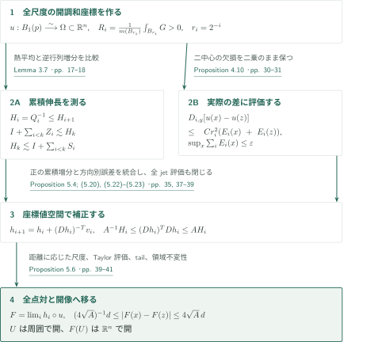
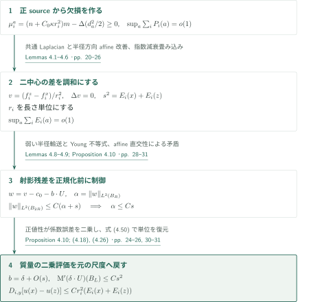
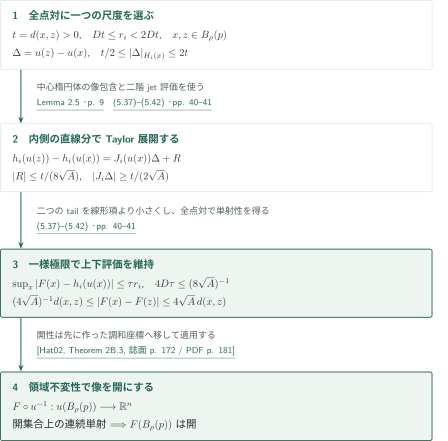
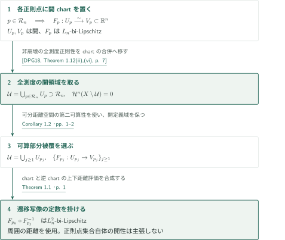

# Bi-Lipschitz Coordinates at Regular Points of Noncollapsed RCD Spaces

**発散し得るGram逆行列を、可算和可能な方向別誤差で座標へ積分する**

本原稿は、非崩壊RCD空間の指定された正則点の周りに、周囲の距離を双リプシッツに比較する開座標を構成する。調和座標の微分の一様非退化性を仮定せず、尺度ごとの退化を座標値空間の滑らかな写像で補正する。以下は原稿が提示する論証の概略であり、その全証明の正しさを認定するものではない。

## 1. 主要結果

### Theorem 1.1 — 各正則点の開bi-Lipschitz座標

任意の整数 $n\ge2$ に対して $L_n\ge1$ が存在する。任意の $K\in\mathbb R$ と非崩壊 $\operatorname{RCD}(K,n)$ 空間 $(X,d,\mathcal H_d^n)$、任意の点 $p\in X$ について、$p$ における**すべての**pointed Gromov–Hausdorff tangentが $(\mathbb R^n,|\cdot|,0)$ とpointed-isometricなら、$p$ の開近傍 $U\subset X$、開集合 $V\subset\mathbb R^n$、同相写像 $F:U\to V$ が存在して

$$L_n^{-1}d(x,z)\le |F(x)-F(z)|\le L_n d(x,z)\qquad(x,z\in U)$$

を満たす。ここでRCDは**full unreduced $\operatorname{CD}(K,n)$ と二次的Cheeger energy**を意味し、基準測度は厳密に $\mathcal H_d^n$ である。空間は完備・可分・測地的で、測度はfull supportかつ有界集合上有限とする。距離は $U$ の内在的距離ではなく $d|_{U\times U}$。$L_n$ は次元のみに依存するが、近傍の半径は空間と点に依存する。

<!-- cite:main -->[Theorem 1.1 · p. 1](https://github.com/openai/math/blob/1581d4cbdd69a0faf34b2089614fe2a814316a6a/preprints/Bi-Lipschitz-Coordinates-at-Regular-Points-of-Noncollapsed-RCD-Spaces-September-25-2026/paper.pdf)<!-- /cite -->

### Corollary 1.2 — 全測度の開多様体領域

Theorem 1.1の仮定の下で、すべての $n$-正則点を含み $\mathcal H_d^n(X\setminus\mathcal U)=0$ を満たす開集合 $\mathcal U\subset X$ が存在する。$\mathcal U$ は、周囲の空間で開な定義域から $\mathbb R^n$ の開集合への $L_n$-bi-Lipschitz chartからなる可算atlasを持つ。各chartは制限された周囲の距離を用い、transition mapは $L_n^2$-bi-Lipschitzである。$\mathcal U$ は正則点集合以外の点を含んでもよく、正則点集合そのものが開であるという主張ではない。

<!-- cite:cor -->[Corollary 1.2 · pp. 1–2](https://github.com/openai/math/blob/1581d4cbdd69a0faf34b2089614fe2a814316a6a/preprints/Bi-Lipschitz-Coordinates-at-Regular-Points-of-Noncollapsed-RCD-Spaces-September-25-2026/paper.pdf)<!-- /cite -->

## 図の矢印に付した引用

<!-- reference-guide -->
略号のない定理・補題・節・式番号は本原稿 [Bi-Lipschitz Coordinates at Regular RCD Points](https://github.com/openai/math/blob/1581d4cbdd69a0faf34b2089614fe2a814316a6a/preprints/Bi-Lipschitz-Coordinates-at-Regular-Points-of-Noncollapsed-RCD-Spaces-September-25-2026/paper.pdf) を指します。外部入力には次の略号を使います。

- [AH18](https://arxiv.org/pdf/1703.04939v1) Luigi Ambrosio and Shouhei Honda — *Local spectral convergence in RCD∗(K,N) spaces*：内側の球における調和近似。Lemma 2.2の座標構成への直接入力。arXiv:1703.04939v1 (2017); journal publication 2018。
- [JLZ16](https://arxiv.org/pdf/1407.5289v2) Renjin Jiang, Huaiqian Li and Huichun Zhang — *Heat kernel bounds on metric measure spaces and some applications*：Gaussian熱核上下評価と勾配評価。§3.1の直接入力。arXiv:1407.5289v2; journal publication 2016。
- [DPG18](https://arxiv.org/pdf/1708.02060v3) Guido De Philippis and Nicola Gigli — *Non-collapsed spaces with Ricci curvature bounded from below*：非崩壊体積収束・almost rigidity・全点の密度上限、および系の全測度正則性。arXiv:1708.02060v3, 23 June 2025; journal publication 2018。
- [Hat02](https://pi.math.cornell.edu/~hatcher/AT/AT.pdf) Allen Hatcher — *Algebraic Topology*：Proposition 5.6で開な座標値領域上の連続単射に領域不変性を適用。Cambridge University Press, 2002; author electronic edition retrieved 2026-10-19。
- [MN19](https://arxiv.org/pdf/1405.2222v3) Andrea Mondino and Aaron Naber — *Structure theory of metric measure spaces with lower Ricci curvature bounds*：背景比較：a.e.可測片のrectifiability。主定理への直接入力ではない。arXiv:1405.2222v3; journal publication 2019。

各引用に結果番号とページを付します。誌面番号とPDF内の位置が異なる場合は両方を示します。GitHubの閲覧リンクではページ位置への自動移動を前提としません。
<!-- /reference-guide -->

## 2. Theorem 1.1 — 主定理の証明概略

<!-- proof-target:1 -->証明対象：[Theorem 1.1 · p. 1](https://github.com/openai/math/blob/1581d4cbdd69a0faf34b2089614fe2a814316a6a/preprints/Bi-Lipschitz-Coordinates-at-Regular-Points-of-Noncollapsed-RCD-Spaces-September-25-2026/paper.pdf)<!-- /proof-target -->

**証明の道筋。** 拡大した空間に開調和座標 $u$ を作る。そのGram行列の逆に相当する伸長量を熱平均で単調化し、Bochner質量の累積から制御する。一方、同じ質量を実際の座標差に評価した量は可算和可能である。この二つを滑らかな反復へ入力し、[Proposition 5.4](#proof-2)の微分評価を[Proposition 5.6](#proof-3)の全点対評価へ変換する。

### 1. 全中心・全尺度の正規化と開調和座標

正則点 $p$ で $d_\nu=s_\nu^{-1}d$、$m_\nu=s_\nu^{-n}\mathcal H_d^n$ と拡大する。非崩壊体積収束とBishop–Gromov比較により、固定した大きな領域の全中心で、さらにすべての小半径で体積比をほぼEuclideanに保つ。原稿のLemma 2.2はこれをalmost-volume rigidityと合わせ、調和関数列 $u=(u^1,\ldots,u^n)^T$ を拡大する領域上に作る。調和近似では[AH18]の**内側の球への**強 $H^{1,2}$ 近似を使う。境界値問題全体の収束や、近傍の点が正則であることは仮定しない。

$$r_i=2^{-i},\qquad G=(\langle\nabla u^j,\nabla u^k\rangle)_{j,k},\qquad R_i(y)=\frac{1}{m(B_{r_i}(y))}\int_{B_{r_i}(y)}G\,dm.$$

Lemma 2.3は、すべての中心とdyadic尺度で $R_i(y)>0$ と、$R_i(y)^{-1/2}(u-u(y))/r_i$ のEuclidean近似を得る。異なる点をその距離に相当する尺度で比較すれば単射性が出る。Lemma 2.5はさらに小さい尺度の近似全射性を繰り返し、目標座標への残差を縮める。中心の移動距離が幾何級数で収束するため完備性から逆像が得られ、中心楕円体が像に含まれる。これにより $u:B_1(p)\to\Omega=u(B_1(p))$ は開集合への同相写像になる。この段階では一様bi-Lipschitz性を結論しない。

<!-- cite:coordinates -->[Lemmas 2.2–2.5 · pp. 6–9](https://github.com/openai/math/blob/1581d4cbdd69a0faf34b2089614fe2a814316a6a/preprints/Bi-Lipschitz-Coordinates-at-Regular-Points-of-Noncollapsed-RCD-Spaces-September-25-2026/paper.pdf)<!-- /cite -->

<!-- cite:dpg-volume -->[&#91;DPG18, Theorems 1.2, 1.3, 1.6, pp. 3–4&#93;](https://arxiv.org/pdf/1708.02060v3#page=3)<!-- /cite -->

<!-- cite:dpg-density -->[&#91;DPG18, Corollary 2.14, p. 17&#93;](https://arxiv.org/pdf/1708.02060v3#page=17)<!-- /cite -->

<!-- cite:ah-approx -->[&#91;AH18, Corollary 4.12, p. 20&#93;](https://arxiv.org/pdf/1703.04939v1#page=20)<!-- /cite -->

### 2. 累積伸長と方向別誤差を分ける

$\mathrm M=\tfrac12\Delta G+\kappa Gm$ は正半定値行列値測度であり、特異部分も保持する。固定した拡大係数 $L$ に対し

$$D_{i,y}=R_i(y)^{-1}\bigl[r_i^{2-n}\mathrm M(B_{Lr_i}(y))\bigr]R_i(y)^{-1}$$

と置く。熱平均を小さな正項で補正した $Q_i=P_{r_i^2}(\chi G)+\lambda r_i^2I$ と $H_i=Q_i^{-1}$ は、$Q_i\sim R_i$、$H_i\le H_{i+1}$ を満たす。熱核のGaussian上下評価と勾配評価は[JLZ16]からの直接入力である。原稿のLemma 3.1は、勾配評価を差分評価へ移し、連続性とfull supportにより全source poleへ延長する。これにより特異測度に任意のa.e.勾配代表を積分する問題を避ける。

各尺度で中心 $x$ の $O(r_i)$ 以内から有界個数の $y$ を選び、$Z_i=\sum_yD_{i,y}$、$S_i=\sum_y\theta_{i,y}D_{i,y}$ とする。$0\le\theta_{i,y}\le1$ で、重み1の質量球が $B_{r_i}(x)$ を含むとき、Lemma 3.7は

$$Z_i\le\varepsilon H_i,\qquad I+\sum_{i<k}Z_i\le C_*H_k,\qquad H_k\le C_*\Bigl(I+\sum_{i<k}S_i\Bigr)$$

を与える。$H_k$ 自体の一様有界性は要らない。逆行列増分のtelescopingに加え、球平均と熱平均の正規化を交換する誤差を最終の $H_k$ で抑えるのが要点であり、行列の可換性は使わない。これと独立に、次節で $D_{i,y}$ を実際の差 $u(x)-u(z)$ へ評価すると可算和可能な欠損が現れる。

<!-- cite:cumulative -->[Lemmas 3.2–3.7 · pp. 11–18](https://github.com/openai/math/blob/1581d4cbdd69a0faf34b2089614fe2a814316a6a/preprints/Bi-Lipschitz-Coordinates-at-Regular-Points-of-Noncollapsed-RCD-Spaces-September-25-2026/paper.pdf)<!-- /cite -->

<!-- cite:heat -->[&#91;JLZ16, Theorem 1.2; Corollary 1.2, pp. 2–3&#93;](https://arxiv.org/pdf/1407.5289v2#page=2)<!-- /cite -->

### 3. 次元定数を先に固定する

拡大係数、cutoffのGevrey次数、$C_*,A,B$、最後の点対比較で使う尺度比 $D$ を次元だけから先に固定する。その後で十分遅い拡大を選ぶ。元の距離に戻る際は座標値も $s_\nu$ 倍するので、歪み $L_n=4\sqrt{A(n)}$ は変わらない。点に依存するのは必要な拡大率と元の近傍半径である。

<!-- cite:finish-main -->[Proof of Theorem 1.1 · p. 41](https://github.com/openai/math/blob/1581d4cbdd69a0faf34b2089614fe2a814316a6a/preprints/Bi-Lipschitz-Coordinates-at-Regular-Points-of-Noncollapsed-RCD-Spaces-September-25-2026/paper.pdf)<!-- /cite -->

## 3. Proposition 4.10 — 二中心の差に沿う可算和評価

<!-- proof-target:2 -->証明対象：[Proposition 4.10; (4.18), (4.26) · pp. 24–26, 30–31](https://github.com/openai/math/blob/1581d4cbdd69a0faf34b2089614fe2a814316a6a/preprints/Bi-Lipschitz-Coordinates-at-Regular-Points-of-Noncollapsed-RCD-Spaces-September-25-2026/paper.pdf)<!-- /proof-target -->

<!-- statement:proposition-4-10 -->
### Proposition 4.10 — Summable directional pinching

Lemma 2.2の拡大列と調和座標を用い、任意の固定した $L,C_{\mathrm{sep}}>1$ を取る。十分遅い拡大では、$a\in B_4(p)$、$i\ge0$ に対し非負関数 $E_i(a)$ を同時に選べて

$$\sup_{a\in B_4(p)}\sum_{i\ge0}E_i(a)=o(1),\qquad \inf_{a\in B_4(p)}E_i(a)>0\quad\text{（各固定 }i\text{）}$$

となる。ここで $P_i(a)$ はLemma 4.2の正測度 $\mu_i^a=(n+C_0\kappa r_i^2)m-\Delta(d_a^2/2)$ による欠損 $r_i^{-n}\mu_i^a(B_{8Sr_i}(a))+\kappa r_i^2$（$S$ は固定拡大係数）であり、式(4.26)の構成で $E_i\ge P_i$ とできる。すべての $x,z,y\in B_4(p)$ で $d(x,y),d(z,y)\le C_{\mathrm{sep}}r_i$ を満たすものに対し、前節の $D_{i,y}$ は

$$D_{i,y}[u(x)-u(z)]\le Cr_i^2\{E_i(x)+E_i(z)\}$$

を満たす。同じ関数が全中心・全dyadic尺度に使え、拡大係数を固定してから拡大列の閾値を選ぶ。

<!-- cite:directional -->[Proposition 4.10; (4.18), (4.26) · pp. 24–26, 30–31](https://github.com/openai/math/blob/1581d4cbdd69a0faf34b2089614fe2a814316a6a/preprints/Bi-Lipschitz-Coordinates-at-Regular-Points-of-Noncollapsed-RCD-Spaces-September-25-2026/paper.pdf)<!-- /cite -->
<!-- /statement -->

### 1. 体積欠損を可算和可能なエネルギーにする

$ q^a=d_a^2/2$ のPoisson置換 $f_i^a$ は共通の定数Laplacianを持つ。正の測度 $\mu_i^a=(n+C_0\kappa r_i^2)m-\Delta q^a$ の質量を $P_i(a)$ に組み込み、体積比のdyadic差をtelescopingすると $\sup_a\sum_iP_i(a)=o(1)$ が得られる。Lemma 4.1の正sourceに対する**質量に線形な** $L^1$ 勾配評価により、shifted Bochner測度も $P_i(a)$ で抑えられる。半径方向微分の調和補正とaffine improvementを指数減衰で畳み込み、Lemma 4.6で $E_i$ を作る。単に各尺度の誤差が小さいだけでは、この可算和性にはならない。

<!-- cite:poisson -->[Lemmas 4.1–4.6 · pp. 20–26](https://github.com/openai/math/blob/1581d4cbdd69a0faf34b2089614fe2a814316a6a/preprints/Bi-Lipschitz-Coordinates-at-Regular-Points-of-Noncollapsed-RCD-Spaces-September-25-2026/paper.pdf)<!-- /cite -->

### 2. 射影残差の正規化前に二乗誤差を保つ

尺度を1に直し、二中心のPoisson置換の差 $v$ を取ると、定数Laplacianが消えて $v$ は調和になる。$s^2=E_i(x)+E_i(z)$ と置き、$v$ をaffine調和座標空間に射影した残差 $w$ の $L^2$ ノルムを $\alpha$ とする。Lemma 4.8は、$w/\alpha$ を作る**前に**半径方向の弱い輸送式を試験し、$\|w\|_{L^2(B_{2R})}\le C(\alpha+s)$ を得る。係数誤差には $\|w\|_\infty$ を使ってYoung不等式で $Cs^2$ を残す。

もし $\alpha/s\to\infty$ なら、正規化残差はEuclidean調和極限へ収束する。その極限はEuler型方程式を満たすためaffineだが、射影からaffine関数に直交し、ノルムは1である。矛盾より $\alpha\le Cs$。得られた係数 $b$ と実際の正規化座標差 $\delta$ の差も $O(s)$ であり、Bochner測度の正値性により、その寄与は $O(s^2)$ になる。最後に式(4.50)で $r_i$ の冪を戻して主張を得る。

<!-- cite:radial -->[Lemmas 4.8–4.9; Proposition 4.10 · pp. 28–31](https://github.com/openai/math/blob/1581d4cbdd69a0faf34b2089614fe2a814316a6a/preprints/Bi-Lipschitz-Coordinates-at-Regular-Points-of-Noncollapsed-RCD-Spaces-September-25-2026/paper.pdf)<!-- /cite -->

## 4. Proposition 5.4 — 逆転置更新と計量の閉じた帰納法

<!-- proof-target:3 -->証明対象：[Proposition 5.4; (5.20), (5.22)–(5.23) · pp. 35, 37–39](https://github.com/openai/math/blob/1581d4cbdd69a0faf34b2089614fe2a814316a6a/preprints/Bi-Lipschitz-Coordinates-at-Regular-Points-of-Noncollapsed-RCD-Spaces-September-25-2026/paper.pdf)<!-- /proof-target -->

<!-- statement:proposition-5-4 -->
### Proposition 5.4 — Uniform metric and jet bounds

§§5.1–5.3の十分平坦なデータを用いる。すなわち $\Omega=u(B_1(p))$、$r_i=2^{-i}$、$Q_i=H_i^{-1}$、前節までの正行列・可算和評価があり、§5.2の有界重複netとGevrey cutoff $\phi_{i,y}$ を選ぶ。各patch内で $E_i(z_{i,y})<2\inf E_i$ となる固定点を取り $c_{i,y}=u(z_{i,y})$、

$$v_i(P)=\sum_y\phi_{i,y}(P)D_{i,y}(P-c_{i,y}),\qquad h_0(P)=P,\quad h_{i+1}=h_i+(Dh_i)^{-T}v_i$$

とする。cutoffの次数 $s>1$、$\sigma\ge\max\{1,s\}$ を固定すると、固定定数 $A,B$ と十分小さい平坦性閾値が存在し、すべての有限 $i$ で $h_i$ は $\Omega$ 全体上滑らか、$J_i=Dh_i$ は至る所可逆であり、すべての $x\in B_1(p)$ で

$$A^{-1}H_i(x)\le J_i(u(x))^TJ_i(u(x))\le AH_i(x),$$

$$r_i^{m-1}\|D^mh_i(u(x))\|_{H_i(x)\to\mathbb R^n}\le B^{m-1}(m!)^{1+\sigma}\quad(m\ge2)$$

が成り立つ。多重線形ノルムは各入力に $H_i(x)$ ノルムを使う。これらの行列は評価点で固定し、微分しない。

<!-- cite:iteration -->[Proposition 5.4; (5.20), (5.22)–(5.23) · pp. 35, 37–39](https://github.com/openai/math/blob/1581d4cbdd69a0faf34b2089614fe2a814316a6a/preprints/Bi-Lipschitz-Coordinates-at-Regular-Points-of-Noncollapsed-RCD-Spaces-September-25-2026/paper.pdf)<!-- /cite -->
<!-- /statement -->

### 1. 伸長の主項を計量に直接加える

patchごとに欠損をほぼ最小にする固定点を選ぶことで、$v_i$ とcutoffの微分項を、評価点の $E_i(x)$ で抑えられる。$E_i$ の連続性は不要である。$W=J^{-T}v$ に対する恒等式

$$|(J+DW)\xi|^2-|J\xi|^2=2\xi^TDv\,\xi-2\langle D^2h(\xi,\xi),J^{-T}v\rangle+|DW\xi|^2$$

の主項は $2S_i[\xi]$ になる。逆転置の微分から出る対角二階微分を捨てず、$q_i=|\xi|_{H_i}$、$b_i=r_i|D^2h_i(\xi,\xi)|/q_i$ として

$$b_{i+1}\le\tfrac12b_i+C_A\bigl(\sqrt{Z_i[\xi]}+\sqrt{E_i(x)}q_i\bigr),\qquad \sum_{i<k}b_i^2\le C_AH_k[\xi]$$

を得る。Cauchy–Schwarzで $\sum b_iq_i\sqrt{E_i}$ を評価すれば、必要なのは $\sum E_i$ であり $\sum\sqrt{E_i}$ ではない。式(5.35)の累積計量誤差は $C_A(\sqrt\varepsilon+\varepsilon)H_k[\xi]$ となり、Lemma 3.7の下側比較と合わせて可逆性を閉じる。

<!-- cite:metric -->[(5.21), (5.31)–(5.36) · pp. 35, 38–39](https://github.com/openai/math/blob/1581d4cbdd69a0faf34b2089614fe2a814316a6a/preprints/Bi-Lipschitz-Coordinates-at-Regular-Points-of-Noncollapsed-RCD-Spaces-September-25-2026/paper.pdf)<!-- /cite -->

### 2. 微分次数の損失と尺度の帰納法を分ける

更新は一階微分の逆を含むため、有限次数だけの評価では閉じない。Lemma 5.2の階乗畳み込み評価は逆行列の高階微分における指数基数 $B$ を保持する。次尺度へ移る際の $2^{1-m}$ が高階微分の新しい寄与を吸収するので、Lemma 5.3は全次数のjet評価を同時に維持する。新尺度の可逆性を仮定して新尺度の計量を証明する循環ではなく、旧尺度の逆・jetから新尺度の計量と全jetを得る。各 $h_i$ の大域単射性や、$H_i$ の有限極限は必要としない。

<!-- cite:jets -->[Lemmas 5.2–5.3 · pp. 36–37](https://github.com/openai/math/blob/1581d4cbdd69a0faf34b2089614fe2a814316a6a/preprints/Bi-Lipschitz-Coordinates-at-Regular-Points-of-Noncollapsed-RCD-Spaces-September-25-2026/paper.pdf)<!-- /cite -->

## 5. Proposition 5.6 — 全点対評価・極限・開性

<!-- proof-target:4 -->証明対象：[Proposition 5.6 · pp. 39–41](https://github.com/openai/math/blob/1581d4cbdd69a0faf34b2089614fe2a814316a6a/preprints/Bi-Lipschitz-Coordinates-at-Regular-Points-of-Noncollapsed-RCD-Spaces-September-25-2026/paper.pdf)<!-- /proof-target -->

<!-- statement:proposition-5-6 -->
### Proposition 5.6 — The limiting chart

前節までの構成データが十分平坦なら、$B_1(p)$ 上で $F(x)=\lim_{i\to\infty}h_i(u(x))$ は一様極限として存在する。ある $\rho>0$ に対して、その制限は $B_\rho(p)$ から $\mathbb R^n$ の開集合へのbi-Lipschitz同相写像である。比較する距離は周囲の $d$ の制限である。

<!-- cite:limit -->[Proposition 5.6 · pp. 39–41](https://github.com/openai/math/blob/1581d4cbdd69a0faf34b2089614fe2a814316a6a/preprints/Bi-Lipschitz-Coordinates-at-Regular-Points-of-Noncollapsed-RCD-Spaces-September-25-2026/paper.pdf)<!-- /cite -->
<!-- /statement -->

### 1. 各点対に尺度を選び、上下評価を同時に得る

反復増分は $|h_{i+1}(u(x))-h_i(u(x))|\le C_A\varepsilon r_i$ なので一様収束し、tailは $\sup_x|F(x)-h_i(u(x))|\le\tau r_i$、$\tau\to0$ を満たす。二階微分定数を固定した後で十分大きな $D$ を選び、$\rho=(16D+4)^{-1}$ とする。任意の異なる $x,z\in B_\rho(p)$ に対し $t=d(x,z)$、$Dt\le r_i<2Dt$ となるdyadic尺度を取る。

この選択では $B_{r_i}(x)\subset B_1(p)$ で、$\Delta=u(z)-u(x)$ は $t/2\le|\Delta|_{H_i(x)}\le2t$ を満たす。中心楕円体の包含により、座標値を結ぶ直線分全体が $\Omega$ 内に入り、すべての微分評価点に内側の逆像がある。Taylorの線形項は $t/(2\sqrt A)$ 以上 $2\sqrt A\,t$ 以下、剰余は $t/(8\sqrt A)$ 以下となる。さらに十分遅い拡大を選ぶと二つのtailの合計も $t/(8\sqrt A)$ 以下。したがって全点対で

$$\frac1{4\sqrt A}d(x,z)\le|F(x)-F(z)|\le4\sqrt A\,d(x,z)$$

となる。a.e.点対からの延長でも、曲線長に対する評価でもなく、各点対の周囲の距離から尺度を選んだ直接の比較である。

<!-- cite:all-pairs -->[(5.37)–(5.42) · pp. 40–41](https://github.com/openai/math/blob/1581d4cbdd69a0faf34b2089614fe2a814316a6a/preprints/Bi-Lipschitz-Coordinates-at-Regular-Points-of-Noncollapsed-RCD-Spaces-September-25-2026/paper.pdf)<!-- /cite -->

### 2. 単射な極限の像が開である理由

下側距離評価から $F$ は単射で、逆写像もLipschitzである。$u(B_\rho(p))$ はLemma 2.5ですでに開と分かっているため、連続単射 $F\circ u^{-1}:u(B_\rho(p))\to\mathbb R^n$ に領域不変性を適用できる。これが像の開性を与える。単射な連続写像の像が一般に開だと仮定したり、滑らかな近似写像 $h_i$ の大域単射性を使ったりはしない。

<!-- cite:openness -->[Proposition 5.6, final paragraph · p. 41](https://github.com/openai/math/blob/1581d4cbdd69a0faf34b2089614fe2a814316a6a/preprints/Bi-Lipschitz-Coordinates-at-Regular-Points-of-Noncollapsed-RCD-Spaces-September-25-2026/paper.pdf)<!-- /cite -->

<!-- cite:hatcher -->[&#91;Hat02, Theorem 2B.3, 誌面 p. 172 / PDF p. 181&#93;](https://pi.math.cornell.edu/~hatcher/AT/AT.pdf#page=181)<!-- /cite -->

## 6. Corollary 1.2 — 開領域と可算atlas

<!-- proof-target:5 -->証明対象：[Corollary 1.2 · pp. 1–2](https://github.com/openai/math/blob/1581d4cbdd69a0faf34b2089614fe2a814316a6a/preprints/Bi-Lipschitz-Coordinates-at-Regular-Points-of-Noncollapsed-RCD-Spaces-September-25-2026/paper.pdf)<!-- /proof-target -->

### 1. 全正則点を含む全測度の開領域

Theorem 1.1を各正則点に適用し、chartの定義域の合併を $\mathcal U$ とする。これは周囲の空間で開であり、全正則点を含む。[DPG18]のTheorem 1.12(ii),(vi)を基準測度 $\mathcal H_d^n$ に適用すると、$n$-正則集合は全測度なので $\mathcal H_d^n(X\setminus\mathcal U)=0$ となる。正則点以外を合併から除く操作はしない。

<!-- cite:dpg-regular -->[&#91;DPG18, Theorem 1.12(ii),(vi), p. 7&#93;](https://arxiv.org/pdf/1708.02060v3#page=7)<!-- /cite -->

### 2. 可算化と遷移写像の定数

可分距離空間は第二可算であり、開部分空間 $\mathcal U$ のこのchart被覆から可算部分被覆を選べる。各定義域とその像は開のままで、各chartの歪みは $L_n$。重なり上では $F_\beta\circ F_\alpha^{-1}$ のLipschitz定数も逆写像の定数も $L_n^2$ 以下になる。原稿は正則点集合そのものの開性や、極限座標成分の有界Laplacianを主張しない。

<!-- cite:cor -->[Corollary 1.2 · pp. 1–2](https://github.com/openai/math/blob/1581d4cbdd69a0faf34b2089614fe2a814316a6a/preprints/Bi-Lipschitz-Coordinates-at-Regular-Points-of-Noncollapsed-RCD-Spaces-September-25-2026/paper.pdf)<!-- /cite -->

## 7. 依存する結果と使用箇所

| 入力 | 本稿の使用箇所 | 役割と適用条件 | 確認範囲 |
|---|---|---|---|
| [AH18] Corollary 4.12 | Lemma 2.2、§2.2 | RCD*の収束列における内側の球上の調和近似。Euclidean座標を強 $H^{1,2}$ で近似する | 固定版の記述と本稿の適用を照合。定理の全証明は未検証 |
| [JLZ16] Theorem 1.2 / Corollary 1.2 | §3.1、Lemmas 3.1–3.3 | 固定の負曲率下限と体積比較から一様Gaussian評価。a.e.勾配から全poleの差分評価への移行は本稿で行う | 固定版の記述と適用を照合。外部の証明全体は未検証 |
| [DPG18] Theorems 1.2, 1.3, 1.6 / Corollary 2.14 | Lemma 2.2、Lemma 4.2 | 非崩壊体積収束、体積almost rigidity、全点の体積密度上限。almost rigidityは固定した拡大球から内側の球へ適用 | 独立点検担当が固定版の記述と適用を照合。全証明は未検証 |
| [DPG18] Theorem 1.12(ii),(vi) | Corollary 1.2 | 非崩壊測度の仮定から全測度の $n$-正則性 | 外部記述・適用の独立照合記録を参照 |
| [Hat02] Theorem 2B.3 | Proposition 5.6 | Euclidean開集合上の連続単射に領域不変性を適用 | 外部記述・適用の独立照合記録を参照 |

本稿Lemma 2.1およびLemma 4.2は、局所Poisson正則性、Hessian calculus、次元付きBochner不等式、距離のLaplacian比較も直接用いる。これらの本稿内での使い方は読んだが、外部各原典のすべての記述・仮定の照合は今回完了していない。De Philippis–Gigliの体積収束・almost rigidity・密度上限は独立点検担当が記述と適用を照合した。Cheeger–Colding、Cheeger–Jiang–Naber、他のReifenberg構成は本稿が方法上の先行研究として挙げるものであり、本記事はそれだけから直接依存の矢印を追加しない。

[MN19]のTheorem 1.1は一般の $\operatorname{RCD}^*(K,N)$ 空間を零集合を除き可算個の可測片で覆い、各片をEuclidean空間の可測部分集合へbi-Lipschitzに写す。本稿は非崩壊の仮定を置く一方、指定されたすべての正則点について、周囲で開な定義域と同次元の開像を得る。この比較は背景であり、可測片をそのまま開chartとみなすものではない。

<!-- cite:mn-background -->[&#91;MN19, Theorem 1.1, p. 3&#93;](https://arxiv.org/pdf/1405.2222v3#page=3)<!-- /cite -->

## 8. 原典を読む入口と確認範囲

<!-- reading-list -->
- [Lemmas 2.2–2.5 · pp. 6–9](https://github.com/openai/math/blob/1581d4cbdd69a0faf34b2089614fe2a814316a6a/preprints/Bi-Lipschitz-Coordinates-at-Regular-Points-of-Noncollapsed-RCD-Spaces-September-25-2026/paper.pdf) — 全中心・全尺度の正規化と開調和座標
- [Lemma 3.7 · pp. 17–18](https://github.com/openai/math/blob/1581d4cbdd69a0faf34b2089614fe2a814316a6a/preprints/Bi-Lipschitz-Coordinates-at-Regular-Points-of-Noncollapsed-RCD-Spaces-September-25-2026/paper.pdf) — 非可換な逆行列の累積比較
- [Proposition 4.10; (4.18), (4.26) · pp. 24–26, 30–31](https://github.com/openai/math/blob/1581d4cbdd69a0faf34b2089614fe2a814316a6a/preprints/Bi-Lipschitz-Coordinates-at-Regular-Points-of-Noncollapsed-RCD-Spaces-September-25-2026/paper.pdf) — 二中心の方向別欠損と尺度の復元
- [Proposition 5.4; (5.20), (5.22)–(5.23) · pp. 35, 37–39](https://github.com/openai/math/blob/1581d4cbdd69a0faf34b2089614fe2a814316a6a/preprints/Bi-Lipschitz-Coordinates-at-Regular-Points-of-Noncollapsed-RCD-Spaces-September-25-2026/paper.pdf) — 計量と全jetの同時帰納法
- [Proposition 5.6 · pp. 39–41](https://github.com/openai/math/blob/1581d4cbdd69a0faf34b2089614fe2a814316a6a/preprints/Bi-Lipschitz-Coordinates-at-Regular-Points-of-Noncollapsed-RCD-Spaces-September-25-2026/paper.pdf) — 一様極限、全点対評価、開像
- [Corollary 1.2 · pp. 1–2](https://github.com/openai/math/blob/1581d4cbdd69a0faf34b2089614fe2a814316a6a/preprints/Bi-Lipschitz-Coordinates-at-Regular-Points-of-Noncollapsed-RCD-Spaces-September-25-2026/paper.pdf) — 全測度領域、可算atlas、遷移定数
<!-- /reading-list -->

Theorem 1.1、Corollary 1.2、Lemmas 2.2–2.5、3.5–3.7、4.2、4.8–4.9、Propositions 4.10、5.4、5.6と、その間の主要な接続を原典本文で読んだ。特に量化の順序、全中心・全尺度、二乗欠損、逆転置更新、全点対、領域不変性を区別して追跡した。§§3.1–3.2およびLemmas 4.4–4.6の長い局所解析を全計算にわたり独立再証明したものではなく、外部入力の証明の再帰的検証、専門家査読、形式検証は行っていない。確認した記述と適用の範囲を越えて、原稿全体の正しさを保証しない。
